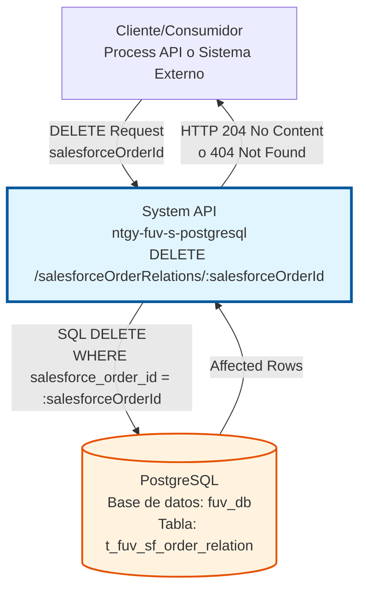
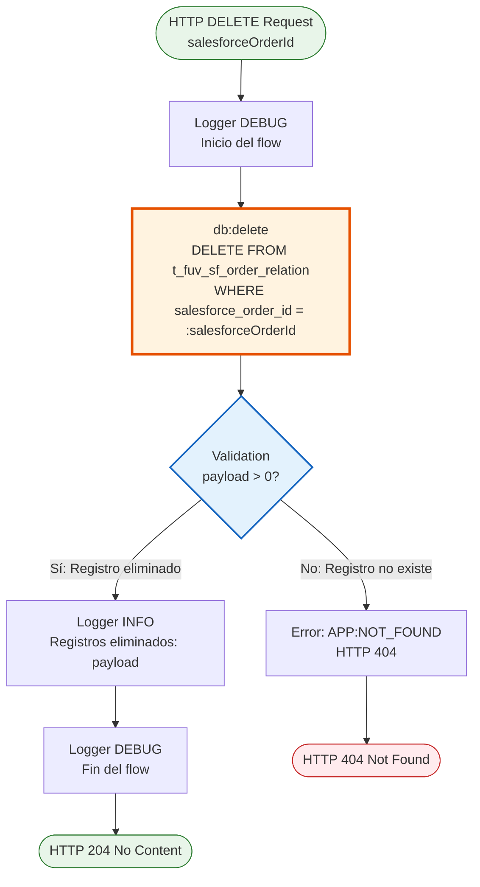
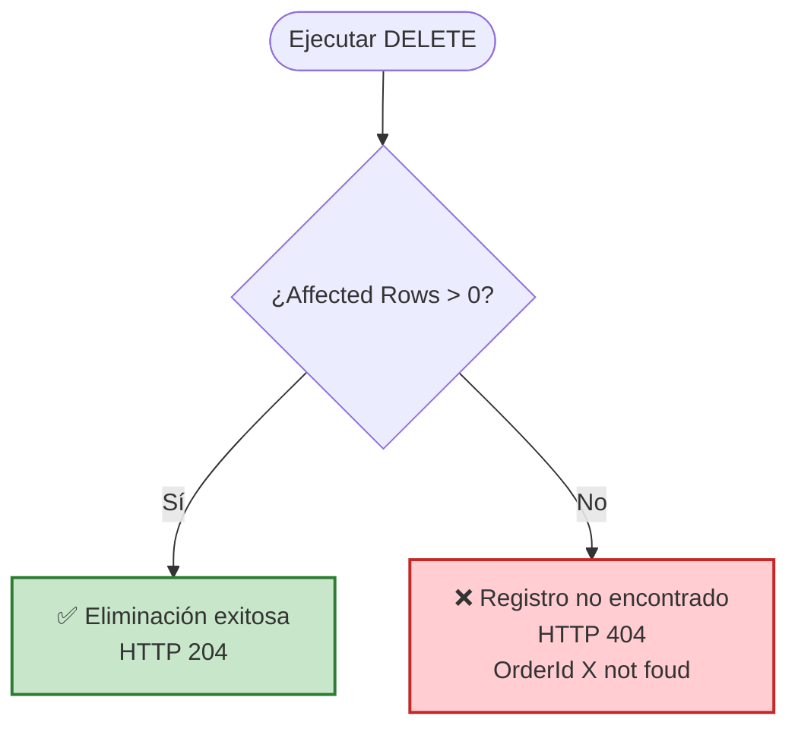

# DELETE /salesforceOrderRelations/:salesforceOrderId

## 📌 Descripción General

### Propósito del Endpoint

Este endpoint elimina una relación existente entre un ID de pedido de Salesforce (carrito) y un ID de pedido de Darwin en la base de datos FUV. Se utiliza para desvincular órdenes cuando se cancelan, corrigen o limpian datos obsoletos.

El endpoint soporta:
- **Eliminación por ID de Salesforce**: Elimina la relación usando el salesforceOrderId como clave
- **Validación de existencia**: Verifica que el registro existe antes de confirmar la eliminación
- **Respuesta estándar**: Retorna 204 No Content en caso de éxito, 404 si no existe

### Tipo de API

**Capa:** System API (API-Led Connectivity)

**Función:** Integración directa con PostgreSQL para gestión de relaciones entre sistemas Salesforce y Darwin (FUV).

### Patrón de Integración

**Tipo:** Request-Reply Síncrono con SQL DELETE

**Descripción:** El endpoint recibe el salesforceOrderId como path parameter, ejecuta un DELETE en la tabla `t_fuv_sf_order_relation`, valida que0 se eliminó al menos un registro, y retorna una respuesta HTTP 204 (No Content) en caso de éxito o 404 (Not Found) si el registro no existe.

### Arquitectura API-Led Connectivity



---

## 💼 Propósito del Negocio

### Casos de Uso Principales

1. **Cancelación de Pedidos**
   - Cuando un pedido de Salesforce es cancelado antes de completarse
   - Se elimina la relación para evitar referencias a pedidos inexistentes
   - Mantiene la integridad referencial entre sistemas

2. **Corrección de Datos**
   - Cuando se detecta una relación errónea entre Salesforce y Darwin
   - Permite eliminar la relación incorrecta antes de crear una nueva
   - Facilita la corrección de errores de integración

3. **Limpieza de Datos Obsoletos**
   - Eliminación de relaciones de pedidos antiguos o archivados
   - Mantenimiento de la base de datos para optimizar rendimiento
   - Cumplimiento con políticas de retención de datos

### Contexto Empresarial

- **Dominio:** Gestión de Pedidos e Integración de Sistemas
- **Sector:** Energía - Utilities
- **División:** Naturgy España - FUV (Facturación Única Virtual)
- **Proceso de Negocio:** Sincronización y gestión de pedidos entre Salesforce y Darwin
- **Sistema Backend:** PostgreSQL (Base de datos FUV)

### Stakeholders

- **Equipos de Integración**: Necesitan desvincular pedidos cuando hay errores o cancelaciones
- **Operaciones de TI**: Requieren mantener la integridad de datos entre sistemas
- **Desarrolladores de Process APIs**: Consumen este endpoint para gestionar el ciclo de vida de pedidos
- **Administradores de Base de Datos**: Monitorean la limpieza y mantenimiento de relaciones

### Valor de Negocio

- **Integridad de Datos**: Mantiene la consistencia entre Salesforce y Darwin eliminando relaciones obsoletas
- **Flexibilidad Operativa**: Permite corregir errores de integración sin intervención manual en la base de datos
- **Automatización**: Facilita procesos automatizados de limpieza y corrección de datos
- **Trazabilidad**: Registra en logs cada eliminación para auditoría y troubleshooting

### Consumidores Potenciales

Este endpoint puede ser consumido por:
- Process APIs de gestión de pedidos
- Flujos de Salesforce (Platform Events, Flows)
- Sistemas de integración middleware
- Procesos batch de limpieza de datos
- Herramientas de corrección manual de datos

---

## 🔧 Especificación Técnica

### URLs por Ambiente

| Ambiente | URL Base | URL Completa |
|----------|----------|--------------|
| **Local** | `http://localhost:8081` | `http://localhost:8081/api/salesforceOrderRelations/:salesforceOrderId` |
| **Development** | `https://ntgy-fuv-s-postgresql-dev.us-e2.cloudhub.io` | `https://ntgy-fuv-s-postgresql-dev.us-e2.cloudhub.io/api/salesforceOrderRelations/:salesforceOrderId` |
| **UAT** | `https://ntgy-fuv-s-postgresql-uat.us-e2.cloudhub.io` | `https://ntgy-fuv-s-postgresql-uat.us-e2.cloudhub.io/api/salesforceOrderRelations/:salesforceOrderId` |
| **Production** | `https://ntgy-fuv-s-postgresql-pro.us-e2.cloudhub.io` | `https://ntgy-fuv-s-postgresql-pro.us-e2.cloudhub.io/api/salesforceOrderRelations/:salesforceOrderId` |

### Método HTTP

```
DELETE /api/salesforceOrderRelations/:salesforceOrderId
```

### Parámetros de Entrada

#### Path Parameters

| Parámetro | Tipo | Requerido | Descripción | Ejemplo |
|-----------|------|-----------|-------------|---------|
| `salesforceOrderId` | string | ✅ Sí | ID del pedido en Salesforce (carrito) que se desea desvincular | `"8015Y000000ABCD"` |

#### Headers HTTP

| Header | Tipo | Requerido | Descripción | Ejemplo |
|--------|------|-----------|-------------|---------|
| `client_id` | string | ✅ Sí | Client ID para autenticación en Anypoint Platform | `"a1b2c3d4e5f6..."` |
| `client_secret` | string | ✅ Sí | Client Secret para autenticación en Anypoint Platform | `"x1y2z3..."` |

#### Query Parameters

No aplica para este endpoint.

#### Body Parameters

No aplica para este endpoint (método DELETE sin body).

### Respuestas

#### Respuesta Exitosa (204 No Content)

```http
HTTP/1.1 204 No Content
Date: Thu, 03 Jul 2026 07:26:00 GMT
```

**Descripción:** La relación fue eliminada exitosamente. No se retorna contenido en el body.

#### Respuesta de Registro No Encontrado (404 Not Found)

```json
{
  "error": "APP:NOT_FOUND",
  "message": "OrderId 8015Y000000ABCD not foud"
}
```

**Descripción:** El salesforceOrderId especificado no existe en la tabla de relaciones.

#### Respuesta de Error Técnico (500 Internal Server Error)

```json
{
  "result": {
    "codResult": "0001",
    "msgResult": "Error interno del servidor: Database connection failed"
  }
}
```

**Descripción:** Error técnico durante la ejecución del DELETE (problemas de conectividad, permisos, etc.).

### Autenticación y Autorización

- **Tipo:** Client ID & Client Secret (Anypoint Platform)
- **Autorización PostgreSQL:** El usuario de base de datos debe tener permisos para:
  - Ejecutar DELETE en la tabla `t_fuv_sf_order_relation`
  - Acceso al schema `public` de la base de datos `fuv_db`

### Timeouts

| Tipo | Valor | Descripción |
|------|-------|-------------|
| **Request Timeout** | 30 segundos | Tiempo máximo de espera para la respuesta |
| **Connection Timeout** | 10 segundos | Tiempo máximo para establecer conexión con PostgreSQL |
| **Query Timeout** | 30 segundos | Tiempo máximo de ejecución del DELETE |

---

## 🏗️ Implementación Técnica

### Arquitectura del Flow



### Query SQL Ejecutada

**Ubicación en código:** `src/main/resources/s-postgresql-global-config.yaml` (línea 32)

```sql
DELETE FROM t_fuv_sf_order_relation 
WHERE salesforce_order_id = :salesforceOrderId
```

**Parámetros:**
- `:salesforceOrderId` - ID del pedido de Salesforce (obtenido del path parameter)

**Tabla afectada:** `t_fuv_sf_order_relation`

**Estructura de la tabla:**
```sql
CREATE TABLE public.t_fuv_sf_order_relation (
    darwin_order_id VARCHAR,      -- ID del pedido en Darwin
    salesforce_order_id VARCHAR,  -- ID del pedido en Salesforce (clave de búsqueda)
    -- Otros campos de auditoría...
);
```

### Transformación de Datos

Este endpoint no requiere transformaciones DataWeave complejas ya que:
1. El path parameter `salesforceOrderId` se extrae automáticamente por APIKit
2. Se almacena en `vars.salesforceOrderId`
3. Se pasa directamente como parámetro al DELETE
4. La respuesta es vacía (204 No Content) o un error estándar

### Validación de Negocio



**Lógica de validación (del código XML):**
```xml
<validation:is-true 
    expression="#[payload &gt; 0]" 
    message='#["OrderId " ++ vars.salesforceOrderId ++ " not foud"]'>
    <error-mapping sourceType="VALIDATION:INVALID_BOOLEAN" targetType="APP:NOT_FOUND" />
</validation:is-true>
```

### Manejo de Errores

| Tipo de Error | Código HTTP | Descripción | Acción |
|---------------|-------------|-------------|--------|
| **Registro no encontrado** | 404 | El salesforceOrderId no existe en la tabla | Retornar error APP:NOT_FOUND con mensaje descriptivo |
| **Error de conectividad** | 500 | No se puede conectar a PostgreSQL | Reintentar según política de retry, registrar en logs |
| **Error de permisos** | 500 | Usuario sin permisos DELETE en la tabla | Registrar error, notificar a administradores |
| **Timeout de query** | 500 | Query excede 30 segundos | Cancelar operación, investigar performance |

### Logging

**Categoría de logs:** `com.naturgy.mule.salesforceOrderRelation-delete`

**Niveles de log:**
- **DEBUG**: Inicio y fin del flow
- **INFO**: Número de registros eliminados (payload)
- **ERROR**: Errores de base de datos o validación

**Ejemplo de logs:**
```
[DEBUG] com.naturgy.mule.salesforceOrderRelation-delete - Inicio
[INFO]  com.naturgy.mule.salesforceOrderRelation-delete - 1
[DEBUG] com.naturgy.mule.salesforceOrderRelation-delete - Fin
```

### Diagrama de Secuencia Completo

```mermaid
sequenceDiagram
    participant Client as Cliente/Process API
    participant API as System API<br/>ntgy-fuv-s-postgresql
    participant Logger as Logger
    participant DB as PostgreSQL<br/>fuv_db
    participant Validator as Validation Module
    
    Client->>API: DELETE /salesforceOrderRelations/:salesforceOrderId
    activate API
    
    API->>Logger: DEBUG - Inicio
    Logger-->>API: Logged
    
    API->>DB: DELETE FROM t_fuv_sf_order_relation<br/>WHERE salesforce_order_id = :salesforceOrderId
    activate DB
    DB-->>API: Affected Rows (0 o 1)
    deactivate DB
    
    API->>Validator: Validate payload > 0
    activate Validator
    
    alt Registro eliminado (payload > 0)
        Validator-->>API: Validation OK
        deactivate Validator
        API->>Logger: INFO - Registros eliminados: 1
        Logger-->>API: Logged
        API->>Logger: DEBUG - Fin
        Logger-->>API: Logged
        API-->>Client: HTTP 204 No Content
    else Registro no encontrado (payload = 0)
        Validator-->>API: Validation FAILED<br/>APP:NOT_FOUND
        deactivate Validator
        API-->>Client: HTTP 404 Not Found<br/>{"error": "OrderId X not foud"}
    end
    
    deactivate API
```

### Configuración de Base de Datos

**Connection Pool:**
- Min Pool Size: 5
- Max Pool Size: 20
- Max Idle Time: 30 minutos
- Connection Timeout: 10 segundos

**Transaction Management:**
- Cada DELETE se ejecuta en su propia transacción
- Auto-commit habilitado
- Rollback automático en caso de error

---

## 💻 Ejemplos de Uso

### Ejemplo 1: Eliminación Exitosa

**Request:**
```bash
curl -X DELETE \
  'https://ntgy-fuv-s-postgresql-dev.us-e2.cloudhub.io/api/salesforceOrderRelations/8015Y000000ABCD' \
  -H 'client_id: a1b2c3d4e5f6g7h8i9j0' \
  -H 'client_secret: x1y2z3a4b5c6d7e8f9g0'
```

**Response:**
```http
HTTP/1.1 204 No Content
Date: Thu, 03 Jul 2026 07:26:00 GMT
Server: Mule Runtime
```

**Descripción:** La relación fue eliminada exitosamente. No se retorna contenido en el body.

---

### Ejemplo 2: Registro No Encontrado

**Request:**
```bash
curl -X DELETE \
  'https://ntgy-fuv-s-postgresql-dev.us-e2.cloudhub.io/api/salesforceOrderRelations/8015Y000000ZZZZZ' \
  -H 'client_id: a1b2c3d4e5f6g7h8i9j0' \
  -H 'client_secret: x1y2z3a4b5c6d7e8f9g0'
```

**Response:**
```http
HTTP/1.1 404 Not Found
Content-Type: application/json
Date: Thu, 03 Jul 2026 07:26:00 GMT

{
  "error": "APP:NOT_FOUND",
  "message": "OrderId 8015Y000000ZZZZZ not foud"
}
```

**Descripción:** El salesforceOrderId especificado no existe en la tabla de relaciones.

---

### Ejemplo 3: Error de Conectividad

**Request:**
```bash
curl -X DELETE \
  'https://ntgy-fuv-s-postgresql-dev.us-e2.cloudhub.io/api/salesforceOrderRelations/8015Y000000ABCD' \
  -H 'client_id: a1b2c3d4e5f6g7h8i9j0' \
  -H 'client_secret: x1y2z3a4b5c6d7e8f9g0'
```

**Response:**
```http
HTTP/1.1 500 Internal Server Error
Content-Type: application/json
Date: Thu, 03 Jul 2026 07:26:00 GMT

{
  "result": {
    "codResult": "0001",
    "msgResult": "Error interno del servidor: Database connection timeout"
  }
}
```

**Descripción:** Error técnico al intentar conectar con PostgreSQL.

---

### Ejemplo 4: Uso desde JavaScript/Node.js

```javascript
const axios = require('axios');

async function deleteSalesforceOrderRelation(salesforceOrderId) {
  try {
    const response = await axios.delete(
      `https://ntgy-fuv-s-postgresql-dev.us-e2.cloudhub.io/api/salesforceOrderRelations/${salesforceOrderId}`,
      {
        headers: {
          'client_id': 'a1b2c3d4e5f6g7h8i9j0',
          'client_secret': 'x1y2z3a4b5c6d7e8f9g0'
        }
      }
    );
    
    console.log('Relación eliminada exitosamente');
    console.log('Status:', response.status); // 204
    
  } catch (error) {
    if (error.response) {
      if (error.response.status === 404) {
        console.error('Registro no encontrado:', error.response.data.message);
      } else {
        console.error('Error del servidor:', error.response.data);
      }
    } else {
      console.error('Error de red:', error.message);
    }
  }
}

// Uso
deleteSalesforceOrderRelation('8015Y000000ABCD');
```

---

### Ejemplo 5: Uso desde Python

```python
import requests

def delete_salesforce_order_relation(salesforce_order_id):
    url = f"https://ntgy-fuv-s-postgresql-dev.us-e2.cloudhub.io/api/salesforceOrderRelations/{salesforce_order_id}"
    
    headers = {
        'client_id': 'a1b2c3d4e5f6g7h8i9j0',
        'client_secret': 'x1y2z3a4b5c6d7e8f9g0'
    }
    
    try:
        response = requests.delete(url, headers=headers)
        
        if response.status_code == 204:
            print("Relación eliminada exitosamente")
        elif response.status_code == 404:
            print(f"Registro no encontrado: {response.json()['message']}")
        else:
            print(f"Error: {response.status_code} - {response.text}")
            
    except requests.exceptions.RequestException as e:
        print(f"Error de conexión: {e}")

# Uso
delete_salesforce_order_relation('8015Y000000ABCD')
```

---

### Ejemplo 6: Uso desde Postman

**Configuración:**
1. Método: `DELETE`
2. URL: `https://ntgy-fuv-s-postgresql-dev.us-e2.cloudhub.io/api/salesforceOrderRelations/8015Y000000ABCD`
3. Headers:
   - `client_id`: `a1b2c3d4e5f6g7h8i9j0`
   - `client_secret`: `x1y2z3a4b5c6d7e8f9g0`
4. Body: (vacío)

**Tests en Postman:**
```javascript
pm.test("Status code is 204", function () {
    pm.response.to.have.status(204);
});

pm.test("Response time is less than 3000ms", function () {
    pm.expect(pm.response.responseTime).to.be.below(3000);
});