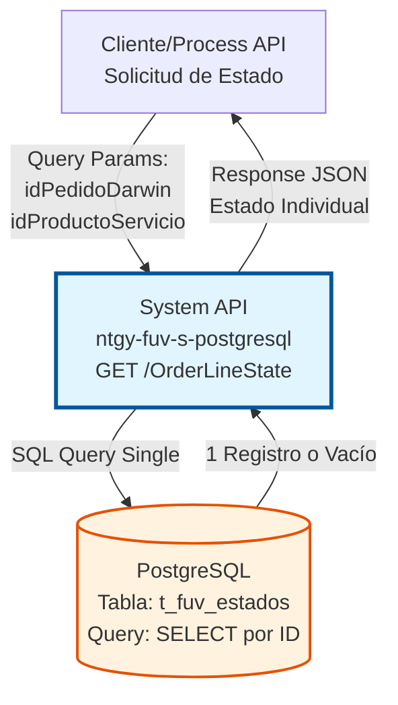
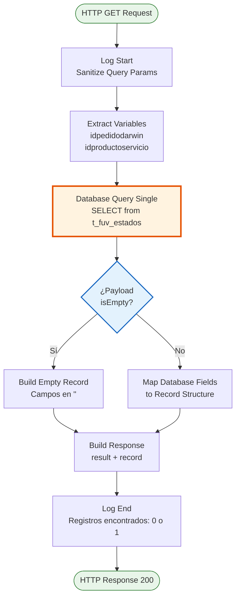
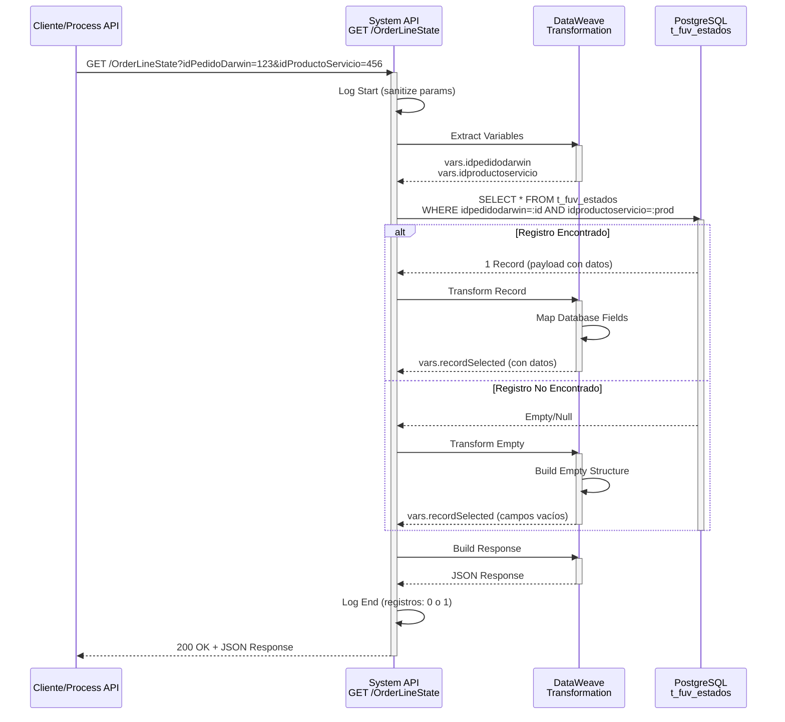
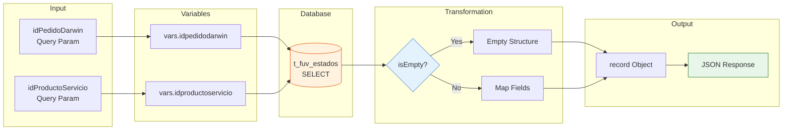

# GET /OrderLineState

## 📌 Descripción General

### Propósito del Endpoint

Este endpoint permite consultar el estado individual de una línea de pedido específica en la base de datos PostgreSQL. Retorna información detallada sobre el estado de procesamiento, fechas de creación y envío, reintentos, origen y datos adicionales asociados a una línea de pedido identificada por su ID de pedido Darwin y opcionalmente por su ID de producto/servicio.

El endpoint soporta:
- **Consulta Individual**: Recupera el estado de UNA línea de pedido específica
- **Búsqueda por ID Compuesto**: Utiliza idPedidoDarwin (obligatorio) e idProductoServicio (opcional)
- **Manejo de Registros Vacíos**: Retorna estructura consistente incluso cuando no hay datos
- **Tracking Completo**: Incluye fechas de creación, envío, reintentos y datos JSON adicionales

### Tipo de API

**Capa:** System API (API-Led Connectivity)

**Función:** Acceso directo a la base de datos PostgreSQL para consultar estados individuales de líneas de pedido en la tabla `t_fuv_estados`.

### Patrón de Integración

**Tipo:** Request-Reply Síncrono con PostgreSQL

**Descripción:** El endpoint recibe los parámetros de búsqueda (idPedidoDarwin e idProductoServicio), ejecuta una consulta SQL que retorna un único registro (`db:query-single`), transforma el resultado mediante DataWeave manejando casos de registros vacíos, y retorna una respuesta JSON estructurada con el estado de la línea de pedido.

### Arquitectura API-Led Connectivity



---

## 💼 Propósito del Negocio

### Casos de Uso Principales

1. **Seguimiento Individual de Línea de Pedido**
   - Un sistema necesita conocer el estado actual de una línea de pedido específica
   - Se proporciona el ID del pedido Darwin y opcionalmente el ID del producto/servicio
   - Se obtiene información completa del estado, fechas y datos adicionales

2. **Verificación de Estado de Procesamiento**
   - Validar si una línea de pedido ha sido enviada (`send_status`)
   - Consultar el número de reintentos de envío (`send_retry`)
   - Verificar las fechas de creación y último envío

3. **Recuperación de Datos Adicionales**
   - Obtener el campo `datos` (JSON) con información adicional de la línea
   - Identificar el origen del registro (`origen`)
   - Analizar el estado de transacción (`estadotrans`)

### Contexto Empresarial

- **Dominio:** Gestión de Estados de Pedidos
- **Sector:** Energía - Utilities
- **División:** Naturgy España - FUV (Facturación Única Virtual)
- **Proceso de Negocio:** Tracking y seguimiento de líneas de pedido en proceso
- **Sistema Backend:** PostgreSQL (Base de datos FUV)

### Stakeholders

- **Sistemas de Gestión de Pedidos**: Necesitan consultar estados individuales para validaciones
- **Aplicaciones de Seguimiento**: Requieren información detallada de líneas específicas
- **Procesos de Reintento**: Consultan reintentos para decidir reprocesamiento
- **Sistemas de Auditoría**: Verifican fechas y estados históricos

### Valor de Negocio

- **Trazabilidad Individual**: Seguimiento preciso de cada línea de pedido
- **Información Detallada**: Acceso a todos los campos de estado y tracking
- **Manejo Consistente**: Respuesta estructurada incluso sin datos
- **Soporte a Decisiones**: Información para reintentos y reprocesamiento

### Consumidores Potenciales

Este endpoint puede ser consumido por:
- Process APIs de gestión de pedidos
- Sistemas de seguimiento y tracking
- Aplicaciones de validación de estados
- Procesos de reintento y reprocesamiento
- Sistemas de auditoría y reporting

---

## 🔧 Especificación Técnica

### URLs por Ambiente

| Ambiente | URL Base | URL Completa |
|----------|----------|--------------|
| **Local** | `http://localhost:8081` | `http://localhost:8081/api/OrderLineState?idPedidoDarwin=123&idProductoServicio=456` |
| **Development** | `https://ntgy-fuv-s-postgresql-dev.us-e2.cloudhub.io` | `https://ntgy-fuv-s-postgresql-dev.us-e2.cloudhub.io/api/OrderLineState?idPedidoDarwin=123&idProductoServicio=456` |
| **UAT** | `https://ntgy-fuv-s-postgresql-uat.us-e2.cloudhub.io` | `https://ntgy-fuv-s-postgresql-uat.us-e2.cloudhub.io/api/OrderLineState?idPedidoDarwin=123&idProductoServicio=456` |
| **Production** | `https://ntgy-fuv-s-postgresql-pro.us-e2.cloudhub.io` | `https://ntgy-fuv-s-postgresql-pro.us-e2.cloudhub.io/api/OrderLineState?idPedidoDarwin=123&idProductoServicio=456` |

### Método HTTP

```
GET /api/OrderLineState
```

### Parámetros de Entrada

#### Headers HTTP

| Header | Tipo | Requerido | Descripción | Ejemplo |
|--------|------|-----------|-------------|---------|
| `Content-Type` | string | ❌ No | Tipo de contenido (no aplica para GET) | `application/json` |
| `Accept` | string | ❌ No | Tipo de contenido esperado en response | `application/json` |
| `client_id` | string | ✅ Sí | Client ID de Anypoint Platform | `a1b2c3d4e5f6` |
| `client_secret` | string | ✅ Sí | Client Secret de Anypoint Platform | `A1B2C3D4E5F6` |

#### Query Parameters

| Parámetro | Tipo | Requerido | Descripción | Ejemplo | Validación |
|-----------|------|-----------|-------------|---------|------------|
| `idPedidoDarwin` | string | ✅ Sí | Identificador único del pedido en sistema Darwin | `"PED-2024-001234"` | No vacío |
| `idProductoServicio` | string | ❌ No | Identificador del producto o servicio (default: "") | `"PROD-456"` | Opcional, default "" |

**Nota sobre idProductoServicio:**
- Si se omite, se usa valor por defecto `""` (cadena vacía)
- La query SQL usa `LIKE` para este campo, permitiendo búsquedas parciales
- Para búsqueda exacta, proporcionar el valor completo

### Respuestas

#### Respuesta Exitosa con Datos (200 OK)

```json
{
  "result": {
    "codResult": "0000",
    "msgResult": "No hay error"
  },
  "record": {
    "idpedidodarwin": "PED-2024-001234",
    "idproductoservicio": "PROD-456",
    "estadotrans": "PROCESADO",
    "send_status": "ENVIADO",
    "create_date": "2024-01-15T10:30:00",
    "send_date": "2024-01-15T10:35:00",
    "send_retry": 0,
    "origen": "SALESFORCE",
    "datos": {
      "campo1": "valor1",
      "campo2": "valor2"
    }
  }
}
```

**Descripción de Campos del Record:**

| Campo | Tipo | Descripción |
|-------|------|-------------|
| `idpedidodarwin` | string | ID único del pedido en sistema Darwin |
| `idproductoservicio` | string | ID del producto o servicio asociado |
| `estadotrans` | string | Estado de la transacción (ej: PROCESADO, PENDIENTE, ERROR) |
| `send_status` | string | Estado del envío (ej: ENVIADO, PENDIENTE, FALLIDO) |
| `create_date` | timestamp | Fecha y hora de creación del registro |
| `send_date` | timestamp | Fecha y hora del último envío |
| `send_retry` | integer | Número de reintentos de envío realizados |
| `origen` | string | Sistema origen del registro (ej: SALESFORCE, SAP, MANUAL) |
| `datos` | object/null | Datos adicionales en formato JSON |

#### Respuesta Sin Datos (200 OK)

Cuando no se encuentra el registro, se retorna estructura vacía:

```json
{
  "result": {
    "codResult": "0000",
    "msgResult": "No hay error"
  },
  "record": {
    "idpedidodarwin": "",
    "idproductoservicio": "",
    "estadotrans": "",
    "send_status": "",
    "create_date": "",
    "send_date": "",
    "send_retry": 0,
    "origen": "",
    "datos": null
  }
}
```

**Nota:** El código de resultado sigue siendo `"0000"` (éxito) porque la consulta se ejecutó correctamente, aunque no haya datos.

#### Respuesta de Error - Parámetro Faltante (400 Bad Request)

```json
{
  "result": {
    "codResult": "0001",
    "msgResult": "Parámetro requerido 'idPedidoDarwin' no proporcionado"
  }
}
```

#### Respuesta de Error Técnico (500 Internal Server Error)

```json
{
  "result": {
    "codResult": "0002",
    "msgResult": "Error al consultar la base de datos"
  }
}
```

### Autenticación y Autorización

- **Tipo:** Client ID & Client Secret (Anypoint Platform)
- **Ubicación:** Headers HTTP
- **Autorización PostgreSQL:** El usuario de conexión debe tener permisos para:
  - Ejecutar `SELECT` en tabla `t_fuv_estados`
  - Acceso al schema `public` (o schema configurado)

### Timeouts

| Tipo | Valor | Descripción |
|------|-------|-------------|
| **Request Timeout** | 30 segundos | Tiempo máximo de espera para la respuesta |
| **Connection Timeout** | 10 segundos | Tiempo máximo para establecer conexión con PostgreSQL |
| **Query Timeout** | 30 segundos | Tiempo máximo de ejecución de la query SQL |

---

## 🏗️ Implementación Técnica

### Arquitectura del Flow



### Componentes del Flow

#### 1. Logger Inicial (Línea 210)
```dataweave
'STARTING getOrderLinesState METHOD. REQUEST: ' ++ request
```
- Registra inicio de ejecución
- Sanitiza query params con `normalizeJSON()` para logging seguro

#### 2. Extracción de Variables (Líneas 211-224)

**Variables extraídas:**
```dataweave
vars.idpedidodarwin = attributes.queryParams.idPedidoDarwin
vars.idproductoservicio = attributes.queryParams.idProductoServicio default ""
```

**Características:**
- `idpedidodarwin`: Requerido, sin default
- `idproductoservicio`: Opcional, default `""`

#### 3. Query a Base de Datos (Líneas 225-231)

**Operación:** `db:query-single`
- Retorna máximo 1 registro
- Si no hay resultados, retorna `null` o vacío

**Query SQL (desde configuración línea 61):**
```sql
select * from t_fuv_estados 
where idpedidodarwin = :idpedidodarwin 
and idproductoservicio = :idproductoservicio
```

**Parámetros de entrada:**
```dataweave
{
  idpedidodarwin: vars.idpedidodarwin,
  idproductoservicio: vars.idproductoservicio
}
```

#### 4. Transformación de Resultado (Líneas 232-262)

**Lógica de Transformación:**

```dataweave
if (isEmpty(payload)) 
{
  // Estructura vacía con campos en ""
  "idpedidodarwin": "",
  "idproductoservicio": "",
  "estadotrans": "",
  "send_status": "",
  "create_date": "",
  "send_date": "",
  "send_retry": 0,
  "origen": "",
  "datos": null
}
else 
{
  // Mapeo directo de campos de BD
  "idpedidodarwin": payload."idpedidodarwin",
  "idproductoservicio": payload."idproductoservicio",
  "estadotrans": payload."estadotrans",
  "send_status": payload."send_status",
  "create_date": payload."create_date",
  "send_date": payload."send_date",
  "send_retry": payload."send_retry",
  "origen": payload."origen",
  "datos": payload."datos"
}
```

**Características:**
- Manejo explícito de registros vacíos
- Estructura consistente en ambos casos
- Campo `datos` puede ser JSON o null

#### 5. Construcción de Respuesta (Líneas 264-277)

```dataweave
{
  "result": {
    "codResult": "0000",
    "msgResult": "No hay error"
  },
  "record": vars.recordSelected
}
```

**Características:**
- Siempre retorna código `"0000"` (éxito)
- Incluye el record (vacío o con datos)
- Estructura consistente para facilitar parsing

#### 6. Logger Final (Línea 278)

```dataweave
'FINISHED getOrderLinesState METHOD. RESPONSE: Registros encontrados: ' 
++ (numRecords as String default "-")
```

**Cálculo de registros:**
```dataweave
var numRecords = if(payload.records.idpedidodarwin == "") 0 else 1
```

### Diagrama de Secuencia Detallado



### Tabla de la Base de Datos

**Tabla:** `t_fuv_estados`

| Columna | Tipo | Nullable | Descripción |
|---------|------|----------|-------------|
| `idpedidodarwin` | VARCHAR | NO | ID único del pedido (PK parte 1) |
| `idproductoservicio` | VARCHAR | NO | ID del producto/servicio (PK parte 2) |
| `estadotrans` | VARCHAR | YES | Estado de la transacción |
| `send_status` | VARCHAR | YES | Estado del envío |
| `create_date` | TIMESTAMP | YES | Fecha de creación del registro |
| `send_date` | TIMESTAMP | YES | Fecha del último envío |
| `send_retry` | INTEGER | YES | Número de reintentos |
| `origen` | VARCHAR | YES | Sistema origen del registro |
| `datos` | JSONB | YES | Datos adicionales en formato JSON |

**Índices:**
- Primary Key: `(idpedidodarwin, idproductoservicio)`
- Índice en `send_status` (para consultas por estado)

### Configuración de la Query

**Archivo:** `src/main/resources/s-postgresql-global-config.yaml`

**Línea 61:**
```yaml
getOrderLineStatus: "select * from t_fuv_estados where idpedidodarwin = :idpedidodarwin and idproductoservicio = :idproductoservicio"
```

**Características:**
- Query parametrizada (prevención de SQL injection)
- Filtro por clave compuesta
- Retorna todos los campos (`SELECT *`)

### Manejo de Errores

**Errores Potenciales:**

1. **Parámetro Faltante:**
   - Si `idPedidoDarwin` no se proporciona
   - HTTP 400 Bad Request

2. **Error de Conexión a BD:**
   - Timeout de conexión
   - Base de datos no disponible
   - HTTP 500 Internal Server Error

3. **Error de Query:**
   - Query malformada (no debería ocurrir con query parametrizada)
   - Permisos insuficientes
   - HTTP 500 Internal Server Error

**Estrategia de Manejo:**
- Logging detallado de errores
- Respuestas estructuradas con códigos de error
- No exponer detalles internos al cliente

### Diagrama de Transformación de Datos



---

## 💻 Ejemplos de Uso

### Ejemplo 1: Consulta con Ambos Parámetros

**Request:**
```bash
curl -X GET "https://ntgy-fuv-s-postgresql-dev.us-e2.cloudhub.io/api/OrderLineState?idPedidoDarwin=PED-2024-001234&idProductoServicio=PROD-456" \
  -H "client_id: a1b2c3d4e5f6" \
  -H "client_secret: A1B2C3D4E5F6" \
  -H "Accept: application/json"
```

**Response (200 OK):**
```json
{
  "result": {
    "codResult": "0000",
    "msgResult": "No hay error"
  },
  "record": {
    "idpedidodarwin": "PED-2024-001234",
    "idproductoservicio": "PROD-456",
    "estadotrans": "PROCESADO",
    "send_status": "ENVIADO",
    "create_date": "2024-01-15T10:30:00",
    "send_date": "2024-01-15T10:35:00",
    "send_retry": 0,
    "origen": "SALESFORCE",
    "datos": {
      "clienteId": "CLI-789",
      "contratoId": "CTR-012",
      "observaciones": "Procesamiento exitoso"
    }
  }
}
```

### Ejemplo 2: Consulta Solo con idPedidoDarwin

**Request:**
```bash
curl -X GET "https://ntgy-fuv-s-postgresql-dev.us-e2.cloudhub.io/api/OrderLineState?idPedidoDarwin=PED-2024-001234" \
  -H "client_id: a1b2c3d4e5f6" \
  -H "client_secret: A1B2C3D4E5F6" \
  -H "Accept: application/json"
```

**Nota:** `idProductoServicio` toma valor por defecto `""` (cadena vacía)

**Response (200 OK):**
```json
{
  "result": {
    "codResult": "0000",
    "msgResult": "No hay error"
  },
  "record": {
    "idpedidodarwin": "PED-2024-001234",
    "idproductoservicio": "",
    "estadotrans": "PENDIENTE",
    "send_status": "PENDIENTE_ENVIO",
    "create_date": "2024-01-15T09:00:00",
    "send_date": "",
    "send_retry": 0,
    "origen": "MANUAL",
    "datos": null
  }
}
```

### Ejemplo 3: Registro No Encontrado

**Request:**
```bash
curl -X GET "https://ntgy-fuv-s-postgresql-dev.us-e2.cloudhub.io/api/OrderLineState?idPedidoDarwin=PED-9999-NOEXISTE&idProductoServicio=PROD-999" \
  -H "client_id: a1b2c3d4e5f6" \
  -H "client_secret: A1B2C3D4E5F6" \
  -H "Accept: application/json"
```

**Response (200 OK):**
```json
{
  "result": {
    "codResult": "0000",
    "msgResult": "No hay error"
  },
  "record": {
    "idpedidodarwin": "",
    "idproductoservicio": "",
    "estadotrans": "",
    "send_status": "",
    "create_date": "",
    "send_date": "",
    "send_retry": 0,
    "origen": "",
    "datos": null
  }
}
```

**Nota:** El código sigue siendo `"0000"` porque la consulta se ejecutó correctamente. El cliente debe verificar si `record.idpedidodarwin` está vacío para determinar si se encontró el registro.

### Ejemplo 4: Error - Parámetro Faltante

**Request:**
```bash
curl -X GET "https://ntgy-fuv-s-postgresql-dev.us-e2.cloudhub.io/api/OrderLineState" \
  -H "client_id: a1b2c3d4e5f6" \
  -H "client_secret: A1B2C3D4E5F6" \
  -H "Accept: application/json"
```

**Response (400 Bad Request):**
```json
{
  "result": {
    "codResult": "0001",
    "msgResult": "Parámetro requerido 'idPedidoDarwin' no proporcionado"
  }
}
```

### Ejemplo 5: Consulta con Reintentos

**Request:**
```bash
curl -X GET "https://ntgy-fuv-s-postgresql-dev.us-e2.cloudhub.io/api/OrderLineState?idPedidoDarwin=PED-2024-005678&idProductoServicio=PROD-789" \
  -H "client_id: a1b2c3d4e5f6" \
  -H "client_secret: A1B2C3D4E5F6" \
  -H "Accept: application/json"
```

**Response (200 OK) - Línea con Reintentos:**
```json
{
  "result": {
    "codResult": "0000",
    "msgResult": "No hay error"
  },
  "record": {
    "idpedidodarwin": "PED-2024-005678",
    "idproductoservicio": "PROD-789",
    "estadotrans": "ERROR",
    "send_status": "FALLIDO",
    "create_date": "2024-01-14T15:00:00",
    "send_date": "2024-01-14T16:30:00",
    "send_retry": 3,
    "origen": "SAP",
    "datos": {
      "errorCode": "TIMEOUT",
      "errorMessage": "Timeout al enviar a sistema destino",
      "lastAttempt": "2024-01-14T16:30:00"
    }
  }
}
```

### Ejemplo 6: Uso desde JavaScript

```javascript
async function getOrderLineState(idPedidoDarwin, idProductoServicio = '') {
  const baseUrl = 'https://ntgy-fuv-s-postgresql-dev.us-e2.cloudhub.io';
  const params = new URLSearchParams({
    idPedidoDarwin: idPedidoDarwin
  });
  
  if (idProductoServicio) {
    params.append('idProductoServicio', idProductoServicio);
  }
  
  const response = await fetch(`${baseUrl}/api/OrderLineState?${params}`, {
    method: 'GET',
    headers: {
      'client_id': 'a1b2c3d4e5f6',
      'client_secret': 'A1B2C3D4E5F6',
      'Accept': 'application/json'
    }
  });
  
  const data = await response.json();
  
  // Verificar si se encontró el registro
  if (data.record.idpedidodarwin === '') {
    console.log('Registro no encontrado');
    return null;
  }
  
  return data.record;
}

// Uso
const estado = await getOrderLineState('PED-2024-001234', 'PROD-456');
if (estado) {
  console.log(`Estado: ${estado.estadotrans}`);
  console.log(`Reintentos: ${estado.send_retry}`);
}
```

### Ejemplo 7: Uso desde Python

```python
import requests

def get_order_line_state(id_pedido_darwin, id_producto_servicio=''):
    base_url = 'https://ntgy-fuv-s-postgresql-dev.us-e2.cloudhub.io'
    
    params = {
        'idPedidoDarwin': id_pedido_darwin
    }
    
    if id_producto_servicio:
        params['idProductoServicio'] = id_producto_servicio
    
    headers = {
        'client_id': 'a1b2c3d4e5f6',
        'client_secret': 'A1B2C3D4E5F6',
        'Accept': 'application/json'
    }
    
    response = requests.get(
        f'{base_url}/api/OrderLineState',
        params=params,
        headers=headers
    )
    
    data = response.json()
    
    # Verificar si se encontró el registro
    if data['record']['idpedidodarwin'] == '':
        print('Registro no encontrado')
        return None
    
    return data['record']

# Uso
estado = get_order_line_state('PED-2024-001234', 'PROD-456')
if estado:
    print(f"Estado: {estado['estadotrans']}")
    print(f"Reintentos: {estado['send_retry']}")
```

### Ejemplo 8: Validación de Registro Encontrado

```javascript
// Función helper para validar si el registro existe
function isRecordFound(response) {
  return response.record.idpedidodarwin !== '';
}

// Uso en aplicación
const response = await fetch(url, options);
const data = await response.json();

if (isRecordFound(data)) {
  // Procesar registro encontrado
  processOrderLine(data.record);
} else {
  // Manejar caso de registro no encontrado
  console.warn('Línea de pedido no encontrada');
  showNotFoundMessage();
}
```
