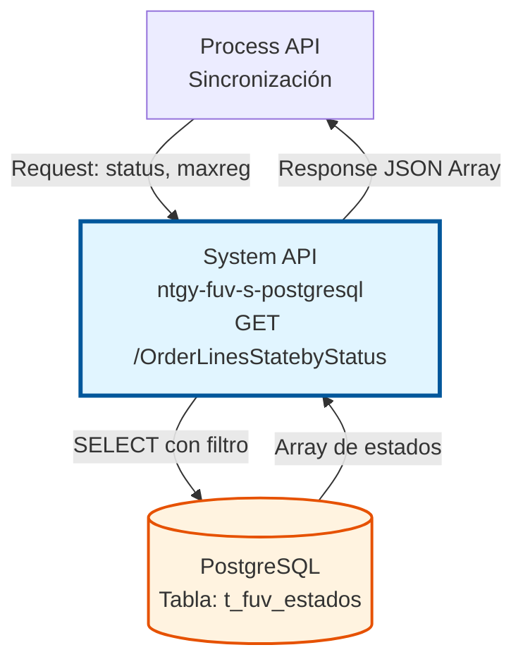
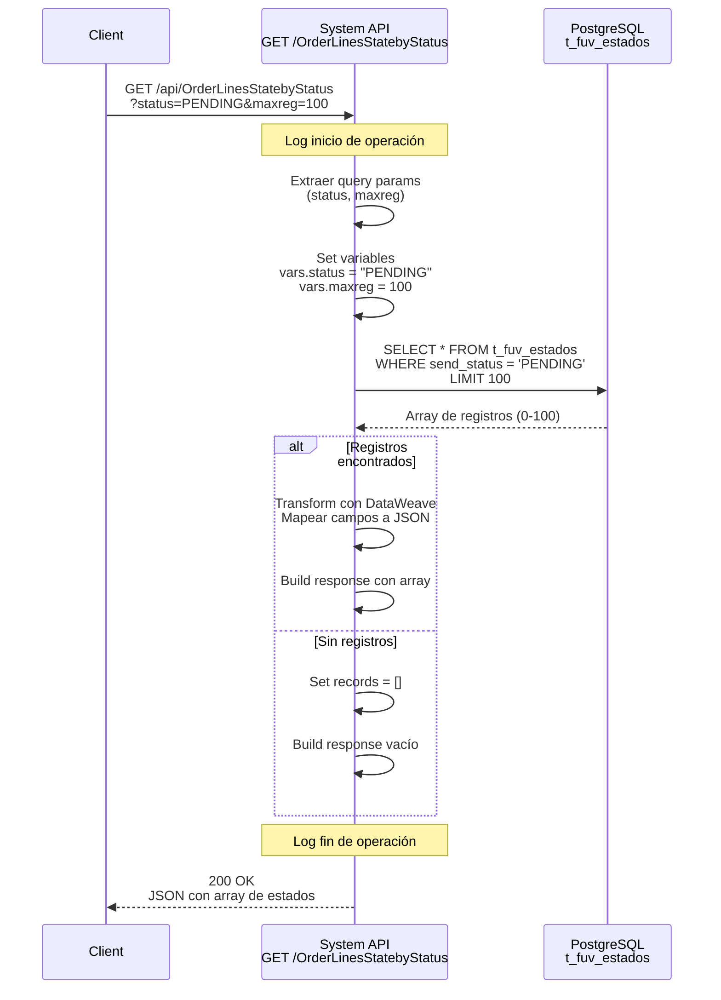
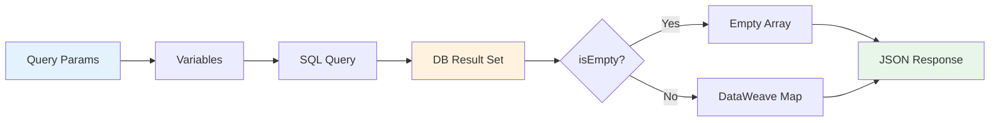

# GET /OrderLinesStatebyStatus

## 📌 Descripción General

### Propósito del Endpoint

Este endpoint consulta estados de líneas de pedido desde la tabla `t_fuv_estados`, permitiendo filtrar por estado de envío (`send_status`) y limitar la cantidad de registros retornados. Es utilizado principalmente para procesos batch de sincronización y reenvío de estados.

El endpoint soporta:
- **Filtrado por Estado**: Consulta estados específicos (PENDING, SENT, ERROR, etc.)
- **Límite de Registros**: Control del volumen de datos retornados mediante parámetro `maxreg`
- **Procesamiento Batch**: Diseñado para operaciones de sincronización masiva
- **Auditoría**: Incluye fechas de creación, envío y número de reintentos

### Tipo de API

**Capa:** System API (API-Led Connectivity)

**Función:** Acceso directo a base de datos PostgreSQL para consulta de estados de líneas de pedido del sistema FUV (Facturación Única Virtual).

### Patrón de Integración

**Tipo:** Request-Reply Síncrono con Query SQL

**Descripción:** Recibe parámetros de filtrado (status y maxreg), ejecuta query SELECT sobre tabla `t_fuv_estados`, transforma resultados a JSON y retorna array de estados.

### Arquitectura API-Led Connectivity



---

## 💼 Propósito del Negocio

### Casos de Uso Principales

1. **Sincronización de Estados Pendientes**
   - Consultar estados con `send_status = "PENDING"` para procesamiento
   - Limitar cantidad de registros para evitar sobrecarga
   - Reenviar estados a sistemas externos

2. **Reintento de Estados Fallidos**
   - Identificar estados con `send_status = "ERROR"`
   - Analizar número de reintentos (`send_retry`)
   - Reprocesar estados fallidos

3. **Monitoreo de Estados Enviados**
   - Consultar estados con `send_status = "SENT"`
   - Auditar fechas de envío
   - Verificar completitud de sincronización

### Contexto Empresarial

- **Dominio:** Gestión de Estados de Pedidos
- **Sector:** Energía - Utilities
- **División:** Naturgy España - FUV (Facturación Única Virtual)
- **Proceso de Negocio:** Sincronización de estados de líneas de pedido entre sistemas
- **Sistema:** PostgreSQL - Base de datos transaccional

### Stakeholders

- **Equipos de Integración**: Necesitan sincronizar estados entre sistemas
- **Operaciones**: Monitorean estados pendientes y errores
- **Desarrollo**: Implementan lógica de reintento y recuperación
- **Soporte**: Diagnostican problemas de sincronización

### Valor de Negocio

- **Trazabilidad**: Seguimiento completo del ciclo de vida de estados
- **Confiabilidad**: Control de reintentos para estados fallidos
- **Escalabilidad**: Procesamiento batch con límite configurable
- **Auditoría**: Registro de fechas de creación y envío

### Consumidores Potenciales

Este endpoint puede ser consumido por:
- Process APIs de sincronización de pedidos
- Jobs batch de reenvío de estados
- Sistemas de monitoreo y alertas
- Procesos de reconciliación de datos

---

## 🔧 Especificación Técnica

### URLs por Ambiente

| Ambiente | URL Base | URL Completa |
|----------|----------|--------------|
| **Local** | `http://localhost:8081` | `http://localhost:8081/api/OrderLinesStatebyStatus?status=PENDING&maxreg=100` |
| **Development** | `https://ntgy-fuv-s-postgresql-dev.us-e2.cloudhub.io` | `https://ntgy-fuv-s-postgresql-dev.us-e2.cloudhub.io/api/OrderLinesStatebyStatus?status=PENDING&maxreg=100` |
| **UAT** | `https://ntgy-fuv-s-postgresql-uat.us-e2.cloudhub.io` | `https://ntgy-fuv-s-postgresql-uat.us-e2.cloudhub.io/api/OrderLinesStatebyStatus?status=PENDING&maxreg=100` |
| **Production** | `https://ntgy-fuv-s-postgresql-pro.us-e2.cloudhub.io` | `https://ntgy-fuv-s-postgresql-pro.us-e2.cloudhub.io/api/OrderLinesStatebyStatus?status=PENDING&maxreg=100` |

### Método HTTP

```
GET /api/OrderLinesStatebyStatus
```

### Parámetros de Entrada

#### Headers HTTP

| Header | Tipo | Requerido | Descripción | Ejemplo |
|--------|------|-----------|-------------|---------|
| `Accept` | string | ❌ No | Tipo de contenido esperado en response | `application/json` |

#### Query Parameters

| Parámetro | Tipo | Requerido | Descripción | Ejemplo |
|-----------|------|-----------|-------------|---------|
| `status` | string | ✅ Sí | Estado de envío a filtrar | `"PENDING"`, `"SENT"`, `"ERROR"` |
| `maxreg` | integer | ✅ Sí | Límite máximo de registros a retornar | `100`, `1000`, `5000` |

**Valores comunes para `status`:**
- `PENDING` - Estados pendientes de envío
- `SENT` - Estados enviados exitosamente
- `ERROR` - Estados con error en envío
- `RETRY` - Estados en proceso de reintento

### Respuestas

#### Respuesta Exitosa (200 OK)

```json
{
  "result": {
    "codResult": "0000",
    "msgResult": "No hay error"
  },
  "records": [
    {
      "idpedidodarwin": "ORD-2024-001",
      "idproductoservicio": "PROD-123",
      "estadotrans": "COMPLETED",
      "send_status": "PENDING",
      "create_date": "2024-01-15T10:30:00Z",
      "send_date": "2024-01-15T10:35:00Z",
      "send_retry": 0,
      "origen": "SALESFORCE",
      "datos": {
        "additionalInfo": "Extra data"
      }
    },
    {
      "idpedidodarwin": "ORD-2024-002",
      "idproductoservicio": "PROD-456",
      "estadotrans": "IN_PROGRESS",
      "send_status": "PENDING",
      "create_date": "2024-01-15T11:00:00Z",
      "send_date": "2024-01-15T11:05:00Z",
      "send_retry": 1,
      "origen": "DARWIN",
      "datos": null
    }
  ]
}
```

**Estructura de cada registro:**

| Campo | Tipo | Descripción |
|-------|------|-------------|
| `idpedidodarwin` | string | Identificador único del pedido en sistema Darwin |
| `idproductoservicio` | string | Identificador del producto/servicio |
| `estadotrans` | string | Estado de la transacción |
| `send_status` | string | Estado de envío (PENDING, SENT, ERROR, RETRY) |
| `create_date` | timestamp | Fecha y hora de creación del registro |
| `send_date` | timestamp | Fecha y hora del último intento de envío |
| `send_retry` | integer | Número de reintentos realizados |
| `origen` | string | Sistema origen del estado (SALESFORCE, DARWIN, etc.) |
| `datos` | object/null | Datos adicionales en formato JSON |

#### Respuesta Sin Registros (200 OK)

```json
{
  "result": {
    "codResult": "0000",
    "msgResult": "No hay error"
  },
  "records": []
}
```

#### Respuesta de Error de Validación (400 Bad Request)

```json
{
  "result": {
    "codResult": "0001",
    "msgResult": "Parámetros requeridos faltantes: status y/o maxreg"
  }
}
```

#### Respuesta de Error Técnico (500 Internal Server Error)

```json
{
  "result": {
    "codResult": "0002",
    "msgResult": "Error al consultar base de datos"
  }
}
```

### Autenticación y Autorización

- **Tipo:** Client ID & Client Secret (Anypoint Platform)
- **Autorización PostgreSQL:** El usuario de base de datos debe tener permisos para:
  - Ejecutar SELECT sobre tabla `t_fuv_estados`
  - Acceso al schema `public` (o schema configurado)

### Timeouts

| Tipo | Valor | Descripción |
|------|-------|-------------|
| **Request Timeout** | 30 segundos | Tiempo máximo de espera para la respuesta |
| **Connection Timeout** | 10 segundos | Tiempo máximo para establecer conexión con BD |
| **Query Timeout** | 30 segundos | Tiempo máximo de ejecución de query SQL |

---

## 🏗️ Implementación Técnica

### Arquitectura del Flow

```mermaid
flowchart TD
    Start([HTTP GET Request]) --> LogStart[Log Start]
    LogStart --> ExtractParams[Extract Query Params<br/>status, maxreg]
    ExtractParams --> SetVars[Set Variables<br/>vars.status<br/>vars.maxreg]
    SetVars --> DBQuery[Database Query<br/>SELECT con filtro]
    DBQuery --> CheckEmpty{¿Resultados<br/>vacíos?}
    CheckEmpty -->|Sí| EmptyArray[Set records = []]
    CheckEmpty -->|No| Transform[Transform Results<br/>DataWeave Array Mapping]
    EmptyArray --> BuildResp[Build Response JSON]
    Transform --> BuildResp
    BuildResp --> LogEnd[Log End]
    LogEnd --> End([HTTP Response 200])
    
    style Start fill:#e8f5e9,stroke:#2e7d32
    style DBQuery fill:#fff3e0,stroke:#e65100,stroke-width:3px
    style End fill:#e8f5e9,stroke:#2e7d32
```

### Flujo de Datos Detallado



### Query SQL Ejecutada

**Ubicación en código:** `s-postgresql-global-config.yaml` línea 63

```sql
SELECT * FROM t_fuv_estados 
WHERE send_status = :status 
LIMIT :maxreg
```

**Parámetros:**
- `:status` - Valor del query parameter `status`
- `:maxreg` - Valor del query parameter `maxreg`

**Tabla consultada:** `t_fuv_estados`

**Operación:** SELECT (READ)

**Índices recomendados:**
- Índice en columna `send_status` para optimizar filtrado
- Índice compuesto en `(send_status, create_date)` para ordenamiento

### Transformación de Datos

**Ubicación:** `s-postgresql-OrderLineStates.xml` líneas 284-368

#### Extracción de Parámetros (líneas 284-307)

```dataweave
%dw 2.0
output application/java
---
{
  status: attributes.queryParams.status,
  maxreg: attributes.queryParams.maxreg as Number
}
```

#### Mapeo de Resultados (líneas 312-368)

```dataweave
%dw 2.0
output application/json
---
{
  result: {
    codResult: "0000",
    msgResult: "No hay error"
  },
  records: if (isEmpty(payload)) 
    []
  else 
    payload map {
      idpedidodarwin: $.idpedidodarwin,
      idproductoservicio: $.idproductoservicio,
      estadotrans: $.estadotrans,
      send_status: $.send_status,
      create_date: $.create_date,
      send_date: $.send_date,
      send_retry: $.send_retry,
      origen: $.origen,
      datos: $.datos
    }
}
```

### Manejo de Errores

#### Error de Conexión a Base de Datos

```xml
<on-error-propagate type="DB:CONNECTIVITY">
  <ee:transform>
    <ee:set-payload>
      {
        "result": {
          "codResult": "0002",
          "msgResult": "Error de conexión a base de datos"
        }
      }
    </ee:set-payload>
  </ee:transform>
  <ee:set-variable variableName="httpStatus" value="500"/>
</on-error-propagate>
```

#### Error de Ejecución de Query

```xml
<on-error-propagate type="DB:QUERY_EXECUTION">
  <ee:transform>
    <ee:set-payload>
      {
        "result": {
          "codResult": "0003",
          "msgResult": "Error al ejecutar query SQL"
        }
      }
    </ee:set-payload>
  </ee:transform>
  <ee:set-variable variableName="httpStatus" value="500"/>
</on-error-propagate>
```

### Diagrama de Transformación de Datos



### Configuración de Base de Datos

**Archivo:** `s-postgresql-{env}-config.yaml`

```yaml
dbFUV:
  host: "postgresql-host.example.com"
  port: 5432
  database: "fuv_database"
  user: "fuv_user"
  password: "![encrypted]"
  
database:
  pooling:
    maxPoolSize: 20
    minPoolSize: 5
    maxIdleTime: 30
```

### Logging

**Nivel de Log:** INFO

**Mensajes clave:**
1. Inicio: `"STARTING getOrderLinesStatusbyState METHOD. REQUEST: status={status}, maxreg={maxreg}"`
2. Fin: `"FINISHED getOrderLinesStatusbyState METHOD. RESPONSE: Registros encontrados: {count}"`

---

## 💻 Ejemplos de Uso

### Ejemplo 1: Consultar Estados Pendientes (Límite 100)

#### Request

```bash
curl -X GET "https://ntgy-fuv-s-postgresql-dev.us-e2.cloudhub.io/api/OrderLinesStatebyStatus?status=PENDING&maxreg=100" \
  -H "Accept: application/json" \
  -H "client_id: your-client-id" \
  -H "client_secret: your-client-secret"
```

#### Response (200 OK)

```json
{
  "result": {
    "codResult": "0000",
    "msgResult": "No hay error"
  },
  "records": [
    {
      "idpedidodarwin": "ORD-2024-12345",
      "idproductoservicio": "ELEC-001",
      "estadotrans": "COMPLETED",
      "send_status": "PENDING",
      "create_date": "2024-01-15T10:30:00Z",
      "send_date": "2024-01-15T10:35:00Z",
      "send_retry": 0,
      "origen": "SALESFORCE",
      "datos": {
        "contractId": "C-12345",
        "customerId": "CUST-67890"
      }
    },
    {
      "idpedidodarwin": "ORD-2024-12346",
      "idproductoservicio": "GAS-002",
      "estadotrans": "IN_PROGRESS",
      "send_status": "PENDING",
      "create_date": "2024-01-15T11:00:00Z",
      "send_date": "2024-01-15T11:05:00Z",
      "send_retry": 1,
      "origen": "DARWIN",
      "datos": null
    }
  ]
}
```

### Ejemplo 2: Consultar Estados con Error (Límite 50)

#### Request

```bash
curl -X GET "https://ntgy-fuv-s-postgresql-uat.us-e2.cloudhub.io/api/OrderLinesStatebyStatus?status=ERROR&maxreg=50" \
  -H "Accept: application/json" \
  -H "client_id: your-client-id" \
  -H "client_secret: your-client-secret"
```

#### Response (200 OK)

```json
{
  "result": {
    "codResult": "0000",
    "msgResult": "No hay error"
  },
  "records": [
    {
      "idpedidodarwin": "ORD-2024-99999",
      "idproductoservicio": "ELEC-999",
      "estadotrans": "FAILED",
      "send_status": "ERROR",
      "create_date": "2024-01-14T15:20:00Z",
      "send_date": "2024-01-15T09:00:00Z",
      "send_retry": 3,
      "origen": "SALESFORCE",
      "datos": {
        "errorCode": "TIMEOUT",
        "errorMessage": "Connection timeout to external system"
      }
    }
  ]
}
```

### Ejemplo 3: Sin Registros Encontrados

#### Request

```bash
curl -X GET "https://ntgy-fuv-s-postgresql-pro.us-e2.cloudhub.io/api/OrderLinesStatebyStatus?status=SENT&maxreg=1000" \
  -H "Accept: application/json" \
  -H "client_id: your-client-id" \
  -H "client_secret: your-client-secret"
```

#### Response (200 OK)

```json
{
  "result": {
    "codResult": "0000",
    "msgResult": "No hay error"
  },
  "records": []
}
```

### Ejemplo 4: Error - Parámetros Faltantes

#### Request

```bash
curl -X GET "https://ntgy-fuv-s-postgresql-dev.us-e2.cloudhub.io/api/OrderLinesStatebyStatus?status=PENDING" \
  -H "Accept: application/json" \
  -H "client_id: your-client-id" \
  -H "client_secret: your-client-secret"
```

#### Response (400 Bad Request)

```json
{
  "result": {
    "codResult": "0001",
    "msgResult": "Parámetro requerido faltante: maxreg"
  }
}
```

### Ejemplo 5: Uso en Script Python

```python
import requests
import json

# Configuración
base_url = "https://ntgy-fuv-s-postgresql-dev.us-e2.cloudhub.io"
endpoint = "/api/OrderLinesStatebyStatus"
client_id = "your-client-id"
client_secret = "your-client-secret"

# Parámetros
params = {
    "status": "PENDING",
    "maxreg": 100
}

# Headers
headers = {
    "Accept": "application/json",
    "client_id": client_id,
    "client_secret": client_secret
}

# Request
response = requests.get(
    f"{base_url}{endpoint}",
    params=params,
    headers=headers
)

# Procesar respuesta
if response.status_code == 200:
    data = response.json()
    records = data.get("records", [])
    print(f"Registros encontrados: {len(records)}")
    
    for record in records:
        print(f"Pedido: {record['idpedidodarwin']}, "
              f"Estado: {record['send_status']}, "
              f"Reintentos: {record['send_retry']}")
else:
    print(f"Error: {response.status_code}")
    print(response.text)
```

### Ejemplo 6: Uso en JavaScript/Node.js

```javascript
const axios = require('axios');

const config = {
  baseURL: 'https://ntgy-fuv-s-postgresql-dev.us-e2.cloudhub.io',
  headers: {
    'Accept': 'application/json',
    'client_id': 'your-client-id',
    'client_secret': 'your-client-secret'
  }
};

async function getOrderLineStates(status, maxreg) {
  try {
    const response = await axios.get('/api/OrderLinesStatebyStatus', {
      ...config,
      params: { status, maxreg }
    });
    
    const { result, records } = response.data;
    
    if (result.codResult === '0000') {
      console.log(`Registros encontrados: ${records.length}`);
      return records;
    } else {
      console.error(`Error: ${result.msgResult}`);
      return [];
    }
  } catch (error) {
    console.error('Error en request:', error.message);
    throw error;
  }
}

// Uso
getOrderLineStates('PENDING', 100)
  .then(records => {
    records.forEach(record => {
      console.log(`Pedido: ${record.idpedidodarwin}, ` +
                  `Estado: ${record.send_status}, ` +
                  `Reintentos: ${record.send_retry}`);
    });
  })
  .catch(error => console.error(error));