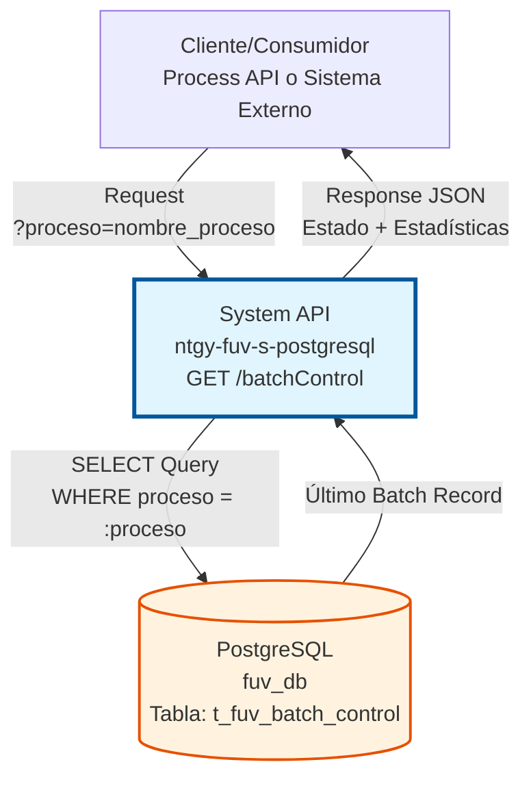
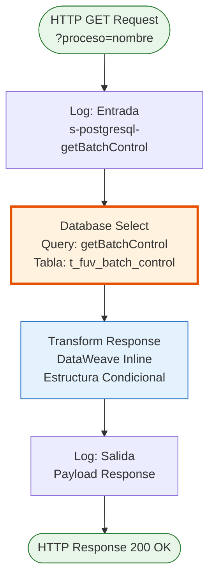
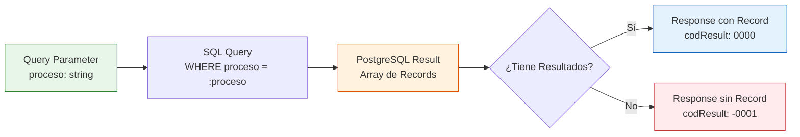

# GET /batchControl

## 📌 Descripción General

### Propósito del Endpoint

Este endpoint consulta el estado del último proceso batch ejecutado en la base de datos PostgreSQL. Permite obtener información detallada sobre la ejecución más reciente de un proceso específico, incluyendo estadísticas de procesamiento, estado final y detalles adicionales.

El endpoint soporta:
- **Consulta de Estado**: Obtiene el estado actual del último batch ejecutado
- **Estadísticas de Procesamiento**: Retorna contadores de registros procesados, exitosos y con error
- **Auditoría**: Proporciona información de fecha de ejecución y detalles del proceso
- **Monitoreo**: Permite verificar el éxito o fallo de procesos batch

### Tipo de API

**Capa:** System API (API-Led Connectivity)

**Función:** Integración directa con PostgreSQL para consultar información de control de procesos batch en la plataforma FUV (Facturación Única Virtual).

### Patrón de Integración

**Tipo:** Request-Reply Síncrono con PostgreSQL

**Descripción:** El endpoint recibe un identificador de proceso como query parameter, ejecuta una consulta SELECT en PostgreSQL para obtener el registro más reciente del batch, y retorna la información en formato JSON con una estructura condicional basada en la existencia de resultados.

### Arquitectura API-Led Connectivity



---

## 💼 Propósito del Negocio

### Casos de Uso Principales

1. **Monitoreo de Procesos Batch en Tiempo Real**
   - Los equipos de operaciones consultan el estado de procesos batch críticos
   - Se verifica si el último batch se ejecutó correctamente
   - Permite tomar acciones correctivas inmediatas en caso de fallos

2. **Verificación de Sincronizaciones**
   - Los Process APIs verifican el estado de sincronizaciones de datos
   - Se confirma que los procesos de obfuscación o reprocessing finalizaron exitosamente
   - Permite continuar con flujos dependientes solo si el batch fue exitoso

3. **Auditoría de Ejecuciones**
   - Se consulta el histórico de ejecuciones para análisis de tendencias
   - Se obtienen estadísticas de procesamiento para reportes
   - Permite identificar patrones de fallos o degradación de rendimiento

4. **Troubleshooting de Procesos Fallidos**
   - Los equipos de soporte consultan detalles de batches fallidos
   - Se accede a mensajes de error y detalles técnicos
   - Facilita la resolución rápida de incidencias

### Contexto Empresarial

- **Dominio:** Gestión de Procesos Batch y Control de Ejecuciones
- **Sector:** Energía - Utilities
- **División:** Naturgy España - FUV (Facturación Única Virtual)
- **Proceso de Negocio:** Control y monitoreo de procesos batch de sincronización, obfuscación y reprocessing
- **Plataforma:** PostgreSQL Database

### Stakeholders

- **Equipos de Operaciones**: Monitorean la salud de procesos batch críticos
- **Desarrolladores de Process APIs**: Verifican dependencias de procesos batch
- **Equipos de Soporte**: Investigan y resuelven incidencias de procesos fallidos
- **Administradores de Base de Datos**: Analizan rendimiento y optimizan procesos

### Valor de Negocio

- **Visibilidad Operacional**: Proporciona transparencia sobre el estado de procesos batch
- **Detección Temprana de Fallos**: Permite identificar y resolver problemas rápidamente
- **Auditoría y Compliance**: Mantiene registro histórico de ejecuciones para auditorías
- **Optimización de Procesos**: Facilita análisis de rendimiento y mejora continua

### Consumidores Potenciales

Este endpoint puede ser consumido por:
- Process APIs que dependen de procesos batch (obfuscación, reprocessing)
- Sistemas de monitoreo y alertas
- Dashboards de operaciones
- Herramientas de troubleshooting y soporte
- Scripts de automatización y validación

---

## 🔧 Especificación Técnica

### URLs por Ambiente

| Ambiente | URL Base | URL Completa |
|----------|----------|--------------|
| **Local** | `http://localhost:8081` | `http://localhost:8081/api/batchControl?proceso=nombre_proceso` |
| **Development** | `https://ntgy-fuv-s-postgresql-dev.us-e2.cloudhub.io` | `https://ntgy-fuv-s-postgresql-dev.us-e2.cloudhub.io/api/batchControl?proceso=nombre_proceso` |
| **UAT** | `https://ntgy-fuv-s-postgresql-uat.us-e2.cloudhub.io` | `https://ntgy-fuv-s-postgresql-uat.us-e2.cloudhub.io/api/batchControl?proceso=nombre_proceso` |
| **UAT01** | `https://ntgy-fuv-s-postgresql-uat01.us-e2.cloudhub.io` | `https://ntgy-fuv-s-postgresql-uat01.us-e2.cloudhub.io/api/batchControl?proceso=nombre_proceso` |
| **Production** | `https://ntgy-fuv-s-postgresql-pro.us-e2.cloudhub.io` | `https://ntgy-fuv-s-postgresql-pro.us-e2.cloudhub.io/api/batchControl?proceso=nombre_proceso` |

### Método HTTP

```
GET /api/batchControl
```

### Parámetros de Entrada

#### Headers HTTP

| Header | Tipo | Requerido | Descripción | Ejemplo |
|--------|------|-----------|-------------|---------|
| `Accept` | string | ❌ No | Tipo de contenido esperado en response | `application/json` |

#### Query Parameters

| Parámetro | Tipo | Requerido | Descripción | Ejemplo |
|-----------|------|-----------|-------------|---------|
| `proceso` | string | ✅ Sí | Identificador único del proceso batch a consultar | `"obfuscateOrders"` |

**Valores Comunes de `proceso`:**
- `obfuscateOrders` - Proceso de obfuscación de pedidos
- `obfuscateGNSOrders` - Proceso de obfuscación de pedidos GNS
- `reprocessOrders` - Reprocesamiento de pedidos
- `reprocessDocuments` - Reprocesamiento de documentos
- Otros procesos batch definidos en el sistema

### Respuestas

#### Respuesta Exitosa - Batch Encontrado (200 OK)

```json
{
  "result": {
    "codResult": "0000",
    "msgResult": "No hay error"
  },
  "record": {
    "proceso": "obfuscateOrders",
    "tipo_proceso": "OBFUSCATION",
    "fecha_ejecucion": "2026-01-07T10:30:00.000Z",
    "total_registros_procesados": 1500,
    "registros_exitosos": 1485,
    "registros_error": 15,
    "estado": "SUCCESS",
    "detalles": {
      "duracion_segundos": 45,
      "memoria_utilizada_mb": 256,
      "observaciones": "Proceso completado con advertencias menores"
    }
  }
}
```

**Descripción de Campos:**

| Campo | Tipo | Descripción |
|-------|------|-------------|
| `result.codResult` | string | Código de resultado: "0000" = éxito |
| `result.msgResult` | string | Mensaje descriptivo del resultado |
| `record.proceso` | string | Identificador del proceso batch |
| `record.tipo_proceso` | string | Tipo de proceso (OBFUSCATION, REPROCESSING, SYNC, etc.) |
| `record.fecha_ejecucion` | timestamp | Fecha y hora de ejecución del batch |
| `record.total_registros_procesados` | integer | Total de registros procesados |
| `record.registros_exitosos` | integer | Cantidad de registros procesados exitosamente |
| `record.registros_error` | integer | Cantidad de registros con error |
| `record.estado` | string | Estado final: SUCCESS, FAILED, PARTIAL |
| `record.detalles` | object | Detalles adicionales en formato JSON |

#### Respuesta - Batch No Encontrado (200 OK)

```json
{
  "result": {
    "codResult": "-0001",
    "msgResult": "Registro no existe"
  }
}
```

**Descripción:**
- Se retorna cuando no existe ningún registro para el proceso especificado
- Puede indicar que el proceso nunca se ha ejecutado o que el nombre es incorrecto

#### Respuesta de Error - Parámetro Faltante (400 Bad Request)

```json
{
  "error": "Required query parameter 'proceso' is missing"
}
```

#### Respuesta de Error Técnico (500 Internal Server Error)

```json
{
  "result": {
    "codResult": "0001",
    "msgResult": "Error interno del servidor"
  }
}
```

### Códigos de Estado HTTP

| Código | Descripción | Cuándo Ocurre |
|--------|-------------|---------------|
| `200 OK` | Solicitud procesada correctamente | Siempre que la consulta se ejecute (con o sin resultados) |
| `400 Bad Request` | Parámetros inválidos o faltantes | Cuando falta el parámetro `proceso` |
| `500 Internal Server Error` | Error en el servidor o base de datos | Cuando hay un error de conexión o query |

### Autenticación y Autorización

- **Tipo:** Client ID & Client Secret (Anypoint Platform)
- **Autorización PostgreSQL:** El usuario de base de datos debe tener permisos para:
  - Ejecutar SELECT en la tabla `fuv.t_fuv_batch_control`
  - Acceso de lectura al schema `fuv`

### Timeouts

| Tipo | Valor | Descripción |
|------|-------|-------------|
| **Request Timeout** | 30 segundos | Tiempo máximo de espera para la respuesta |
| **Connection Timeout** | 10 segundos | Tiempo máximo para establecer conexión con PostgreSQL |
| **Query Timeout** | 30 segundos | Tiempo máximo de ejecución de la query SQL |

---

## 🏗️ Implementación Técnica

### Arquitectura del Flow



### Componentes del Flow

#### 1. Logger de Entrada
**Ubicación:** `s-postgresql-batch-control.xml`, líneas 18-21

```xml
<logger level="INFO" 
        message="s-postgresql-getBatchControl ## Obteniendo control de batch"
        doc:name="logEntrada"
        category="s-postgresql-getBatchControl"/>
```

**Propósito:** Registra el inicio de la operación para trazabilidad.

#### 2. Database Select
**Ubicación:** `s-postgresql-batch-control.xml`, líneas 23-28

```xml
<db:select config-ref="Database_Config" doc:name="Select Batch Control">
    <db:sql><![CDATA[${queries.getBatchControl}]]></db:sql>
    <db:input-parameters><![CDATA[#[{
        'proceso': attributes.queryParams.proceso
    }]]]></db:input-parameters>
</db:select>
```

**Query SQL Real** (desde `s-postgresql-global-config.yaml`, línea 69):
```sql
SELECT proceso, tipo_proceso, fecha_ejecucion, total_registros_procesados, 
       registros_exitosos, registros_error, estado, detalles 
FROM fuv.t_fuv_batch_control 
WHERE proceso = :proceso 
ORDER BY fecha_ejecucion DESC 
LIMIT 1
```

**Características:**
- **Parámetro:** `:proceso` - Identificador del proceso batch
- **Ordenamiento:** Por `fecha_ejecucion DESC` para obtener el más reciente
- **Límite:** 1 registro (solo el último batch)
- **Schema:** `fuv`
- **Tabla:** `t_fuv_batch_control`

#### 3. Transform Response
**Ubicación:** `s-postgresql-batch-control.xml`, líneas 30-43

```xml
<ee:transform doc:name="Transform Response">
    <ee:message>
        <ee:set-payload><![CDATA[%dw 2.0
output application/json
---
{
    "result": {
        "codResult": if (sizeOf(payload) > 0) "0000" else "-0001",
        "msgResult": if (sizeOf(payload) > 0) "No hay error" else "Registro no existe"
    },     
    ("record": payload[0]) if (sizeOf(payload) > 0)
}]]></ee:set-payload>
    </ee:message>
</ee:transform>
```

**Lógica de Transformación:**
1. **Verifica existencia de resultados:** `sizeOf(payload) > 0`
2. **Si existe registro:**
   - `codResult`: "0000"
   - `msgResult`: "No hay error"
   - `record`: Incluye el primer (y único) registro del array
3. **Si NO existe registro:**
   - `codResult`: "-0001"
   - `msgResult`: "Registro no existe"
   - `record`: Campo omitido (no se incluye en el JSON)

#### 4. Logger de Salida
**Ubicación:** `s-postgresql-batch-control.xml`, línea 44

```xml
<logger level="INFO" 
        message="s-postgresql-getBatchControl.logSalida ## Payload: #[payload]" 
        category="s-postgresql-getBatchControl" />
```

**Propósito:** Registra la respuesta final para auditoría y troubleshooting.

### Diagrama de Secuencia Detallado

```mermaid
sequenceDiagram
    participant Client as Cliente/Process API
    participant API as System API<br/>GET /batchControl
    participant Logger as Logger Component
    participant DB as PostgreSQL<br/>fuv.t_fuv_batch_control
    
    Client->>API: GET /api/batchControl?proceso=obfuscateOrders
    activate API
    
    API->>Logger: Log entrada (INFO)
    Logger-->>API: OK
    
    API->>DB: SELECT * FROM t_fuv_batch_control<br/>WHERE proceso = 'obfuscateOrders'<br/>ORDER BY fecha_ejecucion DESC<br/>LIMIT 1
    activate DB
    
    alt Registro Encontrado
        DB-->>API: [{ proceso, tipo_proceso, fecha_ejecucion, ... }]
        deactivate DB
        API->>API: Transform: codResult="0000"<br/>Incluir record en response
    else Registro No Encontrado
        DB-->>API: []
        deactivate DB
        API->>API: Transform: codResult="-0001"<br/>Omitir record en response
    end
    
    API->>Logger: Log salida con payload (INFO)
    Logger-->>API: OK
    
    API-->>Client: 200 OK<br/>{ result: {...}, record?: {...} }
    deactivate API
```

### Configuración de Base de Datos

**Database Config:** `Database_Config`

**Propiedades de Conexión:**
- **Driver:** PostgreSQL JDBC 42.3.3
- **Connection Type:** Pooled connections
- **Host:** Configurado por ambiente
- **Port:** 5432 (default PostgreSQL)
- **Database:** `fuv_db`
- **Schema:** `fuv`
- **User:** Configurado por ambiente
- **Password:** Encriptado vía secure properties

**Connection Pool Settings:**
- **Min Pool Size:** 5 conexiones
- **Max Pool Size:** 20 conexiones
- **Max Idle Time:** 30 minutos
- **Connection Timeout:** 10 segundos
- **Query Timeout:** 30 segundos

### Estructura de la Tabla `t_fuv_batch_control`

```sql
CREATE TABLE fuv.t_fuv_batch_control (
    t_fuv_batch_control_id SERIAL PRIMARY KEY,
    proceso VARCHAR(100) NOT NULL,
    tipo_proceso VARCHAR(50),
    fecha_ejecucion TIMESTAMP NOT NULL,
    total_registros_procesados INTEGER,
    registros_exitosos INTEGER,
    registros_error INTEGER,
    estado VARCHAR(20),
    detalles JSONB,
    create_date TIMESTAMP DEFAULT CURRENT_TIMESTAMP,
    update_date TIMESTAMP
);

-- Índice para optimizar búsquedas por proceso
CREATE INDEX idx_batch_control_proceso ON fuv.t_fuv_batch_control(proceso, fecha_ejecucion DESC);
```

**Campos Principales:**

| Campo | Tipo | Nullable | Descripción |
|-------|------|----------|-------------|
| `t_fuv_batch_control_id` | SERIAL | NO | ID autoincremental (PK) |
| `proceso` | VARCHAR(100) | NO | Identificador del proceso |
| `tipo_proceso` | VARCHAR(50) | SÍ | Tipo de proceso batch |
| `fecha_ejecucion` | TIMESTAMP | NO | Fecha/hora de ejecución |
| `total_registros_procesados` | INTEGER | SÍ | Total de registros |
| `registros_exitosos` | INTEGER | SÍ | Registros exitosos |
| `registros_error` | INTEGER | SÍ | Registros con error |
| `estado` | VARCHAR(20) | SÍ | Estado final (SUCCESS/FAILED) |
| `detalles` | JSONB | SÍ | Detalles adicionales en JSON |

### Manejo de Errores

#### Error de Conexión a Base de Datos
```xml
<on-error-propagate type="DB:CONNECTIVITY">
    <logger level="ERROR" message="Error de conexión a PostgreSQL"/>
    <ee:transform>
        <ee:set-payload>
            { "result": { "codResult": "0001", "msgResult": "Error de conexión" } }
        </ee:set-payload>
    </ee:transform>
</on-error-propagate>
```

#### Error de Query SQL
```xml
<on-error-propagate type="DB:QUERY_EXECUTION">
    <logger level="ERROR" message="Error ejecutando query SQL"/>
    <ee:transform>
        <ee:set-payload>
            { "result": { "codResult": "0001", "msgResult": "Error en consulta" } }
        </ee:set-payload>
    </ee:transform>
</on-error-propagate>
```

### Diagrama de Transformación de Datos



### Logging y Trazabilidad

**Nivel de Log:** INFO

**Categoría:** `s-postgresql-getBatchControl`

**Mensajes de Log:**
1. **Entrada:** `"s-postgresql-getBatchControl ## Obteniendo control de batch"`
2. **Salida:** `"s-postgresql-getBatchControl.logSalida ## Payload: [payload_json]"`

**Información Registrada:**
- Timestamp de la operación
- Parámetro `proceso` recibido
- Resultado de la query (cantidad de registros)
- Payload completo de respuesta
- Errores si ocurren

---

## 💻 Ejemplos de Uso

### Ejemplo 1: Consultar Batch Exitoso

#### Request con curl

```bash
curl -X GET \
  'https://ntgy-fuv-s-postgresql-dev.us-e2.cloudhub.io/api/batchControl?proceso=obfuscateOrders' \
  -H 'Accept: application/json' \
  -H 'client_id: your-client-id' \
  -H 'client_secret: your-client-secret'
```

#### Response (200 OK)

```json
{
  "result": {
    "codResult": "0000",
    "msgResult": "No hay error"
  },
  "record": {
    "proceso": "obfuscateOrders",
    "tipo_proceso": "OBFUSCATION",
    "fecha_ejecucion": "2026-01-07T10:30:00.000Z",
    "total_registros_procesados": 1500,
    "registros_exitosos": 1485,
    "registros_error": 15,
    "estado": "SUCCESS",
    "detalles": {
      "duracion_segundos": 45,
      "memoria_utilizada_mb": 256,
      "observaciones": "Proceso completado con advertencias menores",
      "registros_omitidos": 15,
      "motivo_omision": "Datos incompletos"
    }
  }
}
```

### Ejemplo 2: Consultar Batch No Encontrado

#### Request con curl

```bash
curl -X GET \
  'https://ntgy-fuv-s-postgresql-dev.us-e2.cloudhub.io/api/batchControl?proceso=procesoInexistente' \
  -H 'Accept: application/json' \
  -H 'client_id: your-client-id' \
  -H 'client_secret: your-client-secret'
```

#### Response (200 OK)

```json
{
  "result": {
    "codResult": "-0001",
    "msgResult": "Registro no existe"
  }
}
```

### Ejemplo 3: Consultar Batch Fallido

#### Request con curl

```bash
curl -X GET \
  'https://ntgy-fuv-s-postgresql-dev.us-e2.cloudhub.io/api/batchControl?proceso=reprocessDocuments' \
  -H 'Accept: application/json' \
  -H 'client_id: your-client-id' \
  -H 'client_secret: your-client-secret'
```

#### Response (200 OK)

```json
{
  "result": {
    "codResult": "0000",
    "msgResult": "No hay error"
  },
  "record": {
    "proceso": "reprocessDocuments",
    "tipo_proceso": "REPROCESSING",
    "fecha_ejecucion": "2026-01-07T09:15:00.000Z",
    "total_registros_procesados": 500,
    "registros_exitosos": 350,
    "registros_error": 150,
    "estado": "FAILED",
    "detalles": {
      "duracion_segundos": 120,
      "memoria_utilizada_mb": 512,
      "error_principal": "Timeout en conexión a sistema externo",
      "registros_pendientes": 150,
      "requiere_reproceso": true
    }
  }
}
```

### Ejemplo 4: Error - Parámetro Faltante

#### Request con curl

```bash
curl -X GET \
  'https://ntgy-fuv-s-postgresql-dev.us-e2.cloudhub.io/api/batchControl' \
  -H 'Accept: application/json' \
  -H 'client_id: your-client-id' \
  -H 'client_secret: your-client-secret'
```

#### Response (400 Bad Request)

```json
{
  "error": "Required query parameter 'proceso' is missing"
}
```

### Ejemplo 5: Uso desde JavaScript/Node.js

```javascript
const axios = require('axios');

async function consultarBatchControl(proceso) {
  try {
    const response = await axios.get(
      'https://ntgy-fuv-s-postgresql-dev.us-e2.cloudhub.io/api/batchControl',
      {
        params: { proceso },
        headers: {
          'Accept': 'application/json',
          'client_id': process.env.CLIENT_ID,
          'client_secret': process.env.CLIENT_SECRET
        }
      }
    );

    if (response.data.result.codResult === '0000') {
      console.log('Batch encontrado:', response.data.record);
      
      // Verificar estado del batch
      if (response.data.record.estado === 'SUCCESS') {
        console.log('✅ Batch ejecutado exitosamente');
        console.log(`Registros procesados: ${response.data.record.total_registros_procesados}`);
        console.log(`Registros exitosos: ${response.data.record.registros_exitosos}`);
      } else {
        console.log('❌ Batch falló');
        console.log('Detalles:', response.data.record.detalles);
      }
    } else {
      console.log('⚠️ Batch no encontrado para el proceso:', proceso);
    }

    return response.data;
  } catch (error) {
    console.error('Error consultando batch control:', error.message);
    throw error;
  }
}

// Uso
consultarBatchControl('obfuscateOrders')
  .then(data => console.log('Resultado:', data))
  .catch(err => console.error('Error:', err));
```

### Ejemplo 6: Uso desde Python

```python
import requests
import os
from datetime import datetime

def consultar_batch_control(proceso):
    """
    Consulta el estado del último batch ejecutado
    
    Args:
        proceso (str): Identificador del proceso batch
        
    Returns:
        dict: Información del batch o None si no existe
    """
    url = 'https://ntgy-fuv-s-postgresql-dev.us-e2.cloudhub.io/api/batchControl'
    
    headers = {
        'Accept': 'application/json',
        'client_id': os.getenv('CLIENT_ID'),
        'client_secret': os.getenv('CLIENT_SECRET')
    }
    
    params = {'proceso': proceso}
    
    try:
        response = requests.get(url, headers=headers, params=params)
        response.raise_for_status()
        
        data = response.json()
        
        if data['result']['codResult'] == '0000':
            record = data['record']
            print(f"✅ Batch encontrado: {record['proceso']}")
            print(f"Estado: {record['estado']}")
            print(f"Fecha ejecución: {record['fecha_ejecucion']}")
            print(f"Registros procesados: {record['total_registros_procesados']}")
            print(f"Registros exitosos: {record['registros_exitosos']}")
            print(f"Registros con error: {record['registros_error']}")
            
            return record
        else:
            print(f"⚠️ Batch no encontrado: {proceso}")
            return None
            
    except requests.exceptions.RequestException as e:
        print(f"❌ Error en la petición: {e}")
        raise

# Uso
if __name__ == '__main__':
    batch_info = consultar_batch_control('obfuscateOrders')
    
    if batch_info and batch_info['estado'] == 'SUCCESS':
        print("Proceso completado exitosamente")
    elif batch_info and batch_info['estado'] == 'FAILED':
        print("Proceso falló, revisar detalles")
    else:
        print("Proceso no encontrado o sin ejecutar")
```

### Ejemplo 7: Monitoreo Continuo

```bash
#!/bin/bash
# Script de monitoreo de batch control

PROCESO="obfuscateOrders"
API_URL="https://ntgy-fuv-s-postgresql-dev.us-e2.cloudhub.io/api/batchControl"
CLIENT_ID="your-client-id"
CLIENT_SECRET="your-client-secret"

while true; do
    echo "$(date): Consultando estado del batch $PROCESO..."
    
    RESPONSE=$(curl -s -X GET \
        "${API_URL}?proceso=${PROCESO}" \
        -H "Accept: application/json" \
        -H "client_id: ${CLIENT_ID}" \
        -