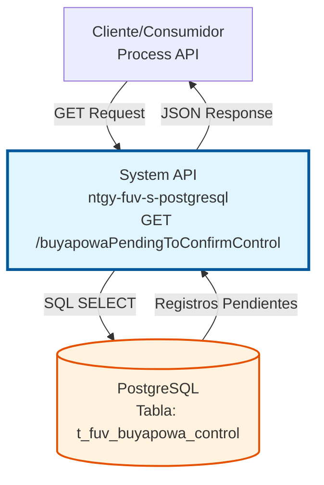
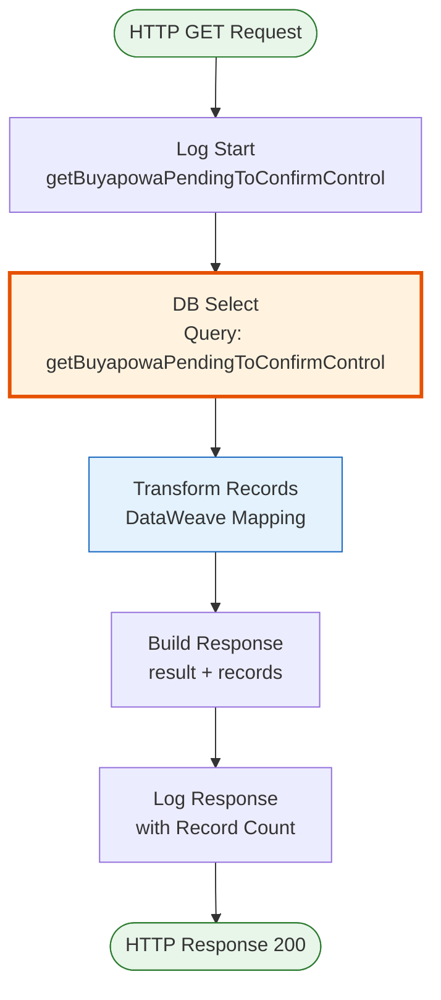
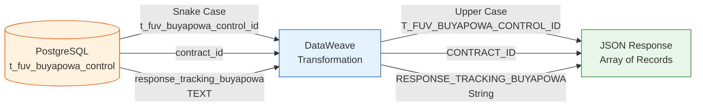

# GET /buyapowaPendingToConfirmControl

## 📌 Descripción General

### Propósito del Endpoint

Este endpoint consulta los registros de control de Buyapowa que están pendientes de confirmación en la base de datos PostgreSQL. Retorna todos los contratos que han sido trackeados en Buyapowa pero aún no han recibido confirmación, permitiendo identificar qué contratos requieren seguimiento.

El endpoint soporta:
- **Consulta masiva**: Retorna hasta 80,000 registros pendientes
- **Filtrado automático**: Excluye contratos ya confirmados o con estados finales
- **Ordenamiento**: Por ID de control para procesamiento secuencial

### Tipo de API

**Capa:** System API (API-Led Connectivity)

**Función:** Acceso directo a la base de datos PostgreSQL FUV para consultar el estado de contratos en el programa de referidos Buyapowa.

### Patrón de Integración

**Tipo:** Request-Reply Síncrono con PostgreSQL

**Descripción:** El endpoint recibe una petición GET sin parámetros, ejecuta una consulta SQL en la tabla de control de Buyapowa, transforma los resultados a formato JSON y retorna la lista de registros pendientes de confirmación.

### Arquitectura API-Led Connectivity



---

## 💼 Propósito del Negocio

### Casos de Uso Principales

1. **Seguimiento de Confirmaciones Pendientes**
   - Identificar contratos que han sido trackeados en Buyapowa
   - Detectar contratos sin confirmación de estado
   - Facilitar el procesamiento batch de confirmaciones

2. **Monitoreo del Programa de Referidos**
   - Supervisar el flujo de contratos en el programa Buyapowa
   - Identificar cuellos de botella en el proceso de confirmación
   - Generar reportes de contratos pendientes

3. **Procesamiento Batch**
   - Obtener lote de contratos para confirmar en Buyapowa
   - Procesar confirmaciones masivas de forma controlada
   - Sincronizar estados entre sistemas

### Contexto Empresarial

- **Dominio:** Gestión de Programas de Referidos y Loyalty
- **Sector:** Energía - Utilities
- **División:** Naturgy España - FUV (Facturación Única Virtual)
- **Proceso de Negocio:** Seguimiento y confirmación de contratos en programa Buyapowa
- **Sistema:** PostgreSQL FUV

### Stakeholders

- **Equipo de Marketing**: Monitoreo del programa de referidos
- **Operaciones**: Seguimiento de confirmaciones pendientes
- **Desarrollo**: Integración con sistema Buyapowa
- **Soporte**: Resolución de incidencias en confirmaciones

### Valor de Negocio

- **Visibilidad**: Identificación clara de contratos pendientes de confirmación
- **Eficiencia**: Procesamiento batch optimizado con límite de 80,000 registros
- **Control**: Seguimiento del estado de contratos en programa de referidos
- **Automatización**: Facilita procesos automáticos de confirmación

### Consumidores Potenciales

Este endpoint puede ser consumido por:
- Process APIs de gestión de Buyapowa
- Procesos batch de confirmación
- Sistemas de monitoreo y reporting
- Integraciones con plataforma Buyapowa

---

## 🔧 Especificación Técnica

### URLs por Ambiente

| Ambiente | URL Base | URL Completa |
|----------|----------|--------------|
| **Local** | `http://localhost:8081` | `http://localhost:8081/api/buyapowaPendingToConfirmControl` |
| **Development** | `https://ntgy-fuv-s-postgresql-dev.us-e2.cloudhub.io` | `https://ntgy-fuv-s-postgresql-dev.us-e2.cloudhub.io/api/buyapowaPendingToConfirmControl` |
| **UAT** | `https://ntgy-fuv-s-postgresql-uat.us-e2.cloudhub.io` | `https://ntgy-fuv-s-postgresql-uat.us-e2.cloudhub.io/api/buyapowaPendingToConfirmControl` |
| **Production** | `https://ntgy-fuv-s-postgresql-pro.us-e2.cloudhub.io` | `https://ntgy-fuv-s-postgresql-pro.us-e2.cloudhub.io/api/buyapowaPendingToConfirmControl` |

### Método HTTP

```
GET /api/buyapowaPendingToConfirmControl
```

### Parámetros de Entrada

#### Headers HTTP

| Header | Tipo | Requerido | Descripción | Ejemplo |
|--------|------|-----------|-------------|---------|
| `Accept` | string | ❌ No | Tipo de contenido esperado en response | `application/json` |

**Nota:** Este endpoint no requiere parámetros de entrada (query params o body).

### Respuestas

#### Respuesta Exitosa con Registros (200 OK)

```json
{
  "result": {
    "codResult": "0000",
    "msgResult": "No hay error"
  },
  "records": [
    {
      "T_FUV_BUYAPOWA_CONTROL_ID": 12345,
      "CONTRACT_ID": "ORD-2024-001",
      "CONTRACT_LINE": "CL-001",
      "PRODUCT_ID": "PROD-GAS-001",
      "CODIGO_AMIGO": "REF123456",
      "RESPONSE_TRACKING_BUYAPOWA": "{\"status\":\"tracked\",\"date\":\"2024-01-15\"}",
      "RESPONSE_CONFIRMATION_BUYAPOWA": null,
      "CONTRACT_STATUS": null,
      "TRACKING_DATE": "2024-01-15T10:30:00",
      "UPDATE_STATUS_DATE": null,
      "CONFIRMATION_DATE": null
    },
    {
      "T_FUV_BUYAPOWA_CONTROL_ID": 12346,
      "CONTRACT_ID": "ORD-2024-002",
      "CONTRACT_LINE": "CL-002",
      "PRODUCT_ID": "PROD-ELEC-001",
      "CODIGO_AMIGO": "REF789012",
      "RESPONSE_TRACKING_BUYAPOWA": "{\"status\":\"tracked\",\"date\":\"2024-01-16\"}",
      "RESPONSE_CONFIRMATION_BUYAPOWA": null,
      "CONTRACT_STATUS": "Pendiente",
      "TRACKING_DATE": "2024-01-16T14:20:00",
      "UPDATE_STATUS_DATE": "2024-01-16T14:25:00",
      "CONFIRMATION_DATE": null
    }
  ]
}
```

#### Respuesta Exitosa sin Registros (200 OK)

```json
{
  "result": {
    "codResult": "0000",
    "msgResult": "No hay error"
  }
}
```

**Nota:** Cuando no hay registros pendientes, el campo `records` no se incluye en la respuesta.

#### Respuesta de Error Técnico (500)

```json
{
  "result": {
    "codResult": "0001",
    "msgResult": "Error interno del servidor"
  }
}
```

### Estructura de Campos de Respuesta

| Campo | Tipo | Descripción |
|-------|------|-------------|
| `T_FUV_BUYAPOWA_CONTROL_ID` | number | ID único del registro de control |
| `CONTRACT_ID` | string | ID del contrato/pedido |
| `CONTRACT_LINE` | string | Línea de contrato |
| `PRODUCT_ID` | string | ID del producto contratado |
| `CODIGO_AMIGO` | string | Código de referido/amigo |
| `RESPONSE_TRACKING_BUYAPOWA` | string | JSON con respuesta de tracking de Buyapowa |
| `RESPONSE_CONFIRMATION_BUYAPOWA` | string/null | JSON con respuesta de confirmación (null si pendiente) |
| `CONTRACT_STATUS` | string/null | Estado del contrato (null o diferente de estados finales) |
| `TRACKING_DATE` | string | Fecha y hora de tracking |
| `UPDATE_STATUS_DATE` | string/null | Fecha y hora de actualización de estado |
| `CONFIRMATION_DATE` | string/null | Fecha y hora de confirmación |

### Autenticación y Autorización

- **Tipo:** Client ID & Client Secret (Anypoint Platform)
- **Autorización DB:** El usuario de base de datos debe tener permisos de:
  - SELECT en tabla `t_fuv_buyapowa_control`
  - Acceso al schema `fuv`

### Timeouts

| Tipo | Valor | Descripción |
|------|-------|-------------|
| **Request Timeout** | 30 segundos | Tiempo máximo de espera para la respuesta |
| **Connection Timeout** | 10 segundos | Tiempo máximo para establecer conexión con DB |
| **Query Timeout** | 30 segundos | Tiempo máximo de ejecución de la query SQL |

---

## 🏗️ Implementación Técnica

### Arquitectura del Flow



### Ubicación del Código

**Subflow Principal:**
- **Archivo:** `src/main/mule/s-postgresql-buyapowaControl.xml`
- **Línea:** 260
- **Nombre:** `s-postgresql-getBuyapowaPendingToConfirmControl`

**Query SQL:**
- **Archivo:** `src/main/resources/s-postgresql-global-config.yaml`
- **Línea:** 38
- **Propiedad:** `queries.getBuyapowaPendingToConfirmControl`

### Query SQL Completa

```sql
SELECT * 
FROM t_fuv_buyapowa_control 
WHERE (response_confirmation_buyapowa IS NULL 
       AND (contract_status IS NULL 
            OR contract_status != 'Activo' 
            OR contract_status != 'Anulado' 
            OR contract_status != 'Inactivo')) 
ORDER BY t_fuv_buyapowa_control_id ASC 
LIMIT 80000
```

### Lógica de Filtrado

**Condiciones de Selección:**

1. **response_confirmation_buyapowa IS NULL**: Solo registros sin confirmación
2. **contract_status IS NULL OR contract_status NOT IN ('Activo', 'Anulado', 'Inactivo')**: 
   - Incluye contratos sin estado asignado
   - Incluye contratos con estados intermedios (ej: 'Pendiente', 'En Proceso')
   - Excluye contratos con estados finales

**Ordenamiento:**
- Por `t_fuv_buyapowa_control_id` ascendente (procesamiento secuencial)

**Límite:**
- Máximo 80,000 registros por consulta (optimización de performance)

### Tabla de Base de Datos

**Nombre:** `t_fuv_buyapowa_control`

**Campos Principales:**

| Campo | Tipo | Descripción |
|-------|------|-------------|
| `t_fuv_buyapowa_control_id` | SERIAL | ID único (PK) |
| `contract_id` | VARCHAR | ID del contrato |
| `contract_line` | VARCHAR | Línea de contrato |
| `product_id` | VARCHAR | ID del producto |
| `codigo_amigo` | VARCHAR | Código de referido |
| `response_tracking_buyapowa` | TEXT | Respuesta de tracking (JSON) |
| `response_confirmation_buyapowa` | TEXT | Respuesta de confirmación (JSON) |
| `contract_status` | VARCHAR | Estado del contrato |
| `tracking_date` | TIMESTAMP | Fecha de tracking |
| `update_status_date` | TIMESTAMP | Fecha de actualización |
| `confirmation_date` | TIMESTAMP | Fecha de confirmación |

### Transformación DataWeave

**Ubicación:** Inline en XML (líneas 278-290)

**Mapeo de Campos:**

```dataweave
%dw 2.0
output application/json
---
payload map (record, findex) -> {
    "T_FUV_BUYAPOWA_CONTROL_ID": record.'t_fuv_buyapowa_control_id',
    "CONTRACT_ID": record.'contract_id',
    "CONTRACT_LINE": record.'contract_line',
    "PRODUCT_ID": record.'product_id',
    "CODIGO_AMIGO": record.'codigo_amigo',
    "RESPONSE_TRACKING_BUYAPOWA": record.'response_tracking_buyapowa'.'value',
    "RESPONSE_CONFIRMATION_BUYAPOWA": record.'response_confirmation_buyapowa'.'value',
    "CONTRACT_STATUS": record.'contract_status',
    "TRACKING_DATE": record.'tracking_date',
    "UPDATE_STATUS_DATE": record.'update_status_date',
    "CONFIRMATION_DATE": record.'confirmation_date'
}
```

### Diagrama de Transformación de Datos



### Manejo de Errores

**Errores de Base de Datos:**
- Connection timeout → 500 Internal Server Error
- Query timeout → 500 Internal Server Error
- SQL syntax error → 500 Internal Server Error

**Logging:**
- **Nivel INFO:** Request y response (con número de registros)
- **Nivel DEBUG:** Response completo con datos
- **Ubicación:** Líneas 261-267 (request), 312-320 (response)

### Performance

**Optimizaciones:**
- Límite de 80,000 registros para evitar sobrecarga
- Índice en `t_fuv_buyapowa_control_id` para ordenamiento eficiente
- Connection pooling en Database_Config
- Query timeout de 30 segundos

**Consideraciones:**
- Para más de 80,000 registros, se requiere paginación
- El ordenamiento por ID garantiza procesamiento secuencial
- La query puede ser intensiva si hay muchos registros pendientes

---

## 💻 Ejemplos de Uso

### Ejemplo 1: Consulta con curl

```bash
curl -X GET \
  'https://ntgy-fuv-s-postgresql-dev.us-e2.cloudhub.io/api/buyapowaPendingToConfirmControl' \
  -H 'Accept: application/json' \
  -H 'client_id: YOUR_CLIENT_ID' \
  -H 'client_secret: YOUR_CLIENT_SECRET'
```

### Ejemplo 2: Response con Registros Pendientes

```json
{
  "result": {
    "codResult": "0000",
    "msgResult": "No hay error"
  },
  "records": [
    {
      "T_FUV_BUYAPOWA_CONTROL_ID": 45678,
      "CONTRACT_ID": "ORD-2024-12345",
      "CONTRACT_LINE": "CL-GAS-001",
      "PRODUCT_ID": "GAS-NATURAL-HOGAR",
      "CODIGO_AMIGO": "REFAMIGO2024",
      "RESPONSE_TRACKING_BUYAPOWA": "{\"trackingId\":\"TRK-123\",\"status\":\"success\",\"timestamp\":\"2024-01-20T10:00:00Z\"}",
      "RESPONSE_CONFIRMATION_BUYAPOWA": null,
      "CONTRACT_STATUS": null,
      "TRACKING_DATE": "2024-01-20T10:00:15",
      "UPDATE_STATUS_DATE": null,
      "CONFIRMATION_DATE": null
    },
    {
      "T_FUV_BUYAPOWA_CONTROL_ID": 45679,
      "CONTRACT_ID": "ORD-2024-12346",
      "CONTRACT_LINE": "CL-ELEC-002",
      "PRODUCT_ID": "ELECTRICIDAD-HOGAR",
      "CODIGO_AMIGO": "REFAMIGO2024",
      "RESPONSE_TRACKING_BUYAPOWA": "{\"trackingId\":\"TRK-124\",\"status\":\"success\",\"timestamp\":\"2024-01-20T11:30:00Z\"}",
      "RESPONSE_CONFIRMATION_BUYAPOWA": null,
      "CONTRACT_STATUS": "Pendiente",
      "TRACKING_DATE": "2024-01-20T11:30:20",
      "UPDATE_STATUS_DATE": "2024-01-20T11:35:00",
      "CONFIRMATION_DATE": null
    }
  ]
}
```

### Ejemplo 3: Response sin Registros Pendientes

```json
{
  "result": {
    "codResult": "0000",
    "msgResult": "No hay error"
  }
}
```

**Interpretación:** No hay contratos pendientes de confirmación en este momento.

### Ejemplo 4: Response de Error

```json
{
  "result": {
    "codResult": "0001",
    "msgResult": "Error interno del servidor"
  }
}
```

### Ejemplo 5: Consulta con JavaScript (Node.js)

```javascript
const axios = require('axios');

async function getPendingConfirmations() {
  try {
    const response = await axios.get(
      'https://ntgy-fuv-s-postgresql-dev.us-e2.cloudhub.io/api/buyapowaPendingToConfirmControl',
      {
        headers: {
          'Accept': 'application/json',
          'client_id': process.env.CLIENT_ID,
          'client_secret': process.env.CLIENT_SECRET
        }
      }
    );
    
    console.log(`Registros pendientes: ${response.data.records?.length || 0}`);
    return response.data;
  } catch (error) {
    console.error('Error al consultar pendientes:', error.message);
    throw error;
  }
}

// Uso
getPendingConfirmations()
  .then(data => {
    if (data.records) {
      data.records.forEach(record => {
        console.log(`Contract: ${record.CONTRACT_ID}, Status: ${record.CONTRACT_STATUS || 'Sin estado'}`);
      });
    } else {
      console.log('No hay registros pendientes');
    }
  });
```

### Ejemplo 6: Procesamiento Batch en Python

```python
import requests
import json

def get_pending_confirmations():
    url = "https://ntgy-fuv-s-postgresql-dev.us-e2.cloudhub.io/api/buyapowaPendingToConfirmControl"
    headers = {
        "Accept": "application/json",
        "client_id": "YOUR_CLIENT_ID",
        "client_secret": "YOUR_CLIENT_SECRET"
    }
    
    response = requests.get(url, headers=headers)
    response.raise_for_status()
    
    data = response.json()
    records = data.get('records', [])
    
    print(f"Total registros pendientes: {len(records)}")
    
    # Procesar en lotes de 100
    batch_size = 100
    for i in range(0, len(records), batch_size):
        batch = records[i:i+batch_size]
        process_batch(batch)
        print(f"Procesado lote {i//batch_size + 1}")

def process_batch(batch):
    # Lógica de procesamiento de confirmaciones
    for record in batch:
        contract_id = record['CONTRACT_ID']
        contract_line = record['CONTRACT_LINE']
        # Procesar confirmación...
        print(f"Procesando: {contract_id} - {contract_line}")

# Ejecutar
if __name__ == "__main__":
    get_pending_confirmations()
```

### Notas de Implementación

1. **Límite de Registros:** El endpoint retorna máximo 80,000 registros. Para procesar más, considerar implementar paginación o ejecutar múltiples veces.

2. **Frecuencia de Consulta:** Recomendado consultar cada 15-30 minutos para evitar sobrecarga del sistema.

3. **Procesamiento:** Los registros están ordenados por ID, facilitando el procesamiento secuencial y la reanudación en caso de fallo.

4. **Estados Excluidos:** Los contratos con estados 'Activo', 'Anulado' o 'Inactivo' NO se retornan, ya que son estados finales.

5. **Confirmación Pendiente:** Un registro se considera pendiente si `RESPONSE_CONFIRMATION_BUYAPOWA` es `null`.