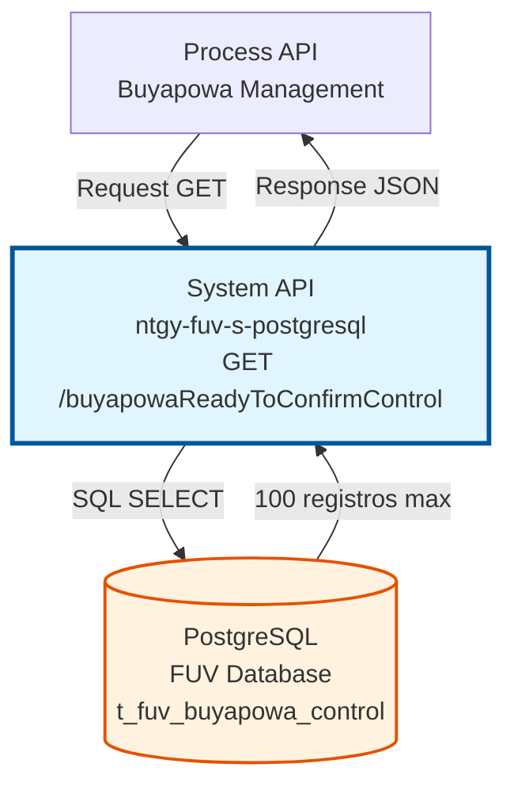
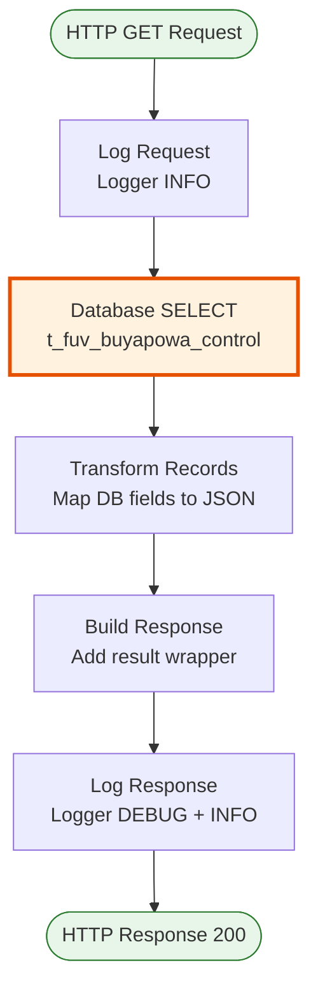
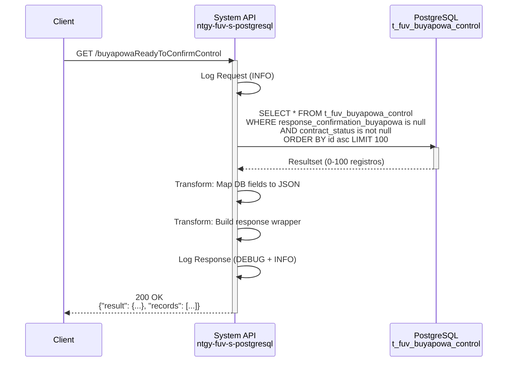

# GET /buyapowaReadyToConfirmControl

## 📌 Descripción General

### Propósito del Endpoint

Este endpoint recupera registros de control del programa de lealtad Buyapowa que están **listos para ser confirmados**. A diferencia del endpoint `buyapowaPendingToConfirmControl`, este endpoint filtra específicamente los registros que:
- No tienen respuesta de confirmación (`response_confirmation_buyapowa is null`)
- **SÍ tienen un estado de contrato válido** (`contract_status is not null`)

El endpoint soporta:
- **Consulta sin parámetros**: Retorna hasta 100 registros listos para confirmación
- **Ordenamiento automático**: Por ID de control ascendente (FIFO)
- **Límite de registros**: Máximo 100 registros por consulta para optimizar rendimiento

### Tipo de API

**Capa:** System API (API-Led Connectivity)

**Función:** Acceso directo a la base de datos PostgreSQL del sistema FUV (Facturación Única Virtual) para consultar registros de control de Buyapowa listos para procesamiento de confirmación.

### Patrón de Integración

**Tipo:** Request-Reply Síncrono con PostgreSQL

**Descripción:** El endpoint recibe una petición GET sin parámetros, ejecuta una consulta SQL SELECT en la tabla `t_fuv_buyapowa_control` con filtros específicos, transforma los resultados mediante DataWeave y retorna un JSON con los registros encontrados.

### Arquitectura API-Led Connectivity



---

## 💼 Propósito del Negocio

### Casos de Uso Principales

1. **Procesamiento de Confirmaciones de Buyapowa**
   - Obtener registros que tienen estado de contrato válido y están pendientes de confirmación
   - Facilitar el proceso de confirmación en lotes pequeños (100 registros)
   - Priorizar registros más antiguos mediante ordenamiento FIFO

2. **Monitoreo de Registros Listos**
   - Verificar cuántos registros están listos para confirmación
   - Identificar registros que ya tienen estado de contrato asignado
   - Facilitar auditoría del proceso de confirmación

3. **Integración con Sistema Buyapowa**
   - Preparar datos para envío al sistema de lealtad Buyapowa
   - Confirmar transacciones de referidos una vez validado el estado del contrato
   - Mantener sincronización entre sistemas

### Contexto Empresarial

- **Dominio:** Gestión de Programas de Lealtad
- **Sector:** Energía - Utilities
- **División:** Naturgy España - FUV (Facturación Única Virtual)
- **Proceso de Negocio:** Confirmación de referidos en programa Buyapowa
- **Sistema:** PostgreSQL FUV Database

### Stakeholders

- **Equipo de Marketing**: Gestión del programa de lealtad y referidos
- **Equipo de Operaciones**: Procesamiento de confirmaciones de contratos
- **Equipo de Desarrollo**: Integración con sistema Buyapowa
- **Administradores de Base de Datos**: Monitoreo de rendimiento de consultas

### Valor de Negocio

- **Procesamiento Eficiente**: Límite de 100 registros optimiza el rendimiento
- **Orden FIFO**: Garantiza procesamiento cronológico de confirmaciones
- **Filtrado Preciso**: Solo registros con estado válido, listos para confirmación
- **Trazabilidad**: Seguimiento completo del ciclo de vida de cada registro

### Consumidores Potenciales

Este endpoint puede ser consumido por:
- Process APIs de gestión de Buyapowa
- Flujos de integración con sistema de lealtad
- Procesos batch de confirmación de referidos
- Sistemas de monitoreo y auditoría

---

## 🔧 Especificación Técnica

### URLs por Ambiente

| Ambiente | URL Completa |
|----------|--------------|
| **Local** | `http://localhost:8055/api/buyapowaReadyToConfirmControl` |
| **Development** | `https://ntgy-fuv-s-postgresql-dev.us-e2.cloudhub.io/api/buyapowaReadyToConfirmControl` |
| **UAT** | `https://ntgy-fuv-s-postgresql-uat.us-e2.cloudhub.io/api/buyapowaReadyToConfirmControl` |
| **UAT01** | `https://ntgy-fuv-s-postgresql-uat01.us-e2.cloudhub.io/api/buyapowaReadyToConfirmControl` |
| **Production** | `https://ntgy-fuv-s-postgresql-pro.us-e2.cloudhub.io/api/buyapowaReadyToConfirmControl` |

### Método HTTP

```
GET /api/buyapowaReadyToConfirmControl
```

### Parámetros de Entrada

#### Headers HTTP

| Header | Tipo | Requerido | Descripción | Ejemplo |
|--------|------|-----------|-------------|---------|
| `Accept` | string | ❌ No | Tipo de contenido esperado en response | `application/json` |

**Nota:** Este endpoint **NO requiere parámetros** de entrada (ni query params, ni body).

### Respuestas

#### Respuesta Exitosa con Registros (200 OK)

```json
{
  "result": {
    "codResult": "0000",
    "msgResult": "No hay error"
  },
  "records": [
    {
      "T_FUV_BUYAPOWA_CONTROL_ID": 12345,
      "CONTRACT_ID": "CTR-2024-001",
      "CONTRACT_LINE": "CL-001",
      "PRODUCT_ID": "PROD-GAS-001",
      "CODIGO_AMIGO": "REF123456",
      "RESPONSE_TRACKING_BUYAPOWA": "{\"status\":\"tracked\",\"date\":\"2024-01-15\"}",
      "RESPONSE_CONFIRMATION_BUYAPOWA": null,
      "CONTRACT_STATUS": "Activo",
      "TRACKING_DATE": "2024-01-15T10:30:00",
      "UPDATE_STATUS_DATE": "2024-01-16T14:20:00",
      "CONFIRMATION_DATE": null
    }
  ]
}
```

#### Respuesta Exitosa sin Registros (200 OK)

```json
{
  "result": {
    "codResult": "0000",
    "msgResult": "No hay error"
  }
}
```

**Nota:** Cuando no hay registros, el campo `records` no se incluye en la respuesta.

#### Respuesta de Error Técnico (500)

```json
{
  "result": {
    "codResult": "0001",
    "msgResult": "Error interno del servidor"
  }
}
```

### Estructura de Campos de Respuesta

| Campo | Tipo | Descripción |
|-------|------|-------------|
| `T_FUV_BUYAPOWA_CONTROL_ID` | integer | ID único del registro de control |
| `CONTRACT_ID` | string | Identificador del contrato |
| `CONTRACT_LINE` | string | Línea de contrato |
| `PRODUCT_ID` | string | Identificador del producto |
| `CODIGO_AMIGO` | string | Código de referido Buyapowa |
| `RESPONSE_TRACKING_BUYAPOWA` | string (JSON) | Respuesta del tracking inicial |
| `RESPONSE_CONFIRMATION_BUYAPOWA` | string (JSON) \| null | Respuesta de confirmación (null en estos registros) |
| `CONTRACT_STATUS` | string | Estado del contrato (Activo, Anulado, Inactivo) |
| `TRACKING_DATE` | timestamp | Fecha de tracking inicial |
| `UPDATE_STATUS_DATE` | timestamp | Fecha de actualización de estado |
| `CONFIRMATION_DATE` | timestamp \| null | Fecha de confirmación (null en estos registros) |

### Autenticación y Autorización

- **Tipo:** Client ID & Client Secret (Anypoint Platform)
- **Autorización PostgreSQL:** El usuario de base de datos debe tener permisos para:
  - Ejecutar SELECT en tabla `t_fuv_buyapowa_control`
  - Acceso al schema `public` de la base de datos FUV

### Timeouts

| Tipo | Valor | Descripción |
|------|-------|-------------|
| **Request Timeout** | 30 segundos | Tiempo máximo de espera para la respuesta |
| **Connection Timeout** | 10 segundos | Tiempo máximo para establecer conexión con PostgreSQL |
| **Query Timeout** | 30 segundos | Tiempo máximo de ejecución de la query SQL |

---

## 🏗️ Implementación Técnica

### Arquitectura del Flow



### Query SQL Real

**Archivo de Configuración:** `s-postgresql-global-config.yaml` (línea 39)

```sql
SELECT * 
FROM t_fuv_buyapowa_control 
WHERE (response_confirmation_buyapowa is null 
       and contract_status is not null) 
ORDER BY t_fuv_buyapowa_control_id asc 
LIMIT 100
```

### Análisis de la Query

**Filtros Aplicados:**
1. `response_confirmation_buyapowa is null`: Registros sin confirmación
2. `contract_status is not null`: Registros con estado de contrato válido

**Ordenamiento:**
- `t_fuv_buyapowa_control_id asc`: Orden ascendente (FIFO - First In, First Out)

**Límite:**
- `LIMIT 100`: Máximo 100 registros por consulta

**Diferencia con buyapowaPendingToConfirmControl:**

| Aspecto | PendingToConfirm | **ReadyToConfirm** |
|---------|------------------|-------------------|
| Filtro estado | `contract_status is null OR contract_status != 'Activo' OR ...` | `contract_status is not null` |
| Límite | 80,000 registros | 100 registros |
| Propósito | Registros pendientes de estado | Registros listos para confirmación |

### Tabla de Base de Datos

**Nombre:** `t_fuv_buyapowa_control`

**Campos Principales:**
- `t_fuv_buyapowa_control_id` (PK): ID único del registro
- `contract_id`: Identificador del contrato
- `contract_line`: Línea de contrato
- `product_id`: Identificador del producto
- `codigo_amigo`: Código de referido Buyapowa
- `response_tracking_buyapowa`: JSON con respuesta de tracking
- `response_confirmation_buyapowa`: JSON con respuesta de confirmación
- `contract_status`: Estado del contrato
- `tracking_date`: Fecha de tracking
- `update_status_date`: Fecha de actualización de estado
- `confirmation_date`: Fecha de confirmación

### Transformación DataWeave

**Archivo:** `s-postgresql-buyapowaControl.xml` (líneas 333-353)

#### Transformación 1: Mapeo de Registros

```dataweave
%dw 2.0
output application/json
---
payload map (record, findex) -> {
    "T_FUV_BUYAPOWA_CONTROL_ID": record.'t_fuv_buyapowa_control_id',
    "CONTRACT_ID": record.'contract_id',
    "CONTRACT_LINE": record.'contract_line',
    "PRODUCT_ID": record.'product_id',
    "CODIGO_AMIGO": record.'codigo_amigo',
    "RESPONSE_TRACKING_BUYAPOWA": record.'response_tracking_buyapowa'.'value',
    "RESPONSE_CONFIRMATION_BUYAPOWA": record.'response_confirmation_buyapowa'.'value',
    "CONTRACT_STATUS": record.'contract_status',
    "TRACKING_DATE": record.'tracking_date',
    "UPDATE_STATUS_DATE": record.'update_status_date',
    "CONFIRMATION_DATE": record.'confirmation_date'
}
```

**Operaciones:**
- Mapeo de campos de PostgreSQL a formato JSON
- Conversión de nombres de campos a UPPER_CASE
- Extracción de valores de campos JSONB (`.value`)

#### Transformación 2: Construcción de Respuesta

```dataweave
%dw 2.0
output application/json
---
{
    "result": {
        "codResult": "0000",
        "msgResult": "No hay error",
    }, 
    ("records": vars.recordsSelected) if sizeOf(vars.recordsSelected) > 0
}
```

**Lógica:**
- Siempre incluye objeto `result` con código y mensaje
- Incluye array `records` solo si hay registros (`sizeOf > 0`)
- Calcula variable `NumRecords` para logging

### Diagrama de Secuencia Detallado



### Manejo de Errores

**Error Handler:** Global error handler del proyecto

**Tipos de Errores:**

1. **Error de Conexión a Base de Datos**
   - Código: `DB:CONNECTIVITY`
   - Response: 500 Internal Server Error
   - Log: ERROR con stack trace

2. **Error de Query SQL**
   - Código: `DB:QUERY_EXECUTION`
   - Response: 500 Internal Server Error
   - Log: ERROR con detalles de la query

3. **Timeout de Query**
   - Código: `DB:TIMEOUT`
   - Response: 504 Gateway Timeout
   - Log: WARN con tiempo de ejecución

### Logging

**Nivel de Log:** INFO y DEBUG

**Puntos de Logging:**

1. **Request Logging (INFO):**
   ```
   STARTING getBuyapowaReadyToConfirmControl METHOD. REQUEST: {}
   ```

2. **Response Logging (DEBUG):**
   ```
   FINISHED getBuyapowaReadyToConfirmControl METHOD. RESPONSE: {result: {...}}
   ```

3. **Summary Logging (INFO):**
   ```
   FINISHED getBuyapowaReadyToConfirmControl METHOD. RESPONSE: {result: {...}} Registros: 45
   ```

### Optimizaciones de Rendimiento

1. **Límite de Registros:** 100 registros máximo por consulta
2. **Índice en Tabla:** Índice en `t_fuv_buyapowa_control_id` para ordenamiento eficiente
3. **Connection Pooling:** Reutilización de conexiones PostgreSQL
4. **Fetch Size:** Configurado en 2000 para optimizar transferencia de datos

---

## 💻 Ejemplos de Uso

### Ejemplo 1: Consulta Básica con curl

```bash
curl -X GET "https://ntgy-fuv-s-postgresql-dev.us-e2.cloudhub.io/api/buyapowaReadyToConfirmControl" \
  -H "Accept: application/json" \
  -H "client_id: YOUR_CLIENT_ID" \
  -H "client_secret: YOUR_CLIENT_SECRET"
```

### Ejemplo 2: Respuesta con Registros

```json
{
  "result": {
    "codResult": "0000",
    "msgResult": "No hay error"
  },
  "records": [
    {
      "T_FUV_BUYAPOWA_CONTROL_ID": 12345,
      "CONTRACT_ID": "CTR-2024-001",
      "CONTRACT_LINE": "CL-001",
      "PRODUCT_ID": "PROD-GAS-001",
      "CODIGO_AMIGO": "REF123456",
      "RESPONSE_TRACKING_BUYAPOWA": "{\"status\":\"tracked\",\"trackingId\":\"TRK-001\"}",
      "RESPONSE_CONFIRMATION_BUYAPOWA": null,
      "CONTRACT_STATUS": "Activo",
      "TRACKING_DATE": "2024-01-15T10:30:00",
      "UPDATE_STATUS_DATE": "2024-01-16T14:20:00",
      "CONFIRMATION_DATE": null
    },
    {
      "T_FUV_BUYAPOWA_CONTROL_ID": 12346,
      "CONTRACT_ID": "CTR-2024-002",
      "CONTRACT_LINE": "CL-002",
      "PRODUCT_ID": "PROD-ELEC-001",
      "CODIGO_AMIGO": "REF789012",
      "RESPONSE_TRACKING_BUYAPOWA": "{\"status\":\"tracked\",\"trackingId\":\"TRK-002\"}",
      "RESPONSE_CONFIRMATION_BUYAPOWA": null,
      "CONTRACT_STATUS": "Activo",
      "TRACKING_DATE": "2024-01-15T11:45:00",
      "UPDATE_STATUS_DATE": "2024-01-16T15:30:00",
      "CONFIRMATION_DATE": null
    }
  ]
}
```

### Ejemplo 3: Respuesta sin Registros

```json
{
  "result": {
    "codResult": "0000",
    "msgResult": "No hay error"
  }
}
```

### Ejemplo 4: Consulta desde JavaScript

```javascript
const axios = require('axios');

async function getBuyapowaReadyToConfirm() {
  try {
    const response = await axios.get(
      'https://ntgy-fuv-s-postgresql-dev.us-e2.cloudhub.io/api/buyapowaReadyToConfirmControl',
      {
        headers: {
          'Accept': 'application/json',
          'client_id': process.env.CLIENT_ID,
          'client_secret': process.env.CLIENT_SECRET
        }
      }
    );
    
    console.log(`Registros listos: ${response.data.records?.length || 0}`);
    return response.data;
  } catch (error) {
    console.error('Error:', error.response?.data || error.message);
    throw error;
  }
}

// Uso
getBuyapowaReadyToConfirm()
  .then(data => {
    if (data.records) {
      data.records.forEach(record => {
        console.log(`Contract: ${record.CONTRACT_ID}, Status: ${record.CONTRACT_STATUS}`);
      });
    } else {
      console.log('No hay registros listos para confirmación');
    }
  });
```

### Ejemplo 5: Consulta desde Python

```python
import requests
import os

def get_buyapowa_ready_to_confirm():
    url = "https://ntgy-fuv-s-postgresql-dev.us-e2.cloudhub.io/api/buyapowaReadyToConfirmControl"
    
    headers = {
        "Accept": "application/json",
        "client_id": os.getenv("CLIENT_ID"),
        "client_secret": os.getenv("CLIENT_SECRET")
    }
    
    try:
        response = requests.get(url, headers=headers)
        response.raise_for_status()
        
        data = response.json()
        records = data.get("records", [])
        
        print(f"Registros listos: {len(records)}")
        
        for record in records:
            print(f"Contract: {record['CONTRACT_ID']}, Status: {record['CONTRACT_STATUS']}")
        
        return data
        
    except requests.exceptions.RequestException as e:
        print(f"Error: {e}")
        raise

# Uso
if __name__ == "__main__":
    get_buyapowa_ready_to_confirm()
```

### Ejemplo 6: Error de Conexión

```json
{
  "result": {
    "codResult": "0001",
    "msgResult": "Error de conexión con la base de datos"
  }
}
```

### Ejemplo 7: Procesamiento en Lote

```javascript
async function processReadyToConfirm() {
  let hasMoreRecords = true;
  let totalProcessed = 0;
  
  while (hasMoreRecords) {
    const response = await getBuyapowaReadyToConfirm();
    const records = response.records || [];
    
    if (records.length === 0) {
      hasMoreRecords = false;
      console.log('No hay más registros para procesar');
      break;
    }
    
    // Procesar cada registro
    for (const record of records) {
      await confirmBuyapowaRecord(record);
      totalProcessed++;
    }
    
    console.log(`Procesados ${records.length} registros. Total: ${totalProcessed}`);
    
    // Si se obtuvieron menos de 100, no hay más registros
    if (records.length < 100) {
      hasMoreRecords = false;
    }
  }
  
  console.log(`Proceso completado. Total procesados: ${totalProcessed}`);
}
```

---

## 📊 Comparación con Endpoints Relacionados

### GET /buyapowaPendingToConfirmControl vs GET /buyapowaReadyToConfirmControl

| Característica | PendingToConfirm | **ReadyToConfirm** |
|----------------|------------------|-------------------|
| **Filtro Principal** | Sin confirmación Y (sin estado O estado inválido) | Sin confirmación Y con estado válido |
| **Límite de Registros** | 80,000 | 100 |
| **Propósito** | Registros pendientes de asignación de estado | Registros listos para confirmación |
| **Uso Típico** | Procesamiento masivo inicial | Confirmación en lotes pequeños |
| **Frecuencia de Uso** | Menos frecuente (batch jobs) | Más frecuente (procesamiento continuo) |

### Flujo Típico de Procesamiento

```mermaid
graph LR
    A[Nuevo Registro<br/>Buyapowa] --> B[Tracking Inicial]
    B --> C{Estado<br/>Asignado?}
    C -->|No| D[PendingToConfirm<br/>80K registros]
    C -->|Sí| E[ReadyToConfirm<br/>100 registros]
    D --> F[Asignar Estado]
    F --> E
    E --> G[Confirmar en Buyapowa]
    G --> H[Registro Completado]
    
    style E fill:#c8e6c9,stroke:#2e7d32,stroke-width:2px