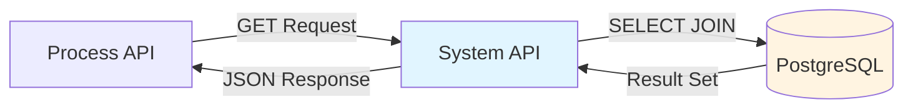
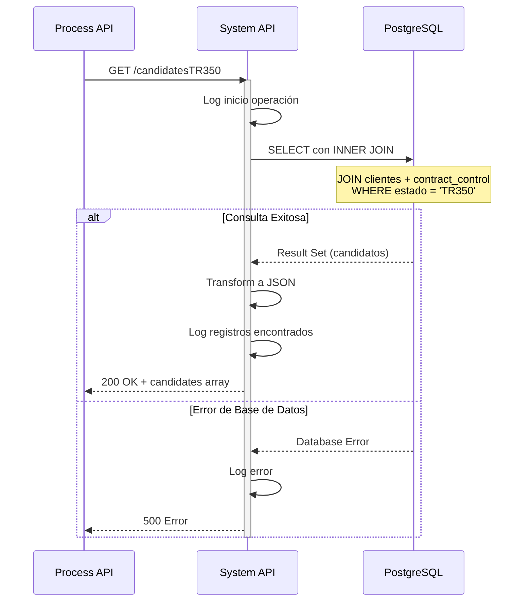
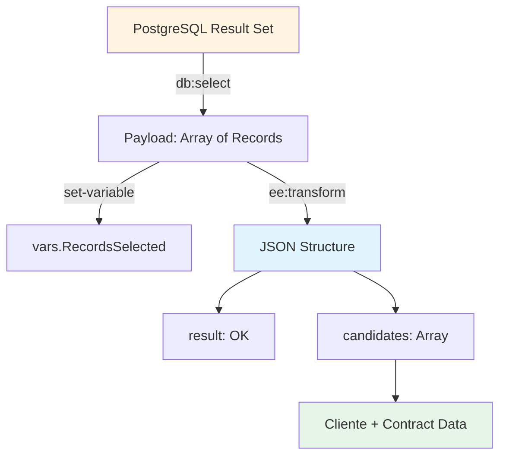
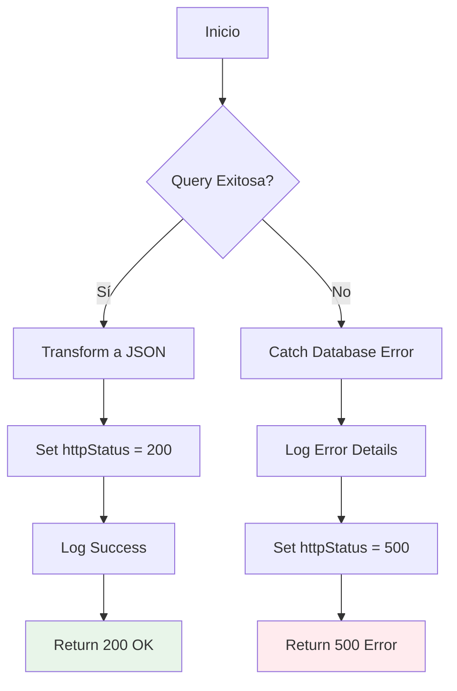

# GET /candidatesTR350

## 📌 Descripción General

### Tipo de API
**System API** - Capa de acceso a datos en arquitectura API-Led Connectivity

### Patrón de Integración
**Database Query Pattern** - Consulta simple a vista/tabla

### Propósito
Consultar candidatos en estado TR350 desde la vista/tabla `candidatosTR350` en PostgreSQL. Esta vista puede estar basada internamente en JOINs de múltiples tablas, pero la consulta desde la API es directa.

### Arquitectura



---

## 💼 Propósito del Negocio

### Problema que Resuelve
Permite identificar y obtener información completa de candidatos que se encuentran en el estado TR350 del proceso de gestión de contratos, facilitando el seguimiento y procesamiento de estos casos específicos.

### Valor para el Negocio
- **Trazabilidad**: Seguimiento de candidatos en estado específico del proceso
- **Eficiencia**: Consulta optimizada con JOIN para obtener datos completos en una sola operación
- **Gestión de Procesos**: Identificación rápida de casos pendientes en estado TR350
- **Datos Completos**: Información del cliente y contrato en una sola respuesta

### Casos de Uso

#### 1. Identificación de Candidatos TR350
```
Proceso de Negocio → Consulta candidatos en estado TR350
                   → Obtiene lista completa con datos de contacto
                   → Procesa candidatos según reglas de negocio
```

#### 2. Generación de Listados
```
Sistema de Reportes → Solicita candidatos TR350
                    → Recibe información completa
                    → Genera reportes o dashboards
```

#### 3. Procesamiento Batch
```
Job Programado → Consulta candidatos TR350
               → Procesa cada candidato
               → Actualiza estados según resultado
```

### Stakeholders
- **Equipo de Operaciones**: Seguimiento de contratos en proceso
- **Equipo de Ventas**: Gestión de candidatos pendientes
- **Sistemas de Reporting**: Generación de métricas y KPIs
- **Process APIs**: Consumidores de datos de candidatos

---

## 🔧 Especificación Técnica

### Método HTTP
```
GET /api/candidatesTR350
```

### URLs por Ambiente

| Ambiente | URL Completa |
|----------|--------------|
| **Local** | `http://localhost:8081/api/candidatesTR350` |
| **Dev** | `https://ntgy-fuv-s-postgresql-dev.us-e2.cloudhub.io/api/candidatesTR350` |
| **UAT** | `https://ntgy-fuv-s-postgresql-uat.us-e2.cloudhub.io/api/candidatesTR350` |
| **UAT01** | `https://ntgy-fuv-s-postgresql-uat01.us-e2.cloudhub.io/api/candidatesTR350` |
| **Producción** | `https://ntgy-fuv-s-postgresql-pro.us-e2.cloudhub.io/api/candidatesTR350` |

### Parámetros de Entrada

#### Query Parameters
Este endpoint **no requiere parámetros**. Retorna todos los candidatos en estado TR350.

### Estructura de Respuesta

#### Response 200 - Éxito

```json
{
  "result": {
    "codResult": "0000",
    "msgResult": "No hay error"
  },
  "records": [
    {
      "T_FUV_INTEGRATION_ID": 12345,
      "T_FUV_DOCUMENTATION_CONTROL_ID": 67890,
      "CONTRACT_ID": "ORD-2024-001234",
      "MESSAGE": "{\"orderId\":\"ORD-2024-001234\",\"clientData\":{...}}",
      "DOCUMENT_NAME": "contrato_firmado.pdf",
      "DOC_UPDATE_DATE": "2024-06-15T10:30:00Z",
      "TIPO_DOCUMENTAL": "CONTRATO",
      "ENVIO_DISTRIBUIDORA": true
    }
  ]
}
```

**Campos de Respuesta:**

| Campo | Tipo | Descripción |
|-------|------|-------------|
| `result` | object | Objeto con resultado de la operación |
| `result.codResult` | string | Código de resultado: "0000" (éxito) o "-0001" (sin registros) |
| `result.msgResult` | string | Mensaje descriptivo del resultado |
| `records` | array | Lista de registros de documentos pendientes |
| `records[].T_FUV_INTEGRATION_ID` | integer | ID del registro en t_fuv_integration |
| `records[].T_FUV_DOCUMENTATION_CONTROL_ID` | integer | ID del registro en t_fuv_documentation_control |
| `records[].CONTRACT_ID` | string | Identificador del pedido/contrato |
| `records[].MESSAGE` | string | Mensaje completo del pedido en formato JSON |
| `records[].DOCUMENT_NAME` | string | Nombre del documento |
| `records[].DOC_UPDATE_DATE` | datetime | Fecha de actualización del documento |
| `records[].TIPO_DOCUMENTAL` | string | Tipo de documento (CONTRATO, DNI, etc.) |
| `records[].ENVIO_DISTRIBUIDORA` | boolean | Indica si se debe enviar a distribuidora |

#### Response 500 - Error del Servidor

```json
{
  "error": {
    "code": "DATABASE_ERROR",
    "message": "Error al consultar candidatos TR350",
    "details": "Connection timeout",
    "timestamp": "2024-06-15T12:30:00Z"
  }
}
```

### Códigos de Estado HTTP

| Código | Descripción | Cuándo Ocurre |
|--------|-------------|---------------|
| **200** | OK | Consulta exitosa (puede retornar array vacío si no hay candidatos) |
| **500** | Internal Server Error | Error de base de datos o error interno del servidor |

---

## 🏗️ Implementación Técnica

### Flujo de Ejecución



### Query SQL Ejecutada

La query SQL se obtiene desde el archivo de configuración mediante la propiedad `${queries.getCandidatesTr350}`:

```sql
SELECT * FROM candidatosTR350 LIMIT 80000
```

**Características de la Query:**
- **Tipo**: SELECT simple (sin JOINs explícitos en la query)
- **Fuente**: Vista/tabla `candidatosTR350`
- **Límite de Registros**: 80000 registros máximo (hardcodeado en la query)
- **Fetch Size**: Configurable via `${dbFUV.fetchsize}` (controla cuántos registros se cargan en memoria a la vez, NO el total)
- **Timeout**: 30 segundos
- **Campos**: Retorna todos los campos (`SELECT *`) de la vista

**Nota Importante**: 
- La vista `candidatosTR350` puede estar basada internamente en JOINs de tablas como `t_fuv_integration` y `t_fuv_documentation_control`, pero esto es transparente para la API.
- El LIMIT de 80000 registros está hardcodeado en la configuración YAML y limita el número máximo de candidatos que se pueden retornar en una sola llamada.

### Componentes MuleSoft

#### 1. Flow Principal
```xml
<flow name="get:\candidatesTR350:s-postgresql-config">
    <logger level="DEBUG" message="get:\candidatesTR350:s-postgresql-config" />
    <flow-ref name="s-postgresql-candidatesTR350" />
</flow>
```

#### 2. Sub-flow de Implementación
```xml
<sub-flow name="s-postgresql-candidatesTR350">
    <!-- Log inicio -->
    <logger level="INFO" 
            message="INICIO getCandidatesTr350" 
            category="s-postgresql-getcandidatesTR350"/>
    
    <!-- Consulta a base de datos con query parametrizada -->
    <db:select config-ref="Database_Config" 
               fetchSize="${dbFUV.fetchsize}">
        <db:sql><![CDATA[${queries.getCandidatesTr350}]]></db:sql>
    </db:select>
    
    <!-- Transformación 1: Almacenar registros en variable -->
    <ee:transform doc:name="vars recordsSelected">
        <ee:variables>
            <ee:set-variable variableName="recordsSelected">
                <![CDATA[%dw 2.0
                output application/json
                ---
                payload map (record, index) -> {
                    "T_FUV_INTEGRATION_ID": record.'t_fuv_integration_id',
                    "T_FUV_DOCUMENTATION_CONTROL_ID": record.'t_fuv_documentation_control_id',
                    "CONTRACT_ID": record.'contract_id',
                    "MESSAGE": record.'message'.value,
                    "DOCUMENT_NAME": record.'document_name',
                    "DOC_UPDATE_DATE": record.'doc_update_date',
                    "TIPO_DOCUMENTAL": record.'tipo_documental',
                    "ENVIO_DISTRIBUIDORA": record.'envio_distribuidora'
                }]]>
            </ee:set-variable>
        </ee:variables>
    </ee:transform>
    
    <!-- Transformación 2: Construir respuesta final -->
    <ee:transform doc:name="response">
        <ee:message>
            <ee:set-payload>
                <![CDATA[%dw 2.0
                output application/json
                ---
                {
                    "result": {
                        "codResult": if (sizeOf(vars.recordsSelected) > 0) "0000" else "-0001",
                        "msgResult": if (sizeOf(vars.recordsSelected) > 0) "No hay error" else "No hay registros existentes"
                    },
                    "records": vars.recordsSelected
                }]]>
            </ee:set-payload>
        </ee:message>
    </ee:transform>
    
    <!-- Log finalización -->
    <logger level="INFO" 
            message="FINISHED getCandidatesTr350 METHOD. RESPONSE: #[payload.result] Registros: #[sizeOf(vars.RecordsSelected)]" 
            category="s-postgresql-getcandidatesTR350"/>
</sub-flow>
```

### Configuración de Base de Datos

```yaml
# Database Configuration
dbFUV:
  host: ${db.host}
  port: ${db.port}
  database: ${db.database}
  user: ${db.user}
  password: ${secure::dbFUV.password}
  fetchsize: 5000
```

### Diagrama de Transformación de Datos



### Manejo de Errores



### Optimizaciones Implementadas

1. **Connection Pooling**: Reutilización de conexiones a PostgreSQL
2. **Fetch Size Configurable**: Control de memoria con fetch size de 5000
3. **INNER JOIN Optimizado**: Join eficiente entre tablas relacionadas
4. **Logging Estructurado**: Logs con categoría específica para troubleshooting
5. **Variable Storage**: Almacenamiento de resultados para logging posterior

---

## 💻 Ejemplos de Uso

### Ejemplo 1: Consulta Básica con curl

```bash
curl -X GET "https://ntgy-fuv-s-postgresql-dev.us-e2.cloudhub.io/api/candidatesTR350" \
  -H "Content-Type: application/json" \
  -H "client_id: your-client-id" \
  -H "client_secret: your-client-secret"
```

**Respuesta Exitosa:**
```json
{
  "result": {
    "codResult": "0000",
    "msgResult": "No hay error"
  },
  "records": [
    {
      "T_FUV_INTEGRATION_ID": 12345,
      "T_FUV_DOCUMENTATION_CONTROL_ID": 67890,
      "CONTRACT_ID": "ORD-2024-001234",
      "MESSAGE": "{\"orderId\":\"ORD-2024-001234\",\"clientData\":{...}}",
      "DOCUMENT_NAME": "contrato_firmado.pdf",
      "DOC_UPDATE_DATE": "2024-06-15T10:30:00Z",
      "TIPO_DOCUMENTAL": "CONTRATO",
      "ENVIO_DISTRIBUIDORA": "Y"
    },
    {
      "T_FUV_INTEGRATION_ID": 12346,
      "T_FUV_DOCUMENTATION_CONTROL_ID": 67891,
      "CONTRACT_ID": "ORD-2024-001235",
      "MESSAGE": "{\"orderId\":\"ORD-2024-001235\",\"clientData\":{...}}",
      "DOCUMENT_NAME": "anexo_contrato.pdf",
      "DOC_UPDATE_DATE": "2024-06-15T11:00:00Z",
      "TIPO_DOCUMENTAL": "ANEXO",
      "ENVIO_DISTRIBUIDORA": "N"
    }
  ]
}
```

**Nota:** Los campos exactos dependen de la estructura de la vista `candidatosTR350`. El campo `ENVIO_DISTRIBUIDORA` se retorna como string ('Y'/'N') desde la base de datos.

### Ejemplo 2: Consulta sin Resultados

```bash
curl -X GET "https://ntgy-fuv-s-postgresql-dev.us-e2.cloudhub.io/api/candidatesTR350" \
  -H "Content-Type: application/json" \
  -H "client_id: your-client-id" \
  -H "client_secret: your-client-secret"
```

**Respuesta (sin candidatos):**
```json
{
  "result": {
    "codResult": "-0001",
    "msgResult": "No hay registros existentes"
  },
  "records": []
}
```

### Ejemplo 3: Integración desde JavaScript

```javascript
async function getCandidatesTR350() {
  const url = 'https://ntgy-fuv-s-postgresql-dev.us-e2.cloudhub.io/api/candidatesTR350';
  
  try {
    const response = await fetch(url, {
      method: 'GET',
      headers: {
        'Content-Type': 'application/json',
        'client_id': 'your-client-id',
        'client_secret': 'your-client-secret'
      }
    });
    
    if (!response.ok) {
      throw new Error(`HTTP error! status: ${response.status}`);
    }
    
    const data = await response.json();
    
    console.log(`Total candidatos TR350: ${data.records.length}`);
    console.log(`Resultado: ${data.result.codResult} - ${data.result.msgResult}`);
    
    data.records.forEach(record => {
      console.log(`Contract ID: ${record.CONTRACT_ID}`);
      console.log(`Document: ${record.DOCUMENT_NAME}`);
      console.log(`Tipo: ${record.TIPO_DOCUMENTAL}`);
      console.log('---');
    });
    
    return data;
  } catch (error) {
    console.error('Error al consultar candidatos:', error);
    throw error;
  }
}

// Uso
getCandidatesTR350()
  .then(data => console.log('Consulta exitosa'))
  .catch(error => console.error('Error:', error));
```

### Ejemplo 4: Integración desde Python

```python
import requests
import json

def get_candidates_tr350():
    """
    Consulta candidatos en estado TR350
    """
    url = "https://ntgy-fuv-s-postgresql-dev.us-e2.cloudhub.io/api/candidatesTR350"
    
    headers = {
        "Content-Type": "application/json",
        "client_id": "your-client-id",
        "client_secret": "your-client-secret"
    }
    
    try:
        response = requests.get(url, headers=headers, timeout=30)
        response.raise_for_status()
        
        data = response.json()
        
        print(f"Total candidatos TR350: {len(data['records'])}")
        print(f"Resultado: {data['result']['codResult']} - {data['result']['msgResult']}")
        
        for record in data['records']:
            print(f"\nContract ID: {record['CONTRACT_ID']}")
            print(f"Document: {record['DOCUMENT_NAME']}")
            print(f"Tipo Documental: {record['TIPO_DOCUMENTAL']}")
            print(f"Fecha Actualización: {record['DOC_UPDATE_DATE']}")
            print(f"Envío Distribuidora: {record['ENVIO_DISTRIBUIDORA']}")
        
        return data
        
    except requests.exceptions.RequestException as e:
        print(f"Error al consultar candidatos: {e}")
        raise

# Uso
if __name__ == "__main__":
    try:
        candidates = get_candidates_tr350()
        print(f"\n✓ Consulta exitosa: {len(candidates['candidates'])} candidatos")
    except Exception as e:
        print(f"\n✗ Error: {e}")
```

### Ejemplo 5: Error de Base de Datos

```bash
curl -X GET "https://ntgy-fuv-s-postgresql-dev.us-e2.cloudhub.io/api/candidatesTR350" \
  -H "Content-Type: application/json" \
  -H "client_id: your-client-id" \
  -H "client_secret: your-client-secret"
```

**Respuesta de Error (500):**
```json
{
  "error": {
    "code": "DATABASE_ERROR",
    "message": "Error al consultar candidatos TR350",
    "details": "Connection to database failed: timeout",
    "timestamp": "2024-06-15T12:30:00Z"
  }
}
```

### Ejemplo 6: Procesamiento Batch

```python
import requests
import time
from datetime import datetime

def process_tr350_candidates_batch():
    """
    Procesa candidatos TR350 en batch
    """
    url = "https://ntgy-fuv-s-postgresql-dev.us-e2.cloudhub.io/api/candidatesTR350"
    
    headers = {
        "Content-Type": "application/json",
        "client_id": "your-client-id",
        "client_secret": "your-client-secret"
    }
    
    try:
        # Obtener candidatos
        response = requests.get(url, headers=headers, timeout=30)
        response.raise_for_status()
        data = response.json()
        
        records = data['records']
        total = len(records)
        
        print(f"[{datetime.now()}] Iniciando procesamiento de {total} candidatos TR350")
        print(f"Resultado consulta: {data['result']['codResult']} - {data['result']['msgResult']}")
        
        processed = 0
        errors = 0
        
        for record in records:
            try:
                # Procesar cada candidato
                print(f"Procesando: {record['CONTRACT_ID']} - {record['DOCUMENT_NAME']}")
                
                # Aquí iría la lógica de procesamiento específica
                # Por ejemplo: enviar email, actualizar estado, etc.
                
                processed += 1
                
            except Exception as e:
                print(f"Error procesando {candidate['id_cliente']}: {e}")
                errors += 1
            
            # Pequeña pausa entre procesamiento
            time.sleep(0.1)
        
        print(f"\n[{datetime.now()}] Procesamiento completado:")
        print(f"  - Total: {total}")
        print(f"  - Procesados: {processed}")
        print(f"  - Errores: {errors}")
        
        return {
            'total': total,
            'processed': processed,
            'errors': errors
        }
        
    except Exception as e:
        print(f"Error en procesamiento batch: {e}")
        raise

# Uso
if __name__ == "__main__":
    result = process_tr350_candidates_batch()
    print(f"\n✓ Batch completado: {result['processed']}/{result['total']} candidatos procesados")
```
