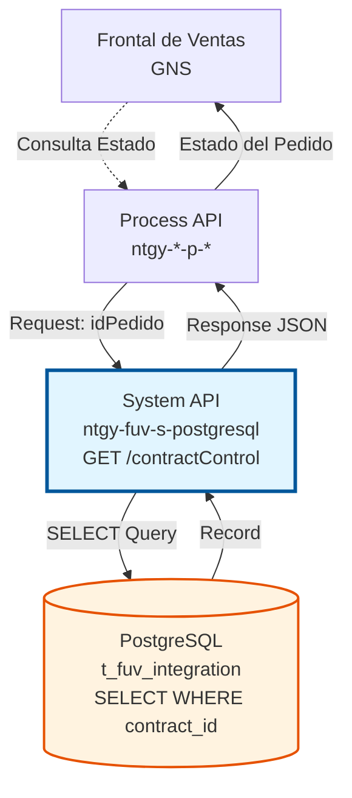

# GET /contractControl

## 📌 Descripción General

### Propósito del Endpoint

Este endpoint consulta un registro específico de control de pedidos GNS desde la tabla `t_fuv_integration` de PostgreSQL, permitiendo obtener el estado completo y la trazabilidad de un pedido mediante su identificador único de contrato.

El endpoint soporta:
- **Consulta por ID de Contrato:** Búsqueda precisa por contract_id
- **Registro Único:** Retorna un único registro mediante query-single
- **Información Completa:** Incluye todos los campos de control y auditoría
- **Mensaje JSONB:** Extrae el mensaje completo del pedido almacenado en formato JSONB
- **Validación de Existencia:** Verifica si el pedido existe en el sistema

### Tipo de API

**Capa:** System API (API-Led Connectivity)

**Función:** Integración directa con PostgreSQL para consulta de datos de control de pedidos GNS del sistema FUV (Facturación Única Virtual).

### Patrón de Integración

**Tipo:** Request-Reply Síncrono con PostgreSQL SELECT (query-single)

**Descripción:** Recibe el ID del pedido como query parameter, extrae el parámetro, ejecuta query SELECT con query-single en la tabla `t_fuv_integration` filtrando por contract_id y ordenando por create_date descendente, transforma el resultado de base de datos a estructura JSON (incluyendo extracción del campo JSONB message), valida la existencia del registro, y retorna el registro único con información completa de control y trazabilidad.

### Arquitectura API-Led Connectivity



---

## 💼 Propósito del Negocio

### Casos de Uso Principales

1. **Consulta de Estado de Pedido**
   - Usuario o sistema consulta el estado actual de un pedido GNS
   - Sistema retorna información completa de control y procesamiento
   - Permite verificar en qué fase del ciclo de vida se encuentra el pedido

2. **Trazabilidad y Auditoría**
   - Obtención de historial completo de un pedido específico
   - Consulta de fechas de creación y actualización
   - Verificación de usuario y programa que realizó cambios

3. **Verificación de Origen del Pedido**
   - Identificación del origen del pedido (Frontal de Ventas)
   - Consulta del campo system_message para determinar origen
   - Permite aplicar lógica diferenciada según origen

4. **Monitoreo de Intentos de Procesamiento**
   - Consulta del contador de intentos (attempts_number)
   - Verificación de errores en procesamiento
   - Identificación de pedidos con múltiples reintentos

### Contexto Empresarial

- **Dominio:** Gestión de Pedidos y Contratos
- **Sector:** Energía - Utilities
- **División:** Naturgy España - GNS (Gas Natural Servicios)
- **Proceso de Negocio:** Consulta y seguimiento de pedidos del Frontal de Ventas
- **Sistema:** FUV (Facturación Única Virtual)

### Stakeholders

- **Equipos de Atención al Cliente**: Consultan estado de pedidos para informar a clientes
- **Equipos de Operaciones**: Monitorean pedidos en proceso y detectan problemas
- **Equipos de Desarrollo**: Verifican procesamiento correcto de pedidos en desarrollo/testing
- **Auditores**: Revisan trazabilidad y cumplimiento de procesos

---

## 🔧 Especificación Técnica

### URLs por Ambiente

| Ambiente | URL Base | URL Completa |
|----------|----------|--------------|
| **Local** | `http://localhost:8081` | `http://localhost:8081/api/contractControl?idPedido={idPedido}` |
| **Development** | `https://ntgy-fuv-s-postgresql-dev.us-e2.cloudhub.io` | `https://ntgy-fuv-s-postgresql-dev.us-e2.cloudhub.io/api/contractControl?idPedido={idPedido}` |
| **UAT** | `https://ntgy-fuv-s-postgresql-uat.us-e2.cloudhub.io` | `https://ntgy-fuv-s-postgresql-uat.us-e2.cloudhub.io/api/contractControl?idPedido={idPedido}` |
| **Production** | `https://ntgy-fuv-s-postgresql-pro.us-e2.cloudhub.io` | `https://ntgy-fuv-s-postgresql-pro.us-e2.cloudhub.io/api/contractControl?idPedido={idPedido}` |

### Método HTTP

```
GET /api/contractControl
```

### Parámetros de Entrada

#### Query Parameters

| Parámetro | Tipo | Requerido | Descripción | Ejemplo |
|-----------|------|-----------|-------------|---------|
| `idPedido` | string | ✅ Sí | Identificador único del pedido del Frontal de Ventas GNS. Se usa para localizar el registro en la tabla t_fuv_integration mediante el campo contract_id. | `"ORD-2024-001234"` |

### Respuestas

#### Respuesta Exitosa (200 OK)

```json
{
  "result": {
    "codResult": "0000",
    "msgResult": "No hay error"
  },
  "record": {
    "T_FUV_INTEGRATION_ID": 12345,
    "CONTRACT_ID": "ORD-2024-001234",
    "SYSTEM_MESSAGE": "Frontal",
    "CODE": "received",
    "MESSAGE": "{\"orderId\":\"ORD-2024-001234\",\"cliente\":{\"nombre\":\"Juan Pérez\",\"nif\":\"12345678A\"},\"contrato\":{\"tipo\":\"ELECTRICIDAD\",\"tarifa\":\"2.0TD\"}}",
    "STATE": "received",
    "RESPONSE": null,
    "ERROR": null,
    "CONTRACT_ATR": 0,
    "CREATE_DATE": "2024-06-16T08:00:00+02:00",
    "UPDATE_DATE": "2024-06-16T08:00:00+02:00",
    "UPDATE_USER": "mulesoft",
    "UPDATE_PROGRAM": "mulesoft",
    "OPTIMIST_LOCK": 1,
    "VIEWABLE": 1,
    "ATTEMPTS_NUMBER": 0,
    "ID_CLIENTE": "CLI-789",
    "ID_PS": "ES0021000000000001AA"
  }
}
```

#### Respuesta de Registro No Encontrado (200 OK con codResult "-0001")

```json
{
  "result": {
    "codResult": "-0001",
    "msgResult": "Registro no existe"
  },
  "record": {}
}
```

#### Respuesta de Error Técnico (500 Internal Server Error)

```json
{
  "result": {
    "codResult": "0001",
    "msgResult": "Error interno del servidor"
  }
}
```

**Nota sobre Validación y Manejo de Errores:**

El comportamiento del endpoint varía según el tipo de error:

- **Parámetro `idPedido` falta completamente**: APIKit valida el RAML y retorna **400 Bad Request** automáticamente.
- **Parámetro presente pero vacío/inválido**: No hay validación explícita en el código. La query SQL fallará y retornará **500 Internal Server Error**.
- **Errores de base de datos**: El flow no tiene error handler propio, por lo que cualquier error de PostgreSQL se propaga como **500 Internal Server Error**.
- **Registro no encontrado**: Este caso SÍ está manejado correctamente en el código mediante la lógica `isEmpty(payload)`, retornando **200 OK** con `codResult: "-0001"`.

---

## 🏗️ Implementación Técnica

### Query SQL Ejecutada

La query se obtiene desde `${queries.getContractControl}`:

```sql
SELECT * 
FROM t_fuv_integration 
WHERE contract_id = :contractId 
ORDER BY create_date DESC
```

**Características:**
- **Operación:** `query-single` - Retorna un único registro (el más reciente)
- **Parámetro:** `:contractId` mapeado desde `vars.idPedido`
- **Tabla:** `t_fuv_integration`
- **Filtro:** `contract_id = :contractId`
- **Ordenamiento:** `ORDER BY create_date DESC` (retorna el registro más reciente si hay múltiples)

### Transformación DataWeave

```dataweave
%dw 2.0
output application/json
---
if (isEmpty(payload)) payload
else 
{
    "T_FUV_INTEGRATION_ID": payload.'t_fuv_integration_id',
    "CONTRACT_ID": payload.'contract_id',
    "SYSTEM_MESSAGE": payload.'system_message',
    "CODE": payload.'code',
    "MESSAGE": payload.'message'.'value',  // Extrae valor de campo JSONB
    "STATE": payload.'state',
    "RESPONSE": payload.'response',
    "ERROR": payload.'error',
    "CONTRACT_ATR": payload.'contract_atr',
    "CREATE_DATE": payload.'create_date',
    "UPDATE_DATE": payload.'update_date',
    "UPDATE_USER": payload.'update_user',
    "UPDATE_PROGRAM": payload.'update_program',
    "OPTIMIST_LOCK": payload.'optimist_lock',
    "VIEWABLE": payload.'viewable',
    "ATTEMPTS_NUMBER": payload.'attempts_number',
    "ID_CLIENTE": payload.'id_cliente',
    "ID_PS": payload.'id_ps'
}
```

**Nota Importante:** El campo `message` es de tipo JSONB en PostgreSQL, por lo que se accede con `.value` para extraer el contenido JSON como string.

### Lógica de Validación

```dataweave
{
    "result": {
        "codResult": if (sizeOf(vars.recordSelected) > 5) "0000" else "-0001",
        "msgResult": if (sizeOf(vars.recordSelected) > 5) "No hay error" else "Registro no existe"
    },
    "record": vars.recordSelected
}
```

**Códigos de Resultado:**
- `"0000"`: Éxito - Registro encontrado y retornado
- `"-0001"`: Error - Registro no existe en la base de datos

---

## 💻 Ejemplos de Uso

### Ejemplo 1: Consulta Exitosa de Pedido

```bash
curl -X GET "https://ntgy-fuv-s-postgresql-dev.us-e2.cloudhub.io/api/contractControl?idPedido=ORD-2024-001234" \
  -H "Accept: application/json" \
  -H "client_id: YOUR_CLIENT_ID" \
  -H "client_secret: YOUR_CLIENT_SECRET"
```

**Response (200 OK):**
```json
{
  "result": {
    "codResult": "0000",
    "msgResult": "No hay error"
  },
  "record": {
    "T_FUV_INTEGRATION_ID": 12345,
    "CONTRACT_ID": "ORD-2024-001234",
    "SYSTEM_MESSAGE": "Frontal",
    "CODE": "received",
    "MESSAGE": "{\"orderId\":\"ORD-2024-001234\",\"cliente\":{\"nombre\":\"Juan Pérez\"}}",
    "STATE": "received",
    "ID_CLIENTE": "CLI-789",
    "ID_PS": "ES0021000000000001AA"
  }
}
```

### Ejemplo 2: Pedido No Encontrado

```bash
curl -X GET "https://ntgy-fuv-s-postgresql-dev.us-e2.cloudhub.io/api/contractControl?idPedido=ORD-9999-NOEXISTE" \
  -H "Accept: application/json" \
  -H "client_id: YOUR_CLIENT_ID" \
  -H "client_secret: YOUR_CLIENT_SECRET"
```

**Response (200 OK con codResult "-0001"):**
```json
{
  "result": {
    "codResult": "-0001",
    "msgResult": "Registro no existe"
  },
  "record": {}
}
```

---

## 📊 Diferencias con GET /contractControl_NW

Este endpoint es similar a `GET /contractControl_NW` pero con las siguientes diferencias:

| Aspecto | GET /contractControl (GNS) | GET /contractControl_NW (NewCo) |
|---------|---------------------------|----------------------------------|
| **Tabla** | `t_fuv_integration` | `t_fuv_integration_nw` |
| **Origen** | Frontal de Ventas GNS | Frontal de Ventas NewCo / Portabilidad Masiva |
| **Campos Adicionales** | `ID_CLIENTE`, `ID_PS` | No tiene estos campos |
| **System Message** | "Frontal" | "Frontal" o "PortabilidadMasiva" |

Ambos endpoints comparten la misma lógica de implementación y estructura de response.