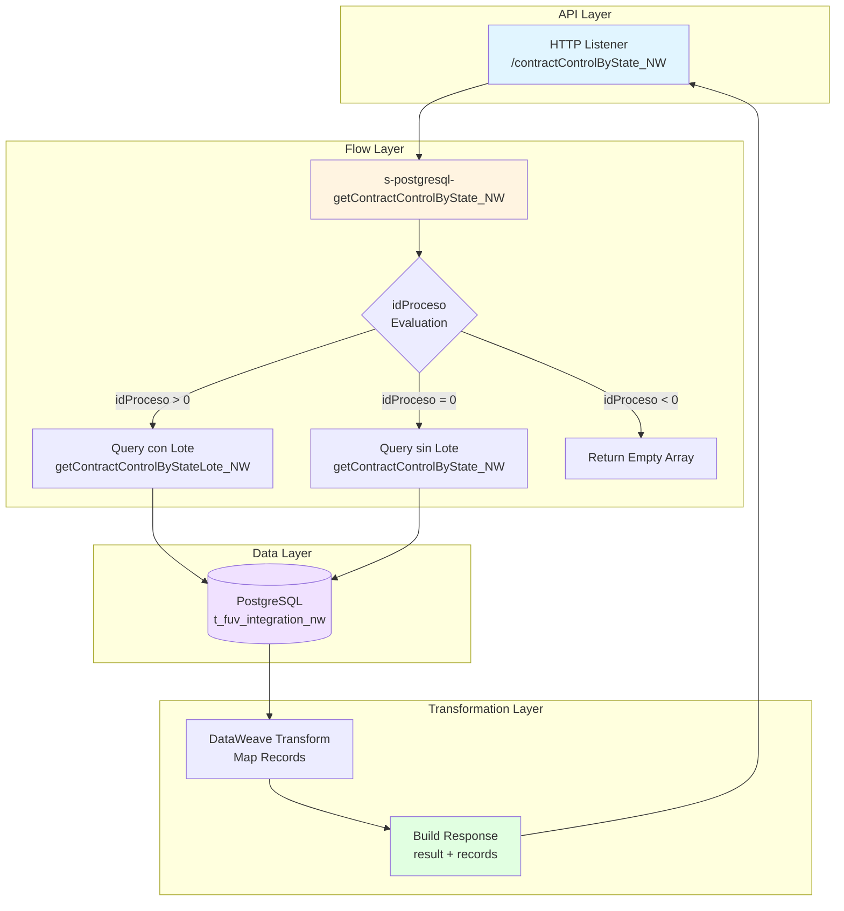
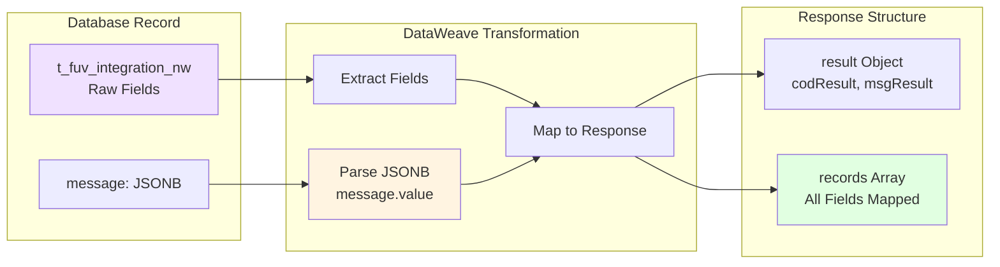
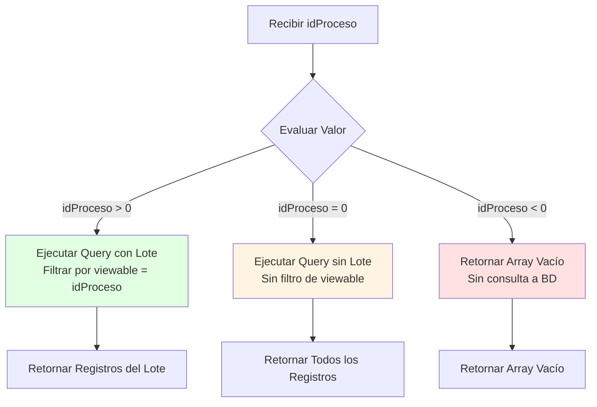

# GET /contractControlByState_NW

## 📌 Descripción General

Consulta registros de control de contratos NEWCO desde la tabla `t_fuv_integration_nw` en PostgreSQL, filtrando por estado y opcionalmente por lote de procesamiento. Este endpoint permite recuperar contratos que requieren reprocesamiento, aplicando filtros automáticos de fecha y número de intentos para optimizar el procesamiento batch.

**Tipo de API:** System API  
**Método HTTP:** GET  
**Ruta:** `/contractControlByState_NW`  
**Backend:** PostgreSQL Database (FUV - Facturación Única Virtual)

---

## 💼 Propósito del Negocio

### Objetivo
Facilitar la consulta de contratos NEWCO que se encuentran en un estado específico para su procesamiento o reprocesamiento, con capacidad de filtrar por lotes de procesamiento batch. Este endpoint es fundamental para los procesos de recuperación de errores y reprocesamiento de contratos.

### Casos de Uso
1. **Reprocesamiento de Contratos en Error**
   - Consultar contratos en estado "ERROR" para reintento de procesamiento
   - Filtrar por lote específico para procesamiento controlado
   - Limitar a contratos con menos de 4 intentos para evitar loops infinitos

2. **Monitoreo de Contratos Pendientes**
   - Identificar contratos en estado "PENDIENTE" esperando procesamiento
   - Obtener contratos de los últimos 10 días para procesamiento prioritario
   - Generar reportes de contratos pendientes por lote

3. **Procesamiento Batch por Lotes**
   - Recuperar contratos asignados a un lote específico (idProceso)
   - Procesar contratos en grupos controlados
   - Facilitar procesamiento paralelo por diferentes workers

4. **Auditoría y Seguimiento**
   - Consultar histórico de contratos por estado
   - Verificar contratos en proceso
   - Analizar patrones de error para mejoras

### Valor de Negocio
- **Recuperación Automática:** Permite identificar y reprocesar contratos fallidos
- **Optimización de Recursos:** Filtra contratos recientes y con intentos limitados
- **Procesamiento Controlado:** Soporta procesamiento por lotes para mejor gestión
- **Visibilidad Operacional:** Facilita monitoreo del estado de contratos NEWCO

---

## 🔧 Especificación Técnica

### Request

#### Query Parameters

| Parámetro | Tipo | Requerido | Default | Descripción |
|-----------|------|-----------|---------|-------------|
| `estado` | string | ✅ Sí | - | Estado del contrato a filtrar. Ejemplos: "PENDIENTE", "ERROR", "EN_PROCESO", "COMPLETADO" |
| `idProceso` | integer | ❌ No | 0 | ID del lote/proceso batch. Valores: &gt;0 (filtra por lote), 0 (sin filtro de lote), &lt;0 (retorna vacío) |

#### Ejemplo de Request
```bash
# Consulta sin filtro de lote
GET /contractControlByState_NW?estado=ERROR

# Consulta con filtro de lote específico
GET /contractControlByState_NW?estado=PENDIENTE&idProceso=12345

# Consulta que retorna vacío (idProceso negativo)
GET /contractControlByState_NW?estado=ERROR&idProceso=-1
```

### Response

#### Estructura de Response (200 OK)

```json
{
  "result": {
    "codResult": "0000",
    "msgResult": "No hay error"
  },
  "records": [
    {
      "T_FUV_INTEGRATION_NW_ID": 12345,
      "CONTRACT_ID": "ORD-2024-001234",
      "SYSTEM_MESSAGE": "Frontal",
      "CODE": "ERROR_001",
      "MESSAGE": "{\"orderId\":\"ORD-2024-001234\",\"clientData\":{...}}",
      "STATE": "ERROR",
      "RESPONSE": "Error en validación de datos",
      "ERROR": "Campo obligatorio faltante: CUPS",
      "CONTRACT_ATR": 0,
      "CREATE_DATE": "2024-06-10T10:30:00Z",
      "UPDATE_DATE": "2024-06-15T14:20:00Z",
      "UPDATE_USER": "mulesoft",
      "UPDATE_PROGRAM": "s-postgresql",
      "OPTIMIST_LOCK": 1,
      "VIEWABLE": 12345,
      "ATTEMPTS_NUMBER": 2
    }
  ]
}
```

#### Campos del Response

**Objeto `result`:**
- `codResult`: Código de resultado ("0000" = éxito)
- `msgResult`: Mensaje descriptivo del resultado

**Array `records`:** Lista de contratos que coinciden con los criterios
- `T_FUV_INTEGRATION_NW_ID`: ID único del registro en la tabla
- `CONTRACT_ID`: Identificador del contrato/pedido
- `SYSTEM_MESSAGE`: Sistema origen del mensaje (ej: "Frontal", "PortabilidadMasiva")
- `CODE`: Código de estado o error
- `MESSAGE`: Mensaje completo del contrato en formato JSON (campo JSONB)
- `STATE`: Estado actual del contrato
- `RESPONSE`: Respuesta del sistema destino
- `ERROR`: Mensaje de error si aplica
- `CONTRACT_ATR`: Atributos adicionales del contrato
- `CREATE_DATE`: Fecha de creación del registro
- `UPDATE_DATE`: Fecha de última actualización
- `UPDATE_USER`: Usuario que realizó la última actualización
- `UPDATE_PROGRAM`: Programa que realizó la última actualización
- `OPTIMIST_LOCK`: Control de concurrencia optimista
- `VIEWABLE`: ID del lote/proceso (usado como filtro con idProceso)
- `ATTEMPTS_NUMBER`: Número de intentos de procesamiento

#### Códigos de Estado HTTP

| Código | Descripción |
|--------|-------------|
| 200 | Consulta exitosa - Retorna array de registros (puede estar vacío) |
| 400 | Parámetro 'estado' falta completamente (validación APIKit) |
| 500 | Error interno del servidor o error de base de datos |

**Nota sobre Validación y Manejo de Errores:**

El comportamiento del endpoint varía según el tipo de error:

- **Parámetro `estado` falta completamente**: APIKit valida el RAML y retorna **400 Bad Request** automáticamente (validación de routing).
- **Parámetro presente pero vacío/inválido**: No hay validación explícita en el código. La query SQL fallará y retornará **500 Internal Server Error**.
- **Errores de base de datos**: El flow no tiene error handler propio, por lo que cualquier error de PostgreSQL se propaga como **500 Internal Server Error** sin transformación.
- **Parámetro `idProceso` negativo**: Este caso SÍ está manejado correctamente mediante lógica condicional, retornando **200 OK** con array vacío sin consultar la base de datos.
- **Sin resultados**: Retorna **200 OK** con array vacío `"records": []` (comportamiento normal, no es error).

---

## 🏗️ Implementación Técnica

### Arquitectura de Componentes



### Flujo de Datos

```mermaid
sequenceDiagram
    participant Client
    participant API as GET /contractControlByState_NW
    participant Flow as Sub-Flow
    participant DB as PostgreSQL
    participant DW as DataWeave
    
    Client->>API: GET ?estado=ERROR&idProceso=12345
    API->>Flow: Invoke sub-flow
    
    Note over Flow: Extract query params<br/>estado, idProceso
    
    alt idProceso &gt; 0
        Flow->>DB: SELECT * FROM t_fuv_integration_nw<br/>WHERE state=:status AND viewable=:IdProceso<br/>AND update_date &gt; CURRENT_DATE-10<br/>AND attempts_number &lt; 4
    else idProceso = 0
        Flow->>DB: SELECT * FROM t_fuv_integration_nw<br/>WHERE state=:status<br/>AND update_date &gt; CURRENT_DATE-10<br/>AND attempts_number &lt; 4
    else idProceso &lt; 0
        Note over Flow: Return empty array
    end
    
    DB-->>Flow: Result Set
    Flow->>DW: Transform records
    
    Note over DW: Map all fields<br/>Extract MESSAGE.value from JSONB<br/>Build result object
    
    DW-->>Flow: Transformed payload
    Flow-->>API: Response with result + records
    API-->>Client: 200 OK + JSON
```

### Transformación de Datos



### Base de Datos

**Database:** PostgreSQL  
**Schema:** public  
**Tabla:** t_fuv_integration_nw

#### Estructura de la Tabla

| Campo | Tipo | Descripción |
|-------|------|-------------|
| t_fuv_integration_nw_id | SERIAL | ID único del registro (PK) |
| contract_id | VARCHAR | Identificador del contrato/pedido |
| system_message | VARCHAR | Sistema origen del mensaje |
| code | VARCHAR | Código de estado o error |
| message | JSONB | Mensaje completo en formato JSON |
| state | VARCHAR | Estado actual del contrato |
| response | TEXT | Respuesta del sistema destino |
| error | TEXT | Mensaje de error si aplica |
| contract_atr | INTEGER | Atributos adicionales |
| create_date | TIMESTAMP | Fecha de creación |
| update_date | TIMESTAMP | Fecha de última actualización |
| update_user | VARCHAR | Usuario de última actualización |
| update_program | VARCHAR | Programa de última actualización |
| optimist_lock | INTEGER | Control de concurrencia |
| viewable | INTEGER | ID del lote/proceso |
| attempts_number | INTEGER | Número de intentos |

#### Queries SQL

**Query sin filtro de lote (idProceso = 0):**
```sql
SELECT * 
FROM t_fuv_integration_nw 
WHERE state = :status 
  AND update_date > CURRENT_DATE - 10 
  AND attempts_number < 4 
ORDER BY update_date ASC
```

**Query con filtro de lote (idProceso &gt; 0):**
```sql
SELECT * 
FROM t_fuv_integration_nw 
WHERE state = :status 
  AND viewable = :IdProceso 
  AND update_date > CURRENT_DATE - 10 
  AND attempts_number < 4 
ORDER BY update_date ASC
```

#### Filtros Automáticos Aplicados

1. **Filtro de Fecha:** `update_date > CURRENT_DATE - 10`
   - Solo retorna registros actualizados en los últimos 10 días
   - Optimiza el rendimiento evitando consultar histórico completo
   - Prioriza contratos recientes para reprocesamiento

2. **Filtro de Intentos:** `attempts_number < 4`
   - Limita a contratos con menos de 4 intentos
   - Previene loops infinitos de reprocesamiento
   - Identifica contratos que aún pueden ser recuperados

3. **Ordenamiento:** `ORDER BY update_date ASC`
   - Procesa primero los contratos más antiguos
   - Garantiza procesamiento FIFO (First In, First Out)
   - Mejora la equidad en el procesamiento

### Lógica Condicional del Parámetro idProceso

El endpoint implementa una lógica condicional basada en el valor de `idProceso`:



**Casos de Uso por Valor:**
- **idProceso &gt; 0:** Procesamiento batch por lotes específicos
- **idProceso = 0:** Consulta general sin filtro de lote
- **idProceso &lt; 0:** Operación de bypass (retorna vacío sin consultar BD)

### Configuración

**Fetch Size:** Configurado mediante `${dbFUV.fetchsize}` (típicamente 5000 registros)

**Timeout:** 30 segundos para operaciones de base de datos

**Connection Pool:** Utiliza pool de conexiones configurado en `Database_Config`

### Manejo de Errores

El endpoint implementa logging comprehensivo:

```dataweave
// Log de entrada (INFO)
'STARTING getContractControlByState_NW METHOD. REQUEST: ' ++ request

// Log de salida (DEBUG)
'FINISHED getContractControlByState_NW METHOD. RESPONSE: ' ++ response

// Log de salida (INFO) con métricas
'FINISHED getContractControlByState_NW METHOD. RESPONSE: ' ++ payload.result 
++ ' Registros: ' ++ vars.NumRecords
```

**Normalización de Datos Sensibles:**
- Utiliza función `common::commonFunctions::normalizeJSON()` para ofuscar datos sensibles en logs
- Protege información personal y confidencial en trazas

---

## 💻 Ejemplos de Uso

### Ejemplo 1: Consulta de Contratos en Error (Sin Lote)

**Request:**
```bash
curl -X GET "https://api.naturgy.com/fuv/s-postgresql/contractControlByState_NW?estado=ERROR" \
  -H "Content-Type: application/json" \
  -H "client_id: your-client-id" \
  -H "client_secret: your-client-secret"
```

**Response (200 OK):**
```json
{
  "result": {
    "codResult": "0000",
    "msgResult": "No hay error"
  },
  "records": [
    {
      "T_FUV_INTEGRATION_NW_ID": 12345,
      "CONTRACT_ID": "ORD-2024-001234",
      "SYSTEM_MESSAGE": "Frontal",
      "CODE": "ERROR_001",
      "MESSAGE": "{\"orderId\":\"ORD-2024-001234\",\"clientData\":{\"name\":\"Juan Pérez\",\"nif\":\"12345678A\"}}",
      "STATE": "ERROR",
      "RESPONSE": "Error en validación de datos",
      "ERROR": "Campo obligatorio faltante: CUPS",
      "CONTRACT_ATR": 0,
      "CREATE_DATE": "2024-06-10T10:30:00Z",
      "UPDATE_DATE": "2024-06-15T14:20:00Z",
      "UPDATE_USER": "mulesoft",
      "UPDATE_PROGRAM": "s-postgresql",
      "OPTIMIST_LOCK": 1,
      "VIEWABLE": 0,
      "ATTEMPTS_NUMBER": 2
    },
    {
      "T_FUV_INTEGRATION_NW_ID": 12346,
      "CONTRACT_ID": "ORD-2024-001235",
      "SYSTEM_MESSAGE": "PortabilidadMasiva",
      "CODE": "ERROR_002",
      "MESSAGE": "{\"orderId\":\"ORD-2024-001235\",\"portabilidadMasiva\":true}",
      "STATE": "ERROR",
      "RESPONSE": "Timeout en sistema destino",
      "ERROR": "Connection timeout after 30s",
      "CONTRACT_ATR": 0,
      "CREATE_DATE": "2024-06-12T08:15:00Z",
      "UPDATE_DATE": "2024-06-15T16:45:00Z",
      "UPDATE_USER": "mulesoft",
      "UPDATE_PROGRAM": "s-postgresql",
      "OPTIMIST_LOCK": 1,
      "VIEWABLE": 0,
      "ATTEMPTS_NUMBER": 3
    }
  ]
}
```

### Ejemplo 2: Consulta de Contratos Pendientes por Lote

**Request:**
```bash
curl -X GET "https://api.naturgy.com/fuv/s-postgresql/contractControlByState_NW?estado=PENDIENTE&idProceso=12345" \
  -H "Content-Type: application/json" \
  -H "client_id: your-client-id" \
  -H "client_secret: your-client-secret"
```

**Response (200 OK):**
```json
{
  "result": {
    "codResult": "0000",
    "msgResult": "No hay error"
  },
  "records": [
    {
      "T_FUV_INTEGRATION_NW_ID": 12347,
      "CONTRACT_ID": "ORD-2024-001236",
      "SYSTEM_MESSAGE": "Frontal",
      "CODE": "received",
      "MESSAGE": "{\"orderId\":\"ORD-2024-001236\",\"clientData\":{\"name\":\"María García\"}}",
      "STATE": "PENDIENTE",
      "RESPONSE": null,
      "ERROR": null,
      "CONTRACT_ATR": 0,
      "CREATE_DATE": "2024-06-15T09:00:00Z",
      "UPDATE_DATE": "2024-06-15T09:00:00Z",
      "UPDATE_USER": "mulesoft",
      "UPDATE_PROGRAM": "s-postgresql",
      "OPTIMIST_LOCK": 0,
      "VIEWABLE": 12345,
      "ATTEMPTS_NUMBER": 0
    }
  ]
}
```

### Ejemplo 3: Consulta sin Resultados

**Request:**
```bash
curl -X GET "https://api.naturgy.com/fuv/s-postgresql/contractControlByState_NW?estado=COMPLETADO" \
  -H "Content-Type: application/json" \
  -H "client_id: your-client-id" \
  -H "client_secret: your-client-secret"
```

**Response (200 OK):**
```json
{
  "result": {
    "codResult": "0000",
    "msgResult": "No hay error"
  },
  "records": []
}
```

### Ejemplo 4: Bypass con idProceso Negativo

**Request:**
```bash
curl -X GET "https://api.naturgy.com/fuv/s-postgresql/contractControlByState_NW?estado=ERROR&idProceso=-1" \
  -H "Content-Type: application/json" \
  -H "client_id: your-client-id" \
  -H "client_secret: your-client-secret"
```

**Response (200 OK):**
```json
{
  "result": {
    "codResult": "0000",
    "msgResult": "No hay error"
  },
  "records": []
}
```

### Ejemplo 5: Error - Parámetro Faltante (Validación APIKit)

**Request:**
```bash
curl -X GET "https://api.naturgy.com/fuv/s-postgresql/contractControlByState_NW" \
  -H "Content-Type: application/json" \
  -H "client_id: your-client-id" \
  -H "client_secret: your-client-secret"
```

**Response (400 Bad Request):**
```json
{
  "message": "Bad request"
}
```

**Nota:** Si el parámetro `estado` falta completamente, APIKit valida el RAML antes de ejecutar el flow y retorna 400 Bad Request automáticamente.

---

### Ejemplo 5b: Error - Parámetro Vacío

**Request:**
```bash
curl -X GET "https://api.naturgy.com/fuv/s-postgresql/contractControlByState_NW?estado=" \
  -H "Content-Type: application/json" \
  -H "client_id: your-client-id" \
  -H "client_secret: your-client-secret"
```

**Response (500 Internal Server Error):**
```json
{
  "result": {
    "codResult": "0001",
    "msgResult": "Error interno del servidor"
  }
}
```

**Nota:** Si el parámetro está presente pero vacío, APIKit no valida el valor. La query SQL fallará (`WHERE state = ''`) y retornará error 500 sin manejo específico.

### Ejemplo 6: Uso en Script de Reprocesamiento

```python
import requests
import time

# Configuración
API_URL = "https://api.naturgy.com/fuv/s-postgresql"
CLIENT_ID = "your-client-id"
CLIENT_SECRET = "your-client-secret"
LOTE_ID = 12345

# Headers
headers = {
    "Content-Type": "application/json",
    "client_id": CLIENT_ID,
    "client_secret": CLIENT_SECRET
}

# Consultar contratos en error del lote
response = requests.get(
    f"{API_URL}/contractControlByState_NW",
    params={"estado": "ERROR", "idProceso": LOTE_ID},
    headers=headers
)

if response.status_code == 200:
    data = response.json()
    records = data.get("records", [])
    
    print(f"Contratos en error encontrados: {len(records)}")
    
    for record in records:
        contract_id = record["CONTRACT_ID"]
        attempts = record["ATTEMPTS_NUMBER"]
        error = record["ERROR"]
        
        print(f"Contrato: {contract_id}")
        print(f"  Intentos: {attempts}")
        print(f"  Error: {error}")
        
        # Aquí iría la lógica de reprocesamiento
        # ...
        
        time.sleep(1)  # Rate limiting
else:
    print(f"Error: {response.status_code}")
    print(response.text)
```

### Ejemplo 7: Monitoreo de Contratos Pendientes

```javascript
// Node.js - Script de monitoreo
const axios = require('axios');

const API_URL = 'https://api.naturgy.com/fuv/s-postgresql';
const CLIENT_ID = 'your-client-id';
const CLIENT_SECRET = 'your-client-secret';

async function monitorearContratosPendientes() {
  try {
    const response = await axios.get(
      `${API_URL}/contractControlByState_NW`,
      {
        params: { estado: 'PENDIENTE', idProceso: 0 },
        headers: {
          'Content-Type': 'application/json',
          'client_id': CLIENT_ID,
          'client_secret': CLIENT_SECRET
        }
      }
    );

    const records = response.data.records || [];
    
    console.log(`📊 Contratos pendientes: ${records.length}`);
    
    // Agrupar por sistema origen
    const porSistema = records.reduce((acc, record) => {
      const sistema = record.SYSTEM_MESSAGE;
      acc[sistema] = (acc[sistema] || 0) + 1;
      return acc;
    }, {});
    
    console.log('📈 Distribución por sistema:');
    Object.entries(porSistema).forEach(([sistema, count]) => {
      console.log(`  ${sistema}: ${count}`);
    });
    
    // Alertar si hay muchos pendientes
    if (records.length > 100) {
      console.warn('⚠️  ALERTA: Más de 100 contratos pendientes');
    }
    
  } catch (error) {
    console.error('❌ Error al consultar contratos:', error.message);
  }
}

// Ejecutar cada 5 minutos
setInterval(monitorearContratosPendientes, 5 * 60 * 1000);
monitorearContratosPendientes(); // Ejecución inicial