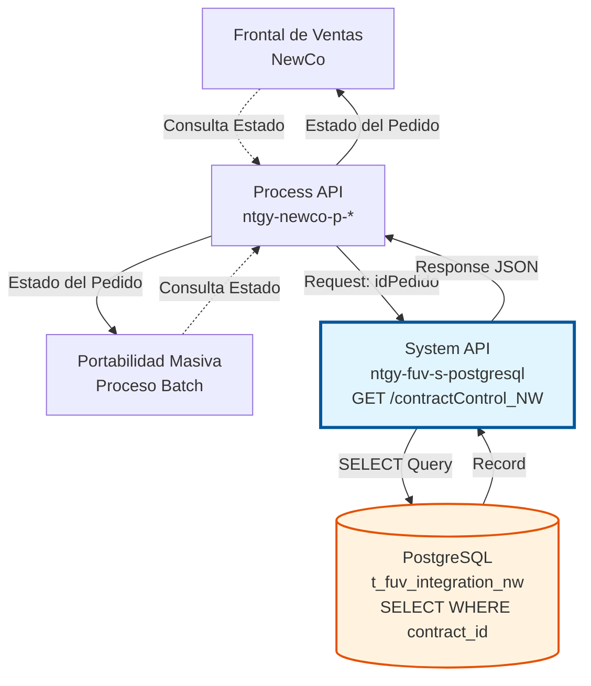
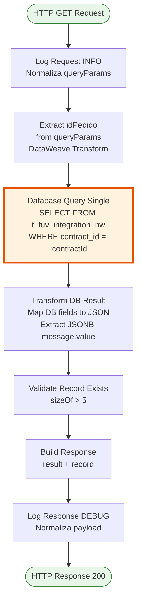
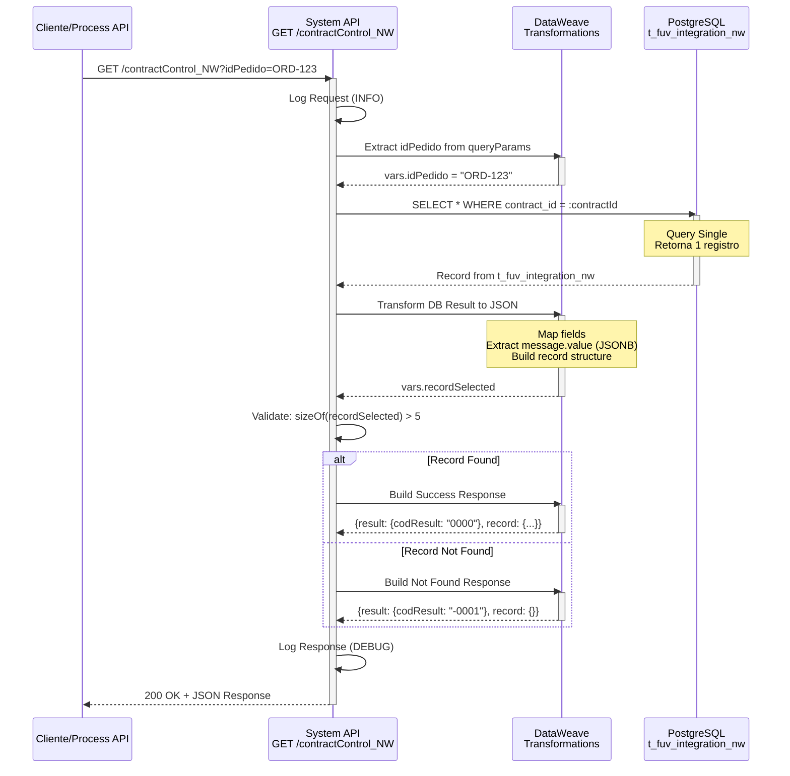
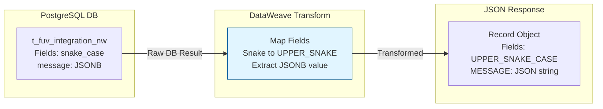

# GET /contractControl_NW

## 📌 Descripción General

### Propósito del Endpoint

Este endpoint consulta un registro específico de control de pedidos NewCo desde la tabla `t_fuv_integration_nw` de PostgreSQL, permitiendo obtener el estado completo y la trazabilidad de un pedido mediante su identificador único de contrato.

El endpoint soporta:
- **Consulta por ID de Contrato:** Búsqueda precisa por contract_id
- **Registro Único:** Retorna un único registro mediante query-single
- **Información Completa:** Incluye todos los campos de control y auditoría
- **Mensaje JSONB:** Extrae el mensaje completo del pedido almacenado en formato JSONB
- **Validación de Existencia:** Verifica si el pedido existe en el sistema

### Tipo de API

**Capa:** System API (API-Led Connectivity)

**Función:** Integración directa con PostgreSQL para consulta de datos de control de pedidos NewCo del sistema FUV (Facturación Única Virtual).

### Patrón de Integración

**Tipo:** Request-Reply Síncrono con PostgreSQL SELECT (query-single)

**Descripción:** Recibe el ID del pedido como query parameter, extrae el parámetro, ejecuta query SELECT con query-single en la tabla `t_fuv_integration_nw` filtrando por contract_id, transforma el resultado de base de datos a estructura JSON (incluyendo extracción del campo JSONB message), valida la existencia del registro, y retorna el registro único con información completa de control y trazabilidad.

### Arquitectura API-Led Connectivity



---

## 💼 Propósito del Negocio

### Casos de Uso Principales

1. **Consulta de Estado de Pedido**
   - Usuario o sistema consulta el estado actual de un pedido NewCo
   - Sistema retorna información completa de control y procesamiento
   - Permite verificar en qué fase del ciclo de vida se encuentra el pedido
   - **Beneficio**: Visibilidad en tiempo real del estado del pedido

2. **Trazabilidad y Auditoría**
   - Obtención de historial completo de un pedido específico
   - Consulta de fechas de creación y actualización
   - Verificación de usuario y programa que realizó cambios
   - **Beneficio**: Cumplimiento normativo y capacidad de auditoría completa

3. **Verificación de Origen del Pedido**
   - Identificación si el pedido proviene del Frontal o Portabilidad Masiva
   - Consulta del campo system_message para determinar origen
   - Permite aplicar lógica diferenciada según origen
   - **Beneficio**: Gestión diferenciada de pedidos según su procedencia

4. **Monitoreo de Intentos de Procesamiento**
   - Consulta del contador de intentos (attempts_number)
   - Verificación de errores en procesamiento
   - Identificación de pedidos con múltiples reintentos
   - **Beneficio**: Detección proactiva de problemas de procesamiento

### Contexto Empresarial

- **Dominio:** Gestión de Pedidos y Contratos
- **Sector:** Energía - Utilities
- **División:** Naturgy España - NewCo
- **Proceso de Negocio:** Consulta y seguimiento de pedidos del Frontal de Ventas y Portabilidad Masiva
- **Sistema:** FUV (Facturación Única Virtual)

### Stakeholders

- **Equipos de Atención al Cliente**: Consultan estado de pedidos para informar a clientes
- **Equipos de Operaciones**: Monitorean pedidos en proceso y detectan problemas
- **Equipos de Desarrollo**: Verifican procesamiento correcto de pedidos en desarrollo/testing
- **Auditores**: Revisan trazabilidad y cumplimiento de procesos

### Valor de Negocio

- **Transparencia Operacional**: Visibilidad completa del estado de cada pedido
- **Eficiencia en Atención al Cliente**: Respuesta rápida a consultas sobre estado de pedidos
- **Detección Temprana de Problemas**: Identificación de pedidos con errores o múltiples reintentos
- **Cumplimiento Normativo**: Trazabilidad completa para auditorías y cumplimiento GDPR

### Consumidores Potenciales

Este endpoint puede ser consumido por:
- Process APIs de gestión de pedidos NewCo
- Sistemas de monitoreo y dashboards operacionales
- Herramientas de atención al cliente
- Procesos de auditoría y reporting
- Sistemas de integración middleware

---

## 🔧 Especificación Técnica

### URLs por Ambiente

| Ambiente | URL Base | URL Completa |
|----------|----------|--------------|
| **Local** | `http://localhost:8081` | `http://localhost:8081/api/contractControl_NW?idPedido=ORD-NW-2024-001234` |
| **Development** | `https://ntgy-fuv-s-postgresql-dev.us-e2.cloudhub.io` | `https://ntgy-fuv-s-postgresql-dev.us-e2.cloudhub.io/api/contractControl_NW?idPedido=ORD-NW-2024-001234` |
| **UAT** | `https://ntgy-fuv-s-postgresql-uat.us-e2.cloudhub.io` | `https://ntgy-fuv-s-postgresql-uat.us-e2.cloudhub.io/api/contractControl_NW?idPedido=ORD-NW-2024-001234` |
| **Production** | `https://ntgy-fuv-s-postgresql-pro.us-e2.cloudhub.io` | `https://ntgy-fuv-s-postgresql-pro.us-e2.cloudhub.io/api/contractControl_NW?idPedido=ORD-NW-2024-001234` |

### Método HTTP

```
GET /api/contractControl_NW
```

### Parámetros de Entrada

#### Headers HTTP

| Header | Tipo | Requerido | Descripción | Ejemplo |
|--------|------|-----------|-------------|---------|
| `Accept` | string | ❌ No | Tipo de contenido esperado en response | `application/json` |

#### Query Parameters

| Parámetro | Tipo | Requerido | Descripción | Ejemplo |
|-----------|------|-----------|-------------|---------|
| `idPedido` | string | ✅ Sí | Identificador único del pedido del Frontal de Ventas NewCo o Portabilidad Masiva. Se usa para localizar el registro en la tabla t_fuv_integration_nw mediante el campo contract_id. | `"ORD-NW-2024-001234"` |

### Respuestas

#### Respuesta Exitosa (200 OK)

```json
{
  "result": {
    "codResult": "0000",
    "msgResult": "No hay error"
  },
  "record": {
    "T_FUV_INTEGRATION_NW_ID": 12345,
    "CONTRACT_ID": "ORD-NW-2024-001234",
    "SYSTEM_MESSAGE": "Frontal",
    "CODE": "received",
    "MESSAGE": "{\"orderId\":\"ORD-NW-2024-001234\",\"cliente\":{\"nombre\":\"Juan Pérez\",\"nif\":\"12345678A\"},\"contrato\":{\"tipo\":\"ELECTRICIDAD\",\"tarifa\":\"2.0TD\"}}",
    "STATE": "received",
    "RESPONSE": null,
    "ERROR": null,
    "CONTRACT_ATR": 0,
    "CREATE_DATE": "2024-06-16T08:00:00+02:00",
    "UPDATE_DATE": "2024-06-16T08:00:00+02:00",
    "UPDATE_USER": "mulesoft",
    "UPDATE_PROGRAM": "mulesoft",
    "OPTIMIST_LOCK": 1,
    "VIEWABLE": 1,
    "ATTEMPTS_NUMBER": 0
  }
}
```

**Descripción de Campos del Record:**

| Campo | Tipo | Descripción |
|-------|------|-------------|
| `T_FUV_INTEGRATION_NW_ID` | number | ID único del registro en la tabla |
| `CONTRACT_ID` | string | Identificador del pedido (clave de búsqueda) |
| `SYSTEM_MESSAGE` | string | Origen del pedido: "Frontal" o "PortabilidadMasiva" |
| `CODE` | string | Código de estado del procesamiento |
| `MESSAGE` | string | Mensaje completo del pedido en formato JSON (campo JSONB) |
| `STATE` | string | Estado actual del procesamiento |
| `RESPONSE` | string\|null | Respuesta del procesamiento (null si no procesado) |
| `ERROR` | string\|null | Mensaje de error si aplica |
| `CONTRACT_ATR` | number | Atributo del contrato |
| `CREATE_DATE` | string | Fecha y hora de creación (ISO 8601 con timezone) |
| `UPDATE_DATE` | string | Fecha y hora de última actualización |
| `UPDATE_USER` | string | Usuario que realizó la última actualización |
| `UPDATE_PROGRAM` | string | Programa que realizó la última actualización |
| `OPTIMIST_LOCK` | number | Versión para control de concurrencia optimista |
| `VIEWABLE` | number | Indicador de visibilidad (1 = visible, 0 = oculto) |
| `ATTEMPTS_NUMBER` | number | Número de intentos de procesamiento |

#### Respuesta de Registro No Encontrado (200 OK con codResult "-0001")

```json
{
  "result": {
    "codResult": "-0001",
    "msgResult": "Registro no existe"
  },
  "record": {}
}
```

#### Respuesta de Error Técnico (500 Internal Server Error)

```json
{
  "result": {
    "codResult": "0001",
    "msgResult": "Error interno del servidor"
  }
}
```

**Nota sobre Validación y Manejo de Errores:**

El comportamiento del endpoint varía según el tipo de error:

- **Parámetro `idPedido` falta completamente**: APIKit valida el RAML y retorna **400 Bad Request** automáticamente (validación de routing).
- **Parámetro presente pero vacío/inválido**: No hay validación explícita en el código. La query SQL fallará y retornará **500 Internal Server Error**.
- **Errores de base de datos**: El flow no tiene error handler propio (`<error-handler ref="apiErrorHandler" />`), por lo que cualquier error de PostgreSQL se propaga como **500 Internal Server Error** sin transformación.
- **Registro no encontrado**: Este caso SÍ está manejado correctamente en el código mediante la lógica `isEmpty(payload)`, retornando **200 OK** con `codResult: "-0001"`.

**Recomendación**: Para un manejo de errores más robusto, considerar añadir validación explícita del parámetro y un error handler al flow.

### Autenticación y Autorización

- **Tipo:** Client ID & Client Secret (Anypoint Platform)
- **Autorización PostgreSQL:** El usuario de base de datos debe tener permisos para:
  - Ejecutar SELECT en tabla `t_fuv_integration_nw`
  - Acceso al schema `public`
  - Lectura de campos JSONB

### Timeouts

| Tipo | Valor | Descripción |
|------|-------|-------------|
| **Request Timeout** | 30 segundos | Tiempo máximo de espera para la respuesta |
| **Connection Timeout** | 10 segundos | Tiempo máximo para establecer conexión con PostgreSQL |
| **Query Timeout** | 30 segundos | Tiempo máximo de ejecución de la query SQL |

---

## 🏗️ Implementación Técnica

### Arquitectura del Flow



### Diagrama de Secuencia Completo



### Transformación de Datos



### Sub-flow: s-postgresql-getContractControl_NW

**Ubicación:** `src/main/mule/s-postgresql-contractControl_NW.xml` (líneas 155-217)

#### 1. Logging de Request (Líneas 156)

```dataweave
%dw 2.0
output application/java
var payloadStr = write(attributes.queryParams,'application/json')
var request = common::commonFunctions::normalizeJSON(payloadStr)
---
'STARTING getContractControl_NW METHOD. REQUEST: ' ++ request
```

**Propósito:** Registra los query parameters recibidos de forma normalizada para trazabilidad.

#### 2. Extracción de Parámetro (Líneas 157-167)

```dataweave
%dw 2.0
output application/java
---
attributes.queryParams.idPedido
```

**Propósito:** Extrae el parámetro `idPedido` de los query parameters y lo almacena en `vars.idPedido`.

#### 3. Query a Base de Datos (Líneas 168-171)

```xml
<db:query-single config-ref="Database_Config">
    <db:sql><![CDATA[${queries.getContractControl_NW}]]></db:sql>
    <db:input-parameters><![CDATA[#[{contractId: vars.idPedido}]]]></db:input-parameters>
</db:query-single>
```

**Query SQL Ejecutada:**
```sql
SELECT 
  t_fuv_integration_nw_id,
  contract_id,
  system_message,
  code,
  message,
  state,
  response,
  error,
  contract_atr,
  create_date,
  update_date,
  update_user,
  update_program,
  optimist_lock,
  viewable,
  attempts_number
FROM t_fuv_integration_nw
WHERE contract_id = :contractId
```

**Características:**
- **Operación:** `query-single` - Retorna un único registro
- **Parámetro:** `:contractId` mapeado desde `vars.idPedido`
- **Tabla:** `t_fuv_integration_nw`
- **Filtro:** `contract_id = :contractId`

#### 4. Transformación de Resultado (Líneas 172-200)

```dataweave
%dw 2.0
output application/json
---
if (isEmpty(payload)) payload
else 
{
    "T_FUV_INTEGRATION_NW_ID": payload.'t_fuv_integration_nw_id',
    "CONTRACT_ID": payload.'contract_id',
    "SYSTEM_MESSAGE": payload.'system_message',
    "CODE": payload.'code',
    "MESSAGE": payload.'message'.'value',  // Extrae valor de campo JSONB
    "STATE": payload.'state',
    "RESPONSE": payload.'response',
    "ERROR": payload.'error',
    "CONTRACT_ATR": payload.'contract_atr',
    "CREATE_DATE": payload.'create_date',
    "UPDATE_DATE": payload.'update_date',
    "UPDATE_USER": payload.'update_user',
    "UPDATE_PROGRAM": payload.'update_program',
    "OPTIMIST_LOCK": payload.'optimist_lock',
    "VIEWABLE": payload.'viewable',
    "ATTEMPTS_NUMBER": payload.'attempts_number'
}
```

**Propósito:** 
- Transforma campos de base de datos (snake_case) a formato JSON (UPPER_SNAKE_CASE)
- Extrae el valor del campo JSONB `message` usando `.value`
- Maneja caso de registro vacío con `isEmpty(payload)`

**Nota Importante:** El campo `message` es de tipo JSONB en PostgreSQL, por lo que se accede con `.value` para extraer el contenido JSON como string.

#### 5. Construcción de Respuesta (Líneas 201-214)

```dataweave
%dw 2.0
output application/json
---
{
    "result": {
        "codResult": if (sizeOf(vars.recordSelected) > 5) "0000" else "-0001",
        "msgResult": if (sizeOf(vars.recordSelected) > 5) "No hay error" else "Registro no existe"
    },
    "record": vars.recordSelected
}
```

**Lógica de Validación:**
- **Registro Encontrado:** `sizeOf(vars.recordSelected) > 5` → `codResult: "0000"`
- **Registro No Encontrado:** `sizeOf <= 5` → `codResult: "-0001"`

**Códigos de Resultado:**
- `"0000"`: Éxito - Registro encontrado y retornado
- `"-0001"`: Error - Registro no existe en la base de datos

#### 6. Logging de Response (Líneas 215-216)

```dataweave
%dw 2.0
output application/java
var payloadStr = write(payload,'application/json')
var response = common::commonFunctions::normalizeJSON(payloadStr)
---
'FINISHED getContractControl_NW METHOD. RESPONSE: ' ++ response
```

**Propósito:** Registra la respuesta completa normalizada para trazabilidad y debugging.

---

## 💻 Ejemplos de Uso

### Ejemplo 1: Consulta Exitosa de Pedido

#### Request

```bash
curl -X GET "https://ntgy-fuv-s-postgresql-dev.us-e2.cloudhub.io/api/contractControl_NW?idPedido=ORD-NW-2024-001234" \
  -H "Accept: application/json" \
  -H "client_id: YOUR_CLIENT_ID" \
  -H "client_secret: YOUR_CLIENT_SECRET"
```

#### Response (200 OK)

```json
{
  "result": {
    "codResult": "0000",
    "msgResult": "No hay error"
  },
  "record": {
    "T_FUV_INTEGRATION_NW_ID": 12345,
    "CONTRACT_ID": "ORD-NW-2024-001234",
    "SYSTEM_MESSAGE": "Frontal",
    "CODE": "received",
    "MESSAGE": "{\"orderId\":\"ORD-NW-2024-001234\",\"cliente\":{\"nombre\":\"Juan Pérez\",\"nif\":\"12345678A\"},\"contrato\":{\"tipo\":\"ELECTRICIDAD\",\"tarifa\":\"2.0TD\"}}",
    "STATE": "received",
    "RESPONSE": null,
    "ERROR": null,
    "CONTRACT_ATR": 0,
    "CREATE_DATE": "2024-06-16T08:00:00+02:00",
    "UPDATE_DATE": "2024-06-16T08:00:00+02:00",
    "UPDATE_USER": "mulesoft",
    "UPDATE_PROGRAM": "mulesoft",
    "OPTIMIST_LOCK": 1,
    "VIEWABLE": 1,
    "ATTEMPTS_NUMBER": 0
  }
}
```

### Ejemplo 2: Pedido No Encontrado

#### Request

```bash
curl -X GET "https://ntgy-fuv-s-postgresql-dev.us-e2.cloudhub.io/api/contractControl_NW?idPedido=ORD-NW-9999-NOEXISTE" \
  -H "Accept: application/json" \
  -H "client_id: YOUR_CLIENT_ID" \
  -H "client_secret: YOUR_CLIENT_SECRET"
```

#### Response (200 OK con codResult "-0001")

```json
{
  "result": {
    "codResult": "-0001",
    "msgResult": "Registro no existe"
  },
  "record": {}
}
```

### Ejemplo 3: Consulta de Pedido de Portabilidad Masiva

#### Request

```bash
curl -X GET "https://ntgy-fuv-s-postgresql-pro.us-e2.cloudhub.io/api/contractControl_NW?idPedido=PM-2024-567890" \
  -H "Accept: application/json" \
  -H "client_id: YOUR_CLIENT_ID" \
  -H "client_secret: YOUR_CLIENT_SECRET"
```

#### Response (200 OK)

```json
{
  "result": {
    "codResult": "0000",
    "msgResult": "No hay error"
  },
  "record": {
    "T_FUV_INTEGRATION_NW_ID": 67890,
    "CONTRACT_ID": "PM-2024-567890",
    "SYSTEM_MESSAGE": "PortabilidadMasiva",
    "CODE": "processed",
    "MESSAGE": "{\"orderId\":\"PM-2024-567890\",\"portabilidadMasiva\":true,\"lote\":\"LOTE-2024-05\"}",
    "STATE": "completed",
    "RESPONSE": "{\"status\":\"success\",\"processedAt\":\"2024-06-15T10:30:00Z\"}",
    "ERROR": null,
    "CONTRACT_ATR": 1,
    "CREATE_DATE": "2024-06-15T08:00:00+02:00",
    "UPDATE_DATE": "2024-06-15T10:30:15+02:00",
    "UPDATE_USER": "mulesoft",
    "UPDATE_PROGRAM": "batch-processor",
    "OPTIMIST_LOCK": 3,
    "VIEWABLE": 1,
    "ATTEMPTS_NUMBER": 2
  }
}
```

### Ejemplo 4: Error por Parámetro Faltante (Validación APIKit)

#### Request

```bash
curl -X GET "https://ntgy-fuv-s-postgresql-dev.us-e2.cloudhub.io/api/contractControl_NW" \
  -H "Accept: application/json" \
  -H "client_id: YOUR_CLIENT_ID" \
  -H "client_secret: YOUR_CLIENT_SECRET"
```

#### Response (400 Bad Request)

```json
{
  "message": "Bad request"
}
```

**Nota:** Si el parámetro `idPedido` falta completamente, APIKit valida el RAML antes de ejecutar el flow y retorna 400 Bad Request automáticamente.

---

### Ejemplo 5: Error por Parámetro Vacío

#### Request

```bash
curl -X GET "https://ntgy-fuv-s-postgresql-dev.us-e2.cloudhub.io/api/contractControl_NW?idPedido=" \
  -H "Accept: application/json" \
  -H "client_id: YOUR_CLIENT_ID" \
  -H "client_secret: YOUR_CLIENT_SECRET"
```

#### Response (500 Internal Server Error)

```json
{
  "result": {
    "codResult": "0001",
    "msgResult": "Error interno del servidor"
  }
}
```

**Nota:** Si el parámetro está presente pero vacío, APIKit no valida el valor. La query SQL fallará (`WHERE contract_id = ''`) y retornará error 500 sin manejo específico.

### Ejemplo 6: Uso desde JavaScript/Node.js

```javascript
const axios = require('axios');

async function getContractControlNW(idPedido) {
  try {
    const response = await axios.get(
      'https://ntgy-fuv-s-postgresql-dev.us-e2.cloudhub.io/api/contractControl_NW',
      {
        params: { idPedido },
        headers: {
          'Accept': 'application/json',
          'client_id': process.env.CLIENT_ID,
          'client_secret': process.env.CLIENT_SECRET
        }
      }
    );

    if (response.data.result.codResult === '0000') {
      console.log('Pedido encontrado:', response.data.record);
      return response.data.record;
    } else {
      console.log('Pedido no encontrado:', response.data.result.msgResult);
      return null;
    }
  } catch (error) {
    console.error('Error al consultar pedido:', error.message);
    throw error;
  }
}

// Uso
getContractControlNW('ORD-NW-2024-001234')
  .then(record => {
    if (record) {
      console.log('Estado del pedido:', record.STATE);
      console.log('Origen:', record.SYSTEM_MESSAGE);
      console.log('Intentos:', record.ATTEMPTS_NUMBER);
    }
  });
```

### Ejemplo 7: Uso desde Python

```python
import requests
import os
import json

def get_contract_control_nw(id_pedido):
    """
    Consulta el estado de un pedido NewCo
    
    Args:
        id_pedido (str): ID del pedido a consultar
        
    Returns:
        dict: Registro del pedido o None si no existe
    """
    url = "https://ntgy-fuv-s-postgresql-dev.us-e2.cloudhub.io/api/contractControl_NW"
    
    headers = {
        "Accept": "application/json",
        "client_id": os.getenv("CLIENT_ID"),
        "client_secret": os.getenv("CLIENT_SECRET")
    }
    
    params = {"idPedido": id_pedido}
    
    try:
        response = requests.get(url, headers=headers, params=params)
        response.raise_for_status()
        
        data = response.json()
        
        if data["result"]["codResult"] == "0000":
            print(f"Pedido encontrado: {id_pedido}")
            return data["record"]
        else:
            print(f"Pedido no encontrado: {data['result']['msgResult']}")
            return None
            
    except requests.exceptions.RequestException as e:
        print(f"Error al consultar pedido: {e}")
        raise

# Uso
if __name__ == "__main__":
    record = get_contract_control_nw("ORD-NW-2024-001234")
    
    if record:
        print(f"Estado: {record['STATE']}")
        print(f"Origen: {record['SYSTEM_MESSAGE']}")
        print(f"Intentos: {record['ATTEMPTS_NUMBER']}")
        
        # Parsear mensaje JSONB
        message = json.loads(record['MESSAGE'])
        print(f"Datos del mensaje: {message}")
```

---

## 📊 Información Adicional

### Query SQL Real

La query SQL ejecutada por este endpoint (desde configuración `s-postgresql-global-config.yaml`):

```sql
SELECT * 
FROM t_fuv_integration_nw 
WHERE contract_id = :contractId 
ORDER BY create_date DESC
```

**Nota:** Aunque la query incluye `ORDER BY create_date DESC`, al usar `query-single` solo retorna el primer registro (el más reciente si hay múltiples).

### Estructura de la Tabla t_fuv_integration_nw

| Columna | Tipo | Nullable | Descripción |
|---------|------|----------|-------------|
| `t_fuv_integration_nw_id` | SERIAL | NO | ID autoincremental (PK) |
| `contract_id` | VARCHAR | NO | ID del pedido (UNIQUE) |
| `system_message` | VARCHAR | YES | Origen: "Frontal" o "PortabilidadMasiva" |
| `code` | VARCHAR | YES | Código de estado |
| `message` | JSONB | YES | Mensaje completo del pedido |
| `state` | VARCHAR | YES | Estado del procesamiento |
| `response` | TEXT | YES | Respuesta del procesamiento |
| `error` | TEXT | YES | Mensaje de error |
| `contract_atr` | INTEGER | YES | Atributo del contrato |
| `create_date` | TIMESTAMP | YES | Fecha de creación |
| `update_date` | TIMESTAMP | YES | Fecha de actualización |
| `update_user` | VARCHAR | YES | Usuario que actualizó |
| `update_program` | VARCHAR | YES | Programa que actualizó |
| `optimist_lock` | INTEGER | YES | Versión para concurrencia |
| `viewable` | INTEGER | YES | Indicador de visibilidad |
| `attempts_number` | INTEGER | YES | Contador de intentos |

### Estados Comunes del Campo STATE

| Estado | Descripción | Siguiente Acción |
|--------|-------------|------------------|
| `received` | Pedido recibido, pendiente de procesamiento | Procesar pedido |
| `processing` | Pedido en proceso de validación/transformación | Esperar resultado |
| `processed` | Pedido procesado exitosamente | Enviar a sistema destino |
| `completed` | Pedido completado en todos los sistemas | Archivar |
| `error` | Error en procesamiento | Revisar y reprocesar |
| `cancelled` | Pedido cancelado | No procesar |

### Diferencias entre Frontal y Portabilidad Masiva

| Aspecto | Frontal | Portabilidad Masiva |
|---------|---------|---------------------|
| **system_message** | "Frontal" | "PortabilidadMasiva" |
| **Origen** | Pedidos individuales de clientes | Proceso batch masivo |
| **Volumen** | Bajo (pedidos individuales) | Alto (miles de pedidos) |
| **Prioridad** | Alta (tiempo real) | Media (procesamiento batch) |
| **Validación** | Completa en tiempo real | Validación diferida |
| **Reprocesamiento** | Inmediato si falla | Por lotes programados |
