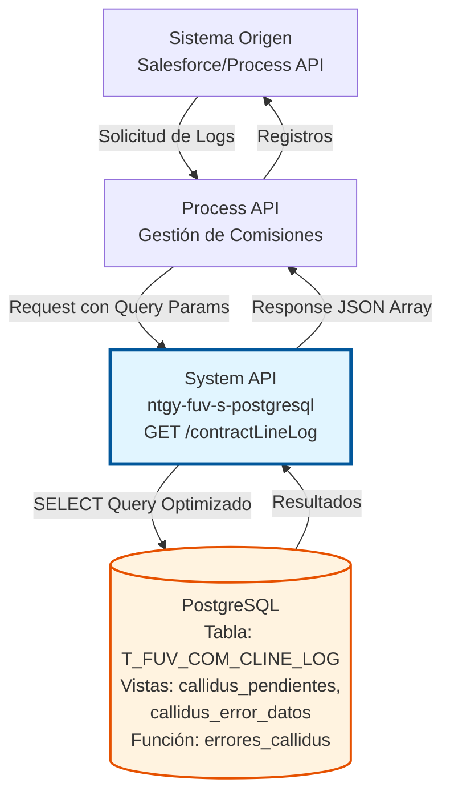
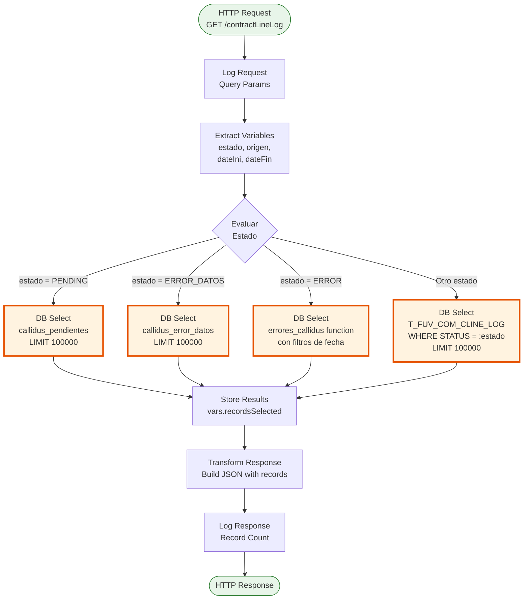
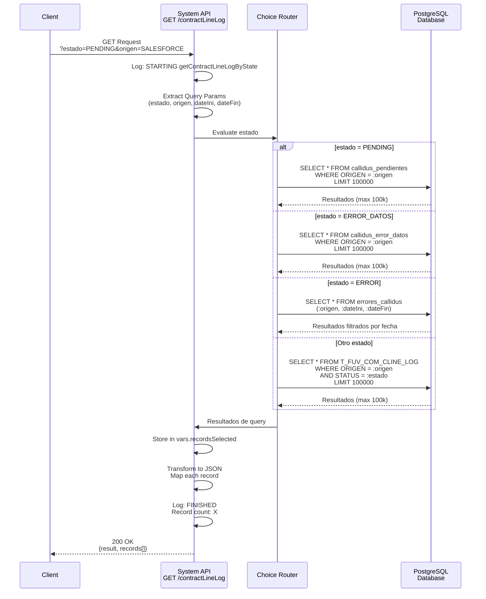
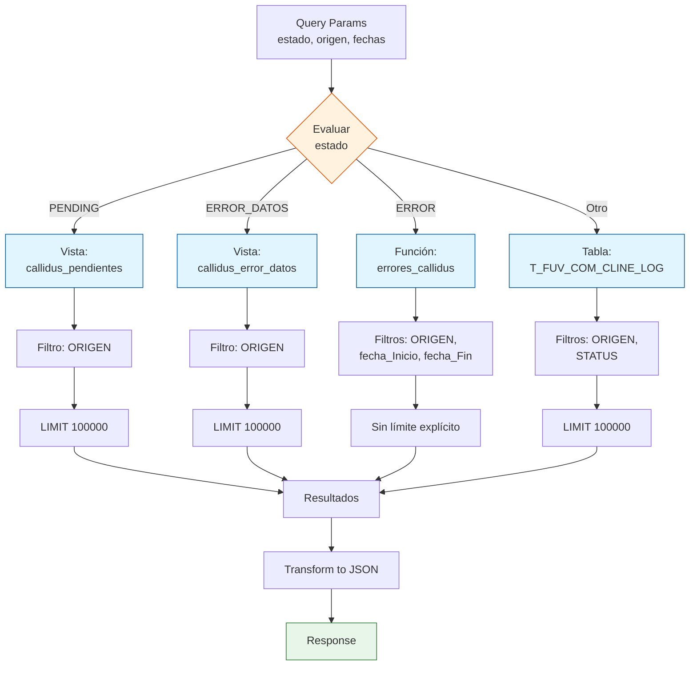

# GET /contractLineLog

## 📌 Descripción General

### Propósito del Endpoint

Este endpoint consulta registros de log de líneas de contrato desde la tabla `T_FUV_COM_CLINE_LOG` implementando un patrón de consulta condicional optimizado según el estado solicitado. Utiliza queries especializados y vistas de base de datos para mejorar el rendimiento en consultas frecuentes.

El endpoint soporta:
- **Consulta por estado PENDING**: Utiliza vista optimizada `callidus_pendientes` con límite de 100,000 registros
- **Consulta por estado ERROR_DATOS**: Utiliza vista optimizada `callidus_error_datos` con límite de 100,000 registros
- **Consulta por estado ERROR**: Utiliza función `errores_callidus()` con filtros de fecha
- **Consulta por cualquier otro estado**: Query genérico con filtro por estado y límite de 100,000 registros
- **Filtrado por origen**: Todos los queries soportan filtrado por sistema origen
- **Filtrado por rango de fechas**: Disponible para estado ERROR

### Tipo de API

**Capa:** System API (API-Led Connectivity)

**Función:** Integración directa con PostgreSQL para consulta de logs de líneas de contrato del sistema de comisiones Callidus con queries optimizados por estado.

### Patrón de Integración

**Tipo:** Request-Reply Síncrono con PostgreSQL

**Descripción:** Recibe parámetros de consulta (estado, origen, fechas), selecciona el query optimizado según el estado, ejecuta la consulta en PostgreSQL, transforma los resultados a JSON y retorna la respuesta con los registros encontrados.

### Arquitectura API-Led Connectivity



---

## 💼 Propósito del Negocio

### Casos de Uso Principales

1. **Monitoreo de Líneas Pendientes**
   - Consulta líneas en estado PENDING para procesamiento en Callidus
   - Utiliza vista optimizada para consultas frecuentes
   - Permite identificar backlog de procesamiento

2. **Gestión de Errores de Datos**
   - Consulta líneas con ERROR_DATOS para corrección
   - Vista especializada para análisis de calidad de datos
   - Facilita reprocesamiento de registros con datos incorrectos

3. **Análisis de Errores Técnicos**
   - Consulta errores técnicos con filtros de fecha
   - Función de base de datos para análisis temporal
   - Soporta troubleshooting y análisis de incidencias

4. **Consultas por Estado Personalizado**
   - Query genérico para cualquier estado no optimizado
   - Flexibilidad para estados adicionales
   - Filtrado por origen del sistema

### Contexto Empresarial

- **Dominio:** Gestión de Comisiones
- **Sector:** Energía - Utilities
- **División:** Naturgy España - FUV (Facturación Única Virtual)
- **Proceso de Negocio:** Monitoreo y gestión de procesamiento de líneas de contrato en Callidus
- **Sistema Externo:** Callidus (Sistema de gestión de comisiones)

### Stakeholders

- **Equipo de Comisiones**: Monitorea estado de procesamiento de líneas
- **Equipo de Soporte**: Identifica y resuelve errores de procesamiento
- **Equipo de Calidad de Datos**: Analiza y corrige errores de datos
- **Equipo de Operaciones**: Gestiona backlog y rendimiento del sistema

### Valor de Negocio

- **Visibilidad Operacional**: Monitoreo en tiempo real del estado de procesamiento
- **Gestión Proactiva**: Identificación temprana de problemas y backlog
- **Eficiencia Operativa**: Queries optimizados reducen tiempo de consulta
- **Análisis de Calidad**: Facilita identificación de patrones de error
- **Trazabilidad**: Seguimiento completo del ciclo de vida de cada línea

### Consumidores Potenciales

Este endpoint puede ser consumido por:
- Process APIs de gestión de comisiones
- Dashboards de monitoreo operacional
- Procesos batch de reprocesamiento
- Herramientas de análisis y reporting
- Sistemas de alertas y notificaciones

---

## 🔧 Especificación Técnica

### URLs por Ambiente

| Ambiente | URL Base | URL Completa |
|----------|----------|--------------|
| **Local** | `http://localhost:8081` | `http://localhost:8081/api/contractLineLog?estado=PENDING&origen=SALESFORCE` |
| **Development** | `https://ntgy-fuv-s-postgresql-dev.us-e2.cloudhub.io` | `https://ntgy-fuv-s-postgresql-dev.us-e2.cloudhub.io/api/contractLineLog?estado=PENDING&origen=SALESFORCE` |
| **UAT** | `https://ntgy-fuv-s-postgresql-uat.us-e2.cloudhub.io` | `https://ntgy-fuv-s-postgresql-uat.us-e2.cloudhub.io/api/contractLineLog?estado=PENDING&origen=SALESFORCE` |
| **Production** | `https://ntgy-fuv-s-postgresql-pro.us-e2.cloudhub.io` | `https://ntgy-fuv-s-postgresql-pro.us-e2.cloudhub.io/api/contractLineLog?estado=PENDING&origen=SALESFORCE` |

### Método HTTP

```
GET /api/contractLineLog
```

### Parámetros de Entrada

#### Headers HTTP

| Header | Tipo | Requerido | Descripción | Ejemplo |
|--------|------|-----------|-------------|---------|
| `Accept` | string | ❌ No | Tipo de contenido esperado en response | `application/json` |

#### Query Parameters

| Parámetro | Tipo | Requerido | Descripción | Ejemplo | Valores Válidos |
|-----------|------|-----------|-------------|---------|-----------------|
| `estado` | string | ✅ Sí | Estado de las líneas a consultar | `"PENDING"` | `PENDING`, `ERROR_DATOS`, `ERROR`, o cualquier otro estado |
| `origen` | string | ✅ Sí | Sistema origen de los registros | `"SALESFORCE"` | `SALESFORCE`, `BATCH`, etc. |
| `fecha_Inicio` | string | ❌ No* | Fecha inicio para filtro (solo estado ERROR) | `"2026-01-01"` | Formato: `YYYY-MM-DD` |
| `fecha_Fin` | string | ❌ No* | Fecha fin para filtro (solo estado ERROR) | `"2026-01-31"` | Formato: `YYYY-MM-DD` |

**Nota:** Los parámetros `fecha_Inicio` y `fecha_Fin` son requeridos solo cuando `estado=ERROR`.

### Respuestas

#### Respuesta Exitosa (200 OK)

```json
{
  "result": {
    "codResult": "0000",
    "msgResult": "No hay error"
  },
  "records": [
    {
      "AC_EXTRA_DATA": "correlation-id-12345",
      "T_FUV_COM_CLINE_LOG_ID": 1001,
      "CONTRACT_LINE_ID": "CL-2026-001-001",
      "ATHENA_CONTRACT_LINE": "{\"contractId\":\"C-2026-001\",\"lineNumber\":\"001\"}",
      "PROCESSING_DATE": "2026-01-07T10:30:00",
      "PROCESSING_RETRIES": 0,
      "ERROR": null,
      "UPDATE_DATE": null,
      "STATUS": "PENDING",
      "ORIGEN": "SALESFORCE"
    }
  ]
}
```

#### Respuesta Exitosa sin Registros (200 OK)

```json
{
  "result": {
    "codResult": "0000",
    "msgResult": "No hay error"
  },
  "records": []
}
```

#### Estructura de Campos en Response

| Campo | Tipo | Descripción |
|-------|------|-------------|
| `result.codResult` | string | Código de resultado (`"0000"` = éxito) |
| `result.msgResult` | string | Mensaje descriptivo del resultado |
| `records` | array | Array de registros encontrados |
| `records[].AC_EXTRA_DATA` | string | Correlation ID para trazabilidad |
| `records[].T_FUV_COM_CLINE_LOG_ID` | integer | ID único del registro en la tabla |
| `records[].CONTRACT_LINE_ID` | string | Identificador de la línea de contrato |
| `records[].ATHENA_CONTRACT_LINE` | string | JSON string con datos completos de Athena |
| `records[].PROCESSING_DATE` | string | Fecha/hora de procesamiento (ISO 8601) |
| `records[].PROCESSING_RETRIES` | integer | Número de reintentos de procesamiento |
| `records[].ERROR` | string/null | Mensaje de error (null si no hay error) |
| `records[].UPDATE_DATE` | string/null | Fecha/hora de última actualización |
| `records[].STATUS` | string | Estado actual del registro |
| `records[].ORIGEN` | string | Sistema origen del registro |

### Límites de Consulta

| Estado | Límite de Registros | Fuente de Datos |
|--------|---------------------|-----------------|
| `PENDING` | 100,000 | Vista `callidus_pendientes` |
| `ERROR_DATOS` | 100,000 | Vista `callidus_error_datos` |
| `ERROR` | Sin límite explícito | Función `errores_callidus()` |
| Otros estados | 100,000 | Tabla `T_FUV_COM_CLINE_LOG` |

### Autenticación y Autorización

- **Tipo:** Client ID & Client Secret (Anypoint Platform)
- **Autorización PostgreSQL:** El usuario debe tener permisos para:
  - SELECT en tabla `T_FUV_COM_CLINE_LOG`
  - SELECT en vista `callidus_pendientes`
  - SELECT en vista `callidus_error_datos`
  - EXECUTE en función `errores_callidus()`

### Timeouts

| Tipo | Valor | Descripción |
|------|-------|-------------|
| **Request Timeout** | 30 segundos | Tiempo máximo de espera para la respuesta |
| **Connection Timeout** | 10 segundos | Tiempo máximo para establecer conexión con PostgreSQL |
| **Query Timeout** | 30 segundos | Tiempo máximo de ejecución de query SQL |

---

## 🏗️ Implementación Técnica

### Arquitectura del Flow



### Flujo de Datos Detallado



### Operaciones de Base de Datos

#### 1. Query para Estado PENDING (Línea 252-257)

**Query SQL:**
```sql
-- Línea 33 en s-postgresql-global-config.yaml
SELECT * FROM callidus_pendientes 
WHERE ORIGEN = :origen 
LIMIT 100000
```

**Parámetros:**
- `:origen` → `vars.origen`

**Propósito:** Consulta vista optimizada de líneas pendientes de procesamiento

**Ubicación en código:** `s-postgresql-contractLineLog.xml`, líneas 252-257

**Características:**
- Utiliza vista materializada o vista optimizada
- Límite de 100,000 registros para prevenir sobrecarga
- Filtrado por sistema origen

---

#### 2. Query para Estado ERROR_DATOS (Línea 260-265)

**Query SQL:**
```sql
-- Línea 34 en s-postgresql-global-config.yaml
SELECT * FROM callidus_error_datos 
WHERE ORIGEN = :origen 
LIMIT 100000
```

**Parámetros:**
- `:origen` → `vars.origen`

**Propósito:** Consulta vista optimizada de líneas con errores de datos

**Ubicación en código:** `s-postgresql-contractLineLog.xml`, líneas 260-265

**Características:**
- Vista especializada para errores de datos
- Límite de 100,000 registros
- Filtrado por sistema origen

---

#### 3. Query para Estado ERROR (Línea 268-275)

**Query SQL:**
```sql
-- Línea 35 en s-postgresql-global-config.yaml
SELECT * FROM errores_callidus(:origen, :dateIni, :dateFin)
```

**Parámetros:**
- `:origen` → `vars.origen`
- `:dateIni` → `vars.dateIni`
- `:dateFin` → `vars.dateFin`

**Propósito:** Consulta función de PostgreSQL que retorna errores con filtros de fecha

**Ubicación en código:** `s-postgresql-contractLineLog.xml`, líneas 268-275

**Características:**
- Función de base de datos para lógica compleja
- Filtrado por rango de fechas
- Sin límite explícito (controlado por la función)

---

#### 4. Query Genérico para Otros Estados (Línea 278-284)

**Query SQL:**
```sql
-- Línea 32 en s-postgresql-global-config.yaml
SELECT * FROM T_FUV_COM_CLINE_LOG 
WHERE ORIGEN = :origen 
AND STATUS = :estado 
LIMIT 100000
```

**Parámetros:**
- `:origen` → `vars.origen`
- `:estado` → `vars.estado`

**Propósito:** Query genérico para cualquier estado no optimizado

**Ubicación en código:** `s-postgresql-contractLineLog.xml`, líneas 278-284

**Características:**
- Consulta directa a tabla principal
- Filtrado por origen y estado
- Límite de 100,000 registros

---

### Transformaciones DataWeave

#### 1. Extracción de Query Parameters (Línea 228-248)

```dataweave
%dw 2.0
output application/java
---
{
  dateIni: attributes.queryParams.fecha_Inicio default "",
  estado: attributes.queryParams.estado,
  origen: attributes.queryParams.origen,
  dateFin: attributes.queryParams.fecha_Fin default ""
}
```

**Propósito:** Extraer y preparar variables desde query parameters

**Ubicación:** `s-postgresql-contractLineLog.xml`, líneas 228-248

**Características:**
- Valores por defecto para fechas opcionales
- Conversión a tipos Java para uso en queries

---

#### 2. Almacenamiento de Resultados (Línea 287-295)

```dataweave
%dw 2.0
output application/java
---
payload
```

**Propósito:** Almacenar resultados de query en variable para transformación posterior

**Ubicación:** `s-postgresql-contractLineLog.xml`, líneas 287-295

---

#### 3. Construcción de Response JSON (Línea 297-322)

```dataweave
%dw 2.0
output application/json
---
{
  "result": {
    "codResult": "0000",
    "msgResult": "No hay error"
  },
  "records": vars.recordsSelected map (record, index) -> {
    "AC_EXTRA_DATA": record.AC_EXTRA_DATA,
    "T_FUV_COM_CLINE_LOG_ID": record.T_FUV_COM_CLINE_LOG_ID,
    "CONTRACT_LINE_ID": record.CONTRACT_LINE_ID,
    "ATHENA_CONTRACT_LINE": record.ATHENA_CONTRACT_LINE.value default "",
    "PROCESSING_DATE": record.PROCESSING_DATE,
    "PROCESSING_RETRIES": record.PROCESSING_RETRIES,
    "ERROR": record.ERROR,
    "UPDATE_DATE": record.UPDATE_DATE,
    "STATUS": record.STATUS,
    "ORIGEN": record.ORIGEN
  }
}
```

**Propósito:** Transformar resultados de PostgreSQL a formato JSON estándar

**Ubicación:** `s-postgresql-contractLineLog.xml`, líneas 297-322

**Características:**
- Mapeo campo por campo de cada registro
- Manejo de campo ATHENA_CONTRACT_LINE como CLOB (`.value`)
- Estructura consistente con otros endpoints del API

---

### Logging

**Puntos de Logging:**

1. **Inicio del flujo** (Línea 221-227):
   ```
   STARTING getContractLineLogByState METHOD. REQUEST: [sanitized query params]
   ```

2. **Fin del flujo** (Línea 323):
   ```
   FINISHED getContractLineLogByState METHOD. RESPONSE: Registros encontrados: X Resultado: [result]
   ```

**Características del Logging:**
- Sanitización de datos sensibles con `normalizeJSON()`
- Conteo de registros encontrados
- Nivel INFO para operaciones normales

---

### Diagrama de Selección de Query



---

## 💻 Ejemplos de Uso

### Ejemplo 1: Consultar Líneas Pendientes

#### Request

```bash
curl -X GET "https://ntgy-fuv-s-postgresql-dev.us-e2.cloudhub.io/api/contractLineLog?estado=PENDING&origen=SALESFORCE" \
  -H "Accept: application/json" \
  -H "client_id: your-client-id" \
  -H "client_secret: your-client-secret"
```

#### Response (200 OK)

```json
{
  "result": {
    "codResult": "0000",
    "msgResult": "No hay error"
  },
  "records": [
    {
      "AC_EXTRA_DATA": "corr-id-001",
      "T_FUV_COM_CLINE_LOG_ID": 1001,
      "CONTRACT_LINE_ID": "CL-2026-001-001",
      "ATHENA_CONTRACT_LINE": "{\"contractId\":\"C-2026-001\",\"lineNumber\":\"001\",\"amount\":250.75}",
      "PROCESSING_DATE": "2026-01-07T08:30:00",
      "PROCESSING_RETRIES": 0,
      "ERROR": null,
      "UPDATE_DATE": null,
      "STATUS": "PENDING",
      "ORIGEN": "SALESFORCE"
    },
    {
      "AC_EXTRA_DATA": "corr-id-002",
      "T_FUV_COM_CLINE_LOG_ID": 1002,
      "CONTRACT_LINE_ID": "CL-2026-001-002",
      "ATHENA_CONTRACT_LINE": "{\"contractId\":\"C-2026-001\",\"lineNumber\":\"002\",\"amount\":180.50}",
      "PROCESSING_DATE": "2026-01-07T08:35:00",
      "PROCESSING_RETRIES": 0,
      "ERROR": null,
      "UPDATE_DATE": null,
      "STATUS": "PENDING",
      "ORIGEN": "SALESFORCE"
    }
  ]
}
```

**Descripción:** Consulta líneas en estado PENDING desde la vista optimizada `callidus_pendientes`.

---

### Ejemplo 2: Consultar Errores de Datos

#### Request

```bash
curl -X GET "https://ntgy-fuv-s-postgresql-dev.us-e2.cloudhub.io/api/contractLineLog?estado=ERROR_DATOS&origen=SALESFORCE" \
  -H "Accept: application/json" \
  -H "client_id: your-client-id" \
  -H "client_secret: your-client-secret"
```

#### Response (200 OK)

```json
{
  "result": {
    "codResult": "0000",
    "msgResult": "No hay error"
  },
  "records": [
    {
      "AC_EXTRA_DATA": "corr-id-100",
      "T_FUV_COM_CLINE_LOG_ID": 2001,
      "CONTRACT_LINE_ID": "CL-2026-050-001",
      "ATHENA_CONTRACT_LINE": "{\"contractId\":\"C-2026-050\",\"lineNumber\":\"001\"}",
      "PROCESSING_DATE": "2026-01-06T14:20:00",
      "PROCESSING_RETRIES": 2,
      "ERROR": "Campo productCode requerido pero no proporcionado",
      "UPDATE_DATE": "2026-01-06T16:45:00",
      "STATUS": "ERROR_DATOS",
      "ORIGEN": "SALESFORCE"
    }
  ]
}
```

**Descripción:** Consulta líneas con errores de datos desde la vista `callidus_error_datos` para corrección.

---

### Ejemplo 3: Consultar Errores Técnicos con Filtro de Fecha

#### Request

```bash
curl -X GET "https://ntgy-fuv-s-postgresql-dev.us-e2.cloudhub.io/api/contractLineLog?estado=ERROR&origen=SALESFORCE&fecha_Inicio=2026-01-01&fecha_Fin=2026-01-07" \
  -H "Accept: application/json" \
  -H "client_id: your-client-id" \
  -H "client_secret: your-client-secret"
```

#### Response (200 OK)

```json
{
  "result": {
    "codResult": "0000",
    "msgResult": "No hay error"
  },
  "records": [
    {
      "AC_EXTRA_DATA": "corr-id-200",
      "T_FUV_COM_CLINE_LOG_ID": 3001,
      "CONTRACT_LINE_ID": "CL-2026-075-001",
      "ATHENA_CONTRACT_LINE": "{\"contractId\":\"C-2026-075\",\"lineNumber\":\"001\"}",
      "PROCESSING_DATE": "2026-01-05T10:15:00",
      "PROCESSING_RETRIES": 3,
      "ERROR": "Timeout al conectar con Callidus API",
      "UPDATE_DATE": "2026-01-05T11:30:00",
      "STATUS": "ERROR",
      "ORIGEN": "SALESFORCE"
    },
    {
      "AC_EXTRA_DATA": "corr-id-201",
      "T_FUV_COM_CLINE_LOG_ID": 3002,
      "CONTRACT_LINE_ID": "CL-2026-076-001",
      "ATHENA_CONTRACT_LINE": "{\"contractId\":\"C-2026-076\",\"lineNumber\":\"001\"}",
      "PROCESSING_DATE": "2026-01-06T09:20:00",
      "PROCESSING_RETRIES": 1,
      "ERROR": "Error de validación en Callidus: código de producto inválido",
      "UPDATE_DATE": "2026-01-06T09:25:00",
      "STATUS": "ERROR",
      "ORIGEN": "SALESFORCE"
    }
  ]
}
```

**Descripción:** Consulta errores técnicos en un rango de fechas usando la función `errores_callidus()`.

---

### Ejemplo 4: Consultar Estado Personalizado

#### Request

```bash
curl -X GET "https://ntgy-fuv-s-postgresql-dev.us-e2.cloudhub.io/api/contractLineLog?estado=PROCESSED&origen=BATCH" \
  -H "Accept: application/json" \
  -H "client_id: your-client-id" \
  -H "client_secret: your-client-secret"
```

#### Response (200 OK)

```json
{
  "result": {
    "codResult": "0000",
    "msgResult": "No hay error"
  },
  "records": [
    {
      "AC_EXTRA_DATA": "batch-corr-id-500",
      "T_FUV_COM_CLINE_LOG_ID": 5001,
      "CONTRACT_LINE_ID": "CL-2026-100-001",
      "ATHENA_CONTRACT_LINE": "{\"contractId\":\"C-2026-100\",\"lineNumber\":\"001\",\"amount\":320.00}",
      "PROCESSING_DATE": "2026-01-07T02:15:00",
      "PROCESSING_RETRIES": 0,
      "ERROR": null,
      "UPDATE_DATE": "2026-01-07T02:20:00",
      "STATUS": "PROCESSED",
      "ORIGEN": "BATCH"
    }
  ]
}
```

**Descripción:** Consulta líneas en estado PROCESSED desde proceso batch usando el query genérico.

---

### Ejemplo 5: Consulta sin Resultados

#### Request

```bash
curl -X GET "https://ntgy-fuv-s-postgresql-pro.us-e2.cloudhub.io/api/contractLineLog?estado=PENDING&origen=MANUAL" \
  -H "Accept: application/json" \
  -H "client_id: your-client-id" \
  -H "client_secret: your-client-secret"
```

#### Response (200 OK)

```json
{
  "result": {
    "codResult": "0000",
    "msgResult": "No hay error"
  },
  "records": []
}
```

**Descripción:** No se encontraron registros que coincidan con los criterios de búsqueda. El array `records` está vacío pero la operación fue exitosa.

---

### Notas de Implementación

#### Optimización de Queries

El endpoint utiliza un patrón de **query condicional** que selecciona la fuente de datos más eficiente según el estado:

1. **Estados Frecuentes (PENDING, ERROR_DATOS)**: Utilizan vistas optimizadas que pueden ser materializadas para mejorar el rendimiento
2. **Estado ERROR**: Utiliza una función de PostgreSQL que permite lógica compleja de filtrado por fechas
3. **Estados Personalizados**: Query genérico flexible para cualquier estado adicional

#### Límites de Registros

Todos los queries (excepto ERROR) tienen un límite de **100,000 registros** para:
- Prevenir sobrecarga de memoria en el servidor
- Garantizar tiempos de respuesta aceptables
- Proteger la base de datos de queries excesivamente grandes

Si se necesitan más registros, considerar:
- Implementar paginación
- Agregar filtros adicionales (fechas, rangos)
- Procesar en lotes más pequeños

#### Manejo del Campo ATHENA_CONTRACT_LINE

El campo `ATHENA_CONTRACT_LINE` es de tipo CLOB en PostgreSQL y se maneja especialmente:

```dataweave
"ATHENA_CONTRACT_LINE": record.ATHENA_CONTRACT_LINE.value default ""
```

- Se accede mediante `.value` para extraer el contenido del CLOB
- Se proporciona un string vacío como valor por defecto
- El contenido es un JSON serializado como string

#### Trazabilidad

El campo `AC_EXTRA_DATA` almacena el correlation ID de cada transacción, permitiendo:
- Rastreo end-to-end de operaciones
- Correlación con logs de otros sistemas
- Debugging y troubleshooting
- Auditoría de operaciones
