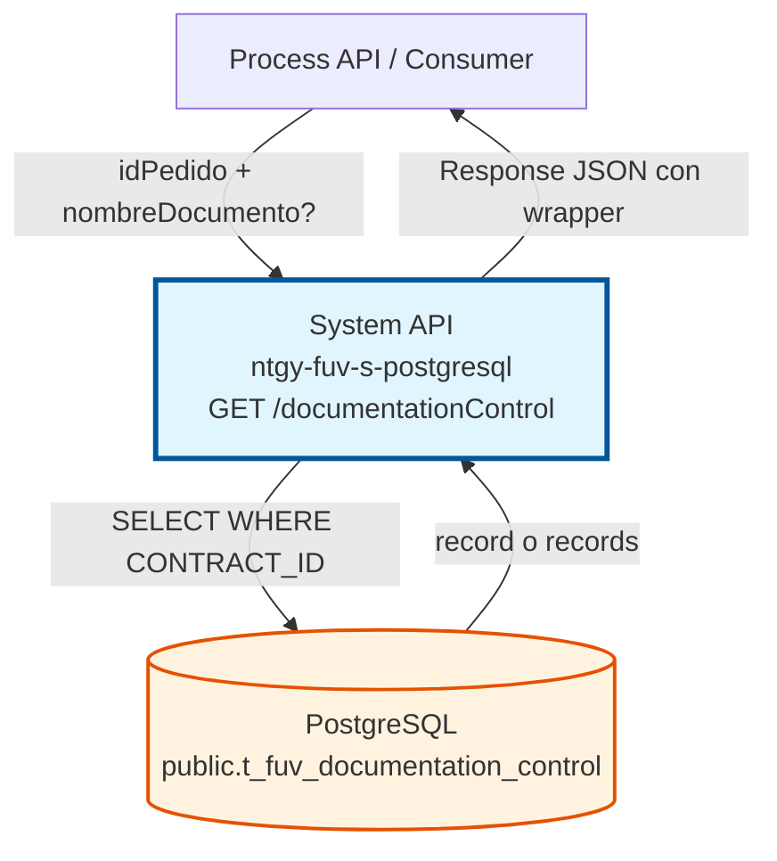
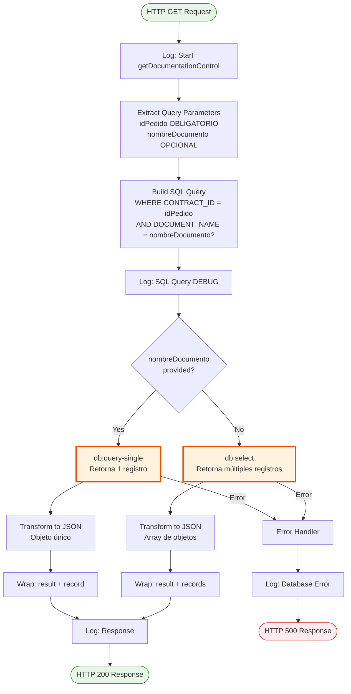
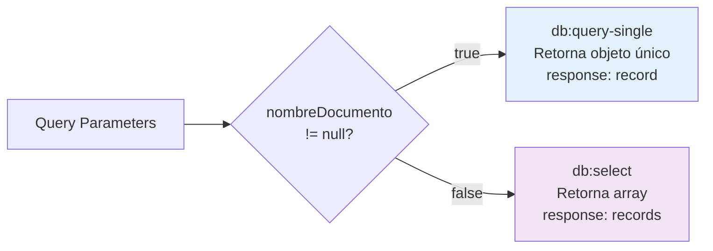
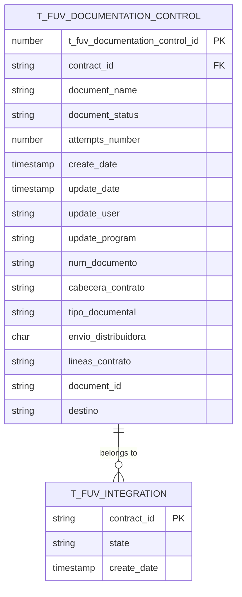
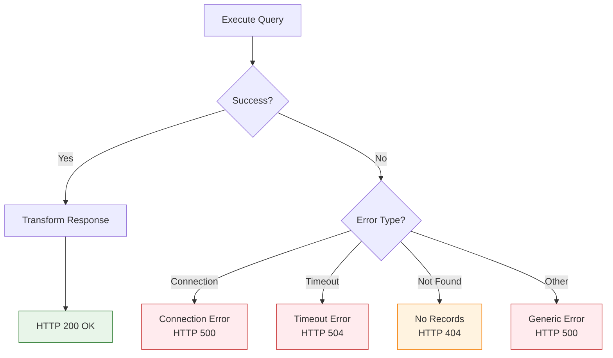

# GET /documentationControl

## 📌 Descripción General

### Propósito del Endpoint

Este endpoint consulta registros de control de documentación desde la tabla `t_fuv_documentation_control` en PostgreSQL, filtrando por un pedido específico (idPedido obligatorio) con opción de filtrar adicionalmente por nombre de documento.

El endpoint soporta:
- **Consulta por pedido**: Retorna todos los documentos asociados a un pedido
- **Consulta por pedido + documento**: Retorna un documento específico de un pedido
- **Respuesta condicional**: Retorna objeto único (`record`) o array (`records`) según filtros

### Tipo de API

**Capa:** System API (API-Led Connectivity)

**Función:** Acceso directo a datos de control de documentación en PostgreSQL para consultas por pedido.

### Patrón de Integración

**Tipo:** Request-Reply Síncrono con Query SQL Condicional

**Descripción:** Recibe idPedido obligatorio y nombreDocumento opcional, construye query SQL con filtro WHERE, ejecuta consulta en PostgreSQL usando query-single o select según parámetros, y retorna resultado en formato JSON con wrapper estándar.

### Arquitectura API-Led Connectivity



---

## 💼 Propósito del Negocio

### Casos de Uso Principales

1. **Consulta de Todos los Documentos de un Pedido**
   - Obtener lista completa de documentos asociados a un pedido
   - Verificar qué documentos están registrados para un contrato
   - Auditar documentación completa de un pedido

2. **Búsqueda de Documento Específico**
   - Localizar un documento concreto por nombre dentro de un pedido
   - Verificar existencia de un documento específico
   - Obtener detalles de un documento particular

3. **Monitoreo de Estados de Documentación**
   - Consultar estado de procesamiento de documentos
   - Identificar documentos pendientes o con errores
   - Verificar documentos ya procesados

4. **Trazabilidad y Auditoría**
   - Rastrear historial de documentos de un pedido
   - Verificar fechas de creación y actualización
   - Auditar cambios en documentación

### Contexto Empresarial

- **Dominio:** Gestión de Documentación Contractual
- **Sector:** Energía - Utilities
- **División:** Naturgy España - FUV (Facturación Única Virtual)
- **Proceso de Negocio:** Control y trazabilidad de documentación asociada a pedidos del Frontal de Ventas
- **Área Funcional:** Operaciones de Contratación y Documentación

### Stakeholders

- **Equipos de Operaciones**: Necesitan consultar documentos de pedidos para seguimiento
- **Sistemas de Procesamiento**: Requieren verificar documentación antes de procesar pedidos
- **Equipos de Auditoría**: Necesitan trazabilidad de documentación por pedido
- **Desarrolladores de Process APIs**: Consumen este endpoint para flujos de documentación

### Valor de Negocio

- **Consulta Flexible**: Permite obtener todos los documentos o uno específico con el mismo endpoint
- **Eficiencia Operativa**: Acceso rápido a documentación por pedido
- **Trazabilidad Completa**: Incluye metadatos de auditoría (fechas, usuarios, intentos)
- **Integración con AWS/SharePoint**: Incluye DOCUMENT_ID para referencias externas

### Consumidores Potenciales

Este endpoint puede ser consumido por:
- Process APIs de gestión de contratos
- Process APIs de procesamiento de documentación
- Sistemas de workflow de pedidos
- Herramientas de monitoreo de documentación
- Procesos de validación de pedidos

---

## 🔧 Especificación Técnica

### URLs por Ambiente

| Ambiente | URL Completa |
|----------|--------------|
| **Local** | `http://localhost:8081/api/documentationControl` |
| **Development** | `https://ntgy-fuv-s-postgresql-dev.us-e2.cloudhub.io/api/documentationControl` |
| **UAT** | `https://ntgy-fuv-s-postgresql-uat.us-e2.cloudhub.io/api/documentationControl` |
| **Production** | `https://ntgy-fuv-s-postgresql-pro.us-e2.cloudhub.io/api/documentationControl` |

### Método HTTP

```
GET /api/documentationControl
```

### Parámetros de Entrada

#### Headers HTTP

| Header | Tipo | Requerido | Descripción | Ejemplo |
|--------|------|-----------|-------------|---------|
| `Accept` | string | ❌ No | Tipo de contenido esperado en response | `application/json` |
| `client_id` | string | ✅ Sí | Client ID de Anypoint Platform | `abc123...` |
| `client_secret` | string | ✅ Sí | Client Secret de Anypoint Platform | `xyz789...` |

#### Query Parameters

| Parámetro | Tipo | Requerido | Descripción | Ejemplo |
|-----------|------|-----------|-------------|---------|
| `idPedido` | string | ✅ **Sí** | Identificador único del pedido del Frontal de Ventas | `"ORD-2024-001234"` |
| `nombreDocumento` | string | ❌ No | Nombre del documento específico a consultar (opcional) | `"contrato_principal.pdf"` |

**Nota:** 
- `idPedido` es **OBLIGATORIO**
- Si se proporciona `nombreDocumento`, retorna objeto único en `record`
- Si NO se proporciona `nombreDocumento`, retorna array en `records`

### Respuestas

#### Respuesta Exitosa - Con nombreDocumento (200 OK)

```json
{
  "result": {
    "codResult": "0000",
    "msgResult": "No hay error"
  },
  "record": {
    "NUM_DOCUMENTO": "12345678A",
    "T_FUV_DOCUMENTATION_CONTROL_ID": 12345,
    "CONTRACT_ID": "ORD-2024-001234",
    "DOCUMENT_NAME": "contrato_principal.pdf",
    "DOCUMENT_STATUS": "PENDIENTE",
    "ATTEMPTS_NUMBER": 1,
    "CREATE_DATE": "2024-01-15T10:30:00",
    "UPDATE_DATE": "2024-01-15T10:30:00",
    "UPDATE_USER": "mulesoft",
    "UPDATE_PROGRAM": "mulesoft",
    "CABECERA_CONTRATO": "Datos de cabecera...",
    "TIPO_DOCUMENTAL": "CONTRATO",
    "ENVIO_DISTRIBUIDORA": true,
    "LINEAS_CONTRATO": "Líneas del contrato...",
    "DOCUMENT_ID": "doc-12345-abcde",
    "DESTINO": "SIEBEL"
  }
}
```

#### Respuesta Exitosa - Sin nombreDocumento (200 OK)

```json
{
  "result": {
    "codResult": "0000",
    "msgResult": "No hay error"
  },
  "records": [
    {
      "NUM_DOCUMENTO": "12345678A",
      "T_FUV_DOCUMENTATION_CONTROL_ID": 12345,
      "CONTRACT_ID": "ORD-2024-001234",
      "DOCUMENT_NAME": "contrato_principal.pdf",
      "DOCUMENT_STATUS": "PENDIENTE",
      "ATTEMPTS_NUMBER": 1,
      "CREATE_DATE": "2024-01-15T10:30:00",
      "UPDATE_DATE": "2024-01-15T10:30:00",
      "UPDATE_USER": "mulesoft",
      "UPDATE_PROGRAM": "mulesoft",
      "CABECERA_CONTRATO": "Datos de cabecera...",
      "TIPO_DOCUMENTAL": "CONTRATO",
      "ENVIO_DISTRIBUIDORA": true,
      "LINEAS_CONTRATO": "Líneas del contrato...",
      "DOCUMENT_ID": "doc-12345-abcde",
      "DESTINO": "SIEBEL"
    },
    {
      "NUM_DOCUMENTO": "12345678A",
      "T_FUV_DOCUMENTATION_CONTROL_ID": 12346,
      "CONTRACT_ID": "ORD-2024-001234",
      "DOCUMENT_NAME": "anexo_condiciones.pdf",
      "DOCUMENT_STATUS": "PROCESADO",
      "ATTEMPTS_NUMBER": 1,
      "CREATE_DATE": "2024-01-15T10:35:00",
      "UPDATE_DATE": "2024-01-15T14:20:00",
      "UPDATE_USER": "mulesoft",
      "UPDATE_PROGRAM": "mulesoft",
      "CABECERA_CONTRATO": null,
      "TIPO_DOCUMENTAL": "ANEXO",
      "ENVIO_DISTRIBUIDORA": false,
      "LINEAS_CONTRATO": null,
      "DOCUMENT_ID": "doc-12346-fghij",
      "DESTINO": "SIEBEL"
    }
  ]
}
```

#### Respuesta de Error (400 Bad Request)

```json
{
  "message": "Bad request"
}
```

**Nota:** Si el parámetro `idPedido` falta completamente, APIKit valida el RAML antes de ejecutar el flow y retorna 400 Bad Request automáticamente.

#### Respuesta de Error (500 Internal Server Error)

```json
{
  "error": {
    "code": "500",
    "message": "Database connection error",
    "details": "Unable to execute query"
  }
}
```

### Códigos de Estado HTTP

| Código | Descripción | Cuándo Ocurre |
|--------|-------------|---------------|
| **200** | OK | Consulta exitosa (puede retornar record o records vacío) |
| **400** | Bad Request | Falta parámetro idPedido (validación APIKit) |
| **500** | Internal Server Error | Error de base de datos o error interno |
| **504** | Gateway Timeout | Query excede timeout de 30 segundos |

**Nota sobre Validación y Manejo de Errores:**

El comportamiento del endpoint varía según el tipo de error:

- **Parámetro `idPedido` falta completamente**: APIKit valida el RAML y retorna **400 Bad Request** automáticamente (validación de routing).
- **Parámetro presente pero vacío/inválido**: No hay validación explícita en el código. La query SQL fallará y retornará **500 Internal Server Error**.
- **Errores de base de datos**: El flow no tiene error handler propio, por lo que cualquier error de PostgreSQL se propaga como **500 Internal Server Error** sin transformación.
- **Sin resultados**: Retorna **200 OK** con `records: []` o `record: {}` vacío (comportamiento normal, no es error 404).

### Estructura de Campos de Respuesta

| Campo | Tipo | Descripción |
|-------|------|-------------|
| `NUM_DOCUMENTO` | string | Número de documento del cliente (NIF/NIE/CIF) |
| `T_FUV_DOCUMENTATION_CONTROL_ID` | number | ID único del registro de control |
| `CONTRACT_ID` | string | ID del pedido/contrato asociado |
| `DOCUMENT_NAME` | string | Nombre del archivo del documento |
| `DOCUMENT_STATUS` | string | Estado: PENDIENTE, PROCESADO, ERROR, ENVIADO |
| `ATTEMPTS_NUMBER` | number | Número de intentos de procesamiento |
| `CREATE_DATE` | string | Fecha y hora de creación (ISO 8601) |
| `UPDATE_DATE` | string | Fecha y hora de última actualización |
| `UPDATE_USER` | string | Usuario que realizó la última actualización |
| `UPDATE_PROGRAM` | string | Programa que realizó la actualización |
| `CABECERA_CONTRATO` | string | Datos de cabecera del contrato |
| `TIPO_DOCUMENTAL` | string | Tipo: CONTRATO, ANEXO, CONDICIONES, etc. |
| `ENVIO_DISTRIBUIDORA` | boolean | Indica si se envía a distribuidora |
| `LINEAS_CONTRATO` | string | Líneas del contrato en formato texto |
| `DOCUMENT_ID` | string | ID del documento en SharePoint/AWS S3 |
| `DESTINO` | string | Sistema destino: SIEBEL, DISTRIBUIDORA, etc. |

### Autenticación y Autorización

- **Tipo:** Client ID & Client Secret (Anypoint Platform)
- **Autorización PostgreSQL:** El usuario de base de datos debe tener:
  - Permiso SELECT en tabla `public.t_fuv_documentation_control`
  - Acceso al schema `public`

### Timeouts

| Tipo | Valor | Descripción |
|------|-------|-------------|
| **Query Timeout** | 30 segundos | Tiempo máximo de ejecución de la query SQL |
| **Connection Timeout** | 10 segundos | Tiempo máximo para establecer conexión con PostgreSQL |

### Límites y Restricciones

- **Fetch Size:** Sin límite específico (retorna todos los documentos del pedido)
- **Timeout:** 30 segundos máximo de ejecución
- **Ordenamiento:** Por defecto ordena por `create_date DESC`
- **Lógica Condicional:** Usa `query-single` o `select` según nombreDocumento

---

## 🏗️ Implementación Técnica

### Arquitectura del Flow



### Query SQL Implementada

```sql
SELECT * FROM t_fuv_documentation_control 
WHERE CONTRACT_ID = :idPedido
[AND DOCUMENT_NAME = :nombreDocumento]
ORDER BY create_date DESC
```

**Características de la Query:**
- **Filtro Principal**: CONTRACT_ID (obligatorio)
- **Filtro Opcional**: DOCUMENT_NAME (si se proporciona nombreDocumento)
- **Ordenamiento**: Por fecha de creación descendente
- **Construcción Dinámica**: Usa DataWeave para agregar filtro condicional

### Lógica Condicional del Flow



### Transformación DataWeave

**Transformación de Salida (PostgreSQL → JSON):**

```dataweave
%dw 2.0
output application/json
---
// Para query-single (con nombreDocumento)
if (isEmpty(payload)) payload
else {
    "NUM_DOCUMENTO": payload.'num_documento',
    "T_FUV_DOCUMENTATION_CONTROL_ID": payload.'t_fuv_documentation_control_id',
    "CONTRACT_ID": payload.'contract_id',
    "DOCUMENT_NAME": payload.'document_name',
    "DOCUMENT_STATUS": payload.'document_status',
    "ATTEMPTS_NUMBER": payload.'attempts_number',
    "CREATE_DATE": payload.'create_date',
    "UPDATE_DATE": payload.'update_date',
    "UPDATE_USER": payload.'update_user',
    "UPDATE_PROGRAM": payload.'update_program',
    "CABECERA_CONTRATO": payload.'cabecera_contrato',
    "TIPO_DOCUMENTAL": payload.'tipo_documental',
    "ENVIO_DISTRIBUIDORA": if(payload.'envio_distribuidora' == 'Y') true else false,
    "LINEAS_CONTRATO": payload.'lineas_contrato',
    "DOCUMENT_ID": payload.document_id,
    "DESTINO": payload.'destino'
}

// Para select (sin nombreDocumento)
payload map (record, findex) -> {
    "NUM_DOCUMENTO": record.'num_documento',
    "T_FUV_DOCUMENTATION_CONTROL_ID": record.'t_fuv_documentation_control_id',
    // ... mismo mapeo para cada registro
}
```

**Transformaciones Especiales:**
- `ENVIO_DISTRIBUIDORA`: Convierte 'Y'/'N' a boolean (true/false)
- Todos los campos mantienen nombres UPPERCASE como en la base de datos
- Campos nullable se retornan como null si no tienen valor

### Modelo de Datos



### Configuración de Base de Datos

```xml
<db:config name="Database_Config">
    <db:generic-connection 
        url="jdbc:postgresql://${dbFUV.host}:${dbFUV.port}/${dbFUV.database}"
        driverClassName="org.postgresql.Driver"
        user="${dbFUV.user}"
        password="${secure::dbFUV.password}">
        <db:pooling-profile 
            maxPoolSize="20" 
            minPoolSize="5" 
            acquireIncrement="1" 
            maxWait="30000"/>
    </db:generic-connection>
</db:config>
```

### Manejo de Errores



### Logging

**Puntos de Log:**
1. **Inicio (INFO):** Log de inicio con idPedido
2. **Query (DEBUG):** Log de query SQL construida
3. **Resultado (DEBUG):** Log de respuesta normalizada (sin datos sensibles)
4. **Fin (INFO):** Log de finalización con idPedido
5. **Error (ERROR):** Log detallado de errores con stack trace

**Ejemplo de Logs:**
```
INFO: STARTING getDocumentationControl METHOD. Pedido: ORD-2024-001234
DEBUG: SELECT * FROM t_fuv_documentation_control WHERE CONTRACT_ID = 'ORD-2024-001234' order by create_date desc
DEBUG: FINISHED getDocumentationControl METHOD. RESPONSE: [normalized]
INFO: FINISH getDocumentationControl METHOD. pedido: ORD-2024-001234
```

---

## 💻 Ejemplos de Uso

### Ejemplo 1: Consulta de Todos los Documentos de un Pedido

**Request:**

```bash
curl -X GET "https://ntgy-fuv-s-postgresql-dev.us-e2.cloudhub.io/api/documentationControl?idPedido=ORD-2024-001234" \
  -H "Accept: application/json" \
  -H "client_id: your-client-id" \
  -H "client_secret: your-client-secret"
```

**Response (200 OK):**

```json
{
  "result": {
    "codResult": "0000",
    "msgResult": "No hay error"
  },
  "records": [
    {
      "NUM_DOCUMENTO": "12345678A",
      "T_FUV_DOCUMENTATION_CONTROL_ID": 12345,
      "CONTRACT_ID": "ORD-2024-001234",
      "DOCUMENT_NAME": "contrato_principal.pdf",
      "DOCUMENT_STATUS": "PENDIENTE",
      "ATTEMPTS_NUMBER": 1,
      "CREATE_DATE": "2024-01-15T10:30:00",
      "UPDATE_DATE": "2024-01-15T10:30:00",
      "UPDATE_USER": "mulesoft",
      "UPDATE_PROGRAM": "mulesoft",
      "CABECERA_CONTRATO": "Datos de cabecera del contrato",
      "TIPO_DOCUMENTAL": "CONTRATO",
      "ENVIO_DISTRIBUIDORA": true,
      "LINEAS_CONTRATO": "Líneas del contrato",
      "DOCUMENT_ID": "doc-12345-abcde",
      "DESTINO": "SIEBEL"
    },
    {
      "NUM_DOCUMENTO": "12345678A",
      "T_FUV_DOCUMENTATION_CONTROL_ID": 12346,
      "CONTRACT_ID": "ORD-2024-001234",
      "DOCUMENT_NAME": "anexo_condiciones.pdf",
      "DOCUMENT_STATUS": "PROCESADO",
      "ATTEMPTS_NUMBER": 1,
      "CREATE_DATE": "2024-01-15T10:35:00",
      "UPDATE_DATE": "2024-01-15T14:20:00",
      "UPDATE_USER": "mulesoft",
      "UPDATE_PROGRAM": "mulesoft",
      "CABECERA_CONTRATO": null,
      "TIPO_DOCUMENTAL": "ANEXO",
      "ENVIO_DISTRIBUIDORA": false,
      "LINEAS_CONTRATO": null,
      "DOCUMENT_ID": "doc-12346-fghij",
      "DESTINO": "SIEBEL"
    }
  ]
}
```

### Ejemplo 2: Consulta de Documento Específico por Nombre

**Request:**

```bash
curl -X GET "https://ntgy-fuv-s-postgresql-dev.us-e2.cloudhub.io/api/documentationControl?idPedido=ORD-2024-001234&nombreDocumento=contrato_principal.pdf" \
  -H "Accept: application/json" \
  -H "client_id: your-client-id" \
  -H "client_secret: your-client-secret"
```

**Response (200 OK):**

```json
{
  "result": {
    "codResult": "0000",
    "msgResult": "No hay error"
  },
  "record": {
    "NUM_DOCUMENTO": "12345678A",
    "T_FUV_DOCUMENTATION_CONTROL_ID": 12345,
    "CONTRACT_ID": "ORD-2024-001234",
    "DOCUMENT_NAME": "contrato_principal.pdf",
    "DOCUMENT_STATUS": "PENDIENTE",
    "ATTEMPTS_NUMBER": 1,
    "CREATE_DATE": "2024-01-15T10:30:00",
    "UPDATE_DATE": "2024-01-15T10:30:00",
    "UPDATE_USER": "mulesoft",
    "UPDATE_PROGRAM": "mulesoft",
    "CABECERA_CONTRATO": "Datos de cabecera del contrato",
    "TIPO_DOCUMENTAL": "CONTRATO",
    "ENVIO_DISTRIBUIDORA": true,
    "LINEAS_CONTRATO": "Líneas del contrato",
    "DOCUMENT_ID": "doc-12345-abcde",
    "DESTINO": "SIEBEL"
  }
}
```

### Ejemplo 3: Error - Falta Parámetro Obligatorio (Validación APIKit)

**Request:**

```bash
curl -X GET "https://ntgy-fuv-s-postgresql-dev.us-e2.cloudhub.io/api/documentationControl" \
  -H "Accept: application/json" \
  -H "client_id: your-client-id" \
  -H "client_secret: your-client-secret"
```

**Response (400 Bad Request):**

```json
{
  "message": "Bad request"
}
```

**Nota:** APIKit valida el RAML antes de ejecutar el flow. Si el parámetro obligatorio `idPedido` falta, retorna 400 automáticamente.

### Ejemplo 4: No Se Encontraron Documentos

**Request:**

```bash
curl -X GET "https://ntgy-fuv-s-postgresql-dev.us-e2.cloudhub.io/api/documentationControl?idPedido=ORD-9999-NOEXISTE" \
  -H "Accept: application/json" \
  -H "client_id: your-client-id" \
  -H "client_secret: your-client-secret"
```

**Response (200 OK con records vacío):**

```json
{
  "result": {
    "codResult": "0000",
    "msgResult": "No hay error"
  },
  "records": []
}
```

### Ejemplo 5: Integración con JavaScript

```javascript
async function getDocumentationControl(idPedido, nombreDocumento = null) {
  const baseUrl = 'https://ntgy-fuv-s-postgresql-dev.us-e2.cloudhub.io/api/documentationControl';
  const params = new URLSearchParams({ idPedido });
  
  if (nombreDocumento) {
    params.append('nombreDocumento', nombreDocumento);
  }
  
  const response = await fetch(`${baseUrl}?${params}`, {
    method: 'GET',
    headers: {
      'Accept': 'application/json',
      'client_id': 'your-client-id',
      'client_secret': 'your-client-secret'
    }
  });
  
  const data = await response.json();
  
  if (data.result.codResult === '0000') {
    // Éxito - verificar si es record o records
    return nombreDocumento ? data.record : data.records;
  } else {
    throw new Error(data.result.msgResult);
  }
}

// Uso
const todosLosDocumentos = await getDocumentationControl('ORD-2024-001234');
const documentoEspecifico = await getDocumentationControl('ORD-2024-001234', 'contrato_principal.pdf');
```

### Ejemplo 6: Integración con Python

```python
import requests

def get_documentation_control(id_pedido, nombre_documento=None):
    base_url = 'https://ntgy-fuv-s-postgresql-dev.us-e2.cloudhub.io/api/documentationControl'
    
    params = {'idPedido': id_pedido}
    if nombre_documento:
        params['nombreDocumento'] = nombre_documento
    
    headers = {
        'Accept': 'application/json',
        'client_id': 'your-client-id',
        'client_secret': 'your-client-secret'
    }
    
    response = requests.get(base_url, params=params, headers=headers)
    response.raise_for_status()
    
    data = response.json()
    
    if data['result']['codResult'] == '0000':
        return data.get('record') if nombre_documento else data.get('records', [])
    else:
        raise Exception(data['result']['msgResult'])

# Uso
todos_los_documentos = get_documentation_control('ORD-2024-001234')
documento_especifico = get_documentation_control('ORD-2024-001234', 'contrato_principal.pdf')