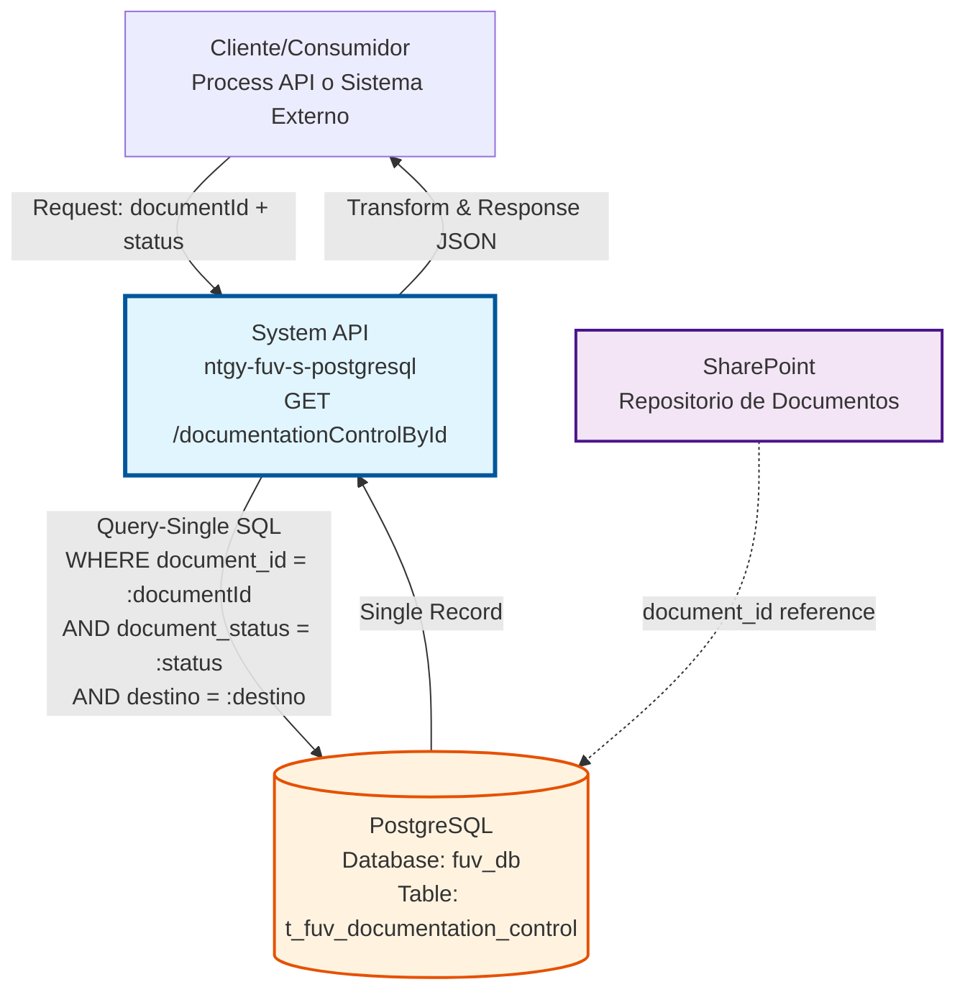
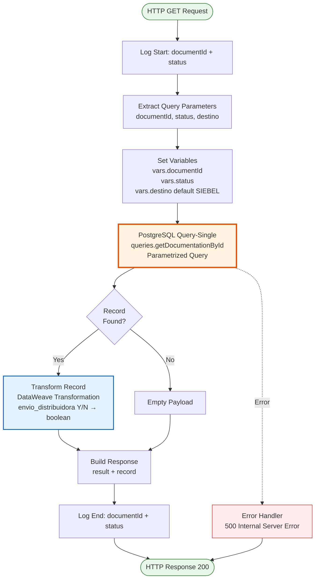
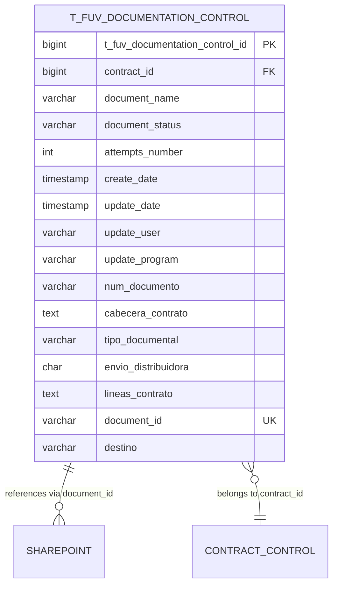

# GET /documentationControlById

## 📌 Descripción General

### Propósito del Endpoint

Este endpoint consulta un registro específico de control de documentación desde la base de datos PostgreSQL, utilizando el identificador único del documento en SharePoint (`document_id`) combinado con su estado de procesamiento (`status`) y opcionalmente el sistema destino (`destino`). A diferencia de otros endpoints de consulta que pueden retornar múltiples documentos, este endpoint utiliza `query-single` para garantizar que se retorna exactamente un único documento que coincida con los criterios especificados.

El endpoint soporta:
- **Búsqueda Precisa**: Localización exacta de un documento por su ID externo en SharePoint
- **Filtro por Estado**: Validación de que el documento está en el estado esperado
- **Filtro por Destino**: Opcionalmente filtra por sistema destino (SIEBEL, SAP, DISTRIBUIDORA)
- **Trazabilidad Externa**: Integración con SharePoint mediante document_id
- **Respuesta Única**: Garantiza retornar un solo registro mediante query-single
- **Transformación de Datos**: Convierte campo envio_distribuidora de 'Y'/'N' a boolean

### Tipo de API

**Capa:** System API (API-Led Connectivity)

**Función:** Integración directa con PostgreSQL para consulta específica de documentos de control FUV mediante identificador externo de SharePoint.

### Patrón de Integración

**Tipo:** Request-Reply Síncrono con PostgreSQL Query-Single

**Descripción:** El endpoint recibe los parámetros de búsqueda (documentId, status, destino opcional), construye una query SQL parametrizada, ejecuta una consulta de registro único (`query-single`) en PostgreSQL, transforma el resultado aplicando conversiones de datos (envio_distribuidora a boolean), y retorna el documento específico encontrado en formato JSON estandarizado.

### Arquitectura API-Led Connectivity



---

## 💼 Propósito del Negocio

### Casos de Uso Principales

1. **Consulta de Documento por ID Externo**
   - Un sistema externo (SharePoint, Process API) necesita verificar el estado de un documento específico
   - Se proporciona el document_id generado por SharePoint y el estado esperado
   - Se obtiene el registro completo del documento con todos sus metadatos

2. **Validación de Estado de Documento Específico**
   - Verificar que un documento identificado por su ID en SharePoint está en un estado específico
   - Útil para workflows que dependen del estado actual del documento
   - Permite validaciones antes de procesar o enviar documentos

3. **Trazabilidad de Documentos entre Sistemas**
   - Seguimiento de documentos entre FUV y SharePoint mediante document_id
   - Auditoría de documentos específicos por su identificador externo
   - Integración bidireccional entre sistemas de gestión documental

4. **Búsqueda Precisa con Múltiples Filtros**
   - Localización exacta de un documento usando document_id + status + destino
   - Evita ambigüedades al garantizar un único resultado
   - Útil cuando se conoce el identificador exacto del documento

### Contexto Empresarial

- **Dominio:** Gestión Documental y Control de Documentación
- **Sector:** Energía - Utilities
- **División:** Naturgy España - NewCo
- **Proceso de Negocio:** Facturación Única Virtual (FUV) - Control y trazabilidad de documentación contractual
- **Integración:** SharePoint (repositorio de documentos) ↔ PostgreSQL (control y metadatos)

### Stakeholders

- **Equipo de Operaciones Documentales**: Necesitan consultar estado de documentos específicos por su ID en SharePoint
- **Desarrolladores de Process APIs**: Consumen este endpoint para validar documentos antes de procesarlos
- **Administradores de SharePoint**: Requieren trazabilidad entre SharePoint y FUV mediante document_id
- **Equipo de Atención al Cliente**: Consultan documentos específicos para resolver incidencias
- **Auditores**: Verifican trazabilidad y estado de documentos específicos

### Valor de Negocio

- **Búsqueda Precisa**: Localización exacta de documentos mediante identificador único externo
- **Integración SharePoint**: Trazabilidad bidireccional entre sistemas de gestión documental
- **Validación de Estado**: Verificación de que documentos están en el estado esperado
- **Eficiencia Operativa**: Consulta rápida de documento único sin ambigüedades
- **Auditoría**: Seguimiento completo de documentos por identificador externo
- **Prevención de Errores**: Query-single garantiza un único resultado, evitando duplicados

### Consumidores Potenciales

Este endpoint puede ser consumido por:
- Process APIs de gestión documental que necesitan validar documentos específicos
- Sistemas de integración con SharePoint que requieren sincronización de metadatos
- Workflows de procesamiento de documentos que dependen del estado actual
- Aplicaciones de auditoría y trazabilidad documental
- Sistemas de atención al cliente para consultas específicas de documentos

---

## 🔧 Especificación Técnica

### URLs por Ambiente

| Ambiente | URL Base | URL Completa |
|----------|----------|--------------|
| **Local** | `http://localhost:8081` | `http://localhost:8081/api/documentationControlById?documentId=SP-DOC-123&status=PROCESADO` |
| **Development** | `https://ntgy-fuv-s-postgresql-dev.us-e2.cloudhub.io` | `https://ntgy-fuv-s-postgresql-dev.us-e2.cloudhub.io/api/documentationControlById?documentId=SP-DOC-123&status=PROCESADO` |
| **UAT** | `https://ntgy-fuv-s-postgresql-uat.us-e2.cloudhub.io` | `https://ntgy-fuv-s-postgresql-uat.us-e2.cloudhub.io/api/documentationControlById?documentId=SP-DOC-123&status=PROCESADO` |
| **Production** | `https://ntgy-fuv-s-postgresql-pro.us-e2.cloudhub.io` | `https://ntgy-fuv-s-postgresql-pro.us-e2.cloudhub.io/api/documentationControlById?documentId=SP-DOC-123&status=PROCESADO` |

### Método HTTP

```
GET /api/documentationControlById
```

### Parámetros de Entrada

#### Headers HTTP

| Header | Tipo | Requerido | Descripción | Ejemplo |
|--------|------|-----------|-------------|---------|
| `Accept` | string | ❌ No | Tipo de contenido esperado en response | `application/json` |
| `client_id` | string | ✅ Sí | Client ID de Anypoint Platform | `a1b2c3d4e5f6` |
| `client_secret` | string | ✅ Sí | Client Secret de Anypoint Platform | `A1B2C3D4E5F6` |

#### Query Parameters

| Parámetro | Tipo | Requerido | Descripción | Ejemplo |
|-----------|------|-----------|-------------|---------|
| `documentId` | string | ✅ Sí | Identificador único del documento en SharePoint. Formato alfanumérico generado por SharePoint. | `"SP-DOC-2024-001234"` |
| `status` | string | ✅ Sí | Estado de procesamiento del documento. Valores: PENDIENTE, PROCESADO, ERROR, ENVIADO, CANCELADO | `"PROCESADO"` |
| `destino` | string | ❌ No | Sistema destino del documento. Por defecto: "SIEBEL". Valores: SIEBEL, SAP, DISTRIBUIDORA | `"SIEBEL"` |

### Respuestas

#### Respuesta Exitosa (200 OK)

```json
{
  "result": {
    "codResult": "0000",
    "msgResult": "No hay error"
  },
  "record": {
    "NUM_DOCUMENTO": "12345678A",
    "T_FUV_DOCUMENTATION_CONTROL_ID": 12345,
    "CONTRACT_ID": 67890,
    "DOCUMENT_NAME": "contrato_principal.pdf",
    "DOCUMENT_STATUS": "PROCESADO",
    "ATTEMPTS_NUMBER": 1,
    "CREATE_DATE": "2024-01-15T10:30:00+01:00",
    "UPDATE_DATE": "2024-01-15T11:00:00+01:00",
    "UPDATE_USER": "mulesoft",
    "UPDATE_PROGRAM": "mulesoft",
    "CABECERA_CONTRATO": "{\"cliente\":\"Juan Pérez\",\"contrato\":\"C-2024-001\"}",
    "TIPO_DOCUMENTAL": "CONTRATO",
    "ENVIO_DISTRIBUIDORA": true,
    "LINEAS_CONTRATO": "{\"lineas\":[{\"producto\":\"Electricidad\",\"tarifa\":\"2.0TD\"}]}",
    "DOCUMENT_ID": "SP-DOC-2024-001234",
    "DESTINO": "SIEBEL"
  }
}
```

**Campos de la Respuesta:**

| Campo | Tipo | Descripción |
|-------|------|-------------|
| `result.codResult` | string | Código de resultado: "0000" = éxito, "-0001" = error |
| `result.msgResult` | string | Mensaje descriptivo del resultado |
| `record.NUM_DOCUMENTO` | string | Número de documento del cliente (NIF/NIE/CIF) |
| `record.T_FUV_DOCUMENTATION_CONTROL_ID` | number | ID interno del registro en la tabla |
| `record.CONTRACT_ID` | number | ID del pedido/contrato asociado |
| `record.DOCUMENT_NAME` | string | Nombre del archivo del documento |
| `record.DOCUMENT_STATUS` | string | Estado actual del documento |
| `record.ATTEMPTS_NUMBER` | number | Número de intentos de procesamiento |
| `record.CREATE_DATE` | string | Fecha de creación del registro (ISO 8601) |
| `record.UPDATE_DATE` | string | Fecha de última actualización (ISO 8601) |
| `record.UPDATE_USER` | string | Usuario que realizó la última actualización |
| `record.UPDATE_PROGRAM` | string | Programa que realizó la última actualización |
| `record.CABECERA_CONTRATO` | string | Datos de cabecera del contrato en formato JSON |
| `record.TIPO_DOCUMENTAL` | string | Tipo de documento (CONTRATO, ANEXO, CERTIFICADO) |
| `record.ENVIO_DISTRIBUIDORA` | boolean | Indica si se envía a distribuidora (true/false) |
| `record.LINEAS_CONTRATO` | string | Líneas del contrato en formato JSON |
| `record.DOCUMENT_ID` | string | ID del documento en SharePoint |
| `record.DESTINO` | string | Sistema destino del documento |

#### Respuesta Sin Resultados (200 OK)

```json
{
  "result": {
    "codResult": "0000",
    "msgResult": "No hay error"
  },
  "record": {}
}
```

**Nota:** Cuando `query-single` no encuentra el documento, retorna payload vacío que se transforma en `record: {}` (no es error 404).

#### Respuesta de Error - Parámetros Inválidos (400 Bad Request)

```json
{
  "message": "Bad request"
}
```

**Nota:** APIKit valida el RAML antes de ejecutar el flow. Si faltan parámetros obligatorios, retorna 400 automáticamente.

#### Respuesta de Error Técnico (500 Internal Server Error)

```json
{
  "result": {
    "codResult": "-0001",
    "msgResult": "Error interno del servidor o error de base de datos"
  }
}
```

**Nota sobre Validación y Manejo de Errores:**

El comportamiento del endpoint varía según el tipo de error:

- **Parámetros faltan completamente**: APIKit valida el RAML y retorna **400 Bad Request** automáticamente (validación de routing).
- **Parámetros presentes pero vacíos/inválidos**: No hay validación explícita en el código. La query SQL fallará y retornará **500 Internal Server Error**.
- **Documento no encontrado**: `query-single` retorna payload vacío. El código lo maneja con `if (isEmpty(payload))` y retorna **200 OK** con `record: {}` (no es error 404).
- **Errores de base de datos**: El flow no tiene error handler propio visible, por lo que errores de PostgreSQL se propagan como **500 Internal Server Error** sin transformación.

### Autenticación y Autorización

- **Tipo:** Client ID & Client Secret (Anypoint Platform)
- **Autorización PostgreSQL:** El usuario de base de datos debe tener permisos para:
  - Ejecutar SELECT en tabla `t_fuv_documentation_control`
  - Acceso de lectura al schema `public`
  - Permisos de conexión a la base de datos `fuv_db`

### Timeouts

| Tipo | Valor | Descripción |
|------|-------|-------------|
| **Query Timeout** | 30 segundos | Tiempo máximo de ejecución de la query SQL |
| **Connection Timeout** | 10 segundos | Tiempo máximo para establecer conexión con PostgreSQL |
| **Response Timeout** | 60 segundos | Tiempo máximo de espera para la respuesta completa |

### Configuración de Base de Datos

| Configuración | Valor | Descripción |
|---------------|-------|-------------|
| **Fetch Size** | 5000 | Número máximo de registros a recuperar (aunque query-single retorna 1) |
| **Query Type** | query-single | Garantiza retornar un único registro |
| **Transaction** | Read-only | Operación de solo lectura |

---

## 🏗️ Implementación Técnica

### Arquitectura del Flow



### Diagrama de Secuencia Detallado

```mermaid
sequenceDiagram
    participant Client as Cliente/Process API
    participant API as System API<br/>GET /documentationControlById
    participant Logger as Logger
    participant DW as DataWeave<br/>Transformer
    participant DB as PostgreSQL<br/>t_fuv_documentation_control
    
    Client->>API: GET /documentationControlById?documentId=SP-DOC-123&status=PROCESADO
    activate API
    
    API->>Logger: Log START (documentId + status)
    Logger-->>API: Logged
    
    API->>DW: Extract & Set Variables
    Note over DW: vars.documentId = "SP-DOC-123"<br/>vars.status = "PROCESADO"<br/>vars.destino = "SIEBEL" (default)
    DW-->>API: Variables Set
    
    API->>DB: Query-Single SQL
    Note over DB: SELECT * FROM t_fuv_documentation_control<br/>WHERE document_id = 'SP-DOC-123'<br/>AND document_status = 'PROCESADO'<br/>AND destino = 'SIEBEL'
    activate DB
    
    alt Document Found
        DB-->>API: Single Record
        deactivate DB
        
        API->>DW: Transform Record
        Note over DW: Map fields<br/>Convert envio_distribuidora:<br/>'Y' → true, 'N' → false
        DW-->>API: Transformed Record
        
        API->>API: Build Response (result + record)
        
    else Document Not Found
        DB-->>API: Empty Result
        deactivate DB
        
        API->>API: Build Response (empty record)
    end
    
    API->>Logger: Log END (documentId + status)
    Logger-->>API: Logged
    
    API->>Client: 200 OK + JSON Response
    deactivate API
```

### Modelo de Datos



### Query SQL Ejecutada

**Ubicación de la Query:** Configurada en `s-postgresql-global-config.yaml` bajo la clave `queries.getDocumentationById`

**Query SQL Parametrizada:**

```sql
SELECT 
    t_fuv_documentation_control_id,
    contract_id,
    document_name,
    document_status,
    attempts_number,
    create_date,
    update_date,
    update_user,
    update_program,
    num_documento,
    cabecera_contrato,
    tipo_documental,
    envio_distribuidora,
    lineas_contrato,
    document_id,
    destino
FROM t_fuv_documentation_control
WHERE document_id = :documentId
  AND document_status = :status
  AND destino = :destino
```

**Parámetros de la Query:**
- `:documentId` - ID del documento en SharePoint (string)
- `:status` - Estado del documento (string)
- `:destino` - Sistema destino (string, default "SIEBEL")

**Índices Recomendados:**
```sql
-- Índice compuesto para optimizar la búsqueda
CREATE INDEX idx_doc_control_id_status_destino 
ON t_fuv_documentation_control(document_id, document_status, destino);

-- Índice único en document_id si se requiere unicidad
CREATE UNIQUE INDEX idx_doc_control_document_id 
ON t_fuv_documentation_control(document_id);
```

### Transformación DataWeave

**Transformación de Variables (Inline en XML):**

```dataweave
%dw 2.0
output application/java
---
{
  status: attributes.queryParams.status,
  destino: if (attributes.queryParams.destino == null) "SIEBEL" 
           else attributes.queryParams.destino,
  documentId: attributes.queryParams.documentId
}
```

**Transformación de Respuesta (Inline en XML):**

```dataweave
%dw 2.0
output application/json
---
if (isEmpty(payload)) payload
else {
  "NUM_DOCUMENTO": payload.'num_documento',
  "T_FUV_DOCUMENTATION_CONTROL_ID": payload.'t_fuv_documentation_control_id',
  "CONTRACT_ID": payload.'contract_id',
  "DOCUMENT_NAME": payload.'document_name',
  "DOCUMENT_STATUS": payload.'document_status',
  "ATTEMPTS_NUMBER": payload.'attempts_number',
  "CREATE_DATE": payload.'create_date',
  "UPDATE_DATE": payload.'update_date',
  "UPDATE_USER": payload.'update_user',
  "UPDATE_PROGRAM": payload.'update_program',
  "CABECERA_CONTRATO": payload.'cabecera_contrato',
  "TIPO_DOCUMENTAL": payload.'tipo_documental',
  "ENVIO_DISTRIBUIDORA": if(payload.'envio_distribuidora' == 'Y') true else false,
  "LINEAS_CONTRATO": payload.'lineas_contrato',
  "DOCUMENT_ID": payload.document_id,
  "DESTINO": payload.'destino'
}
```

**Construcción de Respuesta Final:**

```dataweave
%dw 2.0
output application/json
---
{
  "result": {
    "codResult": "0000",
    "msgResult": "No hay error"
  },
  "record": vars.recordsSelected
}
```

### Manejo de Errores

**Error Handler Configuration:**

```xml
<error-handler>
  <on-error-propagate type="DB:CONNECTIVITY">
    <logger level="ERROR" message="Database connectivity error"/>
    <set-variable variableName="httpStatus" value="500"/>
  </on-error-propagate>
  
  <on-error-propagate type="DB:QUERY_EXECUTION">
    <logger level="ERROR" message="Query execution error"/>
    <set-variable variableName="httpStatus" value="500"/>
  </on-error-propagate>
  
  <on-error-propagate type="ANY">
    <logger level="ERROR" message="Unexpected error"/>
    <set-variable variableName="httpStatus" value="500"/>
  </on-error-propagate>
</error-handler>
```

---

## 💻 Ejemplos de Uso

### Ejemplo 1: Consulta Exitosa con Parámetros Obligatorios

**Request:**

```bash
curl -X GET "https://ntgy-fuv-s-postgresql-dev.us-e2.cloudhub.io/api/documentationControlById?documentId=SP-DOC-2024-001234&status=PROCESADO" \
  -H "Accept: application/json" \
  -H "client_id: a1b2c3d4e5f6" \
  -H "client_secret: A1B2C3D4E5F6"
```

**Response (200 OK):**

```json
{
  "result": {
    "codResult": "0000",
    "msgResult": "No hay error"
  },
  "record": {
    "NUM_DOCUMENTO": "12345678A",
    "T_FUV_DOCUMENTATION_CONTROL_ID": 12345,
    "CONTRACT_ID": 67890,
    "DOCUMENT_NAME": "contrato_principal.pdf",
    "DOCUMENT_STATUS": "PROCESADO",
    "ATTEMPTS_NUMBER": 1,
    "CREATE_DATE": "2024-01-15T10:30:00+01:00",
    "UPDATE_DATE": "2024-01-15T11:00:00+01:00",
    "UPDATE_USER": "mulesoft",
    "UPDATE_PROGRAM": "mulesoft",
    "CABECERA_CONTRATO": "{\"cliente\":\"Juan Pérez\",\"contrato\":\"C-2024-001\"}",
    "TIPO_DOCUMENTAL": "CONTRATO",
    "ENVIO_DISTRIBUIDORA": true,
    "LINEAS_CONTRATO": "{\"lineas\":[{\"producto\":\"Electricidad\",\"tarifa\":\"2.0TD\"}]}",
    "DOCUMENT_ID": "SP-DOC-2024-001234",
    "DESTINO": "SIEBEL"
  }
}
```

### Ejemplo 2: Consulta con Parámetro Destino Opcional

**Request:**

```bash
curl -X GET "https://ntgy-fuv-s-postgresql-dev.us-e2.cloudhub.io/api/documentationControlById?documentId=SP-DOC-2024-005678&status=ENVIADO&destino=SAP" \
  -H "Accept: application/json" \
  -H "client_id: a1b2c3d4e5f6" \
  -H "client_secret: A1B2C3D4E5F6"
```

**Response (200 OK):**

```json
{
  "result": {
    "codResult": "0000",
    "msgResult": "No hay error"
  },
  "record": {
    "NUM_DOCUMENTO": "87654321B",
    "T_FUV_DOCUMENTATION_CONTROL_ID": 54321,
    "CONTRACT_ID": 98765,
    "DOCUMENT_NAME": "anexo_condiciones.pdf",
    "DOCUMENT_STATUS": "ENVIADO",
    "ATTEMPTS_NUMBER": 2,
    "CREATE_DATE": "2024-01-20T14:15:00+01:00",
    "UPDATE_DATE": "2024-01-20T15:30:00+01:00",
    "UPDATE_USER": "mulesoft",
    "UPDATE_PROGRAM": "mulesoft",
    "CABECERA_CONTRATO": "{\"cliente\":\"María García\",\"contrato\":\"C-2024-002\"}",
    "TIPO_DOCUMENTAL": "ANEXO",
    "ENVIO_DISTRIBUIDORA": false,
    "LINEAS_CONTRATO": "{\"lineas\":[{\"producto\":\"Gas\",\"tarifa\":\"3.1\"}]}",
    "DOCUMENT_ID": "SP-DOC-2024-005678",
    "DESTINO": "SAP"
  }
}
```

### Ejemplo 3: Documento No Encontrado (200 OK con record vacío)

**Request:**

```bash
curl -X GET "https://ntgy-fuv-s-postgresql-dev.us-e2.cloudhub.io/api/documentationControlById?documentId=SP-DOC-INEXISTENTE&status=PROCESADO" \
  -H "Accept: application/json" \
  -H "client_id: a1b2c3d4e5f6" \
  -H "client_secret: A1B2C3D4E5F6"
```

**Response (200 OK):**

```json
{
  "result": {
    "codResult": "0000",
    "msgResult": "No hay error"
  },
  "record": {}
}
```

**Nota:** `query-single` retorna payload vacío cuando no encuentra el documento. El código lo maneja con `if (isEmpty(payload))` y retorna `record: {}` (no es error 404).

### Ejemplo 4: Error de Validación - Parámetros Faltantes (400 Bad Request)

**Request:**

```bash
curl -X GET "https://ntgy-fuv-s-postgresql-dev.us-e2.cloudhub.io/api/documentationControlById?documentId=SP-DOC-2024-001234" \
  -H "Accept: application/json" \
  -H "client_id: a1b2c3d4e5f6" \
  -H "client_secret: A1B2C3D4E5F6"
```

**Response (400 Bad Request):**

```json
{
  "message": "Bad request"
}
```

**Nota:** APIKit valida el RAML antes de ejecutar el flow. Si el parámetro obligatorio `status` falta, retorna 400 automáticamente.

### Ejemplo 5: Error Interno del Servidor (500)

**Request:**

```bash
curl -X GET "https://ntgy-fuv-s-postgresql-dev.us-e2.cloudhub.io/api/documentationControlById?documentId=SP-DOC-2024-001234&status=PROCESADO" \
  -H "Accept: application/json" \
  -H "client_id: a1b2c3d4e5f6" \
  -H "client_secret: A1B2C3D4E5F6"
```

**Response (500 Internal Server Error):**

```json
{
  "result": {
    "codResult": "-0001",
    "msgResult": "Error interno del servidor o error de base de datos"
  }
}
```

### Ejemplo 6: Uso desde JavaScript/Node.js

```javascript
const axios = require('axios');

async function getDocumentById(documentId, status, destino = 'SIEBEL') {
  try {
    const response = await axios.get(
      'https://ntgy-fuv-s-postgresql-dev.us-e2.cloudhub.io/api/documentationControlById',
      {
        params: {
          documentId: documentId,
          status: status,
          destino: destino
        },
        headers: {
          'Accept': 'application/json',
          'client_id': 'a1b2c3d4e5f6',
          'client_secret': 'A1B2C3D4E5F6'
        }
      }
    );
    
    if (response.data.result.codResult === '0000') {
      console.log('Documento encontrado:', response.data.record);
      return response.data.record;
    } else {
      console.error('Error:', response.data.result.msgResult);
      return null;
    }
  } catch (error) {
    console.error('Error en la petición:', error.message);
    throw error;
  }
}

// Uso
getDocumentById('SP-DOC-2024-001234', 'PROCESADO')
  .then(document => {
    if (document) {
      console.log('Document ID:', document.DOCUMENT_ID);
      console.log('Status:', document.DOCUMENT_STATUS);
      console.log('Envío a distribuidora:', document.ENVIO_DISTRIBUIDORA);
    }
  });
```

### Ejemplo 7: Uso desde Python

```python
import requests
import json

def get_document_by_id(document_id, status, destino='SIEBEL'):
    """
    Consulta un documento específico por su ID en SharePoint y estado
    """
    url = 'https://ntgy-fuv-s-postgresql-dev.us-e2.cloudhub.io/api/documentationControlById'
    
    params = {
        'documentId': document_id,
        'status': status,
        'destino': destino
    }
    
    headers = {
        'Accept': 'application/json',
        'client_id': 'a1b2c3d4e5f6',
        'client_secret': 'A1B2C3D4E5F6'
    }
    
    try:
        response = requests.get(url, params=params, headers=headers)
        response.raise_for_status()
        
        data = response.json()
        
        if data['result']['codResult'] == '0000':
            print(f"Documento encontrado: {data['record']['DOCUMENT_NAME']}")
            return data['record']
        else:
            print(f"Error: {data['result']['msgResult']}")
            return None
            
    except requests.exceptions.RequestException as e:
        print(f"Error en la petición: {e}")
        raise

# Uso
document = get_document_by_id('SP-DOC-2024-001234', 'PROCESADO')
if document:
    print(f"Document ID: {document['DOCUMENT_ID']}")
    print(f"Status: {document['DOCUMENT_STATUS']}")
    print(f"Envío a distribuidora: {document['ENVIO_DISTRIBUIDORA']}")
```

---

## 📊 Notas Adicionales

### Diferencias con Otros Endpoints de Documentación

| Endpoint | Filtros | Retorna | Uso Principal |
|----------|---------|---------|---------------|
| `GET /documentationControl` | orderId + nombreDocumento (opcional) | Uno o múltiples documentos | Consultar documentos de un pedido |
| `GET /documentationControlByStatus` | status + destino | Múltiples documentos | Listar documentos por estado |
| `GET /documentationControlByDocNumber` | docNumber + status + destino | Múltiples documentos | Buscar documentos por NIF/NIE/CIF |
| **`GET /documentationControlById`** | **documentId + status + destino** | **UN ÚNICO documento** | **Buscar documento específico por ID SharePoint** |

