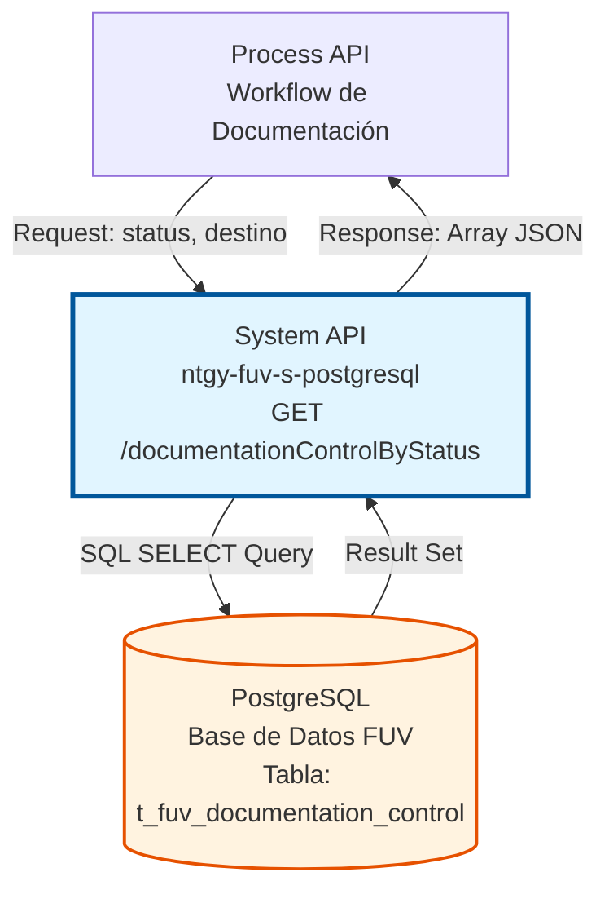
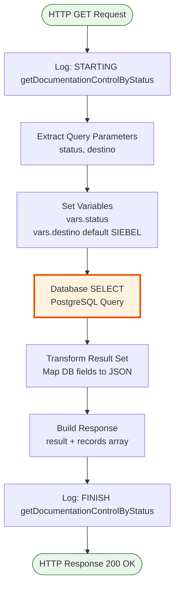
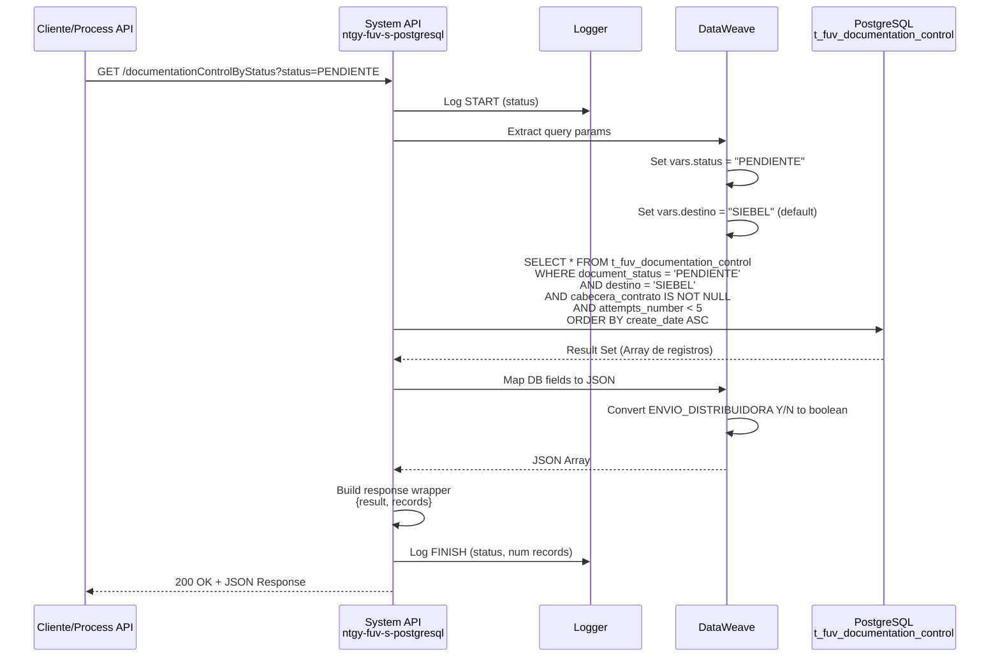

# GET /documentationControlByStatus

## 📌 Descripción General

### Propósito del Endpoint

Este endpoint consulta registros de control de documentación en la base de datos PostgreSQL del sistema FUV (Facturación Única Virtual), filtrando por estado de procesamiento y sistema destino. Permite recuperar documentos pendientes de procesamiento que cumplan con criterios específicos de validez y número de intentos.

El endpoint soporta:
- **Filtrado por Estado**: Consulta documentos según su estado de procesamiento (PENDIENTE, PROCESADO, ERROR, etc.)
- **Filtrado por Destino**: Filtra por sistema destino (SIEBEL por defecto, u otros sistemas)
- **Validación de Integridad**: Solo retorna documentos con cabecera de contrato válida
- **Control de Reintentos**: Excluye documentos que han superado el límite de intentos (≥5)
- **Ordenamiento Cronológico**: Retorna documentos ordenados por fecha de creación ascendente

### Tipo de API

**Capa:** System API (API-Led Connectivity)

**Función:** Acceso directo a datos de control de documentación en PostgreSQL para consultas por estado y destino.

### Patrón de Integración

**Tipo:** Request-Reply Síncrono con Query SQL

**Descripción:** El endpoint recibe parámetros de consulta (status y destino opcional), ejecuta una query SELECT parametrizada en PostgreSQL, transforma los resultados a JSON y retorna un array de registros que cumplen los criterios de filtrado.

### Arquitectura API-Led Connectivity



---

## 💼 Propósito del Negocio

### Casos de Uso Principales

1. **Procesamiento Batch de Documentos Pendientes**
   - Los procesos batch consultan documentos en estado PENDIENTE para procesarlos
   - Se recuperan solo documentos válidos (con cabecera) y con intentos disponibles
   - Permite procesamiento ordenado por antigüedad (FIFO)

2. **Monitoreo de Documentos en Error**
   - Consulta documentos en estado ERROR para análisis y reprocesamiento
   - Identifica documentos que requieren intervención manual
   - Facilita la gestión de excepciones en el flujo documental

3. **Gestión de Documentos por Sistema Destino**
   - Filtra documentos según el sistema destino (SIEBEL, otros)
   - Permite procesamiento diferenciado por canal de destino
   - Soporta múltiples flujos de integración documental

### Contexto Empresarial

- **Dominio:** Gestión Documental y Control de Órdenes
- **Sector:** Energía - Utilities
- **División:** Naturgy España - FUV (Facturación Única Virtual)
- **Proceso de Negocio:** Control y seguimiento de documentación asociada a órdenes de clientes
- **Sistema:** PostgreSQL - Base de datos transaccional FUV

### Stakeholders

- **Equipos de Procesamiento Batch**: Necesitan consultar documentos pendientes para procesamiento automatizado
- **Equipos de Soporte**: Requieren visibilidad de documentos en error para resolución de incidencias
- **Sistemas de Integración**: Consumen este endpoint para sincronización con sistemas destino (SIEBEL, etc.)

### Valor de Negocio

- **Eficiencia Operativa**: Permite procesamiento automatizado de documentos pendientes
- **Control de Calidad**: Filtra documentos válidos (con cabecera) para evitar errores
- **Gestión de Reintentos**: Controla intentos de procesamiento para evitar loops infinitos
- **Trazabilidad**: Facilita seguimiento del estado de documentación por sistema destino

### Consumidores Potenciales

Este endpoint puede ser consumido por:
- Process APIs de gestión documental
- Procesos batch de sincronización con sistemas externos
- Flujos de reprocesamiento de documentos
- Sistemas de monitoreo y alertas

---

## 🔧 Especificación Técnica

### URLs por Ambiente

| Ambiente | URL Base | URL Completa |
|----------|----------|--------------|
| **Local** | `http://localhost:8081` | `http://localhost:8081/api/documentationControlByStatus?status=PENDIENTE` |
| **Development** | `https://ntgy-fuv-s-postgresql-dev.us-e2.cloudhub.io` | `https://ntgy-fuv-s-postgresql-dev.us-e2.cloudhub.io/api/documentationControlByStatus?status=PENDIENTE` |
| **UAT** | `https://ntgy-fuv-s-postgresql-uat.us-e2.cloudhub.io` | `https://ntgy-fuv-s-postgresql-uat.us-e2.cloudhub.io/api/documentationControlByStatus?status=PENDIENTE` |
| **Production** | `https://ntgy-fuv-s-postgresql-pro.us-e2.cloudhub.io` | `https://ntgy-fuv-s-postgresql-pro.us-e2.cloudhub.io/api/documentationControlByStatus?status=PENDIENTE` |

### Método HTTP

```
GET /api/documentationControlByStatus
```

### Parámetros de Entrada

#### Headers HTTP

| Header | Tipo | Requerido | Descripción | Ejemplo |
|--------|------|-----------|-------------|---------|
| `Accept` | string | ❌ No | Tipo de contenido esperado en response | `application/json` |

#### Query Parameters

| Parámetro | Tipo | Requerido | Descripción | Ejemplo | Default |
|-----------|------|-----------|-------------|---------|---------|
| `status` | string | ✅ Sí | Estado de procesamiento del documento | `"PENDIENTE"` | - |
| `destino` | string | ❌ No | Sistema destino del documento | `"SIEBEL"` | `"SIEBEL"` |

**Valores comunes para `status`:**
- `PENDIENTE` - Documentos pendientes de procesamiento
- `PROCESADO` - Documentos procesados exitosamente
- `ERROR` - Documentos con errores de procesamiento
- `EN_PROCESO` - Documentos en procesamiento activo

**Valores comunes para `destino`:**
- `SIEBEL` - Sistema Siebel (valor por defecto)
- Otros sistemas según configuración

### Respuestas

#### Respuesta Exitosa (200 OK)

```json
{
  "result": {
    "codResult": "0000",
    "msgResult": "No hay error"
  },
  "records": [
    {
      "NUM_DOCUMENTO": "12345678A",
      "T_FUV_DOCUMENTATION_CONTROL_ID": "550e8400-e29b-41d4-a716-446655440000",
      "CONTRACT_ID": "ORD-2024-001234",
      "DOCUMENT_NAME": "contrato_firmado.pdf",
      "DOCUMENT_STATUS": "PENDIENTE",
      "ATTEMPTS_NUMBER": 1,
      "CREATE_DATE": "2024-01-15T10:30:00Z",
      "UPDATE_DATE": "2024-01-15T10:30:00Z",
      "UPDATE_USER": "mulesoft",
      "UPDATE_PROGRAM": "mulesoft",
      "CABECERA_CONTRATO": "{\"cliente\":\"Juan Pérez\",\"contrato\":\"C-001\"}",
      "TIPO_DOCUMENTAL": "CONTRATO",
      "ENVIO_DISTRIBUIDORA": true,
      "LINEAS_CONTRATO": "{\"linea1\":{\"producto\":\"Electricidad\"}}",
      "DOCUMENT_ID": "DOC-2024-5678",
      "DESTINO": "SIEBEL"
    }
  ]
}
```

#### Respuesta Sin Resultados (200 OK)

```json
{
  "result": {
    "codResult": "0000",
    "msgResult": "No hay error"
  },
  "records": []
}
```

#### Respuesta de Error Técnico (500)

```json
{
  "result": {
    "codResult": "0001",
    "msgResult": "Error al consultar la base de datos"
  }
}
```

### Estructura de Campos de Respuesta

| Campo | Tipo | Descripción |
|-------|------|-------------|
| `NUM_DOCUMENTO` | string | Número de documento del cliente (NIF/NIE/CIF) |
| `T_FUV_DOCUMENTATION_CONTROL_ID` | string (UUID) | Identificador único del registro de control |
| `CONTRACT_ID` | string | Identificador del pedido/contrato asociado |
| `DOCUMENT_NAME` | string | Nombre del documento |
| `DOCUMENT_STATUS` | string | Estado actual del documento |
| `ATTEMPTS_NUMBER` | integer | Número de intentos de procesamiento |
| `CREATE_DATE` | timestamp | Fecha de creación del registro |
| `UPDATE_DATE` | timestamp | Fecha de última actualización |
| `UPDATE_USER` | string | Usuario que realizó la última actualización |
| `UPDATE_PROGRAM` | string | Programa que realizó la última actualización |
| `CABECERA_CONTRATO` | string (JSON) | Datos de cabecera del contrato en formato JSON |
| `TIPO_DOCUMENTAL` | string | Tipo de documento (CONTRATO, ANEXO, etc.) |
| `ENVIO_DISTRIBUIDORA` | boolean | Indica si el documento se envía a distribuidora |
| `LINEAS_CONTRATO` | string (JSON) | Líneas del contrato en formato JSON |
| `DOCUMENT_ID` | string | Identificador del documento en sistema externo |
| `DESTINO` | string | Sistema destino del documento |

### Autenticación y Autorización

- **Tipo:** Client ID & Client Secret (Anypoint Platform)
- **Autorización PostgreSQL:** El usuario de base de datos debe tener permisos de:
  - SELECT en tabla `t_fuv_documentation_control`
  - Acceso al schema `public` (o schema configurado)

### Timeouts

| Tipo | Valor | Descripción |
|------|-------|-------------|
| **Query Timeout** | 30 segundos | Tiempo máximo de ejecución de la query SQL |
| **Connection Timeout** | 10 segundos | Tiempo máximo para establecer conexión con PostgreSQL |
| **Response Timeout** | 60 segundos | Tiempo máximo de espera para la respuesta completa |

### Consideraciones de Performance

- **Fetch Size:** Configurable mediante `${dbFUV.fetchsize}` (valor típico: 1000 registros)
- **Índices Recomendados:** 
  - Índice compuesto en `(document_status, destino, create_date)`
  - Índice en `attempts_number`
  - Índice en `cabecera_contrato` (para filtro IS NOT NULL)
- **Volumen Esperado:** Puede retornar grandes volúmenes de datos según filtros

---

## 🏗️ Implementación Técnica

### Arquitectura del Flow



### Query SQL Ejecutada

**Ubicación:** `s-postgresql-global-config.yaml` - `queries.getDocumentationByStatus`

```sql
SELECT * 
FROM t_fuv_documentation_control 
WHERE document_status = :status 
  AND destino = :destino 
  AND cabecera_contrato IS NOT NULL 
  AND attempts_number < 5 
ORDER BY create_date ASC
```

**Parámetros de la Query:**
- `:status` - Estado del documento (del query parameter)
- `:destino` - Sistema destino (del query parameter o default "SIEBEL")

**Filtros Aplicados:**
1. **document_status = :status** - Filtra por estado solicitado
2. **destino = :destino** - Filtra por sistema destino
3. **cabecera_contrato IS NOT NULL** - Solo documentos con cabecera válida
4. **attempts_number < 5** - Excluye documentos con 5 o más intentos fallidos

**Ordenamiento:**
- **ORDER BY create_date ASC** - Documentos más antiguos primero (FIFO)

### Tabla de Base de Datos

**Nombre:** `t_fuv_documentation_control`

**Columnas Principales:**
- `t_fuv_documentation_control_id` (UUID, PK)
- `contract_id` (VARCHAR)
- `document_name` (VARCHAR)
- `document_status` (VARCHAR)
- `num_documento` (VARCHAR)
- `cabecera_contrato` (TEXT/JSON)
- `lineas_contrato` (TEXT/JSON)
- `tipo_documental` (VARCHAR)
- `envio_distribuidora` (CHAR(1): 'Y'/'N')
- `attempts_number` (INTEGER)
- `create_date` (TIMESTAMP)
- `update_date` (TIMESTAMP)
- `update_user` (VARCHAR)
- `update_program` (VARCHAR)
- `document_id` (VARCHAR)
- `destino` (VARCHAR)

### Transformaciones DataWeave

#### 1. Extracción de Parámetros (Set Variables)

**Ubicación:** Inline en XML (líneas 309-325)

```dataweave
%dw 2.0
output application/java
---
{
  status: attributes.queryParams.status,
  destino: if (attributes.queryParams.destino == null) "SIEBEL"
          else attributes.queryParams.destino
}
```

**Propósito:** Extrae parámetros de query y establece valor por defecto para `destino`.

#### 2. Transformación de Respuesta

**Ubicación:** Inline en XML (líneas 333-358)

```dataweave
%dw 2.0
output application/json
---
payload map (record, findex) -> {
  "NUM_DOCUMENTO": record.'num_documento',
  "T_FUV_DOCUMENTATION_CONTROL_ID": record.'t_fuv_documentation_control_id',
  "CONTRACT_ID": record.'contract_id',
  "DOCUMENT_NAME": record.'document_name',
  "DOCUMENT_STATUS": record.'document_status',
  "ATTEMPTS_NUMBER": record.'attempts_number',
  "CREATE_DATE": record.'create_date',
  "UPDATE_DATE": record.'update_date',
  "UPDATE_USER": record.'update_user',
  "UPDATE_PROGRAM": record.'update_program',
  "CABECERA_CONTRATO": record.'cabecera_contrato',
  "TIPO_DOCUMENTAL": record.'tipo_documental',
  "ENVIO_DISTRIBUIDORA": if(record.'envio_distribuidora' == 'Y') true else false,
  "LINEAS_CONTRATO": record.'lineas_contrato',
  "DOCUMENT_ID": record.document_id,
  "DESTINO": record.'destino'
}
```

**Propósito:** Transforma el result set de PostgreSQL a formato JSON con nombres de campos en mayúsculas y conversión de tipos (ENVIO_DISTRIBUIDORA de 'Y'/'N' a boolean).

### Diagrama de Secuencia Detallado



### Configuración de Conexión

**Database Config:** `Database_Config`

```yaml
# Configuración típica (valores de ejemplo)
host: ${dbFUV.host}
port: ${dbFUV.port}
database: ${dbFUV.database}
user: ${dbFUV.user}
password: ${dbFUV.password}
fetchSize: ${dbFUV.fetchsize}  # Ej: 1000
```

### Manejo de Errores

**Errores de Base de Datos:**
- Connection timeout → 503 Service Unavailable
- Query timeout → 504 Gateway Timeout
- SQL error → 500 Internal Server Error

**Errores de Validación:**
- Parámetro `status` faltante → 400 Bad Request (manejado por APIKit)

### Logging

**Nivel INFO:**
- Inicio: `"STARTING getDocumentationControlByStatus METHOD. estado: {status}"`
- Fin: `"FINISH getDocumentationControlByStatus METHOD. Estado: {status}"`

**Nivel DEBUG:**
- Response completo (con normalización de datos sensibles)

---

## 💻 Ejemplos de Uso

### Ejemplo 1: Consultar Documentos Pendientes (SIEBEL)

#### Request con curl

```bash
curl -X GET "https://ntgy-fuv-s-postgresql-dev.us-e2.cloudhub.io/api/documentationControlByStatus?status=PENDIENTE" \
  -H "Accept: application/json" \
  -H "client_id: your-client-id" \
  -H "client_secret: your-client-secret"
```

#### Response (200 OK)

```json
{
  "result": {
    "codResult": "0000",
    "msgResult": "No hay error"
  },
  "records": [
    {
      "NUM_DOCUMENTO": "12345678A",
      "T_FUV_DOCUMENTATION_CONTROL_ID": "550e8400-e29b-41d4-a716-446655440000",
      "CONTRACT_ID": "ORD-2024-001234",
      "DOCUMENT_NAME": "contrato_firmado.pdf",
      "DOCUMENT_STATUS": "PENDIENTE",
      "ATTEMPTS_NUMBER": 1,
      "CREATE_DATE": "2024-01-15T10:30:00Z",
      "UPDATE_DATE": "2024-01-15T10:30:00Z",
      "UPDATE_USER": "mulesoft",
      "UPDATE_PROGRAM": "mulesoft",
      "CABECERA_CONTRATO": "{\"cliente\":\"Juan Pérez\",\"contrato\":\"C-001\"}",
      "TIPO_DOCUMENTAL": "CONTRATO",
      "ENVIO_DISTRIBUIDORA": true,
      "LINEAS_CONTRATO": "{\"linea1\":{\"producto\":\"Electricidad\"}}",
      "DOCUMENT_ID": "DOC-2024-5678",
      "DESTINO": "SIEBEL"
    },
    {
      "NUM_DOCUMENTO": "87654321B",
      "T_FUV_DOCUMENTATION_CONTROL_ID": "660e8400-e29b-41d4-a716-446655440001",
      "CONTRACT_ID": "ORD-2024-001235",
      "DOCUMENT_NAME": "anexo_condiciones.pdf",
      "DOCUMENT_STATUS": "PENDIENTE",
      "ATTEMPTS_NUMBER": 0,
      "CREATE_DATE": "2024-01-15T11:00:00Z",
      "UPDATE_DATE": "2024-01-15T11:00:00Z",
      "UPDATE_USER": "mulesoft",
      "UPDATE_PROGRAM": "mulesoft",
      "CABECERA_CONTRATO": "{\"cliente\":\"María García\",\"contrato\":\"C-002\"}",
      "TIPO_DOCUMENTAL": "ANEXO",
      "ENVIO_DISTRIBUIDORA": false,
      "LINEAS_CONTRATO": "{\"linea1\":{\"producto\":\"Gas\"}}",
      "DOCUMENT_ID": "DOC-2024-5679",
      "DESTINO": "SIEBEL"
    }
  ]
}
```

### Ejemplo 2: Consultar Documentos en Error

#### Request con curl

```bash
curl -X GET "https://ntgy-fuv-s-postgresql-dev.us-e2.cloudhub.io/api/documentationControlByStatus?status=ERROR&destino=SIEBEL" \
  -H "Accept: application/json" \
  -H "client_id: your-client-id" \
  -H "client_secret: your-client-secret"
```

#### Response (200 OK)

```json
{
  "result": {
    "codResult": "0000",
    "msgResult": "No hay error"
  },
  "records": [
    {
      "NUM_DOCUMENTO": "11223344C",
      "T_FUV_DOCUMENTATION_CONTROL_ID": "770e8400-e29b-41d4-a716-446655440002",
      "CONTRACT_ID": "ORD-2024-001236",
      "DOCUMENT_NAME": "documento_error.pdf",
      "DOCUMENT_STATUS": "ERROR",
      "ATTEMPTS_NUMBER": 3,
      "CREATE_DATE": "2024-01-14T09:00:00Z",
      "UPDATE_DATE": "2024-01-15T12:00:00Z",
      "UPDATE_USER": "mulesoft",
      "UPDATE_PROGRAM": "mulesoft",
      "CABECERA_CONTRATO": "{\"cliente\":\"Pedro López\",\"contrato\":\"C-003\"}",
      "TIPO_DOCUMENTAL": "CONTRATO",
      "ENVIO_DISTRIBUIDORA": true,
      "LINEAS_CONTRATO": "{\"linea1\":{\"producto\":\"Electricidad\"}}",
      "DOCUMENT_ID": "DOC-2024-5680",
      "DESTINO": "SIEBEL"
    }
  ]
}
```

### Ejemplo 3: Sin Resultados

#### Request con curl

```bash
curl -X GET "https://ntgy-fuv-s-postgresql-dev.us-e2.cloudhub.io/api/documentationControlByStatus?status=PROCESADO" \
  -H "Accept: application/json" \
  -H "client_id: your-client-id" \
  -H "client_secret: your-client-secret"
```

#### Response (200 OK)

```json
{
  "result": {
    "codResult": "0000",
    "msgResult": "No hay error"
  },
  "records": []
}
```

### Ejemplo 4: Error de Base de Datos

#### Request con curl

```bash
curl -X GET "https://ntgy-fuv-s-postgresql-dev.us-e2.cloudhub.io/api/documentationControlByStatus?status=PENDIENTE" \
  -H "Accept: application/json" \
  -H "client_id: your-client-id" \
  -H "client_secret: your-client-secret"
```

#### Response (500 Internal Server Error)

```json
{
  "result": {
    "codResult": "0001",
    "msgResult": "Error al consultar la base de datos: Connection timeout"
  }
}
```

### Ejemplo 5: Uso desde JavaScript/Node.js

```javascript
const axios = require('axios');

async function getDocumentsByStatus(status, destino = 'SIEBEL') {
  try {
    const response = await axios.get(
      'https://ntgy-fuv-s-postgresql-dev.us-e2.cloudhub.io/api/documentationControlByStatus',
      {
        params: {
          status: status,
          destino: destino
        },
        headers: {
          'Accept': 'application/json',
          'client_id': 'your-client-id',
          'client_secret': 'your-client-secret'
        }
      }
    );
    
    console.log(`Found ${response.data.records.length} documents`);
    return response.data.records;
  } catch (error) {
    console.error('Error fetching documents:', error.message);
    throw error;
  }
}

// Uso
getDocumentsByStatus('PENDIENTE')
  .then(documents => {
    documents.forEach(doc => {
      console.log(`Document: ${doc.DOCUMENT_NAME}, Status: ${doc.DOCUMENT_STATUS}`);
    });
  });
```

### Ejemplo 6: Uso desde Python

```python
import requests

def get_documents_by_status(status, destino='SIEBEL'):
    url = 'https://ntgy-fuv-s-postgresql-dev.us-e2.cloudhub.io/api/documentationControlByStatus'
    
    params = {
        'status': status,
        'destino': destino
    }
    
    headers = {
        'Accept': 'application/json',
        'client_id': 'your-client-id',
        'client_secret': 'your-client-secret'
    }
    
    try:
        response = requests.get(url, params=params, headers=headers)
        response.raise_for_status()
        
        data = response.json()
        print(f"Found {len(data['records'])} documents")
        return data['records']
    except requests.exceptions.RequestException as e:
        print(f"Error fetching documents: {e}")
        raise

# Uso
documents = get_documents_by_status('PENDIENTE')
for doc in documents:
    print(f"Document: {doc['DOCUMENT_NAME']}, Status: {doc['DOCUMENT_STATUS']}")
```

### Notas de Implementación

1. **Paginación:** Este endpoint no implementa paginación. Para grandes volúmenes, considerar:
   - Limitar resultados en la query SQL
   - Implementar paginación en versiones futuras
   - Usar filtros adicionales para reducir el conjunto de resultados

2. **Performance:** 
   - El ordenamiento por `create_date ASC` asegura procesamiento FIFO
   - El filtro `attempts_number < 5` previene loops infinitos
   - El filtro `cabecera_contrato IS NOT NULL` asegura calidad de datos

3. **Seguridad:**
   - Usar HTTPS en todos los ambientes excepto local
   - Rotar credenciales regularmente
   - Monitorear accesos y volúmenes de consulta