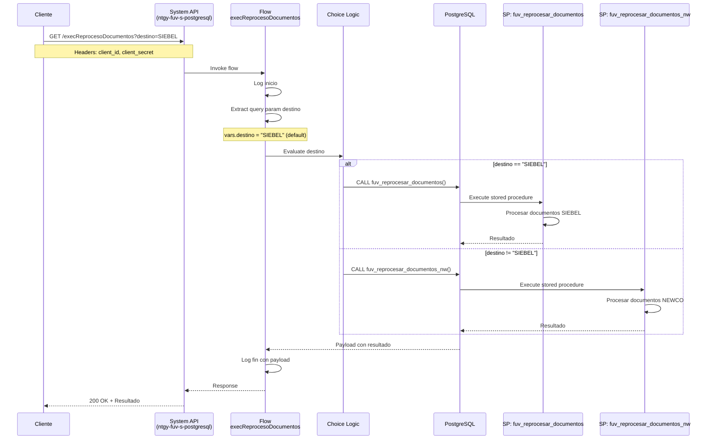
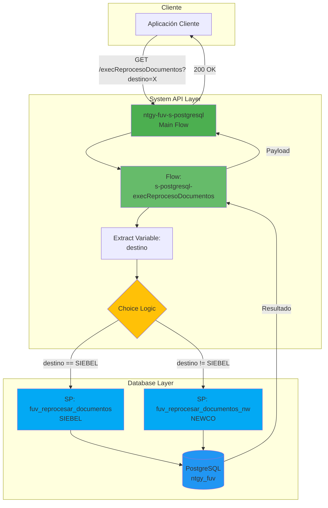
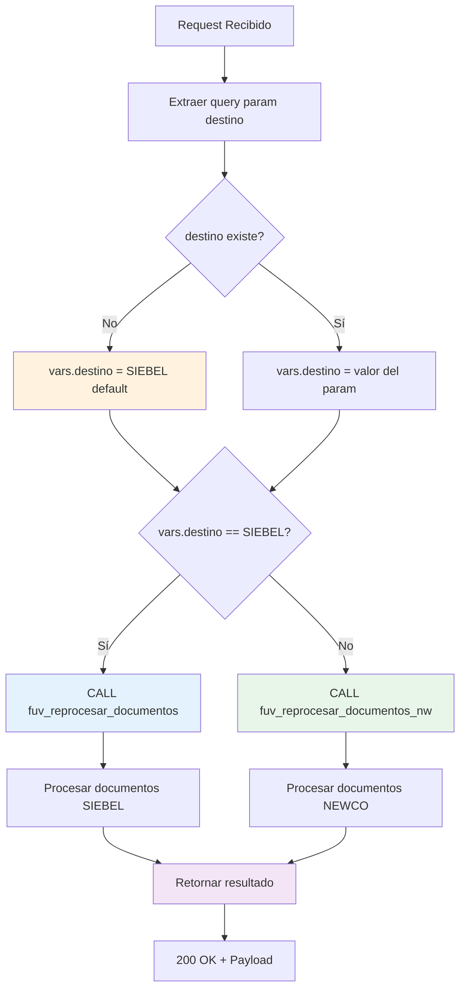
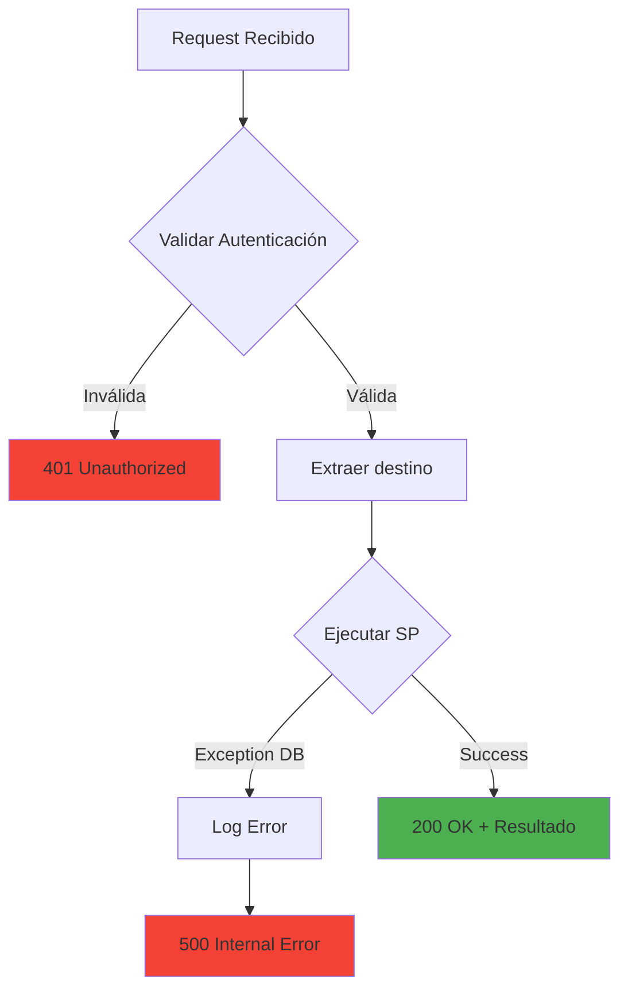

# GET /execReprocesoDocumentos

## 📌 Descripción General

El endpoint `GET /execReprocesoDocumentos` es una **System API** que ejecuta el reprocesamiento de documentos pendientes en el sistema FUV (Facturación Única Virtual) mediante la invocación de stored procedures en PostgreSQL. El endpoint selecciona dinámicamente qué stored procedure ejecutar basándose en el sistema destino especificado (SIEBEL o NEWCO).

**Características principales:**
- **Operación:** Llamada a Stored Procedures sin parámetros
- **Backend:** PostgreSQL
- **Tipo de API:** System API
- **Método HTTP:** GET
- **Lógica condicional:** Choice basado en parámetro `destino`
- **Stored Procedures:** `fuv_reprocesar_documentos()` o `fuv_reprocesar_documentos_nw()`
- **Sin transformaciones:** No usa DataWeave, respuesta directa del SP

## 💼 Propósito del Negocio

### Contexto del Negocio

El sistema FUV (Facturación Única Virtual) gestiona la integración de documentos de facturación con dos sistemas destino diferentes:
- **SIEBEL:** Sistema legacy de gestión de clientes
- **NEWCO:** Sistema nuevo de gestión (New Company)

Cuando los documentos fallan en su procesamiento inicial o requieren ser reprocesados por cambios en los datos, este endpoint ejecuta el proceso de reprocesamiento masivo según el sistema destino.

### Casos de Uso

1. **Reprocesamiento Masivo SIEBEL**
   - Ejecutar reprocesamiento de documentos pendientes para SIEBEL
   - Procesar documentos que fallaron en intentos anteriores
   - Sincronizar documentos con el sistema legacy

2. **Reprocesamiento Masivo NEWCO**
   - Ejecutar reprocesamiento de documentos pendientes para NEWCO
   - Procesar documentos del nuevo sistema
   - Mantener sincronización con la plataforma moderna

3. **Recuperación de Errores**
   - Reintentar procesamiento de documentos con errores
   - Limpiar cola de documentos pendientes
   - Resolver problemas de integración masivamente

4. **Operaciones Programadas**
   - Ejecutar como parte de jobs batch programados
   - Procesar documentos en horarios de baja carga
   - Mantener sincronización periódica

### Valor de Negocio

- **Automatización:** Reprocesamiento masivo sin intervención manual
- **Eficiencia:** Procesa múltiples documentos en una sola operación
- **Flexibilidad:** Soporta dos sistemas destino diferentes
- **Recuperación:** Permite resolver errores de procesamiento masivamente
- **Integridad:** Asegura que todos los documentos se procesen correctamente

## 🔧 Especificación Técnica

### Endpoint

```
GET /execReprocesoDocumentos
```

### Headers Requeridos

| Header | Valor | Descripción |
|--------|-------|-------------|
| `client_id` | `string` | Identificador del cliente API |
| `client_secret` | `string` | Secreto del cliente para autenticación |

### Query Parameters

| Parámetro | Tipo | Requerido | Default | Descripción | Valores Válidos |
|-----------|------|-----------|---------|-------------|-----------------|
| `destino` | string | No | "SIEBEL" | Sistema destino para el reprocesamiento | "SIEBEL", "NEWCO" o cualquier otro valor |

**Nota:** Si no se proporciona el parámetro `destino` o está vacío, se usa "SIEBEL" por defecto.

### Lógica de Selección

```
IF destino == "SIEBEL" THEN
    CALL fuv_reprocesar_documentos()
ELSE
    CALL fuv_reprocesar_documentos_nw()
END IF
```

**Importante:** Cualquier valor diferente de "SIEBEL" (incluyendo "NEWCO", "newco", etc.) ejecutará el stored procedure de NEWCO.

### Response Body

#### Respuesta Exitosa (200 OK)

La respuesta contiene el resultado directo del stored procedure ejecutado. La estructura exacta depende de la implementación del SP, pero típicamente incluye:

```json
{
  "registros_procesados": 150,
  "registros_exitosos": 145,
  "registros_error": 5,
  "mensaje": "Reprocesamiento completado",
  "timestamp": "2024-01-15T10:30:00Z"
}
```

**Nota:** La estructura exacta puede variar según la implementación del stored procedure en PostgreSQL.

### Códigos de Respuesta

| Código | Descripción | Escenario |
|--------|-------------|-----------|
| 200 | OK | Stored procedure ejecutado correctamente |
| 401 | Unauthorized | Credenciales inválidas o faltantes |
| 500 | Internal Server Error | Error en la ejecución del stored procedure |
| 503 | Service Unavailable | Base de datos no disponible |

### Validaciones

1. **Autenticación:** Validación de `client_id` y `client_secret`
2. **Parámetro destino:** Opcional, se aplica default si no se proporciona
3. **Conexión DB:** Verificación de disponibilidad de PostgreSQL

## 🏗️ Implementación Técnica

### Arquitectura del Flujo



### Diagrama de Arquitectura



### Implementación del Flow

**Archivo:** `s-postgresql-execReprocesoDocumentos.xml`  
**Flow:** `s-postgresql-execReprocesoDocumentos`  
**Líneas:** 8-37

#### Paso 1: Logging Inicial (Línea 9)

```xml
<logger level="INFO" doc:name="Logger" 
    message="execReprocesoPedidos: Inicio "/>
```

**Nota:** El mensaje dice "execReprocesoPedidos" pero el flow es para documentos. Probablemente es un copy-paste del flow de pedidos.

#### Paso 2: Extracción del Parámetro destino (Líneas 10-18)

```xml
<ee:transform doc:name="var destino">
    <ee:message />
    <ee:variables>
        <ee:set-variable variableName="destino"><![CDATA[%dw 2.0
output application/java
---
attributes.queryParams.destino default "SIEBEL"]]></ee:set-variable>
    </ee:variables>
</ee:transform>
```

**Propósito:**
- Extrae el query parameter `destino`
- Si no existe o está vacío, usa "SIEBEL" como default
- Almacena en variable `vars.destino`

#### Paso 3: Lógica Condicional Choice (Líneas 19-30)

```xml
<choice doc:name="Choice">
    <when expression='#[vars.destino == "SIEBEL"]'>
        <db:stored-procedure doc:name="Procedure SIEBEL" config-ref="Database_Config">
            <db:sql><![CDATA[call fuv_reprocesar_documentos()]]></db:sql>
        </db:stored-procedure>
    </when>
    <otherwise>
        <db:stored-procedure doc:name="Procedure NEWCO" config-ref="Database_Config">
            <db:sql><![CDATA[call fuv_reprocesar_documentos_nw()]]></db:sql>
        </db:stored-procedure>
    </otherwise>
</choice>
```

**Lógica:**
- **Condición:** Si `vars.destino == "SIEBEL"` (comparación exacta, case-sensitive)
- **Then:** Ejecuta `fuv_reprocesar_documentos()`
- **Else:** Ejecuta `fuv_reprocesar_documentos_nw()`

**Importante:** 
- La comparación es case-sensitive
- "SIEBEL" ejecuta el SP de SIEBEL
- Cualquier otro valor (incluyendo "siebel", "NEWCO", "newco", null) ejecuta el SP de NEWCO

#### Paso 4: Logging Final (Línea 31)

```xml
<logger level="INFO" doc:name="Logger" 
    message="execReprocesoPedidos: Fin #[payload]"/>
```

**Propósito:** Registra el fin de la ejecución incluyendo el payload de respuesta del stored procedure.

#### Paso 5: Manejo de Errores (Líneas 32-36)

```xml
<error-handler>
    <on-error-propagate enableNotifications="true" logException="true" 
        doc:name="On Error Propagate">
        <logger level="ERROR" doc:name="Logger" 
            message="execReprocesoPedidos: Error"/>
    </on-error-propagate>
</error-handler>
```

**Propósito:** Captura y registra cualquier error durante la ejecución, propagando el error al cliente.

### Stored Procedures

#### 1. fuv_reprocesar_documentos()

**Sistema:** SIEBEL  
**Parámetros:** Ninguno  
**Descripción:** Procesa documentos pendientes para el sistema SIEBEL

**Características:**
- Sin parámetros de entrada
- Selecciona documentos pendientes internamente
- Procesa según lógica interna del SP
- Retorna resultado del procesamiento

**Ejemplo de implementación típica:**
```sql
CREATE OR REPLACE FUNCTION fuv_reprocesar_documentos()
RETURNS TABLE (
    registros_procesados INTEGER,
    registros_exitosos INTEGER,
    registros_error INTEGER
) AS $$
BEGIN
    -- Lógica de reprocesamiento para SIEBEL
    -- Selecciona documentos pendientes
    -- Procesa cada documento
    -- Retorna estadísticas
END;
$$ LANGUAGE plpgsql;
```

#### 2. fuv_reprocesar_documentos_nw()

**Sistema:** NEWCO  
**Parámetros:** Ninguno  
**Descripción:** Procesa documentos pendientes para el sistema NEWCO

**Características:**
- Sin parámetros de entrada
- Selecciona documentos pendientes internamente
- Procesa según lógica interna del SP
- Retorna resultado del procesamiento

**Ejemplo de implementación típica:**
```sql
CREATE OR REPLACE FUNCTION fuv_reprocesar_documentos_nw()
RETURNS TABLE (
    registros_procesados INTEGER,
    registros_exitosos INTEGER,
    registros_error INTEGER
) AS $$
BEGIN
    -- Lógica de reprocesamiento para NEWCO
    -- Selecciona documentos pendientes
    -- Procesa cada documento
    -- Retorna estadísticas
END;
$$ LANGUAGE plpgsql;
```

### Diagrama de Flujo de Decisión



### Configuración de Base de Datos

**Connector:** Database Connector (PostgreSQL)

```xml
<db:config name="Database_Config">
    <db:generic-connection 
        url="${db.url}" 
        driverClassName="org.postgresql.Driver"
        user="${db.user}"
        password="${secure::db.password}"/>
</db:config>
```

### Manejo de Errores



### Propiedades de Configuración

```properties
# Database Configuration
db.url=jdbc:postgresql://localhost:5432/ntgy_fuv
db.user=${DB_USER}
db.password=${DB_PASSWORD}

# API Configuration
api.base.path=/api/v1
```

## 💻 Ejemplos de Uso

### Ejemplo 1: Reprocesamiento SIEBEL (Default)

#### Request

```bash
curl -X GET "https://api.naturgy.com/fuv/v1/execReprocesoDocumentos" \
  -H "client_id: your-client-id" \
  -H "client_secret: your-client-secret"
```

**Nota:** Sin parámetro `destino`, usa default "SIEBEL"

#### Response (200 OK)

```json
{
  "registros_procesados": 150,
  "registros_exitosos": 145,
  "registros_error": 5,
  "mensaje": "Reprocesamiento SIEBEL completado",
  "timestamp": "2024-01-15T10:30:00Z"
}
```

### Ejemplo 2: Reprocesamiento SIEBEL (Explícito)

#### Request

```bash
curl -X GET "https://api.naturgy.com/fuv/v1/execReprocesoDocumentos?destino=SIEBEL" \
  -H "client_id: your-client-id" \
  -H "client_secret: your-client-secret"
```

#### Response (200 OK)

```json
{
  "registros_procesados": 200,
  "registros_exitosos": 195,
  "registros_error": 5,
  "mensaje": "Reprocesamiento SIEBEL completado",
  "timestamp": "2024-01-15T11:00:00Z"
}
```

### Ejemplo 3: Reprocesamiento NEWCO

#### Request

```bash
curl -X GET "https://api.naturgy.com/fuv/v1/execReprocesoDocumentos?destino=NEWCO" \
  -H "client_id: your-client-id" \
  -H "client_secret: your-client-secret"
```

#### Response (200 OK)

```json
{
  "registros_procesados": 75,
  "registros_exitosos": 72,
  "registros_error": 3,
  "mensaje": "Reprocesamiento NEWCO completado",
  "timestamp": "2024-01-15T11:30:00Z"
}
```

### Ejemplo 4: Con PowerShell

```powershell
$headers = @{
    "client_id" = "your-client-id"
    "client_secret" = "your-client-secret"
}

# Reprocesamiento SIEBEL
$response = Invoke-RestMethod -Uri "https://api.naturgy.com/fuv/v1/execReprocesoDocumentos?destino=SIEBEL" `
    -Method Get `
    -Headers $headers

Write-Host "Procesados: $($response.registros_procesados)"
Write-Host "Exitosos: $($response.registros_exitosos)"
Write-Host "Errores: $($response.registros_error)"
```

### Ejemplo 5: Integración con JavaScript/Node.js

```javascript
const axios = require('axios');

async function ejecutarReprocesamiento(destino = 'SIEBEL') {
  try {
    const response = await axios.get(
      `https://api.naturgy.com/fuv/v1/execReprocesoDocumentos`,
      {
        params: { destino: destino },
        headers: {
          'client_id': process.env.CLIENT_ID,
          'client_secret': process.env.CLIENT_SECRET
        }
      }
    );
    
    console.log(`Reprocesamiento ${destino} completado:`);
    console.log(`- Procesados: ${response.data.registros_procesados}`);
    console.log(`- Exitosos: ${response.data.registros_exitosos}`);
    console.log(`- Errores: ${response.data.registros_error}`);
    
    return response.data;
  } catch (error) {
    console.error('Error al ejecutar reprocesamiento:', error.response?.data || error.message);
    throw error;
  }
}

// Uso
ejecutarReprocesamiento('SIEBEL');
ejecutarReprocesamiento('NEWCO');
```

### Ejemplo 6: Integración con Python

```python
import requests
import os
from typing import Dict

def ejecutar_reprocesamiento(destino: str = 'SIEBEL') -> Dict:
    """
    Ejecuta el reprocesamiento de documentos
    
    Args:
        destino: Sistema destino ('SIEBEL' o 'NEWCO')
        
    Returns:
        Dict con resultado del reprocesamiento
    """
    url = "https://api.naturgy.com/fuv/v1/execReprocesoDocumentos"
    
    headers = {
        "client_id": os.getenv("CLIENT_ID"),
        "client_secret": os.getenv("CLIENT_SECRET")
    }
    
    params = {"destino": destino}
    
    try:
        response = requests.get(url, params=params, headers=headers)
        response.raise_for_status()
        
        data = response.json()
        print(f"Reprocesamiento {destino} completado:")
        print(f"- Procesados: {data.get('registros_procesados', 0)}")
        print(f"- Exitosos: {data.get('registros_exitosos', 0)}")
        print(f"- Errores: {data.get('registros_error', 0)}")
        
        return data
        
    except requests.exceptions.HTTPError as e:
        print(f"Error HTTP: {e.response.status_code} - {e.response.text}")
        raise
    except Exception as e:
        print(f"Error: {str(e)}")
        raise

# Uso
if __name__ == "__main__":
    # Reprocesar SIEBEL
    resultado_siebel = ejecutar_reprocesamiento('SIEBEL')
    
    # Reprocesar NEWCO
    resultado_newco = ejecutar_reprocesamiento('NEWCO')
```

### Ejemplo 7: Job Programado (Python con Schedule)

```python
import schedule
import time
import requests
import os
from datetime import datetime

def job_reprocesamiento_siebel():
    """Job programado para reprocesar documentos SIEBEL"""
    print(f"[{datetime.now()}] Iniciando reprocesamiento SIEBEL...")
    
    url = "https://api.naturgy.com/fuv/v1/execReprocesoDocumentos"
    headers = {
        "client_id": os.getenv("CLIENT_ID"),
        "client_secret": os.getenv("CLIENT_SECRET")
    }
    params = {"destino": "SIEBEL"}
    
    try:
        response = requests.get(url, params=params, headers=headers)
        response.raise_for_status()
        data = response.json()
        
        print(f"✅ Completado: {data.get('registros_procesados', 0)} documentos")
        print(f"   Exitosos: {data.get('registros_exitosos', 0)}")
        print(f"   Errores: {data.get('registros_error', 0)}")
        
    except Exception as e:
        print(f"❌ Error: {str(e)}")

def job_reprocesamiento_newco():
    """Job programado para reprocesar documentos NEWCO"""
    print(f"[{datetime.now()}] Iniciando reprocesamiento NEWCO...")
    
    url = "https://api.naturgy.com/fuv/v1/execReprocesoDocumentos"
    headers = {
        "client_id": os.getenv("CLIENT_ID"),
        "client_secret": os.getenv("CLIENT_SECRET")
    }
    params = {"destino": "NEWCO"}
    
    try:
        response = requests.get(url, params=params, headers=headers)
        response.raise_for_status()
        data = response.json()
        
        print(f"✅ Completado: {data.get('registros_procesados', 0)} documentos")
        print(f"   Exitosos: {data.get('registros_exitosos', 0)}")
        print(f"   Errores: {data.get('registros_error', 0)}")
        
    except Exception as e:
        print(f"❌ Error: {str(e)}")

# Programar jobs
schedule.every().day.at("02:00").do(job_reprocesamiento_siebel)  # 2 AM diario
schedule.every().day.at("03:00").do(job_reprocesamiento_newco)   # 3 AM diario

print("Jobs programados. Esperando ejecución...")
while True:
    schedule.run_pending()
    time.sleep(60)
```

### Ejemplo 8: Monitoreo y Alertas

```python
import requests
import os
from typing import Dict

def ejecutar_y_monitorear_reprocesamiento(destino: str, umbral_error: float = 0.05) -> bool:
    """
    Ejecuta reprocesamiento y alerta si hay muchos errores
    
    Args:
        destino: Sistema destino
        umbral_error: Porcentaje máximo de errores aceptable (default 5%)
        
    Returns:
        bool: True si está dentro del umbral, False si excede
    """
    url = "https://api.naturgy.com/fuv/v1/execReprocesoDocumentos"
    headers = {
        "client_id": os.getenv("CLIENT_ID"),
        "client_secret": os.getenv("CLIENT_SECRET")
    }
    params = {"destino": destino}
    
    try:
        response = requests.get(url, params=params, headers=headers)
        response.raise_for_status()
        data = response.json()
        
        procesados = data.get('registros_procesados', 0)
        errores = data.get('registros_error', 0)
        
        if procesados > 0:
            tasa_error = errores / procesados
            
            print(f"Reprocesamiento {destino}:")
            print(f"- Procesados: {procesados}")
            print(f"- Errores: {errores} ({tasa_error:.2%})")
            
            if tasa_error > umbral_error:
                print(f"⚠️ ALERTA: Tasa de error ({tasa_error:.2%}) excede umbral ({umbral_error:.2%})")
                # Aquí podrías enviar notificación por email, Slack, etc.
                return False
            else:
                print(f"✅ Tasa de error dentro del umbral")
                return True
        else:
            print(f"ℹ️ No hay documentos para procesar")
            return True
            
    except Exception as e:
        print(f"❌ Error al ejecutar reprocesamiento: {str(e)}")
        return False

# Uso
if __name__ == "__main__":
    ok_siebel = ejecutar_y_monitorear_reprocesamiento('SIEBEL', umbral_error=0.05)
    ok_newco = ejecutar_y_monitorear_reprocesamiento('NEWCO', umbral_error=0.05)
    
    if not (ok_siebel and ok_newco):
        print("\n⚠️ Se detectaron problemas en el reprocesamiento")
```

---

**Proyecto:** ntgy-fuv-s-postgresql  
**Tipo de API:** System API  
**Backend:** PostgreSQL  
**Stored Procedures:** fuv_reprocesar_documentos(), fuv_reprocesar_documentos_nw()  
**Flow:** s-postgresql-execReprocesoDocumentos  
**Lógica:** Choice condicional basado en parámetro destino