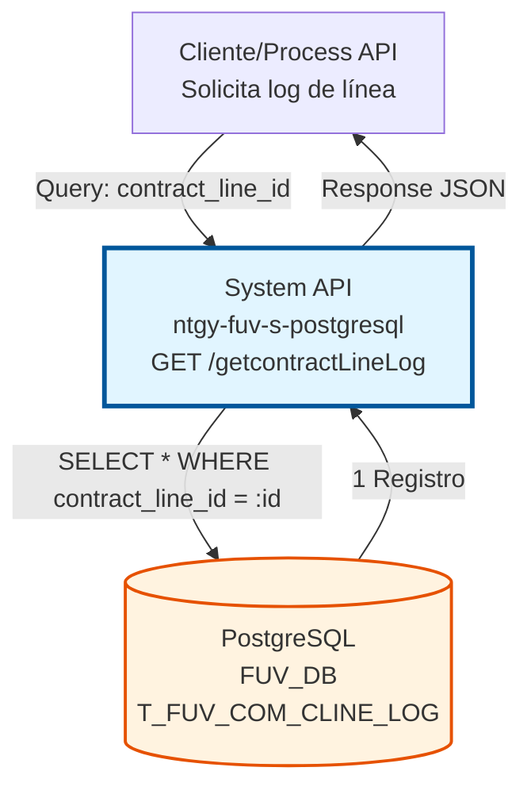
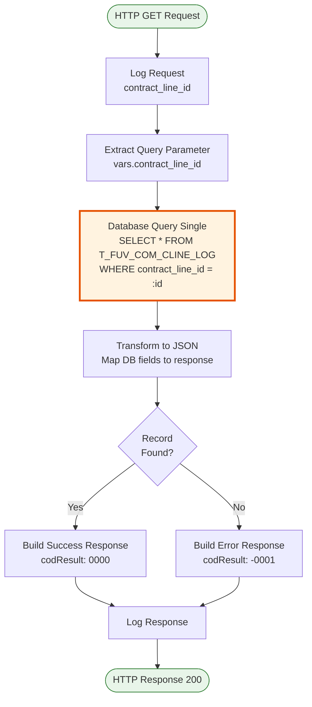
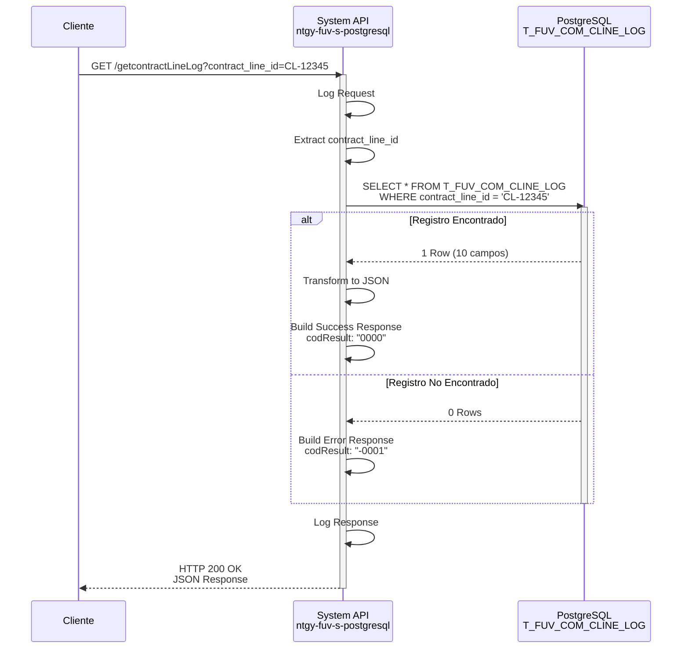

# GET /getcontractLineLog

## 📌 Descripción General

### Propósito del Endpoint

Consulta el registro de log de una línea de contrato específica en el sistema de comisiones FUV. Este endpoint retorna un único registro que contiene toda la información de procesamiento, estado, errores y trazabilidad de una línea de contrato identificada por su `CONTRACT_LINE_ID`.

El endpoint soporta:
- **Consulta Individual**: Recupera el registro completo de una línea de contrato específica
- **Monitoreo de Estado**: Verifica el estado actual de procesamiento (PENDING, ERROR, ERROR_DATOS, etc.)
- **Análisis de Errores**: Obtiene información detallada de errores y número de reintentos
- **Trazabilidad**: Accede a datos de correlación y origen del procesamiento

### Tipo de API

**Capa:** System API (API-Led Connectivity)

**Función:** Acceso directo a PostgreSQL para consulta de registros de log de comisiones FUV.

### Patrón de Integración

**Tipo:** Request-Reply Síncrono con PostgreSQL

**Descripción:** Recibe un `contract_line_id` como query parameter, ejecuta una consulta SQL directa a la tabla `T_FUV_COM_CLINE_LOG`, transforma el resultado a JSON y retorna el registro encontrado o un error si no existe.

### Arquitectura API-Led Connectivity



---

## 💼 Propósito del Negocio

### Casos de Uso Principales

1. **Monitoreo de Procesamiento de Comisiones**
   - Verificar el estado actual de una línea de contrato en el sistema de comisiones
   - Identificar si está pendiente, procesada o con errores
   - Obtener el número de reintentos realizados

2. **Troubleshooting y Resolución de Incidencias**
   - Consultar errores específicos de una línea de contrato
   - Analizar el mensaje de error para diagnóstico
   - Verificar datos de correlación para trazabilidad end-to-end

3. **Auditoría y Cumplimiento**
   - Rastrear el origen del procesamiento (ORIGEN)
   - Verificar fechas de procesamiento y actualización
   - Obtener datos extra de auditoría (AC_EXTRA_DATA)

4. **Validación de Datos**
   - Revisar el contenido completo de ATHENA_CONTRACT_LINE
   - Verificar que los datos de la línea de contrato sean correctos
   - Validar antes de reprocesar o actualizar

### Contexto Empresarial

- **Dominio:** Gestión de Comisiones y Facturación
- **Sector:** Energía - Utilities
- **División:** Naturgy España - FUV (Facturación Única Virtual)
- **Proceso de Negocio:** Procesamiento de comisiones de líneas de contrato
- **Sistema:** Sistema de comisiones Callidus/Athena

### Stakeholders

- **Equipo de Comisiones**: Monitoreo del procesamiento de líneas de contrato
- **Soporte Técnico**: Resolución de incidencias y errores de procesamiento
- **Equipo de Auditoría**: Trazabilidad y cumplimiento normativo
- **Desarrolladores de Process APIs**: Integración con flujos de comisiones

### Valor de Negocio

- **Visibilidad**: Transparencia completa del estado de procesamiento de cada línea
- **Eficiencia**: Diagnóstico rápido de problemas sin acceso directo a base de datos
- **Trazabilidad**: Cumplimiento de requisitos de auditoría y GDPR
- **Calidad**: Validación de datos antes de reprocesamiento

### Consumidores Potenciales

Este endpoint puede ser consumido por:
- Process APIs de gestión de comisiones
- Sistemas de monitoreo y alertas
- Herramientas de troubleshooting y soporte
- Dashboards de operaciones
- Procesos de reprocesamiento de comisiones

---

## 🔧 Especificación Técnica

### URLs por Ambiente

| Ambiente | URL Base | URL Completa |
|----------|----------|--------------|
| **Local** | `http://localhost:8081` | `http://localhost:8081/api/getcontractLineLog?contract_line_id={id}` |
| **Development** | `https://ntgy-fuv-s-postgresql-dev.us-e2.cloudhub.io` | `https://ntgy-fuv-s-postgresql-dev.us-e2.cloudhub.io/api/getcontractLineLog?contract_line_id={id}` |
| **UAT** | `https://ntgy-fuv-s-postgresql-uat.us-e2.cloudhub.io` | `https://ntgy-fuv-s-postgresql-uat.us-e2.cloudhub.io/api/getcontractLineLog?contract_line_id={id}` |
| **Production** | `https://ntgy-fuv-s-postgresql-pro.us-e2.cloudhub.io` | `https://ntgy-fuv-s-postgresql-pro.us-e2.cloudhub.io/api/getcontractLineLog?contract_line_id={id}` |

### Método HTTP

```
GET /api/getcontractLineLog
```

### Parámetros de Entrada

#### Headers HTTP

| Header | Tipo | Requerido | Descripción | Ejemplo |
|--------|------|-----------|-------------|---------|
| `Accept` | string | ❌ No | Tipo de contenido esperado en response | `application/json` |

#### Query Parameters

| Parámetro | Tipo | Requerido | Descripción | Ejemplo |
|-----------|------|-----------|-------------|---------|
| `contract_line_id` | string | ✅ Sí | Identificador único de la línea de contrato | `"CL-12345"` |

**Validaciones:**
- El parámetro `contract_line_id` es obligatorio
- Si no se proporciona, se retorna error 400 Bad Request
- El valor debe corresponder a un registro existente en la tabla

### Respuestas

#### Respuesta Exitosa (200 OK)

**Cuando se encuentra el registro:**

```json
{
  "result": {
    "codResult": "0000",
    "msgResult": "No hay error"
  },
  "record": {
    "T_FUV_COM_CLINE_LOG_ID": "123",
    "CONTRACT_LINE_ID": "CL-12345",
    "ATHENA_CONTRACT_LINE": "{\"contractId\":\"C-001\",\"lineId\":\"L-001\",\"product\":\"Electricidad\"}",
    "STATUS": "PENDING",
    "PROCESSING_RETRIES": 0,
    "AC_EXTRA_DATA": "correlation-id-abc-123",
    "ERROR": null,
    "PROCESSING_DATE": "2026-07-10T08:30:00Z",
    "UPDATE_DATE": null,
    "ORIGEN": "SALESFORCE"
  }
}
```

#### Respuesta de Error - Registro No Encontrado (200 OK)

**Cuando no existe el registro:**

```json
{
  "result": {
    "codResult": "-0001",
    "msgResult": "Registro no existe"
  },
  "record": {}
}
```

**Nota:** El endpoint retorna 200 OK incluso cuando no encuentra el registro, pero con `codResult: "-0001"`.

#### Respuesta de Error - Parámetro Faltante (400 Bad Request)

```json
{
  "message": "Bad request"
}
```

#### Respuesta de Error Técnico (500 Internal Server Error)

```json
{
  "error": "APP_9999",
  "message": "Error en el servicio."
}
```

### Estructura del Campo `record`

| Campo | Tipo | Descripción | Ejemplo |
|-------|------|-------------|---------|
| `T_FUV_COM_CLINE_LOG_ID` | string | ID único del registro de log | `"123"` |
| `CONTRACT_LINE_ID` | string | ID de la línea de contrato (clave de búsqueda) | `"CL-12345"` |
| `ATHENA_CONTRACT_LINE` | string (JSON) | Datos completos de la línea de contrato en formato JSON | `"{\"contractId\":\"C-001\"}"` |
| `STATUS` | string | Estado del procesamiento | `"PENDING"`, `"ERROR"`, `"ERROR_DATOS"`, `"PROCESSED"` |
| `PROCESSING_RETRIES` | integer | Número de reintentos de procesamiento | `0`, `1`, `2`, `3` |
| `AC_EXTRA_DATA` | string | Datos de correlación/trazabilidad | `"correlation-id-abc-123"` |
| `ERROR` | string \| null | Mensaje de error (si aplica) | `"Error al procesar comisión"` o `null` |
| `PROCESSING_DATE` | timestamp | Fecha y hora de procesamiento inicial | `"2026-07-10T08:30:00Z"` |
| `UPDATE_DATE` | timestamp \| null | Fecha y hora de última actualización | `"2026-07-10T09:15:00Z"` o `null` |
| `ORIGEN` | string | Sistema origen del registro | `"SALESFORCE"`, `"DARWIN"`, `"MANUAL"` |

### Autenticación y Autorización

- **Tipo:** Client ID & Client Secret (Anypoint Platform)
- **Autorización PostgreSQL:** El usuario de base de datos debe tener permisos de:
  - `SELECT` en tabla `T_FUV_COM_CLINE_LOG`
  - Acceso al schema `public` de la base de datos FUV_DB

### Timeouts

| Tipo | Valor | Descripción |
|------|-------|-------------|
| **Request Timeout** | 30 segundos | Tiempo máximo de espera para la respuesta |
| **Connection Timeout** | 10 segundos | Tiempo máximo para establecer conexión con PostgreSQL |
| **Query Timeout** | 30 segundos | Tiempo máximo de ejecución de la query SQL |

---

## 🏗️ Implementación Técnica

### Arquitectura del Flow



### Componentes del Flow

#### 1. HTTP Listener
- **Configuración:** `HTTP_Listener_config`
- **Path:** `/api/getcontractLineLog`
- **Método:** GET
- **Puerto:** Configurado por ambiente en `${s-postgresql.http.port}`

#### 2. Logger de Request
```dataweave
%dw 2.0
output application/java
var payloadStr = write(attributes.queryParams,'application/json')
var request = common::commonFunctions::normalizeJSON(payloadStr)
---
'STARTING getContractLineLog METHOD. REQUEST: ' ++ request
```

#### 3. Extracción de Parámetro
```dataweave
%dw 2.0
output application/java
---
attributes.queryParams.contract_line_id default ""
```

#### 4. Database Query Single

**Operación:** `db:query-single`

**Query SQL (desde `s-postgresql-global-config.yaml`):**
```sql
SELECT * FROM T_FUV_COM_CLINE_LOG WHERE contract_line_id = :contract_line_id
```

**Input Parameters:**
```dataweave
{
  contract_line_id: vars.contract_line_id
}
```

**Características:**
- Usa `query-single` que espera exactamente 1 resultado
- Si no encuentra registro, lanza excepción que se maneja en transformación
- Timeout configurado: 30 segundos

#### 5. Transformación de Respuesta

**Transformación DataWeave:**
```dataweave
%dw 2.0
output application/json
---
if (isEmpty(payload)) payload
else 
{
  "T_FUV_COM_CLINE_LOG_ID": payload.T_FUV_COM_CLINE_LOG_ID,
  "CONTRACT_LINE_ID": payload.CONTRACT_LINE_ID,
  "ATHENA_CONTRACT_LINE": payload.ATHENA_CONTRACT_LINE.value default "",
  "STATUS": payload.STATUS,
  "PROCESSING_RETRIES": payload.PROCESSING_RETRIES,
  "AC_EXTRA_DATA": payload.AC_EXTRA_DATA,
  "ERROR": payload.ERROR,
  "PROCESSING_DATE": payload.PROCESSING_DATE,
  "UPDATE_DATE": payload.UPDATE_DATE,
  "ORIGEN": payload.ORIGEN
}
```

**Construcción de Response Final:**
```dataweave
%dw 2.0
output application/json
---
{
  "result": {
    "codResult": if (sizeOf(vars.recordSelected) > 5) "0000" else "-0001",
    "msgResult": if (sizeOf(vars.recordSelected) > 5) "No hay error" else "Registro no existe"
  },
  "record": vars.recordSelected
}
```

#### 6. Logger de Response
```dataweave
%dw 2.0
output application/java
var payloadStr = write(payload.result,'application/json')
var response = common::commonFunctions::normalizeJSON(payloadStr)
---
'FINISHED getContractLineLog METHOD. RESPONSE: Resultado: ' ++ payloadStr
```

### Diagrama de Secuencia Detallado



### Manejo de Errores

#### Error: Parámetro Faltante
- **Condición:** `contract_line_id` no proporcionado o vacío
- **Código HTTP:** 400 Bad Request
- **Response:** `{"message": "Bad request"}`

#### Error: Registro No Encontrado
- **Condición:** No existe registro con el `contract_line_id` proporcionado
- **Código HTTP:** 200 OK (con error en payload)
- **Response:** `{"result": {"codResult": "-0001", "msgResult": "Registro no existe"}, "record": {}}`

#### Error: Database Connection
- **Condición:** No se puede conectar a PostgreSQL
- **Código HTTP:** 500 Internal Server Error
- **Response:** `{"error": "APP_9999", "message": "Error en el servicio."}`
- **Acción:** Retry automático según configuración de connection pool

#### Error: Query Timeout
- **Condición:** Query excede 30 segundos
- **Código HTTP:** 504 Gateway Timeout
- **Acción:** Verificar índices en tabla y optimizar query

### Configuración de Base de Datos

**Database Config:** `Database_Config`

**Propiedades (por ambiente):**
```yaml
dbFUV:
  host: ${db.host}
  port: 5432
  database: fuv_db
  user: ${db.user}
  password: ${secure::dbFUV.password}
  
  # Connection Pool
  pooling:
    maxPoolSize: 20
    minPoolSize: 5
    maxIdleTime: 30m
    connectionTimeout: 10s
    
  # Query Settings
  queryTimeout: 30s
  fetchSize: 1000
```

### Optimizaciones

1. **Índice en CONTRACT_LINE_ID:**
   ```sql
   CREATE INDEX idx_contract_line_id ON T_FUV_COM_CLINE_LOG(contract_line_id);
   ```

2. **Connection Pooling:**
   - Reutilización de conexiones para mejor performance
   - Pool size configurado según carga esperada

3. **Query Single:**
   - Uso de `query-single` en lugar de `select` para mejor performance
   - Espera exactamente 1 resultado, más eficiente que array

---

## 💻 Ejemplos de Uso

### Ejemplo 1: Consulta Exitosa

**Request:**
```bash
curl -X GET "https://ntgy-fuv-s-postgresql-dev.us-e2.cloudhub.io/api/getcontractLineLog?contract_line_id=CL-12345" \
  -H "Accept: application/json"
```

**Response (200 OK):**
```json
{
  "result": {
    "codResult": "0000",
    "msgResult": "No hay error"
  },
  "record": {
    "T_FUV_COM_CLINE_LOG_ID": "789",
    "CONTRACT_LINE_ID": "CL-12345",
    "ATHENA_CONTRACT_LINE": "{\"contractId\":\"C-001\",\"lineId\":\"L-001\",\"product\":\"Electricidad\",\"amount\":150.50}",
    "STATUS": "PENDING",
    "PROCESSING_RETRIES": 0,
    "AC_EXTRA_DATA": "correlation-id-abc-123-xyz",
    "ERROR": null,
    "PROCESSING_DATE": "2026-07-10T08:30:00.000Z",
    "UPDATE_DATE": null,
    "ORIGEN": "SALESFORCE"
  }
}
```

### Ejemplo 2: Registro con Error

**Request:**
```bash
curl -X GET "https://ntgy-fuv-s-postgresql-dev.us-e2.cloudhub.io/api/getcontractLineLog?contract_line_id=CL-99999" \
  -H "Accept: application/json"
```

**Response (200 OK):**
```json
{
  "result": {
    "codResult": "0000",
    "msgResult": "No hay error"
  },
  "record": {
    "T_FUV_COM_CLINE_LOG_ID": "456",
    "CONTRACT_LINE_ID": "CL-99999",
    "ATHENA_CONTRACT_LINE": "{\"contractId\":\"C-999\",\"lineId\":\"L-999\"}",
    "STATUS": "ERROR",
    "PROCESSING_RETRIES": 3,
    "AC_EXTRA_DATA": "correlation-id-error-456",
    "ERROR": "Error al procesar comisión: Datos incompletos en Athena",
    "PROCESSING_DATE": "2026-07-09T14:20:00.000Z",
    "UPDATE_DATE": "2026-07-10T08:45:00.000Z",
    "ORIGEN": "DARWIN"
  }
}
```

### Ejemplo 3: Registro No Encontrado

**Request:**
```bash
curl -X GET "https://ntgy-fuv-s-postgresql-dev.us-e2.cloudhub.io/api/getcontractLineLog?contract_line_id=CL-NOEXISTE" \
  -H "Accept: application/json"
```

**Response (200 OK):**
```json
{
  "result": {
    "codResult": "-0001",
    "msgResult": "Registro no existe"
  },
  "record": {}
}
```

### Ejemplo 4: Error - Parámetro Faltante

**Request:**
```bash
curl -X GET "https://ntgy-fuv-s-postgresql-dev.us-e2.cloudhub.io/api/getcontractLineLog" \
  -H "Accept: application/json"
```

**Response (400 Bad Request):**
```json
{
  "message": "Bad request"
}
```

### Ejemplo 5: Uso desde JavaScript

```javascript
async function getContractLineLog(contractLineId) {
  const baseUrl = 'https://ntgy-fuv-s-postgresql-dev.us-e2.cloudhub.io';
  const endpoint = `/api/getcontractLineLog?contract_line_id=${encodeURIComponent(contractLineId)}`;
  
  try {
    const response = await fetch(baseUrl + endpoint, {
      method: 'GET',
      headers: {
        'Accept': 'application/json'
      }
    });
    
    if (!response.ok) {
      throw new Error(`HTTP error! status: ${response.status}`);
    }
    
    const data = await response.json();
    
    if (data.result.codResult === '0000') {
      console.log('Registro encontrado:', data.record);
      return data.record;
    } else {
      console.log('Registro no encontrado');
      return null;
    }
  } catch (error) {
    console.error('Error al consultar log:', error);
    throw error;
  }
}

// Uso
getContractLineLog('CL-12345')
  .then(record => {
    if (record) {
      console.log('Estado:', record.STATUS);
      console.log('Reintentos:', record.PROCESSING_RETRIES);
      console.log('Error:', record.ERROR || 'Sin errores');
    }
  });
```

### Ejemplo 6: Uso desde Python

```python
import requests
from typing import Optional, Dict

def get_contract_line_log(contract_line_id: str) -> Optional[Dict]:
    """
    Consulta el log de una línea de contrato.
    
    Args:
        contract_line_id: ID de la línea de contrato
        
    Returns:
        Dict con el registro o None si no existe
    """
    base_url = 'https://ntgy-fuv-s-postgresql-dev.us-e2.cloudhub.io'
    endpoint = f'/api/getcontractLineLog'
    
    params = {'contract_line_id': contract_line_id}
    headers = {'Accept': 'application/json'}
    
    try:
        response = requests.get(
            f'{base_url}{endpoint}',
            params=params,
            headers=headers,
            timeout=30
        )
        response.raise_for_status()
        
        data = response.json()
        
        if data['result']['codResult'] == '0000':
            print(f"Registro encontrado: {contract_line_id}")
            return data['record']
        else:
            print(f"Registro no encontrado: {contract_line_id}")
            return None
            
    except requests.exceptions.RequestException as e:
        print(f"Error al consultar log: {e}")
        raise

# Uso
if __name__ == '__main__':
    record = get_contract_line_log('CL-12345')
    
    if record:
        print(f"Estado: {record['STATUS']}")
        print(f"Reintentos: {record['PROCESSING_RETRIES']}")
        print(f"Error: {record.get('ERROR', 'Sin errores')}")
        print(f"Origen: {record['ORIGEN']}")
```

### Ejemplo 7: Monitoreo de Estado

```bash
#!/bin/bash
# Script para monitorear el estado de múltiples líneas de contrato

CONTRACT_LINES=("CL-12345" "CL-67890" "CL-11111")
BASE_URL="https://ntgy-fuv-s-postgresql-dev.us-e2.cloudhub.io"

echo "=== Monitoreo de Contract Lines ==="
echo ""

for line_id in "${CONTRACT_LINES[@]}"; do
  echo "Consultando: $line_id"
  
  response=$(curl -s -X GET "${BASE_URL}/api/getcontractLineLog?contract_line_id=${line_id}" \
    -H "Accept: application/json")
  
  status=$(echo $response | jq -r '.record.STATUS // "NOT_FOUND"')
  retries=$(echo $response | jq -r '.record.PROCESSING_RETRIES // "N/A"')
  error=$(echo $response | jq -r '.record.ERROR // "Sin errores"')
  
  echo "  Estado: $status"
  echo "  Reintentos: $retries"
  echo "  Error: $error"
  echo ""
done