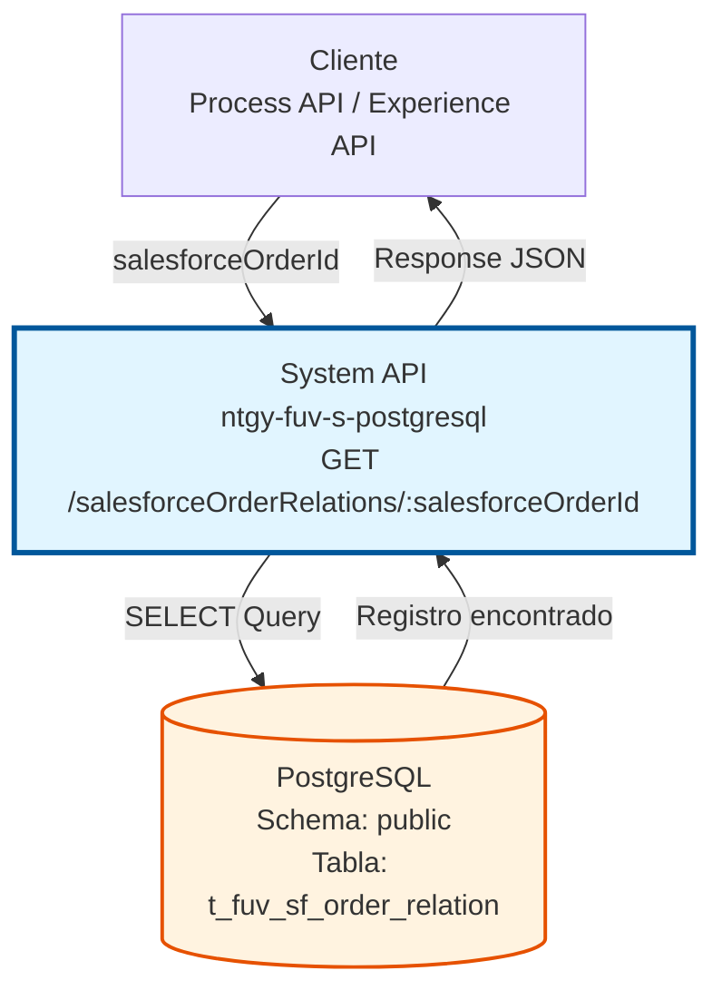
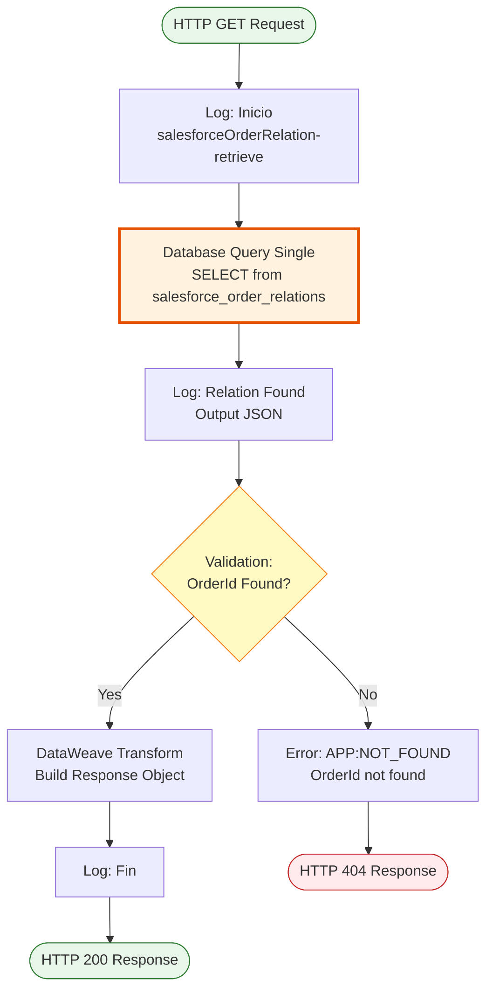
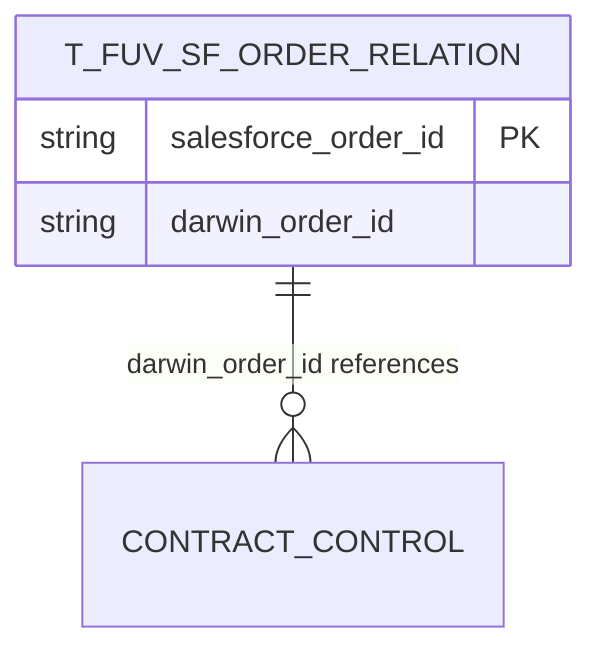
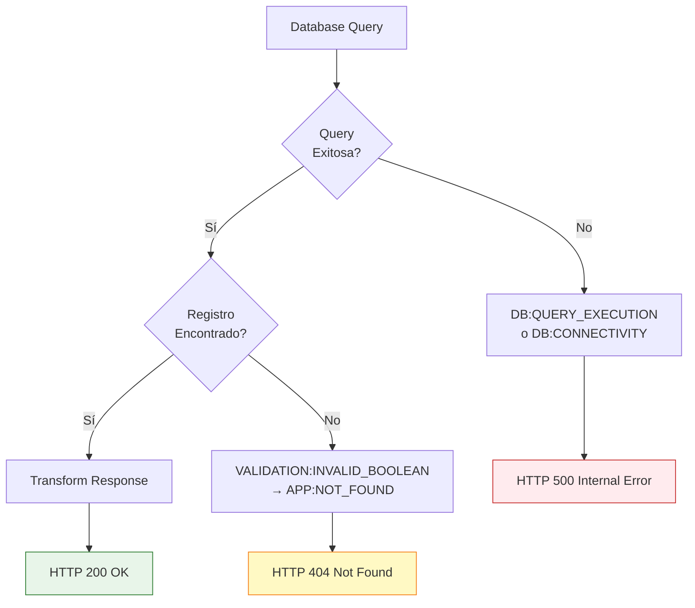

# GET /salesforceOrderRelations/:salesforceOrderId

## 📌 Descripción General

### Propósito del Endpoint

Este endpoint consulta la relación de mapeo entre un ID de orden de Salesforce y su correspondiente ID de pedido en Darwin (sistema FUV), permitiendo la sincronización y trazabilidad cross-sistema entre ambas plataformas.

El endpoint soporta:
- **Consulta de Mapeo**: Obtiene el ID de Darwin asociado a un ID de Salesforce
- **Validación de Existencia**: Verifica que existe una relación registrada
- **Trazabilidad**: Facilita el seguimiento de órdenes entre sistemas
- **Sincronización**: Permite consultas bidireccionales entre Salesforce y Darwin

### Tipo de API

**Capa:** System API (API-Led Connectivity)

**Función:** Integración directa con PostgreSQL para consultar relaciones de órdenes entre Salesforce y Darwin.

### Patrón de Integración

**Tipo:** Request-Reply Síncrono con SQL Query

**Descripción:** Recibe un salesforceOrderId como parámetro de URI, ejecuta una consulta SELECT en PostgreSQL filtrando por ese ID, valida que el registro existe, y retorna el objeto con ambos IDs relacionados (Salesforce y Darwin).

### Arquitectura API-Led Connectivity



---

## 💼 Propósito del Negocio

### Casos de Uso Principales

1. **Consulta de ID Darwin desde Salesforce**
   - Un proceso en Salesforce necesita conocer el ID de pedido en Darwin
   - Se invoca este endpoint con el salesforceOrderId
   - Se obtiene el darwinOrderId para continuar el proceso

2. **Verificación de Sincronización**
   - Validar que una orden de Salesforce fue correctamente sincronizada con Darwin
   - Confirmar la existencia de la relación entre sistemas
   - Detectar órdenes no sincronizadas (404 = no existe relación)

3. **Trazabilidad de Órdenes**
   - Seguimiento de órdenes a través de múltiples sistemas
   - Auditoría de sincronización entre plataformas
   - Resolución de incidencias relacionadas con órdenes

### Contexto Empresarial

- **Dominio:** Gestión de Órdenes y Sincronización Cross-Sistema
- **Sector:** Energía - Utilities
- **División:** Naturgy España - FUV (Facturación Única Virtual)
- **Proceso de Negocio:** Sincronización de órdenes entre Salesforce (CRM) y Darwin (sistema de gestión de pedidos)
- **Integración:** Salesforce ↔ Darwin

### Stakeholders

- **Equipos de Desarrollo**: Necesitan consultar relaciones para integraciones
- **Operaciones de Negocio**: Requieren trazabilidad de órdenes entre sistemas
- **Soporte Técnico**: Utilizan el endpoint para diagnóstico de problemas de sincronización
- **Analistas de Datos**: Consultan relaciones para reportes y análisis

### Valor de Negocio

- **Trazabilidad Completa**: Permite seguir una orden desde Salesforce hasta Darwin y viceversa
- **Validación de Sincronización**: Confirma que las órdenes están correctamente mapeadas
- **Resolución Rápida de Incidencias**: Facilita la identificación de problemas de sincronización
- **Integración Desacoplada**: Permite que múltiples sistemas consulten relaciones sin acoplamiento directo

### Consumidores Potenciales

Este endpoint puede ser consumido por:
- Process APIs de gestión de órdenes
- Experience APIs de portales de clientes
- Flujos de Salesforce (Platform Events, Flows)
- Sistemas de integración middleware
- Herramientas de monitoreo y auditoría

---

## 🔧 Especificación Técnica

### URLs por Ambiente

| Ambiente | URL Base | URL Completa |
|----------|----------|--------------|
| **Local** | `http://localhost:8081` | `http://localhost:8081/api/salesforceOrderRelations/:salesforceOrderId` |
| **Development** | `https://ntgy-fuv-s-postgresql-dev.us-e2.cloudhub.io` | `https://ntgy-fuv-s-postgresql-dev.us-e2.cloudhub.io/api/salesforceOrderRelations/:salesforceOrderId` |
| **UAT** | `https://ntgy-fuv-s-postgresql-uat.us-e2.cloudhub.io` | `https://ntgy-fuv-s-postgresql-uat.us-e2.cloudhub.io/api/salesforceOrderRelations/:salesforceOrderId` |
| **Production** | `https://ntgy-fuv-s-postgresql-pro.us-e2.cloudhub.io` | `https://ntgy-fuv-s-postgresql-pro.us-e2.cloudhub.io/api/salesforceOrderRelations/:salesforceOrderId` |

### Método HTTP

```
GET /api/salesforceOrderRelations/:salesforceOrderId
```

### Parámetros de Entrada

#### Path Parameters

| Parámetro | Tipo | Requerido | Descripción | Ejemplo |
|-----------|------|-----------|-------------|---------|
| `salesforceOrderId` | string | ✅ Sí | ID único de la orden en Salesforce. Se usa para buscar la relación con el pedido de Darwin. | `"0031234567890ABC"` |

#### Headers HTTP

| Header | Tipo | Requerido | Descripción | Ejemplo |
|--------|------|-----------|-------------|---------|
| `Accept` | string | ❌ No | Tipo de contenido esperado en response | `application/json` |

### Respuestas

#### Respuesta Exitosa (200 OK)

```json
{
  "salesforceOrderId": "0031234567890ABC",
  "darwinOrderId": "ORD-2024-001234"
}
```

**Descripción de Campos:**

| Campo | Tipo | Descripción |
|-------|------|-------------|
| `salesforceOrderId` | string | ID de la orden en Salesforce (mismo que el parámetro de entrada) |
| `darwinOrderId` | string | ID del pedido correspondiente en Darwin/FUV |

#### Respuesta de Error - No Encontrado (404 Not Found)

```json
{
  "error": "OrderId 0031234567890ABC not found"
}
```

**Cuándo ocurre:** Cuando no existe una relación registrada para el salesforceOrderId proporcionado.

#### Respuesta de Error Técnico (500 Internal Server Error)

```json
{
  "error": "Database connection error",
  "details": "Unable to execute query"
}
```

**Cuándo ocurre:** Error de conexión a base de datos o error en la ejecución de la query.

### Autenticación y Autorización

- **Tipo:** Client ID & Client Secret (Anypoint Platform)
- **Autorización PostgreSQL:** El usuario de base de datos debe tener permisos para:
  - Ejecutar SELECT en schema `salesforce`
  - Acceso de lectura a tabla `salesforce_order_relations`

### Timeouts

| Tipo | Valor | Descripción |
|------|-------|-------------|
| **Request Timeout** | 30 segundos | Tiempo máximo de espera para la respuesta |
| **Connection Timeout** | 10 segundos | Tiempo máximo para establecer conexión con PostgreSQL |
| **Query Timeout** | 30 segundos | Tiempo máximo de ejecución de la query SQL |

---

## 🏗️ Implementación Técnica

### Arquitectura del Flow



### Componentes del Flow

#### 1. Logger de Inicio
```xml
<logger level="DEBUG" 
        message='#["Inicio"]' 
        category="com.naturgy.mule.salesforceOrderRelation-retrieve" />
```
- Registra el inicio de la ejecución del sub-flow
- Nivel DEBUG para trazabilidad detallada

#### 2. Database Query Single
```xml
<db:query-single config-ref="Database_Config">
    <db:sql><![CDATA[${queries.getOrderRelation}]]></db:sql>
    <db:input-parameters><![CDATA[#[{
        salesforceOrderId: vars.salesforceOrderId
    }]]]></db:input-parameters>
</db:query-single>
```
- Ejecuta query SQL parametrizada
- Usa `query-single` porque se espera un único resultado
- El parámetro viene de `vars.salesforceOrderId` (extraído del path)

#### 3. Logger de Resultado
```xml
<logger level="INFO" 
        message="#[output application/json --- payload]" 
        category="com.naturgy.mule.salesforceOrderRelation-retrieve" />
```
- Registra el resultado de la query en formato JSON
- Nivel INFO para auditoría

#### 4. Validación de Existencia
```xml
<validation:is-true 
    expression="#[payload.SALESFORCE_ORDER_ID != null]" 
    message='#["OrderId " ++ vars.salesforceOrderId ++ " not foud"]'>
    <error-mapping sourceType="VALIDATION:INVALID_BOOLEAN" 
                   targetType="APP:NOT_FOUND" />
</validation:is-true>
```
- Valida que el registro fue encontrado
- Si falla, lanza error `APP:NOT_FOUND` (HTTP 404)

**⚠️ Nota:** El código fuente tiene un typo en el mensaje de error: "not foud" en lugar de "not found".

#### 5. Transformación de Respuesta
```dataweave
%dw 2.0
output application/java
---
{
    salesforceOrderId: payload.salesforce_order_id,
    darwinOrderId: payload.darwin_order_id
}
```
- Transforma campos de snake_case (DB) a camelCase (API)
- Mapea `salesforce_order_id` a `salesforceOrderId`
- Mapea `darwin_order_id` a `darwinOrderId`

#### 6. Logger de Fin
```xml
<logger level="DEBUG" 
        message='#["Fin"]' 
        category="com.naturgy.mule.salesforceOrderRelation-retrieve" />
```
- Registra el fin exitoso de la ejecución

### Query SQL Ejecutada

**Ubicación de la Query:** `src/main/resources/s-postgresql-local-config.yaml` (propiedad `queries.getOrderRelation`)

**Query SQL:**
```sql
SELECT darwin_order_id, salesforce_order_id 
FROM t_fuv_sf_order_relation 
WHERE salesforce_order_id = :salesforceOrderId
```

**Descripción:**
- **Tabla:** `t_fuv_sf_order_relation`
- **Operación:** SELECT (lectura)
- **Filtro:** Por `salesforce_order_id` (parámetro de entrada)
- **Operación:** `query-single` (retorna un único registro)
- **Campos retornados:**
  - `darwin_order_id`: ID de Darwin
  - `salesforce_order_id`: ID de Salesforce

**Nota:** La query no incluye `LIMIT 1` porque se usa `db:query-single` que maneja esto automáticamente.

### Modelo de Datos



**Tabla: t_fuv_sf_order_relation**

| Campo | Tipo | Descripción | Constraints |
|-------|------|-------------|-------------|
| `salesforce_order_id` | VARCHAR | ID único de la orden en Salesforce | PRIMARY KEY |
| `darwin_order_id` | VARCHAR | ID del pedido en Darwin/FUV | NOT NULL |

**Nota:** La query solo retorna estos 2 campos. Si la tabla tiene campos adicionales (created_at, updated_at), no están incluidos en la consulta.

### Manejo de Errores



**Tipos de Errores:**

1. **APP:NOT_FOUND (404)**
   - **Causa:** No existe relación para el salesforceOrderId
   - **Mensaje:** "OrderId [ID] not found"
   - **Acción:** Verificar que el ID es correcto o crear la relación

2. **DB:CONNECTIVITY (500)**
   - **Causa:** Error de conexión a PostgreSQL
   - **Mensaje:** Error de base de datos
   - **Acción:** Verificar conectividad y estado de la base de datos

3. **DB:QUERY_EXECUTION (500)**
   - **Causa:** Error en la ejecución de la query SQL
   - **Mensaje:** Error al ejecutar query
   - **Acción:** Revisar logs y sintaxis de la query

### Configuración de Base de Datos

**Database Config:** `Database_Config`

```yaml
# Configuración de conexión PostgreSQL
database:
  host: ${dbFUV.host}
  port: ${dbFUV.port}
  database: ${dbFUV.database}
  user: ${dbFUV.user}
  password: ${dbFUV.password}
  
connection_pool:
  min_pool_size: 5
  max_pool_size: 20
  max_idle_time: 30m
  connection_timeout: 10s
  query_timeout: 30s
```

### Logging y Trazabilidad

**Categoría de Logs:** `com.naturgy.mule.salesforceOrderRelation-retrieve`

**Niveles de Log:**
- **DEBUG:** Inicio y fin del flow
- **INFO:** Resultado de la query (registro encontrado)
- **ERROR:** Errores de validación o base de datos

**Ejemplo de Logs:**
```
[DEBUG] com.naturgy.mule.salesforceOrderRelation-retrieve - Inicio
[INFO] com.naturgy.mule.salesforceOrderRelation-retrieve - {"salesforce_order_id":"0031234567890ABC","darwin_order_id":"ORD-2024-001234"}
[DEBUG] com.naturgy.mule.salesforceOrderRelation-retrieve - Fin
```

---

## 💻 Ejemplos de Uso

### Ejemplo 1: Consulta Exitosa con curl

```bash
curl -X GET \
  "https://ntgy-fuv-s-postgresql-dev.us-e2.cloudhub.io/api/salesforceOrderRelations/0031234567890ABC" \
  -H "Accept: application/json" \
  -H "client_id: your-client-id" \
  -H "client_secret: your-client-secret"
```

**Response (200 OK):**
```json
{
  "salesforceOrderId": "0031234567890ABC",
  "darwinOrderId": "ORD-2024-001234"
}
```

### Ejemplo 2: Orden No Encontrada

```bash
curl -X GET \
  "https://ntgy-fuv-s-postgresql-dev.us-e2.cloudhub.io/api/salesforceOrderRelations/INVALID_ID_999" \
  -H "Accept: application/json" \
  -H "client_id: your-client-id" \
  -H "client_secret: your-client-secret"
```

**Response (404 Not Found):**
```json
{
  "error": "OrderId INVALID_ID_999 not found"
}
```

### Ejemplo 3: Uso desde JavaScript/Node.js

```javascript
const axios = require('axios');

async function getSalesforceOrderRelation(salesforceOrderId) {
  try {
    const response = await axios.get(
      `https://ntgy-fuv-s-postgresql-dev.us-e2.cloudhub.io/api/salesforceOrderRelations/${salesforceOrderId}`,
      {
        headers: {
          'Accept': 'application/json',
          'client_id': process.env.CLIENT_ID,
          'client_secret': process.env.CLIENT_SECRET
        }
      }
    );
    
    console.log('Darwin Order ID:', response.data.darwinOrderId);
    return response.data;
    
  } catch (error) {
    if (error.response && error.response.status === 404) {
      console.error('Order relation not found');
    } else {
      console.error('Error fetching order relation:', error.message);
    }
    throw error;
  }
}

// Uso
getSalesforceOrderRelation('0031234567890ABC')
  .then(relation => console.log('Relation:', relation))
  .catch(err => console.error('Failed:', err));
```

### Ejemplo 4: Uso desde Python

```python
import requests
import os

def get_salesforce_order_relation(salesforce_order_id):
    """
    Consulta la relación entre Salesforce y Darwin para una orden.
    
    Args:
        salesforce_order_id (str): ID de la orden en Salesforce
        
    Returns:
        dict: Objeto con salesforceOrderId y darwinOrderId
        
    Raises:
        requests.HTTPError: Si la orden no existe (404) o hay error del servidor
    """
    url = f"https://ntgy-fuv-s-postgresql-dev.us-e2.cloudhub.io/api/salesforceOrderRelations/{salesforce_order_id}"
    
    headers = {
        'Accept': 'application/json',
        'client_id': os.getenv('CLIENT_ID'),
        'client_secret': os.getenv('CLIENT_SECRET')
    }
    
    try:
        response = requests.get(url, headers=headers, timeout=30)
        response.raise_for_status()
        
        relation = response.json()
        print(f"Darwin Order ID: {relation['darwinOrderId']}")
        return relation
        
    except requests.HTTPError as e:
        if e.response.status_code == 404:
            print(f"Order relation not found for {salesforce_order_id}")
        else:
            print(f"HTTP Error: {e}")
        raise
    except requests.RequestException as e:
        print(f"Request failed: {e}")
        raise

# Uso
if __name__ == "__main__":
    try:
        relation = get_salesforce_order_relation('0031234567890ABC')
        print(f"Relation found: {relation}")
    except Exception as e:
        print(f"Failed to get relation: {e}")
```

### Ejemplo 5: Integración en Salesforce Flow

```apex
// Apex Class para invocar el endpoint desde Salesforce
public class SalesforceOrderRelationService {
    
    @future(callout=true)
    public static void getDarwinOrderId(String salesforceOrderId) {
        // Named Credential configurado en Salesforce
        String endpoint = 'callout:FUV_PostgreSQL_API/api/salesforceOrderRelations/' + salesforceOrderId;
        
        HttpRequest req = new HttpRequest();
        req.setEndpoint(endpoint);
        req.setMethod('GET');
        req.setHeader('Accept', 'application/json');
        req.setTimeout(30000);
        
        Http http = new Http();
        HttpResponse res = http.send(req);
        
        if (res.getStatusCode() == 200) {
            Map<String, Object> result = (Map<String, Object>) JSON.deserializeUntyped(res.getBody());
            String darwinOrderId = (String) result.get('darwinOrderId');
            
            System.debug('Darwin Order ID: ' + darwinOrderId);
            
            // Actualizar campo en Salesforce Order
            Order ord = [SELECT Id FROM Order WHERE OrderNumber = :salesforceOrderId LIMIT 1];
            ord.Darwin_Order_ID__c = darwinOrderId;
            update ord;
            
        } else if (res.getStatusCode() == 404) {
            System.debug('Order relation not found');
        } else {
            System.debug('Error: ' + res.getStatus());
        }
    }
}
```

### Ejemplo 6: Error de Conexión a Base de Datos

```bash
curl -X GET \
  "https://ntgy-fuv-s-postgresql-dev.us-e2.cloudhub.io/api/salesforceOrderRelations/0031234567890ABC" \
  -H "Accept: application/json" \
  -H "client_id: your-client-id" \
  -H "client_secret: your-client-secret"
```

**Response (500 Internal Server Error):**
```json
{
  "error": "Database connection error",
  "details": "Unable to connect to PostgreSQL server",
  "timestamp": "2024-06-16T11:15:30Z"
}
```

---

## 🔗 Endpoints Relacionados

| Endpoint | Método | Descripción |
|----------|--------|-------------|
| `POST /salesforceOrderRelations` | POST | Crea una nueva relación Salesforce-Darwin |
| `DELETE /salesforceOrderRelations/:salesforceOrderId` | DELETE | Elimina una relación existente |
| `GET /contractControl` | GET | Consulta información del pedido en Darwin |