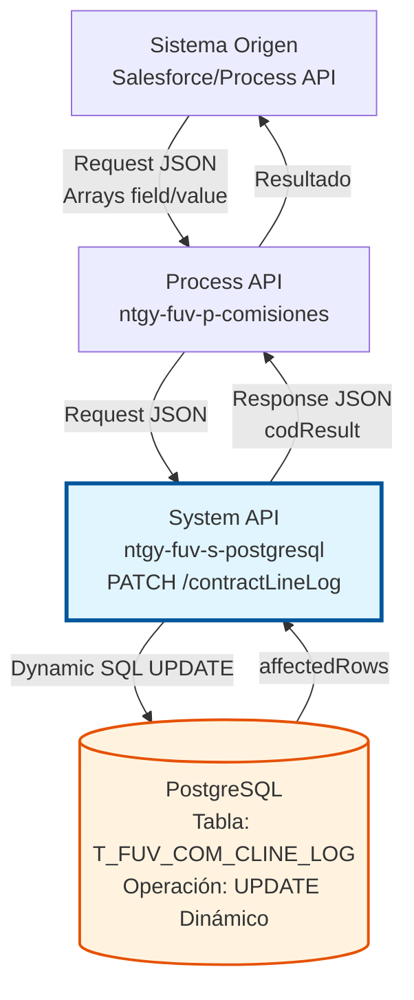
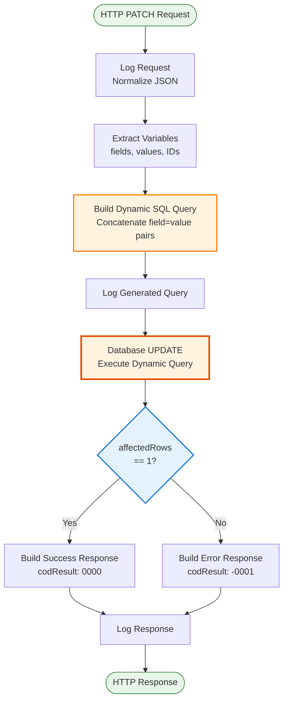
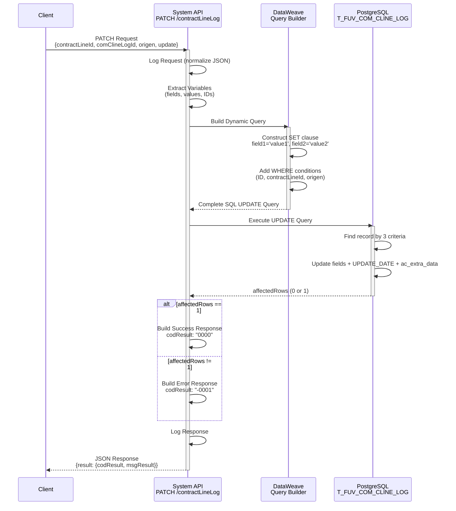
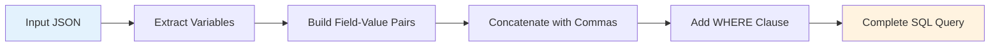
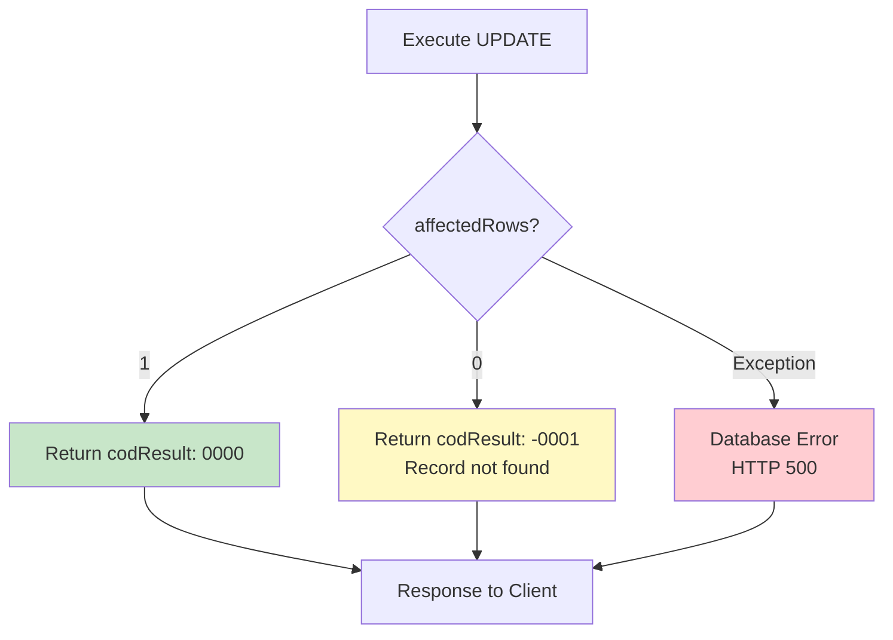

# PATCH /contractLineLog

## 📌 Descripción General

### Propósito del Endpoint

Este endpoint permite actualizar de forma **dinámica y flexible** los campos de un registro en la tabla `T_FUV_COM_CLINE_LOG` de PostgreSQL. A diferencia de endpoints tradicionales con campos fijos, este endpoint acepta **arrays de campos y valores**, permitiendo actualizar cualquier combinación de campos en una sola operación.

El endpoint soporta:
- **Actualización Dinámica**: Especificar qué campos actualizar mediante arrays `field` y `value`
- **Actualización Múltiple**: Actualizar varios campos en una sola transacción
- **Trazabilidad Automática**: Actualiza automáticamente `UPDATE_DATE` y `ac_extra_data` (correlationId)
- **Identificación Precisa**: Usa tres criterios de búsqueda (ID, contractLineId, origen) para máxima precisión

### Tipo de API

**Capa:** System API (API-Led Connectivity)

**Función:** Integración directa con PostgreSQL para actualización flexible de logs de líneas de contrato en el sistema de gestión de comisiones.

### Patrón de Integración

**Tipo:** Request-Reply Síncrono con Query SQL Dinámica

**Descripción:** El endpoint recibe una estructura con arrays de campos y valores, construye dinámicamente una query SQL UPDATE mediante concatenación, ejecuta la actualización en PostgreSQL y retorna el resultado de la operación.

### Arquitectura API-Led Connectivity



---

## 💼 Propósito del Negocio

### Casos de Uso Principales

1. **Actualización de Estado de Procesamiento**
   - Cambiar el estado de un log de comisión (PENDING → PROCESSED → ERROR)
   - Registrar intentos de procesamiento
   - Actualizar información de errores
   - **Beneficio:** Seguimiento preciso del ciclo de vida de comisiones

2. **Actualización de Datos de Athena**
   - Modificar información de la línea de contrato de Athena
   - Actualizar datos extra de procesamiento
   - Sincronizar cambios desde sistemas externos
   - **Beneficio:** Mantener consistencia con sistema Athena

3. **Gestión de Reintentos y Errores**
   - Incrementar contador de reintentos
   - Registrar mensajes de error detallados
   - Actualizar fechas de procesamiento
   - **Beneficio:** Trazabilidad completa de problemas y resoluciones

4. **Actualización Masiva de Metadatos**
   - Modificar múltiples campos en una sola operación
   - Actualizar información de auditoría
   - Sincronizar datos entre sistemas
   - **Beneficio:** Eficiencia operativa y reducción de llamadas API

### Contexto Empresarial

- **Dominio:** Gestión de Comisiones y Líneas de Contrato
- **Sector:** Energía - Utilities
- **División:** Naturgy España - FUV (Facturación Única Virtual)
- **Proceso de Negocio:** Procesamiento y seguimiento de comisiones de líneas de contrato
- **Sistema:** Sistema de gestión de comisiones integrado con Callidus y Athena

### Stakeholders

- **Equipo de Comisiones**: Necesita actualizar estados y datos de procesamiento de comisiones
- **Sistemas de Integración**: Requieren sincronizar información entre Athena, Callidus y PostgreSQL
- **Equipo de Operaciones**: Necesita visibilidad del estado de procesamiento y errores
- **Auditores**: Requieren trazabilidad completa de cambios en registros de comisiones

### Valor de Negocio

- **Flexibilidad Operativa**: Permite actualizar cualquier combinación de campos sin modificar código
- **Eficiencia**: Reduce número de llamadas API al permitir actualizaciones múltiples
- **Trazabilidad**: Registro automático de timestamp y correlationId en cada actualización
- **Precisión**: Triple criterio de búsqueda (ID + contractLineId + origen) evita actualizaciones erróneas
- **Escalabilidad**: Soporta diferentes orígenes (CALLIDUS, ATHENA) sin cambios en la API

### Consumidores Potenciales

Este endpoint puede ser consumido por:
- Process APIs de gestión de comisiones
- Flujos de sincronización con Callidus
- Procesos de integración con Athena
- Sistemas de reintento y recuperación de errores
- Herramientas de administración y soporte

---

## 🔧 Especificación Técnica

### URLs por Ambiente

| Ambiente | URL Base | URL Completa |
|----------|----------|--------------|
| **Local** | `http://localhost:8081` | `http://localhost:8081/api/contractLineLog` |
| **Development** | `https://ntgy-fuv-s-postgresql-dev.us-e2.cloudhub.io` | `https://ntgy-fuv-s-postgresql-dev.us-e2.cloudhub.io/api/contractLineLog` |
| **UAT** | `https://ntgy-fuv-s-postgresql-uat.us-e2.cloudhub.io` | `https://ntgy-fuv-s-postgresql-uat.us-e2.cloudhub.io/api/contractLineLog` |
| **Production** | `https://ntgy-fuv-s-postgresql-pro.us-e2.cloudhub.io` | `https://ntgy-fuv-s-postgresql-pro.us-e2.cloudhub.io/api/contractLineLog` |

### Método HTTP

```
PATCH /api/contractLineLog
```

### Parámetros de Entrada

#### Headers HTTP

| Header | Tipo | Requerido | Descripción | Ejemplo |
|--------|------|-----------|-------------|---------|
| `Content-Type` | string | ✅ Sí | Tipo de contenido del request | `application/json` |
| `Accept` | string | ❌ No | Tipo de contenido esperado en response | `application/json` |
| `X-Correlation-ID` | string | ❌ No | ID de correlación para trazabilidad | `550e8400-e29b-41d4-a716-446655440000` |

#### Body Parameters

**Estructura del Request:**

```json
{
  "contractLineId": "string",
  "comClineLogId": "string",
  "origen": "string",
  "update": {
    "field": ["string", "string", ...],
    "value": ["string", "string", ...]
  }
}
```

**Descripción de Campos:**

| Campo | Tipo | Requerido | Descripción | Ejemplo |
|-------|------|-----------|-------------|---------|
| `contractLineId` | string | ✅ Sí | ID de la línea de contrato | `"12345"` |
| `comClineLogId` | string | ✅ Sí | ID del registro en T_FUV_COM_CLINE_LOG | `"67890"` |
| `origen` | string | ✅ Sí | Origen del registro (CALLIDUS, ATHENA, etc.) | `"CALLIDUS"` |
| `update.field` | array[string] | ✅ Sí | Array de nombres de campos a actualizar | `["status", "error"]` |
| `update.value` | array[string] | ✅ Sí | Array de valores correspondientes a los campos | `["PROCESSED", "null"]` |

**Campos Comunes para Actualización:**

| Campo | Tipo | Descripción | Valores Típicos |
|-------|------|-------------|-----------------|
| `status` | string | Estado del procesamiento | `PENDING`, `PROCESSED`, `ERROR`, `RETRY` |
| `processing_retries` | integer | Número de reintentos | `0`, `1`, `2`, `3` |
| `error` | string | Mensaje de error (si aplica) | `"Error de conexión"`, `"null"` |
| `athena_contract_line` | json | Datos de la línea de contrato de Athena | JSON string |
| `processing_date` | timestamp | Fecha de procesamiento | `"2026-07-10T10:00:00"` |

**Campos Actualizados Automáticamente:**

| Campo | Valor | Descripción |
|-------|-------|-------------|
| `UPDATE_DATE` | `CURRENT_TIMESTAMP` | Timestamp de la actualización (timezone Europe/Madrid) |
| `ac_extra_data` | `correlationId` | ID de correlación de la petición HTTP |

### Respuestas

#### Respuesta Exitosa (200 OK)

**Cuando se actualiza 1 registro:**

```json
{
  "result": {
    "codResult": "0000",
    "msgResult": "No hay error"
  }
}
```

#### Respuesta de Error de Negocio (200 OK)

**Cuando no se encuentra el registro o no se actualiza:**

```json
{
  "result": {
    "codResult": "-0001",
    "msgResult": "Ha habido un error en la actualización del registro o el registro no existe"
  }
}
```

**Posibles Causas:**
- El registro con los criterios especificados no existe
- Los valores de `comClineLogId`, `contractLineId` u `origen` son incorrectos
- El registro ya fue eliminado
- Problema de permisos en la base de datos

#### Respuesta de Error Técnico (500 Internal Server Error)

```json
{
  "error": {
    "code": "DB_ERROR",
    "message": "Error al ejecutar la actualización en la base de datos",
    "details": "Detalles técnicos del error"
  }
}
```

### Autenticación y Autorización

- **Tipo:** Client ID & Client Secret (Anypoint Platform)
- **Autorización PostgreSQL:** El usuario de base de datos debe tener permisos para:
  - Ejecutar UPDATE en tabla `T_FUV_COM_CLINE_LOG`
  - Acceso de lectura/escritura al schema `public`
  - Permisos para usar funciones de timezone

### Timeouts

| Tipo | Valor | Descripción |
|------|-------|-------------|
| **Request Timeout** | 30 segundos | Tiempo máximo de espera para la respuesta |
| **Connection Timeout** | 10 segundos | Tiempo máximo para establecer conexión con PostgreSQL |
| **Query Timeout** | 30 segundos | Tiempo máximo de ejecución de la query UPDATE |

---

## 🏗️ Implementación Técnica

### Arquitectura del Flow



### Subflow Principal

**Nombre:** `s-postgresql-updateContractLineLog`

**Ubicación:** `src/main/mule/s-postgresql-contractLineLog.xml` (líneas 133-220)

### Construcción Dinámica de la Query SQL

#### Paso 1: Extracción de Variables (líneas 142-167)

```dataweave
%dw 2.0
output application/java
---
{
  fields: payload.update.field,           // ["status", "error", "processing_retries"]
  values: payload.update.value,           // ["PROCESSED", "null", "3"]
  contractLineId: payload.contractLineId, // "12345"
  comClineLogId: payload.comClineLogId,   // "67890"
  origen: payload.origen                  // "CALLIDUS"
}
```

#### Paso 2: Construcción de la Query (líneas 168-194)

**Componentes de la Query:**

```dataweave
%dw 2.0
output application/java

// Parte fija inicial
var sentence_1 = "UPDATE T_FUV_COM_CLINE_LOG SET UPDATE_DATE = timezone('Europe/Madrid'::text, CURRENT_TIMESTAMP), ac_extra_data = '" ++ correlationId ++ "', "

// Cláusulas WHERE
var sentence_2 = " WHERE T_FUV_COM_CLINE_LOG_ID = "
var sentence_3 = " AND CONTRACT_LINE_ID = "
var sentence_4 = " AND ORIGEN = "

// Función para construir pares field = value
fun setFieldsValuesSentence(listFields) = listFields map (field, findex) -> {
  printString : field ++ " = '" ++ (vars.values filter ((item, vindex) -> (findex == vindex)) map $)[0] ++ "'"
}

// Aplicar función y obtener array de strings "field = value"
var fieldsValuesSentence = setFieldsValuesSentence(vars.fields)

// Unir con comas
fun buildSentence(listfieldsValuesSentence) = listfieldsValuesSentence joinBy ", "

// Generar parte SET dinámica
var SETSentenceGenerated = buildSentence(fieldsValuesSentence.printString)

// Query completa
---
sentence_1 ++ SETSentenceGenerated ++ sentence_2 ++ "'" ++ vars.comClineLogId ++ "'" ++ sentence_3 ++ "'" ++ vars.contractLineId ++ "'" ++ sentence_4 ++ "'" ++ vars.origen ++ "'"
```

**Ejemplo de Query Generada:**

```sql
UPDATE T_FUV_COM_CLINE_LOG 
SET UPDATE_DATE = timezone('Europe/Madrid'::text, CURRENT_TIMESTAMP), 
    ac_extra_data = '550e8400-e29b-41d4-a716-446655440000', 
    status = 'PROCESSED', 
    error = 'null', 
    processing_retries = '3' 
WHERE T_FUV_COM_CLINE_LOG_ID = '67890' 
  AND CONTRACT_LINE_ID = '12345' 
  AND ORIGEN = 'CALLIDUS'
```

#### Paso 3: Ejecución de la Query (líneas 195-197)

```xml
<db:update config-ref="Database_Config">
    <db:sql><![CDATA[#[payload]]]></db:sql>
</db:update>
```

**Configuración de Base de Datos:**
- **Config:** `Database_Config`
- **Driver:** PostgreSQL JDBC 42.3.3
- **Connection Pooling:** Habilitado
- **Transaction:** Automática

#### Paso 4: Construcción de Respuesta (líneas 198-210)

```dataweave
%dw 2.0
output application/json
---
{
  "result": {
    "codResult": if (payload.affectedRows == 1) "0000" else "-0001",
    "msgResult": if (payload.affectedRows == 1) 
                    "No hay error" 
                 else 
                    "Ha habido un error en la actualización del registro o el registro no existe"
  }
}
```

### Diagrama de Secuencia Detallado



### Transformación de Datos

#### Input → SQL Query



**Ejemplo de Transformación:**

**Input:**
```json
{
  "contractLineId": "12345",
  "comClineLogId": "67890",
  "origen": "CALLIDUS",
  "update": {
    "field": ["status", "processing_retries"],
    "value": ["PROCESSED", "3"]
  }
}
```

**Output (SQL Query):**
```sql
UPDATE T_FUV_COM_CLINE_LOG 
SET UPDATE_DATE = timezone('Europe/Madrid'::text, CURRENT_TIMESTAMP), 
    ac_extra_data = 'correlation-id-123', 
    status = 'PROCESSED', 
    processing_retries = '3' 
WHERE T_FUV_COM_CLINE_LOG_ID = '67890' 
  AND CONTRACT_LINE_ID = '12345' 
  AND ORIGEN = 'CALLIDUS'
```

### Manejo de Errores



**Códigos de Error:**

| Código | Tipo | Descripción | Acción Recomendada |
|--------|------|-------------|-------------------|
| `0000` | Éxito | Registro actualizado correctamente | Ninguna |
| `-0001` | Error de Negocio | Registro no encontrado o no actualizado | Verificar IDs y origen |
| `DB_ERROR` | Error Técnico | Error de base de datos | Revisar logs, verificar conectividad |

### Logging

**Puntos de Logging:**

1. **Request Logging (línea 134-141):**
   ```
   STARTING updateContractLineLog METHOD. REQUEST: [normalized JSON]
   ```

2. **Response Logging (línea 211-218):**
   ```
   FINISHED updateContractLineLog METHOD. RESPONSE: [normalized JSON]
   ```

**Función de Normalización:**
- Usa `common::commonFunctions::normalizeJSON()`
- Sanitiza datos sensibles para logging seguro
- Mantiene trazabilidad sin exponer información confidencial

---

## 💻 Ejemplos de Uso

### Ejemplo 1: Actualización de Estado Simple

**Request:**

```bash
curl -X PATCH "https://ntgy-fuv-s-postgresql-dev.us-e2.cloudhub.io/api/contractLineLog" \
  -H "Content-Type: application/json" \
  -H "client_id: your-client-id" \
  -H "client_secret: your-client-secret" \
  -d '{
    "contractLineId": "CL-2026-001",
    "comClineLogId": "LOG-12345",
    "origen": "CALLIDUS",
    "update": {
      "field": ["status"],
      "value": ["PROCESSED"]
    }
  }'
```

**Response (200 OK):**

```json
{
  "result": {
    "codResult": "0000",
    "msgResult": "No hay error"
  }
}
```

**Query SQL Generada:**

```sql
UPDATE T_FUV_COM_CLINE_LOG 
SET UPDATE_DATE = timezone('Europe/Madrid'::text, CURRENT_TIMESTAMP), 
    ac_extra_data = 'correlation-id-abc123', 
    status = 'PROCESSED' 
WHERE T_FUV_COM_CLINE_LOG_ID = 'LOG-12345' 
  AND CONTRACT_LINE_ID = 'CL-2026-001' 
  AND ORIGEN = 'CALLIDUS'
```

---

### Ejemplo 2: Actualización Múltiple de Campos

**Request:**

```bash
curl -X PATCH "https://ntgy-fuv-s-postgresql-dev.us-e2.cloudhub.io/api/contractLineLog" \
  -H "Content-Type: application/json" \
  -H "client_id: your-client-id" \
  -H "client_secret: your-client-secret" \
  -d '{
    "contractLineId": "CL-2026-002",
    "comClineLogId": "LOG-67890",
    "origen": "ATHENA",
    "update": {
      "field": ["status", "processing_retries", "error"],
      "value": ["ERROR", "3", "Connection timeout to external service"]
    }
  }'
```

**Response (200 OK):**

```json
{
  "result": {
    "codResult": "0000",
    "msgResult": "No hay error"
  }
}
```

**Query SQL Generada:**

```sql
UPDATE T_FUV_COM_CLINE_LOG 
SET UPDATE_DATE = timezone('Europe/Madrid'::text, CURRENT_TIMESTAMP), 
    ac_extra_data = 'correlation-id-xyz789', 
    status = 'ERROR', 
    processing_retries = '3', 
    error = 'Connection timeout to external service' 
WHERE T_FUV_COM_CLINE_LOG_ID = 'LOG-67890' 
  AND CONTRACT_LINE_ID = 'CL-2026-002' 
  AND ORIGEN = 'ATHENA'
```

---

### Ejemplo 3: Actualización con Datos JSON

**Request:**

```bash
curl -X PATCH "https://ntgy-fuv-s-postgresql-dev.us-e2.cloudhub.io/api/contractLineLog" \
  -H "Content-Type: application/json" \
  -H "client_id: your-client-id" \
  -H "client_secret: your-client-secret" \
  -d '{
    "contractLineId": "CL-2026-003",
    "comClineLogId": "LOG-11111",
    "origen": "CALLIDUS",
    "update": {
      "field": ["athena_contract_line", "status"],
      "value": ["{\"lineId\":\"123\",\"amount\":1500.50}", "PENDING"]
    }
  }'
```

**Response (200 OK):**

```json
{
  "result": {
    "codResult": "0000",
    "msgResult": "No hay error"
  }
}
```

---

### Ejemplo 4: Error - Registro No Encontrado

**Request:**

```bash
curl -X PATCH "https://ntgy-fuv-s-postgresql-dev.us-e2.cloudhub.io/api/contractLineLog" \
  -H "Content-Type: application/json" \
  -H "client_id: your-client-id" \
  -H "client_secret: your-client-secret" \
  -d '{
    "contractLineId": "CL-INVALID",
    "comClineLogId": "LOG-99999",
    "origen": "CALLIDUS",
    "update": {
      "field": ["status"],
      "value": ["PROCESSED"]
    }
  }'
```

**Response (200 OK):**

```json
{
  "result": {
    "codResult": "-0001",
    "msgResult": "Ha habido un error en la actualización del registro o el registro no existe"
  }
}
```

**Causa:** No existe un registro que cumpla con los tres criterios:
- `T_FUV_COM_CLINE_LOG_ID = 'LOG-99999'`
- `CONTRACT_LINE_ID = 'CL-INVALID'`
- `ORIGEN = 'CALLIDUS'`

---

### Ejemplo 5: Actualización de Fecha de Procesamiento

**Request:**

```bash
curl -X PATCH "https://ntgy-fuv-s-postgresql-dev.us-e2.cloudhub.io/api/contractLineLog" \
  -H "Content-Type: application/json" \
  -H "client_id: your-client-id" \
  -H "client_secret: your-client-secret" \
  -d '{
    "contractLineId": "CL-2026-004",
    "comClineLogId": "LOG-22222",
    "origen": "CALLIDUS",
    "update": {
      "field": ["processing_date", "status"],
      "value": ["2026-07-10T10:30:00", "RETRY"]
    }
  }'
```

**Response (200 OK):**

```json
{
  "result": {
    "codResult": "0000",
    "msgResult": "No hay error"
  }
}
```

---

### Ejemplo 6: Código JavaScript (Node.js)

```javascript
const axios = require('axios');

async function updateContractLineLog() {
  try {
    const response = await axios.patch(
      'https://ntgy-fuv-s-postgresql-dev.us-e2.cloudhub.io/api/contractLineLog',
      {
        contractLineId: 'CL-2026-005',
        comClineLogId: 'LOG-33333',
        origen: 'ATHENA',
        update: {
          field: ['status', 'processing_retries', 'error'],
          value: ['PROCESSED', '1', 'null']
        }
      },
      {
        headers: {
          'Content-Type': 'application/json',
          'client_id': 'your-client-id',
          'client_secret': 'your-client-secret'
        }
      }
    );

    console.log('Update successful:', response.data);
    
    if (response.data.result.codResult === '0000') {
      console.log('✅ Record updated successfully');
    } else {
      console.log('❌ Update failed:', response.data.result.msgResult);
    }
  } catch (error) {
    console.error('Error updating contract line log:', error.message);
  }
}

updateContractLineLog();
```

---

### Ejemplo 7: Código Python

```python
import requests
import json

def update_contract_line_log():
    url = "https://ntgy-fuv-s-postgresql-dev.us-e2.cloudhub.io/api/contractLineLog"
    
    headers = {
        "Content-Type": "application/json",
        "client_id": "your-client-id",
        "client_secret": "your-client-secret"
    }
    
    payload = {
        "contractLineId": "CL-2026-006",
        "comClineLogId": "LOG-44444",
        "origen": "CALLIDUS",
        "update": {
            "field": ["status", "error"],
            "value": ["ERROR", "Database connection failed"]
        }
    }
    
    try:
        response = requests.patch(url, headers=headers, json=payload)
        response.raise_for_status()
        
        result = response.json()
        print(f"Response: {json.dumps(result, indent=2)}")
        
        if result['result']['codResult'] == '0000':
            print("✅ Record updated successfully")
        else:
            print(f"❌ Update failed: {result['result']['msgResult']}")
            
    except requests.exceptions.RequestException as e:
        print(f"❌ Error: {e}")

if __name__ == "__main__":
    update_contract_line_log()
```

---

## 📊 Validación y Mejores Prácticas

### Checklist de Validación Pre-Request

Antes de invocar el endpoint, verificar:

- [ ] `contractLineId` existe en la tabla `T_FUV_COM_CLINE_LOG`
- [ ] `comClineLogId` es el ID correcto del registro
- [ ] `origen` coincide con el valor almacenado en la base de datos
- [ ] Arrays `field` y `value` tienen la misma longitud
- [ ] Nombres de campos en `field` son válidos en la tabla
- [ ] Valores en `value` son del tipo correcto para cada campo

### Mejores Prácticas

#### 1. Validación de Arrays

```javascript
// Validar que arrays tengan la misma longitud
if (update.field.length !== update.value.length) {
  throw new Error('Arrays field y value deben tener la misma longitud');
}

// Validar que no estén vacíos
if (update.field.length === 0) {
  throw new Error('Debe especificar al menos un campo para actualizar');
}
```

#### 2. Manejo de Valores Nulos

```javascript
// Para valores nulos, usar la cadena "null"
const update = {
  field: ['error', 'status'],
  value: ['null', 'PROCESSED']  // "null" como string, no null
};
```

#### 3. Escape de Comillas en Valores

```javascript
// Si un valor contiene comillas simples, escaparlas
const errorMessage = "Error: Can't connect to database";
const update = {
  field: ['error'],
  value: [errorMessage.replace(/'/g, "''")]  // Escapar comillas
};
```

#### 4. Actualización Idempotente

```javascript
// Verificar estado actual antes de actualizar
async function updateIfNeeded(contractLineId, newStatus) {
  // 1. Obtener estado actual con GET
  const current = await getContractLineLog(contractLineId);
  
  // 2. Solo actualizar si el estado es diferente
  if (current.status !== newStatus) {
    await updateContractLineLog({
      contractLineId: contractLineId,
      comClineLogId: current.id,
      origen: current.origen,
      update: {
        field: ['status'],
        value: [newStatus]
      }
    });
  }
}
```

#### 5. Reintentos con Backoff Exponencial

```javascript
async function updateWithRetry(payload, maxRetries = 3) {
  for (let i = 0; i < maxRetries; i++) {
    try {
      const response = await updateContractLineLog(payload);
      
      if (response.result.codResult === '0000') {
        return response;
      }
      
      // Si el registro no existe, no reintentar
      if (response.result.codResult === '-0001') {
        throw new Error('Record not found');
      }
      
    } catch (error) {
      if (i === maxRetries - 1) throw error;
      
      // Backoff exponencial: 1s, 2s, 4s
      const delay = Math.pow(2, i) * 1000;
      await new Promise(resolve => setTimeout(resolve, delay));
    }
  }
}
```

### Consideraciones de Seguridad

#### 1. Validación de Entrada

```javascript
// Validar que los campos sean permitidos
const ALLOWED_FIELDS = [
  'status', 'processing_retries', 'error', 
  'athena_contract_line', 'processing_date'
];

function validateFields(fields) {
  const invalidFields = fields.filter(f => !ALLOWED_FIELDS.includes(f));
  if (invalidFields.length > 0) {
    throw new Error(`Campos no permitidos: ${invalidFields.join(', ')}`);
  }
}
```

#### 2. Sanitización de Valores

```javascript
// Sanitizar valores para prevenir SQL injection
function sanitizeValue(value) {
  // Remover caracteres peligrosos
  return value.replace(/[;'"\\]/g, '');
}

const update = {
  field: ['error'],
  value: [sanitizeValue(userInput)]
};
```

#### 3. Logging Seguro

```javascript
// No loguear valores sensibles
function logUpdate(payload) {
  const safePayload = {
    ...payload,
    update: {
      field: payload.update.field,
      value: payload.update.value.map(() => '***')  // Ocultar valores
    }
  };
  console.log('Updating:', JSON.stringify(safePayload));
}
```

### Monitoreo y Observabilidad

#### Métricas Recomendadas

```javascript
// Ejemplo con métricas
const metrics = {
  updateAttempts: 0,
  updateSuccesses: 0,
  updateFailures: 0,
  notFoundErrors: 0,
  averageResponseTime: 0
};

async function updateWithMetrics(payload) {
  const startTime = Date.now();
  metrics.updateAttempts++;
  
  try {
    const response = await updateContractLineLog(payload);
    
    if (response.result.codResult === '0000') {
      metrics.updateSuccesses++;
    } else if (response.result.codResult === '-0001') {
      metrics.notFoundErrors++;
    } else {
      metrics.updateFailures++;
    }
    
    const duration = Date.now() - startTime;
    metrics.averageResponseTime = 
      (metrics.averageResponseTime * (metrics.updateAttempts - 1) + duration) 
      / metrics.updateAttempts;
    
    return response;
    
  } catch (error) {
    metrics.updateFailures++;
    throw error;
  }
}
```

### Troubleshooting

#### Problema: Registro No Encontrado (codResult: -0001)

**Posibles Causas:**
1. El `comClineLogId` es incorrecto
2. El `contractLineId` no coincide
3. El `origen` no coincide
4. El registro fue eliminado

**Solución:**
```sql
-- Verificar que el registro existe
SELECT * FROM T_FUV_COM_CLINE_LOG 
WHERE T_FUV_COM_CLINE_LOG_ID = 'LOG-12345'
  AND CONTRACT_LINE_ID = 'CL-2026-001'
  AND ORIGEN = 'CALLIDUS';
```

#### Problema: Error de Timeout

**Posibles Causas:**
1. Query muy lenta
2. Tabla bloqueada por otra transacción
3. Conexión de red lenta

**Solución:**
- Verificar índices en la tabla
- Revisar transacciones activas
- Aumentar timeout si es necesario

#### Problema: Campos No Se Actualizan

**Posibles Causas:**
1. Nombres de campos incorrectos (case-sensitive)
2. Valores con formato incorrecto
3. Permisos insuficientes

**Solución:**
```sql
-- Verificar estructura de la tabla
SELECT column_name, data_type 
FROM information_schema.columns 
WHERE table_name = 't_fuv_com_cline_log';
```

---

## 🔗 Endpoints Relacionados

Este endpoint forma parte del conjunto de operaciones CRUD para `contractLineLog`:

| Endpoint | Método | Propósito | Documentación |
|----------|--------|-----------|---------------|
| `/contractLineLog` | POST | Crear nuevo registro de log | [POST-contractLineLog.md](./POST-contractLineLog.md) |
| `/contractLineLog` | PATCH | **Actualizar campos dinámicos** | Este documento |
| `/contractLineLog` | GET | Consultar logs por estado | [GET-contractLineLog.md](./GET-contractLineLog.md) |
| `/getcontractLineLog` | GET | Obtener log específico | [GET-getcontractLineLog.md](./GET-getcontractLineLog.md) |

---

## 📝 Notas Adicionales

### Diferencias con Otros Endpoints de Actualización

Este endpoint es único porque:

1. **Actualización Dinámica**: No tiene campos fijos, acepta cualquier campo de la tabla
2. **Arrays de Campos**: Usa estructura de arrays en lugar de objeto JSON plano
3. **Triple Criterio**: Requiere 3 identificadores (ID, contractLineId, origen) para máxima precisión
4. **Construcción de Query**: La query SQL se construye dinámicamente en tiempo de ejecución

### Limitaciones Conocidas

1. **Sin Validación de Tipos**: Los valores se pasan como strings, la base de datos hace el cast
2. **Sin Transacciones Múltiples**: Solo actualiza un registro por llamada
3. **Sin Validación de Campos**: No valida que los campos existan en la tabla antes de ejecutar
4. **Escape Manual**: El desarrollador debe escapar comillas en los valores

### Roadmap Futuro

Mejoras planificadas:

- [ ] Validación de campos permitidos antes de ejecutar query
- [ ] Soporte para actualización batch (múltiples registros)
- [ ] Validación de tipos de datos
- [ ] Respuesta con datos actualizados (no solo código de resultado)
- [ ] Soporte para operadores (ej: incrementar contador)

---

## 📚 Referencias Técnicas

### Documentación PostgreSQL

- [UPDATE Statement](https://www.postgresql.org/docs/current/sql-update.html)
- [Timezone Functions](https://www.postgresql.org/docs/current/functions-datetime.html)
- [JDBC Driver](https://jdbc.postgresql.org/documentation/)

### Documentación MuleSoft

- [Database Connector](https://docs.mulesoft.com/db-connector/latest/)
- [DataWeave Functions](https://docs.mulesoft.com/dataweave/latest/)
- [Error Handling](https://docs.mulesoft.com/mule-runtime/latest/error-handling)

### Estándares del Proyecto

- Memory Bank: `docs/memory-bank/`
- Patrones de Sistema: `docs/memory-bank/systemPatterns.md`
- Contexto Técnico: `docs/memory-bank/techContext.md`
