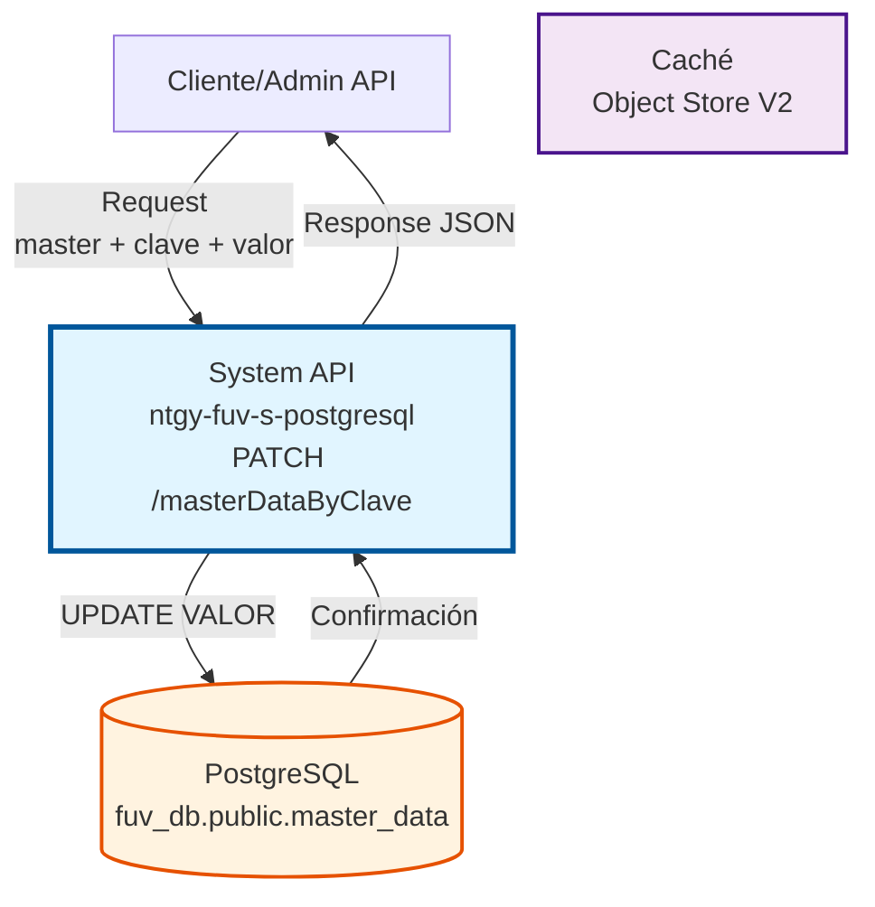
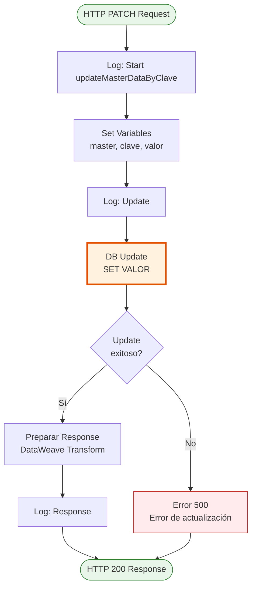
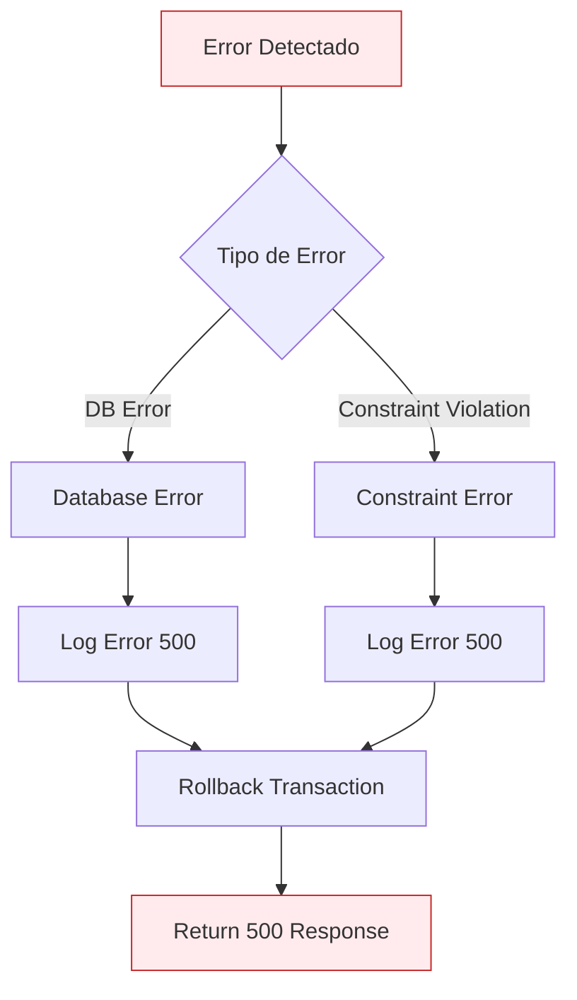
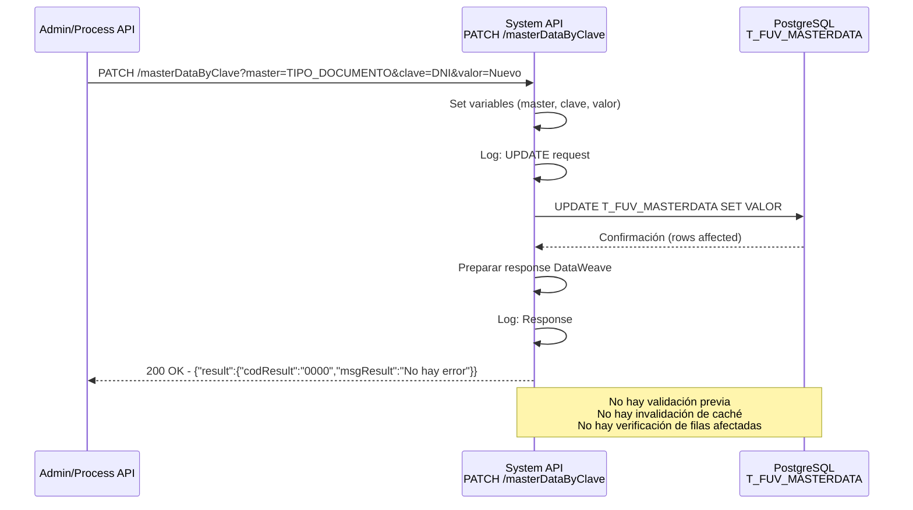
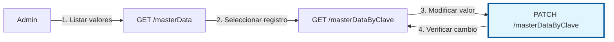

# PATCH /masterDataByClave

## 📌 Descripción General

### Propósito del Endpoint

Este endpoint actualiza el campo `VALOR` de un registro específico en la tabla `T_FUV_MASTERDATA` de PostgreSQL, identificado por la combinación de `MASTER` (master) y `CLAVE` (clave). Permite modificar valores de configuración y descripciones de catálogos sin alterar la estructura de claves.

El endpoint soporta:
- **Actualización Directa**: Modifica solo el campo `VALOR` mediante UPDATE directo
- **Operación Simple**: Ejecuta UPDATE sin validaciones previas ni auditoría automática

### Tipo de API

**Capa:** System API (API-Led Connectivity)

**Función:** Actualización de datos maestros en PostgreSQL para mantenimiento de catálogos y configuraciones.

### Patrón de Integración

**Tipo:** Request-Reply Síncrono con PostgreSQL

**Descripción:** Recibe parámetros de identificación (master + clave) y nuevo valor, valida existencia del registro, ejecuta UPDATE, invalida caché y retorna confirmación.

### Arquitectura API-Led Connectivity



---

## 💼 Propósito del Negocio

### Casos de Uso Principales

1. **Actualización de Descripciones de Catálogos**
   - Modificar descripciones de tipos de documento
   - Ejemplo: Actualizar texto descriptivo de "DNI" por cambios normativos
   - Beneficio: Mantenimiento centralizado de catálogos

2. **Modificación de Valores de Configuración**
   - Ajustar parámetros del sistema
   - Ejemplo: Cambiar valores de configuración operativa
   - Beneficio: Configuración dinámica sin redespliegue

3. **Corrección de Datos Incorrectos**
   - Corregir errores en valores maestros
   - Ejemplo: Rectificar descripciones con errores tipográficos
   - Beneficio: Calidad de datos mejorada

### Contexto Empresarial

- **Dominio:** Gestión y Mantenimiento de Datos Maestros
- **Sector:** Energía - Utilities
- **División:** Naturgy España - FUV (Facturación Única Virtual)
- **Proceso de Negocio:** Mantenimiento de catálogos y configuración del sistema
- **Módulo:** Administración de Datos Maestros

### Stakeholders

- **Administradores de Sistema**: Mantienen configuraciones del sistema
- **Administradores de Datos Maestros**: Gestionan catálogos y valores
- **Equipos de Calidad**: Corrigen inconsistencias en datos

### Valor de Negocio

- **Flexibilidad Operativa**: Actualización de configuraciones sin código
- **Calidad de Datos**: Corrección rápida de errores
- **Auditoría Completa**: Registro automático de cambios con timestamp
- **Consistencia**: Invalidación automática de caché para datos actualizados

### Consumidores Potenciales

Este endpoint puede ser consumido por:
- APIs de administración del sistema
- Herramientas de gestión de datos maestros
- Procesos de migración y corrección de datos
- Interfaces de administración web

---

## 🔧 Especificación Técnica

### URLs por Ambiente

| Ambiente | URL Base | URL Completa |
|----------|----------|--------------|
| **Local** | `http://localhost:8081` | `http://localhost:8081/api/masterDataByClave?master=TIPO_DOCUMENTO&clave=DNI&valor=Nuevo+Valor` |
| **Development** | `https://ntgy-fuv-s-postgresql-dev.us-e2.cloudhub.io` | `https://ntgy-fuv-s-postgresql-dev.us-e2.cloudhub.io/api/masterDataByClave?master=TIPO_DOCUMENTO&clave=DNI&valor=Nuevo+Valor` |
| **UAT** | `https://ntgy-fuv-s-postgresql-uat.us-e2.cloudhub.io` | `https://ntgy-fuv-s-postgresql-uat.us-e2.cloudhub.io/api/masterDataByClave?master=TIPO_DOCUMENTO&clave=DNI&valor=Nuevo+Valor` |
| **Production** | `https://ntgy-fuv-s-postgresql-pro.us-e2.cloudhub.io` | `https://ntgy-fuv-s-postgresql-pro.us-e2.cloudhub.io/api/masterDataByClave?master=TIPO_DOCUMENTO&clave=DNI&valor=Nuevo+Valor` |

### Método HTTP

```
PATCH /api/masterDataByClave
```

### Parámetros de Entrada

#### Headers HTTP

| Header | Tipo | Requerido | Descripción | Ejemplo |
|--------|------|-----------|-------------|---------|
| `Accept` | string | ❌ No | Tipo de contenido esperado en response | `application/json` |
| `client_id` | string | ✅ Sí | Client ID de Anypoint Platform | `abc123...` |
| `client_secret` | string | ✅ Sí | Client Secret de Anypoint Platform | `xyz789...` |

#### Query Parameters

| Parámetro | Tipo | Requerido | Descripción | Ejemplo |
|-----------|------|-----------|-------------|---------|
| `master` | string | ✅ Sí | Nombre de la categoría de master data (MASTER) del registro a actualizar. | `"TIPO_DOCUMENTO"` |
| `clave` | string | ✅ Sí | Clave específica del registro a actualizar (CLAVE). | `"DNI"` |
| `valor` | string | ✅ Sí | Nuevo valor a asignar al campo `VALOR`. Este es el valor descriptivo que se actualizará. | `"Documento Nacional de Identidad - Actualizado"` |

**Restricciones de Parámetros:**
- `master`: Máximo 100 caracteres, alfanumérico con guiones bajos
- `clave`: Máximo 100 caracteres, alfanumérico con guiones bajos
- `valor`: Máximo 500 caracteres, texto libre

### Respuestas

#### Respuesta Exitosa (200 OK)

**Descripción:** Registro actualizado exitosamente.

```json
{
  "result": {
    "codResult": "0000",
    "msgResult": "No hay error"
  }
}
```

**Campos de la Respuesta:**

| Campo | Tipo | Descripción |
|-------|------|-------------|
| `result.codResult` | string | Código de resultado ("0000" = éxito) |
| `result.msgResult` | string | Mensaje descriptivo del resultado |

#### Respuesta de Error Técnico (500 Internal Server Error)

```json
{
  "result": {
    "codResult": "0003",
    "msgResult": "Error al actualizar el registro en base de datos"
  }
}
```

### Autenticación y Autorización

- **Tipo:** Client ID & Client Secret (Anypoint Platform)
- **Políticas:** Aplicadas a nivel de API Manager
- **Autorización PostgreSQL:** El usuario de conexión debe tener:
  - Permiso `UPDATE` en tabla `master_data`
  - Permiso `SELECT` en tabla `master_data` (para validación)
  - Acceso al schema `public`

### Timeouts

| Tipo | Valor | Descripción |
|------|-------|-------------|
| **Query Timeout** | 30 segundos | Tiempo máximo de ejecución del UPDATE |
| **Connection Timeout** | 10 segundos | Tiempo máximo para establecer conexión con PostgreSQL |
| **Response Timeout** | 60 segundos | Tiempo máximo de espera para la respuesta completa |

### Transaccionalidad

- **Transacción Automática:** Sí
- **Rollback:** Automático en caso de error
- **Aislamiento:** READ COMMITTED
- **Consistencia:** Garantizada por PostgreSQL

---

## 🏗️ Implementación Técnica

### Arquitectura del Flow



### Componentes Técnicos

#### 1. HTTP Listener
- **Configuración:** `HTTP_Listener_config`
- **Puerto:** `${s-postgresql.http.port}` (8081 en local)
- **Path:** `/api/masterDataByClave`
- **Método:** PATCH

#### 2. APIKit Router
- **Configuración:** `s-postgresql-config`
- **RAML:** `s-postgresql.raml`
- **Flow Target:** `s-postgresql-updateMasterDataByClave`

#### 3. Database Connector
- **Configuración:** `Database_Config`
- **Driver:** PostgreSQL JDBC 42.3.3
- **Connection Pool:** Configurado por ambiente
- **Operación:** `db:update`


### Query SQL Ejecutada

```sql
UPDATE T_FUV_MASTERDATA 
SET VALOR = :valor 
WHERE MASTER = :master 
  AND CLAVE = :clave
```

**Parámetros:**
- `:master` - Valor del query parameter `master` (columna MASTER)
- `:clave` - Valor del query parameter `clave` (columna CLAVE)
- `:valor` - Valor del query parameter `valor` (nuevo VALOR)

**Campos Actualizados:**
- `VALOR`: Nuevo valor proporcionado

**Nota Importante:**
- La query NO actualiza timestamp automáticamente
- La query NO valida el estado activo del registro
- La query NO verifica la existencia previa del registro
- Si el registro no existe, el UPDATE no afectará ninguna fila pero no generará error

### Transformaciones DataWeave

#### Preparación de Variables
```dataweave
%dw 2.0
output application/java
---
{
    master: attributes.queryParams.master,
    clave: attributes.queryParams.clave,
    valor: attributes.queryParams.valor
}
```

#### Transformación de Respuesta
```dataweave
%dw 2.0
output application/json
---
{
    result: {
        codResult: "0000",
        msgResult: "No hay error"
    }
}
```

### Manejo de Errores



### Logging

**Niveles de Log:**
- **INFO:** Request/Response completos, operaciones de actualización
- **DEBUG:** Detalles de validación y transacción
- **ERROR:** Errores de base de datos y validación

**Ejemplo de Logs:**
```
INFO: STARTING updateMasterDataByClave METHOD. REQUEST: {"master":"TIPO_DOCUMENTO","clave":"DNI","valor":"Nuevo Valor"}
INFO: UPDATE updateMasterDataByClave METHOD. REQUEST: {"master":"TIPO_DOCUMENTO","clave":"DNI","valor":"Nuevo Valor"}
INFO: FINISHED updateMasterDataByClave METHOD. RESPONSE: {"result":{"codResult":"0000","msgResult":"No hay error"}}
```

**Nota:** El logging muestra el flujo completo pero no incluye validaciones previas ni información sobre filas afectadas por el UPDATE.

---

## 💻 Ejemplos de Uso

### Ejemplo 1: Actualización Básica

**Request:**
```bash
curl -X PATCH "https://ntgy-fuv-s-postgresql-dev.us-e2.cloudhub.io/api/masterDataByClave?master=TIPO_DOCUMENTO&clave=DNI&valor=Documento%20Nacional%20de%20Identidad%20-%20Actualizado" \
  -H "client_id: your-client-id" \
  -H "client_secret: your-client-secret" \
  -H "Accept: application/json"
```

**Response (200 OK):**
```json
{
  "result": {
    "codResult": "0000",
    "msgResult": "No hay error"
  }
}
```

### Ejemplo 2: Actualización de Configuración

**Request:**
```bash
curl -X PATCH "https://ntgy-fuv-s-postgresql-dev.us-e2.cloudhub.io/api/masterDataByClave?master=CONFIG_SISTEMA&clave=TIMEOUT_DEFAULT&valor=60" \
  -H "client_id: your-client-id" \
  -H "client_secret: your-client-secret" \
  -H "Accept: application/json"
```

**Response (200 OK):**
```json
{
  "result": {
    "codResult": "0000",
    "msgResult": "No hay error"
  }
}
```

### Ejemplo 3: Error - Registro No Encontrado

**Request:**
```bash
curl -X PATCH "https://ntgy-fuv-s-postgresql-dev.us-e2.cloudhub.io/api/masterDataByClave?master=TIPO_DOCUMENTO&clave=PASAPORTE_DIPLOMATICO&valor=Nuevo%20Valor" \
  -H "client_id: your-client-id" \
  -H "client_secret: your-client-secret" \
  -H "Accept: application/json"
```

**Response (404 Not Found):**
```json
{
  "result": {
    "codResult": "0002",
    "msgResult": "No se encontró el registro para master='TIPO_DOCUMENTO' y clave='PASAPORTE_DIPLOMATICO'"
  }
}
```

### Ejemplo 4: Error - Parámetros Faltantes

**Request:**
```bash
curl -X PATCH "https://ntgy-fuv-s-postgresql-dev.us-e2.cloudhub.io/api/masterDataByClave?master=TIPO_DOCUMENTO&clave=DNI" \
  -H "client_id: your-client-id" \
  -H "client_secret: your-client-secret" \
  -H "Accept: application/json"
```

**Response (400 Bad Request):**
```json
{
  "result": {
    "codResult": "0001",
    "msgResult": "Los parámetros 'master', 'clave' y 'valor' son requeridos"
  }
}
```

### Ejemplo 5: Uso desde JavaScript

```javascript
async function updateMasterDataByClave(master, clave, valor) {
  const url = new URL('https://ntgy-fuv-s-postgresql-dev.us-e2.cloudhub.io/api/masterDataByClave');
  url.searchParams.append('master', master);
  url.searchParams.append('clave', clave);
  url.searchParams.append('valor', valor);

  const response = await fetch(url, {
    method: 'PATCH',
    headers: {
      'client_id': 'your-client-id',
      'client_secret': 'your-client-secret',
      'Accept': 'application/json'
    }
  });

  if (!response.ok) {
    throw new Error(`HTTP error! status: ${response.status}`);
  }

  return await response.json();
}

// Uso
try {
  const result = await updateMasterDataByClave(
    'TIPO_DOCUMENTO', 
    'DNI', 
    'Documento Nacional de Identidad - Actualizado'
  );
  console.log('Actualización exitosa:', result);
} catch (error) {
  console.error('Error:', error);
}
```

### Ejemplo 6: Uso desde Python

```python
import requests
from urllib.parse import urlencode

def update_master_data_by_clave(master, clave, valor):
    url = "https://ntgy-fuv-s-postgresql-dev.us-e2.cloudhub.io/api/masterDataByClave"
    
    params = {
        'master': master,
        'clave': clave,
        'valor': valor
    }
    
    headers = {
        'client_id': 'your-client-id',
        'client_secret': 'your-client-secret',
        'Accept': 'application/json'
    }
    
    response = requests.patch(url, params=params, headers=headers)
    response.raise_for_status()
    
    return response.json()

# Uso
try:
    result = update_master_data_by_clave(
        'TIPO_DOCUMENTO', 
        'DNI', 
        'Documento Nacional de Identidad - Actualizado'
    )
    print(f"Resultado: {result['result']['msgResult']}")
except requests.exceptions.HTTPError as e:
    print(f"Error HTTP: {e}")
```

### Ejemplo 7: Actualización Masiva con Script

```bash
#!/bin/bash
# Script para actualizar múltiples valores maestros

CLIENT_ID="your-client-id"
CLIENT_SECRET="your-client-secret"
BASE_URL="https://ntgy-fuv-s-postgresql-dev.us-e2.cloudhub.io/api/masterDataByClave"

# Array de actualizaciones (master|clave|valor)
updates=(
  "TIPO_DOCUMENTO|DNI|Documento Nacional de Identidad - V2"
  "TIPO_DOCUMENTO|NIE|Número de Identidad de Extranjero - V2"
  "TIPO_DOCUMENTO|CIF|Código de Identificación Fiscal - V2"
)

for update in "${updates[@]}"; do
  IFS='|' read -r master clave valor <<< "$update"
  
  echo "Actualizando: $master - $clave"
  
  curl -X PATCH "${BASE_URL}?master=${master}&clave=${clave}&valor=${valor}" \
    -H "client_id: ${CLIENT_ID}" \
    -H "client_secret: ${CLIENT_SECRET}" \
    -H "Accept: application/json" \
    -s | jq '.'
  
  echo "---"
done
```

### Diagrama de Secuencia - Flujo Completo



---

## 🔄 Relación con Otros Endpoints

### Endpoints Relacionados

| Endpoint | Relación | Uso |
|----------|----------|-----|
| `GET /masterData` | Consulta | Lista todos los registros de una categoría |
| `GET /masterDataByClave` | Consulta | Obtiene el registro antes de actualizar |

### Flujo Típico de Mantenimiento


