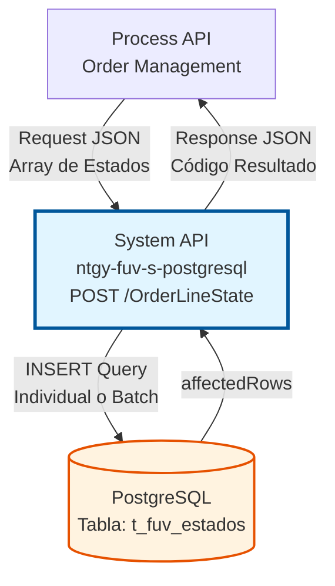
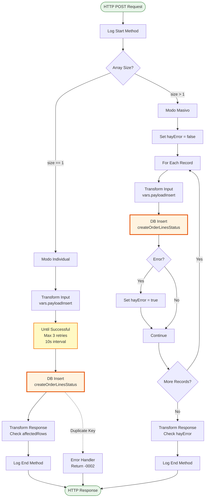
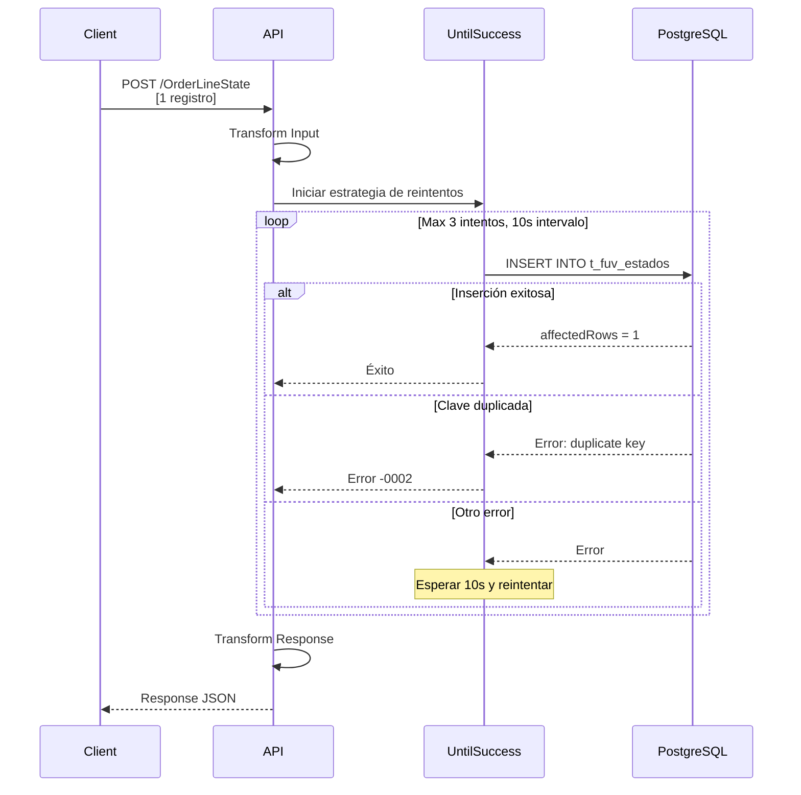
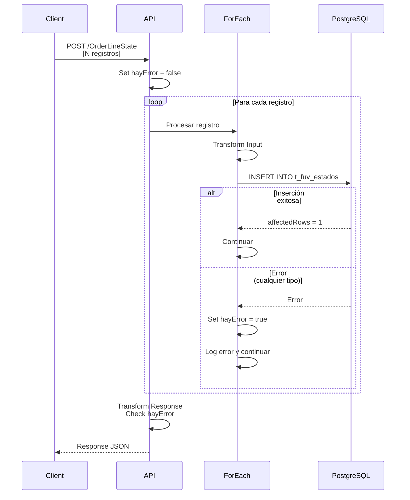
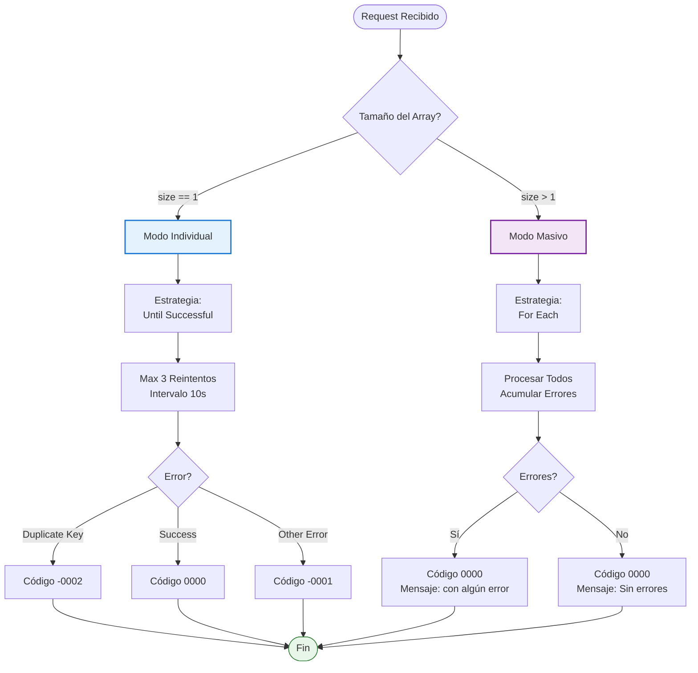
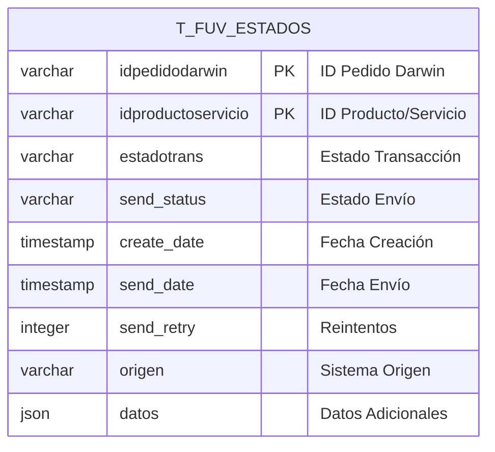
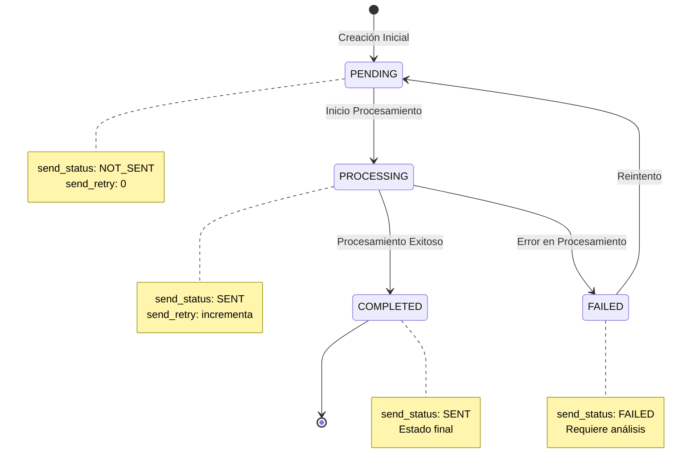
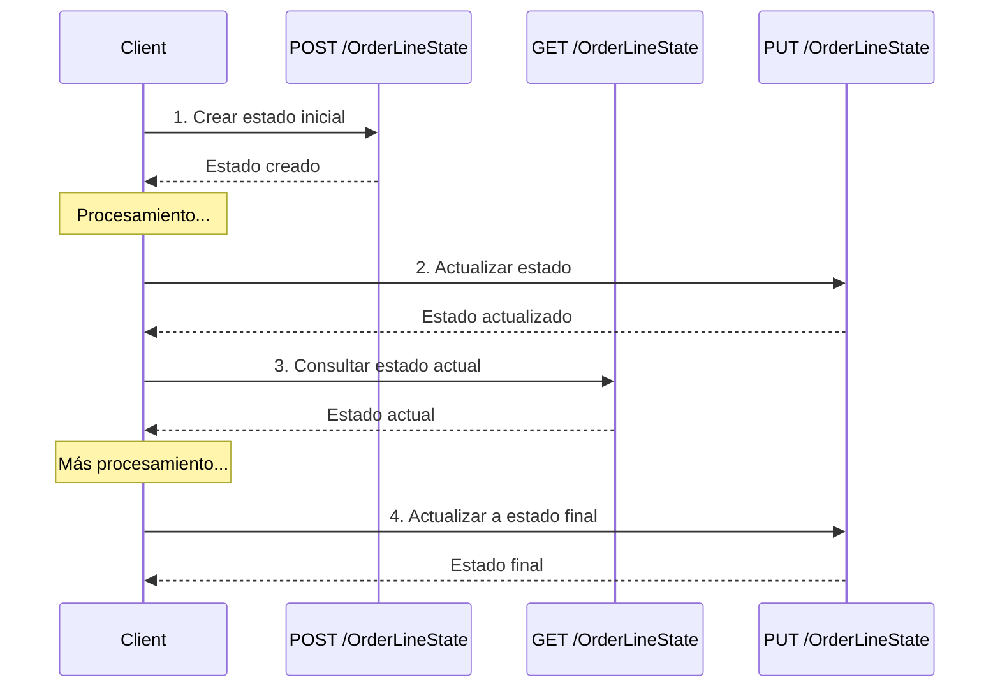

# POST /OrderLineState

## 📌 Descripción General

### Propósito del Endpoint

Este endpoint permite crear registros de estado para líneas de pedido en la base de datos PostgreSQL, proporcionando trazabilidad completa del procesamiento de pedidos en el sistema FUV (Facturación Única Virtual).

El endpoint soporta:
- **Inserción Individual**: Crea un único registro con estrategia de reintentos automáticos
- **Inserción Masiva**: Procesa múltiples registros en batch con manejo de errores acumulativo
- **Detección de Duplicados**: Identifica y maneja claves primarias duplicadas
- **Timestamps Automáticos**: Registra fechas de creación y envío con timezone Europe/Madrid
- **Almacenamiento JSON**: Permite guardar datos adicionales en formato JSON

### Tipo de API

**Capa:** System API (API-Led Connectivity)

**Función:** Integración directa con PostgreSQL para persistencia de estados de líneas de pedido.

### Patrón de Integración

**Tipo:** Request-Reply Síncrono con PostgreSQL INSERT

**Descripción:** El endpoint recibe un array de objetos con información de estado, transforma los datos según el modo de operación (individual o masivo), ejecuta operaciones INSERT en la tabla `t_fuv_estados`, y retorna el resultado de la operación con códigos de estado específicos.

### Arquitectura API-Led Connectivity



---

## 💼 Propósito del Negocio

### Casos de Uso Principales

1. **Registro de Estado Inicial de Pedido**
   - Al crear una nueva línea de pedido, se registra su estado inicial
   - Permite trazabilidad desde el momento de creación
   - Facilita seguimiento del flujo de procesamiento

2. **Trazabilidad de Procesamiento**
   - Registra cada cambio de estado en el ciclo de vida del pedido
   - Almacena información de reintentos y errores
   - Mantiene histórico de estados para auditoría

3. **Procesamiento Masivo de Estados**
   - Permite registrar múltiples estados en una sola operación
   - Optimiza el rendimiento en procesos batch
   - Reduce el número de transacciones a la base de datos

### Contexto Empresarial

- **Dominio:** Gestión de Pedidos y Estados
- **Sector:** Energía - Utilities
- **División:** Naturgy España - FUV (Facturación Única Virtual)
- **Proceso de Negocio:** Control y trazabilidad de estados de líneas de pedido
- **Sistema:** PostgreSQL FUV

### Stakeholders

- **Equipos de Operaciones**: Necesitan visibilidad del estado de procesamiento de pedidos
- **Desarrolladores de Process APIs**: Consumen este endpoint para registrar estados
- **Equipos de Soporte**: Utilizan la información para troubleshooting y análisis
- **Auditores**: Requieren trazabilidad completa de cambios de estado

### Valor de Negocio

- **Trazabilidad Completa**: Registro detallado de todos los estados de líneas de pedido
- **Resiliencia**: Estrategia de reintentos automáticos para operaciones individuales
- **Eficiencia**: Procesamiento batch para operaciones masivas
- **Auditoría**: Timestamps automáticos y almacenamiento de datos adicionales
- **Detección de Duplicados**: Prevención de registros duplicados con manejo específico

### Consumidores Potenciales

Este endpoint puede ser consumido por:
- Process APIs de gestión de pedidos
- Flujos de integración con sistemas externos
- Procesos batch de sincronización
- Servicios de monitoreo y trazabilidad

---

## 🔧 Especificación Técnica

### URLs por Ambiente

| Ambiente | URL Base | URL Completa |
|----------|----------|--------------|
| **Local** | `http://localhost:8081` | `http://localhost:8081/api/OrderLineState` |
| **Development** | `https://ntgy-fuv-s-postgresql-dev.us-e2.cloudhub.io` | `https://ntgy-fuv-s-postgresql-dev.us-e2.cloudhub.io/api/OrderLineState` |
| **UAT** | `https://ntgy-fuv-s-postgresql-uat.us-e2.cloudhub.io` | `https://ntgy-fuv-s-postgresql-uat.us-e2.cloudhub.io/api/OrderLineState` |
| **Production** | `https://ntgy-fuv-s-postgresql-pro.us-e2.cloudhub.io` | `https://ntgy-fuv-s-postgresql-pro.us-e2.cloudhub.io/api/OrderLineState` |

### Método HTTP

```
POST /api/OrderLineState
```

### Parámetros de Entrada

#### Headers HTTP

| Header | Tipo | Requerido | Descripción | Ejemplo |
|--------|------|-----------|-------------|---------|
| `Content-Type` | string | ✅ Sí | Tipo de contenido del request | `application/json` |
| `Accept` | string | ❌ No | Tipo de contenido esperado en response | `application/json` |

#### Body Parameters

**Estructura:** Array de objetos con información de estado de línea de pedido

| Campo | Tipo | Requerido | Descripción | Ejemplo |
|-------|------|-----------|-------------|---------|
| `idpedidodarwin` | string | ✅ Sí | Identificador único del pedido en Darwin | `"PED-2024-001234"` |
| `idproductoservicio` | string | ✅ Sí | Identificador del producto/servicio | `"PROD-GAS-001"` |
| `estadotrans` | string | ✅ Sí | Estado de la transacción | `"PENDING"`, `"PROCESSING"`, `"COMPLETED"` |
| `send_status` | string | ✅ Sí | Estado de envío | `"NOT_SENT"`, `"SENT"`, `"FAILED"` |
| `send_retry` | integer | ✅ Sí | Número de reintentos de envío | `0`, `1`, `2` |
| `origen` | string | ✅ Sí | Sistema origen del registro | `"SALESFORCE"`, `"SAP"`, `"DARWIN"` |
| `datos` | object | ✅ Sí | Datos adicionales en formato JSON | `{"campo1": "valor1"}` |

**Nota sobre Clave Primaria:** La combinación de `idpedidodarwin` + `idproductoservicio` forma la clave primaria compuesta. No se permiten duplicados.

### Respuestas

#### Respuesta Exitosa - Inserción Individual (200 OK)

```json
{
  "result": {
    "codResult": "0000",
    "msgResult": "No hay error"
  }
}
```

#### Respuesta Exitosa - Inserción Masiva (200 OK)

```json
{
  "result": {
    "codResult": "0000",
    "msgResult": "Actualización Masiva: Sin errores"
  }
}
```

#### Respuesta de Error - Clave Duplicada (200 OK)

```json
{
  "result": {
    "codResult": "-0002",
    "msgResult": "Registro ya existente"
  }
}
```

#### Respuesta de Error - Fallo en Inserción (200 OK)

```json
{
  "result": {
    "codResult": "-0001",
    "msgResult": "Ha habido un error en la creación del registro"
  }
}
```

#### Respuesta de Error - Inserción Masiva con Errores (200 OK)

```json
{
  "result": {
    "codResult": "0000",
    "msgResult": "Actualización Masiva: con algún error"
  }
}
```

### Códigos de Respuesta

| Código | Descripción | Escenario |
|--------|-------------|-----------|
| `0000` | Éxito | Registro(s) creado(s) correctamente |
| `-0001` | Error en creación | Fallo en la operación INSERT |
| `-0002` | Registro duplicado | Clave primaria ya existe en la tabla |

### Autenticación y Autorización

- **Tipo:** Client ID & Client Secret (Anypoint Platform)
- **Autorización PostgreSQL:** El usuario de base de datos debe tener permisos para:
  - Ejecutar INSERT en tabla `t_fuv_estados`
  - Acceso al schema `fuv`

### Timeouts

| Tipo | Valor | Descripción |
|------|-------|-------------|
| **Request Timeout** | 30 segundos | Tiempo máximo de espera para la respuesta |
| **Connection Timeout** | 10 segundos | Tiempo máximo para establecer conexión con PostgreSQL |
| **Retry Interval** | 10 segundos | Intervalo entre reintentos (modo individual) |
| **Max Retries** | 3 intentos | Número máximo de reintentos (modo individual) |

---

## 🏗️ Implementación Técnica

### Arquitectura del Flow



### Operación de Base de Datos

#### Query SQL Real

**Referencia en código:** `${queries.createOrderLinesStatus}`

**Query completa:**
```sql
INSERT INTO t_fuv_estados (
    idpedidodarwin,
    idproductoservicio,
    estadotrans,
    send_status,
    create_date,
    send_date,
    send_retry,
    origen,
    datos
) VALUES (
    :idpedidodarwin,
    :idproductoservicio,
    :estadotrans,
    :send_status,
    timezone('Europe/Madrid'::text, CURRENT_TIMESTAMP),
    timezone('Europe/Madrid'::text, CURRENT_TIMESTAMP),
    :send_retry,
    :origen,
    :datos
)
```

**Ubicación en código:**
- **Archivo XML:** `s-postgresql-OrderLineStates.xml`, líneas 33-36 (individual) y 93-96 (masivo)
- **Archivo Config:** `s-postgresql-global-config.yaml`, línea 62

#### Tabla de Base de Datos

**Nombre:** `t_fuv_estados`

**Schema:** `fuv`

**Campos:**

| Campo | Tipo | Constraint | Descripción | Origen |
|-------|------|------------|-------------|--------|
| `idpedidodarwin` | VARCHAR | PRIMARY KEY | Identificador del pedido Darwin | Parámetro |
| `idproductoservicio` | VARCHAR | PRIMARY KEY | Identificador del producto/servicio | Parámetro |
| `estadotrans` | VARCHAR | NOT NULL | Estado de la transacción | Parámetro |
| `send_status` | VARCHAR | NOT NULL | Estado de envío | Parámetro |
| `create_date` | TIMESTAMP | NOT NULL | Fecha de creación del registro | Auto (timezone Europe/Madrid) |
| `send_date` | TIMESTAMP | NOT NULL | Fecha de último envío | Auto (timezone Europe/Madrid) |
| `send_retry` | INTEGER | NOT NULL | Contador de reintentos | Parámetro |
| `origen` | VARCHAR | NOT NULL | Sistema origen del registro | Parámetro |
| `datos` | JSON | NULL | Datos adicionales en formato JSON | Parámetro |

**Índices:**
- Clave primaria compuesta: (`idpedidodarwin`, `idproductoservicio`)

### Transformaciones DataWeave

#### Transformación de Input (Request → Database)

**Ubicación:** Líneas 16-27 (individual) y 79-90 (masivo) del archivo XML

```dataweave
%dw 2.0
output application/json
---
{
    idpedidodarwin : payload[0].idpedidodarwin,
    idproductoservicio: payload[0].idproductoservicio,
    estadotrans: payload[0].estadotrans,
    send_status: payload[0].send_status,
    send_retry: payload[0].send_retry,
    origen: payload[0].origen,
    datos: write(payload[0].datos, "application/json")
}
```

**Propósito:**
- Extrae campos del payload de entrada
- Convierte el objeto `datos` a string JSON para almacenamiento
- Prepara parámetros para la query SQL

#### Transformación de Response (Database → Response)

**Ubicación:** Líneas 39-47 del archivo XML

```dataweave
%dw 2.0
output application/json
---
{
    "result": {
        "codResult": if (payload.affectedRows == 1) "0000" else "-0001",
        "msgResult": if (payload.affectedRows == 1) "No hay error" else "Ha habido un error en la creación del registro"
    }
}
```

**Propósito:**
- Evalúa el resultado de la operación INSERT
- Retorna código 0000 si se insertó 1 fila
- Retorna código -0001 si no se insertó ninguna fila

### Lógica de Negocio

#### Modo Individual (sizeOf(payload) == 1)



**Características:**
- Usa componente `until-successful` con 3 reintentos máximos
- Intervalo de 10 segundos entre reintentos
- Manejo específico de error de clave duplicada
- Logging detallado en cada intento

#### Modo Masivo (sizeOf(payload) > 1)



**Características:**
- Procesa todos los registros aunque algunos fallen
- Acumula errores en variable `hayError`
- No detiene el procesamiento ante errores
- Retorna resumen del procesamiento masivo

### Manejo de Errores

#### Error de Clave Duplicada

**Ubicación:** Líneas 51-66 del archivo XML

```xml
<on-error-continue type="DB:QUERY_EXECUTION" 
                   when='error.description contains("duplicate key")'>
    <logger message="Error Registro existente: #[vars.payloadInsert]"/>
    <ee:transform>
        <ee:set-payload>
            {
                "result": {
                    "codResult": "-0002",
                    "msgResult": "Registro ya existente"
                }
            }
        </ee:set-payload>
    </ee:transform>
</on-error-continue>
```

**Comportamiento:**
- Detecta error de PostgreSQL por clave duplicada
- Retorna código específico -0002
- Registra el intento en logs
- Continúa la ejecución sin propagar el error

#### Error Genérico en Modo Masivo

**Ubicación:** Líneas 98-101 del archivo XML

```xml
<on-error-continue type="ANY">
    <logger message="Error Registro existente: #[vars.payloadInsert]"/>
    <set-variable variableName="hayError" value="#[true]"/>
</on-error-continue>
```

**Comportamiento:**
- Captura cualquier tipo de error
- Marca la variable `hayError` como true
- Registra el error en logs
- Continúa procesando los siguientes registros

### Configuración de Conexión

**Database Config:** `Database_Config`

**Propiedades:**
- **Connection Pooling:** Habilitado
- **Max Pool Size:** Configurado por ambiente
- **Connection Timeout:** 10 segundos
- **Query Timeout:** 30 segundos

### Logging

**Niveles de Log:**
- **DEBUG:** Inicio del método (línea 10)
- **INFO:** Inicio de procesamiento individual (líneas 32, 75)
- **INFO:** Fin del método (línea 120)

**Información Registrada:**
- ID del pedido Darwin
- ID del producto/servicio
- Payload completo (sanitizado)
- Errores y excepciones

---

## 💻 Ejemplos de Uso

### Ejemplo 1: Inserción Individual

#### Request

```bash
curl -X POST "https://ntgy-fuv-s-postgresql-dev.us-e2.cloudhub.io/api/OrderLineState" \
  -H "Content-Type: application/json" \
  -H "client_id: your-client-id" \
  -H "client_secret: your-client-secret" \
  -d '[
    {
      "idpedidodarwin": "PED-2024-001234",
      "idproductoservicio": "PROD-GAS-001",
      "estadotrans": "PENDING",
      "send_status": "NOT_SENT",
      "send_retry": 0,
      "origen": "SALESFORCE",
      "datos": {
        "customer_id": "CUST-12345",
        "contract_number": "CNT-67890",
        "product_type": "GAS_NATURAL"
      }
    }
  ]'
```

#### Response (Éxito)

```json
{
  "result": {
    "codResult": "0000",
    "msgResult": "No hay error"
  }
}
```

### Ejemplo 2: Inserción Masiva

#### Request

```bash
curl -X POST "https://ntgy-fuv-s-postgresql-dev.us-e2.cloudhub.io/api/OrderLineState" \
  -H "Content-Type: application/json" \
  -H "client_id: your-client-id" \
  -H "client_secret: your-client-secret" \
  -d '[
    {
      "idpedidodarwin": "PED-2024-001235",
      "idproductoservicio": "PROD-GAS-002",
      "estadotrans": "PROCESSING",
      "send_status": "SENT",
      "send_retry": 0,
      "origen": "SAP",
      "datos": {
        "order_type": "NEW_CONTRACT"
      }
    },
    {
      "idpedidodarwin": "PED-2024-001236",
      "idproductoservicio": "PROD-ELEC-001",
      "estadotrans": "COMPLETED",
      "send_status": "SENT",
      "send_retry": 0,
      "origen": "DARWIN",
      "datos": {
        "order_type": "MODIFICATION"
      }
    },
    {
      "idpedidodarwin": "PED-2024-001237",
      "idproductoservicio": "PROD-GAS-003",
      "estadotrans": "PENDING",
      "send_status": "NOT_SENT",
      "send_retry": 0,
      "origen": "SALESFORCE",
      "datos": {
        "order_type": "CANCELLATION"
      }
    }
  ]'
```

#### Response (Éxito)

```json
{
  "result": {
    "codResult": "0000",
    "msgResult": "Actualización Masiva: Sin errores"
  }
}
```

### Ejemplo 3: Error - Clave Duplicada

#### Request

```bash
curl -X POST "https://ntgy-fuv-s-postgresql-dev.us-e2.cloudhub.io/api/OrderLineState" \
  -H "Content-Type: application/json" \
  -H "client_id: your-client-id" \
  -H "client_secret: your-client-secret" \
  -d '[
    {
      "idpedidodarwin": "PED-2024-001234",
      "idproductoservicio": "PROD-GAS-001",
      "estadotrans": "PROCESSING",
      "send_status": "SENT",
      "send_retry": 1,
      "origen": "SALESFORCE",
      "datos": {
        "retry_reason": "TIMEOUT"
      }
    }
  ]'
```

#### Response (Error)

```json
{
  "result": {
    "codResult": "-0002",
    "msgResult": "Registro ya existente"
  }
}
```

### Ejemplo 4: Inserción con Datos JSON Complejos

#### Request

```json
[
  {
    "idpedidodarwin": "PED-2024-001238",
    "idproductoservicio": "PROD-DUAL-001",
    "estadotrans": "PENDING_VALIDATION",
    "send_status": "NOT_SENT",
    "send_retry": 0,
    "origen": "SALESFORCE",
    "datos": {
      "customer": {
        "id": "CUST-98765",
        "name": "Cliente Ejemplo S.L.",
        "nif": "B12345678"
      },
      "contract": {
        "number": "CNT-2024-5678",
        "type": "DUAL",
        "start_date": "2024-01-15"
      },
      "products": [
        {
          "type": "GAS",
          "cups": "ES0000000000000001JN",
          "tariff": "3.1"
        },
        {
          "type": "ELECTRICITY",
          "cups": "ES0000000000000002JN",
          "tariff": "2.0TD"
        }
      ],
      "metadata": {
        "channel": "WEB",
        "campaign": "PROMO_2024_Q1",
        "agent_id": "AGT-001"
      }
    }
  }
]
```

#### Response

```json
{
  "result": {
    "codResult": "0000",
    "msgResult": "No hay error"
  }
}
```

### Ejemplo 5: JavaScript/Node.js

```javascript
const axios = require('axios');

const createOrderLineState = async () => {
  try {
    const response = await axios.post(
      'https://ntgy-fuv-s-postgresql-dev.us-e2.cloudhub.io/api/OrderLineState',
      [
        {
          idpedidodarwin: 'PED-2024-001239',
          idproductoservicio: 'PROD-GAS-004',
          estadotrans: 'PENDING',
          send_status: 'NOT_SENT',
          send_retry: 0,
          origen: 'NODEJS_CLIENT',
          datos: {
            timestamp: new Date().toISOString(),
            source: 'automated_process'
          }
        }
      ],
      {
        headers: {
          'Content-Type': 'application/json',
          'client_id': 'your-client-id',
          'client_secret': 'your-client-secret'
        }
      }
    );
    
    console.log('Response:', response.data);
    
    if (response.data.result.codResult === '0000') {
      console.log('✅ Estado creado exitosamente');
    } else {
      console.log('❌ Error:', response.data.result.msgResult);
    }
  } catch (error) {
    console.error('Error en la petición:', error.message);
  }
};

createOrderLineState();
```

### Ejemplo 6: Python

```python
import requests
import json
from datetime import datetime

def create_order_line_state():
    url = "https://ntgy-fuv-s-postgresql-dev.us-e2.cloudhub.io/api/OrderLineState"
    
    headers = {
        "Content-Type": "application/json",
        "client_id": "your-client-id",
        "client_secret": "your-client-secret"
    }
    
    payload = [
        {
            "idpedidodarwin": "PED-2024-001240",
            "idproductoservicio": "PROD-ELEC-002",
            "estadotrans": "PROCESSING",
            "send_status": "SENT",
            "send_retry": 0,
            "origen": "PYTHON_CLIENT",
            "datos": {
                "timestamp": datetime.now().isoformat(),
                "source": "batch_process",
                "batch_id": "BATCH-2024-001"
            }
        }
    ]
    
    try:
        response = requests.post(url, headers=headers, json=payload)
        response.raise_for_status()
        
        result = response.json()
        print(f"Response: {json.dumps(result, indent=2)}")
        
        if result['result']['codResult'] == '0000':
            print("✅ Estado creado exitosamente")
        else:
            print(f"❌ Error: {result['result']['msgResult']}")
            
    except requests.exceptions.RequestException as e:
        print(f"Error en la petición: {e}")

if __name__ == "__main__":
    create_order_line_state()
```

---

## 📊 Diagramas Adicionales

### Diagrama de Decisión: Individual vs Masivo



### Diagrama de Modelo de Datos



### Diagrama de Estados del Pedido



---

## 🔍 Consideraciones Técnicas

### Rendimiento

**Modo Individual:**
- Tiempo promedio: < 500ms por registro
- Incluye hasta 3 reintentos automáticos
- Timeout total máximo: ~40 segundos (3 reintentos × 10s + procesamiento)

**Modo Masivo:**
- Tiempo promedio: ~100ms por registro
- Sin reintentos automáticos
- Procesamiento secuencial con manejo de errores

**Recomendaciones:**
- Usar modo individual para operaciones críticas que requieren garantía de inserción
- Usar modo masivo para cargas batch donde se acepta procesamiento parcial
- Limitar batch a máximo 1000 registros por request

### Idempotencia

**Comportamiento:**
- El endpoint NO es idempotente por diseño
- Reintentos con los mismos datos generarán error de clave duplicada (-0002)
- El cliente debe manejar errores de duplicados según su lógica de negocio

**Estrategia Recomendada:**
- Verificar existencia antes de insertar (usar GET /OrderLineState)
- Manejar código -0002 como "ya existe" sin considerarlo error fatal
- Implementar lógica de actualización si el registro ya existe (usar PUT /OrderLineState)

### Transaccionalidad

**Modo Individual:**
- Cada inserción es una transacción independiente
- Rollback automático en caso de error
- Reintentos mantienen consistencia transaccional

**Modo Masivo:**
- Cada registro es una transacción independiente
- NO hay rollback global si falla un registro
- Procesamiento continúa aunque algunos registros fallen
- Responsabilidad del cliente manejar registros fallidos

### Concurrencia

**Escenarios de Concurrencia:**
- Múltiples clientes insertando el mismo `idpedidodarwin` + `idproductoservicio`
- PostgreSQL maneja locks a nivel de fila
- El primero en completar la transacción gana
- Los demás reciben error de clave duplicada

**Manejo Recomendado:**
- Implementar retry con backoff exponencial en el cliente
- Verificar existencia antes de insertar en escenarios de alta concurrencia
- Usar timestamps para determinar el registro más reciente

### Seguridad

**Validaciones Implementadas:**
- ✅ Validación de estructura JSON
- ✅ Validación de tipos de datos
- ✅ Prevención de SQL injection (queries parametrizadas)
- ✅ Validación de clave primaria compuesta

**Validaciones NO Implementadas:**
- ❌ Validación de valores de enumeración (estadotrans, send_status)
- ❌ Validación de formato de IDs
- ❌ Validación de tamaño del campo datos (JSON)

**Recomendaciones:**
- Implementar validaciones de negocio en el cliente
- Limitar tamaño del campo `datos` a 10KB
- Validar valores de estado contra catálogo definido

### Monitoreo y Observabilidad

**Métricas Clave a Monitorear:**
- Tasa de éxito/error por modo (individual vs masivo)
- Frecuencia de errores de clave duplicada
- Tiempo de respuesta por modo
- Número de reintentos en modo individual
- Tamaño promedio de batch en modo masivo

**Logs Importantes:**
- Inicio y fin de procesamiento con IDs
- Errores de clave duplicada con detalles
- Reintentos en modo individual
- Resumen de procesamiento masivo

**Alertas Recomendadas:**
- Tasa de error > 10% en 5 minutos
- Tiempo de respuesta > 5 segundos
- Más de 50% de registros con error en modo masivo
- Errores de conexión a base de datos

---

## 📝 Notas de Implementación

### Buenas Prácticas

1. **Validación Previa:**
   ```javascript
   // Verificar existencia antes de insertar
   const exists = await checkOrderLineStateExists(idpedidodarwin, idproductoservicio);
   if (!exists) {
     await createOrderLineState(data);
   }
   ```

2. **Manejo de Duplicados:**
   ```javascript
   try {
     await createOrderLineState(data);
   } catch (error) {
     if (error.codResult === '-0002') {
       console.log('Registro ya existe, continuando...');
       // No es un error fatal
     } else {
       throw error;
     }
   }
   ```

3. **Procesamiento Batch Eficiente:**
   ```javascript
   // Dividir en chunks de 100 registros
   const chunkSize = 100;
   for (let i = 0; i < records.length; i += chunkSize) {
     const chunk = records.slice(i, i + chunkSize);
     await createOrderLineStateBatch(chunk);
   }
   ```

4. **Retry con Backoff:**
   ```javascript
   async function createWithRetry(data, maxRetries = 3) {
     for (let i = 0; i < maxRetries; i++) {
       try {
         return await createOrderLineState(data);
       } catch (error) {
         if (i === maxRetries - 1) throw error;
         await sleep(Math.pow(2, i) * 1000); // Backoff exponencial
       }
     }
   }
   ```

### Limitaciones Conocidas

1. **Tamaño del Batch:**
   - No hay límite técnico en el código
   - Recomendado: máximo 1000 registros por request
   - Batches grandes pueden causar timeouts

2. **Campo datos (JSON):**
   - No hay validación de tamaño
   - Recomendado: máximo 10KB por registro
   - JSON muy grandes pueden afectar rendimiento

3. **Reintentos en Modo Masivo:**
   - No hay reintentos automáticos
   - El cliente debe implementar lógica de retry
   - Registros fallidos no se reportan individualmente

4. **Timestamps:**
   - Siempre en timezone Europe/Madrid
   - No se puede especificar timezone diferente
   - No se puede especificar timestamp manual

### Troubleshooting

**Problema: Error -0002 frecuente**
- **Causa:** Intentos de insertar registros duplicados
- **Solución:** Verificar existencia antes de insertar o usar PUT para actualizar

**Problema: Timeout en modo masivo**
- **Causa:** Batch demasiado grande
- **Solución:** Reducir tamaño del batch a 100-500 registros

**Problema: Modo individual muy lento**
- **Causa:** Reintentos innecesarios por problemas de red
- **Solución:** Revisar conectividad, considerar modo masivo si no se requieren reintentos

**Problema: Datos JSON no se guardan correctamente**
- **Causa:** Formato JSON inválido en el campo datos
- **Solución:** Validar JSON antes de enviar, usar JSON.stringify() en cliente

---

## 🔗 Endpoints Relacionados

### Operaciones CRUD Completas

| Operación | Endpoint | Método | Descripción |
|-----------|----------|--------|-------------|
| **Create** | `/OrderLineState` | POST | Crear nuevo estado (este endpoint) |
| **Read** | `/OrderLineState` | GET | Obtener estado por ID |
| **Update** | `/OrderLineState` | PUT | Actualizar estado existente |
| **Delete** | `/OrderLineState` | DELETE | Eliminar estado |
| **Query** | `/OrderLinesStatebyStatus` | GET | Consultar por estado |

### Flujo Típico de Uso



---

## ✅ Checklist de Validación

Antes de usar este endpoint en producción, verificar:

- [ ] Credenciales de API configuradas (client_id, client_secret)
- [ ] Permisos de base de datos verificados (INSERT en t_fuv_estados)
- [ ] Validación de datos implementada en el cliente
- [ ] Manejo de errores de clave duplicada implementado
- [ ] Estrategia de retry configurada (si aplica)
- [ ] Tamaño de batch validado (≤ 1000 registros)
- [ ] Monitoreo y alertas configurados
- [ ] Logs de aplicación revisados
- [ ] Pruebas de carga realizadas
- [ ] Documentación del cliente actualizada
