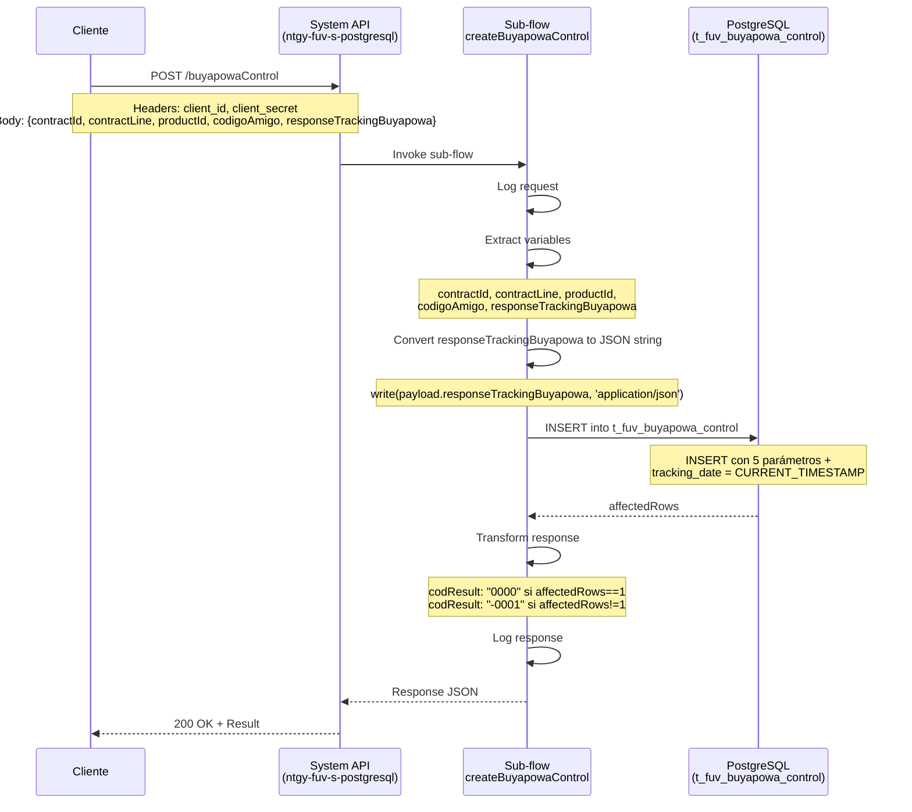
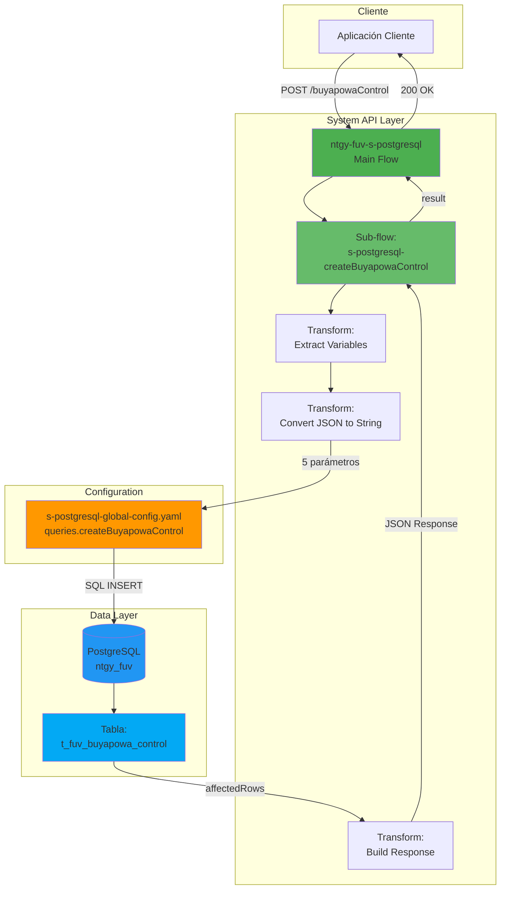
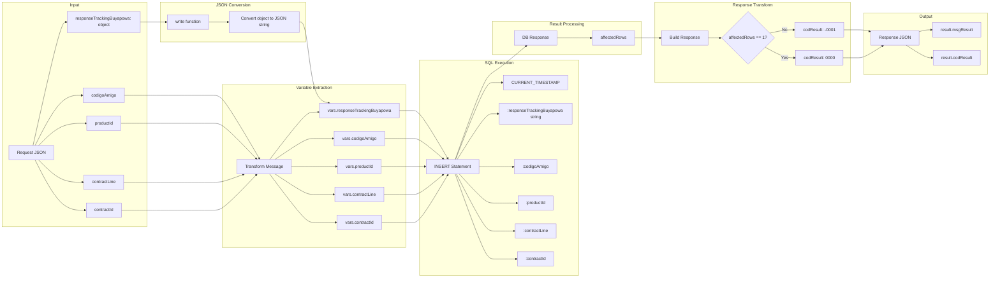
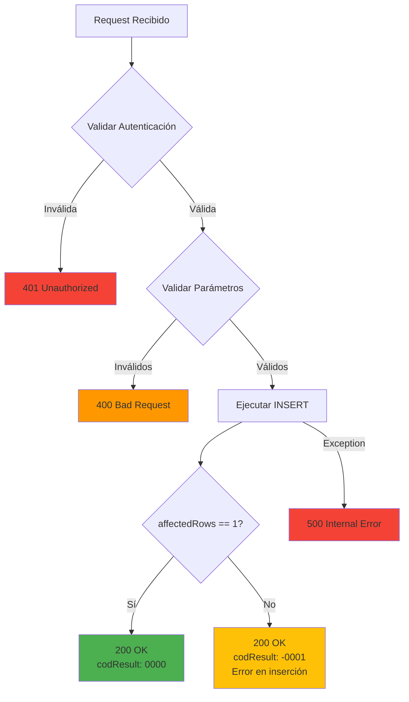

# POST /buyapowaControl

## 📌 Descripción General

El endpoint `POST /buyapowaControl` es una **System API** que registra un nuevo control de tracking de participación de clientes en el programa de referidos Buyapowa. Este endpoint inserta un registro en la tabla `t_fuv_buyapowa_control` de PostgreSQL, almacenando la información del contrato, producto, código de amigo referidor y la respuesta del tracking inicial de Buyapowa.

**Características principales:**
- **Operación:** INSERT en tabla `t_fuv_buyapowa_control`
- **Backend:** PostgreSQL
- **Tipo de API:** System API
- **Método HTTP:** POST
- **Query externalizada:** Usa `queries.createBuyapowaControl` del archivo YAML
- **Timestamp automático:** Campo `tracking_date` se establece con timestamp de Madrid

## 💼 Propósito del Negocio

### Contexto del Negocio

El programa de referidos **Buyapowa** es una plataforma de marketing que permite a los clientes referir nuevos usuarios a cambio de incentivos. Este endpoint registra el inicio del proceso de tracking cuando un cliente participa en el programa, almacenando la información del contrato, el código del amigo referidor y la respuesta inicial del sistema Buyapowa.

### Casos de Uso

1. **Registro Inicial de Participación**
   - Cuando un cliente se registra en el programa de referidos
   - Se almacena el código del amigo que lo refirió
   - Se guarda la respuesta del tracking inicial de Buyapowa
   - Se establece automáticamente la fecha de tracking

2. **Trazabilidad de Referidos**
   - Mantener registro de qué cliente refirió a quién
   - Asociar contratos y productos con códigos de amigo
   - Facilitar el seguimiento de campañas de referidos
   - Permitir auditorías del programa de incentivos

3. **Integración con Plataforma Buyapowa**
   - Almacenar respuestas del sistema externo Buyapowa
   - Mantener sincronización con la plataforma de referidos
   - Guardar información de tracking en formato JSON
   - Preparar datos para confirmaciones posteriores

### Valor de Negocio

- **Trazabilidad:** Registro completo del inicio del proceso de referido
- **Integridad:** Almacenamiento estructurado de datos de tracking
- **Auditoría:** Timestamp automático para seguimiento temporal
- **Integración:** Almacenamiento de respuestas JSON de sistema externo

## 🔧 Especificación Técnica

### Endpoint

```
POST /buyapowaControl
```

### Headers Requeridos

| Header | Valor | Descripción |
|--------|-------|-------------|
| `Content-Type` | `application/json` | Formato del body de la petición |
| `client_id` | `string` | Identificador del cliente API |
| `client_secret` | `string` | Secreto del cliente para autenticación |

### Request Body

```json
{
  "contractId": "string",
  "contractLine": "string",
  "productId": "string",
  "codigoAmigo": "string",
  "responseTrackingBuyapowa": {
    "trackingId": "string",
    "status": "string",
    "timestamp": "string"
  }
}
```

#### Parámetros del Request

| Campo | Tipo | Requerido | Descripción | Ejemplo |
|-------|------|-----------|-------------|---------|
| `contractId` | string | Sí | Identificador del contrato | "CONT-2024-001" |
| `contractLine` | string | Sí | Identificador de la línea de contrato | "CL-2024-001" |
| `productId` | string | Sí | Identificador del producto | "PROD-123" |
| `codigoAmigo` | string | Sí | Código del amigo referidor | "AMIGO-456" |
| `responseTrackingBuyapowa` | object | Sí | Respuesta JSON del tracking de Buyapowa | Ver estructura abajo |

#### Estructura de responseTrackingBuyapowa

El campo `responseTrackingBuyapowa` es un objeto JSON que contiene la respuesta del sistema Buyapowa al registrar el tracking inicial. Estructura típica:

```json
{
  "trackingId": "TRK-789",
  "status": "sent",
  "timestamp": "2024-01-15T10:30:00Z",
  "referralCode": "REF-ABC123",
  "campaignId": "CAMP-2024"
}
```

**Nota importante:** Este objeto se convierte a string JSON antes de insertarse en la base de datos como tipo JSONB.

### Response Body

#### Respuesta Exitosa (200 OK)

```json
{
  "result": {
    "codResult": "0000",
    "msgResult": "No hay error"
  }
}
```

#### Respuesta con Error

```json
{
  "result": {
    "codResult": "-0001",
    "msgResult": "Ha habido un error en la creación del registro"
  }
}
```

#### Estructura de la Respuesta

| Campo | Tipo | Descripción |
|-------|------|-------------|
| `result` | object | Objeto con el resultado de la operación |
| `result.codResult` | string | Código de resultado: "0000" (éxito) o "-0001" (error) |
| `result.msgResult` | string | Mensaje descriptivo del resultado |

**Nota:** La respuesta NO incluye los datos insertados, solo el resultado de la operación basado en `affectedRows`.

### Códigos de Respuesta

| Código | Descripción | Escenario |
|--------|-------------|-----------|
| 200 | OK | Registro creado correctamente (affectedRows == 1) |
| 200 | OK con error | Error en la inserción (affectedRows != 1) |
| 400 | Bad Request | Parámetros inválidos o faltantes |
| 401 | Unauthorized | Credenciales inválidas o faltantes |
| 500 | Internal Server Error | Error en la base de datos o sistema |

### Validaciones

1. **Campos requeridos:** Todos los campos del request son obligatorios
2. **Formato JSON:** `responseTrackingBuyapowa` debe ser un objeto JSON válido
3. **Tipos de datos:** Todos los campos string deben ser VARCHAR válidos
4. **Unicidad:** Puede haber restricciones de unicidad en `contractLine` + `productId`

## 🏗️ Implementación Técnica

### Arquitectura del Flujo



### Diagrama de Arquitectura



### Operación SQL

#### Query de Inserción

**Ubicación:** `s-postgresql-global-config.yaml` → `queries.createBuyapowaControl`

```sql
INSERT into t_fuv_buyapowa_control 
    (contract_id, contract_line, product_id, codigo_amigo, 
     response_tracking_buyapowa, response_confirmation_buyapowa, 
     contract_status, tracking_date, update_status_date, confirmation_date) 
VALUES 
    (:contractId, :contractLine, :productId, :codigoAmigo, 
     :responseTrackingBuyapowa, null, null, 
     timezone('Europe/Madrid'::text, CURRENT_TIMESTAMP), null, null)
```

#### Parámetros SQL

| Parámetro | Tipo | Origen | Descripción |
|-----------|------|--------|-------------|
| `:contractId` | VARCHAR | Request body → vars.contractId | Identificador del contrato |
| `:contractLine` | VARCHAR | Request body → vars.contractLine | Identificador de línea de contrato |
| `:productId` | VARCHAR | Request body → vars.productId | Identificador del producto |
| `:codigoAmigo` | VARCHAR | Request body → vars.codigoAmigo | Código del amigo referidor |
| `:responseTrackingBuyapowa` | VARCHAR (JSON string) | Request body → vars.responseTrackingBuyapowa | Respuesta de tracking convertida a JSON string |

#### Campos Auto-generados

| Campo | Valor | Descripción |
|-------|-------|-------------|
| `response_confirmation_buyapowa` | null | Se actualizará posteriormente con confirmación |
| `contract_status` | null | Se actualizará posteriormente con estado del contrato |
| `tracking_date` | `timezone('Europe/Madrid'::text, CURRENT_TIMESTAMP)` | Timestamp automático de Madrid |
| `update_status_date` | null | Se actualizará cuando cambie el estado |
| `confirmation_date` | null | Se actualizará con la confirmación |

#### Estructura de la Tabla

```sql
CREATE TABLE t_fuv_buyapowa_control (
    t_fuv_buyapowa_control_id SERIAL PRIMARY KEY,
    contract_id VARCHAR,
    contract_line VARCHAR NOT NULL,
    product_id VARCHAR,
    codigo_amigo VARCHAR,
    response_tracking_buyapowa JSONB,
    response_confirmation_buyapowa JSONB,
    contract_status VARCHAR,
    tracking_date TIMESTAMP,
    update_status_date TIMESTAMP,
    confirmation_date TIMESTAMP,
    -- índices y constraints adicionales
);
```

**Campos clave:**
- `contract_id`: Identificador del contrato
- `contract_line`: Identificador de la línea de contrato (clave de búsqueda)
- `product_id`: Identificador del producto asociado
- `codigo_amigo`: Código del referidor
- `response_tracking_buyapowa`: Respuesta JSON del tracking (tipo JSONB)
- `tracking_date`: Fecha de registro del tracking (auto-generado)

### Implementación del Sub-flow

**Archivo:** `s-postgresql-buyapowaControl.xml`  
**Sub-flow:** `s-postgresql-createBuyapowaControl`  
**Líneas:** 8-60

#### Paso 1: Logging del Request (Líneas 9)

```xml
<logger level="INFO" doc:name="request" message="#[%dw 2.0
output application/java
var payloadStr = write(payload,'application/json')
var request = common::commonFunctions::normalizeJSON(payloadStr)
---
'STARTING createBuyapowaControl METHOD. REQUEST: ' ++ request]"/>
```

#### Paso 2: Extracción de Variables (Líneas 10-35)

```xml
<ee:transform doc:name="vars contractId, contractLine, idProducto, codigoAmigo, responseTrackingBuyapowa">
    <ee:variables>
        <ee:set-variable variableName="codigoAmigo"><![CDATA[%dw 2.0
output application/java
---
payload.codigoAmigo]]></ee:set-variable>
        
        <ee:set-variable variableName="contractLine"><![CDATA[%dw 2.0
output application/java
---
payload.contractLine]]></ee:set-variable>
        
        <ee:set-variable variableName="responseTrackingBuyapowa"><![CDATA[%dw 2.0
output application/java
---
write(payload.responseTrackingBuyapowa, 'application/json')]]></ee:set-variable>
        
        <ee:set-variable variableName="productId"><![CDATA[%dw 2.0
output application/java
---
payload.productId]]></ee:set-variable>
        
        <ee:set-variable variableName="contractId"><![CDATA[%dw 2.0
output application/java
---
payload.contractId]]></ee:set-variable>
    </ee:variables>
</ee:transform>
```

**Propósito:** 
- Extrae los 5 campos del payload
- **Importante:** Convierte `responseTrackingBuyapowa` de objeto JSON a string usando `write()`

#### Paso 3: Ejecución del INSERT (Líneas 36-45)

```xml
<db:insert doc:name="Insert" config-ref="Database_Config">
    <db:sql><![CDATA[\${queries.createBuyapowaControl}]]></db:sql>
    <db:input-parameters><![CDATA[#[{
        contractId: vars.contractId,
        contractLine: vars.contractLine,
        codigoAmigo: vars.codigoAmigo,
        productId: vars.productId,
        responseTrackingBuyapowa: vars.responseTrackingBuyapowa
    }]]]></db:input-parameters>
</db:insert>
```

**Características:**
- Usa query externalizada del YAML
- Pasa las 5 variables como parámetros SQL
- `responseTrackingBuyapowa` ya está convertido a JSON string

#### Paso 4: Construcción de la Respuesta (Líneas 46-58)

```xml
<ee:transform doc:name="response">
    <ee:message>
        <ee:set-payload><![CDATA[%dw 2.0
output application/json
---
{
    "result": {
        "codResult": if (payload.affectedRows == 1) "0000" else "-0001",
        "msgResult": if (payload.affectedRows == 1) 
            "No hay error" 
            else "Ha habido un error en la creación del registro"
    }
}]]></ee:set-payload>
    </ee:message>
</ee:transform>
```

**Lógica de respuesta:**
- Si `affectedRows == 1`: Éxito (codResult: "0000")
- Si `affectedRows != 1`: Error (codResult: "-0001")

#### Paso 5: Logging de la Respuesta (Líneas 59)

```xml
<logger level="INFO" doc:name="response" message="#[%dw 2.0
output application/java
var payloadStr = write(payload,'application/json')
var response = common::commonFunctions::normalizeJSON(payloadStr)
---
'FINISHED createBuyapowaControl METHOD. RESPONSE: ' ++ response]"/>
```

### Diagrama de Transformación de Datos



### Configuración de Base de Datos

**Connector:** Database Connector (PostgreSQL)

```xml
<db:config name="Database_Config">
    <db:generic-connection 
        url="${db.url}" 
        driverClassName="org.postgresql.Driver"
        user="${db.user}"
        password="${secure::db.password}"/>
</db:config>
```

### Manejo de Errores



**Nota importante:** El endpoint retorna 200 OK incluso cuando no se inserta el registro. El código de resultado (`codResult`) indica el éxito o fallo real de la operación.

### Propiedades de Configuración

```properties
# Database Configuration
db.url=jdbc:postgresql://localhost:5432/ntgy_fuv
db.user=${DB_USER}
db.password=${DB_PASSWORD}

# API Configuration
api.base.path=/api/v1
```

## 💻 Ejemplos de Uso

### Ejemplo 1: Registro Exitoso de Tracking

#### Request

```bash
curl -X POST "https://api.naturgy.com/fuv/v1/buyapowaControl" \
  -H "Content-Type: application/json" \
  -H "client_id: your-client-id" \
  -H "client_secret: your-client-secret" \
  -d '{
    "contractId": "CONT-2024-001",
    "contractLine": "CL-2024-001",
    "productId": "PROD-123",
    "codigoAmigo": "AMIGO-456",
    "responseTrackingBuyapowa": {
      "trackingId": "TRK-789",
      "status": "sent",
      "timestamp": "2024-01-15T10:30:00Z",
      "referralCode": "REF-ABC123"
    }
  }'
```

#### Response (200 OK)

```json
{
  "result": {
    "codResult": "0000",
    "msgResult": "No hay error"
  }
}
```

### Ejemplo 2: Registro con Respuesta Completa de Buyapowa

#### Request

```json
{
  "contractId": "CONT-2024-002",
  "contractLine": "CL-2024-002",
  "productId": "PROD-456",
  "codigoAmigo": "AMIGO-789",
  "responseTrackingBuyapowa": {
    "trackingId": "TRK-1234",
    "status": "success",
    "timestamp": "2024-01-15T11:00:00Z",
    "referralCode": "REF-XYZ789",
    "campaignId": "CAMP-2024-WINTER",
    "incentiveAmount": 50.00,
    "currency": "EUR"
  }
}
```

#### Response (200 OK)

```json
{
  "result": {
    "codResult": "0000",
    "msgResult": "No hay error"
  }
}
```

### Ejemplo 3: Error en Inserción

#### Request

```json
{
  "contractId": "CONT-2024-003",
  "contractLine": "CL-2024-001",
  "productId": "PROD-123",
  "codigoAmigo": "AMIGO-456",
  "responseTrackingBuyapowa": {
    "trackingId": "TRK-5678"
  }
}
```

#### Response (200 OK - pero con error en codResult)

```json
{
  "result": {
    "codResult": "-0001",
    "msgResult": "Ha habido un error en la creación del registro"
  }
}
```

**Nota:** Puede fallar por restricción de unicidad si ya existe un registro con la misma `contractLine` + `productId`.

### Ejemplo 4: Actualización con cURL (Windows PowerShell)

```powershell
$headers = @{
    "Content-Type" = "application/json"
    "client_id" = "your-client-id"
    "client_secret" = "your-client-secret"
}

$body = @{
    contractId = "CONT-2024-004"
    contractLine = "CL-2024-004"
    productId = "PROD-789"
    codigoAmigo = "AMIGO-999"
    responseTrackingBuyapowa = @{
        trackingId = "TRK-9999"
        status = "pending"
        timestamp = "2024-01-15T12:00:00Z"
    }
} | ConvertTo-Json

Invoke-RestMethod -Uri "https://api.naturgy.com/fuv/v1/buyapowaControl" `
    -Method Post `
    -Headers $headers `
    -Body $body
```

### Ejemplo 5: Integración con JavaScript/Node.js

```javascript
const axios = require('axios');

async function createBuyapowaControl(data) {
  try {
    const response = await axios.post(
      'https://api.naturgy.com/fuv/v1/buyapowaControl',
      {
        contractId: data.contractId,
        contractLine: data.contractLine,
        productId: data.productId,
        codigoAmigo: data.codigoAmigo,
        responseTrackingBuyapowa: data.trackingResponse
      },
      {
        headers: {
          'Content-Type': 'application/json',
          'client_id': process.env.CLIENT_ID,
          'client_secret': process.env.CLIENT_SECRET
        }
      }
    );
    
    console.log('Control creado:', response.data);
    
    // Verificar el código de resultado
    if (response.data.result.codResult === "0000") {
      console.log('✅ Registro creado exitosamente');
      return true;
    } else {
      console.log('❌ Error en creación:', response.data.result.msgResult);
      return false;
    }
  } catch (error) {
    console.error('Error al crear control:', error.response?.data || error.message);
    throw error;
  }
}

// Uso
const data = {
  contractId: 'CONT-2024-005',
  contractLine: 'CL-2024-005',
  productId: 'PROD-111',
  codigoAmigo: 'AMIGO-222',
  trackingResponse: {
    trackingId: 'TRK-3333',
    status: 'sent',
    timestamp: new Date().toISOString()
  }
};

createBuyapowaControl(data);
```

### Ejemplo 6: Integración con Python

```python
import requests
import os
from typing import Dict, Tuple
from datetime import datetime

def create_buyapowa_control(
    contract_id: str,
    contract_line: str,
    product_id: str,
    codigo_amigo: str,
    tracking_response: Dict
) -> Tuple[bool, Dict]:
    """
    Crea un registro de control de tracking de Buyapowa
    
    Args:
        contract_id: Identificador del contrato
        contract_line: Identificador de línea de contrato
        product_id: Identificador del producto
        codigo_amigo: Código del amigo referidor
        tracking_response: Respuesta del tracking de Buyapowa
        
    Returns:
        Tuple[bool, dict]: (éxito, respuesta completa)
    """
    url = "https://api.naturgy.com/fuv/v1/buyapowaControl"
    
    headers = {
        "Content-Type": "application/json",
        "client_id": os.getenv("CLIENT_ID"),
        "client_secret": os.getenv("CLIENT_SECRET")
    }
    
    payload = {
        "contractId": contract_id,
        "contractLine": contract_line,
        "productId": product_id,
        "codigoAmigo": codigo_amigo,
        "responseTrackingBuyapowa": tracking_response
    }
    
    try:
        response = requests.post(url, json=payload, headers=headers)
        response.raise_for_status()
        
        data = response.json()
        print(f"Respuesta recibida: {data}")
        
        # Verificar el código de resultado
        success = data['result']['codResult'] == "0000"
        
        if success:
            print(f"✅ Control creado correctamente para {contract_line}")
        else:
            print(f"❌ Error: {data['result']['msgResult']}")
        
        return success, data
        
    except requests.exceptions.HTTPError as e:
        print(f"Error HTTP: {e.response.status_code} - {e.response.text}")
        raise
    except Exception as e:
        print(f"Error: {str(e)}")
        raise

# Uso
if __name__ == "__main__":
    tracking_response = {
        "trackingId": "TRK-4444",
        "status": "success",
        "timestamp": datetime.now().isoformat(),
        "referralCode": "REF-DEF456"
    }
    
    success, response = create_buyapowa_control(
        contract_id="CONT-2024-006",
        contract_line="CL-2024-006",
        product_id="PROD-222",
        codigo_amigo="AMIGO-333",
        tracking_response=tracking_response
    )
    
    print(f"Operación exitosa: {success}")
```

### Ejemplo 7: Manejo de Múltiples Registros

```python
import requests
import os
from typing import List, Dict

def batch_create_buyapowa_controls(controls: List[Dict]) -> Dict[str, int]:
    """
    Crea múltiples registros de control en lote
    
    Args:
        controls: Lista de diccionarios con datos de control
        
    Returns:
        Dict con contadores de éxitos y fallos
    """
    url = "https://api.naturgy.com/fuv/v1/buyapowaControl"
    
    headers = {
        "Content-Type": "application/json",
        "client_id": os.getenv("CLIENT_ID"),
        "client_secret": os.getenv("CLIENT_SECRET")
    }
    
    results = {"