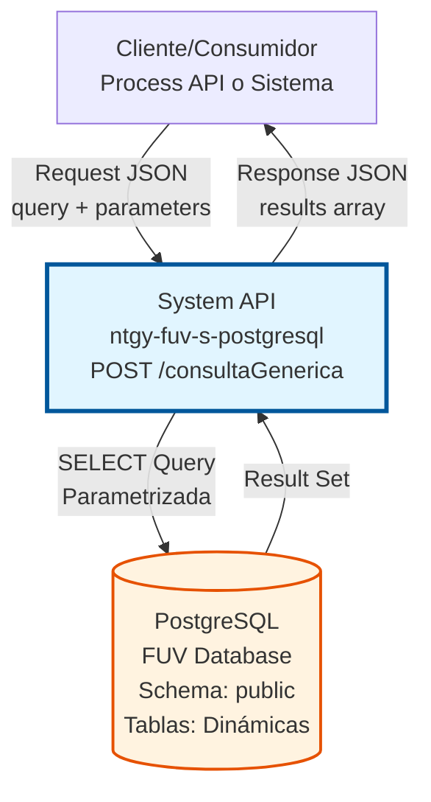
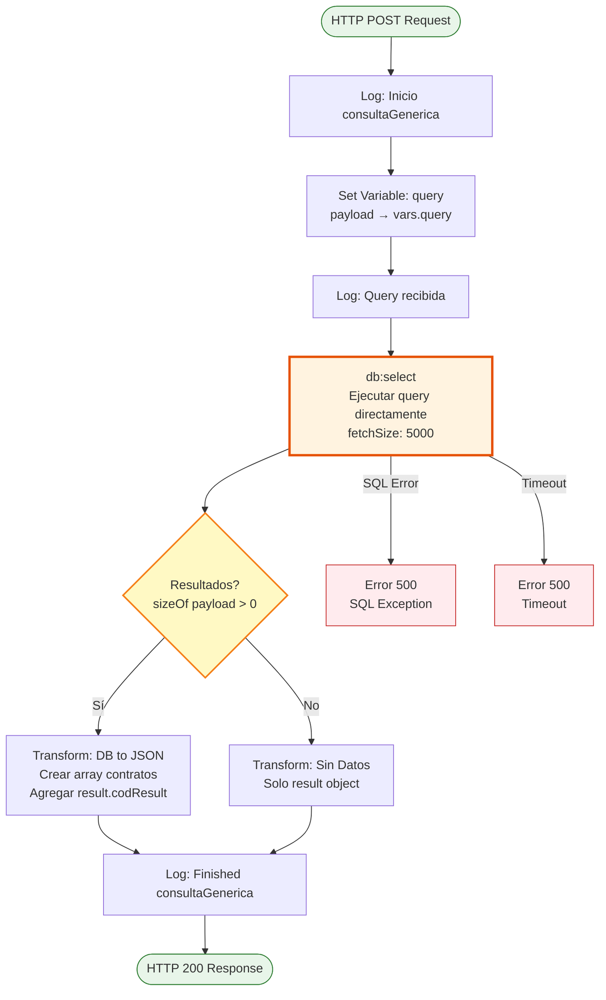
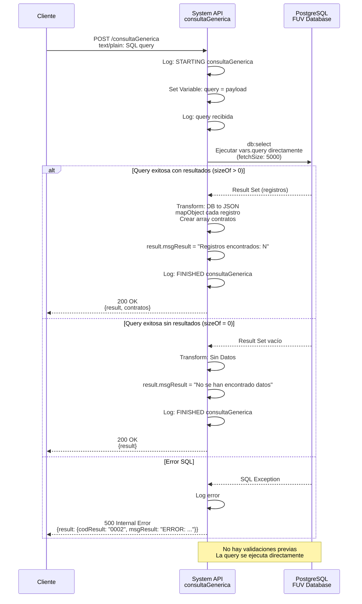
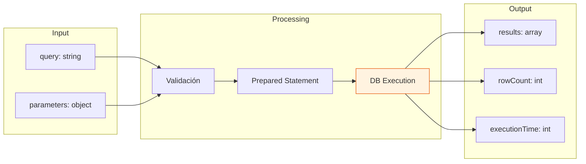

# POST /consultaGenerica

## 📌 Descripción General

### Propósito del Endpoint

El endpoint `POST /consultaGenerica` permite ejecutar consultas SQL genéricas de lectura (SELECT) en la base de datos PostgreSQL del sistema FUV (Facturación Única Virtual). Este endpoint proporciona flexibilidad para realizar consultas ad-hoc sin necesidad de crear endpoints específicos para cada caso de uso.

El endpoint soporta:
- **Consultas Parametrizadas**: Ejecución de queries SQL con parámetros dinámicos para prevenir SQL injection
- **Múltiples Tablas**: Capacidad de consultar cualquier tabla accesible en el schema público
- **Resultados Dinámicos**: Estructura de respuesta adaptable según los campos seleccionados en la query
- **Análisis Ad-Hoc**: Soporte para reportes y análisis de datos personalizados

### Tipo de API

**Capa:** System API (API-Led Connectivity)

**Función:** Integración directa con PostgreSQL para consultas genéricas de lectura en el sistema FUV.

### Patrón de Integración

**Tipo:** Request-Reply Síncrono con SQL Query Dinámica

**Descripción:** El endpoint recibe una query SQL y parámetros opcionales, valida que sea una operación de lectura, construye una query parametrizada segura, la ejecuta en PostgreSQL y retorna los resultados en formato JSON con estructura dinámica.

### Arquitectura API-Led Connectivity



---

## 💼 Propósito del Negocio

### Casos de Uso Principales

1. **Análisis y Reportes Ad-Hoc**
   - Equipos de análisis necesitan consultar datos sin esperar desarrollo de endpoints específicos
   - Permite exploración rápida de datos para toma de decisiones
   - Facilita generación de reportes personalizados

2. **Validación de Datos**
   - Verificación de integridad de datos entre sistemas
   - Validación de migraciones de datos
   - Auditoría de información almacenada

3. **Extracción de Datos para Integraciones**
   - Obtención de datos específicos para integraciones temporales
   - Soporte para procesos de ETL personalizados
   - Exportación de datos para análisis externos

4. **Troubleshooting y Soporte**
   - Equipos de soporte pueden consultar datos para resolver incidencias
   - Verificación de estados de procesos
   - Diagnóstico de problemas de datos

### Contexto Empresarial

- **Dominio:** Gestión de Datos - Facturación Única Virtual
- **Sector:** Energía - Utilities
- **División:** Naturgy España - FUV Platform
- **Proceso de Negocio:** Acceso flexible a datos para análisis, reportes y troubleshooting
- **Base de Datos:** PostgreSQL (FUV Database)

### Stakeholders

- **Analistas de Datos**: Necesitan consultar datos para análisis y reportes sin depender de desarrollo
- **Equipos de Soporte**: Requieren acceso a datos para resolver incidencias y verificar estados
- **Desarrolladores de Integraciones**: Necesitan extraer datos específicos para integraciones temporales
- **Equipos de QA**: Requieren validar datos durante pruebas y migraciones

### Valor de Negocio

- **Agilidad**: Reduce tiempo de respuesta para consultas de datos de días a minutos
- **Flexibilidad**: Permite análisis personalizados sin necesidad de desarrollo adicional
- **Eficiencia**: Elimina necesidad de crear endpoints específicos para cada consulta
- **Autonomía**: Empodera a equipos técnicos para obtener datos sin dependencias

### Consumidores Potenciales

Este endpoint puede ser consumido por:
- Process APIs que requieren consultas específicas no cubiertas por otros endpoints
- Herramientas de análisis y BI (Business Intelligence)
- Scripts de automatización y ETL
- Sistemas de monitoreo y auditoría
- Equipos de soporte técnico con acceso controlado

---

## 🔧 Especificación Técnica

### URLs por Ambiente

| Ambiente | URL Base | URL Completa |
|----------|----------|--------------|
| **Local** | `http://localhost:8081` | `http://localhost:8081/api/consultaGenerica` |
| **Development** | `https://ntgy-fuv-s-postgresql-dev.us-e2.cloudhub.io` | `https://ntgy-fuv-s-postgresql-dev.us-e2.cloudhub.io/api/consultaGenerica` |
| **UAT** | `https://ntgy-fuv-s-postgresql-uat.us-e2.cloudhub.io` | `https://ntgy-fuv-s-postgresql-uat.us-e2.cloudhub.io/api/consultaGenerica` |
| **UAT01** | `https://ntgy-fuv-s-postgresql-uat01.us-e2.cloudhub.io` | `https://ntgy-fuv-s-postgresql-uat01.us-e2.cloudhub.io/api/consultaGenerica` |
| **Production** | `https://ntgy-fuv-s-postgresql-pro.us-e2.cloudhub.io` | `https://ntgy-fuv-s-postgresql-pro.us-e2.cloudhub.io/api/consultaGenerica` |

### Método HTTP

```
POST /api/consultaGenerica
```

### Parámetros de Entrada

#### Headers HTTP

| Header | Tipo | Requerido | Descripción | Ejemplo |
|--------|------|-----------|-------------|---------|
| `Content-Type` | string | ✅ Sí | Tipo de contenido del request | `application/json` |
| `Accept` | string | ❌ No | Tipo de contenido esperado en response | `application/json` |
| `client_id` | string | ✅ Sí | Client ID de Anypoint Platform | `abc123...` |
| `client_secret` | string | ✅ Sí | Client Secret de Anypoint Platform | `xyz789...` |

#### Body Parameters

**Formato:** `text/plain`

El body del request debe contener la query SQL completa como texto plano.

**IMPORTANTE:** 
- No se soportan parámetros nombrados (`:param`)
- Los valores deben incluirse directamente en la query
- La query se ejecuta directamente sin validaciones previas

**Ejemplo de Request Body:**

```sql
SELECT id, name, email, created_at 
FROM customers 
WHERE status = 'active' 
ORDER BY created_at DESC 
LIMIT 100
```

### Respuestas

#### Respuesta Exitosa (200 OK)

```json
{
  "results": [
    {
      "id": 1,
      "name": "Cliente Ejemplo 1",
      "email": "cliente1@example.com",
      "created_at": "2026-01-15T10:30:00Z"
    },
    {
      "id": 2,
      "name": "Cliente Ejemplo 2",
      "email": "cliente2@example.com",
      "created_at": "2026-01-14T15:45:00Z"
    }
  ],
  "rowCount": 2,
  "executionTime": 45
}
```

**Campos de Respuesta:**

| Campo | Tipo | Descripción |
|-------|------|-------------|
| `result` | object | Información del resultado de la operación |
| `result.codResult` | string | Código de resultado ("0000" = éxito) |
| `result.msgResult` | string | Mensaje descriptivo con número de registros encontrados |
| `contratos` | array | Array de objetos con los resultados. Estructura dinámica según campos seleccionados. Solo presente cuando hay resultados |

#### Respuesta de Error de Validación (400 Bad Request)

```json
{
  "result": {
    "codResult": "0001",
    "msgResult": "Query inválida: solo se permiten operaciones SELECT"
  }
}
```

#### Respuesta de Error de SQL (400 Bad Request)

```json
{
  "result": {
    "codResult": "0002",
    "msgResult": "Error de sintaxis SQL: tabla 'invalid_table' no existe"
  }
}
```

#### Respuesta de Error Técnico (500 Internal Server Error)

```json
{
  "result": {
    "codResult": "0003",
    "msgResult": "Error interno del servidor al ejecutar query"
  }
}
```

### Validaciones

El endpoint NO implementa validaciones previas a la ejecución de la query:

1. **Ejecución Directa:**
   - La query SQL se ejecuta directamente tal como se recibe
   - No hay validación de tipo de operación (SELECT, INSERT, UPDATE, etc.)
   - No hay sanitización de la query
   - Los valores deben incluirse directamente en la query (no hay prepared statements)

2. **Validación de Recursos:**
   - Timeout de 30 segundos para ejecución de query
   - Fetch size: 5000 registros por batch
   - Límite de resultados debe especificarse en la query con LIMIT

3. **Seguridad:**
   - La seguridad se gestiona mediante políticas de API Manager y control de acceso
   - Es responsabilidad del cliente validar las queries antes de enviarlas

### Autenticación y Autorización

- **Tipo:** Client ID & Client Secret (Anypoint Platform)
- **Autorización PostgreSQL:** El usuario de base de datos debe tener permisos de:
  - SELECT en schema público
  - Acceso a tablas consultadas
  - Permisos de lectura en vistas (si aplica)

### Timeouts

| Tipo | Valor | Descripción |
|------|-------|-------------|
| **Query Timeout** | 30 segundos | Tiempo máximo de ejecución de la query SQL |
| **Connection Timeout** | 10 segundos | Tiempo máximo para establecer conexión con PostgreSQL |
| **Request Timeout** | 60 segundos | Tiempo máximo total del request HTTP |

---

## 🏗️ Implementación Técnica

### Arquitectura del Flow



### Componentes del Flow

#### 1. Recepción y Almacenamiento de Query

**Ubicación:** Flow principal `s-postgresql-consultaGenerica`

**Lógica:**
```xml
<set-variable value="#[payload]" variableName="query" />
<logger level="INFO" message="query: #[vars.query]" />
```

El payload (texto plano) se guarda directamente en la variable `query`.

#### 2. Ejecución de Query

**Componente:** Database Connector - Select Operation

**Configuración:**
```xml
<db:select config-ref="Database_Config" fetchSize="5000">
    <db:sql><![CDATA[#[vars.query]]]></db:sql>
</db:select>
```

**IMPORTANTE:** La query se ejecuta directamente sin prepared statements.

#### 3. Transformación de Resultados

**DataWeave Transformation (cuando hay resultados):**
```dataweave
%dw 2.0
output application/json
---
{
  result: {
    codResult: "0000",
    msgResult: "No hay error. Registros encontrados: " ++ (sizeOf(payload)) as String
  },
  contratos: payload map (record, index) -> 
    record mapObject using (key = $$, value = $) {
      ($$): $ default ""
    }
}
```

**DataWeave Transformation (sin resultados):**
```dataweave
%dw 2.0
output application/json
---
{
  result: {
    codResult: "0000",
    msgResult: "No se han encontrado datos"
  }
}
```

### Diagrama de Secuencia



### Transformación de Datos



### Configuración de Base de Datos

**Database Connector Config:**
```xml
<db:config name="Database_Config">
    <db:generic-connection 
        url="${dbFUV.url}" 
        driverClassName="org.postgresql.Driver"
        user="${dbFUV.user}"
        password="${secure::dbFUV.password}">
        <db:pooling-profile 
            maxPoolSize="20" 
            minPoolSize="5" 
            acquireIncrement="1" 
            maxWait="10000" 
            maxWaitUnit="SECONDS"/>
    </db:generic-connection>
</db:config>
```

**Propiedades por Ambiente:**
- `dbFUV.url`: URL de conexión PostgreSQL
- `dbFUV.user`: Usuario de base de datos
- `dbFUV.password`: Contraseña encriptada

### Manejo de Errores

El endpoint solo maneja errores generados por la base de datos durante la ejecución:

| Tipo de Error | Código | Mensaje | HTTP Status |
|---------------|--------|---------|-------------|
| Error SQL | 0002 | "ERROR: [detalle del error SQL]" | 500 |
| Tabla no existe | 0002 | "ERROR: relation \"[nombre]\" does not exist" | 500 |
| Sintaxis SQL | 0002 | "ERROR: syntax error at or near \"[token]\"" | 500 |
| Timeout query | 0003 | "Timeout al ejecutar query" | 500 |
| Error conexión DB | 0003 | "Error de conexión a base de datos" | 500 |

**Nota:** No hay validaciones previas, por lo que cualquier error de query se detecta durante la ejecución en PostgreSQL.

### Logging

**Puntos de Log:**
1. Inicio de ejecución con query recibida (sanitizada)
2. Resultado de validaciones
3. Query a ejecutar (con parámetros sanitizados)
4. Resultado de ejecución (rowCount, executionTime)
5. Errores con stack trace completo

**Nivel de Log:**
- INFO: Inicio, fin exitoso, métricas
- DEBUG: Detalles de query y parámetros
- ERROR: Excepciones y errores

---

## 💻 Ejemplos de Uso

### Ejemplo 1: Consulta Simple de Clientes

**Request:**
```bash
curl -X POST "https://ntgy-fuv-s-postgresql-dev.us-e2.cloudhub.io/api/consultaGenerica" \
  -H "Content-Type: text/plain" \
  -H "client_id: your-client-id" \
  -H "client_secret: your-client-secret" \
  -d "SELECT * FROM contract_control WHERE estado = 'ACTIVO' LIMIT 10"
```

**Response (200 OK):**
```json
{
  "result": {
    "codResult": "0000",
    "msgResult": "No hay error. Registros encontrados: 2"
  },
  "contratos": [
    {
      "id": 1,
      "id_pedido": "ORD-001",
      "estado": "ACTIVO",
      "fecha_creacion": "2026-01-15"
    },
    {
      "id": 2,
      "id_pedido": "ORD-002",
      "estado": "ACTIVO",
      "fecha_creacion": "2026-01-14"
    }
  ]
}
```

---

### Ejemplo 2: Consulta con Múltiples Tablas

**Request:**
```bash
curl -X POST "https://ntgy-fuv-s-postgresql-dev.us-e2.cloudhub.io/api/consultaGenerica" \
  -H "Content-Type: text/plain" \
  -H "client_id: your-client-id" \
  -H "client_secret: your-client-secret" \
  -d "SELECT cc.id_pedido, cc.estado, dc.document_name, dc.status 
      FROM contract_control cc 
      LEFT JOIN documentation_control dc ON cc.id_pedido = dc.order_id 
      WHERE cc.estado = 'PROCESADO' 
      LIMIT 5"
```

**Response (200 OK):**
```json
{
  "result": {
    "codResult": "0000",
    "msgResult": "No hay error. Registros encontrados: 3"
  },
  "contratos": [
    {
      "id_pedido": "ORD-001",
      "estado": "PROCESADO",
      "document_name": "contrato_001.pdf",
      "status": "ENVIADO"
    },
    {
      "id_pedido": "ORD-002",
      "estado": "PROCESADO",
      "document_name": "contrato_002.pdf",
      "status": "ENVIADO"
    },
    {
      "id_pedido": "ORD-003",
      "estado": "PROCESADO",
      "document_name": null,
      "status": null
    }
  ]
}
```

---

### Ejemplo 3: Consulta de Agregación

**Request:**
```bash
curl -X POST "https://ntgy-fuv-s-postgresql-dev.us-e2.cloudhub.io/api/consultaGenerica" \
  -H "Content-Type: text/plain" \
  -H "client_id: your-client-id" \
  -H "client_secret: your-client-secret" \
  -d "SELECT estado, COUNT(*) as total, 
      MIN(fecha_creacion) as primera_fecha, 
      MAX(fecha_creacion) as ultima_fecha 
      FROM contract_control 
      GROUP BY estado 
      ORDER BY total DESC"
```

**Response (200 OK):**
```json
{
  "result": {
    "codResult": "0000",
    "msgResult": "No hay error. Registros encontrados: 4"
  },
  "contratos": [
    {
      "estado": "PROCESADO",
      "total": 150,
      "primera_fecha": "2026-01-01",
      "ultima_fecha": "2026-01-15"
    },
    {
      "estado": "ACTIVO",
      "total": 45,
      "primera_fecha": "2026-01-10",
      "ultima_fecha": "2026-01-15"
    },
    {
      "estado": "PENDIENTE",
      "total": 23,
      "primera_fecha": "2026-01-12",
      "ultima_fecha": "2026-01-15"
    },
    {
      "estado": "ERROR",
      "total": 5,
      "primera_fecha": "2026-01-14",
      "ultima_fecha": "2026-01-15"
    }
  ]
}
```

---

### Ejemplo 4: Sin Resultados

**Request:**
```bash
curl -X POST "https://ntgy-fuv-s-postgresql-dev.us-e2.cloudhub.io/api/consultaGenerica" \
  -H "Content-Type: text/plain" \
  -H "client_id: your-client-id" \
  -H "client_secret: your-client-secret" \
  -d "SELECT * FROM contract_control WHERE estado = 'NO_EXISTE'"
```

**Response (200 OK):**
```json
{
  "result": {
    "codResult": "0000",
    "msgResult": "No se han encontrado datos"
  }
}
```

---

### Ejemplo 5: Error - Tabla No Existe

**Request:**
```bash
curl -X POST "https://ntgy-fuv-s-postgresql-dev.us-e2.cloudhub.io/api/consultaGenerica" \
  -H "Content-Type: text/plain" \
  -H "client_id: your-client-id" \
  -H "client_secret: your-client-secret" \
  -d "SELECT * FROM tabla_inexistente"
```

**Response (500 Internal Server Error):**
```json
{
  "result": {
    "codResult": "0002",
    "msgResult": "ERROR: relation \"tabla_inexistente\" does not exist"
  }
}
```
