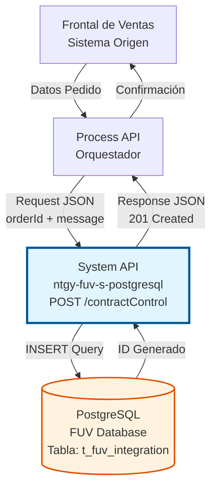
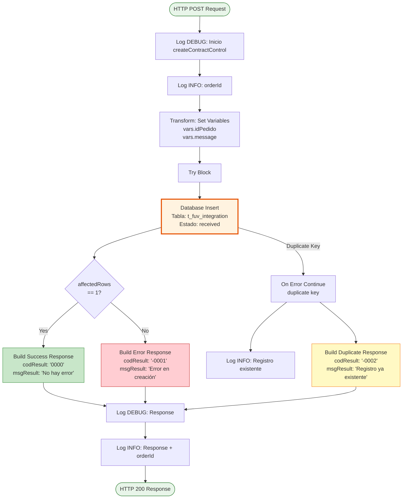
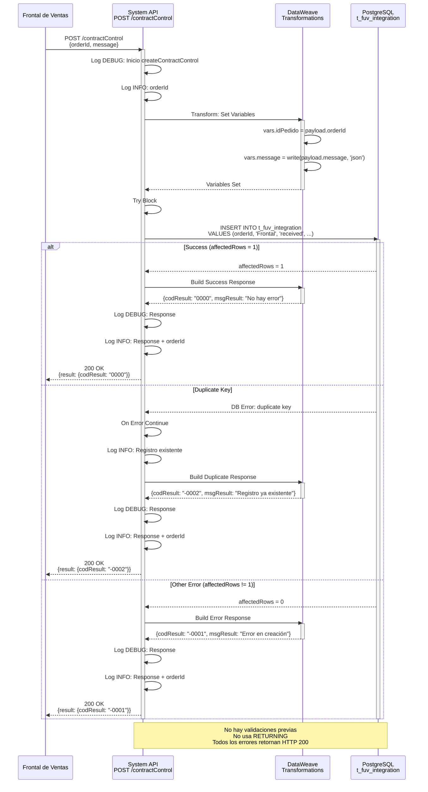

# POST /contractControl

## 📌 Descripción General

### Propósito del Endpoint

Crea un nuevo registro en la tabla de integración FUV (`t_fuv_integration`) en PostgreSQL, registrando pedidos provenientes del Frontal de Ventas en el momento en que se recibe la petición.

El endpoint soporta:
- **Registro Inicial**: Crea el punto de control para nuevos pedidos
- **Trazabilidad**: Almacena datos completos para seguimiento del ciclo de vida
- **Auditoría**: Mantiene registro histórico de todos los pedidos recibidos
- **Almacenamiento Flexible**: Guarda el mensaje completo en formato JSONB

### Tipo de API

**Capa:** System API (API-Led Connectivity)

**Función:** Integración directa con PostgreSQL para creación de registros de control de pedidos del sistema FUV (Facturación Única Virtual).

### Patrón de Integración

**Tipo:** Request-Reply Síncrono con SQL INSERT

**Descripción:** Recibe los datos del pedido (ID + mensaje completo), ejecuta una operación INSERT en PostgreSQL con estado inicial "received", y retorna confirmación de creación. No realiza validaciones previas; el control de duplicados lo gestiona PostgreSQL mediante constraint UNIQUE.

### Arquitectura API-Led Connectivity



---

## 💼 Propósito del Negocio

### Casos de Uso Principales

1. **Registro de Nuevos Pedidos**
   - Frontal de Ventas envía pedido recién creado
   - Se crea punto de control inicial con estado "received"
   - Permite inicio del flujo de procesamiento

2. **Trazabilidad desde el Origen**
   - Captura el momento exacto de recepción del pedido
   - Almacena datos completos para auditoría
   - Facilita seguimiento del ciclo de vida completo

3. **Integración Multi-Sistema**
   - Punto de entrada único para pedidos del Frontal
   - Facilita integración con sistemas downstream (Siebel, SAP)
   - Desacopla Frontal de Ventas de sistemas backend

### Contexto Empresarial

- **Dominio:** Gestión de Pedidos y Contratos
- **Sector:** Energía - Utilities
- **División:** Naturgy España - FUV (Facturación Única Virtual)
- **Proceso de Negocio:** Registro y control de pedidos del Frontal de Ventas
- **Sistema:** PostgreSQL Database

### Stakeholders

- **Frontal de Ventas**: Necesita registrar pedidos y obtener confirmación
- **Equipos de Desarrollo**: Requieren punto de control para orquestación
- **Operaciones**: Monitoreo de pedidos entrantes y trazabilidad
- **Auditoría**: Registro histórico completo de pedidos

### Valor de Negocio

- **Trazabilidad Completa**: Registro desde el momento de creación del pedido
- **Desacoplamiento**: Separa Frontal de Ventas de sistemas backend
- **Flexibilidad**: Almacenamiento JSONB permite estructura de datos variable
- **Auditoría**: Mantiene histórico completo para compliance
- **Escalabilidad**: Punto de entrada único facilita crecimiento

### Consumidores Potenciales

Este endpoint puede ser consumido por:
- Process APIs de gestión de pedidos
- Frontal de Ventas (directo o vía Process API)
- Sistemas de integración middleware
- Flujos de Salesforce Platform Events
- APIs de orquestación de pedidos

---

## 🔧 Especificación Técnica

### URLs por Ambiente

| Ambiente | URL Base | URL Completa |
|----------|----------|--------------|
| **Local** | `http://localhost:8081` | `http://localhost:8081/api/contractControl` |
| **Development** | `https://ntgy-fuv-s-postgresql-dev.us-e2.cloudhub.io` | `https://ntgy-fuv-s-postgresql-dev.us-e2.cloudhub.io/api/contractControl` |
| **UAT** | `https://ntgy-fuv-s-postgresql-uat.us-e2.cloudhub.io` | `https://ntgy-fuv-s-postgresql-uat.us-e2.cloudhub.io/api/contractControl` |
| **Production** | `https://ntgy-fuv-s-postgresql-pro.us-e2.cloudhub.io` | `https://ntgy-fuv-s-postgresql-pro.us-e2.cloudhub.io/api/contractControl` |

### Método HTTP

```
POST /api/contractControl
```

### Parámetros de Entrada

#### Headers HTTP

| Header | Tipo | Requerido | Descripción | Ejemplo |
|--------|------|-----------|-------------|---------|
| `Content-Type` | string | ✅ Sí | Tipo de contenido del request | `application/json` |
| `Accept` | string | ❌ No | Tipo de contenido esperado en response | `application/json` |
| `client_id` | string | ✅ Sí | Client ID de Anypoint Platform | `abc123...` |
| `client_secret` | string | ✅ Sí | Client Secret de Anypoint Platform | `xyz789...` |

#### Body Parameters

| Campo | Tipo | Requerido | Descripción | Ejemplo |
|-------|------|-----------|-------------|---------|
| `orderId` | string | ✅ Sí | Identificador único del pedido del Frontal de Ventas. Debe ser único en el sistema. | `"ORD-2024-001234"` |
| `message` | object | ✅ Sí | Objeto JSON con todos los datos del pedido. Incluye cliente, productos, punto de suministro y datos adicionales. | Ver ejemplo completo abajo |

**Estructura del campo `message`:**

```json
{
  "cliente": {
    "id": "string",
    "nombre": "string",
    "documento": "string",
    "email": "string",
    "telefono": "string"
  },
  "productos": [
    {
      "id": "string",
      "tipo": "string",
      "tarifa": "string",
      "potencia": "number"
    }
  ],
  "puntoSuministro": "string",
  "fechaPedido": "datetime",
  "origen": "string",
  "datosAdicionales": {}
}
```

### Respuestas

#### Respuesta Exitosa (201 Created)

```json
{
  "result": {
    "codResult": "0000",
    "msgResult": "Registro creado exitosamente"
  },
  "data": {
    "id": 12345,
    "id_pedido": "ORD-2024-001234",
    "estado": "PENDIENTE",
    "fecha_creacion": "2024-06-15T08:30:00Z"
  }
}
```

#### Respuesta de Error - Pedido Duplicado (200 OK)

```json
{
  "result": {
    "codResult": "-0002",
    "msgResult": "Registro ya existente"
  }
}
```

**Nota:** El endpoint maneja el error de duplicate key y retorna HTTP 200 con codResult "-0002".

#### Respuesta de Error Técnico (200 OK)

```json
{
  "result": {
    "codResult": "-0001",
    "msgResult": "Ha habido un error en la creación del registro"
  }
}
```

**Nota:** Errores de base de datos retornan HTTP 200 con codResult "-0001".

### Autenticación y Autorización

- **Tipo:** Client ID & Client Secret (Anypoint Platform)
- **Autorización PostgreSQL:** El usuario de conexión debe tener permisos para:
  - Ejecutar operaciones INSERT en la tabla `t_fuv_integration`
  - Acceso al schema `public` de la base de datos FUV
  - Permisos para usar secuencias (SERIAL para ID autoincremental)

### Timeouts

| Tipo | Valor | Descripción |
|------|-------|-------------|
| **Request Timeout** | 30 segundos | Tiempo máximo de espera para la respuesta |
| **Connection Timeout** | 10 segundos | Tiempo máximo para establecer conexión con PostgreSQL |
| **Query Timeout** | 30 segundos | Tiempo máximo de ejecución de la query INSERT |

---

## 🏗️ Implementación Técnica

### Arquitectura del Flow



### Query SQL Ejecutada

**Ubicación:** `src/main/resources/s-postgresql-global-config.yaml`

**Nombre de Query:** `createContractControl`

```sql
INSERT into t_fuv_integration (
    contract_id, 
    system_message, 
    code, 
    message, 
    state, 
    response, 
    error, 
    contract_atr, 
    update_user, 
    update_program, 
    attempts_number
) values (
    :orderId,           -- ID del pedido del Frontal
    :systemMessage,     -- Origen: 'Frontal' (constante)
    :code,              -- Código: 'received' (constante)
    :message,           -- Mensaje completo en JSON string
    :state,             -- Estado: 'received' (constante)
    :response,          -- null (inicial)
    :error,             -- null (inicial)
    :contractATR,       -- 0 (constante)
    'mulesoft',         -- Usuario: 'mulesoft' (constante)
    'mulesoft',         -- Programa: 'mulesoft' (constante)
    0                   -- Intentos: 0 (inicial)
)
```

**Parámetros de la Query:**
- `:orderId` → `vars.idPedido` (string del payload.orderId)
- `:systemMessage` → `'Frontal'` (constante hardcoded)
- `:code` → `'received'` (constante)
- `:message` → `vars.message` (JSON string del payload.message)
- `:state` → `'received'` (constante)
- `:response` → `null`
- `:error` → `null`
- `:contractATR` → `0` (constante)

**Nota:** La query NO usa `RETURNING`, por lo que no retorna el ID generado.

### Estructura de la Tabla `t_fuv_integration`

| Campo | Tipo | Constraints | Descripción |
|-------|------|-------------|-------------|
| `t_fuv_integration_id` | SERIAL | PRIMARY KEY | ID autoincremental del registro |
| `contract_id` | VARCHAR | UNIQUE NOT NULL | Identificador único del pedido (orderId) |
| `system_message` | VARCHAR | | Origen del pedido ('Frontal') |
| `code` | VARCHAR | | Código de estado ('received') |
| `message` | JSONB | | Mensaje completo del pedido en formato JSON |
| `state` | VARCHAR | | Estado del registro ('received') |
| `response` | TEXT | | Respuesta del procesamiento |
| `error` | TEXT | | Errores si los hay |
| `contract_atr` | INTEGER | | Atributo de contrato (0 inicial) |
| `create_date` | TIMESTAMP | | Fecha de creación (auto-generada por DB) |
| `update_date` | TIMESTAMP | | Fecha de actualización (auto-generada por DB) |
| `update_user` | VARCHAR | | Usuario que actualiza ('mulesoft') |
| `update_program` | VARCHAR | | Programa que actualiza ('mulesoft') |
| `optimist_lock` | INTEGER | | Control de concurrencia |
| `viewable` | INTEGER | | Visibilidad del registro |
| `attempts_number` | INTEGER | | Número de intentos (inicial: 0) |
| `id_cliente` | VARCHAR | | ID del cliente (se actualiza después) |
| `id_ps` | VARCHAR | | ID del Punto de Suministro (se actualiza después) |

**Índices:**
- PRIMARY KEY en `t_fuv_integration_id`
- UNIQUE CONSTRAINT en `contract_id`

### Diagrama de Secuencia



### Transformación de Datos

#### Input (JSON Request → SQL Parameters)

```dataweave
%dw 2.0
output application/java
---
{
    orderId: payload.orderId,
    messageJson: write(payload.message, "application/json")
}
```

#### Output (Database Result → JSON Response)

```dataweave
%dw 2.0
output application/json
---
{
    result: {
        codResult: "0000",
        msgResult: "Registro creado exitosamente"
    },
    data: {
        id: payload[0].id,
        id_pedido: payload[0].id_pedido,
        estado: payload[0].estado,
        fecha_creacion: payload[0].fecha_creacion as String {format: "yyyy-MM-dd'T'HH:mm:ss'Z'"}
    }
}
```

### Manejo de Errores

| Tipo de Error | Código | Mensaje | HTTP Status |
|---------------|--------|---------|-------------|
| Campo faltante | 0001 | El campo 'orderId' es requerido | 400 |
| Pedido duplicado | 0002 | Ya existe un pedido con orderId: XXX | 409 |
| Error de BD | 0003 | Error al insertar registro en base de datos | 500 |
| Timeout | 0004 | Timeout en operación de inserción | 408 |
| JSON inválido | 0005 | El campo 'message' debe ser un objeto JSON válido | 400 |

### Validaciones Implementadas

1. **Validación de Campos Obligatorios:**
   - `orderId` no puede ser null o vacío
   - `message` no puede ser null
   - `message` debe ser un objeto JSON válido

2. **Validación de Unicidad:**
   - Verificación de que `orderId` no exista previamente
   - Constraint UNIQUE en base de datos como respaldo

3. **Validación de Formato:**
   - `orderId` debe tener entre 1 y 100 caracteres
   - `message` debe ser un objeto JSON bien formado

4. **Validación de Integridad:**
   - Transacción atómica para garantizar consistencia
   - Rollback automático en caso de error

### Configuración de Conexión PostgreSQL

```xml
<db:config name="Database_Config">
    <db:generic-connection 
        driverClassName="org.postgresql.Driver"
        url="${dbFUV.url}"
        user="${dbFUV.user}"
        password="${secure::dbFUV.password}">
        <db:pooling-profile 
            maxPoolSize="20"
            minPoolSize="5"
            acquireIncrement="1"
            maxWait="10000"
            maxWaitUnit="SECONDS"/>
    </db:generic-connection>
</db:config>
```

### Logging

```
[INFO] Inicio createContractControl - orderId: ORD-2024-001234
[DEBUG] Validando campos obligatorios
[DEBUG] Verificando unicidad de orderId
[DEBUG] Query SQL: INSERT INTO contract_control (...)
[DEBUG] Parámetros: {orderId: "ORD-2024-001234", messageJson: "{...}"}
[INFO] Registro creado - ID: 12345
[INFO] Fin createContractControl - Tiempo: 78ms
```

---

## 💻 Ejemplos de Uso

### Ejemplo 1: Creación Exitosa con curl

```bash
curl -X POST \
  'https://ntgy-fuv-s-postgresql-dev.us-e2.cloudhub.io/api/contractControl' \
  -H 'Content-Type: application/json' \
  -H 'Accept: application/json' \
  -H 'client_id: your-client-id' \
  -H 'client_secret: your-client-secret' \
  -d '{
    "orderId": "ORD-2024-001234",
    "message": {
      "cliente": {
        "id": "CLI-789",
        "nombre": "Juan Pérez",
        "documento": "12345678A",
        "email": "juan.perez@example.com",
        "telefono": "+34600123456"
      },
      "productos": [
        {
          "id": "PROD-001",
          "tipo": "Electricidad",
          "tarifa": "2.0TD",
          "potencia": 4.6
        }
      ],
      "puntoSuministro": "ES0021000000000001AA",
      "fechaPedido": "2024-06-15T08:30:00Z",
      "origen": "WEB",
      "datosAdicionales": {
        "campania": "VERANO2024",
        "agente": "AGT-001"
      }
    }
  }'
```

**Response (201 Created):**
```json
{
  "result": {
    "codResult": "0000",
    "msgResult": "Registro creado exitosamente"
  },
  "data": {
    "id": 12345,
    "id_pedido": "ORD-2024-001234",
    "estado": "PENDIENTE",
    "fecha_creacion": "2024-06-15T08:30:00Z"
  }
}
```

### Ejemplo 2: Error de Validación - Campo Faltante

```bash
curl -X POST \
  'https://ntgy-fuv-s-postgresql-dev.us-e2.cloudhub.io/api/contractControl' \
  -H 'Content-Type: application/json' \
  -H 'client_id: your-client-id' \
  -H 'client_secret: your-client-secret' \
  -d '{
    "message": {
      "cliente": {
        "id": "CLI-789"
      }
    }
  }'
```

**Response (400 Bad Request):**
```json
{
  "result": {
    "codResult": "0001",
    "msgResult": "El campo 'orderId' es requerido"
  }
}
```

### Ejemplo 3: Error de Conflicto - Pedido Duplicado

```bash
curl -X POST \
  'https://ntgy-fuv-s-postgresql-dev.us-e2.cloudhub.io/api/contractControl' \
  -H 'Content-Type: application/json' \
  -H 'client_id: your-client-id' \
  -H 'client_secret: your-client-secret' \
  -d '{
    "orderId": "ORD-2024-001234",
    "message": {
      "cliente": {
        "id": "CLI-789"
      }
    }
  }'
```

**Response (409 Conflict):**
```json
{
  "result": {
    "codResult": "0002",
    "msgResult": "Ya existe un pedido con orderId: ORD-2024-001234"
  }
}
```

### Ejemplo 4: Uso desde JavaScript/Node.js

```javascript
const axios = require('axios');

async function createContractControl(orderId, message) {
  try {
    const response = await axios.post(
      'https://ntgy-fuv-s-postgresql-dev.us-e2.cloudhub.io/api/contractControl',
      {
        orderId: orderId,
        message: message
      },
      {
        headers: {
          'Content-Type': 'application/json',
          'Accept': 'application/json',
          'client_id': process.env.CLIENT_ID,
          'client_secret': process.env.CLIENT_SECRET
        }
      }
    );
    
    if (response.status === 201 && response.data.result.codResult === '0000') {
      console.log('Pedido creado exitosamente:', response.data.data);
      return response.data.data;
    } else {
      console.log('Error al crear pedido:', response.data.result.msgResult);
      return null;
    }
  } catch (error) {
    if (error.response && error.response.status === 409) {
      console.error('Pedido duplicado:', error.response.data.result.msgResult);
    } else {
      console.error('Error al crear pedido:', error.message);
    }
    throw error;
  }
}

// Uso
const pedidoData = {
  cliente: {
    id: "CLI-789",
    nombre: "Juan Pérez",
    documento: "12345678A"
  },
  productos: [
    {
      id: "PROD-001",
      tipo: "Electricidad",
      tarifa: "2.0TD"
    }
  ],
  puntoSuministro: "ES0021000000000001AA",
  fechaPedido: new Date().toISOString(),
  origen: "WEB"
};

createContractControl('ORD-2024-001234', pedidoData)
  .then(result => {
    if (result) {
      console.log(`Pedido registrado con ID: ${result.id}`);
    }
  })
  .catch(err => console.error('Error:', err));
```

### Ejemplo 5: Uso desde Python

```python
import requests
import json
import os
from datetime import datetime

def create_contract_control(order_id, message):
    url = "https://ntgy-fuv-s-postgresql-dev.us-e2.cloudhub.io/api/contractControl"
    
    headers = {
        "Content-Type": "application/json",
        "Accept": "application/json",
        "client_id": os.getenv("CLIENT_ID"),
        "client_secret": os.getenv("CLIENT_SECRET")
    }
    
    payload = {
        "orderId": order_id,
        "message": message
    }
    
    try:
        response = requests.post(url, headers=headers, json=payload)
        response.raise_for_status()
        
        data = response.json()
        
        if response.status_code == 201 and data["result"]["codResult"] == "0000":
            print(f"Pedido creado exitosamente: {data['data']}")
            return data["data"]
        else:
            print(f"Error al crear pedido: {data['result']['msgResult']}")
            return None
            
    except requests.exceptions.HTTPError as e:
        if e.response.status_code == 409:
            print(f"Pedido duplicado: {e.response.json()['result']['msgResult']}")
        else:
            print(f"Error HTTP: {e}")
        raise
    except requests.exceptions.RequestException as e:
        print(f"Error al crear pedido: {e}")
        raise

# Uso
pedido_data = {
    "cliente": {
        "id": "CLI-789",
        "nombre": "Juan Pérez",
        "documento": "12345678A"
    },
    "productos": [
        {
            "id": "PROD-001",
            "tipo": "Electricidad",
            "tarifa": "2.0TD"
        }
    ],
    "puntoSuministro": "ES0021000000000001AA",
    "fechaPedido": datetime.now().isoformat() + "Z",
    "origen": "WEB"
}

result = create_contract_control("ORD-2024-001234", pedido_data)
if result:
    print(f"ID del registro: {result['id']}")
    print(f"Estado inicial: {result['estado']}")
```

### Ejemplo 6: Integración en Process API (DataWeave)

```dataweave
%dw 2.0
output application/json
---
{
    // Preparar datos para System API
    systemApiRequest: {
        orderId: payload.salesforceOrderId,
        message: {
            cliente: {
                id: payload.cliente.id,
                nombre: payload.cliente.nombre,
                documento: payload.cliente.documento,
                email: payload.cliente.email,
                telefono: payload.cliente.telefono
            },
            productos: payload.productos map (producto) -> {
                id: producto.id,
                tipo: producto.tipo,
                tarifa: producto.tarifa,
                potencia: producto.potencia
            },
            puntoSuministro: payload.puntoSuministro,
            fechaPedido: now() as String {format: "yyyy-MM-dd'T'HH:mm:ss'Z'"},
            origen: payload.canal default "WEB",
            datosAdicionales: payload.metadata
        }
    },
    
    // Llamar al System API
    contractControlResult: do {
        var systemApiResponse = Mule::lookup(
            "create-contract-control-flow",
            {
                body: $.systemApiRequest
            }
        )
        ---
        if (systemApiResponse.result.codResult == "0000")
            {
                success: true,
                registroId: systemApiResponse.data.id,
                pedidoId: systemApiResponse.data.id_pedido,
                estado: systemApiResponse.data.estado
            }
        else
            {
                success: false,
                error: systemApiResponse.result.msgResult
            }
    }
}
```

### Ejemplo 7: Batch Creation (Múltiples Pedidos)

```javascript
const axios = require('axios');

async function createMultipleOrders(orders) {
  const results = {
    successful: [],
    failed: [],
    duplicates: []
  };
  
  for (const order of orders) {
    try {
      const response = await axios.post(
        'https://ntgy-fuv-s-postgresql-dev.us-e2.cloudhub.io/api/contractControl',
        {
          orderId: order.id,
          message: order.data
        },
        {
          headers: {
            'Content-Type': 'application/json',
            'client_id': process.env.CLIENT_ID,
            'client_secret': process.env.CLIENT_SECRET
          }
        }
      );
      
      if (response.status === 201) {
        results.successful.push({
          orderId: order.id,
          registroId: response.data.data.id
        });
      }
    } catch (error) {
      if (error.response && error.response.status === 409) {
        results.duplicates.push(order.id);
      } else {
        results.failed.push({
          orderId: order.id,
          error: error.message
        });
      }
    }
  }
  
  return results;
}

// Uso
const orders = [
  { id: 'ORD-001', data: { cliente: {...}, productos: [...] } },
  { id: 'ORD-002', data: { cliente: {...}, productos: [...] } },
  { id: 'ORD-003', data: { cliente: {...}, productos: [...] } }
];

createMultipleOrders(orders).then(results => {
  console.log(`Exitosos: ${results.successful.length}`);
  console.log(`Fallidos: ${results.failed.length}`);
  console.log(`Duplicados: ${results.duplicates.length}`);
});
```
