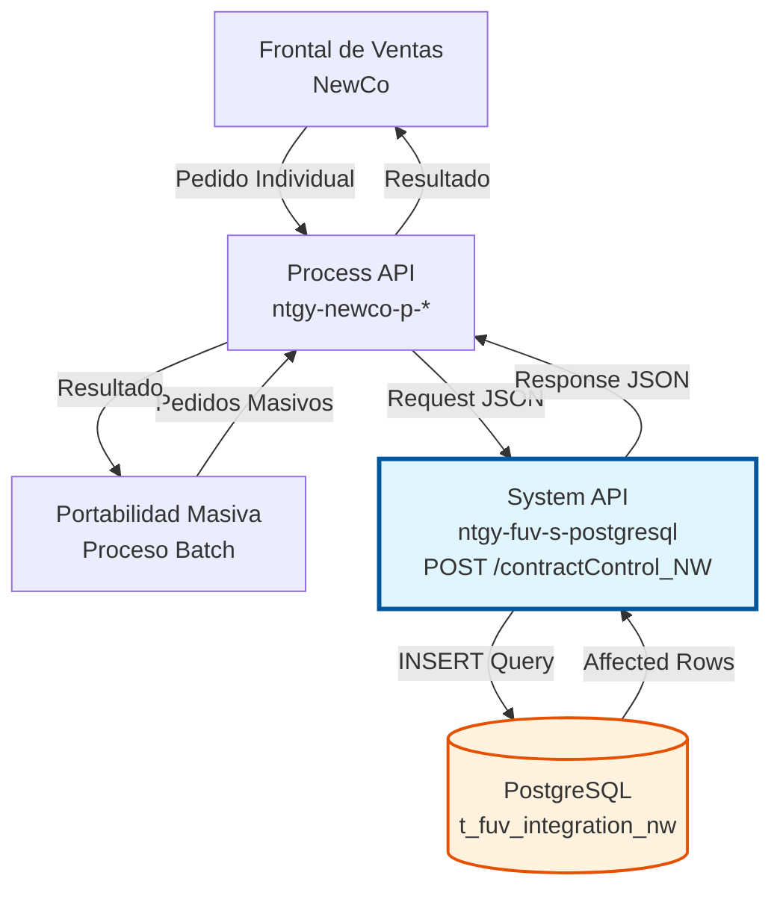
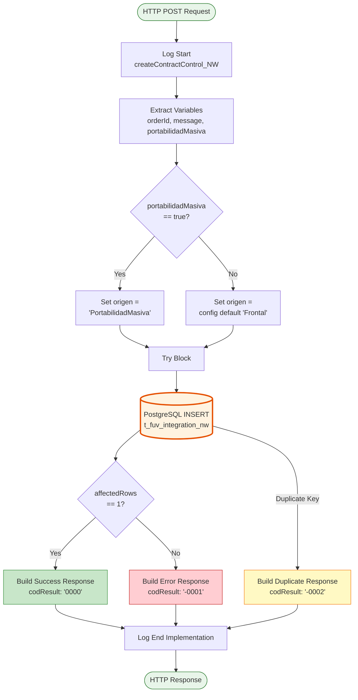
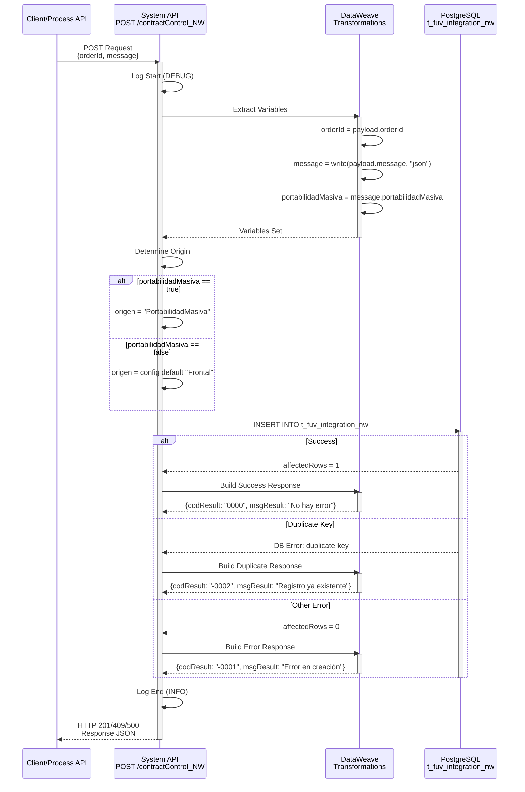

# POST /contractControl_NW

## 📌 Descripción General

### Propósito del Endpoint

Este endpoint crea un registro de control de pedidos NewCo en la tabla `t_fuv_integration_nw` de PostgreSQL, permitiendo la trazabilidad completa del ciclo de vida de pedidos provenientes del Frontal de Ventas o del proceso de Portabilidad Masiva.

El endpoint soporta:
- **Registro de Pedidos Frontal**: Pedidos estándar del Frontal de Ventas NewCo
- **Portabilidad Masiva**: Pedidos masivos de portabilidad con lógica especial
- **Trazabilidad Completa**: Almacenamiento del mensaje completo en formato JSONB
- **Control de Duplicados**: Manejo automático de pedidos duplicados
- **Timestamps con Zona Horaria**: Registro de fechas con zona horaria Europe/Madrid

### Tipo de API

**Capa:** System API (API-Led Connectivity)

**Función:** Integración directa con PostgreSQL para persistencia de datos de control de pedidos NewCo del sistema FUV (Facturación Única Virtual).

### Patrón de Integración

**Tipo:** Request-Reply Síncrono con PostgreSQL INSERT

**Descripción:** Recibe datos del pedido desde sistemas upstream (Frontal de Ventas, Portabilidad Masiva), determina el origen basándose en el flag `portabilidadMasiva`, transforma los datos al formato de base de datos, ejecuta INSERT en la tabla `t_fuv_integration_nw`, maneja errores de duplicados, y retorna resultado de la operación con códigos específicos.

### Arquitectura API-Led Connectivity



---

## 💼 Propósito del Negocio

### Casos de Uso Principales

1. **Registro de Pedidos del Frontal de Ventas**
   - Cliente realiza pedido en portal web o aplicación móvil
   - Sistema registra pedido en tabla de control para trazabilidad
   - Permite seguimiento del estado del pedido en tiempo real
   - **Beneficio**: Visibilidad completa del ciclo de vida del pedido

2. **Procesamiento de Portabilidad Masiva**
   - Proceso batch de portabilidad genera múltiples pedidos
   - Sistema identifica automáticamente origen como "PortabilidadMasiva"
   - Permite diferenciar pedidos masivos de pedidos individuales
   - **Beneficio**: Gestión diferenciada de pedidos masivos vs individuales

3. **Auditoría y Trazabilidad**
   - Almacenamiento completo del mensaje original en formato JSONB
   - Registro de timestamps con zona horaria específica (Europe/Madrid)
   - Control de duplicados para evitar procesamiento múltiple
   - **Beneficio**: Cumplimiento normativo y capacidad de auditoría completa

### Contexto Empresarial

- **Dominio:** Gestión de Pedidos y Contratos
- **Sector:** Energía - Utilities
- **División:** Naturgy España - NewCo
- **Proceso de Negocio:** Registro y control de pedidos del Frontal de Ventas y Portabilidad Masiva
- **Sistema:** FUV (Facturación Única Virtual)

### Stakeholders

- **Equipo de Ventas**: Necesita visibilidad del estado de pedidos de clientes
- **Operaciones**: Requiere trazabilidad para resolución de incidencias
- **Equipo de Portabilidad**: Gestiona procesos masivos de cambio de comercializadora
- **Auditoría y Compliance**: Necesita registro completo para cumplimiento normativo

### Valor de Negocio

- **Trazabilidad Completa**: Registro detallado de cada pedido desde su origen
- **Diferenciación de Origen**: Identificación automática de pedidos masivos vs individuales
- **Prevención de Duplicados**: Control automático de pedidos ya registrados
- **Auditoría**: Almacenamiento del mensaje completo para análisis posterior
- **Performance**: Timestamps con zona horaria correcta para reportes precisos

### Consumidores Potenciales

Este endpoint puede ser consumido por:
- Process APIs de gestión de pedidos NewCo
- Flujos de Salesforce (Platform Events, Flows)
- Procesos batch de Portabilidad Masiva
- Sistemas de integración middleware
- APIs de orquestación de pedidos

---

## 🔧 Especificación Técnica

### URLs por Ambiente

| Ambiente | URL Base | URL Completa |
|----------|----------|--------------|
| **Local** | `http://localhost:8081` | `http://localhost:8081/api/contractControl_NW` |
| **Development** | `https://ntgy-fuv-s-postgresql-dev.us-e2.cloudhub.io` | `https://ntgy-fuv-s-postgresql-dev.us-e2.cloudhub.io/api/contractControl_NW` |
| **UAT** | `https://ntgy-fuv-s-postgresql-uat.us-e2.cloudhub.io` | `https://ntgy-fuv-s-postgresql-uat.us-e2.cloudhub.io/api/contractControl_NW` |
| **UAT01** | `https://ntgy-fuv-s-postgresql-uat01.us-e2.cloudhub.io` | `https://ntgy-fuv-s-postgresql-uat01.us-e2.cloudhub.io/api/contractControl_NW` |
| **Production** | `https://ntgy-fuv-s-postgresql-pro.us-e2.cloudhub.io` | `https://ntgy-fuv-s-postgresql-pro.us-e2.cloudhub.io/api/contractControl_NW` |

### Método HTTP

```
POST /api/contractControl_NW
```

### Parámetros de Entrada

#### Headers HTTP

| Header | Tipo | Requerido | Descripción | Ejemplo |
|--------|------|-----------|-------------|---------|
| `Content-Type` | string | ✅ Sí | Tipo de contenido del request | `application/json` |
| `Accept` | string | ❌ No | Tipo de contenido esperado en response | `application/json` |

#### Body Parameters

| Campo | Tipo | Requerido | Descripción | Ejemplo |
|-------|------|-----------|-------------|---------|
| `orderId` | string | ✅ Sí | Identificador único del pedido NewCo | `"NW-2024-001234"` |
| `message` | object | ✅ Sí | Objeto JSON con datos completos del pedido | Ver ejemplo abajo |
| `message.portabilidadMasiva` | boolean | ❌ No | Flag que indica si es portabilidad masiva | `false` |

**Estructura del message:**
```json
{
  "cliente": {
    "id": "string",
    "nombre": "string",
    "documento": "string"
  },
  "productos": [
    {
      "id": "string",
      "tipo": "string",
      "tarifa": "string"
    }
  ],
  "puntoSuministro": "string",
  "fechaPedido": "string (ISO-8601)",
  "portabilidadMasiva": "boolean",
  "origen": "string"
}
```

### Respuestas

#### Respuesta Exitosa (201 Created)

```json
{
  "result": {
    "codResult": "0000",
    "msgResult": "No hay error"
  }
}
```

**Códigos de Resultado:**
- `"0000"`: Creación exitosa (affectedRows = 1)
- `"-0001"`: Error en la creación (affectedRows = 0 o error de DB)
- `"-0002"`: Registro ya existente (duplicate key constraint)

#### Respuesta de Duplicado (409 Conflict)

```json
{
  "result": {
    "codResult": "-0002",
    "msgResult": "Registro ya existente"
  }
}
```

#### Respuesta de Error de Validación (400 Bad Request)

```json
{
  "error": {
    "code": "VALIDATION_ERROR",
    "message": "Campo obligatorio faltante: orderId",
    "timestamp": "2024-06-15T10:30:00Z"
  }
}
```

#### Respuesta de Error Técnico (500 Internal Server Error)

```json
{
  "result": {
    "codResult": "-0001",
    "msgResult": "Ha habido un error en la creación del registro"
  }
}
```

### Autenticación y Autorización

- **Tipo:** Client ID & Client Secret (Anypoint Platform)
- **Autorización PostgreSQL:** El usuario de conexión debe tener permisos para:
  - Ejecutar INSERT en tabla `t_fuv_integration_nw`
  - Acceso al schema `public`
  - Permisos de escritura en la base de datos FUV

### Timeouts

| Tipo | Valor | Descripción |
|------|-------|-------------|
| **Request Timeout** | 30 segundos | Tiempo máximo de espera para la respuesta |
| **Connection Timeout** | 10 segundos | Tiempo máximo para establecer conexión con PostgreSQL |
| **Query Timeout** | 30 segundos | Tiempo máximo de ejecución del INSERT |

---

## 🏗️ Implementación Técnica

### Arquitectura del Flow



### Diagrama de Secuencia



### Query SQL

**Ubicación:** `src/main/resources/s-postgresql-global-config.yaml`

**Nombre de Query:** `createContractControl_NW`

```sql
INSERT INTO t_fuv_integration_nw (
  contract_id, 
  system_message, 
  code, 
  message, 
  state, 
  response, 
  error, 
  contract_atr, 
  create_date, 
  update_date, 
  update_user, 
  update_program, 
  attempts_number
) VALUES (
  :orderId, 
  :systemMessage, 
  :code, 
  :message, 
  :state, 
  :response, 
  :error, 
  :contractATR, 
  timezone('Europe/Madrid'::text, CURRENT_TIMESTAMP), 
  timezone('Europe/Madrid'::text, CURRENT_TIMESTAMP), 
  'mulesoft', 
  'mulesoft', 
  0
)
```

**Parámetros de la Query:**
- `:orderId` → `vars.idPedido` (string)
- `:systemMessage` → `vars.origen` (string: "PortabilidadMasiva" o "Frontal")
- `:code` → `'received'` (constante)
- `:message` → `vars.message` (string JSON)
- `:state` → `'received'` (constante)
- `:response` → `null`
- `:error` → `null`
- `:contractATR` → `0` (constante)

### Transformaciones DataWeave

#### Transformación 1: Extracción de Variables

**Ubicación:** Inline en XML (líneas 18-34)

```dataweave
%dw 2.0
output application/java
---
{
  idPedido: payload.orderId,
  message: write(payload.message, "application/json"),
  portabilidadMasiva: payload.message.portabilidadMasiva == true
}
```

#### Transformación 2: Determinación de Origen

**Ubicación:** Inline en XML (líneas 36-46)

```dataweave
%dw 2.0
output application/java

var l_origen = p('origen') default 'Frontal'
---
if(vars.portabilidadMasiva) 'PortabilidadMasiva' else l_origen
```

#### Transformación 3: Response Exitoso

**Ubicación:** Inline en XML (líneas 62-73)

```dataweave
%dw 2.0
output application/json
---
{
  "result": {
    "codResult": if (payload.affectedRows == 1) "0000" else "-0001",
    "msgResult": if (payload.affectedRows == 1) "No hay error" else "Ha habido un error en la creación del registro"
  }
}
```

#### Transformación 4: Response Duplicado

**Ubicación:** Inline en XML (líneas 78-90)

```dataweave
%dw 2.0
output application/json
---
{
  "result": {
    "codResult": "-0002",
    "msgResult": "Registro ya existente"
  }
}
```

### Manejo de Errores

**Error Handler:** Try-Catch con On-Error-Continue

```xml
<on-error-continue 
  type="DB:QUERY_EXECUTION" 
  when='error.description contains("duplicate key")'>
  <!-- Manejo específico de duplicados -->
</on-error-continue>
```

**Tipos de Errores Manejados:**
1. **DB:QUERY_EXECUTION con "duplicate key"**: Retorna codResult "-0002"
2. **affectedRows = 0**: Retorna codResult "-0001"
3. **Otros errores de DB**: Propagados como error 500

### Tabla de Base de Datos

**Nombre:** `t_fuv_integration_nw`

**Schema:** `public`

**Campos:**

| Campo | Tipo | Constraint | Descripción |
|-------|------|------------|-------------|
| `t_fuv_integration_nw_id` | SERIAL | PRIMARY KEY | ID auto-incremental del registro |
| `contract_id` | VARCHAR | UNIQUE NOT NULL | ID del pedido (orderId) |
| `system_message` | VARCHAR | | Origen del pedido (PortabilidadMasiva/Frontal) |
| `code` | VARCHAR | | Código de estado (received) |
| `message` | JSONB | | Mensaje completo del pedido |
| `state` | VARCHAR | | Estado del registro (received) |
| `response` | TEXT | | Respuesta del procesamiento |
| `error` | TEXT | | Errores si los hay |
| `contract_atr` | INTEGER | | Atributo de contrato |
| `create_date` | TIMESTAMP | | Fecha de creación (Europe/Madrid) |
| `update_date` | TIMESTAMP | | Fecha de actualización (Europe/Madrid) |
| `update_user` | VARCHAR | | Usuario que actualiza (mulesoft) |
| `update_program` | VARCHAR | | Programa que actualiza (mulesoft) |
| `optimist_lock` | INTEGER | | Control de concurrencia |
| `viewable` | INTEGER | | Visibilidad del registro |
| `attempts_number` | INTEGER | | Número de intentos (inicial: 0) |

**Índices:**
- PRIMARY KEY en `t_fuv_integration_nw_id`
- UNIQUE CONSTRAINT en `contract_id`

---

## 💻 Ejemplos de Uso

### Ejemplo 1: Request Pedido Frontal de Ventas

```json
{
  "orderId": "NW-2024-001234",
  "message": {
    "cliente": {
      "id": "CLI-789",
      "nombre": "Juan Pérez",
      "documento": "12345678A",
      "email": "juan.perez@example.com",
      "telefono": "+34600123456"
    },
    "productos": [
      {
        "id": "PROD-001",
        "tipo": "Electricidad",
        "tarifa": "2.0TD",
        "potencia": "4.6 kW"
      }
    ],
    "puntoSuministro": "ES0021000000000001AA",
    "fechaPedido": "2024-06-15T08:30:00Z",
    "portabilidadMasiva": false,
    "origen": "WEB",
    "canal": "PORTAL_CLIENTE"
  }
}
```

### Ejemplo 2: Response Exitoso (201 Created)

```json
{
  "result": {
    "codResult": "0000",
    "msgResult": "No hay error"
  }
}
```

### Ejemplo 3: Request Portabilidad Masiva

```json
{
  "orderId": "PM-2024-BATCH-5678",
  "message": {
    "cliente": {
      "id": "CLI-456",
      "nombre": "María García",
      "documento": "87654321B"
    },
    "productos": [
      {
        "id": "PROD-002",
        "tipo": "Gas",
        "tarifa": "3.1"
      }
    ],
    "puntoSuministro": "ES0031000000000002BB",
    "fechaPedido": "2024-06-15T02:00:00Z",
    "portabilidadMasiva": true,
    "origen": "BATCH_PORTABILIDAD",
    "lote": "LOTE-2024-06-15",
    "numeroLote": 1234
  }
}
```

### Ejemplo 4: Response Duplicado (409 Conflict)

```json
{
  "result": {
    "codResult": "-0002",
    "msgResult": "Registro ya existente"
  }
}
```

### Ejemplo 5: Comando cURL - Pedido Frontal

```bash
curl -X POST "https://ntgy-fuv-s-postgresql-dev.us-e2.cloudhub.io/api/contractControl_NW" \
  -H "Content-Type: application/json" \
  -H "client_id: your-client-id" \
  -H "client_secret: your-client-secret" \
  -d '{
    "orderId": "NW-2024-001234",
    "message": {
      "cliente": {
        "id": "CLI-789",
        "nombre": "Juan Pérez",
        "documento": "12345678A"
      },
      "productos": [
        {
          "id": "PROD-001",
          "tipo": "Electricidad",
          "tarifa": "2.0TD"
        }
      ],
      "puntoSuministro": "ES0021000000000001AA",
      "fechaPedido": "2024-06-15T08:30:00Z",
      "portabilidadMasiva": false,
      "origen": "WEB"
    }
  }'
```

### Ejemplo 6