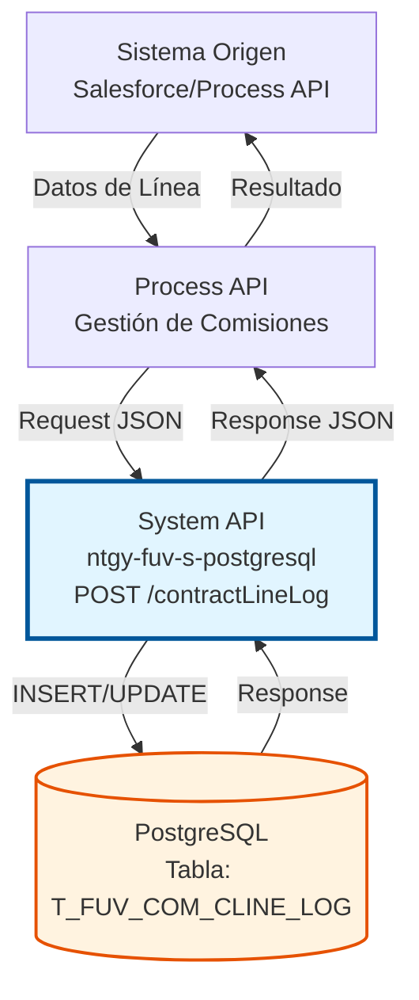
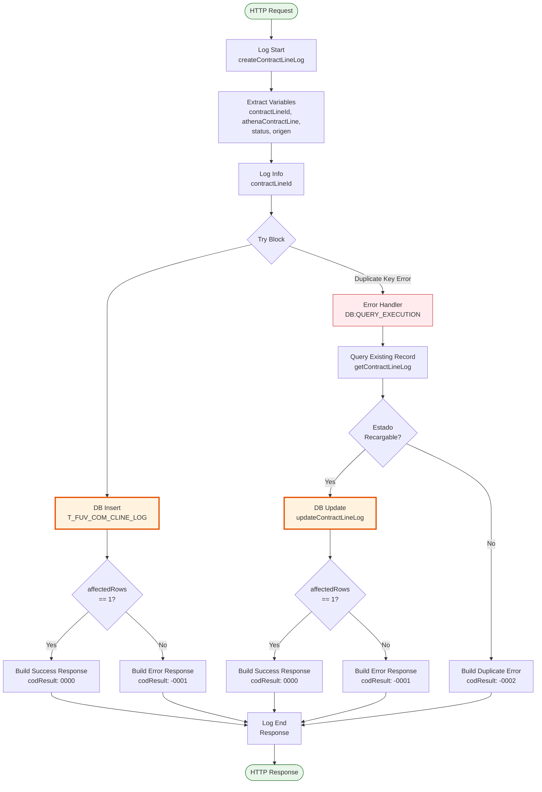
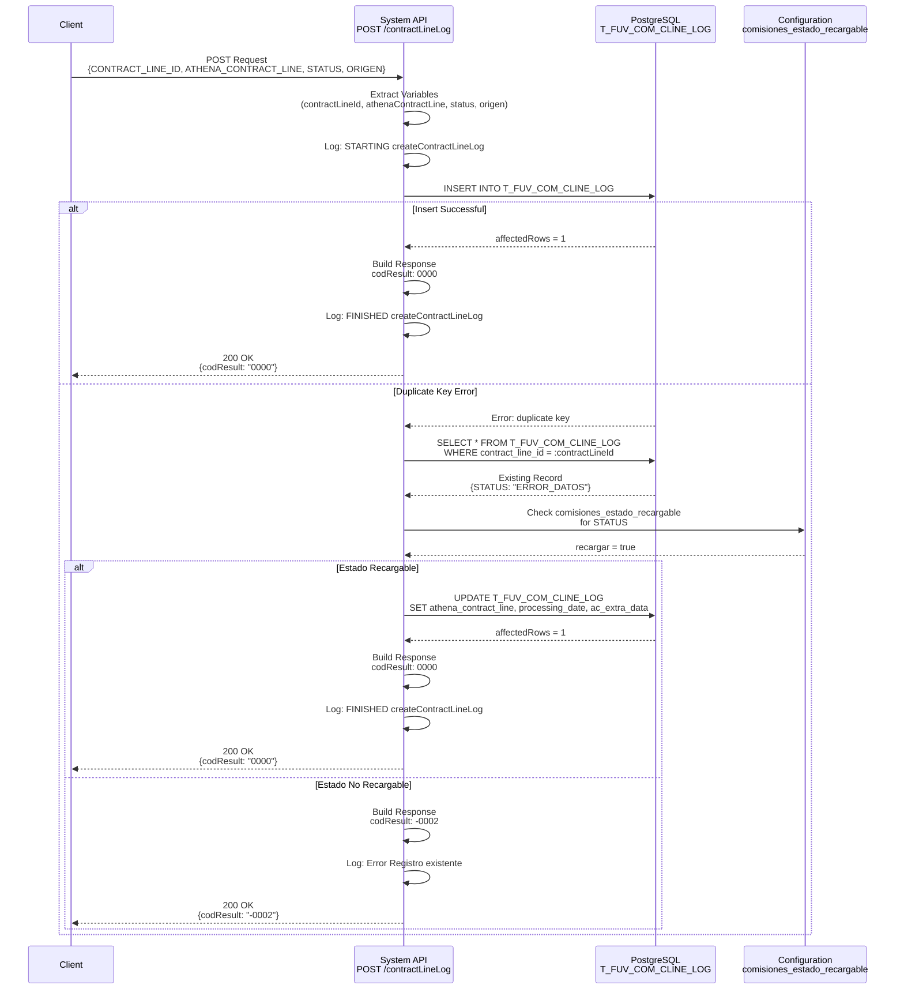
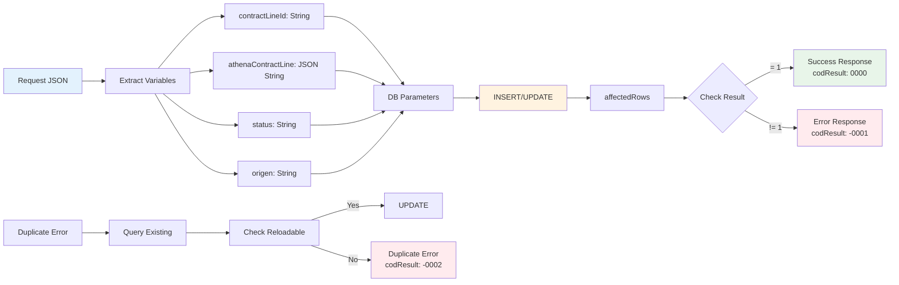

# POST /contractLineLog

## 📌 Descripción General

### Propósito del Endpoint

Este endpoint crea registros de log de líneas de contrato en la tabla `T_FUV_COM_CLINE_LOG` para el sistema de comisiones Callidus. Implementa una lógica inteligente de manejo de duplicados que permite recargar registros según su estado actual.

El endpoint soporta:
- **Creación de registros de log**: Inserta nuevos registros de líneas de contrato con información de Athena
- **Manejo de duplicados**: Detecta registros existentes y aplica lógica de recarga según estado
- **Actualización condicional**: Actualiza registros existentes si están en estado "recargable"
- **Tracking de procesamiento**: Registra fecha de procesamiento, reintentos y errores

### Tipo de API

**Capa:** System API (API-Led Connectivity)

**Función:** Integración directa con PostgreSQL para gestión de logs de líneas de contrato del sistema de comisiones Callidus.

### Patrón de Integración

**Tipo:** Request-Reply Síncrono con PostgreSQL

**Descripción:** Recibe datos de línea de contrato, valida duplicados, ejecuta INSERT o UPDATE según lógica de negocio, y retorna resultado de la operación con códigos de estado específicos.

### Arquitectura API-Led Connectivity



---

## 💼 Propósito del Negocio

### Casos de Uso Principales

1. **Registro de Líneas de Contrato para Comisiones**
   - Registra líneas de contrato que deben procesarse en el sistema Callidus
   - Almacena información completa de la línea desde Athena
   - Permite tracking del estado de procesamiento

2. **Manejo de Reintentos y Recargas**
   - Detecta intentos de crear registros duplicados
   - Evalúa si el registro puede ser recargado según su estado
   - Actualiza registros en estados "recargables" (ej: ERROR_DATOS)

3. **Auditoría y Trazabilidad**
   - Registra fecha de procesamiento y actualizaciones
   - Almacena correlation ID para trazabilidad
   - Mantiene contador de reintentos de procesamiento

### Contexto Empresarial

- **Dominio:** Gestión de Comisiones
- **Sector:** Energía - Utilities
- **División:** Naturgy España - FUV (Facturación Única Virtual)
- **Proceso de Negocio:** Sincronización de líneas de contrato con sistema de comisiones Callidus
- **Sistema Externo:** Callidus (Sistema de gestión de comisiones)

### Stakeholders

- **Equipo de Comisiones**: Necesita tracking preciso de líneas procesadas
- **Equipo de Facturación**: Requiere visibilidad del estado de procesamiento
- **Equipo de Soporte**: Utiliza logs para troubleshooting y reprocesamiento

### Valor de Negocio

- **Integridad de Datos**: Previene duplicados no deseados mientras permite recargas controladas
- **Trazabilidad**: Mantiene historial completo de procesamiento de cada línea
- **Resiliencia**: Permite reprocesamiento de registros en error
- **Eficiencia Operativa**: Automatiza el registro y tracking de líneas de contrato

### Consumidores Potenciales

Este endpoint puede ser consumido por:
- Process APIs de gestión de comisiones
- Flujos de Salesforce para sincronización de contratos
- Procesos batch de reprocesamiento
- Sistemas de integración middleware

---

## 🔧 Especificación Técnica

### URLs por Ambiente

| Ambiente | URL Base | URL Completa |
|----------|----------|--------------|
| **Local** | `http://localhost:8081` | `http://localhost:8081/api/contractLineLog` |
| **Development** | `https://ntgy-fuv-s-postgresql-dev.us-e2.cloudhub.io` | `https://ntgy-fuv-s-postgresql-dev.us-e2.cloudhub.io/api/contractLineLog` |
| **UAT** | `https://ntgy-fuv-s-postgresql-uat.us-e2.cloudhub.io` | `https://ntgy-fuv-s-postgresql-uat.us-e2.cloudhub.io/api/contractLineLog` |
| **Production** | `https://ntgy-fuv-s-postgresql-pro.us-e2.cloudhub.io` | `https://ntgy-fuv-s-postgresql-pro.us-e2.cloudhub.io/api/contractLineLog` |

### Método HTTP

```
POST /api/contractLineLog
```

### Parámetros de Entrada

#### Headers HTTP

| Header | Tipo | Requerido | Descripción | Ejemplo |
|--------|------|-----------|-------------|---------|
| `Content-Type` | string | ✅ Sí | Tipo de contenido del request | `application/json` |
| `Accept` | string | ❌ No | Tipo de contenido esperado en response | `application/json` |

#### Body Parameters

**Estructura del Request:**

| Campo | Tipo | Requerido | Descripción | Ejemplo |
|-------|------|-----------|-------------|---------|
| `CONTRACT_LINE_ID` | string | ✅ Sí | Identificador único de la línea de contrato | `"CL-12345"` |
| `ATHENA_CONTRACT_LINE` | object | ✅ Sí | Objeto JSON con información completa de la línea desde Athena | `{...}` |
| `STATUS` | string | ✅ Sí | Estado inicial del registro | `"PENDING"` |
| `ORIGEN` | string | ✅ Sí | Sistema origen del registro | `"SALESFORCE"` |

**Ejemplo de Request Body:**

```json
{
  "CONTRACT_LINE_ID": "CL-12345-001",
  "ATHENA_CONTRACT_LINE": {
    "contractId": "C-12345",
    "lineNumber": "001",
    "productCode": "ELEC-001",
    "amount": 150.50,
    "currency": "EUR",
    "startDate": "2026-01-01",
    "endDate": "2026-12-31"
  },
  "STATUS": "PENDING",
  "ORIGEN": "SALESFORCE"
}
```

### Respuestas

#### Respuesta Exitosa - Registro Creado (200 OK)

```json
{
  "result": {
    "codResult": "0000",
    "msgResult": "No hay error"
  }
}
```

#### Respuesta Exitosa - Registro Actualizado (200 OK)

Cuando existe un duplicado en estado "recargable" (ej: ERROR_DATOS):

```json
{
  "result": {
    "codResult": "0000",
    "msgResult": "No hay error"
  }
}
```

#### Respuesta de Error - Registro Duplicado No Recargable (200 OK)

```json
{
  "result": {
    "codResult": "-0002",
    "msgResult": "Registro ya existente"
  }
}
```

#### Respuesta de Error - Fallo en Operación (200 OK)

```json
{
  "result": {
    "codResult": "-0001",
    "msgResult": "Ha habido un error en la creación del registro"
  }
}
```

### Códigos de Resultado

| Código | Significado | Descripción |
|--------|-------------|-------------|
| `0000` | Éxito | Operación completada exitosamente (INSERT o UPDATE) |
| `-0001` | Error de Operación | Fallo en INSERT o UPDATE (affectedRows != 1) |
| `-0002` | Duplicado No Recargable | Registro existe y no está en estado recargable |

### Lógica de Estados Recargables

El endpoint consulta la configuración `comisiones_estado_recargable` para determinar si un registro puede ser actualizado:

```yaml
# Configuración en s-postgresql-global-config.yaml (línea 72-73)
comisiones_estado_recargable:
  ERROR_DATOS: "true"
```

**Estados Recargables:**
- `ERROR_DATOS`: Permite actualización del registro

**Estados No Recargables:**
- Cualquier otro estado (ej: `PENDING`, `PROCESSED`, `ERROR`)

### Autenticación y Autorización

- **Tipo:** Client ID & Client Secret (Anypoint Platform)
- **Autorización PostgreSQL:** El usuario debe tener permisos para:
  - INSERT en tabla `T_FUV_COM_CLINE_LOG`
  - SELECT en tabla `T_FUV_COM_CLINE_LOG`
  - UPDATE en tabla `T_FUV_COM_CLINE_LOG`

### Timeouts

| Tipo | Valor | Descripción |
|------|-------|-------------|
| **Request Timeout** | 30 segundos | Tiempo máximo de espera para la respuesta |
| **Connection Timeout** | 10 segundos | Tiempo máximo para establecer conexión con PostgreSQL |

---

## 🏗️ Implementación Técnica

### Arquitectura del Flow



### Flujo de Datos Detallado



### Operaciones de Base de Datos

#### 1. INSERT Principal (Línea 34-43)

**Query SQL:**
```sql
-- Línea 45 en s-postgresql-global-config.yaml
INSERT INTO T_FUV_COM_CLINE_LOG (
    CONTRACT_LINE_ID, 
    ATHENA_CONTRACT_LINE, 
    AC_EXTRA_DATA, 
    STATUS, 
    PROCESSING_RETRIES, 
    ERROR, 
    PROCESSING_DATE, 
    UPDATE_DATE, 
    ORIGEN
) VALUES (
    :contractLineId, 
    :athenaContractLine, 
    :extraData, 
    :status, 
    0, 
    null, 
    timezone('Europe/Madrid'::text, CURRENT_TIMESTAMP), 
    null, 
    :origen
)
```

**Parámetros:**
- `:contractLineId` → `vars.contractLineId`
- `:athenaContractLine` → `vars.athenaContractLine` (JSON serializado)
- `:extraData` → `correlationId` (para trazabilidad)
- `:status` → `vars.status`
- `:origen` → `vars.origen`

**Ubicación en código:** `s-postgresql-contractLineLog.xml`, líneas 34-43

#### 2. SELECT para Validación de Duplicados (Línea 59-64)

**Query SQL:**
```sql
-- Línea 47 en s-postgresql-global-config.yaml
SELECT * FROM T_FUV_COM_CLINE_LOG 
WHERE contract_line_id = :contract_line_id
```

**Parámetros:**
- `:contract_line_id` → `vars.contractLineId`

**Propósito:** Recuperar registro existente para evaluar si es recargable

**Ubicación en código:** `s-postgresql-contractLineLog.xml`, líneas 59-64

#### 3. UPDATE Condicional (Línea 81-89)

**Query SQL:**
```sql
-- Línea 46 en s-postgresql-global-config.yaml
UPDATE T_FUV_COM_CLINE_LOG 
SET processing_date = timezone('Europe/Madrid'::text, CURRENT_TIMESTAMP), 
    ac_extra_data = :extraData, 
    status = 'PENDING', 
    athena_contract_line = :athenaContractLine::json 
WHERE CONTRACT_LINE_ID = :contractLineId
```

**Parámetros:**
- `:contractLineId` → `vars.contractLineId`
- `:athenaContractLine` → `vars.athenaContractLine` (JSON serializado)
- `:extraData` → `correlationId`

**Propósito:** Actualizar registro existente cuando está en estado recargable

**Ubicación en código:** `s-postgresql-contractLineLog.xml`, líneas 81-89

### Transformaciones DataWeave

#### 1. Extracción de Variables (Línea 10-31)

```dataweave
%dw 2.0
output application/java
---
{
  contractLineId: payload.CONTRACT_LINE_ID,
  athenaContractLine: write(payload.ATHENA_CONTRACT_LINE, "application/json"),
  status: payload.STATUS,
  origen: payload.ORIGEN
}
```

**Propósito:** Extraer y preparar variables para operaciones de base de datos

**Ubicación:** `s-postgresql-contractLineLog.xml`, líneas 10-31

#### 2. Evaluación de Estado Recargable (Línea 65-78)

```dataweave
%dw 2.0
output application/java
import * from dw::core::Strings

var estado = payload.STATUS as String
var recargar = p('comisiones_estado_recargable.' ++ estado) default "False"
---
recargar as Boolean
```

**Propósito:** Determinar si el registro puede ser actualizado según su estado

**Configuración consultada:** `comisiones_estado_recargable` en properties

**Ubicación:** `s-postgresql-contractLineLog.xml`, líneas 65-78

#### 3. Construcción de Respuesta Exitosa (Línea 44-56)

```dataweave
%dw 2.0
output application/json
---
{
  "result": {
    "codResult": if (payload.affectedRows == 1) "0000" else "-0001",
    "msgResult": if (payload.affectedRows == 1) 
                    "No hay error" 
                 else 
                    "Ha habido un error en la creación del registro"
  }
}
```

**Propósito:** Construir respuesta JSON basada en resultado de INSERT

**Ubicación:** `s-postgresql-contractLineLog.xml`, líneas 44-56

#### 4. Construcción de Respuesta de Duplicado (Línea 106-118)

```dataweave
%dw 2.0
output application/json
---
{
  "result": {
    "codResult": "-0002",
    "msgResult": "Registro ya existente"
  }
}
```

**Propósito:** Construir respuesta cuando el registro existe y no es recargable

**Ubicación:** `s-postgresql-contractLineLog.xml`, líneas 106-118

### Manejo de Errores

#### Error Handler para Duplicados (Línea 57-122)

```xml
<on-error-continue 
    type="DB:QUERY_EXECUTION" 
    when='error.description contains("duplicate key")'>
    <!-- Lógica de manejo de duplicados -->
</on-error-continue>
```

**Estrategia:**
1. Captura error de clave duplicada
2. Consulta registro existente
3. Evalúa si es recargable según configuración
4. Ejecuta UPDATE o retorna error según resultado

**Ubicación:** `s-postgresql-contractLineLog.xml`, líneas 57-122

### Logging

**Puntos de Logging:**

1. **Inicio del flujo** (Línea 9):
   ```
   STARTING createContractLineLog METHOD. REQUEST: [sanitized payload]
   ```

2. **Información de contractLineId** (Línea 32):
   ```
   STARTING createContractLineLog METHOD. : [contractLineId]
   ```

3. **Error de duplicado** (Línea 105):
   ```
   Error Registro existente: [contractLineId]
   ```

4. **Fin del flujo** (Línea 124):
   ```
   FINISHED createContractLineLog METHOD. [contractLineId] RESPONSE: [sanitized response]
   ```

**Categoría de Log:** `com.naturgy.mule.createContractControl`

### Diagrama de Transformación de Datos



---

## 💻 Ejemplos de Uso

### Ejemplo 1: Crear Nuevo Registro

#### Request

```bash
curl -X POST "https://ntgy-fuv-s-postgresql-dev.us-e2.cloudhub.io/api/contractLineLog" \
  -H "Content-Type: application/json" \
  -H "client_id: your-client-id" \
  -H "client_secret: your-client-secret" \
  -d '{
    "CONTRACT_LINE_ID": "CL-2026-001-001",
    "ATHENA_CONTRACT_LINE": {
      "contractId": "C-2026-001",
      "lineNumber": "001",
      "productCode": "ELEC-STANDARD",
      "productName": "Electricidad Estándar",
      "amount": 250.75,
      "currency": "EUR",
      "startDate": "2026-01-01",
      "endDate": "2026-12-31",
      "commissionRate": 5.5,
      "salesAgent": "AG-12345"
    },
    "STATUS": "PENDING",
    "ORIGEN": "SALESFORCE"
  }'
```

#### Response (200 OK)

```json
{
  "result": {
    "codResult": "0000",
    "msgResult": "No hay error"
  }
}
```

**Descripción:** Registro creado exitosamente en la tabla `T_FUV_COM_CLINE_LOG`.

---

### Ejemplo 2: Intento de Duplicado - Estado Recargable

#### Request

```bash
curl -X POST "https://ntgy-fuv-s-postgresql-dev.us-e2.cloudhub.io/api/contractLineLog" \
  -H "Content-Type: application/json" \
  -H "client_id: your-client-id" \
  -H "client_secret: your-client-secret" \
  -d '{
    "CONTRACT_LINE_ID": "CL-2026-001-001",
    "ATHENA_CONTRACT_LINE": {
      "contractId": "C-2026-001",
      "lineNumber": "001",
      "productCode": "ELEC-STANDARD",
      "productName": "Electricidad Estándar - Corregido",
      "amount": 255.00,
      "currency": "EUR",
      "startDate": "2026-01-01",
      "endDate": "2026-12-31",
      "commissionRate": 5.5,
      "salesAgent": "AG-12345"
    },
    "STATUS": "PENDING",
    "ORIGEN": "SALESFORCE"
  }'
```

#### Response (200 OK)

```json
{
  "result": {
    "codResult": "0000",
    "msgResult": "No hay error"
  }
}
```

**Descripción:** El registro existente estaba en estado `ERROR_DATOS` (recargable), por lo que se actualizó exitosamente con los nuevos datos.

---

### Ejemplo 3: Intento de Duplicado - Estado No Recargable

#### Request

```bash
curl -X POST "https://ntgy-fuv-s-postgresql-dev.us-e2.cloudhub.io/api/contractLineLog" \
  -H "Content-Type: application/json" \
  -H "client_id: your-client-id" \
  -H "client_secret: your-client-secret" \
  -d '{
    "CONTRACT_LINE_ID": "CL-2026-002-001",
    "ATHENA_CONTRACT_LINE": {
      "contractId": "C-2026-002",
      "lineNumber": "001",
      "productCode": "GAS-PREMIUM",
      "amount": 180.50,
      "currency": "EUR"
    },
    "STATUS": "PENDING",
    "ORIGEN": "SALESFORCE"
  }'
```

#### Response (200 OK)

```json
{
  "result": {
    "codResult": "-0002",
    "msgResult": "Registro ya existente"
  }
}
```

**Descripción:** El registro ya existe y está en un estado no recargable (ej: `PROCESSED`, `PENDING`), por lo que no se permite la actualización.

---

### Ejemplo 4: Error en Operación de Base de Datos

#### Request

```bash
curl -X POST "https://ntgy-fuv-s-postgresql-dev.us-e2.cloudhub.io/api/contractLineLog" \
  -H "Content-Type: application/json" \
  -H "client_id: your-client-id" \
  -H "client_secret: your-client-secret" \
  -d '{
    "CONTRACT_LINE_ID": "CL-2026-003-001",
    "ATHENA_CONTRACT_LINE": {
      "contractId": "C-2026-003",
      "lineNumber": "001"
    },
    "STATUS": "PENDING",
    "ORIGEN": "SALESFORCE"
  }'
```

#### Response (200 OK)

```json
{
  "result": {
    "codResult": "-0001",
    "msgResult": "Ha habido un error en la creación del registro"
  }
}
```

**Descripción:** La operación de INSERT falló (affectedRows != 1), posiblemente por un problema de conectividad o constraint de base de datos.

---

### Ejemplo 5: Request con Datos Completos de Athena

#### Request

```bash
curl -X POST "https://ntgy-fuv-s-postgresql-pro.us-e2.cloudhub.io/api/contractLineLog" \
  -H "Content-Type: application/json" \
  -H "client_id: your-client-id" \
  -H "client_secret: your-client-secret" \
  -d '{
    "CONTRACT_LINE_ID": "CL-2026-100-005",
    "ATHENA_CONTRACT_LINE": {
      "contractId": "C-2026-100",
      "lineNumber": "005",
      "productCode": "ELEC-PREMIUM-NIGHT",
      "productName": "Electricidad Premium Nocturna",
      "productCategory": "ELECTRICITY",
      "amount": 320.00,
      "currency": "EUR",
      "startDate": "2026-02-01",
      "endDate": "2027-01-31",
      "commissionRate": 7.5,
      "commissionAmount": 24.00,
      "salesAgent": "AG-67890",
      "salesChannel": "DIRECT",
      "customerSegment": "RESIDENTIAL",
      "contractType": "NEW",
      "billingCycle": "MONTHLY",
      "paymentMethod": "DIRECT_DEBIT",
      "promotionCode": "PROMO2026",
      "discountApplied": 5.0,
      "notes": "Cliente preferente con descuento especial"
    },
    "STATUS": "PENDING",
    "ORIGEN": "SALESFORCE"
  }'
```

#### Response (200 OK)

```json
{
  "result": {
    "codResult": "0000",
    "msgResult": "No hay error"
  }
}
```

**Descripción:** Registro creado exitosamente con información completa de Athena para procesamiento en Callidus.

---

### Notas de Implementación

#### Estados Recargables

La configuración de estados recargables se encuentra en `s-postgresql-global-config.yaml`:

```yaml
comisiones_estado_recargable:
  ERROR_DATOS: "true"
```

Para agregar más estados recargables, añadir entradas adicionales:

```yaml
comisiones_estado_recargable:
  ERROR_DATOS: "true"
  ERROR_TEMPORAL: "true"
  RETRY_PENDING: "true"
```

#### Trazabilidad

El campo `AC_EXTRA_DATA` almacena el `correlationId` de la transacción para trazabilidad end-to-end:

```dataweave
extraData: correlationId
```

Este ID permite rastrear la operación a través de todos los sistemas involucrados.