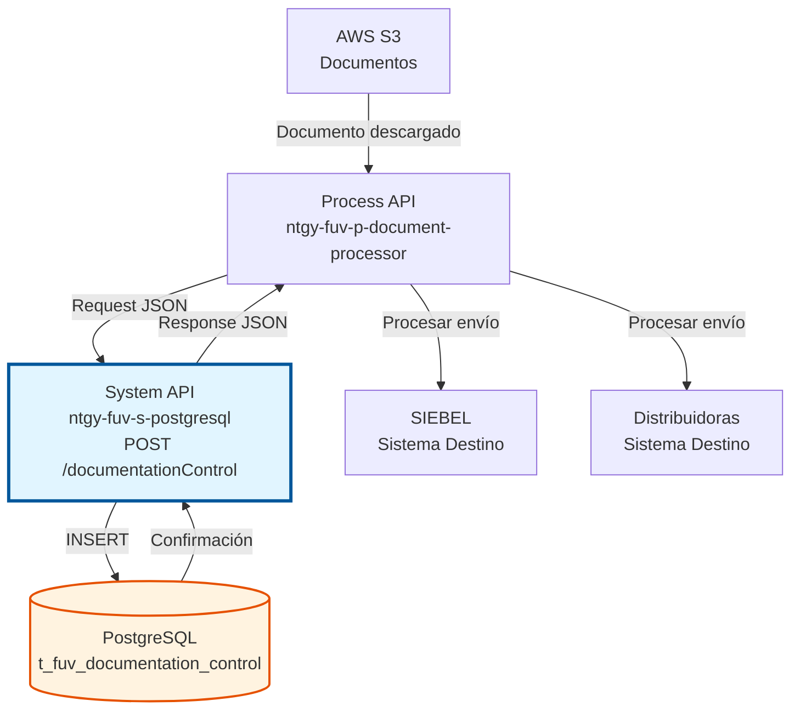
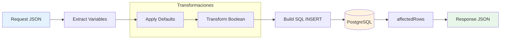
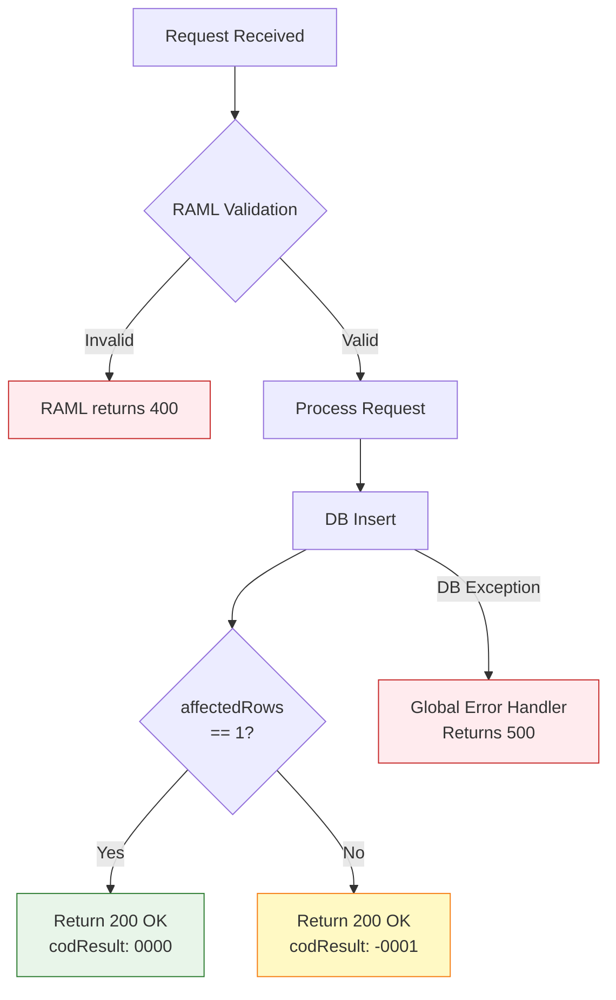

# POST /documentationControl

## 📌 Descripción General

### Propósito del Endpoint

Este endpoint crea un registro de control de documentación en la tabla `t_fuv_documentation_control` de PostgreSQL, permitiendo la trazabilidad completa de documentos asociados a pedidos del sistema FUV (Facturación Única Virtual). Los documentos se recogen de AWS S3 y se procesan para envío a sistemas destino como SIEBEL o distribuidoras eléctricas.

El endpoint soporta:
- **Registro de Documentos AWS**: Almacena metadatos de documentos descargados de AWS S3
- **Control de Envío a Distribuidoras**: Marca documentos que requieren envío a distribuidoras
- **Trazabilidad Completa**: Registra timestamps, intentos y estados de procesamiento
- **Gestión de Destinos**: Soporta múltiples sistemas destino (SIEBEL, DISTRIBUIDORA, SHAREPOINT)
- **Documentos Contractuales**: Gestiona contratos, anexos, condiciones generales y documentación asociada

### Tipo de API

**Capa:** System API (API-Led Connectivity)

**Función:** Integración directa con PostgreSQL para persistencia de control de documentación de pedidos FUV.

### Patrón de Integración

**Tipo:** Request-Reply Síncrono con PostgreSQL INSERT

**Descripción:** Recibe datos del documento, aplica transformaciones y defaults, inserta registro en tabla de control con timestamps de zona horaria Madrid, y retorna confirmación de creación.

### Arquitectura API-Led Connectivity



---

## 💼 Propósito del Negocio

### Casos de Uso Principales

1. **Registro de Documentos de AWS S3**
   - Cuando se descarga un documento de AWS S3 asociado a un pedido
   - Se crea un registro de control para trazabilidad
   - Permite seguimiento del ciclo de vida del documento

2. **Control de Envío a Distribuidoras**
   - Documentos que requieren envío a distribuidoras eléctricas
   - Marca con flag `envioDistribuidora` para procesamiento posterior
   - Facilita workflows de envío automático

3. **Gestión de Documentación Contractual**
   - Contratos de suministro eléctrico/gas
   - Anexos y condiciones generales
   - Documentos de firma electrónica
   - Documentación legal y regulatoria

4. **Trazabilidad de Procesamiento**
   - Estado inicial "PENDIENTE" para documentos nuevos
   - Registro de intentos de procesamiento
   - Timestamps de creación y actualización
   - Auditoría completa de operaciones

### Contexto Empresarial

- **Dominio:** Gestión de Documentación y Pedidos
- **Sector:** Energía - Utilities
- **División:** Naturgy España - FUV (Facturación Única Virtual)
- **Proceso de Negocio:** Control y trazabilidad de documentación de pedidos
- **Sistema:** PostgreSQL Database

### Stakeholders

- **Equipo de Documentación**: Necesita trazabilidad de documentos procesados
- **Operaciones**: Requiere visibilidad del estado de documentos pendientes
- **Distribuidoras**: Reciben documentos marcados para envío
- **Auditoría**: Necesita registro completo de operaciones con timestamps

### Valor de Negocio

- **Trazabilidad Completa**: Registro detallado de todos los documentos procesados
- **Automatización**: Facilita workflows automáticos de procesamiento de documentos
- **Cumplimiento Regulatorio**: Auditoría completa con timestamps y estados
- **Eficiencia Operativa**: Reduce errores manuales en gestión de documentos
- **Visibilidad**: Estado en tiempo real de documentos pendientes/procesados

### Consumidores Potenciales

Este endpoint puede ser consumido por:
- Process APIs de gestión de documentación (ntgy-fuv-p-document-processor)
- Flujos de procesamiento de pedidos del Frontal de Ventas
- Sistemas de integración con AWS S3
- Workflows de envío a distribuidoras
- Sistemas de auditoría y reporting

---

## 🔧 Especificación Técnica

### URLs por Ambiente

| Ambiente | URL Base | URL Completa |
|----------|----------|--------------|
| **Local** | `http://localhost:8081` | `http://localhost:8081/api/documentationControl` |
| **Development** | `https://ntgy-fuv-s-postgresql-dev.us-e2.cloudhub.io` | `https://ntgy-fuv-s-postgresql-dev.us-e2.cloudhub.io/api/documentationControl` |
| **UAT** | `https://ntgy-fuv-s-postgresql-uat.us-e2.cloudhub.io` | `https://ntgy-fuv-s-postgresql-uat.us-e2.cloudhub.io/api/documentationControl` |
| **Production** | `https://ntgy-fuv-s-postgresql-pro.us-e2.cloudhub.io` | `https://ntgy-fuv-s-postgresql-pro.us-e2.cloudhub.io/api/documentationControl` |

### Método HTTP

```
POST /api/documentationControl
```

### Parámetros de Entrada

#### Headers HTTP

| Header | Tipo | Requerido | Descripción | Ejemplo |
|--------|------|-----------|-------------|---------|
| `Content-Type` | string | ✅ Sí | Tipo de contenido del request | `application/json` |
| `Accept` | string | ❌ No | Tipo de contenido esperado en response | `application/json` |

#### Body Parameters

| Campo | Tipo | Requerido | Descripción | Ejemplo |
|-------|------|-----------|-------------|---------|
| `orderId` | string | ✅ Sí | Identificador único del pedido del Frontal de Ventas | `"ORD-2024-001234"` |
| `documentName` | string | ✅ Sí | Nombre del documento (CONTRATO, ANEXO, CONDICIONES_GENERALES) | `"CONTRATO"` |
| `numDocumento` | string | ✅ Sí | Número de documento del cliente (NIF/NIE/CIF) | `"12345678A"` |
| `cabeceraContrato` | string | ❌ No | Datos de cabecera del contrato en formato texto | `"Contrato de suministro eléctrico"` |
| `lineasContrato` | string | ❌ No | Líneas del contrato en formato texto | `"Línea 1: Tarifa 2.0TD"` |
| `tipoDocumental` | string | ✅ Sí | Tipo de documento según catálogo | `"CONTRATO"` |
| `envioDistribuidora` | boolean | ✅ Sí | Indica si el documento debe enviarse a la distribuidora | `true` |
| `destino` | string | ❌ No | Sistema destino del documento (default: "SIEBEL") | `"SIEBEL"` |
| `document_id` | string | ❌ No | Identificador del documento en SharePoint o AWS S3 | `"doc-12345-abcde"` |
| `document_status` | string | ❌ No | Estado inicial del documento (default: "PENDIENTE") | `"PENDIENTE"` |

**Valores por Defecto Aplicados:**
- `destino`: Si es null → "SIEBEL"
- `document_status`: Si es null o vacío → "PENDIENTE"
- `attempts_number`: Siempre 1 en creación
- `update_user`: Siempre "mulesoft"
- `update_program`: Siempre "mulesoft"

**Transformaciones:**
- `envioDistribuidora`: `true` → `'Y'`, `false` → `'N'` (para almacenamiento en DB)

### Respuestas

#### Respuesta Exitosa (200 OK)

```json
{
  "result": {
    "codResult": "0000",
    "msgResult": "No hay error"
  }
}
```

**Descripción:** El registro se creó exitosamente en la tabla `t_fuv_documentation_control`. El endpoint retorna HTTP 200 OK con `codResult: "0000"` cuando `affectedRows == 1`.

#### Respuesta de Error de Creación (200 OK)

```json
{
  "result": {
    "codResult": "-0001",
    "msgResult": "Ha habido un error en la creación del registro"
  }
}
```

**Descripción:** La operación INSERT no afectó ninguna fila (`affectedRows != 1`). El endpoint retorna HTTP 200 OK con `codResult: "-0001"`.

**Nota sobre Validaciones:** Las validaciones de campos obligatorios se manejan a nivel de RAML antes de llegar al flow de MuleSoft. Los errores de base de datos (como duplicate key violations) son manejados por el error handler global de MuleSoft.

### Autenticación y Autorización

- **Tipo:** Client ID & Client Secret (Anypoint Platform)
- **Autorización PostgreSQL:** El usuario de conexión debe tener permisos para:
  - INSERT en tabla `t_fuv_documentation_control`
  - Acceso al schema `public`

### Timeouts

| Tipo | Valor | Descripción |
|------|-------|-------------|
| **Request Timeout** | 30 segundos | Tiempo máximo de espera para la respuesta |
| **Connection Timeout** | 10 segundos | Tiempo máximo para establecer conexión con PostgreSQL |
| **Query Timeout** | 30 segundos | Tiempo máximo de ejecución del INSERT |

---

## 🏗️ Implementación Técnica

### Arquitectura del Flow

```mermaid
flowchart TD
    Start([HTTP POST Request]) --> LogStart[Log Start: STARTING createDocumentationControl]
    LogStart --> ExtractVars[Extract Variables<br/>orderId, documentName, numDocumento, etc.]
    ExtractVars --> ApplyDefaults[Apply Defaults<br/>destino=SIEBEL, estado=PENDIENTE]
    ApplyDefaults --> Transform[Transform Data<br/>envioDistribuidora: boolean → Y/N]
    Transform --> BuildSQL[Build SQL INSERT Statement<br/>Dynamic query construction]
    BuildSQL --> LogSQL[Log SQL Query]
    LogSQL --> Insert[DB Insert<br/>t_fuv_documentation_control]
    Insert --> CheckResult{affectedRows<br/>== 1?}
    CheckResult -->|Yes| Success[Build Success Response<br/>codResult: 0000]
    CheckResult -->|No| Error[Build Error Response<br/>codResult: -0001]
    Success --> LogEnd[Log End: FINISH createDocumentationControl]
    Error --> LogEnd
    LogEnd --> End([HTTP Response 200 OK])
    
    style Start fill:#e8f5e9,stroke:#2e7d32
    style Insert fill:#fff3e0,stroke:#e65100,stroke-width:3px
    style End fill:#e8f5e9,stroke:#2e7d32
    
    Note right of Insert: No hay try-catch explícito<br/>Los errores de DB son manejados<br/>por el error handler global
```

### Tabla PostgreSQL

**Nombre:** `t_fuv_documentation_control`

**Schema:** `public`

**Columnas:**

| Columna | Tipo | Nullable | Descripción |
|---------|------|----------|-------------|
| `t_fuv_documentation_control_id` | SERIAL | NO | ID autoincremental (PK) |
| `contract_id` | VARCHAR | NO | ID del pedido (orderId) |
| `document_name` | VARCHAR | NO | Nombre del documento |
| `document_status` | VARCHAR | NO | Estado del documento (PENDIENTE, EN_PROCESO, COMPLETADO, ERROR) |
| `attempts_number` | INTEGER | NO | Número de intentos de procesamiento |
| `create_date` | TIMESTAMP | NO | Fecha de creación (timezone Madrid) |
| `update_date` | TIMESTAMP | NO | Fecha de última actualización (timezone Madrid) |
| `update_user` | VARCHAR | NO | Usuario que realizó la última actualización |
| `update_program` | VARCHAR | NO | Programa que realizó la última actualización |
| `num_documento` | VARCHAR | NO | NIF/NIE/CIF del cliente |
| `cabecera_contrato` | TEXT | YES | Datos de cabecera del contrato |
| `tipo_documental` | VARCHAR | NO | Tipo de documento |
| `envio_distribuidora` | CHAR(1) | NO | Flag de envío a distribuidora (Y/N) |
| `lineas_contrato` | TEXT | YES | Líneas del contrato |
| `destino` | VARCHAR | NO | Sistema destino (SIEBEL, DISTRIBUIDORA, SHAREPOINT) |
| `document_id` | VARCHAR | YES | ID del documento en SharePoint/AWS |

### Query SQL

```sql
INSERT INTO t_fuv_documentation_control (
  contract_id, 
  document_name, 
  document_status, 
  attempts_number, 
  create_date, 
  update_date, 
  update_user, 
  update_program,
  num_documento, 
  cabecera_contrato, 
  tipo_documental, 
  envio_distribuidora, 
  lineas_contrato, 
  destino, 
  document_id
) VALUES (
  'ORD-2024-001234',                                    -- contract_id
  'CONTRATO',                                           -- document_name
  'PENDIENTE',                                          -- document_status (default)
  1,                                                    -- attempts_number (always 1 on create)
  timezone('Europe/Madrid'::text, CURRENT_TIMESTAMP),  -- create_date
  timezone('Europe/Madrid'::text, CURRENT_TIMESTAMP),  -- update_date
  'mulesoft',                                           -- update_user (default)
  'mulesoft',                                           -- update_program (default)
  '12345678A',                                          -- num_documento
  'Contrato de suministro eléctrico',                  -- cabecera_contrato
  'CONTRATO',                                           -- tipo_documental
  'Y',                                                  -- envio_distribuidora (transformed from true)
  'Línea 1: Tarifa 2.0TD',                            -- lineas_contrato (optional)
  'SIEBEL',                                             -- destino (default)
  'doc-12345-abcde'                                     -- document_id (optional)
)
```

### Transformaciones DataWeave

#### Transformación 1: Extracción de Variables (líneas 10-57)

```dataweave
%dw 2.0
output application/java
---
{
  idPedido: payload.orderId,
  documentName: payload.documentName,
  numDocumento: payload.numDocumento,
  cabeceraContrato: payload.cabeceraContrato,
  lineasContrato: payload.lineasContrato,
  tipoDocumental: payload.tipoDocumental,
  envioDistribuidora: if (payload.envioDistribuidora == true) 'Y' else 'N',
  destino: if (payload.destino == null) "SIEBEL" else payload.destino,
  documentId: payload.document_id,
  estado: if (payload.document_status == null or payload.document_status == "") 
          "PENDIENTE" 
          else payload.document_status
}
```

#### Transformación 2: Construcción de SQL INSERT (líneas 59-90)

```dataweave
%dw 2.0
output application/java

var sentence_1 = "insert into t_fuv_documentation_control 
(contract_id, document_name, document_status, attempts_number, create_date, update_date, 
 update_user, update_program, num_documento, cabecera_contrato, tipo_documental, 
 envio_distribuidora, lineas_contrato, destino, document_id)
values ( "

var lv_lineasContrato = if (vars.lineasContrato != null) 
                        ('\'' ++  vars.lineasContrato  ++ '\'' ) 
                        else ( 'null' )
                        
var lv_documenmtId = if (vars.documentId != null) 
                     ('\'' ++  vars.documentId  ++ '\'' ) 
                     else ( 'null' )
---
sentence_1 
++ '\'' ++ vars.idPedido ++ '\'' 
++ ', ' ++ '\'' ++ vars.documentName ++ '\'' 
++ ', ' ++ '\'' ++ vars.estado ++ '\''
++ ', 1 '
++ ', timezone(\'Europe/Madrid\'::text, CURRENT_TIMESTAMP)'
++ ', timezone(\'Europe/Madrid\'::text, CURRENT_TIMESTAMP)'
++ ', ' ++ '\'mulesoft\'' 
++ ', ' ++ '\'mulesoft\''
++ ', ' ++ '\'' ++ vars.numDocumento ++ '\'' 
++ ', ' ++ '\'' ++ vars.cabeceraContrato ++ '\'' 
++ ', ' ++ '\'' ++ vars.tipoDocumental ++ '\'' 
++ ', ' ++ '\'' ++ vars.envioDistribuidora ++ '\''
++ ', ' ++ lv_lineasContrato
++ ', ' ++ '\'' ++ vars.destino ++ '\'' 
++ ', ' ++ lv_documenmtId
++ ')' 
```

#### Transformación 3: Construcción de Response (líneas 94-106)

```dataweave
%dw 2.0
output application/json
---
{
  "result": {
    "codResult": if (payload.affectedRows == 1) "0000" else "-0001",
    "msgResult": if (payload.affectedRows == 1) 
                 "No hay error" 
                 else "Ha habido un error en la creación del registro"
  }
}
```

### Diagrama de Transformación de Datos



### Manejo de Errores

**Implementación Real:**

El flow implementa un manejo de errores simple basado en `affectedRows`:



**Escenarios de Error:**

1. **Validación RAML** (antes del flow):
   - Campos obligatorios faltantes
   - Tipos de datos incorrectos
   - Retorna: 400 Bad Request

2. **Error de Creación** (affectedRows != 1):
   - La operación INSERT no afectó filas
   - Retorna: 200 OK con `codResult: "-0001"`

3. **Errores de Base de Datos** (manejados por error handler global):
   - Violación de constraint UNIQUE
   - Error de conexión a PostgreSQL
   - Timeout de query
   - Retorna: 500 Internal Server Error

---

## 💻 Ejemplos de Uso

### Ejemplo 1: Request Completo con Todos los Campos

```json
{
  "orderId": "ORD-2024-001234",
  "documentName": "CONTRATO",
  "numDocumento": "12345678A",
  "cabeceraContrato": "Contrato de suministro eléctrico - Cliente: Juan Pérez - Tarifa: 2.0TD",
  "lineasContrato": "Línea 1: Tarifa 2.0TD - Potencia P1: 3.45 kW\nLínea 2: Potencia P2: 5.75 kW\nLínea 3: Término fijo: 45.50 €/mes",
  "tipoDocumental": "CONTRATO",
  "envioDistribuidora": true,
  "destino": "SIEBEL",
  "document_id": "doc-aws-12345-abcde-fghij",
  "document_status": "PENDIENTE"
}
```

### Ejemplo 2: Response Exitoso

```json
{
  "result": {
    "codResult": "0000",
    "msgResult": "No hay error"
  }
}
```

### Ejemplo 3: Request Mínimo (Solo Campos Obligatorios)

```json
{
  "orderId": "ORD-2024-001235",
  "documentName": "ANEXO",
  "numDocumento": "87654321B",
  "tipoDocumental": "ANEXO",
  "envioDistribuidora": false
}
```

**Nota:** Los campos opcionales tomarán valores por defecto:
- `destino`: "SIEBEL"
- `document_status`: "PENDIENTE"
- `cabeceraContrato`: null
- `lineasContrato`: null
- `document_id`: null

### Ejemplo 4: Curl Command

```bash
curl -X POST "https://ntgy-fuv-s-postgresql-dev.us-e2.cloudhub.io/api/documentationControl" \
  -H "Content-Type: application/json" \
  -H "client_id: your-client-id" \
  -H "client_secret: your-client-secret" \
  -d '{
    "orderId": "ORD-2024-001234",
    "documentName": "CONTRATO",
    "numDocumento": "12345678A",
    "cabeceraContrato": "Contrato de suministro eléctrico",
    "tipoDocumental": "CONTRATO",
    "envioDistribuidora": true,
    "destino": "SIEBEL"
  }'
```

### Ejemplo 5: Response de Error de Creación

```json
{
  "result": {
    "codResult": "-0001",
    "msgResult": "Ha habido un error en la creación del registro"
  }
}
```

**Nota:** Este error ocurre cuando `affectedRows != 1`. El endpoint retorna HTTP 200 OK con el código de error en el body.

### Ejemplo 6: Documento para Distribuidora

```json
{
  "orderId": "ORD-2024-001236",
  "documentName": "CONDICIONES_GENERALES",
  "numDocumento": "45678912C",
  "cabeceraContrato": "Condiciones generales del contrato de suministro",
  "tipoDocumental": "CONDICIONES",
  "envioDistribuidora": true,
  "destino": "DISTRIBUIDORA"
}
```

### Ejemplo 7: Documento con ID de SharePoint

```json
{
  "orderId": "ORD-2024-001237",
  "documentName": "ANEXO_FIRMA",
  "numDocumento": "78945612D",
  "tipoDocumental": "ANEXO",
  "envioDistribuidora": false,
  "destino": "SHAREPOINT",
  "document_id": "sharepoint-doc-xyz-789"
}
```

### Ejemplo 8: JavaScript/TypeScript

```typescript
const createDocumentationControl = async (documentData: DocumentationControlRequest) => {
  const response = await fetch(
    'https://ntgy-fuv-s-postgresql-dev.us-e2.cloudhub.io/api/documentationControl',
    {
      method: 'POST',
      headers: {
        'Content-Type': 'application/json',
        'client_id': process.env.CLIENT_ID,
        'client_secret': process.env.CLIENT_SECRET
      },
      body: JSON.stringify({
        orderId: documentData.orderId,
        documentName: documentData.documentName,
        numDocumento: documentData.numDocumento,
        cabeceraContrato: documentData.cabeceraContrato,
        lineasContrato: documentData.lineasContrato,
        tipoDocumental: documentData.tipoDocumental,
        envioDistribuidora: documentData.envioDistribuidora,
        destino: documentData.destino || 'SIEBEL',
        document_id: documentData.document_id,
        document_status: documentData.document_status || 'PENDIENTE'
      })
    }
  );

  const result = await response.json();
  
  if (result.result.codResult === '0000') {
    console.log('Documento registrado exitosamente');
    return { success: true, data: result };
  } else {
    console.error('Error al registrar documento:', result.result.msgResult);
    return { success: false, error: result };
  }
};

// Uso
const documentData = {
  orderId: 'ORD-2024-001234',
  documentName: 'CONTRATO',
  numDocumento: '12345678A',
  tipoDocumental: 'CONTRATO',
  envioDistribuidora: true
};

createDocumentationControl(documentData);
```

---

## 🔗 Endpoints Relacionados

| Endpoint | Método | Propósito |
|----------|--------|-----------|
| `/documentationControl` | GET | Consultar documentos por orderId |
| `/documentationControl` | PUT | Actualizar estado de documento |
| `/documentationControl` | DELETE | Eliminar registro de documento |
| `/documentationControlByStatus` | GET | Consultar documentos por estado |
| `/documentationControlByDocNumber` | GET | Consultar por número de documento |
| `/documentationControlById` | GET | Consultar por document_id |

---

