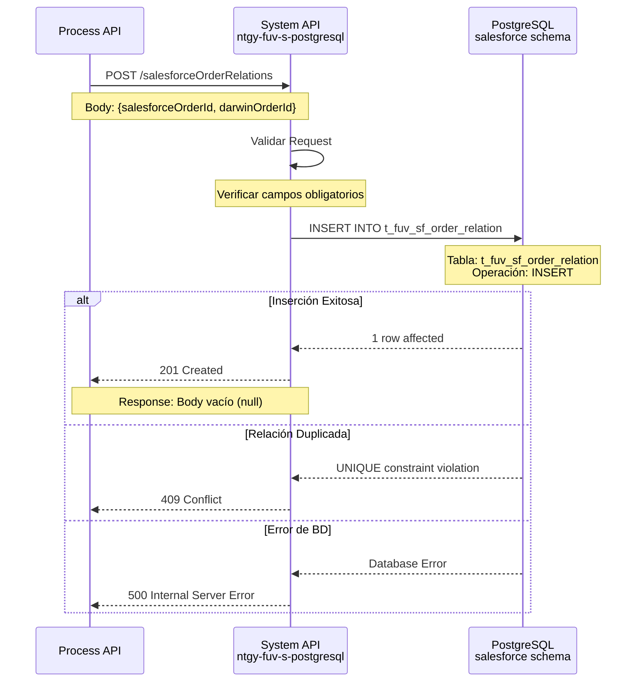
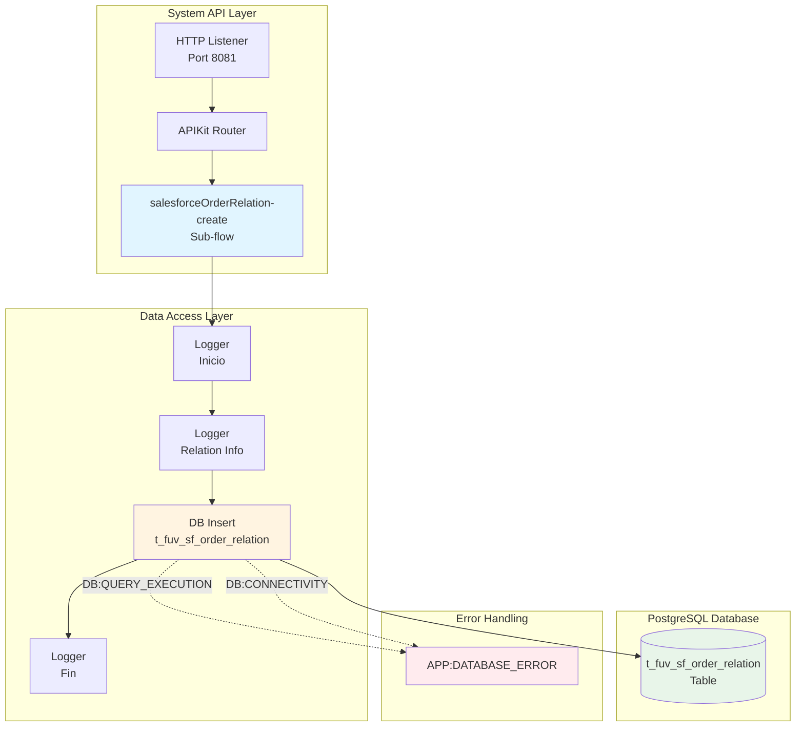
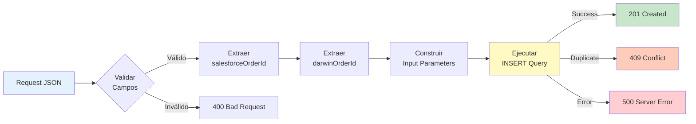

# POST /salesforceOrderRelations

## 📌 Descripción General

### Información Básica

| Atributo | Detalle |
|----------|---------|
| **Método HTTP** | POST |
| **Ruta** | `/api/salesforceOrderRelations` |
| **Tipo de API** | System API |
| **Patrón de Integración** | Request-Reply (Síncrono) |
| **Capa API-Led** | System Layer (Data Access) |

### URLs por Ambiente

| Ambiente | URL Completa |
|----------|--------------|
| **Local** | `http://localhost:8081/api/salesforceOrderRelations` |
| **Development** | `https://ntgy-fuv-s-postgresql-dev.us-e2.cloudhub.io/api/salesforceOrderRelations` |
| **UAT** | `https://ntgy-fuv-s-postgresql-uat.us-e2.cloudhub.io/api/salesforceOrderRelations` |
| **Production** | `https://ntgy-fuv-s-postgresql-pro.us-e2.cloudhub.io/api/salesforceOrderRelations` |

### Resumen Ejecutivo

Este endpoint crea una relación bidireccional entre un ID de orden de Salesforce (sistema CRM) y un ID de pedido de Darwin (sistema de gestión de pedidos) en la base de datos PostgreSQL. Permite establecer la trazabilidad y sincronización entre ambos sistemas, facilitando consultas cross-sistema y auditoría de órdenes.

**Backend:** PostgreSQL  
**Operación:** INSERT  
**Tabla:** `t_fuv_sf_order_relation`

---

## 💼 Propósito del Negocio

### Problema que Resuelve

En el ecosistema de Naturgy, las órdenes se gestionan en dos sistemas principales:
- **Salesforce:** Sistema CRM donde se originan las órdenes de clientes
- **Darwin:** Sistema de gestión y procesamiento de pedidos

Este endpoint resuelve la necesidad crítica de mantener la trazabilidad entre ambos sistemas, permitiendo:
- Sincronización de estados de órdenes
- Consultas cross-sistema eficientes
- Auditoría completa del ciclo de vida de órdenes
- Resolución de incidencias con visibilidad completa

### Casos de Uso

#### 1. Sincronización de Órdenes Nuevas
**Escenario:** Una orden se crea en Salesforce y se envía a Darwin para procesamiento.

**Flujo:**
1. Salesforce crea orden con ID `0031234567890ABC`
2. Darwin procesa la orden y genera ID `DRW-2024-001234`
3. Process API invoca este endpoint para establecer la relación
4. Relación queda registrada para consultas futuras

#### 2. Trazabilidad de Pedidos
**Escenario:** Agente de call center necesita consultar estado de pedido.

**Flujo:**
1. Agente tiene ID de Salesforce de la orden
2. Sistema consulta relación para obtener ID de Darwin
3. Con ID de Darwin, consulta estado actual del pedido
4. Muestra información completa al agente

#### 3. Auditoría y Reporting
**Escenario:** Generación de reportes de órdenes procesadas.

**Flujo:**
1. Sistema de reporting consulta órdenes de Salesforce
2. Usa relaciones para obtener IDs de Darwin
3. Cruza información de ambos sistemas
4. Genera reporte consolidado

### Stakeholders

| Stakeholder | Interés | Beneficio |
|-------------|---------|-----------|
| **Agentes de Call Center** | Consultar estado de órdenes | Visibilidad completa cross-sistema |
| **Equipo de Operaciones** | Monitorear procesamiento | Trazabilidad de órdenes |
| **Equipo de IT** | Mantener sincronización | Integridad de datos entre sistemas |
| **Auditoría** | Verificar cumplimiento | Registro completo de relaciones |

---

## 🔧 Especificación Técnica

### Método HTTP

```
POST /api/salesforceOrderRelations
```

### Headers Requeridos

| Header | Valor | Descripción |
|--------|-------|-------------|
| `Content-Type` | `application/json` | Formato del body del request |
| `client_id` | `{client_id}` | ID del cliente (API Manager) |
| `client_secret` | `{client_secret}` | Secret del cliente (API Manager) |

### Request Body

#### Estructura JSON

```json
{
  "salesforceOrderId": "string",
  "darwinOrderId": "string"
}
```

#### Parámetros del Body

| Campo | Tipo | Requerido | Descripción | Ejemplo |
|-------|------|-----------|-------------|---------|
| `salesforceOrderId` | string | ✅ Sí | ID único de la orden en Salesforce | `"0031234567890ABC"` |
| `darwinOrderId` | string | ✅ Sí | ID único del pedido en Darwin | `"DRW-2024-001234"` |

#### Validaciones

- ✅ `salesforceOrderId` no puede estar vacío
- ✅ `darwinOrderId` no puede estar vacío
- ✅ Ambos IDs deben ser strings válidos
- ✅ No se permiten relaciones duplicadas (constraint UNIQUE en BD)
- ✅ Longitud máxima: 255 caracteres por campo

### Response

#### Response Exitoso (201 Created)

```
HTTP/1.1 201 Created
Content-Length: 0
```

**Nota:** El endpoint retorna HTTP 201 Created con un body vacío (`null`). No retorna JSON con los IDs.

#### Estructura de Response

El response body está vacío. El éxito de la operación se indica únicamente con el código HTTP 201.

#### Códigos de Estado HTTP

| Código | Descripción | Cuándo Ocurre |
|--------|-------------|---------------|
| **201** | Created | Relación creada exitosamente |
| **400** | Bad Request | IDs faltantes o formato inválido |
| **409** | Conflict | La relación ya existe (IDs duplicados) |
| **500** | Internal Server Error | Error de base de datos o sistema |

#### Response de Error (400 Bad Request)

```json
{
  "error": {
    "code": "VALIDATION_ERROR",
    "message": "salesforceOrderId is required",
    "timestamp": "2024-06-16T10:30:00Z"
  }
}
```

#### Response de Error (409 Conflict)

```json
{
  "error": {
    "code": "DUPLICATE_RELATION",
    "message": "Relation already exists for salesforceOrderId: 0031234567890ABC",
    "timestamp": "2024-06-16T10:30:00Z"
  }
}
```

---

## 🏗️ Implementación Técnica

### Arquitectura del Flujo



### Diagrama de Componentes



### Flujo de Datos



### Implementación del Sub-flow

**Archivo:** `s-postgresql-salesforceOrderRelations.xml`

**Sub-flow:** `salesforceOrderRelation-create`

#### Componentes del Flow

1. **Logger (Inicio)**
   - Categoría: `com.naturgy.mule.salesforceOrderRelation-create`
   - Nivel: DEBUG
   - Mensaje: "Inicio"

2. **Logger (Relation Info)**
   - Categoría: `com.naturgy.mule.salesforceOrderRelation-create`
   - Nivel: INFO
   - Mensaje: Muestra IDs de Salesforce y Darwin a crear

3. **DB Insert**
   - Config: `Database_Config`
   - Query: `${queries.createOrderRelation}`
   - Input Parameters:
     ```dataweave
     {
       darwinOrderId: payload.darwinOrderId,
       salesforceOrderId: payload.salesforceOrderId
     }
     ```

4. **Error Mappings**
   - `DB:QUERY_EXECUTION` → `APP:DATABASE_ERROR`
   - `DB:CONNECTIVITY` → `APP:DATABASE_ERROR`

5. **Logger (Fin)**
   - Categoría: `com.naturgy.mule.salesforceOrderRelation-create`
   - Nivel: DEBUG
   - Mensaje: "Fin"

### Query SQL

**Ubicación:** Configuración `${queries.createOrderRelation}` en `s-postgresql-global-config.yaml`

```sql
INSERT INTO t_fuv_sf_order_relation (
    darwin_order_id,
    salesforce_order_id
) VALUES (
    :darwinOrderId,
    :salesforceOrderId
)
```

**Nota:** La query NO incluye columna `created_at` ni `CURRENT_TIMESTAMP`. Si la tabla tiene una columna de timestamp, debe estar configurada con un valor por defecto automático en PostgreSQL (ej: `DEFAULT CURRENT_TIMESTAMP`).

### Tabla de Base de Datos

**Nombre:** `t_fuv_sf_order_relation`

**Columnas en el INSERT:**

| Columna | Tipo | Descripción |
|---------|------|-------------|
| `darwin_order_id` | VARCHAR | ID de pedido en Darwin |
| `salesforce_order_id` | VARCHAR | ID de orden en Salesforce |

**Nota Importante:** La query solo inserta en estas 2 columnas. La tabla puede tener columnas adicionales (como `id` PRIMARY KEY autoincremental, `created_at` con DEFAULT, etc.) que son gestionadas automáticamente por PostgreSQL, pero no están especificadas en el INSERT.

**Constraints Probables:**
- PRIMARY KEY en `id` (autoincremental, no incluido en INSERT)
- UNIQUE constraint en `salesforce_order_id` (para evitar duplicados)
- NOT NULL en ambas columnas
- DEFAULT CURRENT_TIMESTAMP en `created_at` (si existe)

### Manejo de Errores

#### Errores de Validación (400)

**Causas:**
- Campo `salesforceOrderId` faltante o vacío
- Campo `darwinOrderId` faltante o vacío
- Formato JSON inválido

**Respuesta:**
```json
{
  "error": {
    "code": "VALIDATION_ERROR",
    "message": "Required field missing: salesforceOrderId",
    "timestamp": "2024-06-16T10:30:00Z"
  }
}
```

#### Errores de Conflicto (409)

**Causas:**
- Relación duplicada (salesforceOrderId ya existe)
- Violación de constraint UNIQUE

**Respuesta:**
```json
{
  "error": {
    "code": "DUPLICATE_RELATION",
    "message": "Relation already exists for salesforceOrderId: 0031234567890ABC",
    "timestamp": "2024-06-16T10:30:00Z"
  }
}
```

#### Errores de Base de Datos (500)

**Causas:**
- Error de conectividad con PostgreSQL
- Error de ejecución de query
- Timeout de base de datos

**Respuesta:**
```json
{
  "error": {
    "code": "DATABASE_ERROR",
    "message": "Error executing database operation",
    "timestamp": "2024-06-16T10:30:00Z"
  }
}
```

**Nota:** Los errores de base de datos son manejados por el error handler global (`apiErrorHandler`) que mapea `DB:QUERY_EXECUTION` y `DB:CONNECTIVITY` a `APP:DATABASE_ERROR`.

### Configuración

#### Database Connector

**Config:** `Database_Config`

```xml
<db:config name="Database_Config">
    <db:generic-connection 
        url="${dbFUV.url}"
        driverClassName="org.postgresql.Driver"
        user="${dbFUV.user}"
        password="${secure::dbFUV.password}">
        <db:pooling-profile 
            maxPoolSize="20"
            minPoolSize="5"
            acquireIncrement="1"
            maxWait="30000"
            maxWaitUnit="SECONDS"/>
    </db:generic-connection>
</db:config>
```

#### Propiedades por Ambiente

| Propiedad | Descripción | Ejemplo |
|-----------|-------------|---------|
| `dbFUV.url` | URL de conexión PostgreSQL | `jdbc:postgresql://localhost:5432/fuv_db` |
| `dbFUV.user` | Usuario de base de datos | `fuv_user` |
| `dbFUV.password` | Contraseña (encriptada) | `![encrypted]` |

### Performance

| Métrica | Valor Esperado | Notas |
|---------|----------------|-------|
| **Response Time** | < 500ms | Operación simple de INSERT |
| **Throughput** | 100 req/s | Con connection pooling |
| **Timeout** | 30 segundos | Configurado en DB connector |
| **Connection Pool** | 5-20 conexiones | Min-Max pool size |

---

## 💻 Ejemplos de Uso

### Ejemplo 1: Creación Exitosa de Relación

#### Request

```bash
curl -X POST "https://ntgy-fuv-s-postgresql-dev.us-e2.cloudhub.io/api/salesforceOrderRelations" \
  -H "Content-Type: application/json" \
  -H "client_id: your-client-id" \
  -H "client_secret: your-client-secret" \
  -d '{
    "salesforceOrderId": "0031234567890ABC",
    "darwinOrderId": "DRW-2024-001234"
  }'
```

#### Response (201 Created)

```
HTTP/1.1 201 Created
Content-Length: 0

(Body vacío)
```

---

### Ejemplo 2: Error de Validación - Campo Faltante

#### Request

```bash
curl -X POST "https://ntgy-fuv-s-postgresql-dev.us-e2.cloudhub.io/api/salesforceOrderRelations" \
  -H "Content-Type: application/json" \
  -H "client_id: your-client-id" \
  -H "client_secret: your-client-secret" \
  -d '{
    "salesforceOrderId": "0031234567890ABC"
  }'
```

#### Response (400 Bad Request)

```json
{
  "error": {
    "code": "VALIDATION_ERROR",
    "message": "Required field missing: darwinOrderId",
    "timestamp": "2024-06-16T10:30:00Z"
  }
}
```

---

### Ejemplo 3: Error de Conflicto - Relación Duplicada

#### Request

```bash
curl -X POST "https://ntgy-fuv-s-postgresql-dev.us-e2.cloudhub.io/api/salesforceOrderRelations" \
  -H "Content-Type: application/json" \
  -H "client_id: your-client-id" \
  -H "client_secret: your-client-secret" \
  -d '{
    "salesforceOrderId": "0031234567890ABC",
    "darwinOrderId": "DRW-2024-001234"
  }'
```

#### Response (409 Conflict)

```json
{
  "error": {
    "code": "DUPLICATE_RELATION",
    "message": "Relation already exists for salesforceOrderId: 0031234567890ABC",
    "timestamp": "2024-06-16T10:30:00Z"
  }
}
```

---

### Ejemplo 4: Ejemplo con JavaScript (Node.js)

```javascript
const axios = require('axios');

async function createSalesforceOrderRelation() {
  try {
    const response = await axios.post(
      'https://ntgy-fuv-s-postgresql-dev.us-e2.cloudhub.io/api/salesforceOrderRelations',
      {
        salesforceOrderId: '0031234567890ABC',
        darwinOrderId: 'DRW-2024-001234'
      },
      {
        headers: {
          'Content-Type': 'application/json',
          'client_id': 'your-client-id',
          'client_secret': 'your-client-secret'
        }
      }
    );
    
    console.log('Relación creada exitosamente - HTTP 201');
    console.log('Response body:', response.data); // null o vacío
    return { success: true, status: response.status };
  } catch (error) {
    if (error.response) {
      console.error('Error:', error.response.status, error.response.data);
    } else {
      console.error('Error de red:', error.message);
    }
    throw error;
  }
}

// Uso
createSalesforceOrderRelation()
  .then(data => console.log('Éxito:', data))
  .catch(err => console.error('Fallo:', err));
```

---

### Ejemplo 5: Ejemplo con Python

```python
import requests
import json
from datetime import datetime

def create_salesforce_order_relation(salesforce_id, darwin_id):
    """
    Crea una relación entre orden de Salesforce y pedido de Darwin
    """
    url = "https://ntgy-fuv-s-postgresql-dev.us-e2.cloudhub.io/api/salesforceOrderRelations"
    
    headers = {
        "Content-Type": "application/json",
        "client_id": "your-client-id",
        "client_secret": "your-client-secret"
    }
    
    payload = {
        "salesforceOrderId": salesforce_id,
        "darwinOrderId": darwin_id
    }
    
    try:
        response = requests.post(url, headers=headers, json=payload, timeout=30)
        response.raise_for_status()
        
        print(f"✅ Relación creada exitosamente - HTTP {response.status_code}")
        print(f"Response body: {response.text if response.text else '(vacío)'}")
        
        return {
            "success": True,
            "status_code": response.status_code,
            "salesforce_id": salesforce_id,
            "darwin_id": darwin_id
        }
        
    except requests.exceptions.HTTPError as e:
        if e.response.status_code == 409:
            print(f"⚠️ La relación ya existe")
        elif e.response.status_code == 400:
            print(f"❌ Error de validación: {e.response.json()}")
        else:
            print(f"❌ Error HTTP {e.response.status_code}: {e.response.text}")
        raise
        
    except requests.exceptions.RequestException as e:
        print(f"❌ Error de conexión: {str(e)}")
        raise

# Uso
if __name__ == "__main__":
    try:
        result = create_salesforce_order_relation(
            salesforce_id="0031234567890ABC",
            darwin_id="DRW-2024-001234"
        )
        print(f"Resultado: {json.dumps(result, indent=2)}")
    except Exception as e:
        print(f"Error al crear relación: {str(e)}")
```

---

### Ejemplo 6: Ejemplo con Postman

**Configuración de Request:**

1. **Método:** POST
2. **URL:** `https://ntgy-fuv-s-postgresql-dev.us-e2.cloudhub.io/api/salesforceOrderRelations`
3. **Headers:**
   ```
   Content-Type: application/json
   client_id: your-client-id
   client_secret: your-client-secret
   ```
4. **Body (raw JSON):**
   ```json
   {
     "salesforceOrderId": "0031234567890ABC",
     "darwinOrderId": "DRW-2024-001234"
   }
   ```

**Tests de Postman:**

```javascript
// Test 1: Verificar status code
pm.test("Status code is 201", function () {
    pm.response.to.have.status(201);
});

// Test 2: Verificar que el body está vacío
pm.test("Response body is empty", function () {
    pm.expect(pm.response.text()).to.be.empty;
});

// Test 3: Verificar Content-Length
pm.test("Content-Length is 0", function () {
    pm.expect(pm.response.headers.get('Content-Length')).to.eql('0');
});

// Test 4: Verificar tiempo de respuesta
pm.test("Response time is less than 500ms", function () {
    pm.expect(pm.response.responseTime).to.be.below(500);
});
```
