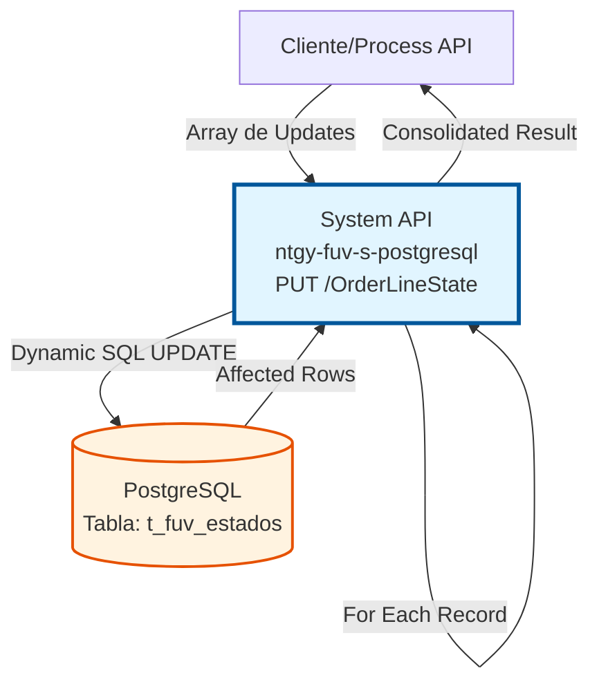
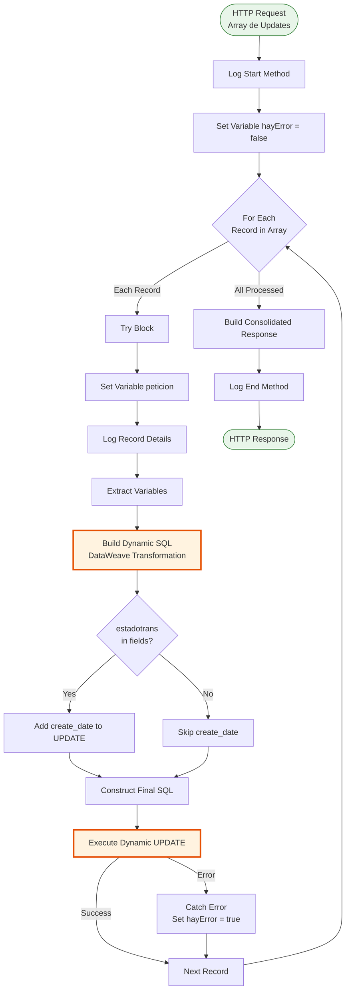
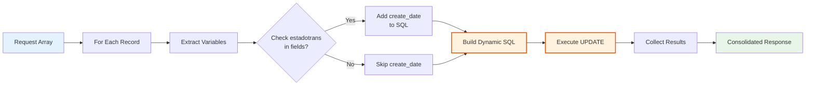

# PUT /OrderLineState

## 📌 Descripción General

### Propósito del Endpoint

Este endpoint actualiza dinámicamente los campos de estado de líneas de pedido en la tabla de control `t_fuv_estados`. A diferencia de un UPDATE tradicional, este endpoint permite especificar qué campos actualizar mediante un array de campos y valores, construyendo la query SQL dinámicamente en tiempo de ejecución.

El endpoint soporta:
- **Actualización Dinámica de Campos**: Permite actualizar cualquier combinación de campos especificados en el request
- **Actualización Masiva**: Procesa múltiples líneas de pedido en un solo request mediante iteración
- **Timestamp Automático**: Actualiza automáticamente `send_date` con timezone de Madrid
- **Lógica Condicional**: Si se actualiza `estadotrans`, también actualiza `create_date`
- **Manejo de Errores Robusto**: Continúa procesando registros aunque algunos fallen

### Tipo de API

**Capa:** System API (API-Led Connectivity)

**Función:** Integración directa con PostgreSQL para actualización flexible de estados de líneas de pedido.

### Patrón de Integración

**Tipo:** Request-Reply Síncrono con SQL Dinámico

**Descripción:** Recibe un array de objetos con campos a actualizar, construye dinámicamente queries SQL UPDATE para cada registro, ejecuta las actualizaciones en iteración, y retorna un resultado consolidado.

### Arquitectura API-Led Connectivity



---

## 💼 Propósito del Negocio

### Casos de Uso Principales

1. **Actualización Flexible de Estados**
   - Permite actualizar solo los campos necesarios sin sobrescribir otros
   - Útil cuando diferentes procesos actualizan diferentes campos
   - Reduce la complejidad de tener múltiples endpoints de actualización

2. **Procesamiento Masivo de Cambios de Estado**
   - Actualiza múltiples líneas de pedido en una sola llamada
   - Optimiza el rendimiento al reducir llamadas HTTP
   - Mantiene consistencia en actualizaciones batch

3. **Tracking de Cambios de Estado con Timestamps**
   - Registra automáticamente la fecha de envío con timezone correcto
   - Actualiza fecha de creación cuando cambia el estado de transacción
   - Facilita auditoría y trazabilidad de cambios

### Contexto Empresarial

- **Dominio:** Gestión de Pedidos y Estados
- **Sector:** Energía - Utilities
- **División:** Naturgy España - FUV (Facturación Única Virtual)
- **Proceso de Negocio:** Control de estados de líneas de pedido en workflow de procesamiento
- **Tabla de Control:** `t_fuv_estados` - Tabla de control de estados de líneas de pedido

### Stakeholders

- **Equipos de Integración**: Necesitan flexibilidad para actualizar diferentes campos según el contexto
- **Sistemas de Procesamiento de Pedidos**: Actualizan estados según el progreso del workflow
- **Equipos de Monitoreo**: Requieren timestamps precisos para tracking y auditoría

### Valor de Negocio

- **Flexibilidad**: Un solo endpoint para múltiples escenarios de actualización
- **Eficiencia**: Procesamiento batch reduce overhead de red y base de datos
- **Trazabilidad**: Timestamps automáticos con timezone correcto
- **Mantenibilidad**: Reduce la necesidad de crear múltiples endpoints especializados

### Consumidores Potenciales

Este endpoint puede ser consumido por:
- Process APIs de gestión de pedidos
- Sistemas de workflow de procesamiento de pedidos
- Servicios de sincronización de estados
- Procesos batch de actualización masiva

---

## 🔧 Especificación Técnica

### URLs por Ambiente

| Ambiente | URL Base | URL Completa |
|----------|----------|--------------|
| **Local** | `http://localhost:8081` | `http://localhost:8081/api/OrderLineState` |
| **Development** | `https://ntgy-fuv-s-postgresql-dev.us-e2.cloudhub.io` | `https://ntgy-fuv-s-postgresql-dev.us-e2.cloudhub.io/api/OrderLineState` |
| **UAT** | `https://ntgy-fuv-s-postgresql-uat.us-e2.cloudhub.io` | `https://ntgy-fuv-s-postgresql-uat.us-e2.cloudhub.io/api/OrderLineState` |
| **Production** | `https://ntgy-fuv-s-postgresql-pro.us-e2.cloudhub.io` | `https://ntgy-fuv-s-postgresql-pro.us-e2.cloudhub.io/api/OrderLineState` |

### Método HTTP

```
PUT /api/OrderLineState
```

### Parámetros de Entrada

#### Headers HTTP

| Header | Tipo | Requerido | Descripción | Ejemplo |
|--------|------|-----------|-------------|---------|
| `Content-Type` | string | ✅ Sí | Tipo de contenido del request | `application/json` |
| `Accept` | string | ❌ No | Tipo de contenido esperado en response | `application/json` |

#### Body Parameters

**Estructura del Request:**

El body debe ser un **array de objetos**, donde cada objeto representa una línea de pedido a actualizar:

```json
[
  {
    "idpedidodarwin": "string",
    "idproductoservicio": "string",
    "update": {
      "field": ["campo1", "campo2", "campoN"],
      "value": ["valor1", "valor2", "valorN"]
    }
  }
]
```

**Campos del Objeto:**

| Campo | Tipo | Requerido | Descripción |
|-------|------|-----------|-------------|
| `idpedidodarwin` | string | ✅ Sí | Identificador del pedido Darwin (clave primaria compuesta) |
| `idproductoservicio` | string | ✅ Sí | Identificador del producto/servicio (clave primaria compuesta) |
| `update` | object | ✅ Sí | Objeto que contiene los campos a actualizar |
| `update.field` | array[string] | ✅ Sí | Array de nombres de campos a actualizar |
| `update.value` | array[string] | ✅ Sí | Array de valores correspondientes a cada campo |

**Campos Actualizables:**

Los siguientes campos pueden ser actualizados dinámicamente:

| Campo | Tipo | Descripción |
|-------|------|-------------|
| `estadotrans` | string | Estado de la transacción (si se actualiza, también se actualiza `create_date`) |
| `send_status` | string | Estado de envío |
| `send_retry` | number | Número de reintentos de envío |
| `origen` | string | Origen del registro |
| `datos` | json | Datos adicionales en formato JSON |

**Campos Actualizados Automáticamente:**

| Campo | Valor | Descripción |
|-------|-------|-------------|
| `send_date` | `timezone('Europe/Madrid'::text, CURRENT_TIMESTAMP)` | Fecha de envío con timezone de Madrid (siempre se actualiza) |
| `create_date` | `timezone('Europe/Madrid'::text, CURRENT_TIMESTAMP)` | Fecha de creación (solo si se actualiza `estadotrans`) |

### Respuestas

#### Respuesta Exitosa (200 OK)

```json
{
  "result": {
    "codResult": "0000",
    "msgResult": "Actualización Masiva: Sin errores"
  }
}
```

#### Respuesta con Errores Parciales (200 OK)

```json
{
  "result": {
    "codResult": "0000",
    "msgResult": "Actualización Masiva: con algún error"
  }
}
```

**Nota:** El endpoint procesa todos los registros del array y retorna un resultado consolidado. Si algunos registros fallan, continúa procesando los demás.

#### Respuesta de Error Técnico (500)

```json
{
  "result": {
    "codResult": "0001",
    "msgResult": "Error interno del servidor"
  }
}
```

### Autenticación y Autorización

- **Tipo:** Client ID & Client Secret (Anypoint Platform)
- **Autorización PostgreSQL:** El usuario de base de datos debe tener permisos para:
  - UPDATE en tabla `t_fuv_estados`
  - Acceso al schema `public`

### Timeouts

| Tipo | Valor | Descripción |
|------|-------|-------------|
| **Request Timeout** | 60 segundos | Tiempo máximo de espera (mayor por procesamiento batch) |
| **Connection Timeout** | 10 segundos | Tiempo máximo para establecer conexión con BD |
| **Query Timeout** | 30 segundos | Tiempo máximo por query individual |

---

## 🏗️ Implementación Técnica

### Arquitectura del Flow



### Componentes del Flow

#### 1. Subflow Principal
- **Nombre:** `s-postgresql-OrderLineStates_update`
- **Ubicación:** `s-postgresql-OrderLineStates.xml` (líneas 122-220)
- **Tipo:** Sub-flow

#### 2. Logging Inicial
```xml
<logger level="INFO" message="STARTING updateOrderLinesState METHOD." />
```

#### 3. Inicialización de Variable de Control
```xml
<set-variable value="#[false]" variableName="hayError" />
```

#### 4. Iteración For-Each
```xml
<foreach collection="payload">
  <!-- Procesa cada registro del array -->
</foreach>
```

#### 5. Extracción de Variables (DataWeave)

**Ubicación:** Líneas 129-150

```dataweave
%dw 2.0
output application/java
---
{
  idproductoservicio: payload.idproductoservicio default "",
  idpedidodarwin: payload.idpedidodarwin,
  fields: payload.update.field,
  values: payload.update.value
}
```

#### 6. Construcción Dinámica de SQL (DataWeave)

**Ubicación:** Líneas 151-180

**Lógica de Construcción:**

```dataweave
%dw 2.0
output application/java

// Detecta si se está actualizando estadotrans
var l_cambioEstado = (vars.fields contains "estadotrans")

// Construye la sentencia base
var sentence_0 = "UPDATE t_fuv_estados SET send_date = timezone('Europe/Madrid'::text, CURRENT_TIMESTAMP), "

// Si cambia estado, añade actualización de create_date
var sentence_1 = sentence_0 ++ 
  if(l_cambioEstado) 
    "create_date = timezone('Europe/Madrid'::text, CURRENT_TIMESTAMP), " 
  else ""

var sentence_2 = " WHERE idpedidodarwin = "
var sentence_3 = " AND idproductoservicio = "

// Función para construir "field = 'value'" por cada campo
fun setFieldsValuesSentence(listFields) = 
  listFields map (field, findex) -> {
    printString: field ++ " = '" ++ 
      (vars.values filter ((item, vindex) -> (findex == vindex)) map $)[0] 
      ++ "'"
  }

// Aplica la función y guarda resultado
var fieldsValuesSentence = setFieldsValuesSentence(vars.fields)

// Une los strings con comas
fun buildSentence(listfieldsValuesSentence) = 
  listfieldsValuesSentence joinBy ", "

// Construye la sentencia SET completa
var SETSentenceGenerated = buildSentence(fieldsValuesSentence.printString)

---
// Retorna la query SQL completa
sentence_1 ++ SETSentenceGenerated ++ sentence_2 ++ 
  "'" ++ vars.idpedidodarwin ++ "'" ++ sentence_3 ++ 
  "'" ++ vars.idproductoservicio ++ "'"
```

**Ejemplo de SQL Generado:**

Si el request contiene:
```json
{
  "idpedidodarwin": "PED123",
  "idproductoservicio": "PROD456",
  "update": {
    "field": ["estadotrans", "send_status", "send_retry"],
    "value": ["COMPLETED", "SENT", "0"]
  }
}
```

Se genera:
```sql
UPDATE t_fuv_estados 
SET send_date = timezone('Europe/Madrid'::text, CURRENT_TIMESTAMP), 
    create_date = timezone('Europe/Madrid'::text, CURRENT_TIMESTAMP), 
    estadotrans = 'COMPLETED', 
    send_status = 'SENT', 
    send_retry = '0' 
WHERE idpedidodarwin = 'PED123' 
  AND idproductoservicio = 'PROD456'
```

#### 7. Ejecución de UPDATE

**Ubicación:** Líneas 181-190

```xml
<db:update config-ref="Database_Config">
  <db:sql><![CDATA[#[vars.payloadUpdate]]]></db:sql>
</db:update>
```

#### 8. Manejo de Errores

```xml
<error-handler>
  <on-error-continue type="ANY">
    <logger level="INFO" message="Error en actualización" />
    <set-variable value="#[true]" variableName="hayError" />
  </on-error-continue>
</error-handler>
```

**Estrategia:** Continúa procesando registros aunque algunos fallen.

#### 9. Respuesta Consolidada

```dataweave
%dw 2.0
output application/json
---
{
  "result": {
    "codResult": "0000",
    "msgResult": "Actualización Masiva: " ++ 
      if (vars.hayError) "con algún error" else "Sin errores"
  }
}
```

### Diagrama de Transformación de Datos



### Tabla de Control: t_fuv_estados

**Campos de la Tabla:**

| Campo | Tipo | Descripción | Actualizable |
|-------|------|-------------|--------------|
| `idpedidodarwin` | string | ID del pedido Darwin (PK) | ❌ No (WHERE) |
| `idproductoservicio` | string | ID del producto/servicio (PK) | ❌ No (WHERE) |
| `estadotrans` | string | Estado de la transacción | ✅ Sí |
| `send_status` | string | Estado de envío | ✅ Sí |
| `send_date` | timestamp | Fecha de envío | ✅ Auto |
| `send_retry` | integer | Número de reintentos | ✅ Sí |
| `create_date` | timestamp | Fecha de creación | ✅ Condicional |
| `origen` | string | Origen del registro | ✅ Sí |
| `datos` | jsonb | Datos adicionales | ✅ Sí |

### Características Especiales

1. **SQL Dinámico**: La query se construye en tiempo de ejecución basándose en los campos especificados
2. **Actualización Condicional de create_date**: Solo se actualiza si `estadotrans` está en los campos a actualizar
3. **Timezone Automático**: Todos los timestamps usan timezone de Madrid
4. **Procesamiento Resiliente**: Continúa procesando aunque algunos registros fallen
5. **Logging Detallado**: Registra cada operación para auditoría

---

## 💻 Ejemplos de Uso

### Ejemplo 1: Actualizar Estado y Status de Envío

**Request:**

```bash
curl -X PUT "https://ntgy-fuv-s-postgresql-dev.us-e2.cloudhub.io/api/OrderLineState" \
  -H "Content-Type: application/json" \
  -H "client_id: your-client-id" \
  -H "client_secret: your-client-secret" \
  -d '[
    {
      "idpedidodarwin": "PED001",
      "idproductoservicio": "PROD001",
      "update": {
        "field": ["estadotrans", "send_status"],
        "value": ["COMPLETED", "SENT"]
      }
    }
  ]'
```

**SQL Generado:**

```sql
UPDATE t_fuv_estados 
SET send_date = timezone('Europe/Madrid'::text, CURRENT_TIMESTAMP), 
    create_date = timezone('Europe/Madrid'::text, CURRENT_TIMESTAMP), 
    estadotrans = 'COMPLETED', 
    send_status = 'SENT' 
WHERE idpedidodarwin = 'PED001' 
  AND idproductoservicio = 'PROD001'
```

**Response (200 OK):**

```json
{
  "result": {
    "codResult": "0000",
    "msgResult": "Actualización Masiva: Sin errores"
  }
}
```

### Ejemplo 2: Actualizar Solo Reintentos (Sin Cambio de Estado)

**Request:**

```bash
curl -X PUT "https://ntgy-fuv-s-postgresql-dev.us-e2.cloudhub.io/api/OrderLineState" \
  -H "Content-Type: application/json" \
  -H "client_id: your-client-id" \
  -H "client_secret: your-client-secret" \
  -d '[
    {
      "idpedidodarwin": "PED002",
      "idproductoservicio": "PROD002",
      "update": {
        "field": ["send_retry", "send_status"],
        "value": ["3", "RETRY"]
      }
    }
  ]'
```

**SQL Generado:**

```sql
UPDATE t_fuv_estados 
SET send_date = timezone('Europe/Madrid'::text, CURRENT_TIMESTAMP), 
    send_retry = '3', 
    send_status = 'RETRY' 
WHERE idpedidodarwin = 'PED002' 
  AND idproductoservicio = 'PROD002'
```

**Nota:** Como no se actualiza `estadotrans`, NO se actualiza `create_date`.

**Response (200 OK):**

```json
{
  "result": {
    "codResult": "0000",
    "msgResult": "Actualización Masiva: Sin errores"
  }
}
```

### Ejemplo 3: Actualización Masiva de Múltiples Registros

**Request:**

```bash
curl -X PUT "https://ntgy-fuv-s-postgresql-dev.us-e2.cloudhub.io/api/OrderLineState" \
  -H "Content-Type: application/json" \
  -H "client_id: your-client-id" \
  -H "client_secret: your-client-secret" \
  -d '[
    {
      "idpedidodarwin": "PED003",
      "idproductoservicio": "PROD003",
      "update": {
        "field": ["send_status"],
        "value": ["SENT"]
      }
    },
    {
      "idpedidodarwin": "PED004",
      "idproductoservicio": "PROD004",
      "update": {
        "field": ["estadotrans", "send_status"],
        "value": ["FAILED", "ERROR"]
      }
    },
    {
      "idpedidodarwin": "PED005",
      "idproductoservicio": "PROD005",
      "update": {
        "field": ["send_retry"],
        "value": ["1"]
      }
    }
  ]'
```

**Response (200 OK):**

```json
{
  "result": {
    "codResult": "0000",
    "msgResult": "Actualización Masiva: Sin errores"
  }
}
```

### Ejemplo 4: Actualización con Errores Parciales

**Escenario:** Uno de los registros no existe en la base de datos.

**Response (200 OK):**

```json
{
  "result": {
    "codResult": "0000",
    "msgResult": "Actualización Masiva: con algún error"
  }
}
```

**Nota:** El endpoint continúa procesando los demás registros aunque uno falle.

### Ejemplo 5: Error de Validación (400 Bad Request)

**Request Inválido:**

```json
[
  {
    "idpedidodarwin": "PED006",
    "update": {
      "field": ["send_status"],
      "value": ["SENT"]
    }
  }
]
```

**Error:** Falta el campo obligatorio `idproductoservicio`.

**Response (400 Bad Request):**

```json
{
  "result": {
    "codResult": "0001",
    "msgResult": "Error de validación: campo obligatorio faltante"
  }
}
```

### Ejemplo 6: Actualizar con Datos JSON

**Request:**

```bash
curl -X PUT "https://ntgy-fuv-s-postgresql-dev.us-e2.cloudhub.io/api/OrderLineState" \
  -H "Content-Type: application/json" \
  -H "client_id: your-client-id" \
  -H "client_secret: your-client-secret" \
  -d '[
    {
      "idpedidodarwin": "PED007",
      "idproductoservicio": "PROD007",
      "update": {
        "field": ["datos", "send_status"],
        "value": ["{\"metadata\": \"value\"}", "SENT"]
      }
    }
  ]'
```

**SQL Generado:**

```sql
UPDATE t_fuv_estados 
SET send_date = timezone('Europe/Madrid'::text, CURRENT_TIMESTAMP), 
    datos = '{"metadata": "value"}', 
    send_status = 'SENT' 
WHERE idpedidodarwin = 'PED007' 
  AND idproductoservicio = 'PROD007'
```

---

## 📊 Consideraciones de Rendimiento

### Optimizaciones Implementadas

1. **Procesamiento Batch**: Múltiples registros en una sola llamada HTTP
2. **Queries Optimizadas**: UPDATE con WHERE en claves primarias compuestas
3. **Manejo de Errores Resiliente**: No detiene el procesamiento por errores individuales
4. **Logging Selectivo**: INFO level para operaciones normales, DEBUG para detalles

### Límites y Restricciones

- **Tamaño del Array**: Recomendado máximo 100 registros por request
- **Timeout**: 60 segundos para procesamiento completo
- **Campos Actualizables**: Solo campos existentes en la tabla `t_fuv_estados`

### Mejores Prácticas

1. **Validar Datos Antes de Enviar**: Asegurar que todos los campos obligatorios estén presentes
2. **Limitar Tamaño de Batch**: No exceder 100 registros por request
3. **Manejar Respuestas con Errores**: Verificar el mensaje de respuesta para detectar errores parciales
4. **Usar Reintentos**: Implementar lógica de reintento para registros que fallen

---

## 🔒 Seguridad

### Autenticación

- Client ID y Client Secret gestionados por Anypoint Platform
- Credenciales de base de datos encriptadas con Secure Properties

### Prevención de SQL Injection

- **Construcción Dinámica Controlada**: Aunque la query es dinámica, los valores se parametrizan
- **Validación de Campos**: Solo se permiten campos existentes en la tabla
- **Escape de Valores**: Los valores se escapan correctamente en la construcción SQL

### Auditoría

- Logging completo de todas las operaciones
- Timestamps automáticos con timezone correcto
- Trazabilidad de cambios por pedido y producto

---

## 🐛 Troubleshooting

### Problema: "Actualización Masiva: con algún error"

**Causa:** Uno o más registros del array fallaron al actualizarse.

**Solución:**
1. Revisar logs para identificar qué registros fallaron
2. Verificar que los IDs existan en la base de datos
3. Validar que los valores sean del tipo correcto
4. Reintentar solo los registros que fallaron

### Problema: Timeout en Requests Grandes

**Causa:** Array con demasiados registros.

**Solución:**
1. Reducir el tamaño del array a máximo 100 registros
2. Dividir en múltiples requests
3. Implementar procesamiento asíncrono para volúmenes grandes

### Problema: Campos No Se Actualizan

**Causa:** Nombres de campos incorrectos en el array `field`.

**Solución:**
1. Verificar que los nombres de campos coincidan exactamente con la tabla
2. Revisar que el array `field` y `value` tengan el mismo tamaño
3. Consultar la documentación de la tabla `t_fuv_estados`

---

## 📝 Notas Adicionales

### Diferencias con Otros Endpoints de Actualización

- **POST /OrderLineState**: Crea nuevos registros
- **PUT /OrderLineState**: Actualiza registros existentes con SQL dinámico
- **DELETE /OrderLineState**: Elimina registros

### Evolución del Endpoint

Este endpoint fue diseñado para proporcionar máxima flexibilidad en la actualización de estados