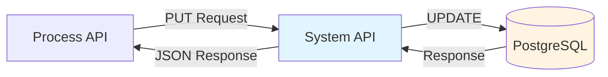
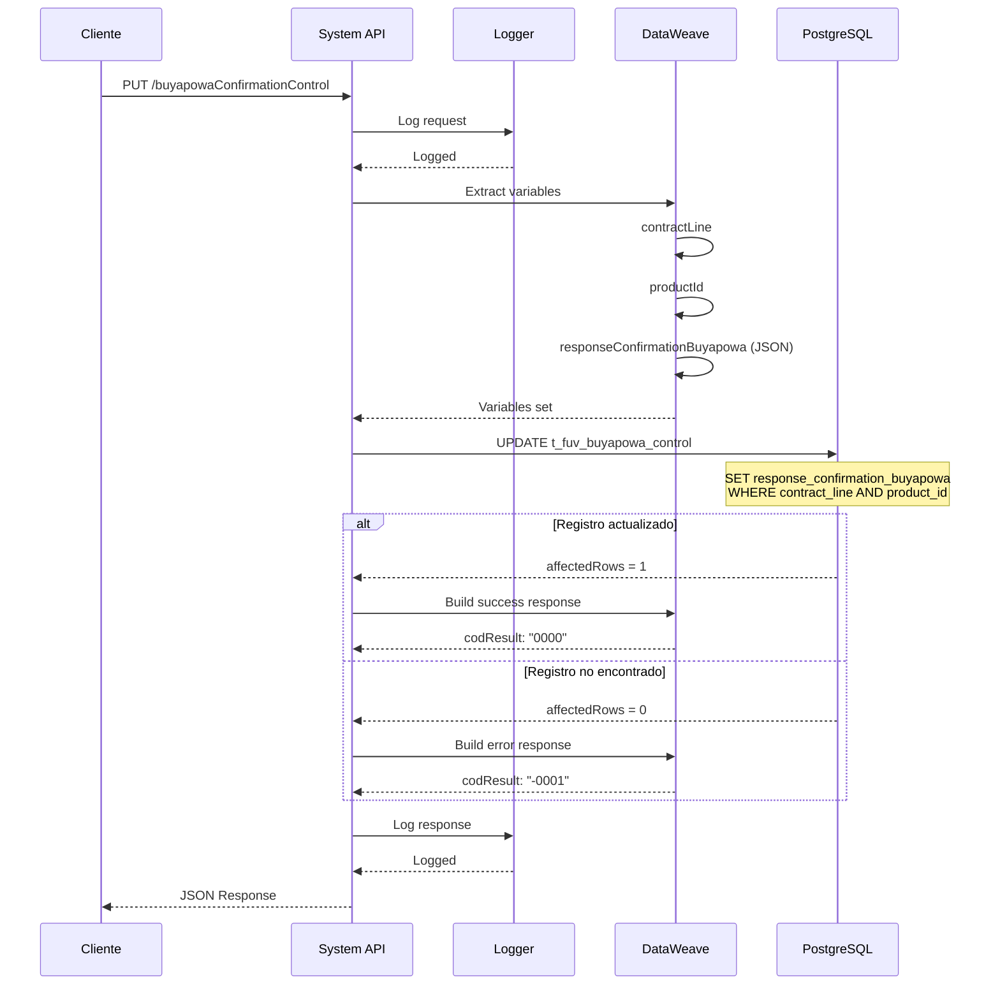
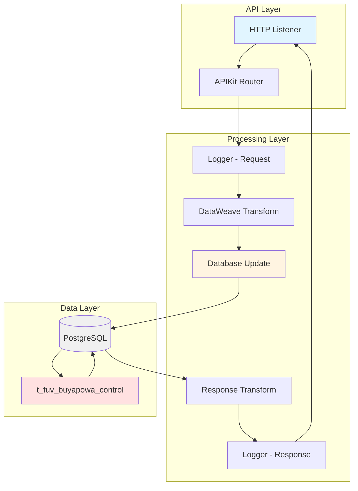
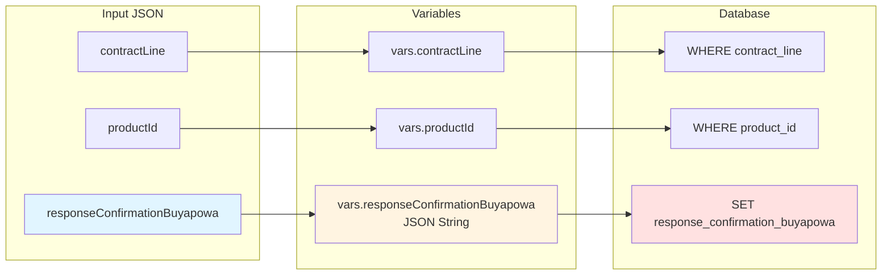

# PUT /buyapowaConfirmationControl

## 📌 Descripción General

### Tipo de API
**System API** - Capa de acceso a datos en arquitectura API-Led Connectivity

### Propósito
Actualiza la respuesta de confirmación de Buyapowa en la tabla de control de eventos, registrando el resultado del proceso de confirmación para una línea de contrato y producto específicos.

### Patrón de Integración
- **Patrón**: Request-Reply (Síncrono)
- **Backend**: PostgreSQL Database
- **Operación**: UPDATE
- **Tabla**: `t_fuv_buyapowa_control`

### Arquitectura



---

## 💼 Propósito del Negocio

### Objetivo de Negocio
Registrar y mantener la trazabilidad de las confirmaciones de eventos del programa de fidelización Buyapowa, permitiendo el seguimiento completo del ciclo de vida de las recompensas y referencias.

### Casos de Uso

#### 1. Confirmación de Recompensa Procesada
**Actor**: Sistema de Buyapowa  
**Flujo**:
1. Buyapowa procesa una recompensa para un cliente
2. El sistema recibe la confirmación del procesamiento
3. Se actualiza el registro de control con la respuesta de confirmación
4. Se mantiene el histórico completo del evento

#### 2. Actualización de Estado de Referencia
**Actor**: Sistema de Gestión de Contratos  
**Flujo**:
1. Se completa el proceso de confirmación de una referencia
2. Se actualiza el control con los detalles de la confirmación
3. Se registra la fecha y respuesta de confirmación
4. Se habilita la consulta del estado actualizado

#### 3. Trazabilidad de Eventos Buyapowa
**Actor**: Sistema de Auditoría  
**Flujo**:
1. Se requiere auditar el proceso de confirmación
2. Se consulta el registro de control actualizado
3. Se verifica la respuesta de confirmación almacenada
4. Se valida la integridad del proceso

### Valor de Negocio
- ✅ **Trazabilidad Completa**: Registro detallado de todas las confirmaciones
- ✅ **Integridad de Datos**: Mantiene la coherencia del estado de eventos
- ✅ **Auditoría**: Facilita la auditoría de procesos de fidelización
- ✅ **Soporte**: Permite resolver incidencias con información completa

### Stakeholders
- **Equipo de Fidelización**: Gestión del programa Buyapowa
- **Servicio al Cliente**: Resolución de consultas sobre recompensas
- **Auditoría**: Verificación de procesos de confirmación
- **Desarrollo**: Mantenimiento de integraciones con Buyapowa

---

## 🔧 Especificación Técnica

### Endpoint
```
PUT /buyapowaConfirmationControl
```

### URLs por Ambiente

| Ambiente | URL Base | URL Completa |
|----------|----------|--------------|
| **Local** | `http://localhost:8081` | `http://localhost:8081/api/buyapowaConfirmationControl` |
| **Desarrollo** | `https://dev-ntgy-fuv-s-postgresql.cloudhub.io` | `https://dev-ntgy-fuv-s-postgresql.cloudhub.io/api/buyapowaConfirmationControl` |
| **UAT** | `https://uat-ntgy-fuv-s-postgresql.cloudhub.io` | `https://uat-ntgy-fuv-s-postgresql.cloudhub.io/api/buyapowaConfirmationControl` |
| **Producción** | `https://ntgy-fuv-s-postgresql.cloudhub.io` | `https://ntgy-fuv-s-postgresql.cloudhub.io/api/buyapowaConfirmationControl` |

### Método HTTP
```http
PUT /api/buyapowaConfirmationControl
```

### Headers

| Header | Valor | Obligatorio | Descripción |
|--------|-------|-------------|-------------|
| `Content-Type` | `application/json` | ✅ Sí | Formato del body de la petición |
| `Accept` | `application/json` | ✅ Sí | Formato de respuesta esperado |
| `client_id` | `string` | ✅ Sí | Client ID de Anypoint Platform |
| `client_secret` | `string` | ✅ Sí | Client Secret de Anypoint Platform |

### Request Body

#### Estructura JSON
```json
{
  "contractLine": "string",
  "productId": "string",
  "responseConfirmationBuyapowa": {
    "confirmationId": "string",
    "status": "string",
    "timestamp": "string",
    "details": {}
  }
}
```

#### Parámetros del Body

| Campo | Tipo | Obligatorio | Descripción | Ejemplo |
|-------|------|-------------|-------------|---------|
| `contractLine` | String | ✅ Sí | Línea de contrato a actualizar | `"0000123456"` |
| `productId` | String | ✅ Sí | ID del producto asociado | `"PROD001"` |
| `responseConfirmationBuyapowa` | Object | ✅ Sí | Respuesta de confirmación de Buyapowa (se almacena como JSON) | Ver estructura abajo |

#### Estructura de responseConfirmationBuyapowa

| Campo | Tipo | Descripción | Ejemplo |
|-------|------|-------------|---------|
| `confirmationId` | String | ID de confirmación de Buyapowa | `"CONF-2024-001"` |
| `status` | String | Estado de la confirmación | `"CONFIRMED"` |
| `timestamp` | String | Fecha/hora de confirmación | `"2024-01-15T10:30:00Z"` |
| `details` | Object | Detalles adicionales de la confirmación | `{}` |

### Responses

#### ✅ 200 OK - Actualización Exitosa
```json
{
  "result": {
    "codResult": "0000",
    "msgResult": "No hay error"
  }
}
```

#### ⚠️ 200 OK - Registro No Encontrado o No Actualizado
```json
{
  "result": {
    "codResult": "-0001",
    "msgResult": "Ha habido un error en la actualización del registro o el registro no existe"
  }
}
```

#### ❌ 400 Bad Request - Datos Inválidos
```json
{
  "error": {
    "code": "BAD_REQUEST",
    "message": "Invalid request body",
    "details": "Missing required field: contractLine"
  }
}
```

#### ❌ 500 Internal Server Error - Error del Servidor
```json
{
  "error": {
    "code": "INTERNAL_ERROR",
    "message": "Database connection error",
    "details": "Unable to connect to PostgreSQL database"
  }
}
```

### Códigos de Estado HTTP

| Código | Descripción | Cuándo Ocurre |
|--------|-------------|---------------|
| `200` | OK | Operación procesada (verificar `codResult` en el body) |
| `400` | Bad Request | Datos de entrada inválidos o incompletos |
| `401` | Unauthorized | Credenciales de API inválidas o ausentes |
| `500` | Internal Server Error | Error en la base de datos o del servidor |
| `503` | Service Unavailable | Base de datos no disponible |

---

## 🏗️ Implementación Técnica

### Flujo de Ejecución



### Arquitectura de Capas



### Componentes Técnicos

#### 1. Flow Principal
**Nombre**: `s-postgresql-updateBuyapowaConfirmationControl`  
**Ubicación**: `src/main/mule/s-postgresql-buyapowaControl.xml` (líneas 170-220)

#### 2. Logging de Request
```dataweave
%dw 2.0
output application/java

var payloadStr = write(payload,'application/json')
var request = common::commonFunctions::normalizeJSON(payloadStr)
---
'STARTING updateBuyapowaConfirmationControl METHOD. REQUEST: ' ++ request
```

#### 3. Extracción de Variables
```dataweave
%dw 2.0
output application/java
---
// Variable: contractLine
payload.contractLine

// Variable: responseConfirmationBuyapowa (convertido a JSON string)
write(payload.responseConfirmationBuyapowa, 'application/json')
```

**Nota**: La variable `productId` se referencia en el query pero no se extrae explícitamente en el transform visible, lo que sugiere que podría estar disponible en el contexto o en `vars.productId` de un flow anterior.

#### 4. Operación de Base de Datos

**Tipo**: `db:update`  
**Configuración**: `Database_Config`  
**Query**: `${queries.updateBuyapowaConfirmationControl}`

**Parámetros de Entrada**:
```dataweave
{
  contractLine: vars.contractLine,
  productId: vars.productId,
  responseConfirmationBuyapowa: vars.responseConfirmationBuyapowa
}
```

**Query SQL Esperado** (basado en parámetros):
```sql
UPDATE t_fuv_buyapowa_control
SET response_confirmation_buyapowa = :responseConfirmationBuyapowa,
    confirmation_date = CURRENT_TIMESTAMP
WHERE contract_line = :contractLine
  AND product_id = :productId
```

#### 5. Transformación de Respuesta
```dataweave
%dw 2.0
output application/json
---
{
  "result": {
    "codResult": if (payload.affectedRows == 1) "0000" else "-0001",
    "msgResult": if (payload.affectedRows == 1) 
                    "No hay error" 
                 else 
                    "Ha habido un error en la actualización del registro o el registro no existe"
  }
}
```

#### 6. Logging de Response
```dataweave
%dw 2.0
output application/java

var payloadStr = write(payload,'application/json')
var response = common::commonFunctions::normalizeJSON(payloadStr)
---
'FINISHED updateBuyapowaConfirmationControl METHOD. RESPONSE: ' ++ response
```

### Tabla de Base de Datos

#### t_fuv_buyapowa_control

| Campo | Tipo | Descripción | Actualizado por este Endpoint |
|-------|------|-------------|-------------------------------|
| `t_fuv_buyapowa_control_id` | SERIAL | ID único del registro | ❌ No |
| `contract_id` | VARCHAR | ID del contrato | ❌ No |
| `contract_line` | VARCHAR | Línea de contrato (WHERE) | ❌ No (usado en WHERE) |
| `product_id` | VARCHAR | ID del producto (WHERE) | ❌ No (usado en WHERE) |
| `codigo_amigo` | VARCHAR | Código de amigo referido | ❌ No |
| `response_tracking_buyapowa` | JSONB | Respuesta de tracking | ❌ No |
| `response_confirmation_buyapowa` | JSONB | Respuesta de confirmación | ✅ **Sí** |
| `contract_status` | VARCHAR | Estado del contrato | ❌ No |
| `tracking_date` | TIMESTAMP | Fecha de tracking | ❌ No |
| `update_status_date` | TIMESTAMP | Fecha de actualización de estado | ❌ No |
| `confirmation_date` | TIMESTAMP | Fecha de confirmación | ⚠️ Posiblemente (no visible en código) |

### Transformación de Datos



### Manejo de Errores

#### Estrategia de Error Handling
- **Validación de Entrada**: Realizada por APIKit basándose en RAML
- **Errores de Base de Datos**: Capturados por el conector DB
- **Registro No Encontrado**: Detectado por `affectedRows = 0`
- **Logging**: Todos los errores se registran en logs

#### Escenarios de Error

| Escenario | Detección | Respuesta |
|-----------|-----------|-----------|
| Campos obligatorios faltantes | APIKit validation | 400 Bad Request |
| Registro no existe | affectedRows = 0 | 200 OK con codResult "-0001" |
| Error de conexión DB | DB Connector | 500 Internal Server Error |
| Timeout de query | DB Connector | 500 Internal Server Error |
| JSON inválido en responseConfirmationBuyapowa | DataWeave | 400 Bad Request |

### Configuración

#### Database Config
```xml
<db:config name="Database_Config">
    <db:generic-connection 
        url="${dbFUV.url}"
        driverClassName="org.postgresql.Driver"
        user="${dbFUV.user}"
        password="${secure::dbFUV.password}"/>
</db:config>
```

#### Properties
- `queries.updateBuyapowaConfirmationControl`: Query SQL parametrizado
- `dbFUV.url`: URL de conexión a PostgreSQL
- `dbFUV.user`: Usuario de base de datos
- `secure::dbFUV.password`: Contraseña encriptada

---

## 💻 Ejemplos de Uso

### Ejemplo 1: Actualización Exitosa de Confirmación

#### Request
```bash
curl -X PUT "https://dev-ntgy-fuv-s-postgresql.cloudhub.io/api/buyapowaConfirmationControl" \
  -H "Content-Type: application/json" \
  -H "client_id: your-client-id" \
  -H "client_secret: your-client-secret" \
  -d '{
    "contractLine": "0000123456",
    "productId": "PROD001",
    "responseConfirmationBuyapowa": {
      "confirmationId": "CONF-2024-001",
      "status": "CONFIRMED",
      "timestamp": "2024-01-15T10:30:00Z",
      "rewardAmount": 50.00,
      "currency": "EUR",
      "details": {
        "referralCode": "REF123",
        "campaignId": "CAMP2024"
      }
    }
  }'
```

#### Response (200 OK)
```json
{
  "result": {
    "codResult": "0000",
    "msgResult": "No hay error"
  }
}
```

---

### Ejemplo 2: Registro No Encontrado

#### Request
```bash
curl -X PUT "https://dev-ntgy-fuv-s-postgresql.cloudhub.io/api/buyapowaConfirmationControl" \
  -H "Content-Type: application/json" \
  -H "client_id: your-client-id" \
  -H "client_secret: your-client-secret" \
  -d '{
    "contractLine": "9999999999",
    "productId": "PROD999",
    "responseConfirmationBuyapowa": {
      "confirmationId": "CONF-2024-002",
      "status": "CONFIRMED",
      "timestamp": "2024-01-15T11:00:00Z"
    }
  }'
```

#### Response (200 OK)
```json
{
  "result": {
    "codResult": "-0001",
    "msgResult": "Ha habido un error en la actualización del registro o el registro no existe"
  }
}
```

---

### Ejemplo 3: Confirmación con Detalles Completos

#### Request
```bash
curl -X PUT "https://uat-ntgy-fuv-s-postgresql.cloudhub.io/api/buyapowaConfirmationControl" \
  -H "Content-Type: application/json" \
  -H "client_id: your-client-id" \
  -H "client_secret: your-client-secret" \
  -d '{
    "contractLine": "0000789012",
    "productId": "ELEC-001",
    "responseConfirmationBuyapowa": {
      "confirmationId": "CONF-2024-003",
      "status": "CONFIRMED",
      "timestamp": "2024-01-15T12:00:00Z",
      "rewardAmount": 75.00,
      "currency": "EUR",
      "paymentMethod": "BANK_TRANSFER",
      "details": {
        "referralCode": "REF456",
        "campaignId": "CAMP2024-Q1",
        "referrerName": "Juan Pérez",
        "referredName": "María García",
        "contractType": "ELECTRICITY",
        "processingTime": "2.5s"
      }
    }
  }'
```

#### Response (200 OK)
```json
{
  "result": {
    "codResult": "0000",
    "msgResult": "No hay error"
  }
}
```

---

### Ejemplo 4: Error de Validación - Campo Faltante

#### Request
```bash
curl -X PUT "https://dev-ntgy-fuv-s-postgresql.cloudhub.io/api/buyapowaConfirmationControl" \
  -H "Content-Type: application/json" \
  -H "client_id: your-client-id" \
  -H "client_secret: your-client-secret" \
  -d '{
    "contractLine": "0000123456",
    "responseConfirmationBuyapowa": {
      "confirmationId": "CONF-2024-004",
      "status": "CONFIRMED"
    }
  }'
```

#### Response (400 Bad Request)
```json
{
  "error": {
    "code": "BAD_REQUEST",
    "message": "Invalid request body",
    "details": "Missing required field: productId"
  }
}
```

---

### Ejemplo 5: Uso desde JavaScript/Node.js

```javascript
const axios = require('axios');

async function updateBuyapowaConfirmation(contractLine, productId, confirmationData) {
  try {
    const response = await axios.put(
      'https://dev-ntgy-fuv-s-postgresql.cloudhub.io/api/buyapowaConfirmationControl',
      {
        contractLine: contractLine,
        productId: productId,
        responseConfirmationBuyapowa: confirmationData
      },
      {
        headers: {
          'Content-Type': 'application/json',
          'client_id': process.env.CLIENT_ID,
          'client_secret': process.env.CLIENT_SECRET
        }
      }
    );

    if (response.data.result.codResult === '0000') {
      console.log('✅ Confirmación actualizada exitosamente');
      return { success: true, data: response.data };
    } else {
      console.log('⚠️ Registro no encontrado o no actualizado');
      return { success: false, message: response.data.result.msgResult };
    }
  } catch (error) {
    console.error('❌ Error al actualizar confirmación:', error.message);
    return { success: false, error: error.message };
  }
}

// Ejemplo de uso
const confirmationData = {
  confirmationId: 'CONF-2024-005',
  status: 'CONFIRMED',
  timestamp: new Date().toISOString(),
  rewardAmount: 100.00,
  currency: 'EUR',
  details: {
    referralCode: 'REF789',
    campaignId: 'CAMP2024-Q1'
  }
};

updateBuyapowaConfirmation('0000123456', 'PROD001', confirmationData)
  .then(result => console.log('Resultado:', result));
```

---

### Ejemplo 6: Uso desde Python

```python
import requests
import json
from datetime import datetime
import os

def update_buyapowa_confirmation(contract_line, product_id, confirmation_data):
    """
    Actualiza la confirmación de Buyapowa para una línea de contrato
    
    Args:
        contract_line (str): Línea de contrato
        product_id (str): ID del producto
        confirmation_data (dict): Datos de confirmación
    
    Returns:
        dict: Resultado de la operación
    """
    url = "https://dev-ntgy-fuv-s-postgresql.cloudhub.io/api/buyapowaConfirmationControl"
    
    headers = {
        "Content-Type": "application/json",
        "client_id": os.getenv("CLIENT_ID"),
        "client_secret": os.getenv("CLIENT_SECRET")
    }
    
    payload = {
        "contractLine": contract_line,
        "productId": product_id,
        "responseConfirmationBuyapowa": confirmation_data
    }
    
    try:
        response = requests.put(url, headers=headers, json=payload)
        response.raise_for_status()
        
        result = response.json()
        
        if result["result"]["codResult"] == "0000":
            print("✅ Confirmación actualizada exitosamente")
            return {"success": True, "data": result}
        else:
            print("⚠️ Registro no encontrado o no actualizado")
            return {"success": False, "message": result["result"]["msgResult"]}
            
    except requests.exceptions.RequestException as e:
        print(f"❌ Error al actualizar confirmación: {str(e)}")
        return {"success": False, "error": str(e)}

# Ejemplo de uso
if __name__ == "__main__":
    confirmation_data = {
        "confirmationId": "CONF-2024-006",
        "status": "CONFIRMED",
        "timestamp": datetime.utcnow().isoformat() + "Z",
        "rewardAmount": 125.00,
        "currency": "EUR",
        "details": {
            "referralCode": "REF999",
            "campaignId": "CAMP2024-Q1",
            "processingTime": "1.8s"
        }
    }
    
    result = update_buyapowa_confirmation("0000123456", "PROD001", confirmation_data)
    print("Resultado:", json.dumps(result, indent=2))
```

---

### Ejemplo 7: Testing con Postman

#### Pre-request Script
```javascript
// Generar timestamp actual
pm.environment.set("timestamp", new Date().toISOString());

// Generar ID de confirmación único
const confirmationId = "CONF-" + new Date().getFullYear() + "-" + 
                       Math.floor(Math.random() * 10000).toString().padStart(4, '0');
pm.environment.set("confirmationId", confirmationId);
```

#### Request Body
```json
{
  "contractLine": "{{contractLine}}",
  "productId": "{{productId}}",
  "responseConfirmationBuyapowa": {
    "confirmationId": "{{confirmationId}}",
    "status": "CONFIRMED",
    "timestamp": "{{timestamp}}",
    "rewardAmount": 50.00,
    "currency": "EUR"
  }
}
```

#### Tests Script
```javascript
pm.test("Status code is 200", function () {
    pm.response.to.have.status(200);
});

pm.test("Response has result object", function () {
    var jsonData = pm.response.json();
    pm.expect(jsonData).to.have.property('result');
});

pm.test("Update was successful", function () {
    var jsonData = pm.response.json();
    pm.expect(jsonData.result.codResult).to.eql("0000");
});

pm.test("Response time is less than 3000ms", function () {
    pm.expect(pm.response.responseTime).to.be.below(3000);
});
```

---

## 📊 Información Adicional

### Performance
- **Tiempo de Respuesta Esperado**: < 2 segundos
- **Throughput**: ~100 requests/segundo
- **Timeout de Query**: 30 segundos

### Seguridad
- ✅ Autenticación mediante Client ID/Secret
- ✅ Conexión HTTPS obligatoria
- ✅ Credenciales de BD encriptadas
- ✅ Queries parametrizados (prevención SQL injection)

### Monitoreo
- **Logs**: Nivel INFO para request/response
- **Métricas**: Disponibles en Anypoint Monitoring
- **Alertas**: Configuradas para errores de BD

### Consideraciones
- El campo `responseConfirmationBuyapowa` se almacena como JSONB en PostgreSQL
- La actualización es atómica (transaccional)
- Si no se encuentra el registro, retorna código "-0001" pero HTTP 200
- El endpoint es idempotente (múltiples llamadas con los mismos datos producen el mismo resultado)

### Dependencias
- **Upstream**: Process APIs de gestión de Buyapowa
- **Downstream**: PostgreSQL Database (tabla `t_fuv_buyapowa_control`)