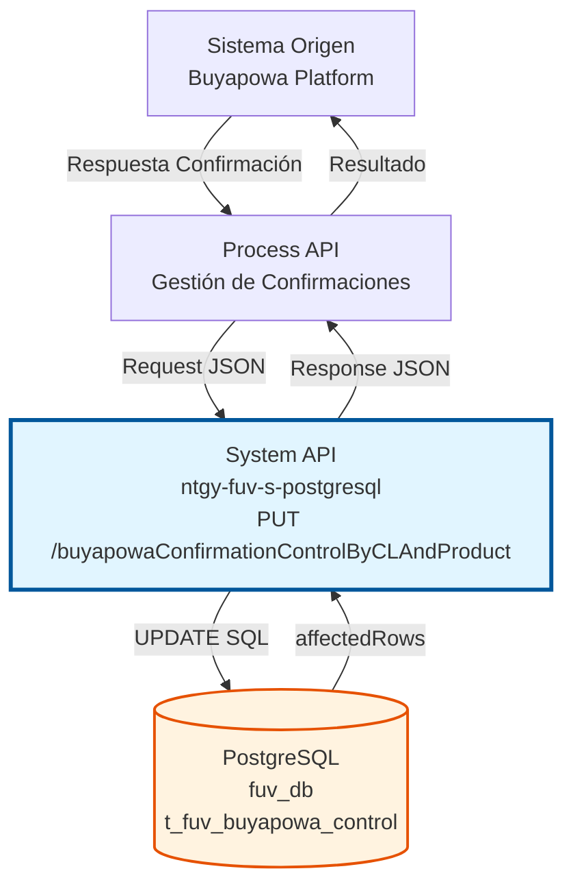
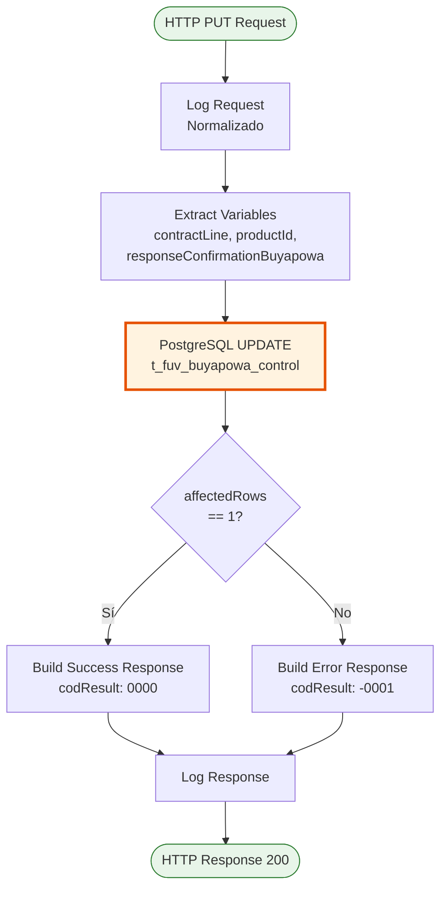
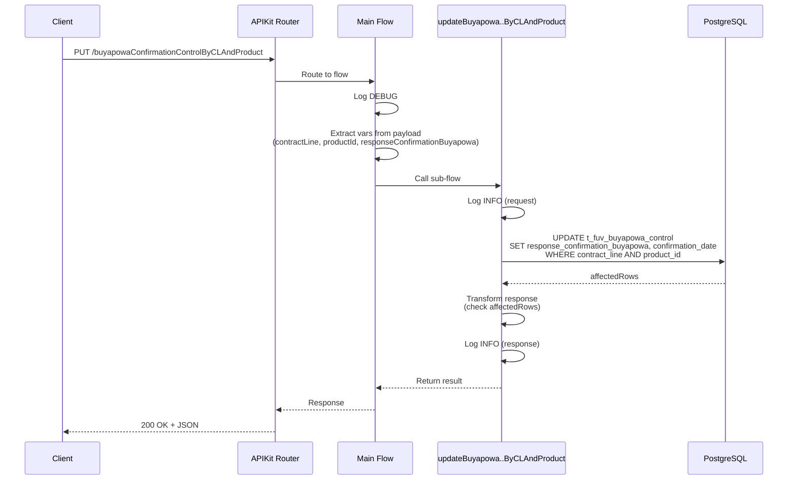
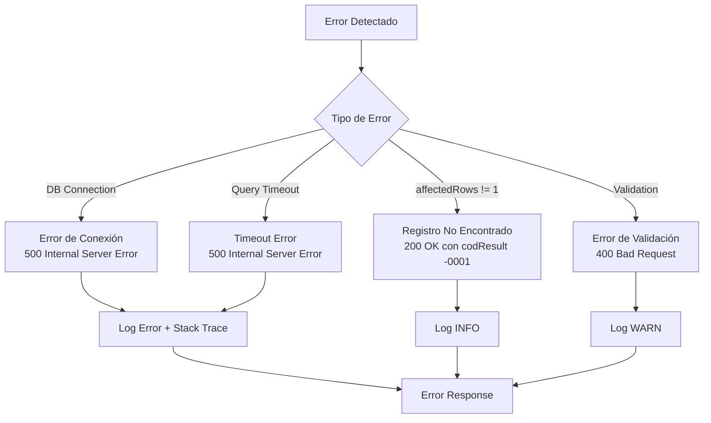

# PUT /buyapowaConfirmationControlByCLAndProduct

## 📌 Descripción General

### Propósito del Endpoint

Este endpoint actualiza la respuesta de confirmación de Buyapowa para un registro específico identificado por línea de contrato y producto en la tabla de control de integración con Buyapowa.

El endpoint soporta:
- **Actualización de confirmación**: Registra la respuesta de confirmación recibida desde Buyapowa
- **Registro de timestamp**: Almacena automáticamente la fecha y hora de confirmación
- **Identificación por clave compuesta**: Utiliza contract_line + product_id para identificar el registro único

### Tipo de API

**Capa:** System API (API-Led Connectivity)

**Función:** Integración directa con PostgreSQL para actualizar el estado de confirmación de registros de control de Buyapowa en el sistema FUV (Facturación Única Virtual).

### Patrón de Integración

**Tipo:** Request-Reply Síncrono con PostgreSQL UPDATE

**Descripción:** Recibe los datos de confirmación de Buyapowa, identifica el registro por línea de contrato y producto, ejecuta un UPDATE en PostgreSQL para almacenar la respuesta de confirmación y la fecha, y retorna el resultado de la operación.

### Arquitectura API-Led Connectivity



---

## 💼 Propósito del Negocio

### Casos de Uso Principales

1. **Confirmación de Referido Exitoso**
   - Buyapowa envía confirmación de que un referido ha sido procesado exitosamente
   - Se actualiza el registro con la respuesta de confirmación
   - Se registra la fecha exacta de confirmación para auditoría

2. **Tracking de Estado de Referidos**
   - Permite seguimiento del ciclo de vida completo de un referido
   - Desde el tracking inicial hasta la confirmación final
   - Facilita reportes y análisis de conversión

3. **Auditoría y Compliance**
   - Mantiene registro histórico de todas las confirmaciones
   - Timestamp automático para trazabilidad
   - Soporte para procesos de reconciliación con Buyapowa

### Contexto Empresarial

- **Dominio:** Gestión de Programas de Fidelización y Referidos
- **Sector:** Energía - Utilities
- **División:** Naturgy España - FUV (Facturación Única Virtual)
- **Proceso de Negocio:** Integración con plataforma Buyapowa para gestión de programa de referidos
- **Sistema Externo:** Buyapowa (plataforma de marketing de referidos)

### Stakeholders

- **Equipo de Marketing**: Necesita visibilidad del estado de confirmación de referidos para campañas
- **Equipo de Operaciones**: Requiere datos actualizados para procesamiento de incentivos
- **Equipo de Auditoría**: Necesita trazabilidad completa de confirmaciones para compliance

### Valor de Negocio

- **Automatización**: Elimina procesos manuales de confirmación de referidos
- **Trazabilidad**: Registro completo de fechas y respuestas de confirmación
- **Integridad de Datos**: Actualización atómica por clave compuesta (contract_line + product_id)
- **Soporte a Incentivos**: Base de datos confiable para cálculo de comisiones y bonificaciones

### Consumidores Potenciales

Este endpoint puede ser consumido por:
- Process APIs de gestión de Buyapowa
- Flujos de integración con plataforma Buyapowa
- Sistemas de procesamiento batch de confirmaciones
- APIs de reconciliación y auditoría

---

## 🔧 Especificación Técnica

### URLs por Ambiente

| Ambiente | URL Base | URL Completa |
|----------|----------|--------------|
| **Local** | `http://localhost:8081` | `http://localhost:8081/api/buyapowaConfirmationControlByCLAndProduct` |
| **Development** | `https://ntgy-fuv-s-postgresql-dev.us-e2.cloudhub.io` | `https://ntgy-fuv-s-postgresql-dev.us-e2.cloudhub.io/api/buyapowaConfirmationControlByCLAndProduct` |
| **UAT** | `https://ntgy-fuv-s-postgresql-uat.us-e2.cloudhub.io` | `https://ntgy-fuv-s-postgresql-uat.us-e2.cloudhub.io/api/buyapowaConfirmationControlByCLAndProduct` |
| **Production** | `https://ntgy-fuv-s-postgresql-pro.us-e2.cloudhub.io` | `https://ntgy-fuv-s-postgresql-pro.us-e2.cloudhub.io/api/buyapowaConfirmationControlByCLAndProduct` |

### Método HTTP

```
PUT /api/buyapowaConfirmationControlByCLAndProduct
```

### Parámetros de Entrada

#### Headers HTTP

| Header | Tipo | Requerido | Descripción | Ejemplo |
|--------|------|-----------|-------------|---------|
| `Content-Type` | string | ✅ Sí | Tipo de contenido del request | `application/json` |
| `Accept` | string | ❌ No | Tipo de contenido esperado en response | `application/json` |

#### Body Parameters

| Campo | Tipo | Requerido | Descripción | Ejemplo |
|-------|------|-----------|-------------|---------|
| `contractLine` | string | ✅ Sí | Identificador único de la línea de contrato | `"CL-2024-001234"` |
| `productId` | string | ✅ Sí | Identificador del producto asociado | `"PROD-GAS-001"` |
| `responseConfirmationBuyapowa` | object | ✅ Sí | Objeto JSON con la respuesta de confirmación de Buyapowa | `{"status": "confirmed", "referralId": "REF123"}` |

**Estructura del Body:**

```json
{
  "contractLine": "string",
  "productId": "string",
  "responseConfirmationBuyapowa": {
    "status": "string",
    "referralId": "string",
    "confirmationDate": "string",
    "additionalData": {}
  }
}
```

### Respuestas

#### Respuesta Exitosa (200 OK)

```json
{
  "result": {
    "codResult": "0000",
    "msgResult": "No hay error"
  }
}
```

**Descripción:** El registro fue actualizado exitosamente (affectedRows = 1).

#### Respuesta de Error - Registro No Encontrado (200 OK)

```json
{
  "result": {
    "codResult": "-0001",
    "msgResult": "Ha habido un error en la actualización del registro o el registro no existe"
  }
}
```

**Descripción:** No se encontró ningún registro con la combinación de contract_line y product_id proporcionada, o hubo un error en la actualización (affectedRows != 1).

#### Respuesta de Error Técnico (500)

```json
{
  "error": "APP_9999",
  "message": "Error en el servicio."
}
```

**Descripción:** Error interno del servidor o error de conexión con la base de datos.

### Autenticación y Autorización

- **Tipo:** Client ID & Client Secret (Anypoint Platform)
- **Autorización PostgreSQL:** El usuario de base de datos debe tener permisos para:
  - Ejecutar UPDATE en tabla `t_fuv_buyapowa_control`
  - Acceso al schema `public` de la base de datos `fuv_db`

### Timeouts

| Tipo | Valor | Descripción |
|------|-------|-------------|
| **Request Timeout** | 30 segundos | Tiempo máximo de espera para la respuesta |
| **Connection Timeout** | 10 segundos | Tiempo máximo para establecer conexión con PostgreSQL |
| **Query Timeout** | 30 segundos | Tiempo máximo de ejecución de la query UPDATE |

---

## 🏗️ Implementación Técnica

### Arquitectura del Flow



### Flujo de Datos Detallado



### Query SQL Ejecutada

**Ubicación:** `s-postgresql-global-config.yaml` (línea 42)

```sql
UPDATE t_fuv_buyapowa_control 
SET response_confirmation_buyapowa = :responseConfirmationBuyapowa, 
    confirmation_date = timezone('Europe/Madrid'::text, CURRENT_TIMESTAMP) 
WHERE contract_line = :contractLine 
  AND product_id = :productId
```

**Parámetros:**
- `:responseConfirmationBuyapowa` → JSON string con la respuesta de confirmación
- `:contractLine` → Identificador de línea de contrato
- `:productId` → Identificador de producto

**Campos Actualizados:**
1. `response_confirmation_buyapowa` → Almacena el objeto JSON completo de respuesta
2. `confirmation_date` → Timestamp actual en timezone Europe/Madrid

**Condiciones WHERE:**
- Clave compuesta: `contract_line` AND `product_id`
- Garantiza actualización del registro específico

### Transformaciones DataWeave

#### Extracción de Variables (Main Flow)

**Ubicación:** `s-postgresql.xml` (líneas 279-294)

```dataweave
%dw 2.0
output application/java
---
{
  contractLine: payload.contractLine,
  productId: payload.productId,
  responseConfirmationBuyapowa: write(payload.responseConfirmationBuyapowa, 'application/json')
}
```

**Transformaciones aplicadas:**
- `contractLine` → Extracción directa del payload
- `productId` → Extracción directa del payload
- `responseConfirmationBuyapowa` → Conversión de objeto a JSON string usando `write()`

#### Construcción de Respuesta (Sub-flow)

**Ubicación:** `s-postgresql-buyapowaControl.xml` (líneas 238-250)

```dataweave
%dw 2.0
output application/json
---
{
  result: {
    codResult: if (payload.affectedRows == 1) "0000" else "-0001",
    msgResult: if (payload.affectedRows == 1) 
                  "No hay error" 
               else 
                  "Ha habido un error en la actualización del registro o el registro no existe"
  }
}
```

**Lógica:**
- Si `affectedRows == 1` → Actualización exitosa
- Si `affectedRows != 1` → Registro no encontrado o error

### Configuración de Base de Datos

**Database Connector:** `Database_Config`

```yaml
host: ${dbFUV.host}
port: ${dbFUV.port}
database: fuv_db
user: ${dbFUV.user}
password: ${secure::dbFUV.password}
```

**Connection Pooling:**
- Min Pool Size: 5
- Max Pool Size: 20
- Connection Timeout: 10 segundos
- Query Timeout: 30 segundos

### Manejo de Errores



**Estrategia de Error Handling:**
1. **Errores de Conexión:** Retry automático (3 intentos)
2. **Registro No Encontrado:** Respuesta 200 OK con código de error de negocio
3. **Errores de Validación:** Respuesta 400 Bad Request
4. **Errores Internos:** Respuesta 500 con mensaje genérico

### Logging

**Niveles de Log:**
- **DEBUG:** Flow entry/exit en main flow
- **INFO:** Request/response en sub-flow con datos normalizados
- **ERROR:** Excepciones y errores de base de datos

**Formato de Log:**
```
STARTING updateBuyapowaConfirmationControlByCLAndProduct METHOD. REQUEST: {normalized_payload}
FINISHED updateBuyapowaConfirmationControlByCLAndProduct METHOD. RESPONSE: {normalized_response}
```

**Normalización:** Se utiliza `common::commonFunctions::normalizeJSON()` para sanitizar datos sensibles antes de loggear.

---

## 💻 Ejemplos de Uso

### Ejemplo 1: Actualización Exitosa

#### Request

```bash
curl -X PUT "https://ntgy-fuv-s-postgresql-dev.us-e2.cloudhub.io/api/buyapowaConfirmationControlByCLAndProduct" \
  -H "Content-Type: application/json" \
  -H "client_id: your-client-id" \
  -H "client_secret: your-client-secret" \
  -d '{
    "contractLine": "CL-2024-001234",
    "productId": "PROD-GAS-001",
    "responseConfirmationBuyapowa": {
      "status": "confirmed",
      "referralId": "REF-2024-5678",
      "confirmationDate": "2024-01-15T10:30:00Z",
      "incentiveAmount": 50.00,
      "currency": "EUR"
    }
  }'
```

#### Response (200 OK)

```json
{
  "result": {
    "codResult": "0000",
    "msgResult": "No hay error"
  }
}
```

### Ejemplo 2: Registro No Encontrado

#### Request

```bash
curl -X PUT "https://ntgy-fuv-s-postgresql-dev.us-e2.cloudhub.io/api/buyapowaConfirmationControlByCLAndProduct" \
  -H "Content-Type: application/json" \
  -H "client_id: your-client-id" \
  -H "client_secret: your-client-secret" \
  -d '{
    "contractLine": "CL-9999-INVALID",
    "productId": "PROD-INVALID",
    "responseConfirmationBuyapowa": {
      "status": "confirmed"
    }
  }'
```

#### Response (200 OK)

```json
{
  "result": {
    "codResult": "-0001",
    "msgResult": "Ha habido un error en la actualización del registro o el registro no existe"
  }
}
```

### Ejemplo 3: Confirmación con Datos Adicionales

#### Request

```bash
curl -X PUT "https://ntgy-fuv-s-postgresql-pro.us-e2.cloudhub.io/api/buyapowaConfirmationControlByCLAndProduct" \
  -H "Content-Type: application/json" \
  -H "client_id: your-client-id" \
  -H "client_secret: your-client-secret" \
  -d '{
    "contractLine": "CL-2024-002456",
    "productId": "PROD-ELEC-002",
    "responseConfirmationBuyapowa": {
      "status": "confirmed",
      "referralId": "REF-2024-9012",
      "confirmationDate": "2024-01-20T14:45:00Z",
      "referrerCustomerId": "CUST-123456",
      "referredCustomerId": "CUST-789012",
      "incentiveAmount": 75.00,
      "currency": "EUR",
      "campaignId": "CAMP-WINTER-2024",
      "metadata": {
        "source": "mobile_app",
        "channel": "email"
      }
    }
  }'
```

#### Response (200 OK)

```json
{
  "result": {
    "codResult": "0000",
    "msgResult": "No hay error"
  }
}
```

### Ejemplo 4: Error de Validación (Body Incompleto)

#### Request

```bash
curl -X PUT "https://ntgy-fuv-s-postgresql-dev.us-e2.cloudhub.io/api/buyapowaConfirmationControlByCLAndProduct" \
  -H "Content-Type: application/json" \
  -H "client_id: your-client-id" \
  -H "client_secret: your-client-secret" \
  -d '{
    "contractLine": "CL-2024-001234"
  }'
```

#### Response (400 Bad Request)

```json
{
  "message": "Bad request"
}
```

### Ejemplo con JavaScript (Node.js)

```javascript
const axios = require('axios');

async function updateBuyapowaConfirmation() {
  try {
    const response = await axios.put(
      'https://ntgy-fuv-s-postgresql-dev.us-e2.cloudhub.io/api/buyapowaConfirmationControlByCLAndProduct',
      {
        contractLine: 'CL-2024-001234',
        productId: 'PROD-GAS-001',
        responseConfirmationBuyapowa: {
          status: 'confirmed',
          referralId: 'REF-2024-5678',
          confirmationDate: new Date().toISOString(),
          incentiveAmount: 50.00,
          currency: 'EUR'
        }
      },
      {
        headers: {
          'Content-Type': 'application/json',
          'client_id': 'your-client-id',
          'client_secret': 'your-client-secret'
        }
      }
    );

    console.log('Confirmación actualizada:', response.data);
    
    if (response.data.result.codResult === '0000') {
      console.log('✅ Actualización exitosa');
    } else {
      console.log('❌ Error:', response.data.result.msgResult);
    }
  } catch (error) {
    console.error('Error en la petición:', error.message);
  }
}

updateBuyapowaConfirmation();
```

### Ejemplo con Python

```python
import requests
import json
from datetime import datetime

def update_buyapowa_confirmation():
    url = "https://ntgy-fuv-s-postgresql-dev.us-e2.cloudhub.io/api/buyapowaConfirmationControlByCLAndProduct"
    
    headers = {
        "Content-Type": "application/json",
        "client_id": "your-client-id",
        "client_secret": "your-client-secret"
    }
    
    payload = {
        "contractLine": "CL-2024-001234",
        "productId": "PROD-GAS-001",
        "responseConfirmationBuyapowa": {
            "status": "confirmed",
            "referralId": "REF-2024-5678",
            "confirmationDate": datetime.now().isoformat(),
            "incentiveAmount": 50.00,
            "currency": "EUR"
        }
    }
    
    try:
        response = requests.put(url, headers=headers, json=payload)
        response.raise_for_status()
        
        result = response.json()
        print(f"Respuesta: {json.dumps(result, indent=2)}")
        
        if result['result']['codResult'] == '0000':
            print("✅ Actualización exitosa")
        else:
            print(f"❌ Error: {result['result']['msgResult']}")
            
    except requests.exceptions.RequestException as e:
        print(f"Error en la petición: {e}")

if __name__ == "__main__":
    update_buyapowa_confirmation()