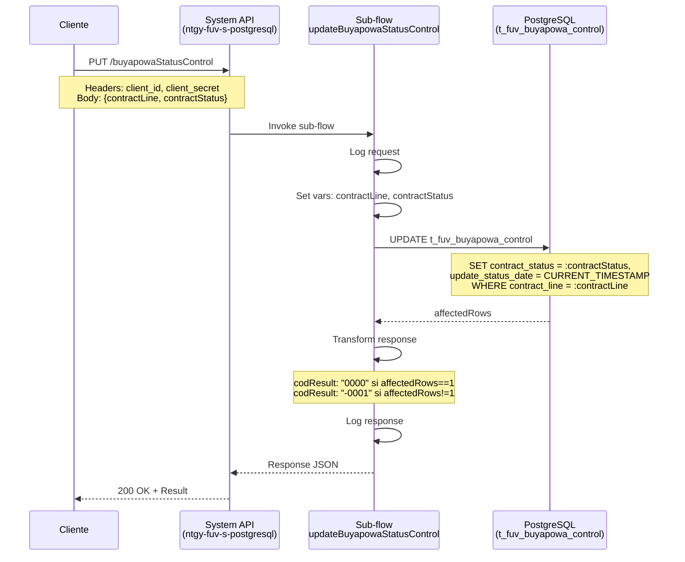
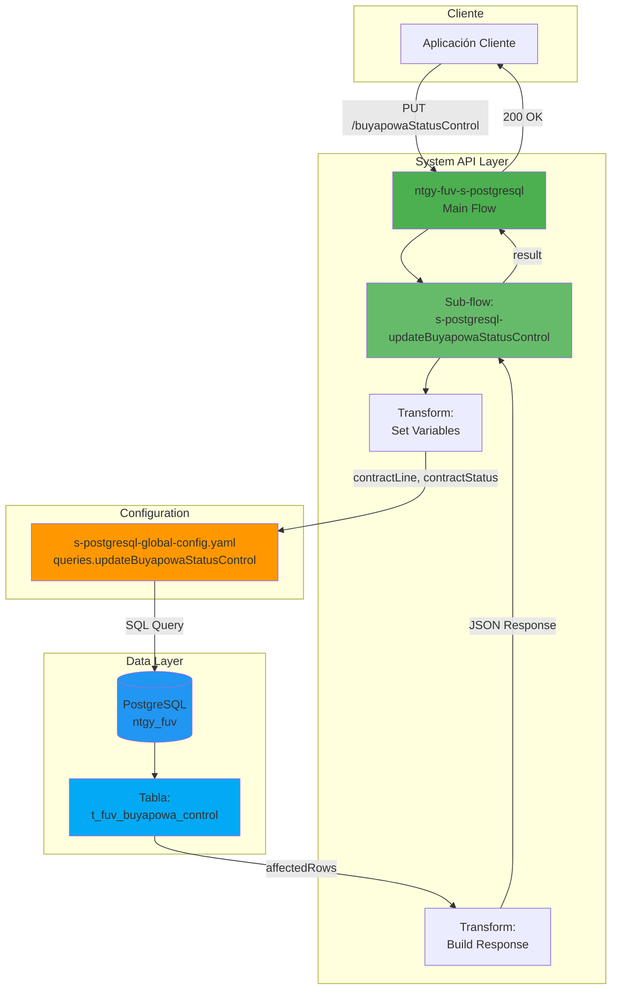
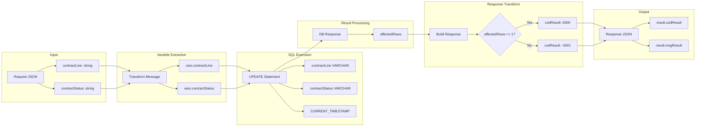
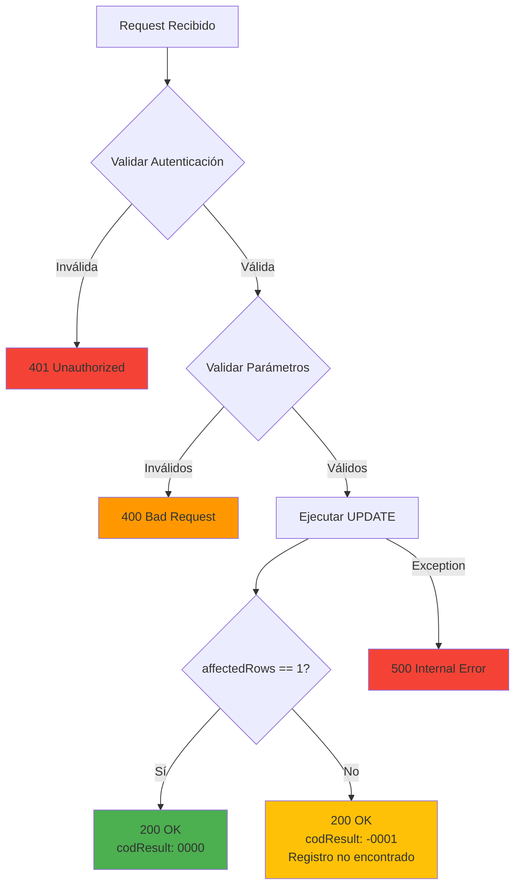

# PUT /buyapowaStatusControl

## 📌 Descripción General

El endpoint `PUT /buyapowaStatusControl` es una **System API** que actualiza el estado de contrato (`contract_status`) de un registro específico en la tabla `t_fuv_buyapowa_control` de PostgreSQL. Este endpoint permite modificar el estado de participación de un cliente en el programa de referidos Buyapowa, actualizando automáticamente la fecha de modificación del estado.

**Características principales:**
- **Operación:** UPDATE sobre tabla `t_fuv_buyapowa_control`
- **Backend:** PostgreSQL
- **Tipo de API:** System API
- **Método HTTP:** PUT
- **Idempotencia:** Sí (múltiples llamadas con los mismos datos producen el mismo resultado)
- **Query externalizada:** Usa `queries.updateBuyapowaStatusControl` del archivo YAML

## 💼 Propósito del Negocio

### Contexto del Negocio

El programa de referidos **Buyapowa** es una plataforma de marketing que permite a los clientes referir nuevos usuarios a cambio de incentivos. El sistema de control mantiene un registro del estado de participación de cada cliente en las campañas de referidos, permitiendo hacer seguimiento del ciclo de vida de cada contrato.

### Casos de Uso

1. **Actualización de Estado de Contrato**
   - Cambiar el estado de un contrato de referido (ej: "PENDING" → "CONFIRMED")
   - Marcar contratos como procesados, cancelados o completados
   - Actualizar estados basados en respuestas de sistemas externos

2. **Control de Ciclo de Vida**
   - Gestionar las diferentes fases del proceso de referido
   - Mantener trazabilidad de cambios de estado con timestamp automático
   - Facilitar auditorías y seguimiento de procesos de negocio

3. **Integración con Plataforma Buyapowa**
   - Sincronizar estados con la plataforma externa Buyapowa
   - Actualizar estados basados en confirmaciones de tracking
   - Mantener consistencia entre sistemas internos y externos

### Valor de Negocio

- **Trazabilidad:** Registro automático de fecha de actualización para auditoría
- **Control:** Gestión centralizada de estados de contratos en el programa de referidos
- **Integridad:** Actualización atómica de estados en base de datos
- **Eficiencia:** Operación simple y directa sin lógica de negocio compleja

## 🔧 Especificación Técnica

### Endpoint

```
PUT /buyapowaStatusControl
```

### Headers Requeridos

| Header | Valor | Descripción |
|--------|-------|-------------|
| `Content-Type` | `application/json` | Formato del body de la petición |
| `client_id` | `string` | Identificador del cliente API |
| `client_secret` | `string` | Secreto del cliente para autenticación |

### Request Body

```json
{
  "contractLine": "string",
  "contractStatus": "string"
}
```

#### Parámetros del Request

| Campo | Tipo | Requerido | Descripción | Ejemplo |
|-------|------|-----------|-------------|---------|
| `contractLine` | string | Sí | Identificador de la línea de contrato | "CL-2024-001" |
| `contractStatus` | string | Sí | Nuevo estado a asignar al contrato | "CONFIRMED" |

#### Estados Válidos

Los estados típicos del contrato incluyen (según lógica de negocio):
- `PENDING`: Contrato pendiente de confirmación
- `CONFIRMED`: Contrato confirmado exitosamente
- `TRACKING_SENT`: Tracking enviado a Buyapowa
- `CANCELLED`: Contrato cancelado
- `ERROR`: Error en el procesamiento
- `COMPLETED`: Proceso completado

### Response Body

#### Respuesta Exitosa (200 OK)

```json
{
  "result": {
    "codResult": "0000",
    "msgResult": "No hay error"
  }
}
```

#### Respuesta con Error

```json
{
  "result": {
    "codResult": "-0001",
    "msgResult": "Ha habido un error en la actualización del registro o el registro no existe"
  }
}
```

#### Estructura de la Respuesta

| Campo | Tipo | Descripción |
|-------|------|-------------|
| `result` | object | Objeto con el resultado de la operación |
| `result.codResult` | string | Código de resultado: "0000" (éxito) o "-0001" (error) |
| `result.msgResult` | string | Mensaje descriptivo del resultado |

**Nota:** La respuesta NO incluye los datos actualizados, solo el resultado de la operación.

### Códigos de Respuesta

| Código | Descripción | Escenario |
|--------|-------------|-----------|
| 200 | OK | Estado actualizado correctamente (affectedRows == 1) |
| 200 | OK con error | Registro no encontrado o no actualizado (affectedRows != 1) |
| 400 | Bad Request | Parámetros inválidos o faltantes |
| 401 | Unauthorized | Credenciales inválidas o faltantes |
| 500 | Internal Server Error | Error en la base de datos o sistema |

### Validaciones

1. **contractLine requerido:** El campo `contractLine` no puede estar vacío
2. **contractStatus requerido:** El campo `contractStatus` no puede estar vacío
3. **Existencia del registro:** La línea de contrato debe corresponder a un registro existente
4. **Formato de datos:** Los campos deben ser strings válidos de tipo VARCHAR

## 🏗️ Implementación Técnica

### Arquitectura del Flujo



### Diagrama de Arquitectura



### Operación SQL

#### Query de Actualización

**Ubicación:** `s-postgresql-global-config.yaml` → `queries.updateBuyapowaStatusControl`

**Referencia en XML:** `\${queries.updateBuyapowaStatusControl}`

```sql
UPDATE t_fuv_buyapowa_control 
SET contract_status = :contractStatus, 
    update_status_date = CURRENT_TIMESTAMP 
WHERE contract_line = :contractLine
```

#### Parámetros SQL

| Parámetro | Tipo | Origen | Descripción |
|-----------|------|--------|-------------|
| `:contractLine` | VARCHAR | Request body → vars.contractLine | Identificador de la línea de contrato |
| `:contractStatus` | VARCHAR | Request body → vars.contractStatus | Nuevo estado del contrato |

**Nota:** Los tipos de parámetros están explícitamente definidos en el XML:
```xml
<db:parameter-type key="contractLine" type="VARCHAR" />
<db:parameter-type key="contractStatus" type="VARCHAR" />
```

#### Estructura de la Tabla

```sql
CREATE TABLE t_fuv_buyapowa_control (
    t_fuv_buyapowa_control_id SERIAL PRIMARY KEY,
    contract_id VARCHAR,
    contract_line VARCHAR NOT NULL,
    product_id VARCHAR,
    codigo_amigo VARCHAR,
    response_tracking_buyapowa JSONB,
    response_confirmation_buyapowa JSONB,
    contract_status VARCHAR NOT NULL,
    tracking_date TIMESTAMP,
    update_status_date TIMESTAMP DEFAULT CURRENT_TIMESTAMP,
    confirmation_date TIMESTAMP,
    -- índices y constraints adicionales
);
```

**Campos clave:**
- `contract_line`: Identificador único de la línea de contrato (WHERE condition)
- `contract_status`: Estado del contrato (campo actualizado)
- `update_status_date`: Timestamp de última actualización (auto-actualizado)

### Implementación del Sub-flow

**Archivo:** `s-postgresql-buyapowaControl.xml`  
**Sub-flow:** `s-postgresql-updateBuyapowaStatusControl`  
**Líneas:** 76-130

#### Paso 1: Logging del Request (Líneas 77-84)

```xml
<logger level="INFO" doc:name="request" message="#[%dw 2.0
output application/java
var payloadStr = write(payload,'application/json')
var request = common::commonFunctions::normalizeJSON(payloadStr)
---
'STARTING updateBuyapowaStatusControl METHOD. REQUEST: ' ++ request]"/>
```

#### Paso 2: Extracción de Variables (Líneas 85-98)

```xml
<ee:transform doc:name="vars contractLine, contractStatus">
    <ee:variables>
        <ee:set-variable variableName="contractLine"><![CDATA[%dw 2.0
output application/java
---
payload.contractLine]]></ee:set-variable>
        <ee:set-variable variableName="contractStatus"><![CDATA[%dw 2.0
output application/java
---
payload.contractStatus]]></ee:set-variable>
    </ee:variables>
</ee:transform>
```

**Propósito:** Extrae los campos del payload y los almacena en variables de flow para su uso en la query SQL.

#### Paso 3: Ejecución del UPDATE (Líneas 99-108)

```xml
<db:update doc:name="Update" config-ref="Database_Config">
    <db:sql><![CDATA[\${queries.updateBuyapowaStatusControl}]]></db:sql>
    <db:parameter-types>
        <db:parameter-type key="contractLine" type="VARCHAR" />
        <db:parameter-type key="contractStatus" type="VARCHAR" />
    </db:parameter-types>
    <db:input-parameters><![CDATA[#[{
        contractLine: vars.contractLine,
        contractStatus: vars.contractStatus
    }]]]></db:input-parameters>
</db:update>
```

**Características:**
- Usa query externalizada del YAML
- Define tipos explícitos para los parámetros (VARCHAR)
- Pasa las variables del flow como parámetros SQL

#### Paso 4: Construcción de la Respuesta (Líneas 109-121)

```xml
<ee:transform doc:name="response">
    <ee:message>
        <ee:set-payload><![CDATA[%dw 2.0
output application/json
---
{
    "result": {
        "codResult": if (payload.affectedRows == 1) "0000" else "-0001",
        "msgResult": if (payload.affectedRows == 1) 
            "No hay error" 
            else "Ha habido un error en la actualización del registro o el registro no existe"
    }
}]]></ee:set-payload>
    </ee:message>
</ee:transform>
```

**Lógica de respuesta:**
- Si `affectedRows == 1`: Éxito (codResult: "0000")
- Si `affectedRows != 1`: Error o registro no encontrado (codResult: "-0001")

#### Paso 5: Logging de la Respuesta (Líneas 122-129)

```xml
<logger level="INFO" doc:name="response" message="#[%dw 2.0
output application/java
var payloadStr = write(payload,'application/json')
var response = common::commonFunctions::normalizeJSON(payloadStr)
---
'FINISHED updateBuyapowaStatusControl METHOD. RESPONSE: ' ++ response]"/>
```

### Diagrama de Transformación de Datos



### Configuración de Base de Datos

**Connector:** Database Connector (PostgreSQL)

```xml
<db:config name="Database_Config">
    <db:generic-connection 
        url="${db.url}" 
        driverClassName="org.postgresql.Driver"
        user="${db.user}"
        password="${secure::db.password}"/>
</db:config>
```

### Manejo de Errores



**Nota importante:** El endpoint retorna 200 OK incluso cuando no se actualiza ningún registro. El código de resultado (`codResult`) indica el éxito o fallo real de la operación.

### Propiedades de Configuración

```properties
# Database Configuration
db.url=jdbc:postgresql://localhost:5432/ntgy_fuv
db.user=${DB_USER}
db.password=${DB_PASSWORD}

# API Configuration
api.base.path=/api/v1
```

## 💻 Ejemplos de Uso

### Ejemplo 1: Actualización Exitosa

#### Request

```bash
curl -X PUT "https://api.naturgy.com/fuv/v1/buyapowaStatusControl" \
  -H "Content-Type: application/json" \
  -H "client_id: your-client-id" \
  -H "client_secret: your-client-secret" \
  -d '{
    "contractLine": "CL-2024-001",
    "contractStatus": "CONFIRMED"
  }'
```

#### Response (200 OK)

```json
{
  "result": {
    "codResult": "0000",
    "msgResult": "No hay error"
  }
}
```

### Ejemplo 2: Cambio de Estado a Tracking Enviado

#### Request

```json
{
  "contractLine": "CL-2024-002",
  "contractStatus": "TRACKING_SENT"
}
```

#### Response (200 OK)

```json
{
  "result": {
    "codResult": "0000",
    "msgResult": "No hay error"
  }
}
```

### Ejemplo 3: Registro No Encontrado

#### Request

```json
{
  "contractLine": "CL-9999-999",
  "contractStatus": "CONFIRMED"
}
```

#### Response (200 OK - pero con error en codResult)

```json
{
  "result": {
    "codResult": "-0001",
    "msgResult": "Ha habido un error en la actualización del registro o el registro no existe"
  }
}
```

**Nota:** El endpoint retorna 200 OK pero el `codResult` indica que no se actualizó ningún registro.

### Ejemplo 4: Cancelación de Contrato

#### Request

```json
{
  "contractLine": "CL-2024-003",
  "contractStatus": "CANCELLED"
}
```

#### Response (200 OK)

```json
{
  "result": {
    "codResult": "0000",
    "msgResult": "No hay error"
  }
}
```

### Ejemplo 5: Actualización con cURL (Windows PowerShell)

```powershell
$headers = @{
    "Content-Type" = "application/json"
    "client_id" = "your-client-id"
    "client_secret" = "your-client-secret"
}

$body = @{
    contractLine = "CL-2024-004"
    contractStatus = "COMPLETED"
} | ConvertTo-Json

Invoke-RestMethod -Uri "https://api.naturgy.com/fuv/v1/buyapowaStatusControl" `
    -Method Put `
    -Headers $headers `
    -Body $body
```

### Ejemplo 6: Integración con JavaScript/Node.js

```javascript
const axios = require('axios');

async function updateBuyapowaStatus(contractLine, contractStatus) {
  try {
    const response = await axios.put(
      'https://api.naturgy.com/fuv/v1/buyapowaStatusControl',
      {
        contractLine: contractLine,
        contractStatus: contractStatus
      },
      {
        headers: {
          'Content-Type': 'application/json',
          'client_id': process.env.CLIENT_ID,
          'client_secret': process.env.CLIENT_SECRET
        }
      }
    );
    
    console.log('Estado actualizado:', response.data);
    
    // Verificar el código de resultado
    if (response.data.result.codResult === "0000") {
      console.log('✅ Actualización exitosa');
      return true;
    } else {
      console.log('❌ Error en actualización:', response.data.result.msgResult);
      return false;
    }
  } catch (error) {
    console.error('Error al actualizar estado:', error.response?.data || error.message);
    throw error;
  }
}

// Uso
updateBuyapowaStatus('CL-2024-005', 'CONFIRMED');
```

### Ejemplo 7: Integración con Python

```python
import requests
import os
from typing import Dict, Tuple

def update_buyapowa_status(contract_line: str, contract_status: str) -> Tuple[bool, Dict]:
    """
    Actualiza el estado de contrato en el control de Buyapowa
    
    Args:
        contract_line: Identificador de la línea de contrato
        contract_status: Nuevo estado del contrato
        
    Returns:
        Tuple[bool, dict]: (éxito, respuesta completa)
    """
    url = "https://api.naturgy.com/fuv/v1/buyapowaStatusControl"
    
    headers = {
        "Content-Type": "application/json",
        "client_id": os.getenv("CLIENT_ID"),
        "client_secret": os.getenv("CLIENT_SECRET")
    }
    
    payload = {
        "contractLine": contract_line,
        "contractStatus": contract_status
    }
    
    try:
        response = requests.put(url, json=payload, headers=headers)
        response.raise_for_status()
        
        data = response.json()
        print(f"Respuesta recibida: {data}")
        
        # Verificar el código de resultado
        success = data['result']['codResult'] == "0000"
        
        if success:
            print(f"✅ Estado actualizado correctamente para {contract_line}")
        else:
            print(f"❌ Error: {data['result']['msgResult']}")
        
        return success, data
        
    except requests.exceptions.HTTPError as e:
        print(f"Error HTTP: {e.response.status_code} - {e.response.text}")
        raise
    except Exception as e:
        print(f"Error: {str(e)}")
        raise

# Uso
if __name__ == "__main__":
    success, response = update_buyapowa_status("CL-2024-006", "CONFIRMED")
    print(f"Operación exitosa: {success}")
```

### Ejemplo 8: Manejo de Múltiples Actualizaciones

```python
import requests
import os
from typing import List, Dict

def batch_update_buyapowa_status(updates: List[Dict[str, str]]) -> Dict[str, int]:
    """
    Actualiza múltiples estados de contrato en lote
    
    Args:
        updates: Lista de diccionarios con contractLine y contractStatus
        
    Returns:
        Dict con contadores de éxitos y fallos
    """
    url = "https://api.naturgy.com/fuv/v1/buyapowaStatusControl"
    
    headers = {
        "Content-Type": "application/json",
        "client_id": os.getenv("CLIENT_ID"),
        "client_secret": os.getenv("CLIENT_SECRET")
    }
    
    results = {"success": 0, "failed": 0, "errors": []}
    
    for update in updates:
        try:
            response = requests.put(url, json=update, headers=headers)
            response.raise_for_status()
            
            data = response.json()
            
            if data['result']['codResult'] == "0000":
                results["success"] += 1
                print(f"✅ {update['contractLine']}: OK")
            else:
                results["failed"] += 1
                results["errors"].append({
                    "contractLine": update['contractLine'],
                    "error": data['result']['msgResult']
                })
                print(f"❌ {update['contractLine']}: {data['result']['msgResult']}")
                
        except Exception as e:
            results["failed"] += 1
            results["errors"].append({
                "contractLine": update['contractLine'],
                "error": str(e)
            })
            print(f"❌ {update['contractLine']}: Exception - {str(e)}")
    
    return results

# Uso
updates = [
    {"contractLine": "CL-2024-001", "contractStatus": "CONFIRMED"},
    {"contractLine": "CL-2024-002", "contractStatus": "TRACKING_SENT"},
    {"contractLine": "CL-2024-003", "contractStatus": "COMPLETED"}
]

results = batch_update_buyapowa_status(updates)
print(f"\n📊 Resumen: {results['success']} éxitos, {results['failed']} fallos")
if results['errors']:
    print(f"Errores: {results['errors']}")
```

---

**Proyecto:** ntgy-fuv-s-postgresql  
**Tipo de API:** System API  
**Backend:** PostgreSQL  
**Tabla:** t_fuv_buyapowa_control  
**Operación:** UPDATE  
**Sub-flow:** s-postgresql-updateBuyapowaStatusControl  
**Query:** `queries.updateBuyapowaStatusControl`
