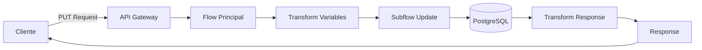
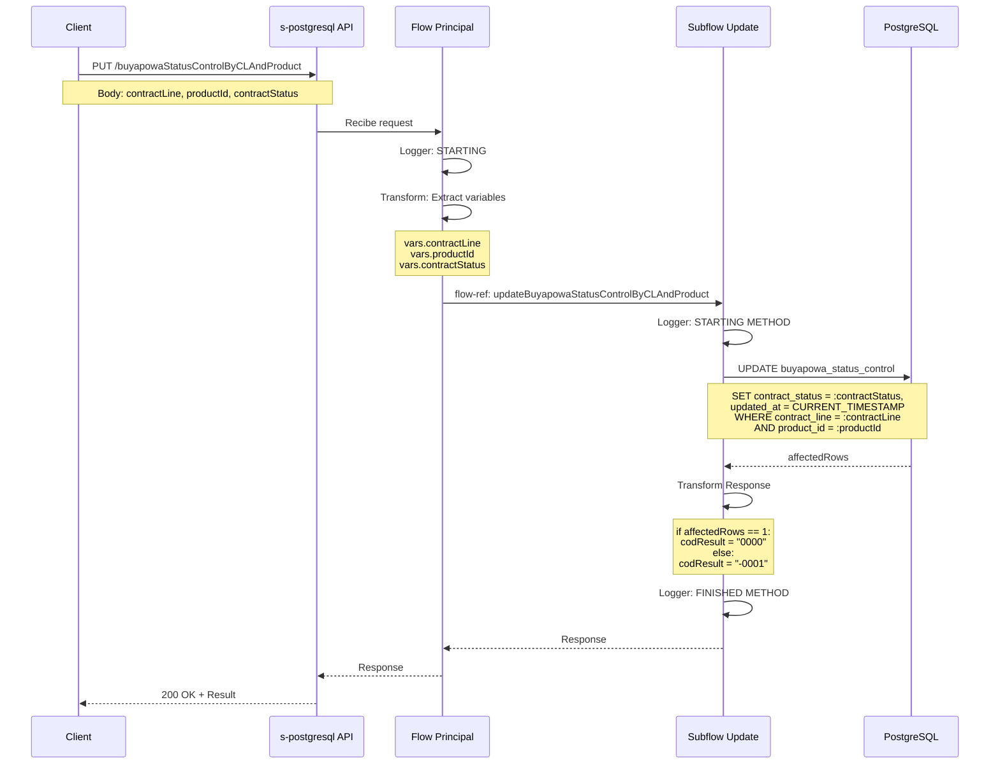
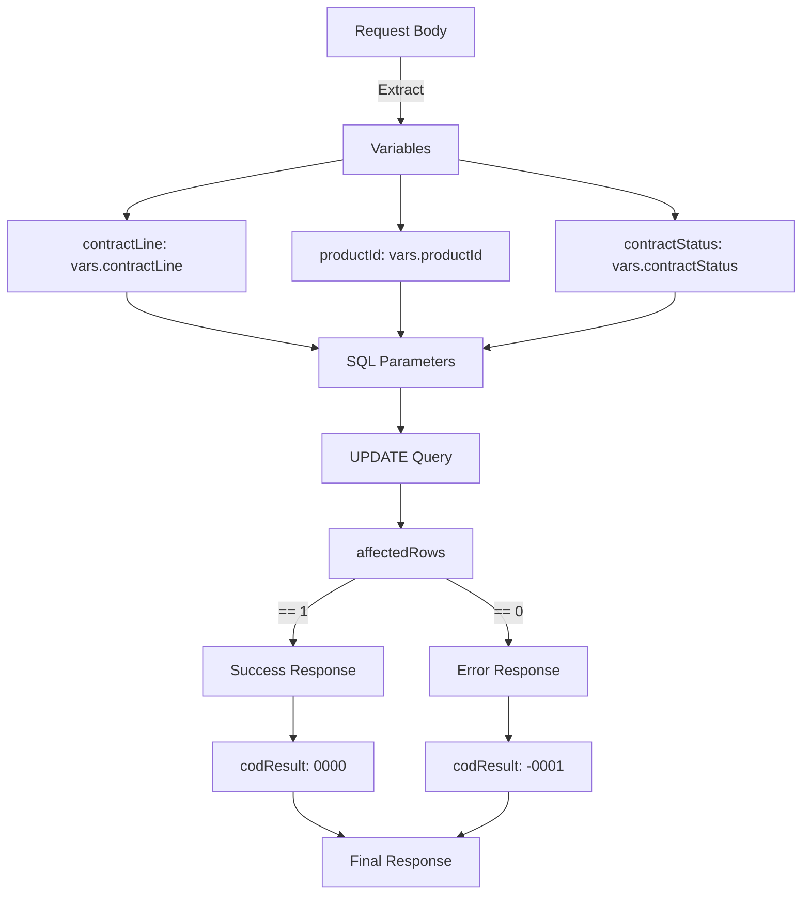

# PUT /buyapowaStatusControlByCLAndProduct

## 📌 Descripción General

Endpoint de System API que actualiza el estado de control del programa Buyapowa para una combinación específica de línea de contrato y producto en la base de datos PostgreSQL.

### Características Principales

- **Tipo de API:** System API
- **Backend:** PostgreSQL
- **Operación:** UPDATE
- **Tabla:** `t_fuv_buyapowa_control`
- **Identificación:** Por `contract_line` y `product_id`
- **Actualización automática:** Campo `updated_at` con timestamp actual

### Flujo de Datos

```
Request → Transform Variables → UPDATE PostgreSQL → Transform Response → Response
```

---

## 💼 Propósito del Negocio

### Objetivo

Gestionar y actualizar el estado de control del programa de referidos Buyapowa para líneas de contrato específicas asociadas a productos determinados.

### Casos de Uso

1. **Activación de Programa Buyapowa**
   - Cambiar estado a "ACTIVE" cuando un cliente se inscribe en el programa
   - Habilitar funcionalidades de referidos para el contrato-producto

2. **Desactivación de Programa**
   - Cambiar estado a "INACTIVE" cuando un cliente se da de baja
   - Suspender temporalmente el programa para un contrato específico

3. **Actualización de Estado**
   - Modificar el estado según eventos del ciclo de vida del contrato
   - Sincronizar estados entre sistemas (SAP, Salesforce, etc.)

4. **Auditoría y Seguimiento**
   - Registrar cambios de estado con timestamp automático
   - Mantener trazabilidad de modificaciones

### Valor de Negocio

- **Control Granular:** Gestión a nivel de línea de contrato y producto
- **Trazabilidad:** Registro automático de fecha de actualización
- **Integridad:** Validación de existencia antes de actualizar
- **Sincronización:** Soporte para integración con otros sistemas

---

## 🔧 Especificación Técnica

### Endpoint

```
PUT /api/buyapowaStatusControlByCLAndProduct
```

### Headers

| Header | Valor | Requerido | Descripción |
|--------|-------|-----------|-------------|
| `Content-Type` | `application/json` | Sí | Formato del body |
| `client_id` | `string` | Sí | ID del cliente API |
| `client_secret` | `string` | Sí | Secret del cliente API |

### Request Body

```json
{
  "contractLine": "string",
  "productId": "string",
  "contractStatus": "string"
}
```

#### Parámetros del Body

| Campo | Tipo | Requerido | Descripción | Ejemplo |
|-------|------|-----------|-------------|---------|
| `contractLine` | string | Sí | Línea de contrato a actualizar | "0000123456-001" |
| `productId` | string | Sí | Identificador del producto | "ELEC_001" |
| `contractStatus` | string | Sí | Nuevo estado del contrato | "ACTIVE", "INACTIVE" |

#### Valores Válidos para `contractStatus`

- `ACTIVE`: Programa Buyapowa activo
- `INACTIVE`: Programa Buyapowa inactivo
- `PENDING`: Pendiente de activación
- `SUSPENDED`: Suspendido temporalmente
- `CANCELLED`: Cancelado definitivamente

### Response

#### Response Exitoso (200 OK)

```json
{
  "result": {
    "codResult": "0000",
    "msgResult": "No hay error"
  }
}
```

#### Response con Error - Registro No Encontrado (200 OK)

```json
{
  "result": {
    "codResult": "-0001",
    "msgResult": "Ha habido un error en la actualización del registro o el registro no existe"
  }
}
```

#### Estructura de Response

| Campo | Tipo | Descripción |
|-------|------|-------------|
| `result.codResult` | string | Código de resultado: "0000" (éxito) o "-0001" (error) |
| `result.msgResult` | string | Mensaje descriptivo del resultado |

### Códigos de Estado HTTP

| Código | Descripción | Escenario |
|--------|-------------|-----------|
| 200 | OK | Operación completada (éxito o registro no encontrado) |
| 400 | Bad Request | Body inválido o campos faltantes |
| 401 | Unauthorized | Credenciales inválidas |
| 500 | Internal Server Error | Error en base de datos o servidor |

---

## 🏗️ Implementación Técnica

### Arquitectura



### Flujo de Ejecución



### Componentes Técnicos

#### 1. Flow Principal

**Ubicación:** `s-postgresql.xml` (línea 256)

**Nombre:** `put:\buyapowaStatusControlByCLAndProduct:application\json:s-postgresql-config`

**Responsabilidades:**
- Recibir el request HTTP
- Extraer parámetros del body a variables
- Invocar el subflow de actualización

**Transformación de Variables:**

```dataweave
%dw 2.0
output application/java
---
{
    contractLine: payload.contractLine,
    productId: payload.productId,
    contractStatus: payload.contractStatus
}
```

#### 2. Subflow de Actualización

**Ubicación:** `s-postgresql-buyapowaControl.xml` (línea 103)

**Nombre:** `s-postgresql-updateBuyapowaStatusControlByCLAndProduct`

**Responsabilidades:**
- Ejecutar operación UPDATE en PostgreSQL
- Transformar resultado a formato de respuesta estándar
- Logging de inicio y fin de operación

#### 3. Operación de Base de Datos

**Tipo:** `db:update`

**Query SQL:**

```sql
UPDATE t_fuv_buyapowa_control 
SET contract_status = :contractStatus,
    updated_at = CURRENT_TIMESTAMP
WHERE contract_line = :contractLine
  AND product_id = :productId
```

**Parámetros:**
- `:contractLine` - Línea de contrato (VARCHAR)
- `:productId` - ID del producto (VARCHAR)
- `:contractStatus` - Nuevo estado (VARCHAR)

**Campos Actualizados:**
- `contract_status`: Nuevo estado del programa Buyapowa
- `updated_at`: Timestamp automático de la actualización

#### 4. Transformación de Response

```dataweave
%dw 2.0
output application/json
---
{
    result: {
        codResult: if (payload.affectedRows == 1) "0000" else "-0001",
        msgResult: if (payload.affectedRows == 1) 
                   "No hay error" 
                   else 
                   "Ha habido un error en la actualización del registro o el registro no existe"
    }
}
```

**Lógica:**
- Si `affectedRows == 1`: Actualización exitosa
- Si `affectedRows == 0`: Registro no encontrado o no actualizado

### Diagrama de Transformación de Datos



### Tabla de Base de Datos

**Nombre:** `t_fuv_buyapowa_control`

**Esquema:** `public`

**Columnas Relevantes:**

| Columna | Tipo | Descripción | Constraint |
|---------|------|-------------|------------|
| `t_fuv_buyapowa_control_id` | SERIAL | ID único del registro | PRIMARY KEY |
| `contract_id` | VARCHAR | ID del contrato | NOT NULL |
| `contract_line` | VARCHAR | Línea de contrato | NOT NULL |
| `product_id` | VARCHAR | ID del producto | NOT NULL |
| `contract_status` | VARCHAR | Estado del contrato | NOT NULL |
| `codigo_amigo` | VARCHAR | Código de referido | |
| `response_tracking_buyapowa` | JSONB | Respuesta de tracking | |
| `response_confirmation_buyapowa` | JSONB | Respuesta de confirmación | |
| `tracking_date` | TIMESTAMP | Fecha de tracking | |
| `update_status_date` | TIMESTAMP | Fecha de actualización de estado | |
| `confirmation_date` | TIMESTAMP | Fecha de confirmación | |
| `updated_at` | TIMESTAMP | Última actualización | DEFAULT CURRENT_TIMESTAMP |

**Índices:**
- Índice compuesto en `(contract_line, product_id)` para búsquedas rápidas

### Manejo de Errores

#### Error de Base de Datos

```json
{
  "error": "APP_9999",
  "message": "Error en el servicio."
}
```

**Código HTTP:** 500

**Causas Posibles:**
- Conexión a base de datos perdida
- Timeout en la query
- Error de sintaxis SQL
- Violación de constraints

#### Error de Validación

```json
{
  "message": "Bad request"
}
```

**Código HTTP:** 400

**Causas Posibles:**
- Campos requeridos faltantes
- Formato JSON inválido
- Tipos de datos incorrectos

---

## 💻 Ejemplos de Uso

### Ejemplo 1: Actualización Exitosa

#### Request

```bash
curl -X PUT "http://localhost:8091/api/buyapowaStatusControlByCLAndProduct" \
  -H "Content-Type: application/json" \
  -H "client_id: your-client-id" \
  -H "client_secret: your-client-secret" \
  -d '{
    "contractLine": "0000123456-001",
    "productId": "ELEC_001",
    "contractStatus": "ACTIVE"
  }'
```

#### Response (200 OK)

```json
{
  "result": {
    "codResult": "0000",
    "msgResult": "No hay error"
  }
}
```

### Ejemplo 2: Registro No Encontrado

#### Request

```bash
curl -X PUT "http://localhost:8091/api/buyapowaStatusControlByCLAndProduct" \
  -H "Content-Type: application/json" \
  -H "client_id: your-client-id" \
  -H "client_secret: your-client-secret" \
  -d '{
    "contractLine": "9999999999-999",
    "productId": "INVALID_PROD",
    "contractStatus": "ACTIVE"
  }'
```

#### Response (200 OK)

```json
{
  "result": {
    "codResult": "-0001",
    "msgResult": "Ha habido un error en la actualización del registro o el registro no existe"
  }
}
```

### Ejemplo 3: Desactivación de Programa

#### Request

```bash
curl -X PUT "http://localhost:8091/api/buyapowaStatusControlByCLAndProduct" \
  -H "Content-Type: application/json" \
  -H "client_id: your-client-id" \
  -H "client_secret: your-client-secret" \
  -d '{
    "contractLine": "0000123456-001",
    "productId": "GAS_002",
    "contractStatus": "INACTIVE"
  }'
```

#### Response (200 OK)

```json
{
  "result": {
    "codResult": "0000",
    "msgResult": "No hay error"
  }
}
```

### Ejemplo 4: Error de Validación

#### Request (campo faltante)

```bash
curl -X PUT "http://localhost:8091/api/buyapowaStatusControlByCLAndProduct" \
  -H "Content-Type: application/json" \
  -H "client_id: your-client-id" \
  -H "client_secret: your-client-secret" \
  -d '{
    "contractLine": "0000123456-001",
    "contractStatus": "ACTIVE"
  }'
```

#### Response (400 Bad Request)

```json
{
  "message": "Bad request"
}
```

### Ejemplo 5: Suspensión Temporal

#### Request

```bash
curl -X PUT "http://localhost:8091/api/buyapowaStatusControlByCLAndProduct" \
  -H "Content-Type: application/json" \
  -H "client_id: your-client-id" \
  -H "client_secret: your-client-secret" \
  -d '{
    "contractLine": "0000789012-002",
    "productId": "ELEC_001",
    "contractStatus": "SUSPENDED"
  }'
```

#### Response (200 OK)

```json
{
  "result": {
    "codResult": "0000",
    "msgResult": "No hay error"
  }
}
```

### Ejemplo 6: Postman Collection

```json
{
  "info": {
    "name": "Buyapowa Status Control",
    "schema": "https://schema.getpostman.com/json/collection/v2.1.0/collection.json"
  },
  "item": [
    {
      "name": "Update Buyapowa Status by CL and Product",
      "request": {
        "method": "PUT",
        "header": [
          {
            "key": "Content-Type",
            "value": "application/json"
          },
          {
            "key": "client_id",
            "value": "{{client_id}}"
          },
          {
            "key": "client_secret",
            "value": "{{client_secret}}"
          }
        ],
        "body": {
          "mode": "raw",
          "raw": "{\n  \"contractLine\": \"0000123456-001\",\n  \"productId\": \"ELEC_001\",\n  \"contractStatus\": \"ACTIVE\"\n}"
        },
        "url": {
          "raw": "{{base_url}}/api/buyapowaStatusControlByCLAndProduct",
          "host": ["{{base_url}}"],
          "path": ["api", "buyapowaStatusControlByCLAndProduct"]
        }
      }
    }
  ]
}
```

---

## 📊 Consideraciones Técnicas

### Performance

- **Tiempo de respuesta esperado:** < 500ms
- **Índice en tabla:** Compuesto en `(contract_line, product_id)`
- **Operación:** UPDATE simple con WHERE específico
- **Impacto:** Bajo (actualización de 1-2 campos)

### Seguridad

- **Autenticación:** Client ID y Client Secret en headers
- **Validación:** Campos requeridos verificados por APIKit
- **SQL Injection:** Protegido por parámetros preparados
- **Logging:** Sin datos sensibles en logs

### Escalabilidad

- **Concurrencia:** Soporta múltiples requests simultáneos
- **Connection Pool:** Configurado en Database_Config
- **Transacciones:** Operación atómica (UPDATE único)
- **Idempotencia:** Múltiples llamadas con mismos datos producen mismo resultado

### Monitoreo

**Logs Generados:**

1. **Inicio de operación:**
   ```
   STARTING updateBuyapowaStatusControlByCLAndProduct METHOD. REQUEST: {...}
   ```

2. **Fin de operación:**
   ```
   FINISHED updateBuyapowaStatusControlByCLAndProduct METHOD. RESPONSE: {...}
   ```

**Métricas Recomendadas:**
- Tasa de éxito/error (codResult "0000" vs "-0001")
- Tiempo de respuesta promedio
- Número de registros no encontrados
- Errores de base de datos

### Mejores Prácticas

1. **Validar existencia previa:**
   - Considerar hacer SELECT antes de UPDATE si se necesita información adicional

2. **Manejo de estados:**
   - Definir máquina de estados válida para `contractStatus`
   - Validar transiciones permitidas

3. **Auditoría:**
   - El campo `updated_at` se actualiza automáticamente
   - Considerar tabla de auditoría para histórico de cambios

4. **Retry Logic:**
   - Implementar reintentos en caso de timeout
   - Usar circuit breaker para fallos de BD

---

## 🔗 Endpoints Relacionados

- **POST /buyapowaControl** - Crear nuevo registro de control Buyapowa
- **PUT /buyapowaStatusControl** - Actualizar estado por línea de contrato únicamente
- **PUT /buyapowaConfirmationControlByCLAndProduct** - Actualizar confirmación Buyapowa
- **GET /buyapowaPendingToConfirmControl** - Obtener registros pendientes de confirmación
- **GET /buyapowaReadyToConfirmControl** - Obtener registros listos para confirmar

---

**Última actualización:** 2026-01-07  
**Versión del API:** 1.0.0  
**Mantenido por:** Equipo de Integración FUV