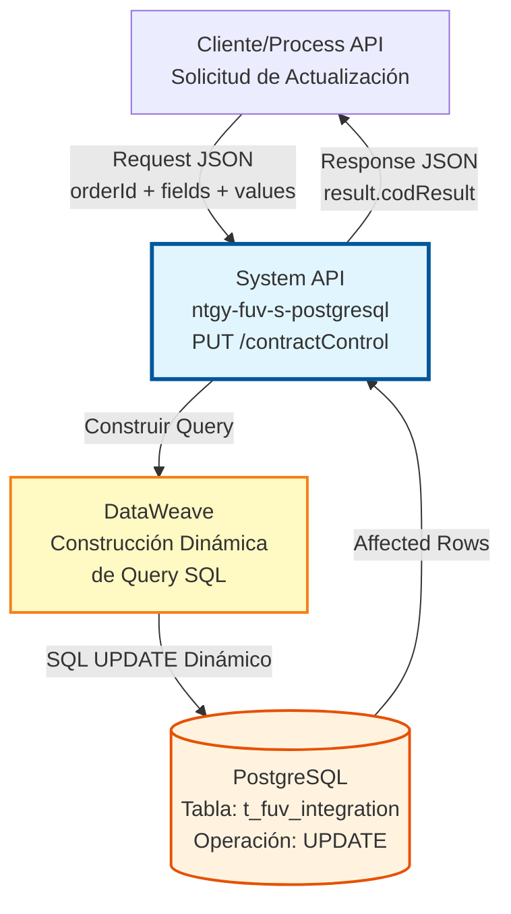
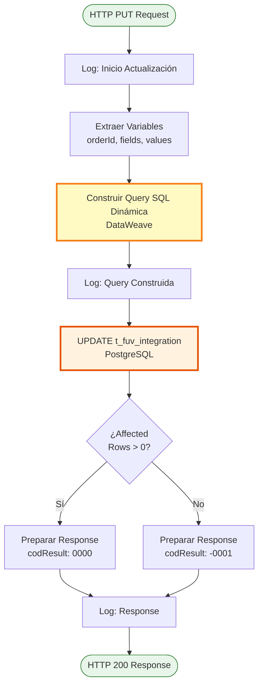
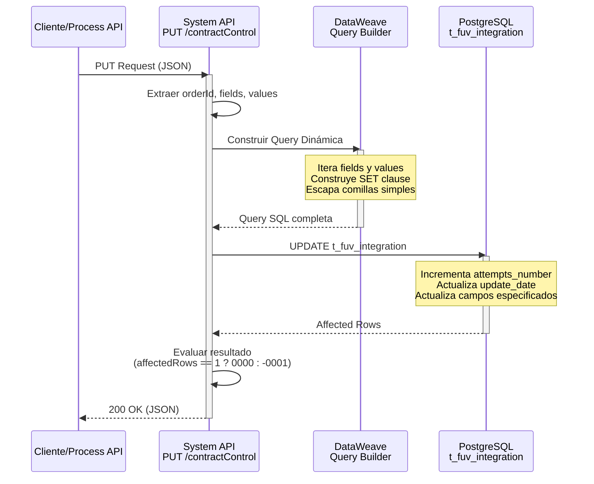
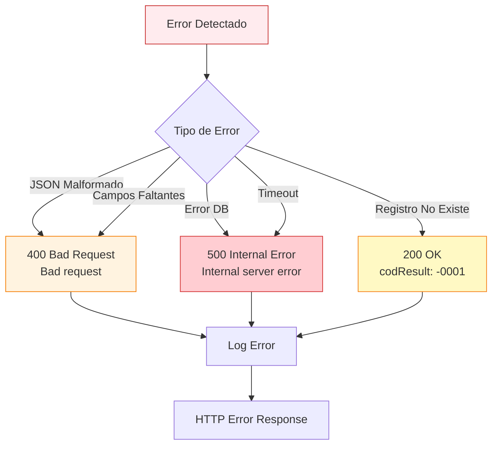

# PUT /contractControl

## 📌 Descripción General

### Propósito del Endpoint

Este endpoint actualiza registros existentes en la tabla `t_fuv_integration` de PostgreSQL mediante construcción dinámica de queries SQL. Permite actualizar múltiples campos de forma flexible especificando arrays de campos y valores, incrementando automáticamente el contador de intentos y actualizando la fecha de modificación.

El endpoint soporta:
- **Actualización Dinámica**: Construye la query SQL basándose en los campos proporcionados
- **Múltiples Campos**: Permite actualizar varios campos en una sola operación
- **Contador Automático**: Incrementa `attempts_number` en cada actualización
- **Timestamp Automático**: Actualiza `update_date` con zona horaria de Madrid
- **Flexibilidad Total**: Cualquier campo de la tabla puede ser actualizado

### Tipo de API

**Capa:** System API (API-Led Connectivity)

**Función:** Integración directa con PostgreSQL para actualización dinámica de datos de control de contratos en el sistema FUV.

### Patrón de Integración

**Tipo:** Request-Reply Síncrono con SQL UPDATE Dinámico

**Descripción:** Recibe el ID del contrato y arrays de campos/valores, construye dinámicamente la query SQL UPDATE, ejecuta la operación en PostgreSQL y retorna el resultado con código de estado.

### Arquitectura API-Led Connectivity



---

## 💼 Propósito del Negocio

### Casos de Uso Principales

1. **Actualización de Estado de Procesamiento**
   - Cambiar el estado del contrato según avanza en el flujo
   - Registrar respuestas de sistemas externos
   - Marcar contratos con errores para reprocesamiento
   - Actualizar códigos de estado

2. **Registro de Respuestas y Errores**
   - Almacenar respuestas de sistemas backend
   - Documentar errores de procesamiento
   - Mantener trazabilidad de intentos
   - Registrar mensajes de sistemas externos

3. **Asociación de Entidades**
   - Vincular cliente al contrato
   - Asociar punto de suministro
   - Actualizar referencias cruzadas
   - Modificar atributos del contrato

### Contexto Empresarial

- **Dominio:** Gestión de Contratos y Facturación
- **Sector:** Energía - Utilities
- **División:** Naturgy España - FUV (Facturación Única Virtual)
- **Proceso de Negocio:** Control y seguimiento del ciclo de vida de contratos
- **Sistema:** PostgreSQL - Base de datos transaccional FUV

### Stakeholders

- **Equipos de Operaciones**: Actualizan estados durante el procesamiento
- **Sistemas de Integración**: Registran respuestas de sistemas externos
- **Procesos Automatizados**: Actualizan estados según reglas de negocio
- **Equipos de Soporte**: Modifican contratos para resolver incidencias

### Valor de Negocio

- **Flexibilidad Máxima**: Actualización dinámica de cualquier campo
- **Trazabilidad Completa**: Contador de intentos y timestamps automáticos
- **Eficiencia Operativa**: Múltiples campos en una sola operación
- **Integración Simplificada**: Punto único de actualización

### Consumidores Potenciales

Este endpoint puede ser consumido por:
- Process APIs de gestión de contratos
- Flujos de integración con sistemas externos
- Procesos batch de actualización
- Sistemas de gestión de errores y reintentos
- Herramientas de administración

---

## 🔧 Especificación Técnica

### URLs por Ambiente

| Ambiente | URL Base | URL Completa |
|----------|----------|--------------|
| **Local** | `http://localhost:8081` | `http://localhost:8081/api/contractControl` |
| **Development** | `https://ntgy-fuv-s-postgresql-dev.us-e2.cloudhub.io` | `https://ntgy-fuv-s-postgresql-dev.us-e2.cloudhub.io/api/contractControl` |
| **UAT** | `https://ntgy-fuv-s-postgresql-uat.us-e2.cloudhub.io` | `https://ntgy-fuv-s-postgresql-uat.us-e2.cloudhub.io/api/contractControl` |
| **Production** | `https://ntgy-fuv-s-postgresql-pro.us-e2.cloudhub.io` | `https://ntgy-fuv-s-postgresql-pro.us-e2.cloudhub.io/api/contractControl` |

### Método HTTP

```
PUT /api/contractControl
```

### Parámetros de Entrada

#### Headers HTTP

| Header | Tipo | Requerido | Descripción | Ejemplo |
|--------|------|-----------|-------------|---------|
| `Content-Type` | string | ✅ Sí | Tipo de contenido del request | `application/json` |
| `Accept` | string | ❌ No | Tipo de contenido esperado en response | `application/json` |

#### Body Parameters

| Campo | Tipo | Requerido | Descripción | Ejemplo |
|-------|------|-----------|-------------|---------|
| `orderId` | string | ✅ Sí | Identificador único del contrato (contract_id) | `"12345"` |
| `update` | object | ✅ Sí | Objeto con campos a actualizar | Ver estructura abajo |
| `update.field` | array[string] | ✅ Sí | Array de nombres de campos a actualizar | `["state", "response"]` |
| `update.value` | array[string] | ✅ Sí | Array de valores correspondientes (mismo orden) | `["PROCESADO", "OK"]` |

**Campos Actualizables:**
- `state` - Estado del contrato
- `code` - Código de estado
- `response` - Respuesta del procesamiento
- `error` - Mensaje de error (si aplica)
- `contract_atr` - Atributo del contrato
- `id_cliente` - Identificador del cliente
- `id_ps` - Identificador del punto de suministro
- `viewable` - Indicador de visibilidad
- `message` - Mensaje del sistema

**Campos Actualizados Automáticamente:**
- `attempts_number` - Se incrementa en 1 automáticamente
- `update_date` - Se actualiza con timestamp actual (zona horaria Madrid)

### Estructura de Datos

#### Request Body

```json
{
  "orderId": "12345",
  "update": {
    "field": ["state", "response", "id_cliente"],
    "value": ["PROCESADO", "Procesamiento exitoso", "CLI-001"]
  }
}
```

#### Response Body (200 OK)

```json
{
  "result": {
    "codResult": "0000",
    "msgResult": "No hay error"
  }
}
```

**Códigos de Resultado:**
- `"0000"` - Actualización exitosa (affectedRows = 1)
- `"-0001"` - Error en actualización o registro no existe (affectedRows = 0)

### Respuestas

#### ✅ 200 OK - Actualización Exitosa

```json
{
  "result": {
    "codResult": "0000",
    "msgResult": "No hay error"
  }
}
```

**Descripción:** El registro fue encontrado y actualizado correctamente. El código `"0000"` indica éxito.

#### ⚠️ 200 OK con Error - Actualización Fallida

```json
{
  "result": {
    "codResult": "-0001",
    "msgResult": "Ha habido un error en la actualización del registro o el registro no existe"
  }
}
```

**Descripción:** El registro no fue encontrado o no se pudo actualizar. El código `"-0001"` indica fallo.

**Causas comunes:**
- El orderId no existe en la base de datos
- Arrays field y value tienen diferente longitud
- Campos especificados no son válidos
- Error en la construcción de la query SQL

#### ❌ 400 Bad Request - Request Inválido

```json
{
  "message": "Bad request"
}
```

**Causas comunes:**
- JSON malformado
- Campos obligatorios faltantes (orderId, update.field, update.value)
- Tipo de datos incorrecto

#### ❌ 500 Internal Server Error - Error del Servidor

```json
{
  "message": "Internal server error"
}
```

**Causas comunes:**
- Error de conexión a PostgreSQL
- Timeout de base de datos
- Error en construcción dinámica de query
- Violación de constraints de la tabla

### Autenticación y Autorización

- **Tipo:** Client ID & Client Secret (Anypoint Platform)
- **Autorización PostgreSQL:** El usuario de base de datos debe tener:
  - Permiso UPDATE en tabla `t_fuv_integration`
  - Permiso SELECT para validar existencia del registro
  - Acceso al schema `public`

### Timeouts

| Tipo | Valor | Descripción |
|------|-------|-------------|
| **Request Timeout** | 30 segundos | Tiempo máximo de espera para la respuesta |
| **Connection Timeout** | 10 segundos | Tiempo máximo para establecer conexión con PostgreSQL |
| **Query Timeout** | 30 segundos | Tiempo máximo de ejecución del UPDATE |

---

## 🏗️ Implementación Técnica

### Arquitectura del Flow



### Diagrama de Secuencia



### Query SQL Ejecutada

La query SQL se construye dinámicamente mediante DataWeave basándose en los campos proporcionados:

```sql
UPDATE t_fuv_integration 
SET attempts_number = attempts_number + 1, 
    update_date = timezone('Europe/Madrid'::text, CURRENT_TIMESTAMP),
    [campo1] = '[valor1]',
    [campo2] = '[valor2]',
    ...
WHERE contract_id = '[orderId]'
```

**Ejemplo Concreto:**
```sql
UPDATE t_fuv_integration 
SET attempts_number = attempts_number + 1, 
    update_date = timezone('Europe/Madrid'::text, CURRENT_TIMESTAMP),
    state = 'PROCESADO',
    response = 'Procesamiento exitoso',
    id_cliente = 'CLI-001'
WHERE contract_id = '12345'
```

**Características:**
- Los valores con comillas simples se escapan automáticamente (`'` → `''`)
- Solo se actualizan los campos especificados en el array `field`
- Los campos no incluidos mantienen su valor actual
- `attempts_number` siempre se incrementa
- `update_date` siempre se actualiza con timestamp de Madrid

### Transformaciones DataWeave

#### Construcción Dinámica de Query (prepare update sentence)

```dataweave
%dw 2.0
output application/java

var sentence_1 = "update t_fuv_integration set attempts_number = attempts_number + 1, update_date = timezone('Europe/Madrid'::text, CURRENT_TIMESTAMP), "
var sentence_2 = " where contract_id = "

// 1. Recorrer fields y values para construir "field = 'value'"
fun setFieldsValuesSentence(listFields) = listFields map (field, findex) -> {
    printString : field ++ " = '" ++ ((vars.values filter ((item, vindex) -> (findex == vindex)) map $)[0] replace "'" with "''") ++ "'"
}

// 2. Aplicar función y guardar resultado
var fieldsValuesSentence = setFieldsValuesSentence(vars.fields)

// 3. Unir strings con comas
fun buildSentence(listfieldsValuesSentence) = listfieldsValuesSentence joinBy ", "

// 4. Construir sentencia completa
var SETSentenceGenerated = buildSentence(fieldsValuesSentence.printString)
---
sentence_1 ++ SETSentenceGenerated ++ sentence_2 ++ "'" ++ vars.orderId ++ "'"
```

**Propósito:** Construir dinámicamente la query SQL UPDATE basándose en los arrays de campos y valores proporcionados.

#### Output Transformation (response)

```dataweave
%dw 2.0
output application/json
---
{
    "result": {
        "codResult": if (payload.affectedRows == 1) "0000" else "-0001",
        "msgResult": if (payload.affectedRows == 1) "No hay error" else "Ha habido un error en la actualización del registro o el registro no existe"
    }
}
```

**Propósito:** Formatear la respuesta con código de resultado basado en el número de registros afectados.

### Manejo de Errores



### Validaciones Implementadas

1. **Validación de Campos Obligatorios**
   - `orderId` debe estar presente
   - `update.field` debe ser un array no vacío
   - `update.value` debe ser un array no vacío

2. **Validación de Consistencia**
   - Arrays `field` y `value` deben tener la misma longitud
   - Cada campo debe tener su valor correspondiente

3. **Escape de Caracteres Especiales**
   - Comillas simples en valores se escapan automáticamente
   - Previene errores de sintaxis SQL

4. **Validación de Existencia**
   - Si `affectedRows = 0`, el registro no existe
   - Retorna código `-0001` en lugar de error HTTP

### Configuración de Base de Datos

**Connector Configuration:** `Database_Config`

```xml
<db:config name="Database_Config">
    <db:generic-connection 
        url="${dbFUV.url}"
        driverClassName="org.postgresql.Driver"
        user="${dbFUV.user}"
        password="${secure::dbFUV.password}">
        <db:pooling-profile 
            maxPoolSize="20"
            minPoolSize="5"
            acquireIncrement="1"
            maxWait="10000"
            maxWaitUnit="SECONDS"/>
    </db:generic-connection>
</db:config>
```

### Tabla de Base de Datos

**Tabla:** `t_fuv_integration`

| Columna | Tipo | Nullable | Descripción |
|---------|------|----------|-------------|
| `t_fuv_integration_id` | BIGINT | NO | ID único (PK, auto-increment) |
| `contract_id` | VARCHAR(50) | NO | Identificador del contrato (índice) |
| `system_message` | VARCHAR(100) | YES | Sistema origen del mensaje |
| `code` | VARCHAR(50) | YES | Código de estado |
| `message` | JSONB | YES | Mensaje del sistema |
| `state` | VARCHAR(50) | YES | Estado del contrato |
| `response` | TEXT | YES | Respuesta del procesamiento |
| `error` | TEXT | YES | Mensaje de error |
| `contract_atr` | INTEGER | YES | Atributo del contrato |
| `create_date` | TIMESTAMP | NO | Fecha de creación (auto) |
| `update_date` | TIMESTAMP | NO | Fecha de modificación (auto) |
| `update_user` | VARCHAR(50) | YES | Usuario que modificó |
| `update_program` | VARCHAR(100) | YES | Programa que modificó |
| `optimist_lock` | INTEGER | YES | Control de concurrencia |
| `viewable` | BOOLEAN | YES | Indicador de visibilidad |
| `attempts_number` | INTEGER | YES | Número de intentos |
| `id_cliente` | VARCHAR(50) | YES | Identificador del cliente |
| `id_ps` | VARCHAR(50) | YES | Identificador del punto de suministro |

**Índices:**
- PRIMARY KEY en `t_fuv_integration_id`
- INDEX en `contract_id` para búsquedas rápidas
- INDEX en `state` para filtros por estado

---

## 💻 Ejemplos de Uso

### Ejemplo 1: Actualizar Estado del Contrato

#### Request

```bash
curl -X PUT "https://ntgy-fuv-s-postgresql-dev.us-e2.cloudhub.io/api/contractControl" \
  -H "Content-Type: application/json" \
  -H "client_id: your-client-id" \
  -H "client_secret: your-client-secret" \
  -d '{
    "orderId": "12345",
    "update": {
      "field": ["state"],
      "value": ["PROCESADO"]
    }
  }'
```

#### Response (200 OK)

```json
{
  "result": {
    "codResult": "0000",
    "msgResult": "No hay error"
  }
}
```

---

### Ejemplo 2: Asociar Cliente y Punto de Suministro

#### Request

```bash
curl -X PUT "https://ntgy-fuv-s-postgresql-dev.us-e2.cloudhub.io/api/contractControl" \
  -H "Content-Type: application/json" \
  -H "client_id: your-client-id" \
  -H "client_secret: your-client-secret" \
  -d '{
    "orderId": "12345",
    "update": {
      "field": ["id_cliente", "id_ps"],
      "value": ["CLI-001", "PS-001"]
    }
  }'
```

#### Response (200 OK)

```json
{
  "result": {
    "codResult": "0000",
    "msgResult": "No hay error"
  }
}
```

---

### Ejemplo 3: Actualización Múltiple de Campos

#### Request

```bash
curl -X PUT "https://ntgy-fuv-s-postgresql-dev.us-e2.cloudhub.io/api/contractControl" \
  -H "Content-Type: application/json" \
  -H "client_id: your-client-id" \
  -H "client_secret: your-client-secret" \
  -d '{
    "orderId": "12345",
    "update": {
      "field": ["state", "response", "id_cliente", "id_ps"],
      "value": ["COMPLETADO", "Procesamiento finalizado", "CLI-001", "PS-001"]
    }
  }'
```

#### Response (200 OK)

```json
{
  "result": {
    "codResult": "0000",
    "msgResult": "No hay error"
  }
}
```

---

### Ejemplo 4: Registrar Error de Procesamiento

#### Request

```bash
curl -X PUT "https://ntgy-fuv-s-postgresql-dev.us-e2.cloudhub.io/api/contractControl" \
  -H "Content-Type: application/json" \
  -H "client_id: your-client-id" \
  -H "client_secret: your-client-secret" \
  -d '{
    "orderId": "12345",
    "update": {
      "field": ["state", "error"],
      "value": ["ERROR", "Error en validación de datos"]
    }
  }'
```

#### Response (200 OK)

```json
{
  "result": {
    "codResult": "0000",
    "msgResult": "No hay error"
  }
}
```

---

### Ejemplo 5: Error - Registro No Encontrado

#### Request

```bash
curl -X PUT "https://ntgy-fuv-s-postgresql-dev.us-e2.cloudhub.io/api/contractControl" \
  -H "Content-Type: application/json" \
  -H "client_id: your-client-id" \
  -H "client_secret: your-client-secret" \
  -d '{
    "orderId": "99999",
    "update": {
      "field": ["state"],
      "value": ["PROCESADO"]
    }
  }'
```

#### Response (200 OK con Error)

```json
{
  "result": {
    "codResult": "-0001",
    "msgResult": "Ha habido un error en la actualización del registro o el registro no existe"
  }
}
```

---

### Ejemplo 6: Uso desde JavaScript/Node.js

```javascript
const axios = require('axios');

async function updateContractControl(orderId, fields, values) {
  try {
    const response = await axios.put(
      'https://ntgy-fuv-s-postgresql-dev.us-e2.cloudhub.io/api/contractControl',
      {
        orderId: orderId,
        update: {
          field: fields,
          value: values
        }
      },
      {
        headers: {
          'Content-Type': 'application/json',
          'client_id': process.env.CLIENT_ID,
          'client_secret': process.env.CLIENT_SECRET
        }
      }
    );
    
    if (response.data.result.codResult === '0000') {
      console.log('Actualización exitosa');
    } else {
      console.log('Error en actualización:', response.data.result.msgResult);
    }
    return response.data;
  } catch (error) {
    console.error('Error al actualizar:', error.response?.data || error.message);
    throw error;
  }
}

// Uso
updateContractControl(
  '12345',
  ['state', 'response', 'id_cliente'],
  ['PROCESADO', 'OK', 'CLI-001']
);
```

---

### Ejemplo 7: Uso desde Python

```python
import requests
import os

def update_contract_control(order_id, fields, values):
    url = "https://ntgy-fuv-s-postgresql-dev.us-e2.cloudhub.io/api/contractControl"
    
    payload = {
        "orderId": order_id,
        "update": {
            "field": fields,
            "value": values
        }
    }
    
    headers = {
        "Content-Type": "application/json",
        "client_id": os.getenv("CLIENT_ID"),
        "client_secret": os.getenv("CLIENT_SECRET")
    }
    
    try:
        response = requests.put(url, json=payload, headers=headers)
        response.raise_for_status()
        result = response.json()
        
        if result['result']['codResult'] == '0000':
            print(f"Actualización exitosa")
        else:
            print(f"Error: {result['result']['msgResult']}")
        
        return result
    except requests.exceptions.HTTPError as e:
        print(f"Error HTTP: {e.response.status_code} - {e.response.text}")
        raise
    except Exception as e:
        print(f"Error: {str(e)}")
        raise

# Uso
update_contract_control(
    "12345",
    ["state", "response", "id_cliente"],
    ["PROCESADO", "Procesamiento exitoso", "CLI-001"]
)
```
