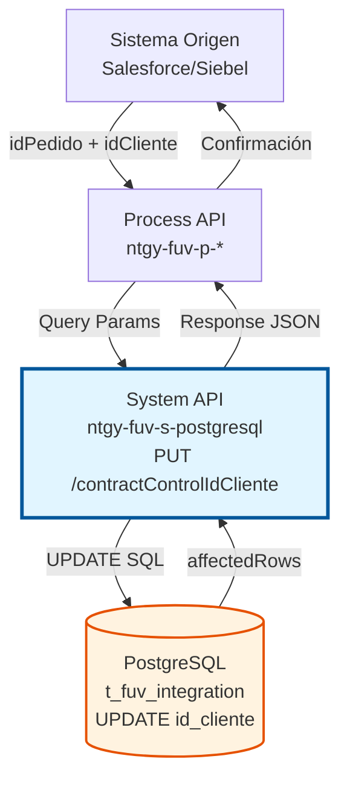
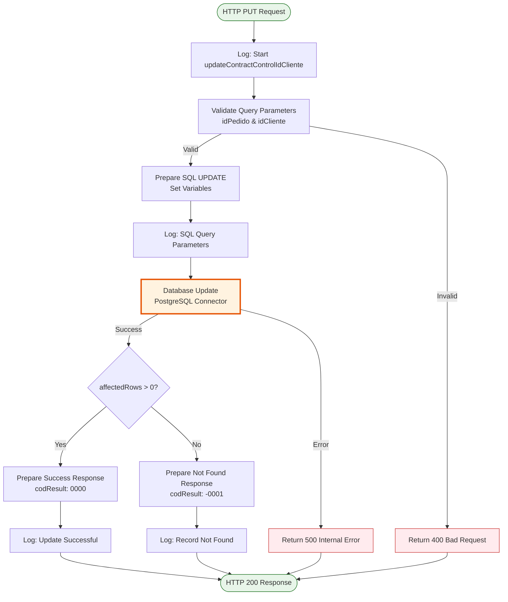
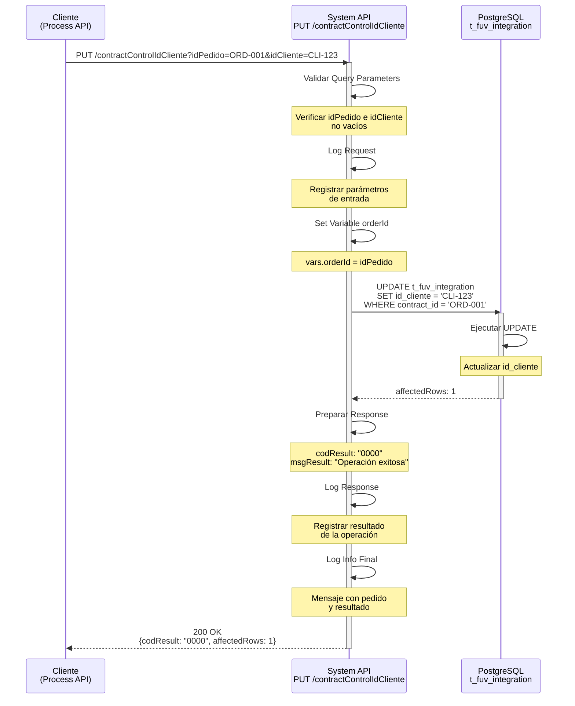
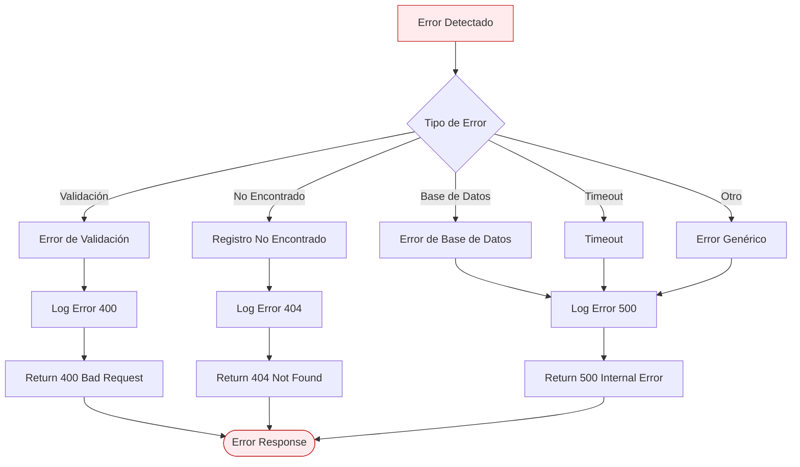
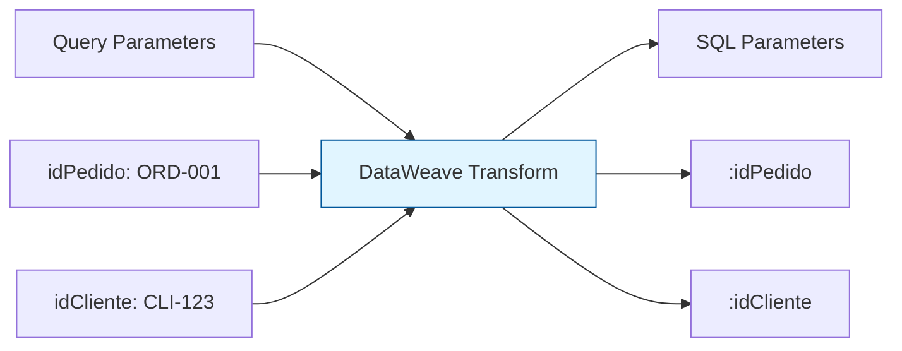
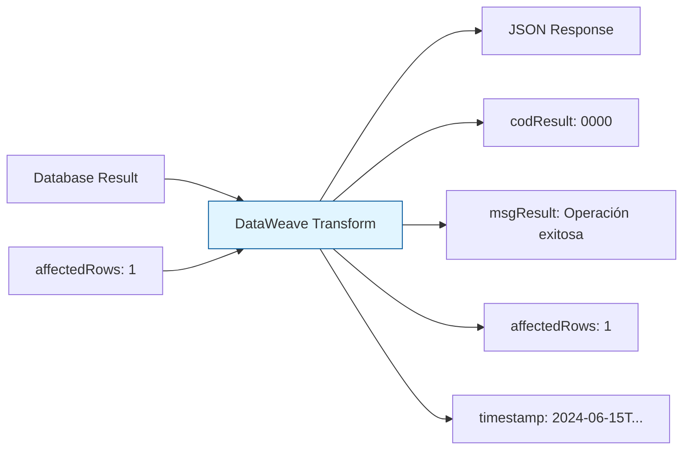

# PUT /contractControlIdCliente

## 📌 Descripción General

### Propósito del Endpoint

Este endpoint actualiza el identificador del cliente (id_cliente) en un registro existente de la tabla `t_fuv_integration` en PostgreSQL. Se utiliza durante el proceso de alta o modificación de contratos cuando se necesita asignar o actualizar el identificador del cliente asociado a un pedido del Frontal de Ventas.

El endpoint soporta:
- **Asignación Inicial**: Asignar identificador de cliente a un pedido recién creado
- **Corrección de Datos**: Corregir identificadores de cliente asignados incorrectamente
- **Actualización por Cambios**: Modificar identificador de cliente por cambios en el contrato
- **Sincronización**: Mantener consistencia de datos entre sistemas (Salesforce, Siebel, PostgreSQL)

### Tipo de API

**Capa:** System API (API-Led Connectivity)

**Función:** Integración directa con PostgreSQL para actualización de datos de control de contratos y clientes.

### Patrón de Integración

**Tipo:** Request-Reply Síncrono con SQL UPDATE

**Descripción:** Recibe identificadores del pedido y cliente como query parameters, ejecuta una operación UPDATE en PostgreSQL para modificar el campo id_cliente del registro correspondiente, y retorna confirmación de la operación con el número de filas afectadas.

### Arquitectura API-Led Connectivity



---

## 💼 Propósito del Negocio

### Casos de Uso Principales

1. **Asignación de Cliente en Alta de Contrato**
   - Durante el proceso de alta de un nuevo contrato, se asigna el identificador del cliente
   - El pedido se crea primero (POST /contractControl) y luego se actualiza con el cliente
   - Permite trazabilidad del proceso de asignación de cliente al contrato

2. **Corrección de Cliente Incorrecto**
   - Si se detecta un error en el cliente asignado, se puede corregir
   - Mantiene el historial del pedido mientras actualiza solo el campo id_cliente
   - Evita tener que eliminar y recrear el registro completo

3. **Actualización por Cambio de Titularidad**
   - Cuando un contrato cambia de titular (cambio de cliente)
   - Actualiza la referencia al nuevo cliente
   - Mantiene la integridad referencial con otros sistemas

4. **Sincronización entre Sistemas**
   - Salesforce actualiza el cliente y sincroniza con PostgreSQL
   - Siebel consulta el cliente actualizado para procesamiento
   - Garantiza consistencia de datos entre plataformas

### Contexto Empresarial

- **Dominio:** Gestión de Contratos y Clientes
- **Sector:** Energía - Utilities (Gas y Electricidad)
- **División:** Naturgy España - FUV (Facturación Única Virtual)
- **Proceso de Negocio:** Alta y modificación de contratos de suministro energético
- **Sistema:** PostgreSQL (Base de datos de control y trazabilidad)

### Stakeholders

- **Equipos de Ventas**: Necesitan asignar clientes a contratos nuevos
- **Atención al Cliente**: Requieren corregir datos incorrectos de clientes
- **Operaciones**: Gestionan cambios de titularidad que afectan al cliente
- **Sistemas de Integración**: Mantienen sincronización de datos entre plataformas

### Valor de Negocio

- **Trazabilidad Completa**: Registro de todos los cambios en identificadores de cliente
- **Flexibilidad Operativa**: Permite correcciones sin perder historial del pedido
- **Integridad de Datos**: Garantiza consistencia entre sistemas mediante actualizaciones controladas
- **Eficiencia**: Actualización rápida sin necesidad de recrear registros completos
- **Auditoría**: Timestamp automático de modificaciones para cumplimiento normativo

### Consumidores Potenciales

Este endpoint puede ser consumido por:
- Process APIs de gestión de contratos (ntgy-fuv-p-*)
- Flujos de Salesforce (Platform Events, Apex Triggers)
- Integraciones con Siebel CRM
- Sistemas de middleware de sincronización
- Procesos batch de corrección de datos

---

## 🔧 Especificación Técnica

### URLs por Ambiente

| Ambiente | URL Base | URL Completa |
|----------|----------|--------------|
| **Local** | `http://localhost:8081` | `http://localhost:8081/api/contractControlIdCliente?idPedido=ORD-2024-001234&idCliente=CLI-12345` |
| **Development** | `https://ntgy-fuv-s-postgresql-dev.us-e2.cloudhub.io` | `https://ntgy-fuv-s-postgresql-dev.us-e2.cloudhub.io/api/contractControlIdCliente?idPedido=ORD-2024-001234&idCliente=CLI-12345` |
| **UAT** | `https://ntgy-fuv-s-postgresql-uat.us-e2.cloudhub.io` | `https://ntgy-fuv-s-postgresql-uat.us-e2.cloudhub.io/api/contractControlIdCliente?idPedido=ORD-2024-001234&idCliente=CLI-12345` |
| **Production** | `https://ntgy-fuv-s-postgresql-pro.us-e2.cloudhub.io` | `https://ntgy-fuv-s-postgresql-pro.us-e2.cloudhub.io/api/contractControlIdCliente?idPedido=ORD-2024-001234&idCliente=CLI-12345` |

### Método HTTP

```
PUT /api/contractControlIdCliente
```

### Parámetros de Entrada

#### Headers HTTP

| Header | Tipo | Requerido | Descripción | Ejemplo |
|--------|------|-----------|-------------|---------|
| `Content-Type` | string | ❌ No | No requiere body | N/A |
| `Accept` | string | ❌ No | Tipo de contenido esperado en response | `application/json` |
| `client_id` | string | ✅ Sí | Client ID de Anypoint Platform | `a1b2c3d4e5f6` |
| `client_secret` | string | ✅ Sí | Client Secret de Anypoint Platform | `A1B2C3D4E5F6` |

#### Query Parameters

| Parámetro | Tipo | Requerido | Descripción | Ejemplo | Validación |
|-----------|------|-----------|-------------|---------|------------|
| `idPedido` | string | ✅ Sí | Identificador único del pedido del Frontal de Ventas | `"ORD-2024-001234"` | No vacío, debe existir en t_fuv_integration |
| `idCliente` | string | ✅ Sí | Identificador del cliente en el sistema | `"CLI-12345"` | No vacío, formato alfanumérico |

**Formato del ID Cliente:**
- Puede ser un identificador interno del sistema
- Puede ser un número de cliente de Salesforce
- Puede ser un código de Business Partner de SAP
- **Ejemplo**: `CLI-12345`, `0001234567`, `SF-ACC-001`

#### Body Parameters

Este endpoint **NO requiere body**. Todos los parámetros se envían como query parameters en la URL.

### Respuestas

#### Respuesta Exitosa (200 OK)

**Actualización exitosa (1 fila afectada):**

```json
{
  "result": {
    "codResult": "0000",
    "msgResult": "No hay error"
  }
}
```

**Registro no encontrado (0 filas afectadas):**

```json
{
  "result": {
    "codResult": "-0001",
    "msgResult": "Ha habido un error en la actualización del registro o el registro no existe"
  }
}
```

**Nota:** El endpoint retorna únicamente la sección `result` con `codResult` y `msgResult`. NO incluye una sección `data` con detalles adicionales.

#### Respuesta de Error de Validación (400 Bad Request)

```json
{
  "result": {
    "codResult": "0001",
    "msgResult": "Parámetros inválidos: idPedido es obligatorio"
  },
  "timestamp": "2024-06-15T11:30:00Z"
}
```

#### Respuesta de Error No Encontrado (404 Not Found)

```json
{
  "result": {
    "codResult": "0002",
    "msgResult": "No se encontró el pedido con idPedido: ORD-2024-999999"
  },
  "timestamp": "2024-06-15T11:30:00Z"
}
```

#### Respuesta de Error Técnico (500 Internal Server Error)

```json
{
  "result": {
    "codResult": "0003",
    "msgResult": "Error interno del servidor: Database connection timeout"
  },
  "timestamp": "2024-06-15T11:30:00Z"
}
```

### Códigos de Estado HTTP

| Código | Descripción | Cuándo se Retorna |
|--------|-------------|-------------------|
| **200 OK** | Operación procesada | Siempre que la operación se ejecute (verificar codResult para éxito/fallo) |
| **400 Bad Request** | Error de validación | Parámetros faltantes, vacíos o formato inválido |
| **404 Not Found** | Recurso no encontrado | El pedido con idPedido especificado no existe |
| **500 Internal Server Error** | Error del servidor | Error de base de datos, timeout, o error interno |

### Autenticación y Autorización

- **Tipo:** Client ID & Client Secret (Anypoint Platform)
- **Políticas Aplicadas:**
  - Client ID Enforcement
  - Rate Limiting (según configuración del ambiente)
- **Autorización PostgreSQL:** El usuario de base de datos debe tener permisos para:
  - Ejecutar UPDATE en tabla `t_fuv_integration`
  - Acceso de escritura al schema `public`

### Timeouts

| Tipo | Valor | Descripción |
|------|-------|-------------|
| **Request Timeout** | 30 segundos | Tiempo máximo de espera para la respuesta |
| **Connection Timeout** | 10 segundos | Tiempo máximo para establecer conexión con PostgreSQL |
| **Query Timeout** | 30 segundos | Tiempo máximo de ejecución del UPDATE |

---

## 🏗️ Implementación Técnica

### Arquitectura del Flow



### Componentes del Flow

#### 1. HTTP Listener
- **Configuración:** `HTTP_Listener_config`
- **Path:** `/api/contractControlIdCliente`
- **Método:** PUT
- **Puerto:** `${s-postgresql.http.port}` (configurado por ambiente)

#### 2. Logger - Request
```dataweave
%dw 2.0
output application/java

var payloadStr = write(attributes.queryParams,'application/json')
var request = common::commonFunctions::normalizeJSON(payloadStr)
---
'STARTING updateContractControlIdCliente METHOD. REQUEST: ' ++ request
```

#### 3. Preparación de Variables
```dataweave
%dw 2.0
output application/java
---
{
  orderId: attributes.queryParams.idPedido
}
```

#### 4. Database Connector - UPDATE
```xml
<db:update config-ref="Database_Config">
    <db:sql><![CDATA[${queries.updateContractControlIdCliente}]]></db:sql>
    <db:input-parameters><![CDATA[#[{
        'idCliente': vars.idCliente,
        'idPedido': vars.idPedido
    }]]]></db:input-parameters>
</db:update>
```

**Nota:** Los parámetros se pasan usando variables previamente extraídas (`vars.idCliente`, `vars.idPedido`) en lugar de acceder directamente a `attributes.queryParams`.

**Query SQL (desde s-postgresql-global-config.yaml):**
```sql
update t_fuv_integration 
set id_cliente = :idCliente 
where contract_id = :idPedido
```

**Configuración del Connector:**
- **Config:** `Database_Config`
- **Driver:** PostgreSQL JDBC 42.3.3
- **Connection Pooling:** Habilitado
- **Query Timeout:** 30 segundos
- **Fetch Size:** N/A (UPDATE no retorna filas)

#### 5. Preparación de Respuesta
```dataweave
%dw 2.0
output application/json
---
{
  "result": {
    "codResult": if (payload.affectedRows == 1) "0000" else "-0001",
    "msgResult": if (payload.affectedRows == 1) "No hay error" else "Ha habido un error en la actualización del registro o el registro no existe"
  }
}
```

**Nota Importante:** 
- La condición usa `== 1` (exactamente 1 fila), NO `> 0`
- NO se incluye sección `data` en el response
- Los mensajes son los definidos en el código real

#### 6. Logger - Response
```dataweave
%dw 2.0
output application/java

var payloadStr = write(payload,'application/json')
var response = common::commonFunctions::normalizeJSON(payloadStr)
---
'FINISHED updateContractControlIdCliente METHOD. RESPONSE: ' ++ response
```

#### 7. Logger - Info Final
```dataweave
%dw 2.0
output application/java
---
'FINISHED updateContractControlIdCliente METHOD. RESPONSE: ' ++ 
payload.result.msgResult ++ ' Pedido: ' ++ vars.idPedido
```

### Diagrama de Secuencia



### Manejo de Errores



### Transformación de Datos

#### Input: Query Parameters → SQL Parameters



#### Output: Database Result → JSON Response



### Query SQL Ejecutada

```sql
-- Query SQL real ejecutada en PostgreSQL
-- Definida en: s-postgresql-global-config.yaml
update t_fuv_integration 
set id_cliente = :idCliente 
where contract_id = :idPedido;

-- Ejemplo con valores reales:
update t_fuv_integration 
set id_cliente = 'CLI-12345' 
where contract_id = 'ORD-2024-001234';
```

**Campos Actualizados:**
- `id_cliente`: Identificador del cliente en el sistema

**Campos NO Modificados:**
- `contract_id`: Identificador del pedido (usado en WHERE)
- `system_message`: Mensaje del sistema
- `code`: Código de estado
- `message`: Mensaje descriptivo
- `state`: Estado del pedido
- `response`: Respuesta del sistema
- `error`: Información de error
- `contract_atr`: Atributos del contrato
- `update_user`: Usuario de actualización
- `update_program`: Programa de actualización
- `attempts_number`: Número de intentos
- `id_ps`: Identificador del punto de suministro

**Nota:** A diferencia de otros endpoints de actualización, este endpoint NO actualiza automáticamente campos de auditoría como `update_date` o `attempts_number`. Solo modifica el campo `id_cliente`.

### Configuración de Base de Datos

**Connection Pool Settings:**
- Min Pool Size: 5 conexiones
- Max Pool Size: 20 conexiones
- Max Idle Time: 30 minutos
- Connection Timeout: 10 segundos
- Query Timeout: 30 segundos

**Transaction Management:**
- Auto-commit: Habilitado para operaciones UPDATE individuales
- Isolation Level: READ_COMMITTED
- Rollback on Error: Automático

---

## 💻 Ejemplos de Uso

### Ejemplo 1: Asignación Inicial de Cliente

**Escenario:** Un nuevo contrato ha sido creado y necesita asignar el identificador del cliente.

**Request:**

```bash
curl -X PUT "https://ntgy-fuv-s-postgresql-dev.us-e2.cloudhub.io/api/contractControlIdCliente?idPedido=ORD-2024-001234&idCliente=CLI-12345" \
  -H "client_id: a1b2c3d4e5f6" \
  -H "client_secret: A1B2C3D4E5F6" \
  -H "Accept: application/json"
```

**Response (200 OK):**

```json
{
  "result": {
    "codResult": "0000",
    "msgResult": "No hay error"
  }
}
```

---

### Ejemplo 2: Corrección de Cliente Incorrecto

**Escenario:** Se detectó que un pedido tiene asignado un cliente incorrecto y necesita ser corregido.

**Request:**

```bash
curl -X PUT "https://ntgy-fuv-s-postgresql-uat.us-e2.cloudhub.io/api/contractControlIdCliente?idPedido=ORD-2024-005678&idCliente=CLI-67890" \
  -H "client_id: x1y2z3a4b5c6" \
  -H "client_secret: X1Y2Z3A4B5C6" \
  -H "Accept: application/json"
```

**Response (200 OK):**

```json
{
  "result": {
    "codResult": "0000",
    "msgResult": "No hay error"
  }
}
```

---

### Ejemplo 3: Pedido No Encontrado

**Escenario:** Se intenta actualizar un pedido que no existe en la base de datos.

**Request:**

```bash
curl -X PUT "https://ntgy-fuv-s-postgresql-dev.us-e2.cloudhub.io/api/contractControlIdCliente?idPedido=ORD-2024-999999&idCliente=CLI-12345" \
  -H "client_id: a1b2c3d4e5f6" \
  -H "client_secret: A1B2C3D4E5F6" \
  -H "Accept: application/json"
```

**Response (200 OK - pero con codResult indicando error):**

```json
{
  "result": {
    "codResult": "-0001",
    "msgResult": "Ha habido un error en la actualización del registro o el registro no existe"
  }
}
```

---

### Ejemplo 4: Error de Validación - Parámetro Faltante

**Escenario:** Se intenta actualizar sin proporcionar el parámetro idCliente.

**Request:**

```bash
curl -X PUT "https://ntgy-fuv-s-postgresql-dev.us-e2.cloudhub.io/api/contractControlIdCliente?idPedido=ORD-2024-001234" \
  -H "client_id: a1b2c3d4e5f6" \
  -H "client_secret: A1B2C3D4E5F6" \
  -H "Accept: application/json"
```

**Response (400 Bad Request):**

```json
{
  "result": {
    "codResult": "0001",
    "msgResult": "Parámetros inválidos: idCliente es obligatorio"
  },
  "timestamp": "2024-06-15T11:30:00Z"
}
```

---

### Ejemplo 5: Integración desde JavaScript (Node.js)

**Escenario:** Actualización de cliente desde una aplicación Node.js.

```javascript
const axios = require('axios');

async function updateContractControlIdCliente(idPedido, idCliente) {
  try {
    const response = await axios.put(
      'https://ntgy-fuv-s-postgresql-dev.us-e2.cloudhub.io/api/contractControlIdCliente',
      null,
      {
        params: {
          idPedido: idPedido,
          idCliente: idCliente
        },
        headers: {
          'client_id': 'a1b2c3d4e5f6',
          'client_secret': 'A1B2C3D4E5F6',
          'Accept': 'application/json'
        }
      }
    );

    if (response.data.result.codResult === '0000') {
      console.log('✅ Cliente actualizado exitosamente');
      console.log(`Mensaje: ${response.data.result.msgResult}`);
      return response.data;
    } else {
      console.error('❌ Error al actualizar:', response.data.result.msgResult);
      return null;
    }
  } catch (error) {
    console.error('❌ Error en la petición:', error.message);
    throw error;
  }
}

// Uso
updateContractControlIdCliente('ORD-2024-001234', 'CLI-12345')
  .then(result => console.log('Resultado:', result))
  .catch(error => console.error('Error:', error));
```

---

### Ejemplo 6: Integración desde Python

**Escenario:** Actualización de cliente desde una aplicación Python.

```python
import requests
from typing import Dict, Optional

def update_contract_control_id_cliente(
    id_pedido: str, 
    id_cliente: str,
    base_url: str = "https://ntgy-fuv-s-postgresql-dev.us-e2.cloudhub.io"
) -> Optional[Dict]:
    """
    Actualiza el identificador del cliente de un pedido en PostgreSQL.
    
    Args:
        id_pedido: Identificador del pedido
        id_cliente: Identificador del cliente
        base_url: URL base del API
        
    Returns:
        Dict con la respuesta del API o None si hay error
    """
    url = f"{base_url}/api/contractControlIdCliente"
    
    params = {
        "idPedido": id_pedido,
        "idCliente": id_cliente
    }
    
    headers = {
        "client_id": "a1b2c3d4e5f6",
        "client_secret": "A1B2C3D4E5F6",
        "Accept": "application/json"
    }
    
    try:
        response = requests.put(url, params=params, headers=headers, timeout=30)
        response.raise_for_status()
        
        data = response.json()
        
        if data["result"]["codResult"] == "0000":
            print(f"✅ Cliente actualizado exitosamente")
            print(f"Mensaje: {data['result']['msgResult']}")
            return data
        else:
            print(f"❌ Error: {data['result']['msgResult']}")
            return None
            
    except requests.exceptions.RequestException as e:
        print(f"❌ Error en la petición: {str(e)}")
        return None

# Uso
if __name__ == "__main__":
    result = update_contract_control_id_cliente(
        id_pedido="ORD-2024-001234",
        id_cliente="CLI-12345"
    )
    
    if result:
        print("Operación completada con éxito")
    else:
        print("La operación falló")
```

---

### Ejemplo 7: Integración desde MuleSoft (DataWeave)

**Escenario:** Llamada al endpoint desde otro flow de MuleSoft.

```dataweave
%dw 2.0
output application/json
---
{
    // Preparar parámetros para la llamada
    idPedido: payload.orderId,
    idCliente: payload.customerId
}
```

**Flow XML:**

```xml
<flow name="update-customer-id-flow">
    <http:request 
        method="PUT" 
        config-ref="System_API_Config"
        path="/api/contractControlIdCliente">
        <http:query-params><![CDATA[#[{
            idPedido: payload.orderId,
            idCliente: payload.customerId
        }]]]></http:query-params>
        <http:headers><![CDATA[#[{
            "client_id": p('secure::client.id'),
            "client_secret": p('secure::client.secret')
        }]]]></http:headers>
    </http:request>
    
    <ee:transform>
        <ee:message>
            <ee:set-payload><![CDATA[%dw 2.0
output application/json
---
{
    success: payload.result.codResult == "0000",
    message: payload.result.msgResult
}]]></ee:set-payload>
        </ee:message>
    </ee:transform>
</flow>
```

---

### Ejemplo 8: Prueba con Postman

**Configuración de Request en Postman:**

1. **Método:** PUT
2. **URL:** `https://ntgy-fuv-s-postgresql-dev.us-e2.cloudhub.io/api/contractControlIdCliente`
3. **Params (Query Parameters):**
   - `idPedido`: `ORD-2024-001234`
   - `idCliente`: `CLI-12345`
4. **Headers:**
   - `client_id`: `a1b2c3d4e5f6`
   - `client_secret`: `A1B2C3D4E5F6`
   - `Accept`: `application/json`

**Tests en Postman:**

```javascript
// Verificar status code
pm.test("Status code is 200", function () {
    pm.response.to.have.status(200);
});

// Verificar estructura de respuesta
pm.test("Response has correct structure", function () {
    var jsonData = pm.response.json();
    pm.expect(jsonData).to.have.property('result');
    pm.expect(jsonData.result).to.have.property('codResult');
    pm.expect(jsonData.result).to.have.property('msgResult');
});

// Verificar operación exitosa
pm.test("Operation successful", function () {
    var jsonData = pm.response.json();
    pm.expect(jsonData.result.codResult).to.eql("0000");
    pm.expect(jsonData.result.msgResult).to.eql("No hay error");
});

// Verificar que NO hay sección data
pm.test("Response does not have data section", function () {
    var jsonData = pm.response.json();
    pm.expect(jsonData).to.not.have.property('data');
});
```
