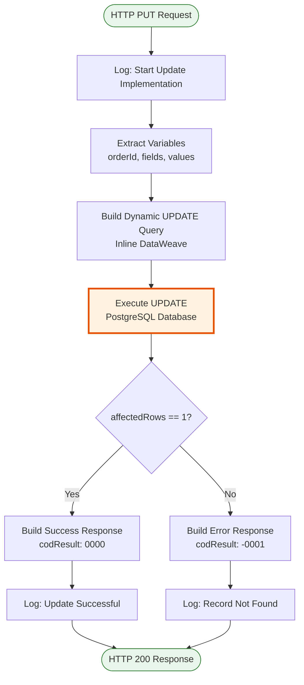
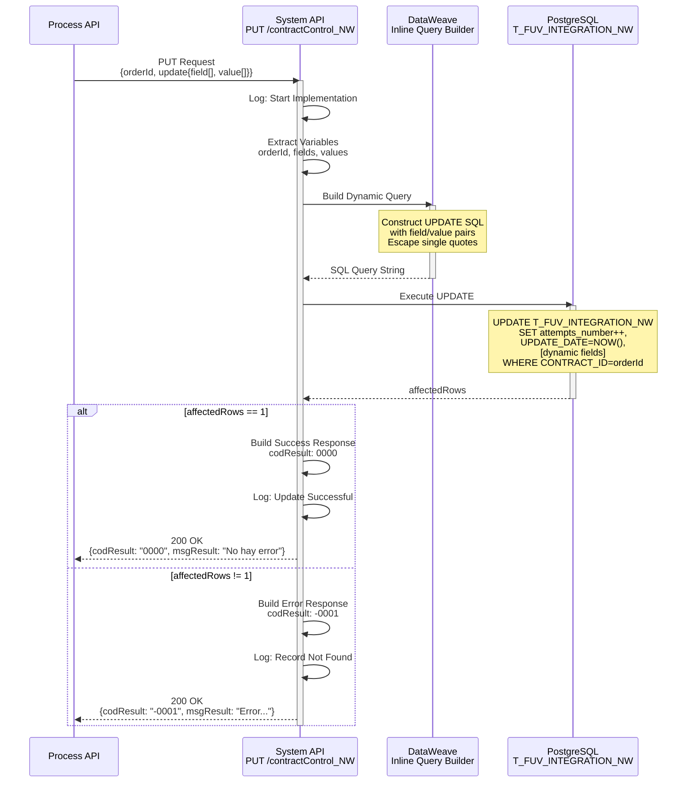
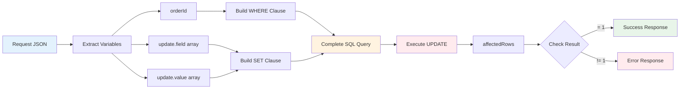

# PUT /contractControl_NW

## 📌 Descripción General

### Propósito del Endpoint

Actualiza registros existentes en la tabla `T_FUV_INTEGRATION_NW` de PostgreSQL mediante construcción dinámica de queries SQL. Este endpoint permite actualizar múltiples campos de forma flexible especificando arrays de campos y valores dentro del objeto `update`, incrementando automáticamente el contador de intentos y actualizando el timestamp con zona horaria de Madrid.

El endpoint soporta:
- **Actualización Dinámica**: Especificar qué campos actualizar mediante arrays field/value dentro del objeto `update`
- **Control de Intentos**: Incremento automático del contador `attempts_number`
- **Timestamp Automático**: Actualización de `UPDATE_DATE` con zona horaria Europe/Madrid
- **Actualización Parcial**: Solo actualiza los campos especificados, no requiere enviar todos los campos
- **Escape de Caracteres**: Manejo automático de comillas simples en valores

### Tipo de API

**Capa:** System API (API-Led Connectivity)

**Función:** Integración directa con PostgreSQL para actualización de registros en la tabla T_FUV_INTEGRATION_NW del sistema FUV (Facturación Única Virtual).

### Patrón de Integración

**Tipo:** Request-Reply Síncrono con SQL UPDATE Dinámico

**Descripción:** Recibe un objeto JSON con el ID del registro y un objeto `update` que contiene arrays de campos/valores a actualizar, construye dinámicamente una query SQL UPDATE, ejecuta la actualización en PostgreSQL y retorna el resultado con el número de filas afectadas.

### Arquitectura API-Led Connectivity

```mermaid
graph TB
    P[Process API<br/>ntgy-newco-p-fua-evo]
    S[System API<br/>ntgy-fuv-s-postgresql<br/>PUT /contractControl_NW]
    DB[(PostgreSQL<br/>T_FUV_INTEGRATION_NW)]
    
    P -->|Request JSON<br/>orderId + update{field[], value[]}| S
    S -->|UPDATE Query<br/>Dynamic SQL| DB
    DB -->|affectedRows| S
    S -->|Response JSON<br/>codResult + msgResult| P
    
    style S fill:#e1f5ff,stroke:#01579b,stroke-width:3px
    style DB fill:#fff3e0,stroke:#e65100,stroke-width:2px
```

---

## 💼 Propósito del Negocio

### Casos de Uso Principales

1. **Actualización de Estado de Procesamiento**
   - Actualizar el estado de un contrato durante su ciclo de vida
   - Registrar progreso de procesamiento (received → EN_PROCESO → COMPLETADO)
   - Marcar contratos con errores para reprocesamiento
   - **Beneficio:** Trazabilidad completa del estado de cada contrato

2. **Registro de Respuestas de Sistemas Externos**
   - Almacenar respuestas de sistemas destino (SIEBEL, distribuidoras)
   - Guardar códigos de resultado de operaciones
   - Registrar mensajes de confirmación o error
   - **Beneficio:** Auditoría completa de integraciones con sistemas externos

3. **Control de Reintentos de Procesamiento**
   - Incrementar contador de intentos automáticamente
   - Registrar errores para análisis y reprocesamiento
   - Actualizar timestamp de última modificación
   - **Beneficio:** Gestión eficiente de reintentos y prevención de loops infinitos

### Contexto Empresarial

- **Dominio:** Gestión de Contratos y Pedidos
- **Sector:** Energía - Utilities
- **División:** Naturgy España - FUV (Facturación Única Virtual)
- **Proceso de Negocio:** Control y seguimiento de contratos NW desde creación hasta completado
- **Sistema:** PostgreSQL - Base de datos de control FUV

### Stakeholders

- **Equipo de Operaciones FUV**: Monitoreo y gestión de contratos en proceso
- **Desarrolladores de Process APIs**: Actualización de estados durante flujos de negocio
- **Equipo de Soporte**: Análisis de errores y reprocesamiento de contratos
- **Administradores de Base de Datos**: Mantenimiento de integridad de datos

### Valor de Negocio

- **Trazabilidad Completa**: Registro detallado de cada actualización con timestamp y contador de intentos
- **Flexibilidad**: Actualización dinámica de campos sin necesidad de modificar código
- **Eficiencia**: Actualización parcial de campos reduce carga en base de datos
- **Auditoría**: Historial completo de cambios para cumplimiento normativo
- **Resiliencia**: Control de reintentos previene sobrecarga del sistema

---

## 🔧 Especificación Técnica

### URLs por Ambiente

| Ambiente | URL Base | URL Completa |
|----------|----------|--------------|
| **Local** | `http://localhost:8081` | `http://localhost:8081/api/contractControl_NW` |
| **Development** | `https://ntgy-fuv-s-postgresql-dev.us-e2.cloudhub.io` | `https://ntgy-fuv-s-postgresql-dev.us-e2.cloudhub.io/api/contractControl_NW` |
| **UAT** | `https://ntgy-fuv-s-postgresql-uat.us-e2.cloudhub.io` | `https://ntgy-fuv-s-postgresql-uat.us-e2.cloudhub.io/api/contractControl_NW` |
| **UAT01** | `https://ntgy-fuv-s-postgresql-uat01.us-e2.cloudhub.io` | `https://ntgy-fuv-s-postgresql-uat01.us-e2.cloudhub.io/api/contractControl_NW` |
| **Production** | `https://ntgy-fuv-s-postgresql-pro.us-e2.cloudhub.io` | `https://ntgy-fuv-s-postgresql-pro.us-e2.cloudhub.io/api/contractControl_NW` |

### Método HTTP

```
PUT /api/contractControl_NW
```

### Parámetros de Entrada

#### Headers HTTP

| Header | Tipo | Requerido | Descripción | Ejemplo |
|--------|------|-----------|-------------|---------|
| `Content-Type` | string | ✅ Sí | Tipo de contenido del request | `application/json` |
| `Accept` | string | ❌ No | Tipo de contenido esperado en response | `application/json` |
| `client_id` | string | ✅ Sí | Client ID de Anypoint Platform | `abc123...` |
| `client_secret` | string | ✅ Sí | Client Secret de Anypoint Platform | `xyz789...` |

#### Body Parameters

| Campo | Tipo | Requerido | Descripción | Ejemplo |
|-------|------|-----------|-------------|---------|
| `orderId` | string | ✅ Sí | Identificador único del registro a actualizar (CONTRACT_ID) | `"ORD-NW-2024-001234"` |
| `update` | object | ✅ Sí | Objeto que contiene los campos a actualizar | Ver estructura abajo |
| `update.field` | array[string] | ✅ Sí | Array de nombres de campos a actualizar | `["STATE", "CODE", "RESPONSE"]` |
| `update.value` | array[string] | ✅ Sí | Array de valores correspondientes a cada campo (misma longitud que field) | `["COMPLETADO", "0000", "OK"]` |

**Campos Actualizables:**

| Campo | Tipo | Descripción | Valores Posibles |
|-------|------|-------------|------------------|
| `STATE` | string | Estado del contrato | received, EN_PROCESO, COMPLETADO, ERROR, CANCELADO |
| `CODE` | string | Código de resultado | received, 0000 (éxito), otros códigos de error |
| `RESPONSE` | string | Respuesta del sistema destino | Texto libre |
| `ERROR` | string | Mensaje de error si aplica | Texto libre |
| `CONTRACT_ATR` | integer | Atributos adicionales del contrato | Número entero |
| `SYSTEM_MESSAGE` | string | Sistema origen del mensaje | Frontal, PortabilidadMasiva |
| `VIEWABLE` | string | Indicador de visibilidad | Y, N |

**Validaciones:**
- `orderId` no puede estar vacío
- Objeto `update` es obligatorio
- Arrays `update.field` y `update.value` deben tener la misma longitud
- Los campos especificados en `update.field` deben ser válidos (nombres de columnas de T_FUV_INTEGRATION_NW)
- Comillas simples en valores se escapan automáticamente (reemplazadas por '')

### Respuestas

#### Respuesta Exitosa (200 OK)

**Actualización exitosa (affectedRows = 1):**

```json
{
  "result": {
    "codResult": "0000",
    "msgResult": "No hay error"
  }
}
```

**Registro no encontrado o no actualizado (affectedRows = 0):**

```json
{
  "result": {
    "codResult": "-0001",
    "msgResult": "Ha habido un error en la actualización del registro o el registro no existe"
  }
}
```

#### Respuesta de Error de Validación (400 Bad Request)

```json
{
  "error": {
    "code": "400",
    "message": "Request inválido",
    "details": "Los arrays field y value deben tener la misma longitud"
  }
}
```

#### Respuesta de Error Técnico (500 Internal Server Error)

```json
{
  "error": {
    "code": "500",
    "message": "Error interno del servidor",
    "details": "Error al ejecutar query UPDATE en base de datos"
  }
}
```

### Autenticación y Autorización

- **Tipo:** Client ID & Client Secret (Anypoint Platform)
- **Autorización PostgreSQL:** El usuario de base de datos debe tener permisos para:
  - Ejecutar operaciones UPDATE en tabla `T_FUV_INTEGRATION_NW`
  - Acceso de lectura para validar existencia del registro
  - Permisos de escritura en schema `public`

### Timeouts

| Tipo | Valor | Descripción |
|------|-------|-------------|
| **Request Timeout** | 30 segundos | Tiempo máximo de espera para la respuesta |
| **Connection Timeout** | 10 segundos | Tiempo máximo para establecer conexión con PostgreSQL |
| **Query Timeout** | 30 segundos | Tiempo máximo de ejecución de la query UPDATE |

---

## 🏗️ Implementación Técnica

### Arquitectura del Flow



### Diagrama de Secuencia



### Transformación de Datos

#### Construcción Dinámica de Query SQL (Inline en XML)

**Extracción de Variables:**

```dataweave
%dw 2.0
output application/java
---
payload.orderId
```

```dataweave
%dw 2.0
output application/java
---
payload.update.field
```

```dataweave
%dw 2.0
output application/java
---
payload.update.value
```

**Query Builder Logic (Inline en el XML):**

```dataweave
%dw 2.0
output application/java

var sentence_1 = "UPDATE T_FUV_INTEGRATION_NW SET attempts_number = attempts_number + 1, UPDATE_DATE = timezone('Europe/Madrid'::text, CURRENT_TIMESTAMP), "
var sentence_2 = " WHERE CONTRACT_ID = "

// Función para construir pares field = value
fun setFieldsValuesSentence(listFields) = listFields map (field, findex) -> {
    printString : field ++ " = '" ++ (vars.values filter ((item, vindex) -> (findex == vindex)) map $)[0] ++ "'"
}

var fieldsValuesSentence = setFieldsValuesSentence(vars.fields)

// Unir los strings con comas
fun buildSentence(listfieldsValuesSentence) = listfieldsValuesSentence joinBy ", "

var SETSentenceGenerated = buildSentence(fieldsValuesSentence.printString)
---
sentence_1 ++ SETSentenceGenerated ++ sentence_2 ++ "'" ++ vars.orderId ++ "'"
```

**Ejemplo de Query Generada:**

```sql
UPDATE T_FUV_INTEGRATION_NW 
SET attempts_number = attempts_number + 1, 
    UPDATE_DATE = timezone('Europe/Madrid'::text, CURRENT_TIMESTAMP), 
    STATE = 'COMPLETADO', 
    CODE = '0000', 
    RESPONSE = 'Contrato actualizado exitosamente'
WHERE CONTRACT_ID = 'ORD-NW-2024-001234'
```

### Operación de Base de Datos

#### Query SQL UPDATE

```sql
UPDATE T_FUV_INTEGRATION_NW 
SET 
    attempts_number = attempts_number + 1,
    UPDATE_DATE = timezone('Europe/Madrid'::text, CURRENT_TIMESTAMP),
    [CAMPO1] = '[valor1]',
    [CAMPO2] = '[valor2]',
    [CAMPON] = '[valorN]'
WHERE CONTRACT_ID = '[orderId]'
```

**Campos Actualizados Automáticamente:**
- `attempts_number`: Se incrementa en 1 en cada actualización
- `UPDATE_DATE`: Se actualiza con timestamp actual en zona horaria Europe/Madrid

**Tabla: T_FUV_INTEGRATION_NW**

| Campo | Tipo | Descripción |
|-------|------|-------------|
| T_FUV_INTEGRATION_NW_ID | BIGINT PK | ID autoincremental de la tabla |
| CONTRACT_ID | VARCHAR(255) | Identificador único del contrato (orderId) |
| SYSTEM_MESSAGE | VARCHAR(100) | Sistema origen del mensaje (Frontal, PortabilidadMasiva) |
| CODE | VARCHAR(50) | Código de resultado (received, 0000, etc.) |
| MESSAGE | TEXT | Mensaje descriptivo completo (JSON) |
| STATE | VARCHAR(50) | Estado del contrato (received, COMPLETADO, ERROR, etc.) |
| RESPONSE | TEXT | Respuesta del sistema destino |
| ERROR | TEXT | Mensaje de error si aplica |
| CONTRACT_ATR | INTEGER | Atributos del contrato |
| CREATE_DATE | TIMESTAMP | Fecha de creación del registro |
| UPDATE_DATE | TIMESTAMP | Fecha de última actualización |
| UPDATE_USER | VARCHAR(50) | Usuario que realizó la actualización |
| UPDATE_PROGRAM | VARCHAR(100) | Programa que realizó la actualización |
| OPTIMIST_LOCK | INTEGER | Control de concurrencia optimista |
| VIEWABLE | CHAR(1) | Indicador de visibilidad (Y/N) |
| attempts_number | INTEGER | Contador de intentos de procesamiento |

### Diagrama de Transformación de Datos



---

## 💻 Ejemplos de Uso

### Ejemplo 1: Request - Actualización de Estado

```json
{
  "orderId": "ORD-NW-2024-001234",
  "update": {
    "field": ["STATE", "CODE", "RESPONSE"],
    "value": ["COMPLETADO", "0000", "Contrato procesado exitosamente"]
  }
}
```

### Ejemplo 2: Response Exitoso (200 OK)

```json
{
  "result": {
    "codResult": "0000",
    "msgResult": "No hay error"
  }
}
```

### Ejemplo 3: Response - Registro No Encontrado (200 OK)

```json
{
  "result": {
    "codResult": "-0001",
    "msgResult": "Ha habido un error en la actualización del registro o el registro no existe"
  }
}
```

### Ejemplo 4: cURL Command

```bash
curl -X PUT "https://ntgy-fuv-s-postgresql-dev.us-e2.cloudhub.io/api/contractControl_NW" \
  -H "Content-Type: application/json" \
  -H "client_id: YOUR_CLIENT_ID" \
  -H "client_secret: YOUR_CLIENT_SECRET" \
  -d '{
    "orderId": "ORD-NW-2024-001234",
    "update": {
      "field": ["STATE", "CODE", "RESPONSE"],
      "value": ["COMPLETADO", "0000", "OK"]
    }
  }'
```

### Ejemplo 5: Request - Actualización con Error

```json
{
  "orderId": "ORD-NW-2024-001235",
  "update": {
    "field": ["STATE", "CODE", "ERROR"],
    "value": ["ERROR", "E001", "Error al procesar contrato: timeout en sistema externo"]
  }
}
```

### Ejemplo 6: Request - Actualización Múltiple de Campos

```json
{
  "orderId": "ORD-NW-2024-001236",
  "update": {
    "field": ["STATE", "CODE", "RESPONSE", "SYSTEM_MESSAGE", "VIEWABLE"],
    "value": ["EN_PROCESO", "P001", "Procesando en SIEBEL", "Frontal", "Y"]
  }
}