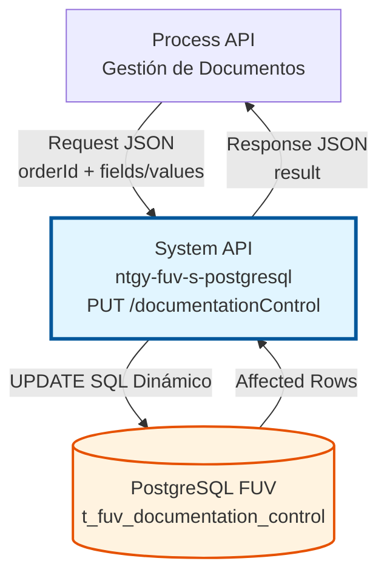
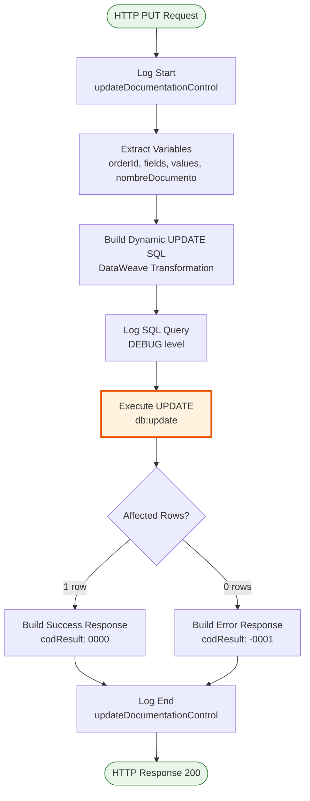
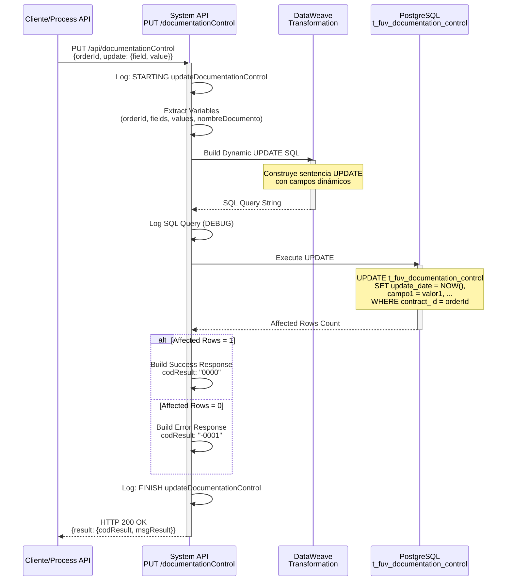

# PUT /documentationControl

## 📌 Descripción General

### Propósito del Endpoint

Este endpoint actualiza dinámicamente uno o múltiples campos del registro de control de documentación asociado a un pedido específico en la base de datos PostgreSQL del sistema FUV (Facturación Única Virtual).

El endpoint soporta:
- **Actualización Dinámica**: Permite actualizar cualquier combinación de campos mediante arrays field/value
- **Filtrado Flexible**: Búsqueda por orderId (obligatorio) y opcionalmente por nombreDocumento
- **Actualización Automática**: Actualiza automáticamente el campo update_date con timezone Europe/Madrid
- **Múltiples Campos**: Soporte para actualizar varios campos en una sola operación

### Tipo de API

**Capa:** System API (API-Led Connectivity)

**Función:** Integración directa con base de datos PostgreSQL para actualización de control de documentación de pedidos.

### Patrón de Integración

**Tipo:** Request-Reply Síncrono con SQL UPDATE Dinámico

**Descripción:** Recibe datos del pedido y campos a actualizar, construye dinámicamente la sentencia SQL UPDATE, ejecuta la actualización en PostgreSQL y retorna el resultado de la operación.

### Arquitectura API-Led Connectivity



---

## 💼 Propósito del Negocio

### Casos de Uso Principales

1. **Actualización de Estado de Documentos**
   - Cambiar el estado de procesamiento de documentos (PENDIENTE → PROCESADO → ERROR)
   - Registrar intentos de procesamiento
   - Mantener trazabilidad del ciclo de vida del documento

2. **Gestión de Reintentos**
   - Incrementar contador de intentos de procesamiento
   - Actualizar estado tras cada intento
   - Controlar límites de reintentos

3. **Actualización de Metadatos**
   - Modificar información de cabecera y líneas de contrato
   - Actualizar tipo documental
   - Cambiar indicadores de envío a distribuidora
   - Modificar sistema destino

### Contexto Empresarial

- **Dominio:** Gestión de Documentación y Pedidos
- **Sector:** Energía - Utilities
- **División:** Naturgy España - FUV (Facturación Única Virtual)
- **Proceso de Negocio:** Control y trazabilidad de documentación asociada a pedidos de suministro
- **Sistema:** PostgreSQL (Base de datos transaccional FUV)

### Stakeholders

- **Equipos de Operaciones**: Necesitan actualizar estados de documentos en tiempo real
- **Sistemas de Procesamiento**: Actualizan automáticamente estados tras procesamiento
- **Equipos de Soporte**: Requieren modificar metadatos para correcciones
- **Sistemas de Monitoreo**: Consultan estados actualizados para reportes

### Valor de Negocio

- **Flexibilidad**: Actualización dinámica sin necesidad de endpoints específicos por campo
- **Trazabilidad**: Registro automático de fecha/hora de cada actualización
- **Eficiencia**: Actualización de múltiples campos en una sola operación
- **Integridad**: Filtrado preciso por orderId y nombreDocumento evita actualizaciones erróneas

### Consumidores Potenciales

Este endpoint puede ser consumido por:
- Process APIs de gestión de documentos
- Sistemas de procesamiento batch de documentos
- Flujos de reintento y recuperación de errores
- Sistemas de integración con distribuidoras
- APIs de sincronización con sistemas externos (SIEBEL, etc.)

---

## 🔧 Especificación Técnica

### URLs por Ambiente

| Ambiente | URL Base | URL Completa |
|----------|----------|--------------|
| **Local** | `http://localhost:8081` | `http://localhost:8081/api/documentationControl` |
| **Development** | `https://ntgy-fuv-s-postgresql-dev.us-e2.cloudhub.io` | `https://ntgy-fuv-s-postgresql-dev.us-e2.cloudhub.io/api/documentationControl` |
| **UAT** | `https://ntgy-fuv-s-postgresql-uat.us-e2.cloudhub.io` | `https://ntgy-fuv-s-postgresql-uat.us-e2.cloudhub.io/api/documentationControl` |
| **UAT01** | `https://ntgy-fuv-s-postgresql-uat01.us-e2.cloudhub.io` | `https://ntgy-fuv-s-postgresql-uat01.us-e2.cloudhub.io/api/documentationControl` |
| **Production** | `https://ntgy-fuv-s-postgresql-pro.us-e2.cloudhub.io` | `https://ntgy-fuv-s-postgresql-pro.us-e2.cloudhub.io/api/documentationControl` |

### Método HTTP

```
PUT /api/documentationControl
```

### Parámetros de Entrada

#### Headers HTTP

| Header | Tipo | Requerido | Descripción | Ejemplo |
|--------|------|-----------|-------------|---------|
| `Content-Type` | string | ✅ Sí | Tipo de contenido del request | `application/json` |
| `Accept` | string | ❌ No | Tipo de contenido esperado en response | `application/json` |

#### Body Parameters

**Estructura del Request:**

```json
{
  "orderId": "string",
  "nombreDocumento": "string (opcional)",
  "update": {
    "field": ["campo1", "campo2", "..."],
    "value": ["valor1", "valor2", "..."]
  }
}
```

**Descripción de Campos:**

| Campo | Tipo | Requerido | Descripción | Ejemplo |
|-------|------|-----------|-------------|---------|
| `orderId` | string | ✅ Sí | ID del pedido asociado al control de documentación | `"ORD-2024-001234"` |
| `nombreDocumento` | string | ❌ No | Nombre del documento a actualizar (para filtrar documentos específicos) | `"CONTRATO_SUMINISTRO"` |
| `update` | object | ✅ Sí | Objeto que contiene los campos a actualizar | - |
| `update.field` | array[string] | ✅ Sí | Array de nombres de campos a actualizar | `["document_status", "attempts_number"]` |
| `update.value` | array[string] | ✅ Sí | Array de valores correspondientes a los campos | `["PROCESADO", "2"]` |

**Campos Actualizables:**

| Campo | Tipo | Descripción | Valores Posibles |
|-------|------|-------------|------------------|
| `document_status` | string | Estado del documento | PENDIENTE, PROCESADO, ERROR, ENVIADO |
| `attempts_number` | integer | Número de intentos de procesamiento | 1, 2, 3, ... |
| `cabecera_contrato` | string | Cabecera del contrato | JSON string |
| `lineas_contrato` | string | Líneas del contrato | JSON string |
| `tipo_documental` | string | Tipo de documento | CONTRATO, ANEXO, CERTIFICADO, etc. |
| `envio_distribuidora` | string | Indicador de envío a distribuidora | Y, N |
| `destino` | string | Sistema destino | SIEBEL, SAP, etc. |

### Respuestas

#### Respuesta Exitosa (200 OK)

**Cuando se actualiza 1 registro:**

```json
{
  "result": {
    "codResult": "0000",
    "msgResult": "No hay error"
  }
}
```

#### Respuesta de Error de Negocio (200 OK con codResult != "0000")

**Cuando no se encuentra el registro o no se actualiza:**

```json
{
  "result": {
    "codResult": "-0001",
    "msgResult": "Ha habido un error en la actualización del registro o el registro no existe"
  }
}
```

#### Respuesta de Error Técnico (400/500)

**Error de validación o error interno:**

```json
{
  "result": {
    "codResult": "0001",
    "msgResult": "Error interno del servidor"
  }
}
```

### Códigos de Estado HTTP

| Código | Descripción | Cuándo se usa |
|--------|-------------|---------------|
| `200 OK` | Operación exitosa o error de negocio | Siempre que la API procese la petición |
| `400 Bad Request` | Request malformado | JSON inválido, campos requeridos faltantes |
| `500 Internal Server Error` | Error técnico del servidor | Error de base de datos, error de conexión |

### Autenticación y Autorización

- **Tipo:** Client ID & Client Secret (Anypoint Platform)
- **Autorización PostgreSQL:** El usuario de base de datos debe tener permisos para:
  - Ejecutar UPDATE en tabla `t_fuv_documentation_control`
  - Acceso al schema `public`
  - Permisos de lectura para construir la query dinámica

### Timeouts

| Tipo | Valor | Descripción |
|------|-------|-------------|
| **Request Timeout** | 30 segundos | Tiempo máximo de espera para la respuesta |
| **Connection Timeout** | 10 segundos | Tiempo máximo para establecer conexión con PostgreSQL |
| **Query Timeout** | 30 segundos | Tiempo máximo de ejecución de la query UPDATE |

---

## 🏗️ Implementación Técnica

### Arquitectura del Flow



### Diagrama de Secuencia



### Query SQL Dinámica

**Construcción de la Query:**

```sql
UPDATE t_fuv_documentation_control 
SET update_date = timezone('Europe/Madrid'::text, CURRENT_TIMESTAMP),
    document_status = 'PROCESADO',
    attempts_number = '2'
WHERE t_fuv_documentation_control_id IN (
    SELECT t_fuv_documentation_control_id 
    FROM t_fuv_documentation_control 
    WHERE contract_id = 'ORD-2024-001234'
    AND document_name = 'CONTRATO_SUMINISTRO'
)
```

**Lógica de Construcción (DataWeave):**

```dataweave
%dw 2.0
output application/java

var sentence_1 = "update t_fuv_documentation_control set update_date = timezone('Europe/Madrid'::text, CURRENT_TIMESTAMP), "
var sentence_2 = " where t_fuv_documentation_control_id in (select t_fuv_documentation_control_id from t_fuv_documentation_control where contract_id = '"

// 1. Recorrer arrays fields y values para construir "field = value"
fun setFieldsValuesSentence(listFields) = listFields map (field, findex) -> {
    printString : field ++ " = '" ++ (vars.values filter ((item, vindex) -> (findex == vindex)) map $)[0] ++ "'"
}

// 2. Aplicar función y guardar resultado
var fieldsValuesSentence = setFieldsValuesSentence(vars.fields)

// 3. Unir strings con comas
fun buildSentence(listfieldsValuesSentence) = listfieldsValuesSentence joinBy ", "

// 4. Construir sentencia completa
var SETSentenceGenerated = buildSentence(fieldsValuesSentence.printString)
---

sentence_1 ++ SETSentenceGenerated ++ sentence_2 ++ vars.orderId 
++ if (vars.nombreDocumento != null) ("' and document_name = '" ++ vars.nombreDocumento ++ "')")  else ("')")
```

**Características de la Query:**
- **Actualización automática de update_date** con timezone Europe/Madrid
- **Construcción dinámica** de campos SET basada en arrays
- **Filtrado por orderId** (obligatorio)
- **Filtrado opcional por nombreDocumento** para documentos específicos
- **Subquery** para obtener el ID del registro a actualizar

### Diagrama de Transformación de Datos

```mermaid
graph LR
    A[Request JSON] --> B[Extract Variables]
    B --> C[Build Field-Value Pairs]
    C --> D[Join with Commas]
    D --> E[Construct UPDATE SQL]
    E --> F[Execute in PostgreSQL]
    F --> G[Check Affected Rows]
    G --> H[Build Response JSON]
    
    style A fill:#e3f2fd
    style E fill:#fff3e0
    style F fill:#ffebee
    style H fill:#e8f5e9
```



### Componentes del Flow

**Flow Principal:** `s-postgresql-updateDocumentationControl`

**Componentes:**

1. **Logger (request)**: Registra inicio de operación con orderId
2. **Transform (var values)**: Extrae variables orderId, fields, values, nombreDocumento
3. **Set Variable**: Almacena nombreDocumento
4. **Transform (prepare update sentence)**: Construye query SQL dinámica
5. **DB Update**: Ejecuta UPDATE en PostgreSQL
6. **Transform (response)**: Construye respuesta basada en affectedRows
7. **Logger (response)**: Registra fin de operación

### Manejo de Errores

**Errores de Base de Datos:**
- Capturados por el error handler del flow
- Retornan código 500 con mensaje de error
- Se registran en logs con nivel ERROR

**Errores de Validación:**
- Arrays field/value con longitudes diferentes
- orderId vacío o nulo
- Retornan código 400 con mensaje descriptivo

**Registro No Encontrado:**
- affectedRows = 0
- Retorna código 200 con codResult "-0001"
- Mensaje: "Ha habido un error en la actualización del registro o el registro no existe"

---

## 💻 Ejemplos de Uso

### Ejemplo 1: Actualizar Estado de Documento

**Request:**

```json
{
  "orderId": "ORD-2024-001234",
  "nombreDocumento": "CONTRATO_SUMINISTRO",
  "update": {
    "field": ["document_status"],
    "value": ["PROCESADO"]
  }
}
```

**Response Exitoso:**

```json
{
  "result": {
    "codResult": "0000",
    "msgResult": "No hay error"
  }
}
```

### Ejemplo 2: Actualizar Múltiples Campos

**Request:**

```json
{
  "orderId": "ORD-2024-001234",
  "update": {
    "field": ["document_status", "attempts_number", "destino"],
    "value": ["ERROR", "3", "SAP"]
  }
}
```

**Response Exitoso:**

```json
{
  "result": {
    "codResult": "0000",
    "msgResult": "No hay error"
  }
}
```

### Ejemplo 3: Comando curl

**Actualizar estado a PROCESADO:**

```bash
curl -X PUT "https://ntgy-fuv-s-postgresql-dev.us-e2.cloudhub.io/api/documentationControl" \
  -H "Content-Type: application/json" \
  -H "client_id: YOUR_CLIENT_ID" \
  -H "client_secret: YOUR_CLIENT_SECRET" \
  -d '{
    "orderId": "ORD-2024-001234",
    "nombreDocumento": "CONTRATO_SUMINISTRO",
    "update": {
      "field": ["document_status", "attempts_number"],
      "value": ["PROCESADO", "1"]
    }
  }'
```

### Ejemplo 4: Error - Registro No Encontrado

**Request:**

```json
{
  "orderId": "ORD-INEXISTENTE",
  "update": {
    "field": ["document_status"],
    "value": ["PROCESADO"]
  }
}
```

**Response:**

```json
{
  "result": {
    "codResult": "-0001",
    "msgResult": "Ha habido un error en la actualización del registro o el registro no existe"
  }
}
```

### Ejemplo 5: Actualizar Indicador de Envío a Distribuidora

**Request:**

```json
{
  "orderId": "ORD-2024-001234",
  "nombreDocumento": "CONTRATO_SUMINISTRO",
  "update": {
    "field": ["envio_distribuidora", "document_status"],
    "value": ["Y", "ENVIADO"]
  }
}
```

**Response Exitoso:**

```json
{
  "result": {
    "codResult": "0000",
    "msgResult": "No hay error"
  }
}
```

### Ejemplo 6: Actualizar Metadatos de Contrato

**Request:**

```json
{
  "orderId": "ORD-2024-001234",
  "update": {
    "field": ["cabecera_contrato", "lineas_contrato", "tipo_documental"],
    "value": [
      "{\"cliente\":\"12345678A\",\"fecha\":\"2024-06-15\"}",
      "{\"linea1\":{\"producto\":\"Electricidad\",\"tarifa\":\"2.0TD\"}}",
      "CONTRATO_ALTA"
    ]
  }
}
```

**Response Exitoso:**

```json
{
  "result": {
    "codResult": "0000",
    "msgResult": "No hay error"
  }
}
```
