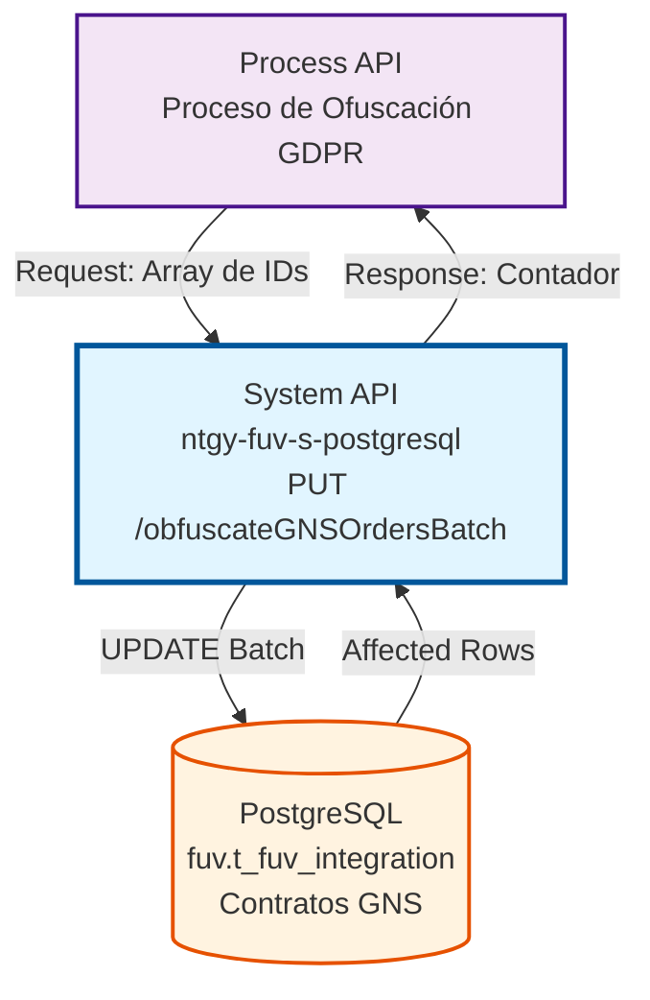
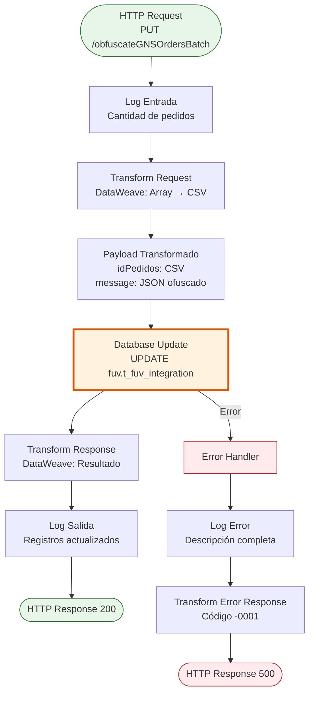
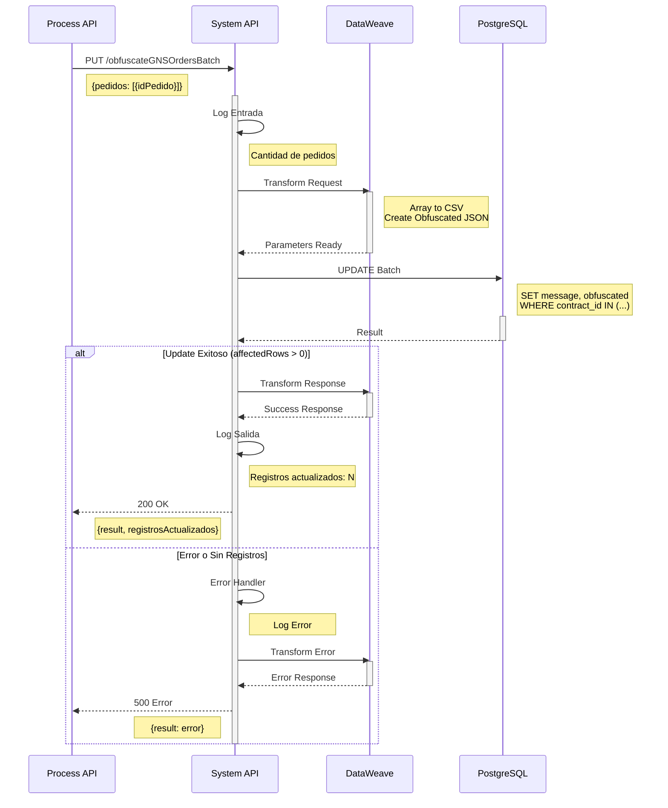
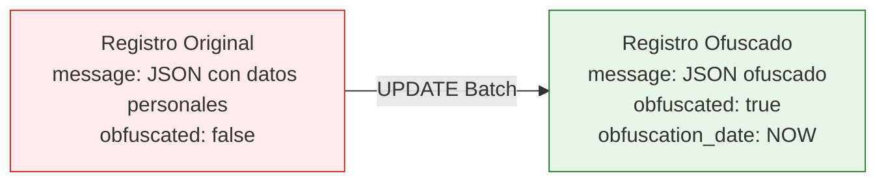

# PUT /obfuscateGNSOrdersBatch

## 📌 Descripción General

### Propósito del Endpoint

Este endpoint realiza la **ofuscación masiva de datos personales** almacenados en el campo `message` (JSONB) de la tabla `t_fuv_integration` para contratos GNS (Gas Natural Servicios). Es una operación batch que permite anonimizar múltiples contratos en una sola transacción, cumpliendo con las regulaciones GDPR de protección de datos.

El endpoint soporta:
- **Ofuscación Batch**: Procesa múltiples contratos en una sola operación
- **Anonimización Irreversible**: Reemplaza el contenido del campo `message` con datos ofuscados
- **Marcado de Registros**: Actualiza flags de control (`obfuscated`, `obfuscation_date`)
- **Respuesta Detallada**: Retorna contador de registros procesados exitosamente

### Tipo de API

**Capa:** System API (API-Led Connectivity)

**Función:** Integración directa con PostgreSQL para operaciones de ofuscación de datos personales en la tabla de contratos GNS.

### Patrón de Integración

**Tipo:** Request-Reply Síncrono con SQL UPDATE Batch

**Descripción:** Recibe un array de IDs de contratos, los transforma en una lista separada por comas, ejecuta un UPDATE masivo en PostgreSQL utilizando la función `ANY(string_to_array())`, y retorna el número de registros afectados.

### Arquitectura API-Led Connectivity



---

## 💼 Propósito del Negocio

### Casos de Uso Principales

1. **Cumplimiento GDPR - Derecho al Olvido**
   - Anonimización de datos personales tras finalización de contrato
   - Eliminación de información sensible de clientes
   - Cumplimiento de plazos legales de retención de datos

2. **Procesamiento Batch de Ofuscación**
   - Ofuscación masiva de contratos finalizados
   - Procesamiento nocturno de contratos antiguos
   - Limpieza periódica de datos históricos

3. **Auditoría y Trazabilidad**
   - Marcado de registros ofuscados con timestamp
   - Control de registros procesados
   - Trazabilidad de operaciones de privacidad

### Contexto Empresarial

- **Dominio:** Gestión de Privacidad y Protección de Datos
- **Sector:** Energía - Utilities
- **División:** Naturgy España - GNS (Gas Natural Servicios)
- **Proceso de Negocio:** Cumplimiento GDPR y gestión de datos personales
- **Regulación:** RGPD (Reglamento General de Protección de Datos)

### Stakeholders

- **Data Protection Officer (DPO)**: Responsable de cumplimiento GDPR
- **Equipo de Operaciones**: Ejecuta procesos batch de ofuscación
- **Equipo Legal**: Supervisa cumplimiento de regulaciones
- **Auditores**: Verifican trazabilidad de operaciones de privacidad

### Valor de Negocio

- **Cumplimiento Legal**: Garantiza adherencia a GDPR y normativas de privacidad
- **Reducción de Riesgo**: Minimiza exposición de datos personales sensibles
- **Eficiencia Operativa**: Procesamiento batch reduce tiempo de ejecución
- **Trazabilidad**: Registro completo de operaciones de ofuscación

### Consumidores Potenciales

Este endpoint puede ser consumido por:
- Process APIs de gestión de privacidad
- Procesos batch programados (schedulers)
- Sistemas de gestión de cumplimiento GDPR
- Herramientas de auditoría y reporting

---

## 🔧 Especificación Técnica

### URLs por Ambiente

| Ambiente | URL Base | URL Completa |
|----------|----------|--------------|
| **Local** | `http://localhost:8081` | `http://localhost:8081/api/obfuscateGNSOrdersBatch` |
| **Development** | `https://ntgy-fuv-s-postgresql-dev.us-e2.cloudhub.io` | `https://ntgy-fuv-s-postgresql-dev.us-e2.cloudhub.io/api/obfuscateGNSOrdersBatch` |
| **UAT** | `https://ntgy-fuv-s-postgresql-uat.us-e2.cloudhub.io` | `https://ntgy-fuv-s-postgresql-uat.us-e2.cloudhub.io/api/obfuscateGNSOrdersBatch` |
| **Production** | `https://ntgy-fuv-s-postgresql-pro.us-e2.cloudhub.io` | `https://ntgy-fuv-s-postgresql-pro.us-e2.cloudhub.io/api/obfuscateGNSOrdersBatch` |

### Método HTTP

```
PUT /api/obfuscateGNSOrdersBatch
```

### Parámetros de Entrada

#### Headers HTTP

| Header | Tipo | Requerido | Descripción | Ejemplo |
|--------|------|-----------|-------------|---------|
| `Content-Type` | string | ✅ Sí | Tipo de contenido del request | `application/json` |
| `Accept` | string | ❌ No | Tipo de contenido esperado en response | `application/json` |

#### Body Parameters

**Estructura del Request:**

```json
{
  "pedidos": [
    {
      "idPedido": "string"
    }
  ]
}
```

**Descripción de Campos:**

| Campo | Tipo | Requerido | Descripción | Ejemplo |
|-------|------|-----------|-------------|---------|
| `pedidos` | array | ✅ Sí | Array de objetos con IDs de contratos a ofuscar | `[{"idPedido": "CONTRACT_001"}]` |
| `pedidos[].idPedido` | string | ✅ Sí | ID del contrato (contract_id) en la tabla t_fuv_integration | `"CONTRACT_001"` |

**Validaciones:**
- El array `pedidos` no puede estar vacío
- Cada objeto debe contener el campo `idPedido`
- Los IDs deben ser strings válidos

### Respuestas

#### Respuesta Exitosa (200 OK)

```json
{
  "result": {
    "codResult": "0000",
    "msgResult": "Pedidos GNS actualizados correctamente"
  },
  "registrosActualizados": 5
}
```

**Descripción de Campos:**

| Campo | Tipo | Descripción |
|-------|------|-------------|
| `result.codResult` | string | Código de resultado: "0000" (éxito) o "-0001" (error) |
| `result.msgResult` | string | Mensaje descriptivo del resultado |
| `registrosActualizados` | integer | Número de registros actualizados en la base de datos |

#### Respuesta Sin Registros Actualizados (200 OK)

```json
{
  "result": {
    "codResult": "-0001",
    "msgResult": "No se actualizaron pedidos GNS"
  },
  "registrosActualizados": 0
}
```

**Escenarios:**
- Los IDs proporcionados no existen en la tabla
- Los contratos ya fueron ofuscados previamente
- Error en la estructura de los IDs

#### Respuesta de Error Técnico (500 Internal Server Error)

```json
{
  "result": {
    "codResult": "-0001",
    "msgResult": "Error técnico al actualizar pedidos GNS"
  }
}
```

**Causas Comunes:**
- Error de conexión con la base de datos
- Timeout en la operación
- Error en la transformación de datos
- Violación de constraints de base de datos

### Autenticación y Autorización

- **Tipo:** Client ID & Client Secret (Anypoint Platform)
- **Autorización PostgreSQL:** El usuario de base de datos debe tener permisos para:
  - Ejecutar UPDATE en tabla `fuv.t_fuv_integration`
  - Acceso al schema `fuv`
  - Permisos de escritura en campos: `message`, `obfuscated`, `obfuscation_date`, `update_date`

### Timeouts

| Tipo | Valor | Descripción |
|------|-------|-------------|
| **Request Timeout** | 60 segundos | Tiempo máximo de espera para operaciones batch |
| **Connection Timeout** | 10 segundos | Tiempo máximo para establecer conexión con PostgreSQL |
| **Query Timeout** | 60 segundos | Tiempo máximo de ejecución del UPDATE batch |

---

## 🏗️ Implementación Técnica

### Arquitectura del Flow



### Componentes del Flow

#### 1. Logger de Entrada (Línea 82-85)

```xml
<logger level="INFO" 
        message="s-postgresql-obfuscateGNSOrdersBatch.logEntrada ## Actualizando #[sizeOf(payload.pedidos)] pedidos GNS en batch"
        category="s-postgresql-obfuscateGNSOrdersBatch"/>
```

**Propósito:** Registra el inicio de la operación y la cantidad de pedidos a procesar.

#### 2. Transformación de Request (Líneas 87-97)

```dataweave
%dw 2.0
output application/java
---
{
  idPedidos: payload.pedidos map $.idPedido joinBy ",",
  message: write({"**":"*******"}, 'application/json')
}
```

**Propósito:** 
- Convierte el array de pedidos en un string CSV
- Crea el mensaje ofuscado en formato JSON
- Prepara los parámetros para la query SQL

**Ejemplo de Transformación:**

**Input:**
```json
{
  "pedidos": [
    {"idPedido": "CONTRACT_001"},
    {"idPedido": "CONTRACT_002"},
    {"idPedido": "CONTRACT_003"}
  ]
}
```

**Output:**
```java
{
  idPedidos: "CONTRACT_001,CONTRACT_002,CONTRACT_003",
  message: "{\"**\":\"*******\"}"
}
```

#### 3. Database Update (Líneas 99-102)

```xml
<db:update config-ref="Database_Config">
  <db:sql><![CDATA[${queries.updateGNSOrderMessagesBatch}]]></db:sql>
  <db:input-parameters><![CDATA[#[payload]]]></db:input-parameters>
</db:update>
```

**Query SQL Ejecutada:**
```sql
UPDATE fuv.t_fuv_integration 
SET 
  message = CAST(:message AS jsonb), 
  obfuscated = true, 
  obfuscation_date = CURRENT_TIMESTAMP, 
  update_date = CURRENT_TIMESTAMP 
WHERE contract_id = ANY(string_to_array(:idPedidos, ','))
```

**Parámetros:**
- `:message` → `{"**":"*******"}` (JSONB ofuscado)
- `:idPedidos` → `"CONTRACT_001,CONTRACT_002,CONTRACT_003"` (CSV string)

**Operación:**
- Actualiza el campo `message` con datos ofuscados
- Marca `obfuscated = true`
- Registra `obfuscation_date` con timestamp actual
- Actualiza `update_date` con timestamp actual
- Filtra por múltiples `contract_id` usando `ANY(string_to_array())`

#### 4. Transformación de Response (Líneas 104-117)

```dataweave
%dw 2.0
output application/json
---
{
  result: {
    codResult: if (payload.affectedRows > 0) "0000" else "-0001",
    msgResult: if (payload.affectedRows > 0) 
                  "Pedidos GNS actualizados correctamente" 
               else 
                  "No se actualizaron pedidos GNS"
  },
  registrosActualizados: payload.affectedRows
}
```

**Propósito:** Construye la respuesta estructurada basándose en el número de filas afectadas.

#### 5. Logger de Salida (Líneas 119-122)

```xml
<logger level="INFO" 
        message="s-postgresql-obfuscateGNSOrdersBatch.logSalida ## Actualizados: #[payload.registrosActualizados] pedidos GNS"
        category="s-postgresql-obfuscateGNSOrdersBatch"/>
```

**Propósito:** Registra el resultado de la operación con el contador de registros actualizados.

#### 6. Error Handler (Líneas 124-146)

```xml
<error-handler>
  <on-error-propagate enableNotifications="true" logException="true">
    <logger level="ERROR" 
            message="#['s-postgresql-obfuscateGNSOrdersBatch.logErrorGenerico Error Description: ' ++ (error.description default 'null' as String)]"
            category="s-postgresql-obfuscateGNSOrdersBatch"/>
    
    <ee:transform>
      <ee:set-payload><![CDATA[%dw 2.0
output application/json
---
{
  result: {
    codResult: "-0001",
    msgResult: "Error técnico al actualizar pedidos GNS"
  }
}]]></ee:set-payload>
    </ee:transform>
  </on-error-propagate>
</error-handler>
```

**Propósito:** Captura errores, los registra y retorna una respuesta de error estructurada.

### Diagrama de Secuencia Detallado



### Tabla de Ofuscación

**Tabla:** `fuv.t_fuv_integration`

**Campos Actualizados:**

| Campo | Tipo | Antes | Después | Descripción |
|-------|------|-------|---------|-------------|
| `message` | jsonb | `{"nombre": "Juan", "email": "juan@example.com"}` | `{"**": "*******"}` | Datos personales ofuscados |
| `obfuscated` | boolean | `false` o `null` | `true` | Marca de registro ofuscado |
| `obfuscation_date` | timestamp | `null` | `2026-07-10 12:55:00` | Fecha de ofuscación |
| `update_date` | timestamp | `2026-01-15 10:30:00` | `2026-07-10 12:55:00` | Fecha de última actualización |

**Diagrama de Ofuscación:**



### Configuración de Base de Datos

**Connector:** Database Connector (PostgreSQL)

**Configuración:** `Database_Config`

**Propiedades:**
- **Driver:** PostgreSQL JDBC 42.3.3
- **Connection Pooling:** Habilitado
- **Max Pool Size:** Configurado por ambiente
- **Query Timeout:** 60 segundos (batch operations)

### Manejo de Transacciones

- **Tipo:** Transacción única para toda la operación batch
- **Aislamiento:** READ COMMITTED (default PostgreSQL)
- **Rollback:** Automático en caso de error
- **Commit:** Automático al finalizar exitosamente

### Logging y Monitoreo

**Categoría de Log:** `s-postgresql-obfuscateGNSOrdersBatch`

**Niveles de Log:**
- **INFO:** Entrada, salida, y operaciones exitosas
- **ERROR:** Errores técnicos y excepciones

**Métricas Monitoreadas:**
- Cantidad de pedidos procesados
- Registros actualizados exitosamente
- Tiempo de ejecución
- Tasa de errores

---

## 💻 Ejemplos de Uso

### Ejemplo 1: Ofuscación Exitosa de Múltiples Contratos

#### Request

```bash
curl -X PUT "https://ntgy-fuv-s-postgresql-dev.us-e2.cloudhub.io/api/obfuscateGNSOrdersBatch" \
  -H "Content-Type: application/json" \
  -H "client_id: YOUR_CLIENT_ID" \
  -H "client_secret: YOUR_CLIENT_SECRET" \
  -d '{
    "pedidos": [
      {"idPedido": "CONTRACT_GNS_001"},
      {"idPedido": "CONTRACT_GNS_002"},
      {"idPedido": "CONTRACT_GNS_003"},
      {"idPedido": "CONTRACT_GNS_004"},
      {"idPedido": "CONTRACT_GNS_005"}
    ]
  }'
```

#### Response (200 OK)

```json
{
  "result": {
    "codResult": "0000",
    "msgResult": "Pedidos GNS actualizados correctamente"
  },
  "registrosActualizados": 5
}
```

**Interpretación:** Los 5 contratos fueron ofuscados exitosamente.

---

### Ejemplo 2: Ofuscación con Algunos IDs No Encontrados

#### Request

```bash
curl -X PUT "https://ntgy-fuv-s-postgresql-uat.us-e2.cloudhub.io/api/obfuscateGNSOrdersBatch" \
  -H "Content-Type: application/json" \
  -H "client_id: YOUR_CLIENT_ID" \
  -H "client_secret: YOUR_CLIENT_SECRET" \
  -d '{
    "pedidos": [
      {"idPedido": "CONTRACT_GNS_100"},
      {"idPedido": "CONTRACT_GNS_999"},
      {"idPedido": "CONTRACT_GNS_101"}
    ]
  }'
```

#### Response (200 OK)

```json
{
  "result": {
    "codResult": "0000",
    "msgResult": "Pedidos GNS actualizados correctamente"
  },
  "registrosActualizados": 2
}
```

**Interpretación:** Solo 2 de los 3 contratos existían en la base de datos. El contrato `CONTRACT_GNS_999` no fue encontrado.

---

### Ejemplo 3: Ningún Registro Actualizado

#### Request

```bash
curl -X PUT "https://ntgy-fuv-s-postgresql-dev.us-e2.cloudhub.io/api/obfuscateGNSOrdersBatch" \
  -H "Content-Type: application/json" \
  -H "client_id: YOUR_CLIENT_ID" \
  -H "client_secret: YOUR_CLIENT_SECRET" \
  -d '{
    "pedidos": [
      {"idPedido": "NONEXISTENT_001"},
      {"idPedido": "NONEXISTENT_002"}
    ]
  }'
```

#### Response (200 OK)

```json
{
  "result": {
    "codResult": "-0001",
    "msgResult": "No se actualizaron pedidos GNS"
  },
  "registrosActualizados": 0
}
```

**Interpretación:** Ninguno de los IDs proporcionados existe en la tabla `t_fuv_integration`.

---

### Ejemplo 4: Error Técnico

#### Request

```bash
curl -X PUT "https://ntgy-fuv-s-postgresql-dev.us-e2.cloudhub.io/api/obfuscateGNSOrdersBatch" \
  -H "Content-Type: application/json" \
  -H "client_id: YOUR_CLIENT_ID" \
  -H "client_secret: YOUR_CLIENT_SECRET" \
  -d '{
    "pedidos": [
      {"idPedido": "CONTRACT_001"}
    ]
  }'
```

#### Response (500 Internal Server Error)

```json
{
  "result": {
    "codResult": "-0001",
    "msgResult": "Error técnico al actualizar pedidos GNS"
  }
}
```

**Causas Posibles:**
- Error de conexión con PostgreSQL
- Timeout en la operación
- Violación de constraints de base de datos
- Error en la transformación de datos

---

### Ejemplo 5: Request con JavaScript (Node.js)

```javascript
const axios = require('axios');

async function obfuscateGNSOrders(contractIds) {
  try {
    const response = await axios.put(
      'https://ntgy-fuv-s-postgresql-pro.us-e2.cloudhub.io/api/obfuscateGNSOrdersBatch',
      {
        pedidos: contractIds.map(id => ({ idPedido: id }))
      },
      {
        headers: {
          'Content-Type': 'application/json',
          'client_id': process.env.CLIENT_ID,
          'client_secret': process.env.CLIENT_SECRET
        },
        timeout: 60000 // 60 segundos
      }
    );

    console.log('Ofuscación exitosa:');
    console.log(`- Código: ${response.data.result.codResult}`);
    console.log(`- Mensaje: ${response.data.result.msgResult}`);
    console.log(`- Registros actualizados: ${response.data.registrosActualizados}`);

    return response.data;
  } catch (error) {
    console.error('Error en ofuscación:', error.response?.data || error.message);
    throw error;
  }
}

// Uso
const contractsToObfuscate = [
  'CONTRACT_GNS_001',
  'CONTRACT_GNS_002',
  'CONTRACT_GNS_003'
];

obfuscateGNSOrders(contractsToObfuscate)
  .then(result => console.log('Proceso completado'))
  .catch(error => console.error('Proceso fallido'));
```

---

### Ejemplo 6: Request con Python

```python
import requests
import os
from typing import List, Dict

def obfuscate_gns_orders(contract_ids: List[str]) -> Dict:
    """
    Ofusca múltiples contratos GNS en batch.
    
    Args:
        contract_ids: Lista de IDs de contratos a ofuscar
        
    Returns:
        Diccionario con el resultado de la operación
    """
    url = "https://ntgy-fuv-s-postgresql-pro.us-e2.cloudhub.io/api/obfuscateGNSOrdersBatch"
    
    headers = {
        "Content-Type": "application/json",
        "client_id": os.getenv("CLIENT_ID"),
        "client_secret": os.getenv("CLIENT_SECRET")
    }
    
    payload = {
        "pedidos": [{"idPedido": contract_id} for contract_id in contract_ids]
    }
    
    try:
        response = requests.put(
            url,
            json=payload,
            headers=headers,
            timeout=60
        )
        response.raise_for_status()
        
        result = response.json()
        print(f"✅ Ofuscación exitosa:")
        print(f"   - Código: {result['result']['codResult']}")
        print(f"   - Mensaje: {result['result']['msgResult']}")
        print(f"   - Registros actualizados: {result['registrosActualizados']}")
        
        return result
        
    except requests.exceptions.RequestException as e:
        print(f"❌ Error en ofuscación: {e}")
        if hasattr(e.response, 'json'):
            print(f"   Detalle: {e.response.json()}")
        raise

# Uso
if __name__ == "__main__":
    contracts = [
        "CONTRACT_GNS_001",
        "CONTRACT_GNS_002",
        "CONTRACT_GNS_003"
    ]
    
    result = obfuscate_gns_orders(contracts)
```

---

### Ejemplo 7: Procesamiento Batch Grande

Para procesar grandes volúmenes de contratos, se recomienda dividir en lotes:

```python
def obfuscate_large_batch(contract_ids: List[str], batch_size: int = 100):
    """
    Procesa grandes volúmenes de contratos en lotes.
    
    Args:
        contract_ids: Lista completa de IDs a ofuscar
        batch_size: Tamaño de cada lote (default: 100)
    """
    total_updated = 0
    total_batches = (len(contract_ids) + batch_size - 1) // batch_size
    
    for i in range(0, len(contract_ids), batch_size):
        batch = contract_ids[i:i + batch_size]
        batch_num = (i // batch_size) + 1
        
        print(f"Procesando lote {batch_num}/{total_batches} ({len(batch)} contratos)...")
        
        try:
            result = obfuscate_gns_orders(batch)
            total_updated += result['registrosActualizados']
            print(f"✅ Lote {batch_num} completado: {result['registrosActualizados']} actualizados")
        except Exception as e:
            print(f"❌ Error en lote {batch_num}: {e}")
            continue
    
    print(f"\n📊 Resumen:")
    print(f"   - Total contratos procesados: {len(contract_ids)}")
    print(f"   - Total actualizados: {total_updated}")
    print(f"   - Lotes procesados: {total_batches}")

# Uso con 500 contratos
large_contract_list = [f"CONTRACT_GNS_{i:04d}" for i in range(1, 501)]
obfuscate_large_batch(large_contract_list, batch_size=100)
```

**Salida Esperada:**
```
Procesando lote 1/5 (100 contratos)...
✅ Lote 1 completado: 100 actualizados
Procesando lote 2/5 (100 contratos)...
✅ Lote 2 completado: 100 actualizados
Procesando lote 3/5 (100 contratos)...
✅ Lote 3 completado: 100 actualizados
Procesando lote 4/5 (100 contratos)...
✅ Lote 4 completado: 100 actualizados
Procesando lote 5/5 (100 contratos)...
✅ Lote 5 completado: 100 actualizados

📊 Resumen:
   - Total contratos procesados: 500
   - Total actualizados: 500
   - Lotes procesados: 5
```
