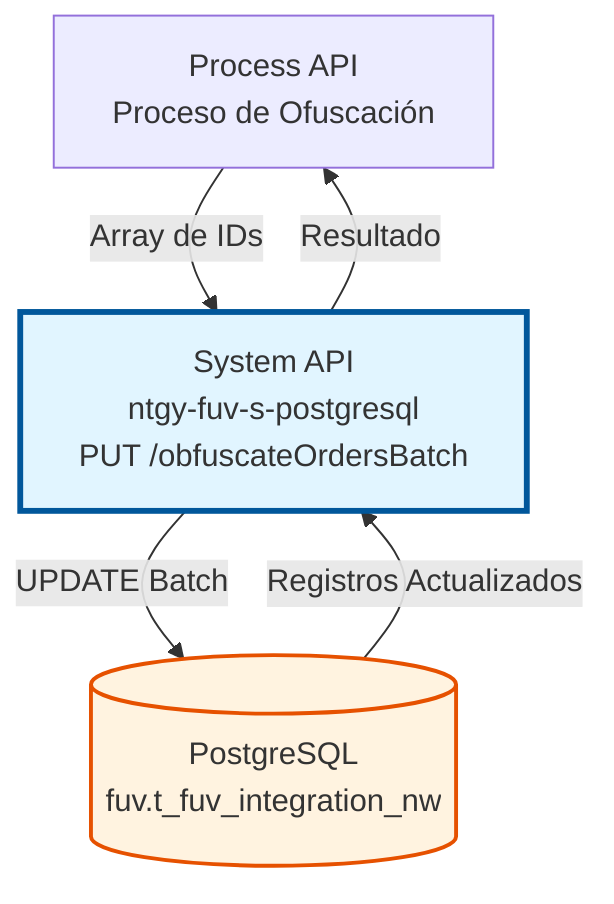
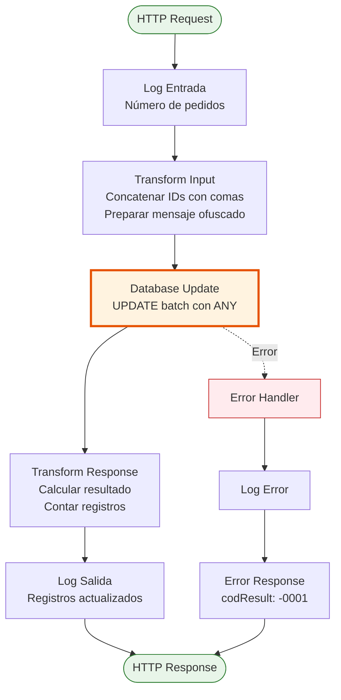
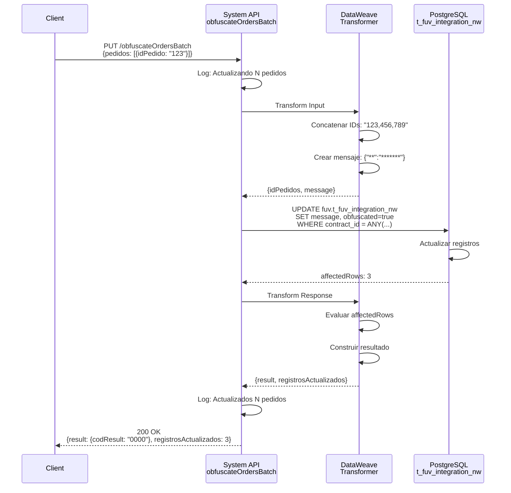

# PUT /obfuscateOrdersBatch

## 📌 Descripción General

### Propósito del Endpoint

Este endpoint realiza la ofuscación batch de datos sensibles almacenados en contratos NewCo, reemplazando información personal identificable con valores genéricos para cumplir con normativas de protección de datos (GDPR/LOPD).

El endpoint soporta:
- **Ofuscación Masiva**: Procesa múltiples contratos en una sola transacción
- **Actualización Atómica**: Garantiza consistencia de datos mediante transacciones
- **Marcado de Ofuscación**: Registra fecha y estado de ofuscación para auditoría
- **Protección de Datos**: Reemplaza mensajes completos con valores genéricos

### Tipo de API

**Capa:** System API (API-Led Connectivity)

**Función:** Operación de mantenimiento de datos para anonimización de información sensible en la base de datos PostgreSQL del sistema FUV (Facturación Única Virtual) NewCo.

### Patrón de Integración

**Tipo:** Request-Reply Síncrono con Operación SQL Batch

**Descripción:** Recibe un array de IDs de pedidos, los concatena en una lista separada por comas, ejecuta una actualización batch en PostgreSQL usando `ANY(string_to_array())` para procesar múltiples registros en una sola transacción, y retorna el número de registros afectados.

### Arquitectura API-Led Connectivity



---

## 💼 Propósito del Negocio

### Casos de Uso Principales

1. **Cumplimiento Normativo GDPR**
   - Anonimización de datos personales tras finalización de contrato
   - Eliminación de información identificable según plazos legales
   - Cumplimiento del derecho al olvido

2. **Protección de Datos Sensibles**
   - Ofuscación de mensajes con información de clientes
   - Protección de datos personales en sistemas legacy
   - Minimización de riesgo de exposición de datos

3. **Mantenimiento de Base de Datos**
   - Limpieza periódica de datos sensibles
   - Optimización de almacenamiento
   - Preparación de datos para entornos de prueba

### Contexto Empresarial

- **Dominio:** Gestión de Datos y Privacidad
- **Sector:** Energía - Utilities
- **División:** Naturgy España - NewCo (FUV)
- **Proceso de Negocio:** Protección de Datos y Cumplimiento Normativo
- **Regulación:** GDPR (Reglamento General de Protección de Datos)

### Stakeholders

- **Data Protection Officer (DPO)**: Responsable de cumplimiento GDPR
- **Administradores de Base de Datos**: Ejecutan procesos de ofuscación
- **Equipos de Auditoría**: Verifican cumplimiento normativo
- **Equipos Legales**: Supervisan protección de datos personales

### Valor de Negocio

- **Cumplimiento Legal**: Evita sanciones por incumplimiento GDPR (hasta 20M€ o 4% facturación)
- **Protección de Marca**: Previene brechas de seguridad y daño reputacional
- **Eficiencia Operativa**: Procesa múltiples registros en una sola operación
- **Trazabilidad**: Registra fecha y estado de ofuscación para auditorías

### Consumidores Potenciales

Este endpoint puede ser consumido por:
- Process APIs de gestión de privacidad
- Jobs batch programados de mantenimiento
- Procesos de preparación de datos para entornos no productivos
- Sistemas de gestión de cumplimiento normativo

---

## 🔧 Especificación Técnica

### URLs por Ambiente

| Ambiente | URL Base | URL Completa |
|----------|----------|--------------|
| **Local** | `http://localhost:8081` | `http://localhost:8081/api/obfuscateOrdersBatch` |
| **Development** | `https://ntgy-fuv-s-postgresql-dev.us-e2.cloudhub.io` | `https://ntgy-fuv-s-postgresql-dev.us-e2.cloudhub.io/api/obfuscateOrdersBatch` |
| **UAT** | `https://ntgy-fuv-s-postgresql-uat.us-e2.cloudhub.io` | `https://ntgy-fuv-s-postgresql-uat.us-e2.cloudhub.io/api/obfuscateOrdersBatch` |
| **Production** | `https://ntgy-fuv-s-postgresql-pro.us-e2.cloudhub.io` | `https://ntgy-fuv-s-postgresql-pro.us-e2.cloudhub.io/api/obfuscateOrdersBatch` |

### Método HTTP

```
PUT /api/obfuscateOrdersBatch
```

### Parámetros de Entrada

#### Headers HTTP

| Header | Tipo | Requerido | Descripción | Ejemplo |
|--------|------|-----------|-------------|---------|
| `Content-Type` | string | ✅ Sí | Tipo de contenido del request | `application/json` |
| `Accept` | string | ❌ No | Tipo de contenido esperado en response | `application/json` |

#### Body Parameters

**Estructura del Request:**

```json
{
  "pedidos": [
    {
      "idPedido": "string"
    }
  ]
}
```

**Descripción de Campos:**

| Campo | Tipo | Requerido | Descripción | Ejemplo |
|-------|------|-----------|-------------|---------|
| `pedidos` | array | ✅ Sí | Array de objetos con IDs de pedidos a ofuscar | `[{"idPedido": "12345"}]` |
| `pedidos[].idPedido` | string | ✅ Sí | ID único del pedido/contrato en sistema NewCo | `"12345"` |

**Validaciones:**
- El array `pedidos` no puede estar vacío
- Cada objeto debe contener el campo `idPedido`
- Los IDs deben ser strings válidos

### Respuestas

#### Respuesta Exitosa (200 OK)

```json
{
  "result": {
    "codResult": "0000",
    "msgResult": "Pedidos actualizados correctamente"
  },
  "registrosActualizados": 5
}
```

**Descripción de Campos:**

| Campo | Tipo | Descripción |
|-------|------|-------------|
| `result.codResult` | string | Código de resultado: "0000" = éxito, "-0001" = sin actualizaciones |
| `result.msgResult` | string | Mensaje descriptivo del resultado |
| `registrosActualizados` | integer | Número de registros actualizados en la base de datos |

#### Respuesta Sin Actualizaciones (200 OK)

```json
{
  "result": {
    "codResult": "-0001",
    "msgResult": "No se actualizaron pedidos"
  },
  "registrosActualizados": 0
}
```

**Escenarios:**
- Los IDs proporcionados no existen en la base de datos
- Los registros ya fueron ofuscados previamente
- Error en la condición WHERE de la query

#### Respuesta de Error Técnico (500)

```json
{
  "result": {
    "codResult": "-0001",
    "msgResult": "Error técnico"
  }
}
```

**Causas Comunes:**
- Error de conexión a base de datos
- Timeout en la operación batch
- Error de sintaxis SQL
- Violación de constraints de base de datos

### Autenticación y Autorización

- **Tipo:** Client ID & Client Secret (Anypoint Platform)
- **Autorización PostgreSQL:** El usuario de base de datos debe tener permisos para:
  - UPDATE en tabla `fuv.t_fuv_integration_nw`
  - Acceso al schema `fuv`
  - Ejecución de función `string_to_array()`

### Timeouts

| Tipo | Valor | Descripción |
|------|-------|-------------|
| **Request Timeout** | 60 segundos | Tiempo máximo para operaciones batch |
| **Connection Timeout** | 10 segundos | Tiempo máximo para establecer conexión |
| **Query Timeout** | 60 segundos | Timeout específico para operaciones batch |

---

## 🏗️ Implementación Técnica

### Arquitectura del Flow



### Componentes del Flow

#### 1. Logger de Entrada
```xml
<logger level="INFO" 
        message="s-postgresql-obfuscateOrdersBatch.logEntrada ## Actualizando #[sizeOf(payload.pedidos)] pedidos en batch"
        category="s-postgresql-obfuscateOrdersBatch"/>
```

**Propósito:** Registrar inicio de operación y número de pedidos a procesar

#### 2. Transformación de Entrada (DataWeave)

**Ubicación:** Inline en XML (líneas 23-33)

```dataweave
%dw 2.0
output application/java
---
{
	idPedidos: payload.pedidos map $.idPedido joinBy ",",
	message: write({"**":"*******"}, 'application/json')
}
```

**Función:**
- Extrae array de `idPedido` del payload
- Concatena IDs con comas: `"123,456,789"`
- Crea mensaje ofuscado genérico: `{"**":"*******"}`
- Prepara parámetros para la query SQL

**Output:**
```json
{
  "idPedidos": "12345,67890,11111",
  "message": "{\"**\":\"*******\"}"
}
```

#### 3. Operación de Base de Datos

**Configuración:** `Database_Config`

**Query SQL (desde s-postgresql-global-config.yaml línea 67):**
```sql
UPDATE fuv.t_fuv_integration_nw 
SET message = CAST(:message AS jsonb), 
    obfuscated = true, 
    obfuscation_date = CURRENT_TIMESTAMP, 
    update_date = CURRENT_TIMESTAMP 
WHERE contract_id = ANY(string_to_array(:idPedidos, ','))
```

**Parámetros:**
- `:message` - JSON ofuscado como string
- `:idPedidos` - String con IDs concatenados

**Función `string_to_array()`:**
- Convierte string `"123,456,789"` en array PostgreSQL `{123,456,789}`
- `ANY()` permite comparar con cada elemento del array
- Equivalente a: `WHERE contract_id IN (123, 456, 789)`

**Campos Actualizados:**
- `message`: Reemplazado con `{"**":"*******"}`
- `obfuscated`: Marcado como `true`
- `obfuscation_date`: Timestamp de ofuscación
- `update_date`: Timestamp de última actualización

#### 4. Transformación de Salida (DataWeave)

**Ubicación:** Inline en XML (líneas 39-54)

```dataweave
%dw 2.0
output application/json
---
{
	result: {
		codResult: if (payload.affectedRows > 0) "0000" else "-0001",
		msgResult: if (payload.affectedRows > 0) 
		           "Pedidos actualizados correctamente" 
		           else "No se actualizaron pedidos"
	},
	registrosActualizados: payload.affectedRows
}
```

**Función:**
- Lee `affectedRows` del resultado de la query
- Determina código de resultado según registros afectados
- Construye mensaje descriptivo
- Retorna conteo de registros actualizados

#### 5. Logger de Salida
```xml
<logger level="INFO" 
        message="s-postgresql-obfuscateOrdersBatch.logSalida ## Actualizados: #[payload.registrosActualizados] pedidos"
        category="s-postgresql-obfuscateOrdersBatch"/>
```

**Propósito:** Registrar resultado de la operación

#### 6. Manejo de Errores

```xml
<on-error-propagate enableNotifications="true" logException="true">
    <logger level="ERROR" 
            message="#['s-postgresql-obfuscateOrdersBatch.logErrorGenerico Error Description: ' ++ (error.description default 'null' as String)]"
            category="s-postgresql-obfuscateOrdersBatch"/>
    <ee:transform>
        <!-- Error response -->
    </ee:transform>
</on-error-propagate>
```

**Estrategia:**
- Captura cualquier excepción durante el proceso
- Registra descripción completa del error
- Retorna respuesta de error estandarizada
- Propaga el error para manejo upstream

### Diagrama de Secuencia



### Tabla PostgreSQL: t_fuv_integration_nw

**Schema:** `fuv`

**Campos Relevantes:**

| Campo | Tipo | Descripción | Actualizado por Endpoint |
|-------|------|-------------|--------------------------|
| `contract_id` | varchar | ID único del contrato (clave de búsqueda) | ❌ No |
| `message` | jsonb | Mensaje con datos del contrato | ✅ Sí → `{"**":"*******"}` |
| `obfuscated` | boolean | Indica si el registro fue ofuscado | ✅ Sí → `true` |
| `obfuscation_date` | timestamp | Fecha de ofuscación | ✅ Sí → `CURRENT_TIMESTAMP` |
| `update_date` | timestamp | Fecha de última actualización | ✅ Sí → `CURRENT_TIMESTAMP` |

**Índices:**
- Primary Key en `t_fuv_integration_nw_id`
- Índice en `contract_id` para búsquedas eficientes

### Configuración de Base de Datos

**Connection Pool:**
- Min Pool Size: 5
- Max Pool Size: 20
- Connection Timeout: 10 segundos
- Query Timeout: 60 segundos (batch operations)

**Transaction Management:**
- Transaccional: Sí
- Isolation Level: READ COMMITTED
- Rollback automático en caso de error

### Logging y Monitoreo

**Categoría de Log:** `s-postgresql-obfuscateOrdersBatch`

**Eventos Registrados:**
1. Entrada: Número de pedidos a procesar
2. Salida: Número de registros actualizados
3. Error: Descripción completa del error

**Métricas Clave:**
- Número de registros procesados por ejecución
- Tiempo de respuesta de la operación batch
- Tasa de éxito/error
- Registros afectados vs. solicitados

---

## 💻 Ejemplos de Uso

### Ejemplo 1: Ofuscación de Múltiples Pedidos

#### Request

```bash
curl -X PUT "https://ntgy-fuv-s-postgresql-dev.us-e2.cloudhub.io/api/obfuscateOrdersBatch" \
  -H "Content-Type: application/json" \
  -H "client_id: your-client-id" \
  -H "client_secret: your-client-secret" \
  -d '{
    "pedidos": [
      {"idPedido": "12345"},
      {"idPedido": "67890"},
      {"idPedido": "11111"}
    ]
  }'
```

#### Response Exitoso (200 OK)

```json
{
  "result": {
    "codResult": "0000",
    "msgResult": "Pedidos actualizados correctamente"
  },
  "registrosActualizados": 3
}
```

**Interpretación:**
- Los 3 pedidos fueron encontrados y ofuscados exitosamente
- El campo `message` de cada registro ahora contiene `{"**":"*******"}`
- Los campos `obfuscated`, `obfuscation_date` y `update_date` fueron actualizados

---

### Ejemplo 2: Ofuscación de Un Solo Pedido

#### Request

```bash
curl -X PUT "http://localhost:8081/api/obfuscateOrdersBatch" \
  -H "Content-Type: application/json" \
  -d '{
    "pedidos": [
      {"idPedido": "ABC123"}
    ]
  }'
```

#### Response Exitoso (200 OK)

```json
{
  "result": {
    "codResult": "0000",
    "msgResult": "Pedidos actualizados correctamente"
  },
  "registrosActualizados": 1
}
```

---

### Ejemplo 3: Pedidos No Encontrados

#### Request

```bash
curl -X PUT "https://ntgy-fuv-s-postgresql-uat.us-e2.cloudhub.io/api/obfuscateOrdersBatch" \
  -H "Content-Type: application/json" \
  -H "client_id: your-client-id" \
  -H "client_secret: your-client-secret" \
  -d '{
    "pedidos": [
      {"idPedido": "NOEXISTE1"},
      {"idPedido": "NOEXISTE2"}
    ]
  }'
```

#### Response Sin Actualizaciones (200 OK)

```json
{
  "result": {
    "codResult": "-0001",
    "msgResult": "No se actualizaron pedidos"
  },
  "registrosActualizados": 0
}
```

**Interpretación:**
- Los IDs proporcionados no existen en la tabla `t_fuv_integration_nw`
- No se realizó ninguna actualización
- Código de resultado `-0001` indica que no hubo cambios

---

### Ejemplo 4: Error de Validación (Request Inválido)

#### Request con Array Vacío

```bash
curl -X PUT "http://localhost:8081/api/obfuscateOrdersBatch" \
  -H "Content-Type: application/json" \
  -d '{
    "pedidos": []
  }'
```

#### Response de Error (400 Bad Request)

```json
{
  "error": {
    "message": "Bad Request",
    "description": "El array de pedidos no puede estar vacío"
  }
}
```

---

### Ejemplo 5: Error Técnico de Base de Datos

#### Escenario: Timeout en Operación Batch

#### Response de Error (500 Internal Server Error)

```json
{
  "result": {
    "codResult": "-0001",
    "msgResult": "Error técnico"
  }
}
```

**Causas Posibles:**
- Timeout de query (>60 segundos)
- Pérdida de conexión a base de datos
- Deadlock en la tabla
- Recursos insuficientes en PostgreSQL

---

### Ejemplo 6: Uso desde JavaScript/Node.js

```javascript
const axios = require('axios');

async function obfuscateOrders(orderIds) {
  try {
    const response = await axios.put(
      'https://ntgy-fuv-s-postgresql-pro.us-e2.cloudhub.io/api/obfuscateOrdersBatch',
      {
        pedidos: orderIds.map(id => ({ idPedido: id }))
      },
      {
        headers: {
          'Content-Type': 'application/json',
          'client_id': process.env.CLIENT_ID,
          'client_secret': process.env.CLIENT_SECRET
        }
      }
    );

    console.log(`Ofuscados ${response.data.registrosActualizados} pedidos`);
    return response.data;
  } catch (error) {
    console.error('Error al ofuscar pedidos:', error.message);
    throw error;
  }
}

// Uso
obfuscateOrders(['12345', '67890', '11111'])
  .then(result => console.log('Resultado:', result))
  .catch(err => console.error('Error:', err));
```

---

### Ejemplo 7: Uso desde Python

```python
import requests
import os

def obfuscate_orders(order_ids):
    url = "https://ntgy-fuv-s-postgresql-pro.us-e2.cloudhub.io/api/obfuscateOrdersBatch"
    
    headers = {
        "Content-Type": "application/json",
        "client_id": os.getenv("CLIENT_ID"),
        "client_secret": os.getenv("CLIENT_SECRET")
    }
    
    payload = {
        "pedidos": [{"idPedido": order_id} for order_id in order_ids]
    }
    
    try:
        response = requests.put(url, json=payload, headers=headers)
        response.raise_for_status()
        
        result = response.json()
        print(f"Ofuscados {result['registrosActualizados']} pedidos")
        return result
    except requests.exceptions.RequestException as e:
        print(f"Error al ofuscar pedidos: {e}")
        raise

# Uso
order_ids = ["12345", "67890", "11111"]
result = obfuscate_orders(order_ids)
print(f"Resultado: {result}")
```

---

### Ejemplo 8: Batch Grande (Procesamiento Masivo)

#### Request con 100 Pedidos

```bash
curl -X PUT "https://ntgy-fuv-s-postgresql-pro.us-e2.cloudhub.io/api/obfuscateOrdersBatch" \
  -H "Content-Type: application/json" \
  -H "client_id: your-client-id" \
  -H "client_secret: your-client-secret" \
  -d '{
    "pedidos": [
      {"idPedido": "10001"},
      {"idPedido": "10002"},
      {"idPedido": "10003"},
      ...
      {"idPedido": "10100"}
    ]
  }'
```

#### Response Exitoso (200 OK)

```json
{
  "result": {
    "codResult": "0000",
    "msgResult": "Pedidos actualizados correctamente"
  },
  "registrosActualizados": 100
}
```

**Consideraciones:**
- Operación batch eficiente: 1 sola transacción
- Tiempo de respuesta típico: 2-5 segundos para 100 registros
- Límite recomendado: 1000 registros por request
- Para volúmenes mayores, considerar paginación

---

## 📊 Consideraciones de Rendimiento

### Optimizaciones Implementadas

1. **Operación Batch Única**
   - Todos los registros se actualizan en una sola transacción
   - Reduce overhead de múltiples conexiones
   - Mejora throughput significativamente

2. **Uso de `ANY(string_to_array())`**
   - Más eficiente que múltiples queries individuales
   - Aprovecha índices de PostgreSQL
   - Reduce latencia de red

3. **Connection Pooling**
   - Reutilización de conexiones existentes
   - Reduce tiempo de establecimiento de conexión
   - Mejora concurrencia

### Límites y Recomendaciones

| Métrica | Valor Recomendado | Límite Máximo |
|---------|-------------------|---------------|
| Registros por request | 100-500 | 1000 |
| Tiempo de respuesta | < 5 segundos | 60 segundos |
| Requests concurrentes | 10 | 20 |
| Tamaño de payload | < 100 KB | 1 MB |

### Monitoreo de Rendimiento

**Métricas a Vigilar:**
- Tiempo de ejecución de query SQL
- Utilización del connection pool
- Tasa de timeouts
- Ratio registros solicitados vs. actualizados

**Alertas Recomendadas:**
- Tiempo de respuesta > 10 segundos
- Tasa de error > 5%
- Connection pool > 80% utilización
- Registros actualizados = 0 (frecuente)