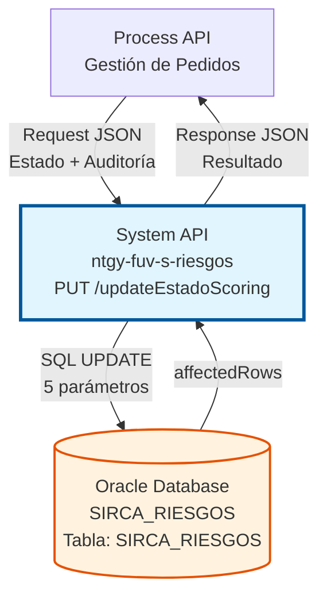
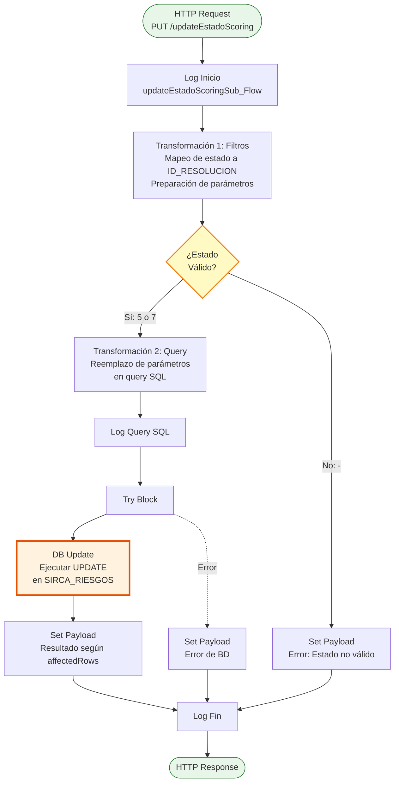
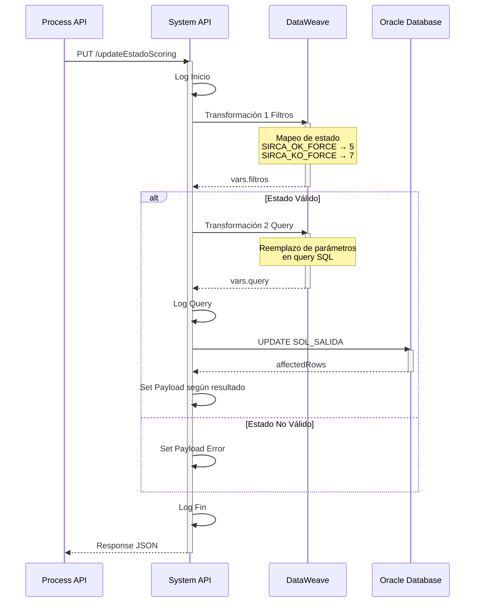
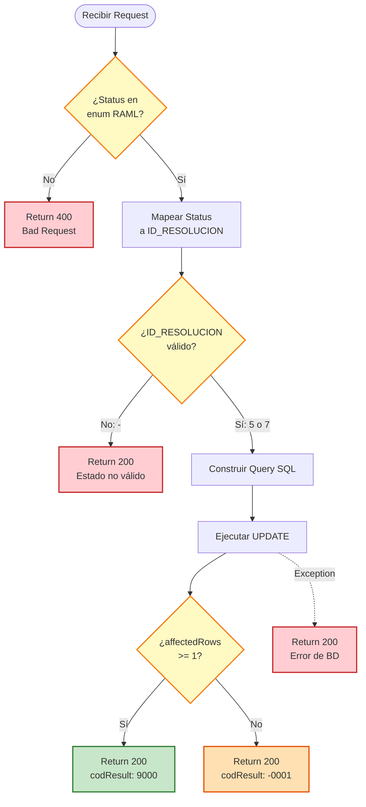

# PUT /updateEstadoScoring

## 📌 Descripción General

### Propósito del Endpoint

Este endpoint permite actualizar manualmente el estado de scoring de un pedido en la base de datos Oracle Sirca/Riesgos. Se utiliza cuando se requiere forzar una decisión de aprobación o rechazo, sobrescribiendo el resultado automático del análisis de riesgos.

El endpoint soporta:
- **Forzado de Aprobación (SIRCA_OK_FORCE)**: Permite aprobar manualmente un pedido que fue rechazado automáticamente
- **Forzado de Rechazo (SIRCA_KO_FORCE)**: Permite rechazar manualmente un pedido que fue aprobado automáticamente
- **Auditoría Completa**: Registra usuario, fecha, hora y comentarios justificativos de cada acción de forzado
- **Validación de Estados**: Solo permite estados específicos definidos en el enum del RAML

### Tipo de API

**Capa:** System API (API-Led Connectivity)

**Función:** Integración directa con base de datos Oracle Sirca/Riesgos para actualización de estados de scoring mediante operaciones SQL transaccionales.

### Patrón de Integración

**Tipo:** Request-Reply Síncrono con SQL UPDATE

**Descripción:** El endpoint recibe los datos del forzado (orderId, estado, usuario, fecha, comentarios), valida que el estado sea uno de los permitidos, transforma los datos mediante DataWeave, ejecuta un UPDATE en la tabla SIRCA_RIESGOS de Oracle, y retorna el resultado de la operación con información sobre el número de registros afectados.

### Arquitectura API-Led Connectivity



---

## 💼 Propósito del Negocio

### Casos de Uso Principales

1. **Forzado de Aprobación por Excepción**
   - Un analista de riesgos revisa un pedido rechazado automáticamente
   - Determina que existen circunstancias especiales que justifican la aprobación
   - Utiliza el endpoint para forzar el estado a SIRCA_OK_FORCE
   - El sistema registra la decisión con usuario, fecha y justificación

2. **Forzado de Rechazo por Política**
   - Un supervisor identifica un pedido que fue aprobado automáticamente
   - Detecta factores de riesgo no considerados por el sistema automático
   - Utiliza el endpoint para forzar el estado a SIRCA_KO_FORCE
   - Se documenta la razón del rechazo manual

3. **Corrección de Decisiones Automáticas**
   - El sistema automático de scoring genera un falso positivo/negativo
   - El equipo de riesgos necesita corregir la decisión
   - Se actualiza el estado con la decisión correcta
   - Queda registro completo de la intervención manual

### Contexto Empresarial

- **Dominio:** Gestión de Riesgos y Análisis de Crédito
- **Sector:** Energía - Utilities
- **División:** Naturgy España - FUV (Fusión)
- **Proceso de Negocio:** Evaluación y aprobación de pedidos con análisis de riesgo crediticio
- **Sistema:** Oracle Sirca/Riesgos

### Stakeholders

- **Analistas de Riesgos**: Necesitan capacidad de override manual de decisiones automáticas
- **Supervisores de Crédito**: Requieren visibilidad y control sobre decisiones de forzado
- **Auditores Internos**: Necesitan trazabilidad completa de todas las intervenciones manuales
- **Equipos de Compliance**: Requieren evidencia documentada de decisiones de riesgo

### Valor de Negocio

- **Flexibilidad Operativa**: Permite intervención humana cuando el sistema automático no es suficiente
- **Trazabilidad Completa**: Cada decisión de forzado queda registrada con usuario, fecha y justificación
- **Cumplimiento Normativo**: Satisface requisitos de auditoría y compliance en gestión de riesgos
- **Mejora Continua**: Los comentarios de forzado ayudan a identificar mejoras en el scoring automático

### Consumidores Potenciales

Este endpoint puede ser consumido por:
- Process APIs de gestión de pedidos
- Sistemas de workflow de aprobaciones
- Aplicaciones de back-office para analistas de riesgos
- Herramientas de supervisión y auditoría

---

## 🔧 Especificación Técnica

### URLs por Ambiente

| Ambiente | URL Base | URL Completa |
|----------|----------|--------------|
| **Local** | `http://localhost:8081` | `http://localhost:8081/api/updateEstadoScoring` |
| **Development** | `https://ntgy-fuv-s-riesgos-dev.us-e2.cloudhub.io` | `https://ntgy-fuv-s-riesgos-dev.us-e2.cloudhub.io/api/updateEstadoScoring` |
| **UAT** | `https://ntgy-fuv-s-riesgos-uat.us-e2.cloudhub.io` | `https://ntgy-fuv-s-riesgos-uat.us-e2.cloudhub.io/api/updateEstadoScoring` |
| **Production** | `https://ntgy-fuv-s-riesgos-pro.us-e2.cloudhub.io` | `https://ntgy-fuv-s-riesgos-pro.us-e2.cloudhub.io/api/updateEstadoScoring` |

### Método HTTP

```
PUT /api/updateEstadoScoring
```

### Parámetros de Entrada

#### Headers HTTP

| Header | Tipo | Requerido | Descripción | Ejemplo |
|--------|------|-----------|-------------|---------|
| `Content-Type` | string | ✅ Sí | Tipo de contenido del request | `application/json` |
| `Accept` | string | ❌ No | Tipo de contenido esperado en response | `application/json` |

#### Body Parameters

| Campo | Tipo | Requerido | Descripción | Valores Permitidos | Ejemplo |
|-------|------|-----------|-------------|-------------------|---------|
| `orderId` | string | ✅ Sí | Identificador único del pedido a actualizar | Cualquier string | `"12345678"` |
| `status` | string | ✅ Sí | Nuevo estado de scoring a aplicar | `SIRCA_KO_FORCE`, `SIRCA_OK_FORCE` | `"SIRCA_OK_FORCE"` |
| `usuarioAccion` | string | ✅ Sí | Usuario que realiza el forzado | Cualquier string | `"JGARCIA"` |
| `fechaAccion` | string | ✅ Sí | Fecha y hora de la acción | Formato: `DD/MM/YYYY HH24:MI:SS` | `"18/08/2026 10:30:45"` |
| `comentarios` | string | ✅ Sí | Justificación del forzado | Cualquier string | `"Cliente con historial positivo"` |

**Mapeo de Estados:**
- `SIRCA_OK_FORCE` → ID_RESOLUCION = 5 (Aprobación forzada)
- `SIRCA_KO_FORCE` → ID_RESOLUCION = 7 (Rechazo forzado)

### Respuestas

#### Respuesta Exitosa (200 OK)

**Cuando se actualiza 1 registro:**
```json
{
  "result": {
    "codResult": "9000",
    "msgResult": "Registro Actualizado"
  }
}
```

**Cuando no se actualiza ningún registro:**
```json
{
  "result": {
    "codResult": "-0001",
    "msgResult": "Ha habido un error en la actualización del registro"
  }
}
```

#### Respuesta de Error de Validación (200 OK)

**Estado no válido:**
```json
{
  "codResult": "-0001",
  "msgResult": "Estatus no valido: -"
}
```

#### Respuesta de Error de Base de Datos (200 OK)

```json
{
  "codResult": "-0001",
  "msgResult": "Error al actualizar los datos: [descripción del error de BD]"
}
```

#### Respuesta de Error de Validación RAML (400 Bad Request)

```json
{
  "message": "Bad request"
}
```

### Autenticación y Autorización

- **Tipo:** Client ID & Client Secret (Anypoint Platform)
- **Autorización Oracle:** El usuario de base de datos debe tener permisos para:
  - Ejecutar UPDATE en tabla `SIRCA_RIESGOS`
  - Acceso al schema `SIRCA`

### Timeouts

| Tipo | Valor | Descripción |
|------|-------|-------------|
| **Request Timeout** | 30 segundos | Tiempo máximo de espera para la respuesta |
| **Connection Timeout** | 10 segundos | Tiempo máximo para establecer conexión con Oracle |

---

## 🏗️ Implementación Técnica

### Arquitectura del Flow



### Secuencia de Operaciones



### Operación de Base de Datos

**Query SQL Real (extraída de configuración):**

```sql
UPDATE SIRCA_RIESGOS 
SET ID_RESOLUCION = :idResolucion, 
    USUARIO_ACCION = :usuarioAccion, 
    FECHA_ACCION = TO_DATE(:fechaAccion,'DD/MM/YYYY HH24:MI:SS'), 
    COMENTARIO = :comentario 
WHERE ID_ORDER = :idOrder
```

**Parámetros:**
- `:idResolucion` → `5` (SIRCA_OK_FORCE) o `7` (SIRCA_KO_FORCE)
- `:usuarioAccion` → Usuario que realiza la acción (con comillas simples)
- `:fechaAccion` → Fecha en formato `DD/MM/YYYY HH24:MI:SS` (con comillas simples)
- `:comentario` → Comentarios justificativos (con escape de comillas simples)
- `:idOrder` → ID del pedido a actualizar (con comillas simples)

**Tabla Afectada:**
- **Nombre:** `SIRCA_RIESGOS`
- **Schema:** `SIRCA`
- **Operación:** `UPDATE`
- **Campos Actualizados:**
  - `ID_RESOLUCION`: Estado de resolución (5 = OK, 7 = KO)
  - `USUARIO_ACCION`: Usuario que forzó el estado
  - `FECHA_ACCION`: Timestamp de la acción
  - `COMENTARIO`: Justificación del forzado

### Transformaciones DataWeave

#### Transformación 1: Preparación de Filtros

**Ubicación:** Inline en `updateEstadoScoring.xml` (líneas 6-24)

**Propósito:** Mapear el estado recibido a ID_RESOLUCION y preparar parámetros para el query

```dataweave
%dw 2.0
output application/json
var resolucion = if (payload.status == "SIRCA_OK_FORCE") "5" 
                 else if (payload.status == "SIRCA_KO_FORCE") "7"
                 else "-"
---
{
    "idResolucion"  : resolucion,
    "usuarioAccion" : "'"  ++ (payload.usuarioAccion as String default "" ) ++ "'",
    "fechaAccion"   : "'"  ++ (payload.fechaAccion as String default "" ) ++ "'",
    "comentario"    : "'" ++  ( (payload.comentarios replace "'" with "''" ) default "" ) ++ "'",
    "idOrder"       : "'" ++  (payload.orderId  default "-" )++ "'"
}
```

**Lógica Especial:**
- Mapeo condicional de estado a ID_RESOLUCION
- Escape de comillas simples en comentarios (`'` → `''`)
- Envoltura de strings con comillas simples para SQL
- Valores por defecto para campos opcionales

#### Transformación 2: Construcción del Query

**Ubicación:** Inline en `updateEstadoScoring.xml` (líneas 28-38)

**Propósito:** Reemplazar placeholders en el query SQL template con valores reales

```dataweave
%dw 2.0
output application/java

var q0 = p('querys.updateEstadoScoring')
var q1 = q0 replace ":idResolucion" with(vars.filtros.idResolucion )
var q2 = q1 replace ":usuarioAccion" with(vars.filtros.usuarioAccion )
var q3 = q2 replace ":fechaAccion" with(vars.filtros.fechaAccion )
var q4 = q3 replace ":comentario" with(vars.filtros.comentario )
var q5 = q4 replace ":idOrder" with(vars.filtros.idOrder )
---
q5
```

**Proceso:**
1. Lee query template desde configuración
2. Reemplaza cada placeholder con su valor correspondiente
3. Retorna query SQL completo listo para ejecutar

### Lógica de Validación



### Manejo de Errores

**Niveles de Validación:**

1. **Validación RAML (APIKit):**
   - Verifica que `status` sea uno de: `SIRCA_KO_FORCE`, `SIRCA_OK_FORCE`
   - Verifica que todos los campos requeridos estén presentes
   - Retorna 400 Bad Request si falla

2. **Validación de Negocio (DataWeave):**
   - Mapea estado a ID_RESOLUCION
   - Si el mapeo resulta en "-", el estado no es válido
   - Retorna 200 con codResult: -0001

3. **Validación de Base de Datos (Try-Catch):**
   - Captura excepciones de Oracle
   - Retorna 200 con codResult: -0001 y descripción del error
   - Verifica affectedRows para confirmar actualización

**Estrategia de Respuesta:**
- Todos los errores retornan HTTP 200 (excepto validación RAML)
- El campo `codResult` indica éxito (9000) o error (-0001)
- El campo `msgResult` proporciona descripción del resultado

### Configuración de Conexión

**Database Connector:**
- **Config-ref:** `Database_Config`
- **Driver:** ojdbc8 (Oracle JDBC)
- **Connection Pooling:** Habilitado
- **Transactional:** Sí (operación UPDATE)

### Logging y Auditoría

**Puntos de Logging:**
1. Inicio del subflow (INFO)
2. Query SQL construido (INFO)
3. Fin del subflow (INFO)
4. Errores de validación (INFO)

**Logger Utilizado:**
- ntgy-cli-logger-extension (logger personalizado de Naturgy)

---

## 💻 Ejemplos de Uso

### Ejemplo 1: Forzar Aprobación (SIRCA_OK_FORCE)

#### Request

```bash
curl -X PUT "https://ntgy-fuv-s-riesgos-dev.us-e2.cloudhub.io/api/updateEstadoScoring" \
  -H "Content-Type: application/json" \
  -H "client_id: YOUR_CLIENT_ID" \
  -H "client_secret: YOUR_CLIENT_SECRET" \
  -d '{
    "orderId": "12345678",
    "status": "SIRCA_OK_FORCE",
    "usuarioAccion": "JGARCIA",
    "fechaAccion": "18/08/2026 10:30:45",
    "comentarios": "Cliente con historial de pagos positivo. Aprobación excepcional por supervisor."
  }'
```

#### Response Exitoso

```json
{
  "result": {
    "codResult": "9000",
    "msgResult": "Registro Actualizado"
  }
}
```

### Ejemplo 2: Forzar Rechazo (SIRCA_KO_FORCE)

#### Request

```bash
curl -X PUT "https://ntgy-fuv-s-riesgos-dev.us-e2.cloudhub.io/api/updateEstadoScoring" \
  -H "Content-Type: application/json" \
  -H "client_id: YOUR_CLIENT_ID" \
  -H "client_secret: YOUR_CLIENT_SECRET" \
  -d '{
    "orderId": "87654321",
    "status": "SIRCA_KO_FORCE",
    "usuarioAccion": "MLOPEZ",
    "fechaAccion": "18/08/2026 11:15:30",
    "comentarios": "Detectado riesgo adicional no considerado por sistema automático. Rechazo manual."
  }'
```

#### Response Exitoso

```json
{
  "result": {
    "codResult": "9000",
    "msgResult": "Registro Actualizado"
  }
}
```

### Ejemplo 3: Error - Pedido No Encontrado

#### Request

```bash
curl -X PUT "https://ntgy-fuv-s-riesgos-dev.us-e2.cloudhub.io/api/updateEstadoScoring" \
  -H "Content-Type: application/json" \
  -H "client_id: YOUR_CLIENT_ID" \
  -H "client_secret: YOUR_CLIENT_SECRET" \
  -d '{
    "orderId": "99999999",
    "status": "SIRCA_OK_FORCE",
    "usuarioAccion": "JGARCIA",
    "fechaAccion": "18/08/2026 10:30:45",
    "comentarios": "Intento de actualización"
  }'
```

#### Response Error

```json
{
  "result": {
    "codResult": "-0001",
    "msgResult": "Ha habido un error en la actualización del registro"
  }
}
```

### Ejemplo 4: Error - Estado No Válido (Validación RAML)

#### Request

```bash
curl -X PUT "https://ntgy-fuv-s-riesgos-dev.us-e2.cloudhub.io/api/updateEstadoScoring" \
  -H "Content-Type: application/json" \
  -H "client_id: YOUR_CLIENT_ID" \
  -H "client_secret: YOUR_CLIENT_SECRET" \
  -d '{
    "orderId": "12345678",
    "status": "INVALID_STATUS",
    "usuarioAccion": "JGARCIA",
    "fechaAccion": "18/08/2026 10:30:45",
    "comentarios": "Intento con estado inválido"
  }'
```

#### Response Error

```json
{
  "message": "Bad request"
}
```

### Ejemplo 5: Comentarios con Comillas Simples

#### Request

```bash
curl -X PUT "https://ntgy-fuv-s-riesgos-dev.us-e2.cloudhub.io/api/updateEstadoScoring" \
  -H "Content-Type: application/json" \
  -H "client_id: YOUR_CLIENT_ID" \
  -H "client_secret: YOUR_CLIENT_SECRET" \
  -d '{
    "orderId": "12345678",
    "status": "SIRCA_OK_FORCE",
    "usuarioAccion": "JGARCIA",
    "fechaAccion": "18/08/2026 10:30:45",
    "comentarios": "Cliente indica: '\''Pagaré en 30 días'\''. Aprobación excepcional."
  }'
```

**Nota:** El sistema automáticamente escapa las comillas simples en los comentarios (`'` → `''`) para prevenir errores de SQL injection.

#### Response Exitoso

```json
{
  "result": {
    "codResult": "9000",
    "msgResult": "Registro Actualizado"
  }
}
```

### Ejemplo 6: Integración desde JavaScript

```javascript
const updateScoring = async (orderId, status, usuario, comentarios) => {
  const fechaAccion = new Date().toLocaleString('es-ES', {
    day: '2-digit',
    month: '2-digit',
    year: 'numeric',