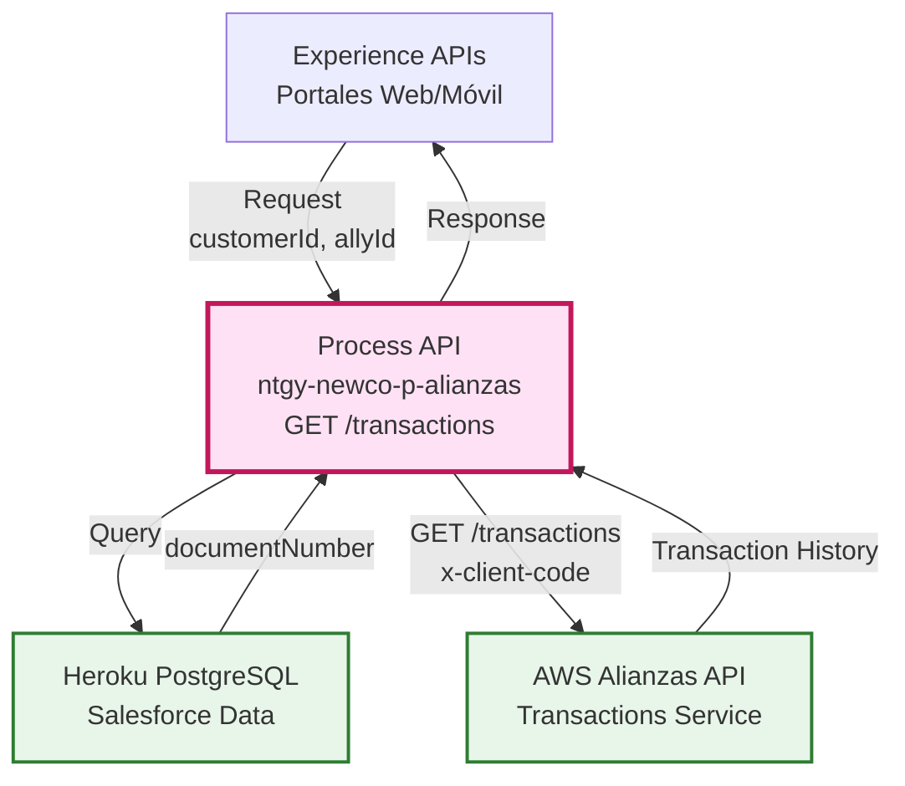
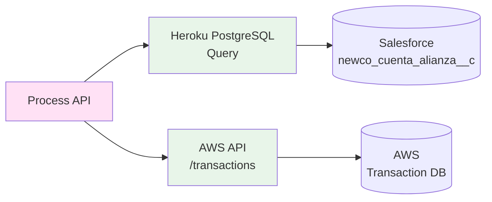
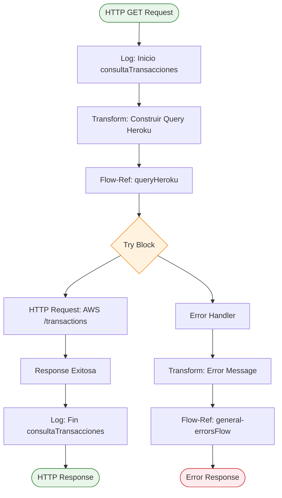
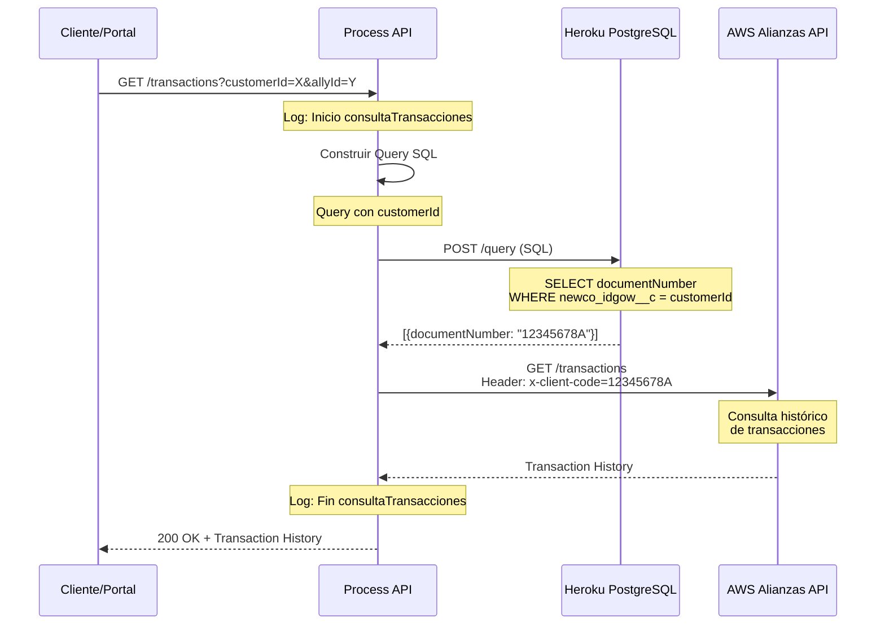
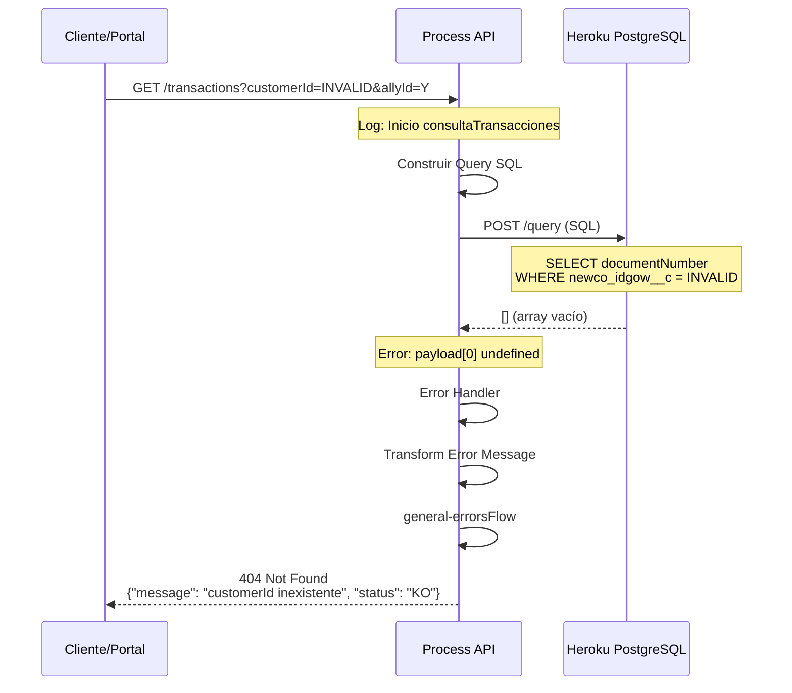
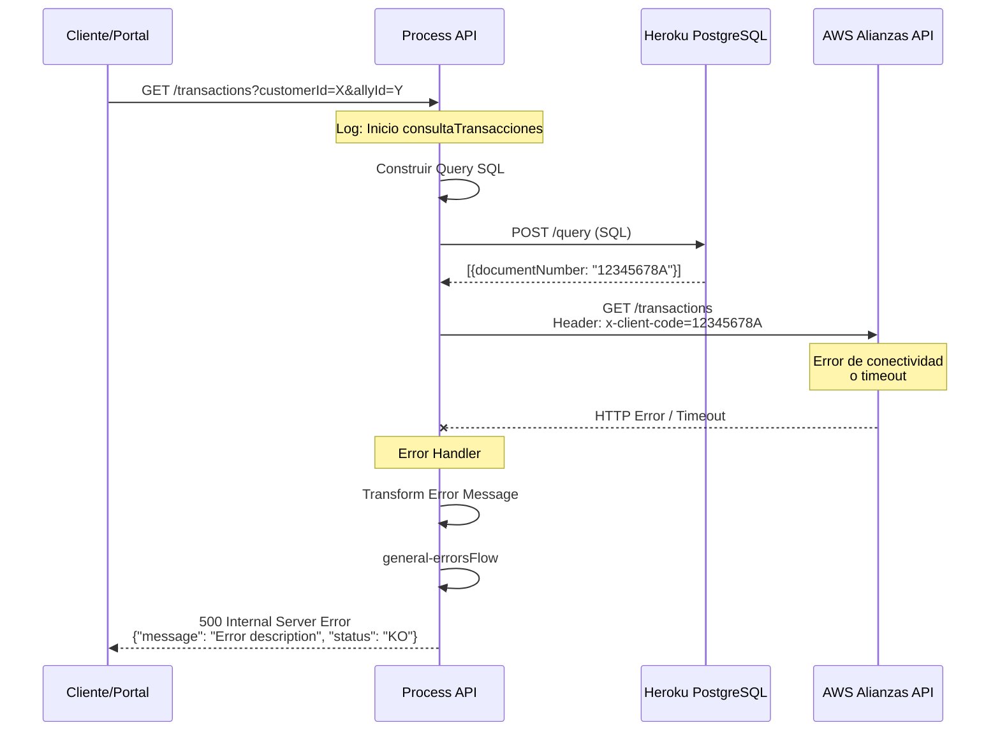

# GET /transactions

## 📌 Descripción General

### Propósito del Endpoint

Este endpoint permite consultar el histórico completo de transacciones de batería (puntos de fidelización) de un cliente específico dentro del programa de alianzas de Naturgy. Orquesta dos llamadas: primero obtiene el número de documento del cliente desde Heroku PostgreSQL (Salesforce) y luego consulta el histórico de transacciones en el sistema AWS de alianzas.

### Tipo de API

**Capa:** Process API (API-Led Connectivity)

**Función:** Orquestación de consulta de histórico de transacciones entre Salesforce y AWS

### Patrón de Integración

**Tipo:** Orquestación con Transformación

**Descripción:** El endpoint realiza una orquestación secuencial donde primero consulta Heroku PostgreSQL para obtener el número de documento del cliente asociado al customerId, y luego utiliza ese dato como header para consultar el histórico de transacciones en AWS.

### Arquitectura API-Led Connectivity



---

## 💼 Propósito del Negocio

### Casos de Uso Principales

1. **Consulta de Histórico por Cliente**
   - Cliente consulta su histórico de acumulación de batería
   - Permite verificar transacciones realizadas en aliados
   - Facilita la transparencia del programa de fidelización

2. **Reconciliación de Transacciones**
   - Aliados verifican transacciones registradas de un cliente
   - Soporte puede validar acumulaciones reportadas
   - Auditoría de movimientos de batería

3. **Seguimiento de Actividad**
   - Análisis de comportamiento de uso del programa
   - Identificación de patrones de consumo
   - Validación de actividad en alianzas

### 🔗 Endpoints Dependientes

Este Process API consume los siguientes backends:

| Backend | Endpoint | Método | Propósito |
|---------|----------|--------|-----------|
| `Heroku PostgreSQL` | `/query` | POST | Consulta del número de documento del cliente desde tabla de Salesforce |
| `AWS Alianzas API` | `/transactions` | GET | Obtención del histórico completo de transacciones de batería |

### Lógica de Orquestación



**Pasos del Proceso:**

1. **Paso 1 - Construcción de Query**: Se construye una query SQL para Heroku PostgreSQL con el customerId recibido
2. **Paso 2 - Consulta a Heroku**: Se ejecuta la query para obtener el campo `newco_account__r__acn_fld_documentnumber__c` (número de documento)
3. **Paso 3 - Llamada a AWS**: Se realiza una petición GET a AWS con el documentNumber como header `x-client-code`
4. **Paso 4 - Respuesta**: Se retorna el histórico de transacciones obtenido de AWS

### Transformaciones Aplicadas

| Origen | Transformación | Destino |
|--------|----------------|---------|
| `attributes.queryParams.customerId` | Query SQL a Heroku | `newco_account__r__acn_fld_documentnumber__c` |
| `payload[0].newco_account__r__acn_fld_documentnumber__c` | Header HTTP | `x-client-code` en AWS request |

**Query SQL Ejecutada:**
```sql
SELECT alianzas.newco_account__r__acn_fld_documentnumber__c
FROM newcosalesforce.newco_cuenta_alianza__c as alianzas
WHERE alianzas.newco_idgow__c = '{customerId}'
```

### Contexto Empresarial

- **Dominio:** Programa de Fidelización y Alianzas Comerciales
- **Sector:** Energía - Utilities
- **División:** Naturgy España - NewCo
- **Proceso de Negocio:** Consulta y seguimiento de transacciones de batería en programa de alianzas

### Stakeholders

- **Clientes Finales**: Consultan su histórico de acumulación de batería
- **Aliados Comerciales**: Verifican transacciones registradas de sus clientes
- **Equipo de Soporte**: Validan y resuelven incidencias relacionadas con transacciones
- **Departamento de Marketing**: Analizan comportamiento y uso del programa

### Valor de Negocio

- **Transparencia**: Clientes pueden verificar todas sus transacciones en tiempo real
- **Trazabilidad**: Registro completo de movimientos para auditoría
- **Confianza**: Visibilidad total genera confianza en el programa de fidelización
- **Soporte Eficiente**: Facilita la resolución de consultas y reclamaciones

### Consumidores Potenciales

Este endpoint puede ser consumido por:
- Portales web de autoservicio de clientes
- Aplicaciones móviles del programa de alianzas
- Sistemas de agentes de call center
- Dashboards de aliados comerciales
- Herramientas de análisis y reporting

---

## 🔧 Especificación Técnica

### URLs por Ambiente

| Ambiente | URL Base | URL Completa |
|----------|----------|--------------|
| **Local** | `http://localhost:8081` | `http://localhost:8081/api/transactions?customerId=:customerId&allyId=:allyId` |
| **Development** | `https://ntgy-newco-p-alianzas-dev.us-e2.cloudhub.io` | `https://ntgy-newco-p-alianzas-dev.us-e2.cloudhub.io/api/transactions?customerId=:customerId&allyId=:allyId` |
| **UAT** | `https://ntgy-newco-p-alianzas-uat.us-e2.cloudhub.io` | `https://ntgy-newco-p-alianzas-uat.us-e2.cloudhub.io/api/transactions?customerId=:customerId&allyId=:allyId` |
| **Production** | `https://ntgy-newco-p-alianzas-pro.us-e2.cloudhub.io` | `https://ntgy-newco-p-alianzas-pro.us-e2.cloudhub.io/api/transactions?customerId=:customerId&allyId=:allyId` |

### Método HTTP

```
GET /api/transactions
```

### Parámetros de Entrada

#### Query Parameters (Obligatorios)

| Parámetro | Tipo | Obligatorio | Descripción | Ejemplo |
|-----------|------|-------------|-------------|---------|
| `customerId` | string | ✅ Sí | Identificador único del cliente en el sistema (newco_idgow__c) | `"12345678"` |
| `allyId` | string | ✅ Sí | Identificador del aliado comercial | `"aliado1"` |

**Ejemplo de URL:**
```
GET /api/transactions?customerId=12345678&allyId=aliado1
```

### Respuestas

#### ✅ 200 OK - Consulta Exitosa

**Descripción:** Histórico de transacciones obtenido correctamente

```json
{
  "status": "OK",
  "status_code": 200
}
```

**Nota:** La estructura completa de la respuesta depende del sistema AWS. El endpoint actúa como pass-through de la respuesta de AWS.

#### ❌ 400 Bad Request - Datos Inválidos

**Descripción:** Parámetros faltantes o formato incorrecto

```json
{
  "message": "Datos Invalidos en la solicitud",
  "status": "KO"
}
```

**Causas comunes:**
- Falta el parámetro `customerId`
- Falta el parámetro `allyId`
- Formato incorrecto de parámetros

#### ❌ 401 Unauthorized - Autenticación Fallida

**Descripción:** Credenciales inválidas o ausentes

```json
{
  "message": "Autentificacion fallida",
  "status": "KO"
}
```

**Causas comunes:**
- Client ID o Client Secret inválidos
- Token expirado
- Falta header de autenticación

#### ❌ 404 Not Found - Cliente Inexistente

**Descripción:** El customerId no existe en el sistema

```json
{
  "message": "customerId inexistente",
  "status": "KO"
}
```

**Causas comunes:**
- Cliente no registrado en Salesforce
- customerId incorrecto
- Cliente no asociado al aliado especificado

#### ⚠️ 500 Internal Server Error - Error del Servidor

**Descripción:** Error en el procesamiento interno

```json
{
  "message": "Internal server error",
  "status": "KO"
}
```

**Causas comunes:**
- Error de conectividad con Heroku PostgreSQL
- Error de conectividad con AWS
- Timeout en llamadas a backends
- Error en transformación de datos

### Autenticación

- **Tipo:** Client ID & Client Secret (Anypoint Platform)
- **Headers requeridos:**
  - `client_id`: Identificador del cliente API
  - `client_secret`: Secreto del cliente API

### Timeouts

| Tipo | Valor | Descripción |
|------|-------|-------------|
| **Request Timeout** | 30 segundos | Timeout total de la petición |
| **Heroku Query Timeout** | 10 segundos | Timeout para consulta a Heroku PostgreSQL |
| **AWS Request Timeout** | Variable | Configurado en `${aws.timeout}` |

---

## 🏗️ Implementación Técnica

### Arquitectura del Flow



### Componentes del Flow

#### 1. Logger de Inicio
```xml
<logger level="INFO" message="Inicio consultaTransacciones: #[payload]"/>
```
**Propósito:** Registrar el inicio de la operación con el payload recibido

#### 2. Transformación de Query Heroku
```dataweave
%dw 2.0
output application/json
---
{
    "query": "select
        alianzas.newco_account__r__acn_fld_documentnumber__c
    from
        newcosalesforce.newco_cuenta_alianza__c as alianzas
    where alianzas.newco_idgow__c = '" ++ attributes.queryParams.'customerId' ++ "'"
}
```
**Propósito:** Construir la query SQL para consultar el número de documento del cliente

**Campos consultados:**
- `newco_account__r__acn_fld_documentnumber__c`: Número de documento del cliente

**Tabla consultada:**
- `newcosalesforce.newco_cuenta_alianza__c`: Tabla de cuentas de alianza en Salesforce

**Filtro:**
- `newco_idgow__c`: Identificador GOW del cliente (customerId)

#### 3. Consulta a Heroku PostgreSQL
```xml
<flow-ref name="queryHeroku"/>
```
**Propósito:** Ejecutar la query en Heroku PostgreSQL para obtener el documentNumber

**Subflow:** `queryHeroku`
- Realiza POST a Heroku Connect API
- Ejecuta la query SQL construida
- Retorna array con resultado

#### 4. Request a AWS Alianzas API
```xml
<http:request 
    method="${aws.alianzas.methodTransactions}" 
    config-ref="HTTP_AWS" 
    path="${aws.alianzas.pathTransactions}" 
    responseTimeout="${aws.timeout}">
    <http:headers>
        {
            "x-api-key": p('aws.apiKey'),
            "x-client-code": payload[0].newco_account__r__acn_fld_documentnumber__c
        }
    </http:headers>
</http:request>
```

**Configuración:**
- **Método:** GET (configurado en `${aws.alianzas.methodTransactions}`)
- **Path:** `/transactions` (configurado en `${aws.alianzas.pathTransactions}`)
- **Host:** Configurado en `${aws.alianzas.host}`

**Headers:**
- `x-api-key`: API key para autenticación en AWS
- `x-client-code`: Número de documento obtenido de Heroku

#### 5. Manejo de Errores
```xml
<error-handler>
    <on-error-propagate>
        <ee:transform>
            <!-- Extrae mensaje de error -->
        </ee:transform>
        <flow-ref name="general-errorsFlow"/>
    </on-error-propagate>
</error-handler>
```

**Transformación de Error:**
```dataweave
%dw 2.0
import * from dw::core::Strings
output application/json
---
{
    "message": if(substringAfterLast(error.description, "' ") != "") 
                  substringAfterLast(error.description, "' ") 
               else if(error.description != null) 
                  error.description 
               else 
                  "Internal server error",
    "status": "KO"
}
```

**Propósito:** Extraer mensaje de error legible y estandarizar formato de respuesta

#### 6. Logger de Fin
```xml
<logger level="INFO" message="Fin transferirSaldo: #[payload]"/>
```
**Propósito:** Registrar el fin de la operación con el resultado

### Configuración de Conectores

#### Heroku PostgreSQL (queryHeroku subflow)
```yaml
heroku:
  host: "connect-eu.heroku.com"
  port: 443
  protocol: "HTTPS"
  basePath: "/api/v1"
```

#### AWS Alianzas API
```yaml
aws:
  alianzas:
    host: "api-alianzas-dev.newco.com"
    methodTransactions: "GET"
    pathTransactions: "/transactions"
  apiKey: "[SECURE_PROPERTY]"
  timeout: 5000
```

### Patrones de Diseño

**Patrón:** Request-Reply con Orquestación Secuencial

**Justificación:** 
- Se requiere información de Heroku antes de llamar a AWS
- Las operaciones son dependientes (documentNumber necesario para AWS)
- Respuesta síncrona esperada por el cliente
- Permite manejo de errores en cada paso

**Patrón:** Error Handling Centralizado

**Justificación:**
- Estandarización de respuestas de error
- Reutilización de lógica de error handling
- Facilita mantenimiento y troubleshooting

### Diagramas de Secuencia

#### 1. Flujo Normal de Éxito



#### 2. Flujo con Cliente No Encontrado



#### 3. Flujo con Error de AWS



### Manejo de Errores

#### Estrategia de Error Handling

1. **Try-Catch Block**: Envuelve la llamada a AWS para capturar errores
2. **Error Transformation**: Extrae mensaje legible del error
3. **Delegación**: Delega a `general-errorsFlow` para procesamiento estándar
4. **Logging**: Registra errores para troubleshooting

#### Tipos de Errores Manejados

| Error | Causa | Respuesta |
|-------|-------|-----------|
| **Connectivity Error** | Heroku o AWS no disponible | 500 - Internal Server Error |
| **Timeout** | Respuesta tardía de backends | 500 - Internal Server Error |
| **Empty Result** | Cliente no encontrado en Heroku | 404 - customerId inexistente |
| **Invalid Credentials** | API key inválida | 401 - Autenticación fallida |
| **Transformation Error** | Error en DataWeave | 500 - Internal Server Error |

---

## 💻 Ejemplos de Uso

### Ejemplo 1: Consulta Exitosa de Histórico

#### cURL

```bash
curl -X GET "https://ntgy-newco-p-alianzas-uat.us-e2.cloudhub.io/api/transactions?customerId=12345678&allyId=aliado1" \
  -H "Content-Type: application/json" \
  -H "client_id: YOUR_CLIENT_ID" \
  -H "client_secret: YOUR_CLIENT_SECRET"
```

#### Respuesta (200 OK)

```json
{
  "status": "OK",
  "status_code": 200
}
```

**Nota:** La respuesta real incluirá el array de transacciones retornado por AWS.

---

### Ejemplo 2: Cliente No Encontrado

#### cURL

```bash
curl -X GET "https://ntgy-newco-p-alianzas-uat.us-e2.cloudhub.io/api/transactions?customerId=99999999&allyId=aliado1" \
  -H "Content-Type: application/json" \
  -H "client_id: YOUR_CLIENT_ID" \
  -H "client_secret: YOUR_CLIENT_SECRET"
```

#### Respuesta (404 Not Found)

```json
{
  "message": "customerId inexistente",
  "status": "KO"
}
```

---

### Ejemplo 3: Parámetros Faltantes

#### cURL

```bash
curl -X GET "https://ntgy-newco-p-alianzas-uat.us-e2.cloudhub.io/api/transactions?customerId=12345678" \
  -H "Content-Type: application/json" \
  -H "client_id: YOUR_CLIENT_ID" \
  -H "client_secret: YOUR_CLIENT_SECRET"
```

#### Respuesta (400 Bad Request)

```json
{
  "message": "Datos Invalidos en la solicitud",
  "status": "KO"
}
```

---

### Ejemplo 4: JavaScript (Fetch API)

```javascript
const getTransactions = async (customerId, allyId) => {
  try {
    const response = await fetch(
      `https://ntgy-newco-p-alianzas-uat.us-e2.cloudhub.io/api/transactions?customerId=${customerId}&allyId=${allyId}`,
      {
        method: 'GET',
        headers: {
          'Content-Type': 'application/json',
          'client_id': 'YOUR_CLIENT_ID',
          'client_secret': 'YOUR_CLIENT_SECRET'
        }
      }
    );

    if (!response.ok) {
      const error = await response.json();
      throw new Error(error.message);
    }

    const data = await response.json();
    console.log('Histórico de transacciones:', data);
    return data;
    
  } catch (error) {
    console.error('Error al consultar transacciones:', error.message);
    throw error;
  }
};

// Uso
getTransactions('12345678', 'aliado1')
  .then(data => console.log('Transacciones:', data))
  .catch(error => console.error('Error:', error));
```

---

### Ejemplo 5: Python (Requests)

```python
import requests

def get_transactions(customer_id, ally_id):
    """
    Consulta el histórico de transacciones de un cliente
    
    Args:
        customer_id (str): ID del cliente
        ally_id (str): ID del aliado
        
    Returns:
        dict: Histórico de transacciones
    """
    url = "https://ntgy-newco-p-alianzas-uat.us-e2.cloudhub.io/api/transactions"
    
    params = {
        'customerId': customer_id,
        'allyId': ally_id
    }
    
    headers = {
        'Content-Type': 'application/json',
        'client_id': 'YOUR_CLIENT_ID',
        'client_secret': 'YOUR_CLIENT_SECRET'
    }
    
    try:
        response = requests.get(url, params=params, headers=headers)
        response.raise_for_status()
        
        data = response.json()
        print(f"Histórico obtenido: {data}")
        return data
        
    except requests.exceptions.HTTPError as http_err:
        error_data = response.json()
        print(f"Error HTTP: {error_data.get('message', 'Unknown error')}")
        raise
    except Exception as err:
        print(f"Error: {err}")
        raise

# Uso
try:
    transactions = get_transactions('12345678', 'aliado1')
    print(f"Total de transacciones: {len(transactions)}")
except Exception as e:
    print(f"No se pudo obtener el histórico: {e}")
```

---

### Ejemplo 6: Postman Collection

```json
{
  "info": {
    "name": "GET /transactions - Consulta Histórico",
    "description": "Consulta el histórico de transacciones de batería"
  },
  "item": [
    {
      "name": "Consulta Exitosa",
      "request": {
        "method": "GET",
        "header": [
          {
            "key": "Content-Type",
            "value": "application/json"
          },
          {
            "key": "client_id",
            "value": "{{client_id}}"
          },
          {
            "key": "client_secret",
            "value": "{{client_secret}}"
          }
        ],
        "url": {
          "raw": "{{base_url}}/api/transactions?customerId=12345678&allyId=aliado1",
          "host": ["{{base_url}}"],
          "path": ["api", "transactions"],
          "query": [
            {
              "key": "customerId",
              "value": "12345678"
            },
            {
              "key": "allyId",
              "value": "aliado1"
            }
          ]
        }
      }
    }
  ]
}
```
