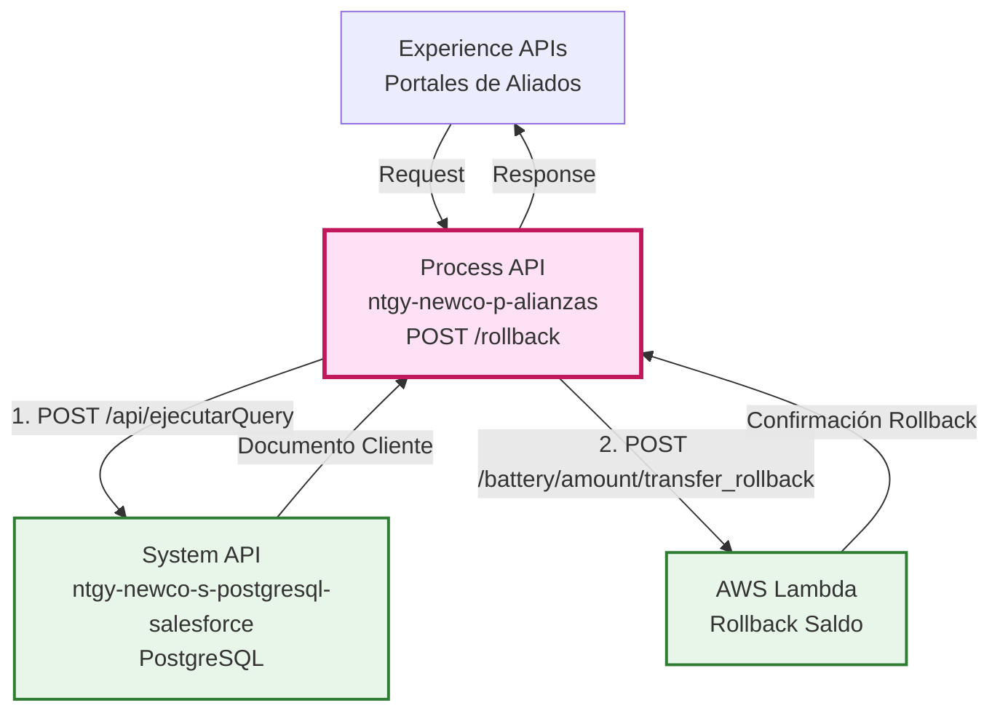
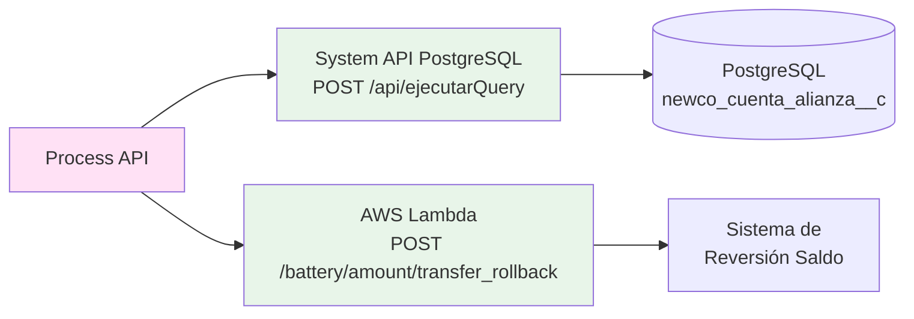
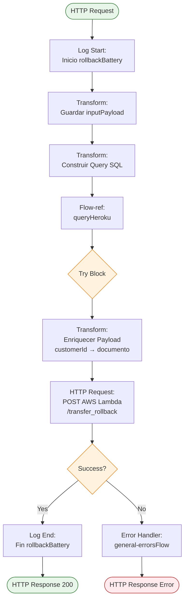
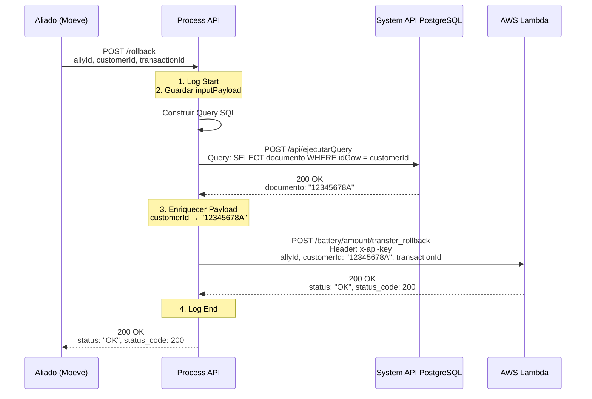
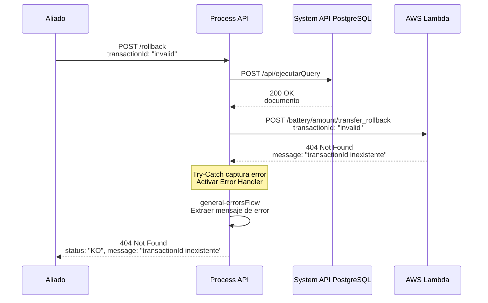
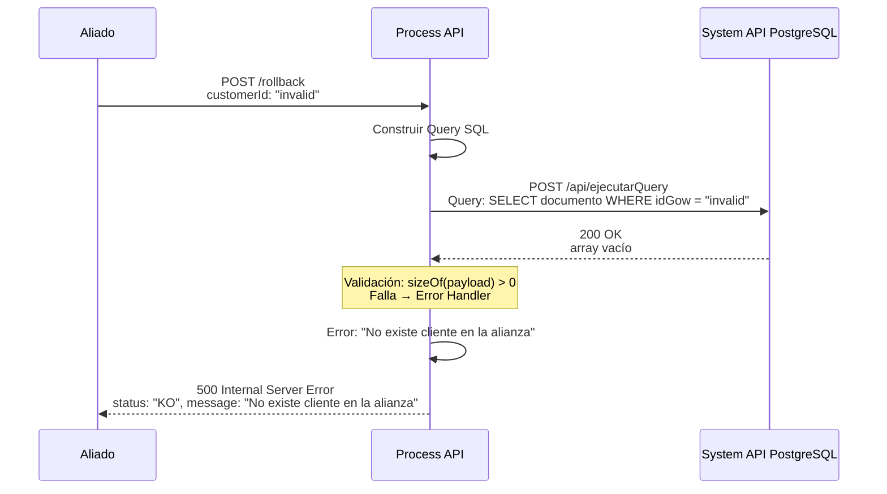

# POST /rollback

## 📌 Descripción General

### Propósito del Endpoint

Este endpoint permite revertir transacciones de transferencia de saldo que no llegaron correctamente al sistema. Implementa el patrón de compensación (Saga Pattern) para garantizar la integridad de datos cuando una transacción falla después de haber sido procesada parcialmente. Orquesta dos operaciones: primero consulta el número de documento del cliente mediante el System API `ntgy-newco-s-postgresql-salesforce`, y luego envía la solicitud de rollback al sistema AWS Lambda.

### Tipo de API

**Capa:** Process API (API-Led Connectivity)

**Función:** Orquestación de rollback de transacciones fallidas en el programa de alianzas comerciales

### Patrón de Integración

**Tipo:** API Composition + Compensating Transaction (Saga Pattern)

**Descripción:** 
1. Recibe el ID interno del cliente (customerId) y el transactionId a revertir
2. Consulta el System API `ntgy-newco-s-postgresql-salesforce` para obtener el número de documento real
3. Enriquece el payload original reemplazando el ID interno con el documento
4. Envía la solicitud de rollback a AWS Lambda para revertir la transacción

### Arquitectura API-Led Connectivity



---

## 💼 Propósito del Negocio

### Casos de Uso Principales

1. **Reversión de Transacción Fallida**
   - Transacción de saldo no llegó correctamente al sistema del aliado
   - Sistema detecta inconsistencia y solicita rollback
   - Garantiza que el saldo no quede duplicado o perdido

2. **Reconciliación de Cuentas**
   - Proceso de reconciliación detecta discrepancias
   - Se revierten transacciones problemáticas
   - Mantiene la integridad entre sistemas

3. **Corrección de Errores de Procesamiento**
   - Error en el procesamiento posterior a la transferencia
   - Necesidad de revertir para reintentar
   - Auditoría completa del proceso de compensación

### 🔗 Endpoints Dependientes

Este Process API consume los siguientes sistemas:

| Sistema | Endpoint | Método | Propósito |
|---------|----------|--------|-----------|
| `ntgy-newco-s-postgresql-salesforce` | `/api/ejecutarQuery` | POST | Ejecuta query SQL para obtener número de documento del cliente |
| `AWS Lambda - Alianzas` | `/battery/amount/transfer_rollback` | POST | Procesamiento de rollback de transacción en sistema AWS |

### Lógica de Orquestación



**Pasos del Proceso:**

1. **Paso 1 - Guardar Input**: Almacena el payload original en variable `inputPayload`
2. **Paso 2 - Consultar Documento**: Construye query SQL y la envía al System API para obtener el número de documento del cliente
3. **Paso 3 - Enriquecer Datos**: Reemplaza el `customerId` (ID interno) con el número de documento real
4. **Paso 4 - Procesar Rollback**: Envía el payload enriquecido a AWS Lambda con autenticación API Key
5. **Paso 5 - Responder**: Retorna la respuesta de AWS Lambda al cliente

### Transformaciones Aplicadas

| Campo Original | Campo Transformado | Transformación |
|----------------|-------------------|----------------|
| `customerId` (ID interno) | `customerId` (Documento) | Reemplazado con `newco_account__r__acn_fld_documentnumber__c` de PostgreSQL |
| `allyId` | `allyId` | Pass-through sin cambios |
| `transactionId` | `transactionId` | Pass-through sin cambios |

### Contexto Empresarial

- **Dominio:** Programa de Fidelización y Alianzas Comerciales
- **Sector:** Energía - Utilities
- **División:** Naturgy España - NewCo
- **Proceso de Negocio:** Gestión de compensaciones y rollback de transacciones

### Stakeholders

- **Aliados Comerciales (Moeve, etc.)**: Necesitan revertir transacciones que no se procesaron correctamente
- **Equipo de Reconciliación**: Gestiona discrepancias entre sistemas
- **Departamento de Auditoría**: Requiere trazabilidad completa de rollbacks
- **Equipo de Sistemas**: Mantiene la integridad de datos entre plataformas

### Valor de Negocio

- **Integridad de Datos**: Garantiza consistencia entre sistemas mediante compensación
- **Auditoría Completa**: Registro de todas las reversiones para compliance
- **Recuperación de Errores**: Permite corregir transacciones fallidas sin intervención manual
- **Confianza del Aliado**: Mecanismo transparente para resolver inconsistencias
- **Reducción de Costos**: Automatiza procesos de reconciliación manual

### Consumidores Potenciales

Este endpoint puede ser consumido por:
- Portales web de aliados comerciales
- Sistemas de reconciliación automática
- Procesos batch de corrección de errores
- Herramientas de administración y soporte

---

## 🔧 Especificación Técnica

### URLs por Ambiente

| Ambiente | URL Base | URL Completa |
|----------|----------|--------------|
| **Local** | `http://localhost:8081` | `http://localhost:8081/api/rollback` |
| **Development** | `https://ntgy-newco-p-alianzas-dev.us-e2.cloudhub.io` | `https://ntgy-newco-p-alianzas-dev.us-e2.cloudhub.io/api/rollback` |
| **UAT** | `https://ntgy-newco-p-alianzas-uat.us-e2.cloudhub.io` | `https://ntgy-newco-p-alianzas-uat.us-e2.cloudhub.io/api/rollback` |
| **Production** | `https://ntgy-newco-p-alianzas-pro.us-e2.cloudhub.io` | `https://ntgy-newco-p-alianzas-pro.us-e2.cloudhub.io/api/rollback` |

### Método HTTP

```http
POST /api/rollback
```

### Parámetros de Entrada

#### Request Body (application/json)

| Campo | Tipo | Requerido | Descripción | Ejemplo |
|-------|------|-----------|-------------|---------|
| `allyId` | string | ✅ Sí | Identificador del aliado comercial | `"aliado1"` |
| `customerId` | string | ✅ Sí | Identificador interno del cliente (ID Gow) | `"m0001"` |
| `transactionId` | string | ✅ Sí | Identificador único de la transacción a revertir | `"1232e2e12e2e21e"` |

**Ejemplo de Request:**

```json
{
  "allyId": "aliado1",
  "customerId": "m0001",
  "transactionId": "1232e2e12e2e21e"
}
```

### Respuestas

#### 200 OK - Rollback Exitoso

```json
{
  "status": "OK",
  "status_code": 200
}
```

| Campo | Tipo | Descripción |
|-------|------|-------------|
| `status` | string | Estado de la operación ("OK" = éxito) |
| `status_code` | number | Código HTTP de la operación |

#### 400 Bad Request - Datos Inválidos

```json
{
  "message": "Datos Invalidos en la solicitud",
  "status": "KO"
}
```

**Causas comunes:**
- Campos requeridos faltantes
- Formato de datos incorrecto
- TransactionId vacío o inválido

#### 404 Not Found - Transacción Inexistente

```json
{
  "message": "transactionId inexistente",
  "status": "KO"
}
```

**Causas comunes:**
- TransactionId no encontrado en el sistema
- Transacción ya revertida previamente
- Cliente no asociado al aliado

#### 401 Unauthorized - Autenticación Fallida

```json
{
  "message": "Autentificacion fallida",
  "status": "KO"
}
```

**Causas comunes:**
- Client ID o Client Secret inválidos
- Token expirado
- Credenciales no proporcionadas

#### 500 Internal Server Error - Error del Sistema

```json
{
  "message": "Internal server error",
  "status": "KO"
}
```

**Causas comunes:**
- Error en System API PostgreSQL
- Timeout en AWS Lambda
- Error de transformación DataWeave
- Problemas de conectividad

### Autenticación

- **Tipo:** Client ID & Client Secret (Anypoint Platform)
- **Headers Requeridos:**
  - `client_id`: ID del cliente registrado
  - `client_secret`: Secret del cliente
  - `Content-Type`: `application/json`

### Timeouts

| Tipo | Valor |
|------|-------|
| **Request Timeout** | 60 segundos |
| **Connection Timeout** | 10 segundos |
| **AWS Lambda Timeout** | 60 segundos |
| **PostgreSQL Query Timeout** | 240 segundos (4 minutos) |

---

## 🏗️ Implementación Técnica

### Arquitectura del Flow



### Transformaciones DataWeave

#### 1. Guardar Input Payload (Líneas 12-20)

```dataweave
%dw 2.0
output application/json
---
payload
```

**Propósito:** Almacenar el payload original en la variable `inputPayload` para uso posterior.

#### 2. Construir Query para System API PostgreSQL (Líneas 22-34)

```dataweave
%dw 2.0
output application/json
---
{
    "query": "select
        alianzas.newco_account__r__acn_fld_documentnumber__c
    from
        newcosalesforce.newco_cuenta_alianza__c as alianzas
    where alianzas.newco_idgow__c = '" ++ payload.customerId ++ "'"
}
```

**Propósito:** Construir la query SQL dinámica que será ejecutada por el System API `ntgy-newco-s-postgresql-salesforce`.

**Tabla Consultada:** `newcosalesforce.newco_cuenta_alianza__c` (en PostgreSQL)
**Campo Retornado:** `newco_account__r__acn_fld_documentnumber__c` (número de documento)
**Condición:** `newco_idgow__c = customerId` (ID interno del cliente)

#### 3. Enriquecer Payload para AWS (Líneas 39-44)

```dataweave
%dw 2.0
output application/json
---
vars.inputPayload update {
    case .customerId -> payload[0].newco_account__r__acn_fld_documentnumber__c
}
```

**Propósito:** Reemplazar el `customerId` (ID interno) con el número de documento real obtenido del System API PostgreSQL.

**Transformación:**
- **Antes:** `{ "customerId": "m0001", "allyId": "aliado1", "transactionId": "tr00012" }`
- **Después:** `{ "customerId": "12345678A", "allyId": "aliado1", "transactionId": "tr00012" }`

### Subflujos Utilizados

#### queryHeroku (src/main/mule/services/alianzas/queryHeroku.xml)

**Propósito:** Ejecutar consultas SQL mediante el System API `ntgy-newco-s-postgresql-salesforce`

**Implementación (línea 13):**
```xml
<http:request 
    method="POST" 
    config-ref="HTTP_Request_s_postgresql-salesforce" 
    path="/ejecutarQuery">
</http:request>
```

**Configuración:**
- **Config:** `HTTP_Request_s_postgresql-salesforce`
- **Base Path:** `/api`
- **Full Path:** `/api/ejecutarQuery`
- **Host:** `ntgy-newco-s-postgresql-salesforce-[env].de-c1.cloudhub.io`
- **Port:** `80`
- **Timeout:** `240000` ms (4 minutos)

**Validación:**
- Valida que la respuesta contenga al menos un registro
- Si no existe cliente: Error "No existe cliente en la alianza"

#### general-errorsFlow (src/main/mule/error/general-errors.xml)

**Propósito:** Manejo centralizado de errores con extracción inteligente de mensajes

**Lógica de Extracción (líneas 56-71):**
```dataweave
{
    "message": 
        if(error.errorMessage.payload != null)
            error.errorMessage.payload
        else if(substringAfterLast(error.description, "' ") != "") 
            substringAfterLast(error.description, "' ") 
        else if(error.description != null) 
            error.description 
        else 
            "Internal server error",
    "status": "KO"
}
```

**Estrategia:** Intenta extraer el mensaje más específico posible con múltiples fallbacks.

### Patrones de Diseño

**Patrón:** Compensating Transaction (Saga Pattern)

**Justificación:** 
- Implementa el patrón de compensación para transacciones distribuidas
- Permite revertir operaciones que ya fueron procesadas
- Mantiene la consistencia eventual entre sistemas
- Facilita la recuperación de errores en procesos de larga duración
- Proporciona trazabilidad completa de compensaciones

### Comparación con transferirSaldo

| Aspecto | POST /transferirSaldo | POST /rollback |
|---------|----------------------|----------------|
| **Propósito** | Enviar saldo acumulado | Revertir transacción |
| **AWS Endpoint** | `/battery/amount/transfer` | `/battery/amount/transfer_rollback` |
| **Campos Input** | allyId, customerId, amount, date, transactionId | allyId, customerId, transactionId |
| **Response Code** | 201 Created | 200 OK |
| **Response Body** | status, transactionId, message | status, status_code |
| **Patrón** | API Composition + Data Enrichment | Compensating Transaction |
| **Idempotencia** | Por transactionId | Por transactionId |

### Diagramas de Secuencia

#### 1. Flujo Normal de Éxito



#### 2. Flujo con Error de Negocio (Transacción No Encontrada)



#### 3. Flujo con Error Técnico (Cliente No Encontrado)



### Manejo de Errores

#### Estrategia de Error Handling

1. **Try-Catch Block:** Envuelve la llamada a AWS Lambda (líneas 37-77)
2. **Error Handler Centralizado:** `general-errorsFlow` procesa todos los errores
3. **Extracción Inteligente:** Múltiples fallbacks para obtener mensaje descriptivo
4. **Logging Completo:** Registra inicio y fin de operación

#### Tipos de Errores Manejados

| Tipo de Error | Código HTTP | Manejo |
|---------------|-------------|--------|
| **APIKIT:BAD_REQUEST** | 400 | Validación de entrada fallida |
| **APIKIT:NOT_FOUND** | 404 | Endpoint no encontrado |
| **HTTP:TIMEOUT** | 500 | Timeout en PostgreSQL o AWS |
| **HTTP:CONNECTIVITY** | 500 | Error de conectividad |
| **Transformation Error** | 500 | Error en DataWeave |
| **Business Error** | 404 | TransactionId no encontrado |
| **General Error** | 500 | Cualquier otro error |

#### Configuración de Retry

**No hay retry automático configurado** para este endpoint debido a:
- Operación de rollback debe ser explícita
- El cliente puede reintentar manualmente si es necesario
- Evita rollbacks duplicados accidentales

---

## 💻 Ejemplos de Uso

### Ejemplo 1: Rollback Exitoso

#### cURL

```bash
curl -X POST "https://ntgy-newco-p-alianzas-dev.us-e2.cloudhub.io/api/rollback" \
  -H "Content-Type: application/json" \
  -H "client_id: YOUR_CLIENT_ID" \
  -H "client_secret: YOUR_CLIENT_SECRET" \
  -d '{
    "allyId": "moeve",
    "customerId": "m0001",
    "transactionId": "1232e2e12e2e21e"
  }'
```

#### Respuesta (200 OK)

```json
{
  "status": "OK",
  "status_code": 200
}
```

### Ejemplo 2: Transacción No Encontrada

#### cURL

```bash
curl -X POST "https://ntgy-newco-p-alianzas-dev.us-e2.cloudhub.io/api/rollback" \
  -H "Content-Type: application/json" \
  -H "client_id: YOUR_CLIENT_ID" \
  -H "client_secret: YOUR_CLIENT_SECRET" \
  -d '{
    "allyId": "moeve",
    "customerId": "m0001",
    "transactionId": "invalid_transaction"
  }'
```

#### Respuesta (404 Not Found)

```json
{
  "message": "transactionId inexistente",
  "status": "KO"
}
```

### Ejemplo 3: JavaScript (Fetch API)

```javascript
const rollbackTransaccion = async (allyId, customerId, transactionId) => {
  try {
    const response = await fetch(
      'https://ntgy-newco-p-alianzas-dev.us-e2.cloudhub.io/api/rollback',
      {
        method: 'POST',
        headers: {
          'Content-Type': 'application/json',
          'client_id': 'YOUR_CLIENT_ID',
          'client_secret': 'YOUR_CLIENT_SECRET'
        },
        body: JSON.stringify({
          allyId,
          customerId,
          transactionId
        })
      }
    );

    if (!response.ok) {
      const error = await response.json();
      throw new Error(`Rollback fallido: ${error.message}`);
    }

    const data = await response.json();
    console.log('Rollback exitoso:', data);
    return data;
  } catch (error) {
    console.error('Error al ejecutar rollback:', error);
    throw error;
  }
};

// Uso
rollbackTransaccion('moeve', 'm0001', '1232e2e12e2e21e')
  .then(result => console.log('Éxito:', result))
  .catch(error => console.error('Error:', error));
```

### Ejemplo 4: Python (Requests)

```python
import requests
import json

def rollback_transaccion(ally_id, customer_id, transaction_id):
    """
    Revierte una transacción de transferencia de saldo
    
    Args:
        ally_id (str): ID del aliado comercial
        customer_id (str): ID interno del cliente
        transaction_id (str): ID de la transacción a revertir
    
    Returns:
        dict: Respuesta del API con status y status_code
    """
    url = 'https://ntgy-newco-p-alianzas-dev.us-e2.cloudhub.io/api/rollback'
    
    headers = {
        'Content-Type': 'application/json',
        'client_id': 'YOUR_CLIENT_ID',
        'client_secret': 'YOUR_CLIENT_SECRET'
    }
    
    payload = {
        'allyId': ally_id,
        'customerId': customer_id,
        'transactionId': transaction_id
    }
    
    try:
        response = requests.post(url, headers=headers, json=payload, timeout=60)
        response.raise_for_status()
        
        result = response.json()
        print(f"Rollback exitoso: {result['status']}")
        return result
        
    except requests.exceptions.HTTPError as http_err:
        error_data = response.json()
        print(f"Error HTTP {response.status_code}: {error_data.get('message')}")
        raise
    except requests.exceptions.Timeout:
        print("Error: Timeout al conectar con el API")
        raise
    except requests.exceptions.RequestException as e:
        print(f"Error de conexión: {str(e)}")
        raise

# Ejemplo de uso
if __name__ == "__main__":
    try:
        resultado = rollback_transaccion(
            ally_id='moeve',
            customer_id='m0001',
            transaction_id='1232e2e12e2e21e'
        )
        print(f"Status: {resultado['status']}")
        print(f"Status Code: {resultado['status_code']}")
    except Exception as e:
        print(f"Error en el rollback: {str(e)}")
```

### Ejemplo 5: Flujo Completo de Compensación

```bash
# Escenario: Transferencia fallida que requiere rollback

# 1. Intento de transferencia (falla después de procesar)
curl -X POST "https://ntgy-newco-p-alianzas-dev.us-e2.cloudhub.io/api/transferirSaldo" \
  -H "Content-Type: application/json" \
  -H "client_id: YOUR_CLIENT_ID" \
  -H "client_secret: YOUR_CLIENT_SECRET" \
  -d '{
    "allyId": "moeve",
    "customerId": "m0001",
    "amount": 25.50,
    "date": "1708737600",
    "transactionId": "tr00012"
  }'

# Respuesta: 201 Created (pero falla en sistema downstream)

# 2. Ejecutar rollback para compensar
curl -X POST "https://ntgy-newco-p-alianzas-dev.us-e2.cloudhub.io/api/rollback" \
  -H "Content-Type: application/json" \
  -H "client_id: YOUR_CLIENT_ID" \
  -H "client_secret: YOUR_CLIENT_SECRET" \
  -d '{
    "allyId": "moeve",
    "customerId": "m0001",
    "transactionId": "tr00012"
  }'

# Respuesta: 200 OK

# 3. Reintentar transferencia con nuevo transactionId
curl -X POST "https://ntgy-newco-p-alianzas-dev.us-e2.cloudhub.io/api/transferirSaldo" \
  -H "Content-Type: application/json" \
  -H "client_id: YOUR_CLIENT_ID" \
  -H "client_secret: YOUR_CLIENT_SECRET" \
  -d '{
    "allyId": "moeve",
    "customerId": "m0001",
    "amount": 25.50,
    "date": "1708737600",
    "transactionId": "tr00013"
  }'

# Respuesta: 201 Created (éxito)
```

### Notas de Implementación

#### Patrón de Compensación (Saga)
- El rollback implementa el patrón de transacción compensatoria
- Permite revertir operaciones distribuidas que ya fueron procesadas
- Mantiene la consistencia eventual entre sistemas
- Proporciona trazabilidad completa para auditoría

#### Timeouts Recomendados
- **Cliente → Process API:** 65 segundos (permite completar toda la orquestación)
- **Process API → PostgreSQL:** 240 segundos (consulta puede ser lenta)
- **Process API → AWS Lambda:** 60 segundos (procesamiento de rollback)
