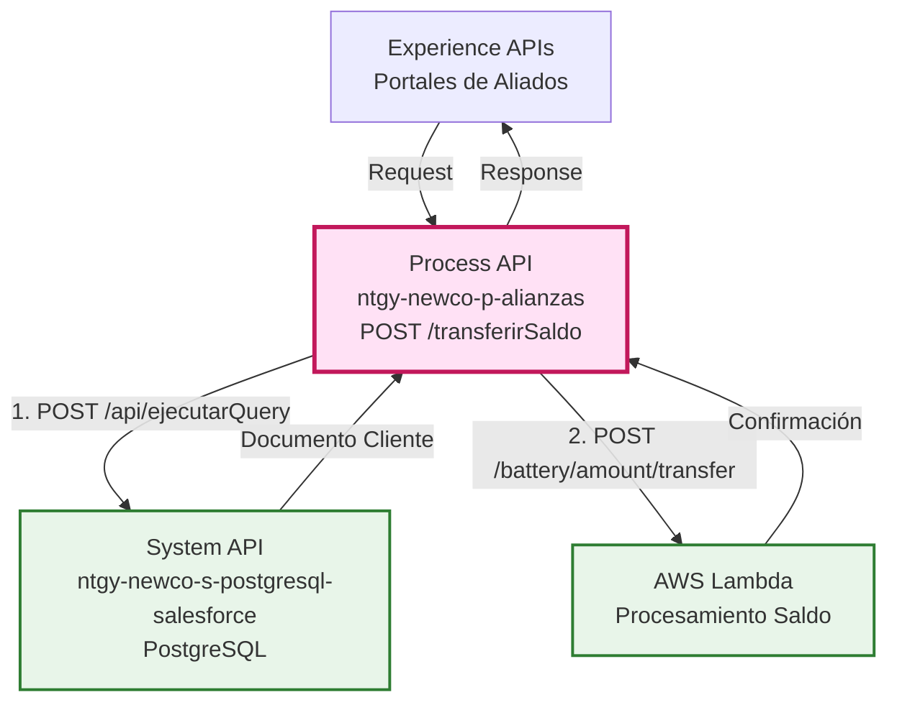
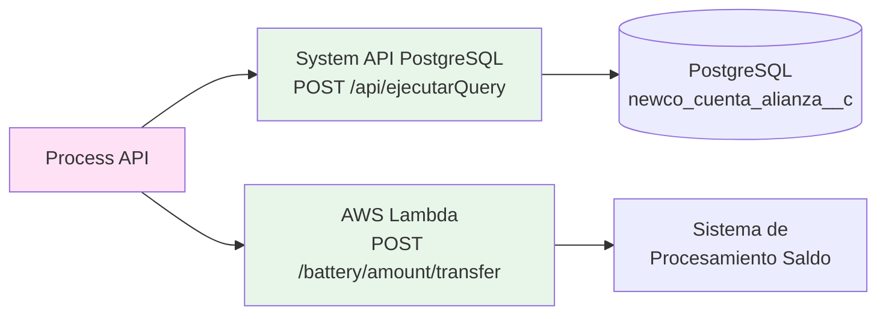
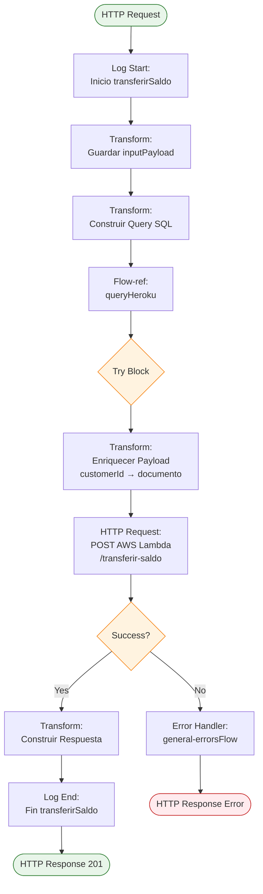
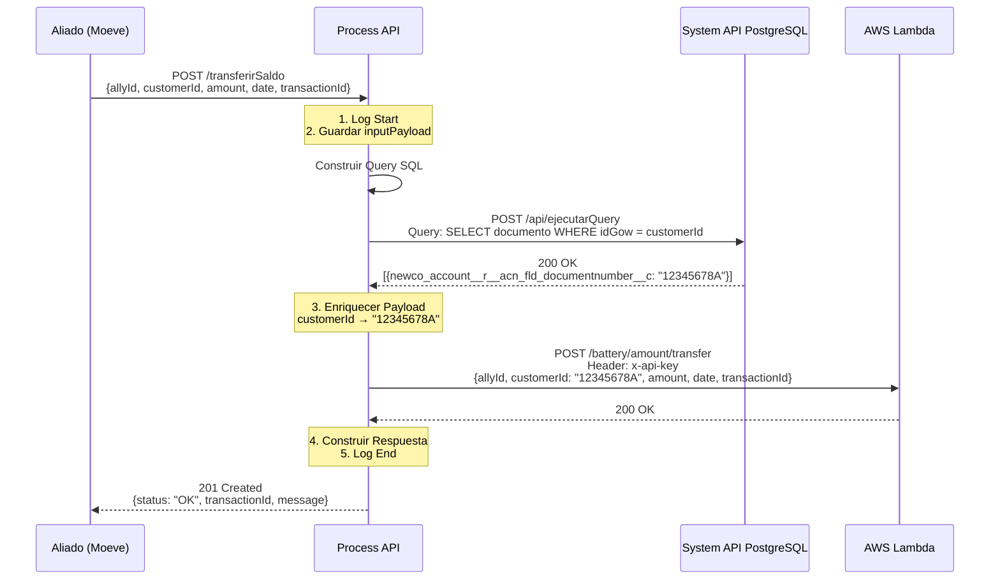
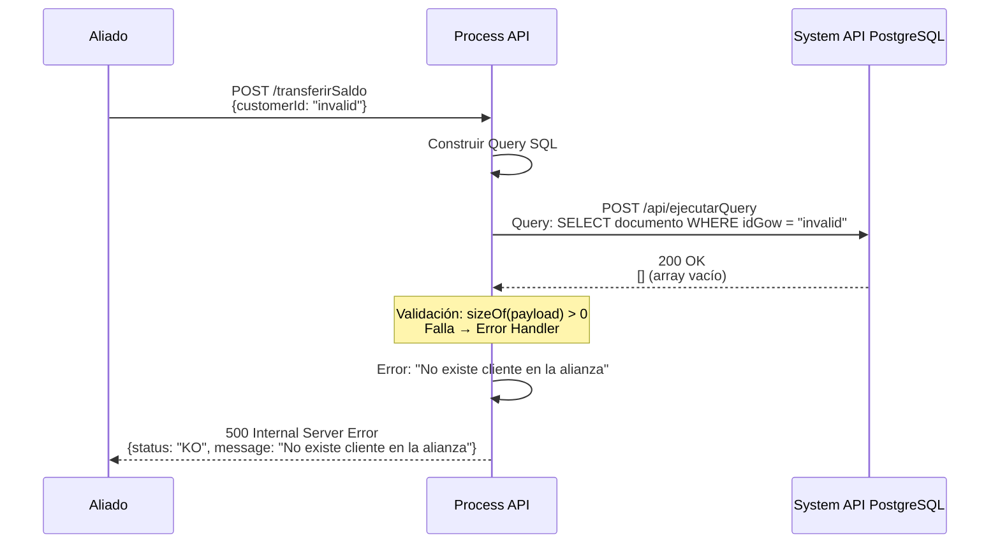
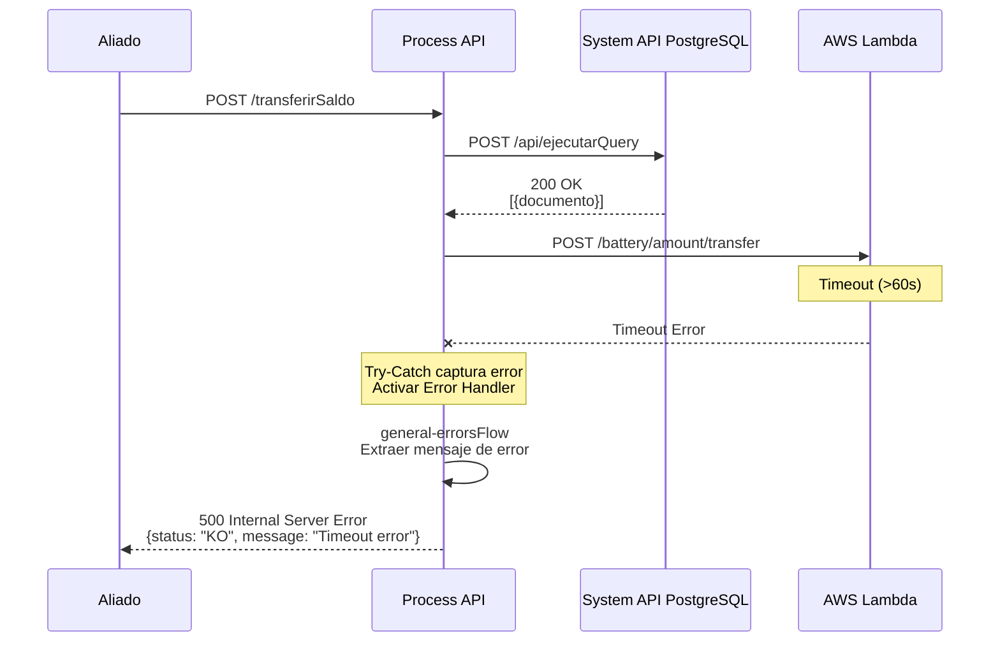

# POST /transferirSaldo

## 📌 Descripción General

### Propósito del Endpoint

Este endpoint permite a las alianzas comerciales (como Moeve) enviar el saldo acumulado por un cliente en función de sus compras. Orquesta dos operaciones críticas: primero consulta el número de documento del cliente mediante el System API `ntgy-newco-s-postgresql-salesforce` (que accede a PostgreSQL con réplica de Salesforce), y luego envía la información de saldo al sistema AWS Lambda para su procesamiento final.

### Tipo de API

**Capa:** Process API (API-Led Connectivity)

**Función:** Orquestación de transferencia de saldo entre alianzas comerciales y sistema de procesamiento AWS

### Patrón de Integración

**Tipo:** API Composition + Data Enrichment

**Descripción:** 
1. Recibe el ID interno del cliente (customerId)
2. Consulta el System API `ntgy-newco-s-postgresql-salesforce` para obtener el número de documento real
3. Enriquece el payload original reemplazando el ID interno con el documento
4. Envía la información completa a AWS Lambda para procesamiento

### Arquitectura API-Led Connectivity



---

## 💼 Propósito del Negocio

### Casos de Uso Principales

1. **Acumulación de Saldo por Compras en Aliado**
   - Cliente realiza compra en estación de servicio Moeve
   - Moeve envía el saldo acumulado al sistema Naturgy
   - Sistema registra y confirma la transacción

2. **Sincronización de Beneficios del Programa de Fidelización**
   - Aliado comercial reporta transacciones de clientes
   - Sistema actualiza saldo acumulado en tiempo real
   - Cliente puede consultar sus beneficios actualizados

3. **Trazabilidad de Transacciones**
   - Cada transferencia tiene un transactionId único
   - Garantiza idempotencia ante reintentos
   - Permite auditoría completa de movimientos

### 🔗 Endpoints Dependientes

Este Process API consume los siguientes sistemas:

| Sistema | Endpoint | Método | Propósito |
|---------|----------|--------|-----------|
| `ntgy-newco-s-postgresql-salesforce` | `/api/ejecutarQuery` | POST | Ejecuta query SQL para obtener número de documento del cliente |
| `AWS Lambda - Alianzas` | `/battery/amount/transfer` | POST | Procesamiento de transferencia de saldo en sistema AWS |

### Lógica de Orquestación



**Pasos del Proceso:**

1. **Paso 1 - Guardar Input**: Almacena el payload original en variable `inputPayload`
2. **Paso 2 - Consultar Documento**: Construye query SQL y la envía al System API `ntgy-newco-s-postgresql-salesforce` para obtener el número de documento del cliente
3. **Paso 3 - Enriquecer Datos**: Reemplaza el `customerId` (ID interno) con el número de documento real
4. **Paso 4 - Procesar Saldo**: Envía el payload enriquecido a AWS Lambda con autenticación API Key
5. **Paso 5 - Responder**: Construye respuesta exitosa con el transactionId

### Transformaciones Aplicadas

| Campo Original | Campo Transformado | Transformación |
|----------------|-------------------|----------------|
| `customerId` (ID interno) | `customerId` (Documento) | Reemplazado con `newco_account__r__acn_fld_documentnumber__c` de Heroku |
| `allyId` | `allyId` | Pass-through sin cambios |
| `amount` | `amount` | Pass-through sin cambios |
| `date` | `date` | Pass-through sin cambios |
| `transactionId` | `transactionId` | Pass-through sin cambios |

### Contexto Empresarial

- **Dominio:** Programa de Fidelización y Alianzas Comerciales
- **Sector:** Energía - Utilities
- **División:** Naturgy España - NewCo
- **Proceso de Negocio:** Gestión de saldos acumulados por compras en aliados

### Stakeholders

- **Aliados Comerciales (Moeve, etc.)**: Necesitan reportar transacciones de clientes de forma automática
- **Clientes Finales**: Beneficiarios del programa de fidelización que acumulan saldo
- **Departamento de Marketing**: Gestiona el programa de alianzas y beneficios
- **Equipo de Sistemas**: Mantiene la integración y trazabilidad

### Valor de Negocio

- **Automatización**: Elimina procesos manuales de registro de saldos
- **Tiempo Real**: Saldos actualizados inmediatamente tras la compra
- **Trazabilidad**: Registro completo de todas las transacciones con transactionId único
- **Escalabilidad**: Facilita la incorporación de nuevos aliados comerciales
- **Idempotencia**: Previene duplicación de saldos ante reintentos

### Consumidores Potenciales

Este endpoint puede ser consumido por:
- Portales web de aliados comerciales
- Aplicaciones móviles de partners
- Sistemas de punto de venta de aliados
- Integraciones batch de terceros autorizados

---

## 🔧 Especificación Técnica

### URLs por Ambiente

| Ambiente | URL Base | URL Completa |
|----------|----------|--------------|
| **Local** | `http://localhost:8081` | `http://localhost:8081/api/transferirSaldo` |
| **Development** | `https://ntgy-newco-p-alianzas-dev.us-e2.cloudhub.io` | `https://ntgy-newco-p-alianzas-dev.us-e2.cloudhub.io/api/transferirSaldo` |
| **UAT** | `https://ntgy-newco-p-alianzas-uat.us-e2.cloudhub.io` | `https://ntgy-newco-p-alianzas-uat.us-e2.cloudhub.io/api/transferirSaldo` |
| **Production** | `https://ntgy-newco-p-alianzas-pro.us-e2.cloudhub.io` | `https://ntgy-newco-p-alianzas-pro.us-e2.cloudhub.io/api/transferirSaldo` |

### Método HTTP

```
POST /api/transferirSaldo
```

### Parámetros de Entrada

#### Request Body (application/json)

| Campo | Tipo | Requerido | Descripción | Ejemplo |
|-------|------|-----------|-------------|---------|
| `allyId` | string | ✅ Sí | Identificador del aliado comercial | `"aliado1"` |
| `customerId` | string | ✅ Sí | Identificador interno del cliente (ID Gow) | `"m0001"` |
| `amount` | number | ✅ Sí | Monto del saldo a transferir | `14.32` |
| `date` | date-only \| string | ✅ Sí | Fecha de la transacción (ISO 8601 o timestamp Unix) | `"1708737600"` |
| `transactionId` | string | ✅ Sí | Identificador único de la transacción (para idempotencia) | `"tr00012"` |

**Ejemplo de Request:**

```json
{
  "allyId": "aliado1",
  "customerId": "m0001",
  "amount": 14.32,
  "date": "1708737600",
  "transactionId": "tr00012"
}
```

### Respuestas

#### 201 Created - Transferencia Exitosa

```json
{
  "status": true,
  "transactionId": "tr00012",
  "message": "Saldo enviado correctamente"
}
```

| Campo | Tipo | Descripción |
|-------|------|-------------|
| `status` | boolean | Estado de la operación (true = éxito) |
| `transactionId` | string | ID de la transacción procesada |
| `message` | string | Mensaje descriptivo del resultado |

#### 400 Bad Request - Datos Inválidos

```json
{
  "message": "Datos Inválidos en la solicitud",
  "status": "KO"
}
```

**Causas comunes:**
- Campos requeridos faltantes
- Formato de datos incorrecto
- Monto negativo o cero
- TransactionId vacío

#### 404 Not Found - Usuario/Alianza Inexistente

```json
{
  "message": "Usuario/Alianza inexistente",
  "status": "KO"
}
```

**Causas comunes:**
- CustomerId no encontrado en Heroku PostgreSQL
- AllyId no registrado en el sistema
- Cliente no asociado al aliado

#### 401 Unauthorized - Autenticación Fallida

```json
{
  "message": "Autentificación fallida",
  "status": "KO"
}
```

**Causas comunes:**
- Client ID o Client Secret inválidos
- Token expirado
- Credenciales no proporcionadas

#### 500 Internal Server Error - Error del Sistema

```json
{
  "message": "Internal server error",
  "status": "KO"
}
```

**Causas comunes:**
- Error en Heroku PostgreSQL
- Timeout en AWS Lambda
- Error de transformación DataWeave
- Problemas de conectividad

### Autenticación

- **Tipo:** Client ID & Client Secret (Anypoint Platform)
- **Headers Requeridos:**
  - `client_id`: ID del cliente registrado
  - `client_secret`: Secret del cliente
  - `Content-Type`: `application/json`

### Timeouts

| Tipo | Valor |
|------|-------|
| **Request Timeout** | 30 segundos |
| **Connection Timeout** | 10 segundos |
| **AWS Lambda Timeout** | 30 segundos |

---

## 🏗️ Implementación Técnica

### Arquitectura del Flow



### Transformaciones DataWeave

#### 1. Guardar Input Payload (Líneas 10-17)

```dataweave
%dw 2.0
output application/json
---
payload
```

**Propósito:** Almacenar el payload original en la variable `inputPayload` para uso posterior.

#### 2. Construir Query para System API PostgreSQL (Líneas 18-27)

```dataweave
%dw 2.0
output application/json
---
{
    "query": "select
        alianzas.newco_account__r__acn_fld_documentnumber__c
    from
        newcosalesforce.newco_cuenta_alianza__c as alianzas
    where alianzas.newco_idgow__c = '" ++ payload.customerId  ++ "'"
}
```

**Propósito:** Construir la query SQL dinámica que será ejecutada por el System API `ntgy-newco-s-postgresql-salesforce`.

**Tabla Consultada:** `newcosalesforce.newco_cuenta_alianza__c` (en PostgreSQL)
**Campo Retornado:** `newco_account__r__acn_fld_documentnumber__c` (número de documento)
**Condición:** `newco_idgow__c = customerId` (ID interno del cliente)

#### 3. Enriquecer Payload para AWS (Líneas 31-36)

```dataweave
%dw 2.0
output application/json
---
vars.inputPayload update {
    case .customerId -> payload[0].newco_account__r__acn_fld_documentnumber__c
}
```

**Propósito:** Reemplazar el `customerId` (ID interno) con el número de documento real obtenido del System API PostgreSQL.

**Transformación:**
- **Antes:** `{ "customerId": "m0001", ... }`
- **Después:** `{ "customerId": "12345678A", ... }`

#### 4. Construir Respuesta Exitosa (Líneas 56-63)

```dataweave
%dw 2.0
output application/json
---
{
    "message": "Saldo enviado correctamente",
    "transactionId": vars.inputPayload.transactionId,
    "status": "OK"
}
```

**Propósito:** Construir la respuesta exitosa con el transactionId original.

### Subflujos Utilizados

#### queryHeroku (src/main/mule/services/alianzas/queryHeroku.xml)

**Propósito:** Ejecutar consultas SQL mediante el System API `ntgy-newco-s-postgresql-salesforce`

**Implementación (línea 13):**
```xml
<http:request 
    method="POST" 
    config-ref="HTTP_Request_s_postgresql-salesforce" 
    path="/ejecutarQuery">
</http:request>
```

**Configuración (global.xml líneas 28-30):**
- **Config:** `HTTP_Request_s_postgresql-salesforce`
- **Base Path:** `/api`
- **Full Path:** `/api/ejecutarQuery`
- **Host:** `ntgy-newco-s-postgresql-salesforce-[env].de-c1.cloudhub.io`
- **Port:** `8091` (pro), `80` (des)
- **Timeout:** `240000` ms (4 minutos)

**Validación (líneas 17-33):**
- Valida que la respuesta contenga al menos un registro
- Si no existe cliente: Error "No existe cliente en la alianza"

#### general-errorsFlow (src/main/mule/error/general-errors.xml)

**Propósito:** Manejo centralizado de errores con extracción inteligente de mensajes

**Lógica de Extracción:**
```dataweave
{
    "message": 
        if(error.errorMessage.payload != null)
            error.errorMessage.payload
        else if(substringAfterLast(error.description, "' ") != "") 
            substringAfterLast(error.description, "' ") 
        else if(error.description != null) 
            error.description 
        else 
            "Internal server error",
    "status": "KO"
}
```

**Estrategia:** Intenta extraer el mensaje más específico posible con múltiples fallbacks.

### Patrones de Diseño

**Patrón:** API Composition + Data Enrichment

**Justificación:** 
- Necesidad de consultar datos adicionales antes de procesar
- Enriquecimiento del payload con información de múltiples fuentes
- Orquestación de dos sistemas independientes (Heroku + AWS)
- Mantiene la separación de responsabilidades entre sistemas

### Diagramas de Secuencia

#### 1. Flujo Normal de Éxito



#### 2. Flujo con Error de Negocio (Cliente No Encontrado)



#### 3. Flujo con Error Técnico (Timeout AWS)



### Manejo de Errores

#### Estrategia de Error Handling

1. **Try-Catch Block:** Envuelve la llamada a AWS Lambda
2. **Error Handler Centralizado:** `general-errorsFlow` procesa todos los errores
3. **Extracción Inteligente:** Múltiples fallbacks para obtener mensaje descriptivo
4. **Logging Completo:** Registra inicio y fin de operación

#### Tipos de Errores Manejados

| Tipo de Error | Código HTTP | Manejo |
|---------------|-------------|--------|
| **APIKIT:BAD_REQUEST** | 400 | Validación de entrada fallida |
| **APIKIT:NOT_FOUND** | 404 | Endpoint no encontrado |
| **HTTP:TIMEOUT** | 500 | Timeout en Heroku o AWS |
| **HTTP:CONNECTIVITY** | 500 | Error de conectividad |
| **Transformation Error** | 500 | Error en DataWeave |
| **General Error** | 500 | Cualquier otro error |

#### Configuración de Retry

**No hay retry automático configurado** para este endpoint debido a:
- Idempotencia garantizada por `transactionId`
- El cliente puede reintentar con el mismo `transactionId`
- Evita duplicación de saldos

---

## 💻 Ejemplos de Uso

### Ejemplo 1: Llamada Exitosa

#### cURL

```bash
curl -X POST "https://ntgy-newco-p-alianzas-dev.us-e2.cloudhub.io/api/transferirSaldo" \
  -H "Content-Type: application/json" \
  -H "client_id: YOUR_CLIENT_ID" \
  -H "client_secret: YOUR_CLIENT_SECRET" \
  -d '{
    "allyId": "moeve",
    "customerId": "m0001",
    "amount": 25.50,
    "date": "1708737600",
    "transactionId": "tr00012"
  }'
```

#### Respuesta (201 Created)

```json
{
  "status": true,
  "transactionId": "tr00012",
  "message": "Saldo enviado correctamente"
}
```

### Ejemplo 2: Cliente No Encontrado

#### cURL

```bash
curl -X POST "https://ntgy-newco-p-alianzas-dev.us-e2.cloudhub.io/api/transferirSaldo" \
  -H "Content-Type: application/json" \
  -H "client_id: YOUR_CLIENT_ID" \
  -H "client_secret: YOUR_CLIENT_SECRET" \
  -d '{
    "allyId": "moeve",
    "customerId": "invalid_id",
    "amount": 25.50,
    "date": "1708737600",
    "transactionId": "tr00013"
  }'
```

#### Respuesta (404 Not Found)

```json
{
  "message": "Usuario/Alianza inexistente",
  "status": "KO"
}
```

### Ejemplo 3: JavaScript (Fetch API)

```javascript
const transferirSaldo = async () => {
  try {
    const response = await fetch(
      'https://ntgy-newco-p-alianzas-dev.us-e2.cloudhub.io/api/transferirSaldo',
      {
        method: 'POST',
        headers: {
          'Content-Type': 'application/json',
          'client_id': 'YOUR_CLIENT_ID',
          'client_secret': 'YOUR_CLIENT_SECRET'
        },
        body: JSON.stringify({
          allyId: 'moeve',
          customerId: 'm0001',
          amount: 25.50,
          date: '1708737600',
          transactionId: 'tr00012'
        })
      }
    );

    if (!response.ok) {
      throw new Error(`HTTP error! status: ${response.status}`);
    }

    const data = await response.json();
    console.log('Saldo transferido:', data);
    return data;
  } catch (error) {
    console.error('Error al transferir saldo:', error);
    throw error;
  }
};

// Uso
transferirSaldo()
  .then(result => console.log('Éxito:', result))
  .catch(error => console.error('Error:', error));
```

### Ejemplo 4: Python (Requests)

```python
import requests
import json
from datetime import datetime

def transferir_saldo(ally_id, customer_id, amount, transaction_id):
    """
    Transfiere saldo acumulado por un cliente en un aliado comercial
    
    Args:
        ally_id (str): ID del aliado comercial
        customer_id (str): ID interno del cliente
        amount (float): Monto del saldo a transferir
        transaction_id (str): ID único de la transacción
    
    Returns:
        dict: Respuesta del API con status y transactionId
    """
    url = 'https://ntgy-newco-p-alianzas-dev.us-e2.cloudhub.io/api/transferirSaldo'
    
    headers = {
        'Content-Type': 'application/json',
        'client_id': 'YOUR_CLIENT_ID',
        'client_secret': 'YOUR_CLIENT_SECRET'
    }
    
    payload = {
        'allyId': ally_id,
        'customerId': customer_id,
        'amount': amount,
        'date': str(int(datetime.now().timestamp())),
        'transactionId': transaction_id
    }
    
    try:
        response = requests.post(url, headers=headers, json=payload, timeout=30)
        response.raise_for_status()
        
        result = response.json()
        print(f"✅ Saldo transferido exitosamente: {result['message']}")
        return result
        
    except requests.exceptions.HTTPError as http_err:
        error_data = response.json()
        print(f"❌ Error HTTP {response.status_code}: {error_data.get('message')}")
        raise
    except requests.exceptions.Timeout:
        print("❌ Error: Timeout al conectar con el API")
        raise
    except requests.exceptions.RequestException as e:
        print(f"❌ Error de conexión: {str(e)}")
        raise

# Ejemplo de uso
if __name__ == "__main__":
    try:
        resultado = transferir_saldo(
            ally_id='moeve',
            customer_id='m0001',
            amount=25.50,
            transaction_id='tr00012'
        )
        print(f"TransactionId: {resultado['transactionId']}")
        print(f"Status: {resultado['status']}")
    except Exception as e:
        print(f"Error en la transferencia: {str(e)}")
```

### Ejemplo 5: Manejo de Idempotencia

```bash
# Primera llamada - Procesa la transacción
curl -X POST "https://ntgy-newco-p-alianzas-dev.us-e2.cloudhub.io/api/transferirSaldo" \
  -H "Content-Type: application/json" \
  -H "client_id: YOUR_CLIENT_ID" \
  -H "client_secret: YOUR_CLIENT_SECRET" \
  -d '{
    "allyId": "moeve",
    "customerId": "m0001",
    "amount": 25.50,
    "date": "1708737600",
    "transactionId": "tr00012"
  }'

# Respuesta: 201 Created
# {
#   "status": true,
#   "transactionId": "tr00012",
#   "message": "Saldo enviado correctamente"
# }

# Segunda llamada con MISMO transactionId - Idempotente
curl -X POST "https://ntgy-newco-p-alianzas-dev.us-e2.cloudhub.io/api/transferirSaldo" \
  -H "Content-Type: application/json" \
  -H "client_id: YOUR_CLIENT_ID" \
  -H "client_secret: YOUR_CLIENT_SECRET" \
  -d '{
    "allyId": "moeve",
    "customerId": "m0001",
    "amount": 25.50,
    "date": "1708737600",
    "transactionId": "tr00012"
  }'

# Respuesta: 201 Created (mismo resultado, no duplica saldo)
# {
#   "status": true,
#   "transactionId": "tr00012",
#   "message": "Saldo enviado correctamente"
# }
```

### Notas de Implementación

#### Idempotencia
- El `transactionId` garantiza que múltiples llamadas con el mismo ID no duplican el saldo
- Útil para reintentos automáticos en caso de timeout o error de red
- El sistema AWS Lambda valida el `transactionId` antes de procesar

#### Timeouts Recomendados
- **Cliente → Process API:** 35 segundos (permite completar toda la orquestación)
- **Process API → Heroku:** 10 segundos (consulta rápida)
- **Process API → AWS Lambda:** 30 segundos (procesamiento de saldo)

#### Mejores Prácticas
1. **Generar transactionId único:** Usar UUID o timestamp + identificador único
2. **Implementar retry con backoff:** Esperar 2s, 4s, 8s entre reintentos
3. **Validar datos antes de enviar:** Verificar formato de campos requeridos
4. **Logging de transacciones:** Registrar todas las llamadas para auditoría
5. **Monitorear timeouts:** Alertar si los tiempos de respuesta aumentan
