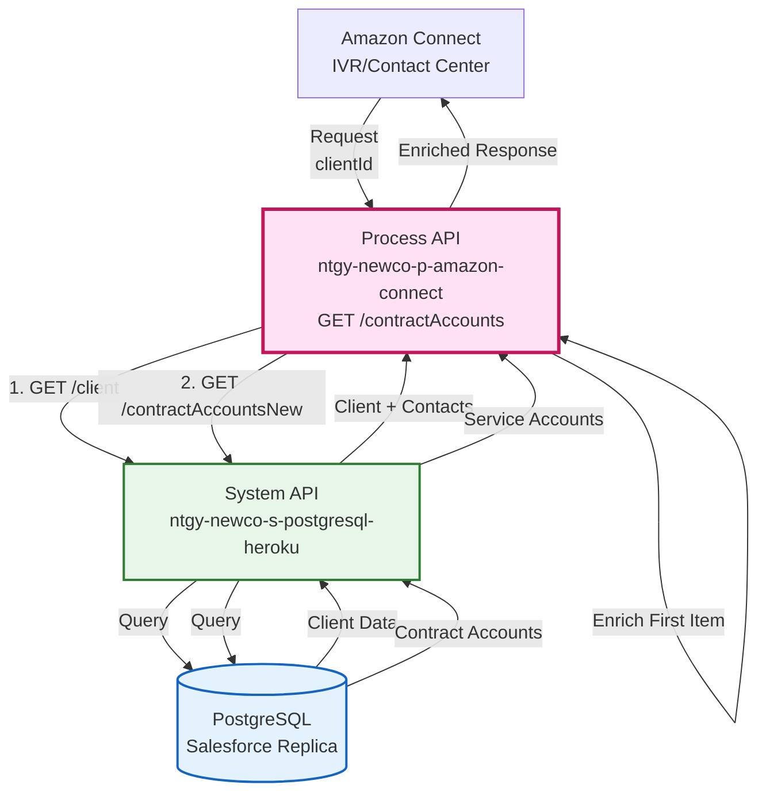
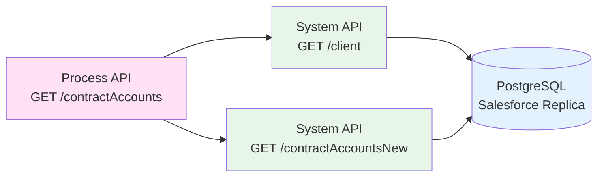
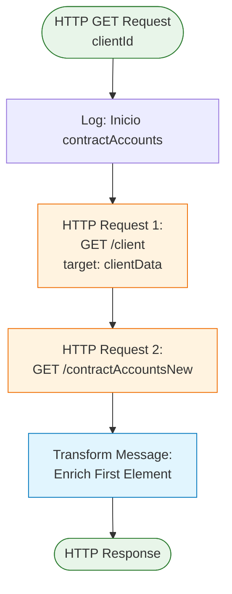
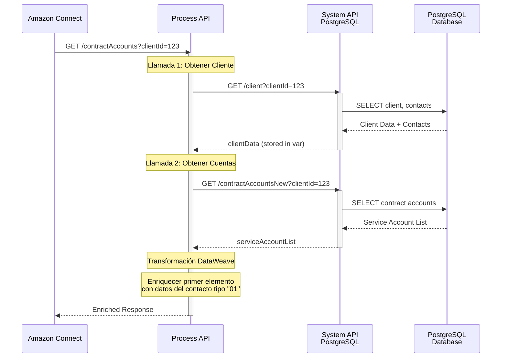
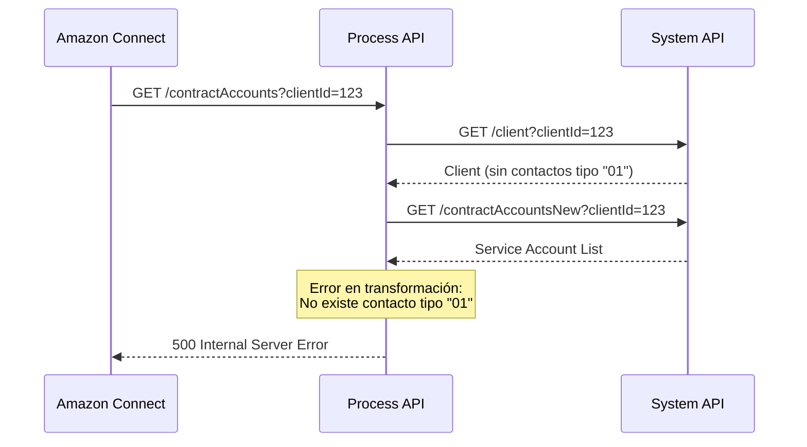
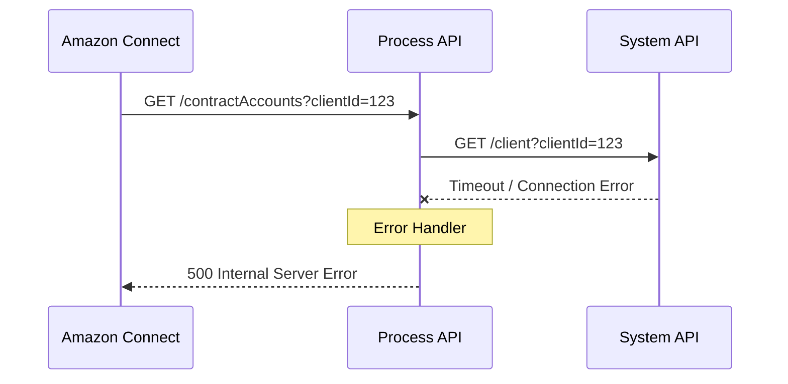

# GET /contractAccounts

## 📌 Descripción General

### Propósito del Endpoint

Este endpoint orquesta dos llamadas a System APIs para obtener las cuentas contrato (suministros) de un cliente y enriquecerlas con información del contacto titular. Es utilizado por Amazon Connect (IVR/Contact Center) para proporcionar a los agentes una vista completa de los suministros del cliente junto con los datos de contacto del titular.

### Tipo de API

**Capa:** Process API (API-Led Connectivity)

**Función:** Orquestación y enriquecimiento de datos de cuentas contrato

### Patrón de Integración

**Tipo:** Orquestación con Enriquecimiento de Datos

**Descripción:** El endpoint realiza dos llamadas secuenciales a un System API (PostgreSQL) y luego enriquece el primer elemento de la lista de cuentas contrato con información del contacto titular (tipo "01").

### Arquitectura API-Led Connectivity



---

## 💼 Propósito del Negocio

### Casos de Uso Principales

1. **Consulta de Suministros en Contact Center**
   - Los agentes necesitan ver todos los suministros asociados a un cliente
   - Permite identificar rápidamente el contacto titular para comunicaciones
   - Facilita la gestión de múltiples puntos de suministro

2. **Autoservicio en IVR**
   - El cliente puede consultar sus suministros mediante voz
   - El sistema identifica automáticamente el contacto titular
   - Proporciona información personalizada según el idioma preferido del titular

3. **Validación de Cliente**
   - Verifica que el cliente existe en el sistema
   - Obtiene datos de contacto actualizados del titular
   - Facilita operaciones posteriores sobre suministros específicos

### 🔗 Endpoints Dependientes

Este Process API consume los siguientes System APIs:

| System API | Endpoint | Método | Propósito |
|------------|----------|--------|-----------|
| `ntgy-newco-s-postgresql-heroku` | `/client` | GET | Obtiene información del cliente y sus contactos desde PostgreSQL |
| `ntgy-newco-s-postgresql-heroku` | `/contractAccountsNew` | GET | Obtiene la lista de cuentas contrato del cliente |

### Lógica de Orquestación



**Pasos del Proceso:**

1. **Paso 1**: Llamada a `/client` con `clientId` para obtener datos del cliente y sus contactos
   - Almacena respuesta en variable `clientData`
   - Extrae información de contactos asociados al cliente

2. **Paso 2**: Llamada a `/contractAccountsNew` con `clientId` para obtener lista de cuentas contrato
   - Obtiene array de `serviceAccountList` con todos los suministros

3. **Paso 3**: Enriquecimiento del primer elemento con datos del contacto titular
   - Filtra contactos por tipo "01" (titular)
   - Extrae `contactId`, `email` preferido y `docNumber`
   - Añade estos campos al primer elemento de `serviceAccountList`

### Transformaciones Aplicadas

**Enriquecimiento de Datos:**

| Campo Original (System API) | Campo Añadido (Process API) | Transformación |
|------------------------------|------------------------------|----------------|
| `serviceAccountList[0]` | `contactId` | Extraído del primer contacto tipo "01" |
| `serviceAccountList[0]` | `email` | Campo `preferredEmail` del contacto tipo "01" |
| `serviceAccountList[0]` | `docNumber` | Número de documento del contacto tipo "01" |

**Lógica de Filtrado:**

```dataweave
// Filtra contactos por tipo "01" (titular)
vars.clientData.client.contacts filter (contact) -> contact.vlocity_cmt__Type__c == "01"

// Toma el primer contacto que cumple la condición
[0]
```

### Contexto Empresarial

- **Dominio:** Gestión de Clientes y Suministros
- **Sector:** Energía - Utilities (Gas & Electricidad)
- **División:** Naturgy España - NewCo
- **Proceso de Negocio:** Atención al Cliente - Contact Center Operations

### Stakeholders

- **Agentes de Contact Center**: Necesitan vista consolidada de suministros con datos de contacto
- **Sistema IVR (Amazon Connect)**: Requiere información para autoservicio telefónico
- **Supervisores de Contact Center**: Monitorean eficiencia en consultas de clientes

### Valor de Negocio

- **Reducción de Tiempo de Atención**: Información consolidada en una sola llamada
- **Mejora de Experiencia del Cliente**: Datos actualizados y completos del titular
- **Eficiencia Operacional**: Evita múltiples consultas a diferentes sistemas
- **Personalización**: Identifica contacto titular para comunicaciones dirigidas

### Consumidores Potenciales

Este endpoint puede ser consumido por:
- Amazon Connect (IVR/Contact Center) - **Consumidor principal**
- Portales web de autoservicio de agentes
- Aplicaciones móviles de agentes de campo
- Sistemas de gestión de clientes internos

---

## 🔧 Especificación Técnica

### URLs por Ambiente

| Ambiente | URL Base | URL Completa |
|----------|----------|--------------|
| **Local** | `http://localhost:8081` | `http://localhost:8081/api/contractAccounts?clientId={clientId}` |
| **Development** | `https://p-amazon-connect-dev.de-c1.cloudhub.io` | `https://p-amazon-connect-dev.de-c1.cloudhub.io/api/contractAccounts?clientId={clientId}` |
| **Pre-Production** | `https://p-amazon-connect-cc.de-c1.cloudhub.io` | `https://p-amazon-connect-cc.de-c1.cloudhub.io/api/contractAccounts?clientId={clientId}` |
| **Production** | `https://p-amazon-connect.de-c1.cloudhub.io` | `https://p-amazon-connect.de-c1.cloudhub.io/api/contractAccounts?clientId={clientId}` |

### Método HTTP

```
GET /api/contractAccounts
```

### Parámetros de Entrada

#### Query Parameters

| Parámetro | Tipo | Requerido | Descripción | Ejemplo |
|-----------|------|-----------|-------------|---------|
| `clientId` | string | ✅ Sí | ID del cliente en Salesforce | `0011t00000AbCdEFG` |

**Validaciones:**
- `clientId` debe ser un ID válido de Salesforce (formato: 18 caracteres alfanuméricos)
- Si no se proporciona, retorna error 400 (Bad Request)

### Respuestas

#### 200 OK - Éxito

**Estructura de Respuesta:**

```json
{
  "result": "string",
  "serviceAccountList": [
    {
      // Campos del primer elemento (enriquecido)
      "contractAccountId": "string",
      "supplyPointId": "string",
      "address": "string",
      "status": "string",
      "contactId": "string",        // ← Añadido por Process API
      "email": "string",             // ← Añadido por Process API
      "docNumber": "string"          // ← Añadido por Process API
    },
    {
      // Resto de elementos (sin enriquecer)
      "contractAccountId": "string",
      "supplyPointId": "string",
      "address": "string",
      "status": "string"
    }
  ]
}
```

**Campos Enriquecidos (solo primer elemento):**

| Campo | Tipo | Descripción | Origen |
|-------|------|-------------|--------|
| `contactId` | string | ID del contacto titular (tipo "01") | `/client` endpoint |
| `email` | string | Email preferido del contacto titular | `/client` endpoint |
| `docNumber` | string | Número de documento del titular | `/client` endpoint |

#### 400 Bad Request - Parámetro Faltante

```json
{
  "message": "Bad request"
}
```

**Causas:**
- Falta el parámetro `clientId`
- `clientId` tiene formato inválido

#### 404 Not Found - Cliente No Existe

```json
{
  "result": "error",
  "message": "Client not found"
}
```

**Causas:**
- El `clientId` no existe en la base de datos
- El cliente fue eliminado o desactivado

#### 500 Internal Server Error - Error del Sistema

```json
{
  "message": "Internal server error"
}
```

**Causas:**
- Error de conectividad con System API PostgreSQL
- Timeout en consultas a base de datos
- Error en transformación DataWeave

### Autenticación

- **Tipo:** Client ID & Client Secret (Anypoint Platform)
- **Headers Requeridos:**
  - `client_id`: ID de la aplicación cliente
  - `client_secret`: Secret de la aplicación cliente

### Timeouts

| Tipo | Valor | Configuración |
|------|-------|---------------|
| **Response Timeout** | Configurable por entorno | `${ntgy-newco-s-dynamodb.timeout}` |
| **Connection Idle Timeout** | Configurable por entorno | `${ntgy-newco-s-dynamodb.timeout}` |
| **Recomendado (IVR)** | `< 3 segundos` | Para cumplir SLA de Amazon Connect |

---

## 🏗️ Implementación Técnica

### Arquitectura del Flow



### Código del Flow (XML)

**Archivo:** `src/main/mule/implementation/contractAccountsFlow.xml`

```xml
<flow name="contractAccountsFlow" doc:id="79ae61a3-837b-4e00-aaa6-74068c9370e9">
    <!-- Primera llamada: Obtener datos del cliente -->
    <http:request 
        method="GET" 
        doc:name="Llamada a /clients" 
        config-ref="HTTP_S_POSTGRESQL_HEROKU" 
        path="/client" 
        target="clientData">
        <http:query-params>
            <![CDATA[#[output application/java
---
{
    "clientId" : attributes.queryParams['clientId']
}]]]>
        </http:query-params>
    </http:request>
    
    <!-- Segunda llamada: Obtener cuentas contrato -->
    <http:request 
        method="GET" 
        doc:name="Llamada a /contractAccounts" 
        config-ref="HTTP_S_POSTGRESQL_HEROKU" 
        path="/contractAccountsNew">
        <http:query-params>
            <![CDATA[#[output application/java
---
{
    "clientId" : attributes.queryParams['clientId']
}]]]>
        </http:query-params>
    </http:request>
    
    <!-- Transformación: Enriquecer primer elemento -->
    <ee:transform doc:name="Transform Message">
        <ee:message>
            <ee:set-payload>
                <![CDATA[%dw 2.0
output application/json
---
{
  result: payload.result,
  serviceAccountList: payload.serviceAccountList map (
      if ($$ == 0) $  ++ 
        { 
            contactId: (vars.clientData.client.contacts filter (contact) -> contact.vlocity_cmt__Type__c == "01")[0].contactId,
            email: (vars.clientData.client.contacts filter (contact) -> contact.vlocity_cmt__Type__c == "01")[0].preferredEmail,
            docNumber: (vars.clientData.client.contacts filter (contact) -> contact.vlocity_cmt__Type__c == "01")[0].docNumber
        }
      else $
  )    
}]]>
            </ee:set-payload>
        </ee:message>
    </ee:transform>
</flow>
```

### Transformaciones DataWeave

#### Enriquecimiento del Primer Elemento

**Lógica:**

```dataweave
%dw 2.0
output application/json
---
{
  result: payload.result,
  serviceAccountList: payload.serviceAccountList map (
      // Si es el primer elemento (índice 0)
      if ($$ == 0) 
        // Combinar elemento original con datos del contacto
        $  ++ 
        { 
            contactId: (vars.clientData.client.contacts 
                        filter (contact) -> contact.vlocity_cmt__Type__c == "01")[0].contactId,
            email: (vars.clientData.client.contacts 
                    filter (contact) -> contact.vlocity_cmt__Type__c == "01")[0].preferredEmail,
            docNumber: (vars.clientData.client.contacts 
                        filter (contact) -> contact.vlocity_cmt__Type__c == "01")[0].docNumber
        }
      // Para el resto de elementos, mantener original
      else $
  )    
}
```

**Explicación:**

1. **`$$`**: Índice del elemento en el array (0-based)
2. **`if ($$ == 0)`**: Solo enriquece el primer elemento
3. **`$ ++`**: Operador de merge que combina el objeto original con nuevos campos
4. **`filter (contact) -> contact.vlocity_cmt__Type__c == "01"`**: Filtra contactos por tipo "01" (titular)
5. **`[0]`**: Toma el primer contacto que cumple la condición

### Patrones de Diseño

**Patrón:** API Composition + Data Enrichment

**Justificación:** 
- Combina datos de dos fuentes (cliente y cuentas contrato)
- Enriquece selectivamente solo el primer elemento
- Mantiene eficiencia al no duplicar datos en todos los elementos
- Proporciona información contextual del titular sin sobrecarga

**Ventajas:**
- Reduce número de llamadas desde Amazon Connect
- Proporciona datos completos en una sola respuesta
- Optimiza ancho de banda al enriquecer solo primer elemento

### Diagramas de Secuencia

#### 1. Flujo Normal de Éxito



#### 2. Flujo con Cliente Sin Contacto Titular



#### 3. Flujo con Error de Conectividad



### Configuración HTTP

**Conector:** `HTTP_S_POSTGRESQL_HEROKU`

**Configuración:**
- **Host:** `${s.postgresql.heroku.host}` → `ntgy-newco-s-postgresql-heroku.us-e2.cloudhub.io`
- **Port:** `${s.postgresql.heroku.port}` → `443`
- **Base Path:** `/api`
- **Protocol:** HTTPS
- **Response Timeout:** `${ntgy-newco-s-dynamodb.timeout}`
- **Connection Idle Timeout:** `${ntgy-newco-s-dynamodb.timeout}`

### Manejo de Errores

**Estrategia:** Fail Fast (sin reintentos)

**Rationale:** Amazon Connect requiere respuestas rápidas (menos de 3 segundos), mejor fallar rápido que reintentar

**Errores Manejados:**

1. **Parámetro Faltante (400)**
   - Detectado por APIKit
   - Respuesta: `{"message": "Bad request"}`

2. **Cliente No Encontrado (404)**
   - System API retorna 404
   - Propagado al cliente

3. **Error de Transformación (500)**
   - Contacto tipo "01" no existe
   - NullPointerException en DataWeave
   - Respuesta: `{"message": "Internal server error"}`

4. **Timeout de System API (500)**
   - Excede timeout configurado
   - Respuesta: `{"message": "Internal server error"}`

---

## 💻 Ejemplos de Uso

### Ejemplo 1: Llamada Exitosa con cURL

#### Request

```bash
curl -X GET "https://p-amazon-connect.de-c1.cloudhub.io/api/contractAccounts?clientId=0011t00000AbCdEFG" \
  -H "Content-Type: application/json" \
  -H "client_id: YOUR_CLIENT_ID" \
  -H "client_secret: YOUR_CLIENT_SECRET"
```

#### Response (200 OK)

```json
{
  "result": "success",
  "serviceAccountList": [
    {
      "contractAccountId": "1234567890",
      "supplyPointId": "ES0021000000000001AB",
      "address": "Calle Mayor 123, Madrid",
      "status": "Active",
      "productType": "Electricity",
      "contactId": "0031t00000XyZaBCD",
      "email": "cliente@example.com",
      "docNumber": "12345678A"
    },
    {
      "contractAccountId": "1234567891",
      "supplyPointId": "ES0021000000000002CD",
      "address": "Avenida Principal 456, Barcelona",
      "status": "Active",
      "productType": "Gas"
    }
  ]
}
```

**Nota:** Solo el primer elemento contiene `contactId`, `email` y `docNumber`.

### Ejemplo 2: JavaScript (Fetch API)

```javascript
const clientId = '0011t00000AbCdEFG';

const response = await fetch(
  'https://p-amazon-connect.de-c1.cloudhub.io/api/contractAccounts?clientId=' + clientId,
  {
    method: 'GET',
    headers: {
      'Content-Type': 'application/json',
      'client_id': 'YOUR_CLIENT_ID',
      'client_secret': 'YOUR_CLIENT_SECRET'
    }
  }
);

const data = await response.json();

// Acceder al primer suministro con datos del titular
const firstAccount = data.serviceAccountList[0];
console.log('Titular:', firstAccount.email);
console.log('Documento:', firstAccount.docNumber);
console.log('Suministros totales:', data.serviceAccountList.length);
```

### Ejemplo 3: Python (Requests)

```python
import requests

client_id = '0011t00000AbCdEFG'
url = 'https://p-amazon-connect.de-c1.cloudhub.io/api/contractAccounts'

headers = {
    'Content-Type': 'application/json',
    'client_id': 'YOUR_CLIENT_ID',
    'client_secret': 'YOUR_CLIENT_SECRET'
}

params = {
    'clientId': client_id
}

response = requests.get(url, headers=headers, params=params)

if response.status_code == 200:
    data = response.json()
    
    # Primer suministro con datos del titular
    first_account = data['serviceAccountList'][0]
    print("Titular: " + first_account['email'])
    print("Documento: " + first_account['docNumber'])
    print("Total suministros: " + str(len(data['serviceAccountList'])))
else:
    print("Error: " + str(response.status_code))
    print(response.json())
```

### Ejemplo 4: Error - Parámetro Faltante

#### Request

```bash
curl -X GET "https://p-amazon-connect.de-c1.cloudhub.io/api/contractAccounts" \
  -H "Content-Type: application/json" \
  -H "client_id: YOUR_CLIENT_ID" \
  -H "client_secret: YOUR_CLIENT_SECRET"
```

#### Response (400 Bad Request)

```json
{
  "message": "Bad request"
}
```

### Ejemplo 5: Error - Cliente No Encontrado

#### Request

```bash
curl -X GET "https://p-amazon-connect.de-c1.cloudhub.io/api/contractAccounts?clientId=INVALID_ID" \
  -H "Content-Type: application/json" \
  -H "client_id: YOUR_CLIENT_ID" \
  -H "client_secret: YOUR_CLIENT_SECRET"
```

#### Response (404 Not Found)

```json
{
  "result": "error",
  "message": "Client not found"
}
```

### Ejemplo 6: Uso en Amazon Connect (Lambda)

```javascript
// AWS Lambda para Amazon Connect
exports.handler = async (event) => {
    const clientId = event.Details.Parameters.clientId;
    
    const response = await fetch(
        `https://p-amazon-connect.de-c1.cloudhub.io/api/contractAccounts?clientId=${clientId}`,
        {
            method: 'GET',
            headers: {
                'Content-Type': 'application/json',
                'client_id': process.env.CLIENT_ID,
                'client_secret': process.env.CLIENT_SECRET
            }
        }
    );
    
    const data = await response.json();
    
    // Retornar datos para IVR
    return {
        statusCode: 200,
        body: JSON.stringify({
            totalSupplies: data.serviceAccountList.length,
            holderEmail: data.serviceAccountList[0]?.email || 'No disponible',
            holderDocument: data.serviceAccountList[0]?.docNumber || 'No disponible'
        })
    };
};