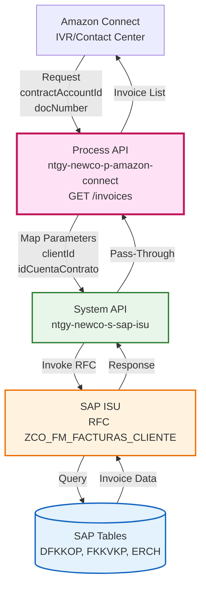
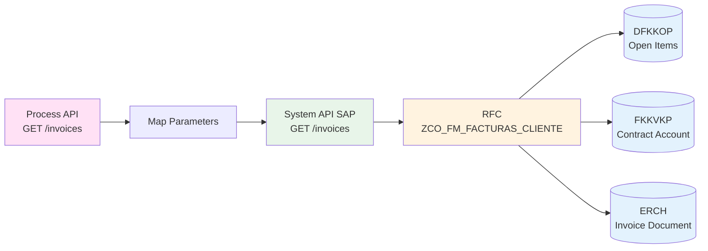
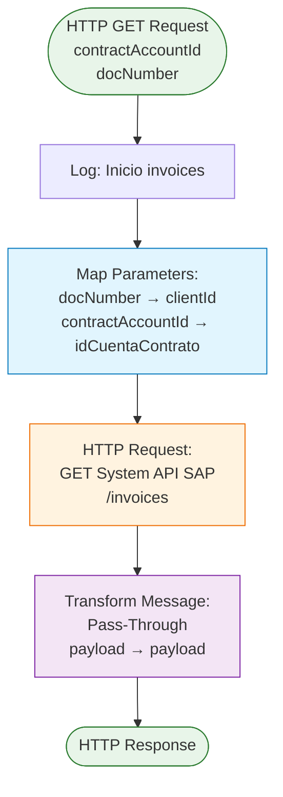
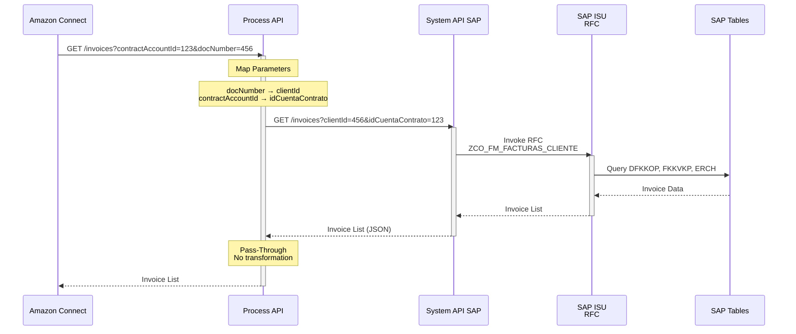
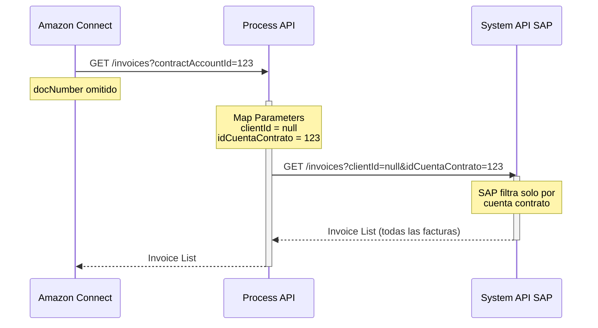
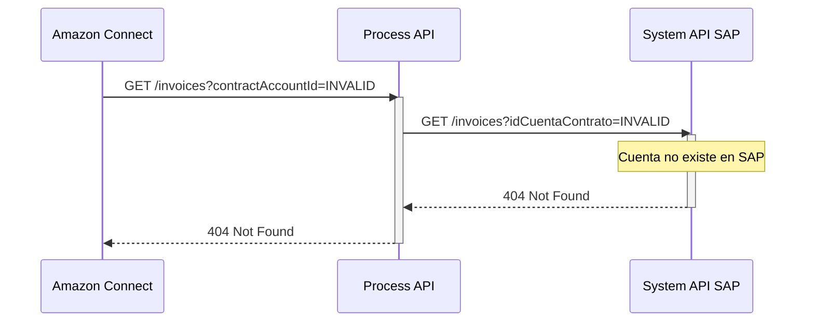

# GET /invoices

## 📌 Descripción General

### Propósito del Endpoint

Este endpoint obtiene las facturas de un cliente para una cuenta contrato específica desde SAP ISU. Actúa como un pass-through que mapea los parámetros del Process API al System API SAP, permitiendo a los agentes de Amazon Connect consultar el historial de facturación de los clientes.

### Tipo de API

**Capa:** Process API (API-Led Connectivity)

**Función:** Pass-Through con Mapeo de Parámetros

### Patrón de Integración

**Tipo:** Pass-Through (Sin Transformación de Respuesta)

**Descripción:** El endpoint recibe parámetros del cliente, los mapea a los nombres esperados por el System API SAP, y retorna la respuesta sin transformación adicional.

### Arquitectura API-Led Connectivity



---

## 💼 Propósito del Negocio

### Casos de Uso Principales

1. **Consulta de Facturas en Contact Center**
   - Los agentes necesitan ver el historial de facturación del cliente
   - Permite identificar facturas pendientes de pago
   - Facilita la resolución de consultas sobre importes y fechas

2. **Autoservicio en IVR**
   - El cliente puede consultar sus facturas mediante voz
   - Obtiene información sobre facturas emitidas y pendientes
   - Accede a detalles de facturación sin intervención de agente

3. **Gestión de Reclamaciones**
   - Verificar facturas específicas durante reclamaciones
   - Consultar histórico de facturación para análisis
   - Validar importes y conceptos facturados

### 🔗 Endpoints Dependientes

Este Process API consume el siguiente System API:

| System API | Endpoint | Método | Propósito |
|------------|----------|--------|-----------|
| `ntgy-newco-s-sap-isu` | `/invoices` | GET | Obtiene facturas desde SAP ISU mediante RFC ZCO_FM_FACTURAS_CLIENTE |

### Lógica de Orquestación



**Pasos del Proceso:**

1. **Paso 1**: Recepción de parámetros del cliente
   - `contractAccountId`: ID de la cuenta contrato (obligatorio)
   - `docNumber`: Número de documento del cliente (opcional)

2. **Paso 2**: Mapeo de parámetros
   - `docNumber` → `clientId` (para System API)
   - `contractAccountId` → `idCuentaContrato` (para System API)

3. **Paso 3**: Llamada al System API SAP
   - El System API invoca RFC `ZCO_FM_FACTURAS_CLIENTE`
   - Consulta tablas SAP: DFKKOP, FKKVKP, ERCH

4. **Paso 4**: Retorno de respuesta sin transformación
   - La respuesta del System API se retorna tal cual
   - No hay enriquecimiento ni transformación de datos

### Transformaciones Aplicadas

**Mapeo de Parámetros:**

| Parámetro Process API | Parámetro System API | Parámetro RFC SAP | Descripción |
|----------------------|---------------------|-------------------|-------------|
| `docNumber` | `clientId` | `IV_CLIENTE` | Número de documento del cliente (DNI/NIE) |
| `contractAccountId` | `idCuentaContrato` | `IV_CUENTA_CONTRATO` | ID de cuenta contrato en SAP |

> **⚠️ PASS-THROUGH - Sin Transformación de Datos**
> 
> Este Process API **NO transforma** la respuesta del System API. Los datos 
> retornados son exactamente los mismos que proporciona el System API SAP, 
> sin modificaciones, enriquecimientos ni filtrados adicionales.
> 
> **Para el schema completo de la respuesta, consultar:**
> 📖 **System API: `ntgy-newco-s-sap-isu` endpoint `/invoices`**
> 
> El System API es el responsable de:
> - Invocar el RFC `ZCO_FM_FACTURAS_CLIENTE` en SAP ISU
> - Consultar las tablas SAP (DFKKOP, FKKVKP, ERCH)
> - Transformar la respuesta del RFC a formato JSON
> - Definir la estructura final de campos

### Contexto Empresarial

- **Dominio:** Gestión de Facturación y Cobros
- **Sector:** Energía - Utilities (Gas & Electricidad)
- **División:** Naturgy España - NewCo
- **Proceso de Negocio:** Consulta de Facturación - Contact Center Operations
- **Módulo SAP:** FI-CA (Financial Contract Accounting)

### Stakeholders

- **Agentes de Contact Center**: Necesitan consultar facturas para resolver consultas de clientes
- **Sistema IVR (Amazon Connect)**: Proporciona autoservicio de consulta de facturas
- **Departamento de Facturación**: Monitorea consultas y gestiona reclamaciones
- **Clientes**: Consultan sus facturas emitidas y pendientes

### Valor de Negocio

- **Reducción de Tiempo de Atención**: Acceso rápido a información de facturación
- **Mejora de Experiencia del Cliente**: Información actualizada y precisa
- **Eficiencia Operacional**: Evita consultas manuales a SAP
- **Autoservicio**: Reduce carga de agentes mediante IVR

### Consumidores Potenciales

Este endpoint puede ser consumido por:
- Amazon Connect (IVR/Contact Center) - **Consumidor principal**
- Portales web de autoservicio de clientes
- Aplicaciones móviles de clientes
- Sistemas de gestión de reclamaciones
- Herramientas de análisis de facturación

---

## 🔧 Especificación Técnica

### URLs por Ambiente

| Ambiente | URL Base | URL Completa |
|----------|----------|--------------|
| **Local** | `http://localhost:8081` | `http://localhost:8081/api/invoices?contractAccountId={id}&docNumber={doc}` |
| **Development** | `https://p-amazon-connect-dev.de-c1.cloudhub.io` | `https://p-amazon-connect-dev.de-c1.cloudhub.io/api/invoices?contractAccountId={id}&docNumber={doc}` |
| **Pre-Production** | `https://p-amazon-connect-cc.de-c1.cloudhub.io` | `https://p-amazon-connect-cc.de-c1.cloudhub.io/api/invoices?contractAccountId={id}&docNumber={doc}` |
| **Production** | `https://p-amazon-connect.de-c1.cloudhub.io` | `https://p-amazon-connect.de-c1.cloudhub.io/api/invoices?contractAccountId={id}&docNumber={doc}` |

### Método HTTP

```
GET /api/invoices
```

### Parámetros de Entrada

#### Query Parameters

| Parámetro | Tipo | Requerido | Descripción | Ejemplo |
|-----------|------|-----------|-------------|---------|
| `contractAccountId` | string | ✅ Sí | ID de la cuenta contrato en SAP ISU | `1234567890` |
| `docNumber` | string | ⚠️ Opcional | Número de documento del cliente (DNI/NIE) | `12345678A` |

**Validaciones:**
- `contractAccountId` es obligatorio
- `docNumber` es opcional pero recomendado para filtrado adicional
- Si no se proporciona `contractAccountId`, retorna error 400 (Bad Request)

**Mapeo Interno:**
```dataweave
{
  "clientId": attributes.queryParams['docNumber'],
  "idCuentaContrato": attributes.queryParams['contractAccountId']
}
```

### Respuestas

> **⚠️ IMPORTANTE - Pass-Through API**
> 
> Este Process API actúa como **pass-through** sin transformación de datos. 
> La estructura de respuesta que se muestra a continuación es **exactamente** 
> la que retorna el System API `ntgy-newco-s-sap-isu`.
> > 
> Para información detallada sobre los campos y su origen en SAP, consultar 
> el código fuente: **`ntgy-newco-s-sap-isu/src/main/mule/implementation/billing-debt-operations.xml`**

#### 200 OK - Éxito

**Estructura de Respuesta:**

```json
{
  "result": {
    "codResult": "string",
    "msgResult": "string"
  },
  "InvoicesPDS": [
    {
      "cuentaContrato": "string",
      "invoiceId": "string",
      "invoiceNum": "string",
      "issuedDate": "string",
      "billingDate": "string",
      "periodFrom": "string",
      "periodEnd": "string",
      "status": "string",
      "isFinan": boolean,
      "pendingAmount": number,
      "amount": number,
      "interactiveInvoice": "string",
      "documentType": "string",
      "pdfDocumentId": "string",
      "pendingInvoiceStatus": [
        {
          "opbel": "string",
          "opupw": "string",
          "opupk": "string",
          "opupz": "string",
          "status": "string"
        }
      ],
      "productInvoiceRelationList": [
        {
          "productFamilyId": "string",
          "isSolarInvoice": boolean,
          "invoice": "string",
          "contractNumber": "string"
        }
      ],
      "agentConsumptionInfo": [
        {
          "type": "string",
          "consumption": "string",
          "period": "string",
          "readFrom": "string",
          "readDateFrom": "string",
          "readTo": "string",
          "readDateTo": "string",
          "readTypeFrom": "string",
          "readTypeTo": "string",
          "magnitude": "string"
        }
      ],
      "agentDueInfo": [
        {
          "unpaidDate": "string",
          "trakingState": "string",
          "trakingDate": "string",
          "trakingFirm": "string",
          "responsability": "string",
          "step": "string"
        }
      ]
    }
  ]
}
```

**Campos de Respuesta:**

| Campo | Tipo | Descripción | Origen RFC SAP |
|-------|------|-------------|----------------|
| **result** | object | Resultado de la operación | |
| `result.codResult` | string | Código de resultado | ZFA_FM_LISTAFACT.E_DATOS.RESULT.CODRESULT |
| `result.msgResult` | string | Mensaje de resultado | ZFA_FM_LISTAFACT.E_DATOS.RESULT.MSGRESULT |
| **InvoicesPDS** | array | Lista de facturas | ZFA_FM_LISTAFACT.E_DATOS.INVOICESPDS |
| `cuentaContrato` | string | ID de cuenta contrato | Variable del flow |
| `invoiceId` | string | ID interno de factura | INVOICEID |
| `invoiceNum` | string | Número de factura | INVOICENUM |
| `issuedDate` | string | Fecha de emisión (formato: yyyy-MM-dd HH:mm:ss) | ISSUEDATE |
| `billingDate` | string | Fecha de facturación | BILLINGDATE |
| `periodFrom` | string | Inicio del período de facturación | PERIODFROM |
| `periodEnd` | string | Fin del período de facturación | PERIODEND |
| `status` | string | Estado de la factura | STATUS |
| `isFinan` | boolean | Indica si tiene financiación | FINAN (X = true) |
| `pendingAmount` | number | Importe pendiente | PENDINGAMOUNT |
| `amount` | number | Importe total de la factura | AMOUNT |
| `interactiveInvoice` | string | Factura interactiva | INTERACTIVEINVOICE |
| `documentType` | string | Tipo de documento | DOCUMENTTYPE |
| `pdfDocumentId` | string | ID del documento PDF | PDFDOCUMENTID |
| `pendingInvoiceStatus` | array | Estados de facturas pendientes | PENDINGINVOICESTATUS |
| `productInvoiceRelationList` | array | Relación producto-factura | PRODUCINVOICERELATIONLIST |
| `agentConsumptionInfo` | array | Información de consumo para agentes | AGENTCONSUMPTIONINFO |
| `agentDueInfo` | array | Información de vencimientos para agentes | AGENTDUEINFO |

#### 400 Bad Request - Parámetro Faltante

```json
{
  "message": "Bad request"
}
```

**Causas:**
- Falta el parámetro obligatorio `contractAccountId`
- Formato inválido de parámetros

#### 404 Not Found - Cuenta Contrato No Existe

```json
{
  "error": "Contract account not found",
  "contractAccountId": "1234567890"
}
```

**Causas:**
- El `contractAccountId` no existe en SAP ISU
- La cuenta contrato fue cerrada o eliminada

#### 500 Internal Server Error - Error del Sistema

```json
{
  "message": "Internal server error"
}
```

**Causas:**
- Error de conectividad con System API SAP
- Timeout en consulta a SAP ISU
- Error en RFC SAP
- Error en transformación de datos

### Autenticación

- **Tipo:** Client ID & Client Secret (Anypoint Platform)
- **Headers Requeridos:**
  - `client_id`: ID de la aplicación cliente
  - `client_secret`: Secret de la aplicación cliente

### Timeouts

| Tipo | Valor | Configuración |
|------|-------|---------------|
| **Response Timeout** | 30 segundos | `${ntgy-newco-s-sap.timeout}` |
| **Connection Idle Timeout** | 30 segundos | `${ntgy-newco-s-sap.timeout}` |
| **Recomendado (IVR)** | Menos de 3 segundos | Para cumplir SLA de Amazon Connect |

---

## 🏗️ Implementación Técnica

### Arquitectura del Flow



### Código del Flow (XML)

**Archivo:** `src/main/mule/implementation/invoicesFlow.xml`

```xml
<flow name="invoicesFlow" doc:id="bd619472-f4b0-4b55-96b2-847dc59f68aa">
    <!-- Llamada al System API SAP -->
    <http:request 
        method="GET" 
        doc:name="Request" 
        config-ref="HTTP_S_SAP" 
        path="/invoices">
        <http:query-params>
            <![CDATA[#[output application/java
---
{
    "clientId" : attributes.queryParams['docNumber'],
    "idCuentaContrato" : attributes.queryParams['contractAccountId']
}]]]>
        </http:query-params>
    </http:request>
    
    <!-- Transformación Pass-Through -->
    <ee:transform doc:name="Transform Message">
        <ee:message>
            <ee:set-payload>
                <![CDATA[%dw 2.0
output application/json
---
payload]]>
            </ee:set-payload>
        </ee:message>
    </ee:transform>
</flow>
```

### Transformaciones DataWeave

#### Mapeo de Parámetros (Query Params)

**Lógica:**

```dataweave
%dw 2.0
output application/java
---
{
  "clientId" : attributes.queryParams['docNumber'],
  "idCuentaContrato" : attributes.queryParams['contractAccountId']
}
```

**Explicación:**

1. **`attributes.queryParams['docNumber']`**: Extrae el parámetro `docNumber` del request
2. **`attributes.queryParams['contractAccountId']`**: Extrae el parámetro `contractAccountId` del request
3. **Mapeo**: Renombra los parámetros a los nombres esperados por el System API
4. **Output**: Genera un objeto Java para los query parameters del HTTP request

#### Transformación de Respuesta (Pass-Through)

> **📋 NOTA: Pass-Through Completo**
> 
> Esta transformación es un **pass-through puro**. El Process API retorna 
> exactamente lo que recibe del System API sin ninguna modificación.

**Lógica:**

```dataweave
%dw 2.0
output application/json
---
payload
```

**Explicación:**

- **Pass-Through Simple**: Retorna el payload tal cual sin transformación
- **Output Format**: Asegura que la respuesta sea JSON
- **No Enriquecimiento**: No se añaden ni modifican campos
- **No Filtrado**: Todos los campos del System API se retornan al cliente
- **Estructura Idéntica**: La estructura JSON es exactamente la del System API

### Patrones de Diseño

**Patrón:** Pass-Through con Parameter Mapping

> **🎯 PATRÓN PASS-THROUGH**
> 
> Este endpoint implementa un patrón de **pass-through puro** donde:
> - **Entrada**: Solo mapea nombres de parámetros (docNumber → clientId)
> - **Salida**: Retorna la respuesta del System API sin modificación
> - **Responsabilidad**: El System API es quien define la estructura de datos
> - **Ventaja**: Cambios en el System API se propagan automáticamente

**Justificación:** 
- El Process API actúa como capa de abstracción ligera
- Mapea nombres de parámetros entre capas (normalización de interfaz)
- No requiere transformación de datos de negocio
- Mantiene simplicidad y performance óptima
- Delega la lógica de transformación SAP al System API

**Ventajas:**
- **Bajo overhead**: Procesamiento mínimo, solo mapeo de parámetros
- **Fácil mantenimiento**: Cambios en estructura se hacen solo en System API
- **Respuesta rápida**: Crítico para cumplir SLA de IVR (menos de 3 segundos)
- **Desacoplamiento**: Separa la interfaz del cliente de la implementación SAP
- **Propagación automática**: Nuevos campos del System API disponibles inmediatamente

### Diagramas de Secuencia

#### 1. Flujo Normal de Éxito



#### 2. Flujo con Parámetro Opcional Omitido



#### 3. Flujo con Error de Cuenta No Encontrada



### Configuración HTTP

**Conector:** `HTTP_S_SAP`

**Configuración:**
- **Host:** `${ntgy-newco-s-sap.host}` → `ntgy-newco-s-sap-isu-des.de-c1.cloudhub.io`
- **Port:** `${ntgy-newco-s-sap.port}` → `80`
- **Base Path:** `/api`
- **Protocol:** HTTP
- **Response Timeout:** `${ntgy-newco-s-sap.timeout}` → `30000ms` (30 segundos)
- **Connection Idle Timeout:** `${ntgy-newco-s-sap.timeout}` → `30000ms`

### Backend SAP ISU

**RFC Invocado:** `ZCO_FM_FACTURAS_CLIENTE`

**Módulo SAP:** FI-CA (Financial Contract Accounting)

**Tablas SAP Consultadas:**

| Tabla | Descripción | Campos Utilizados |
|-------|-------------|-------------------|
| `DFKKOP` | Open Items (Partidas Abiertas) | BELNR, BETRW, FAEDN, AUGST, WAERS |
| `FKKVKP` | Contract Account | VKONT, GPART |
| `ERCH` | Invoice Document | BELNR, BLDAT, BLART, GJAHR |

### Manejo de Errores

**Estrategia:** Fail Fast (sin reintentos)

**Rationale:** Amazon Connect requiere respuestas rápidas (menos de 3 segundos), mejor fallar rápido que reintentar

**Errores Manejados:**

1. **Parámetro Faltante (400)**
   - Detectado por APIKit
   - Respuesta: `{"message": "Bad request"}`

2. **Cuenta Contrato No Encontrada (404)**
   - System API retorna 404
   - Propagado al cliente
   - Respuesta: `{"error": "Contract account not found"}`

3. **Error de SAP (500)**
   - RFC falla o timeout
   - Respuesta: `{"message": "Internal server error"}`

4. **Timeout de System API (500)**
   - Excede 30 segundos configurados
   - Respuesta: `{"message": "Internal server error"}`

---

## 💻 Ejemplos de Uso

### Ejemplo 1: Llamada Exitosa con Ambos Parámetros

#### Request

```bash
curl -X GET "https://p-amazon-connect.de-c1.cloudhub.io/api/invoices?contractAccountId=1234567890&docNumber=12345678A" \
  -H "Content-Type: application/json" \
  -H "client_id: YOUR_CLIENT_ID" \
  -H "client_secret: YOUR_CLIENT_SECRET"
```

#### Response (200 OK)

```json
{
  "result": {
    "codResult": "000",
    "msgResult": "Operación exitosa"
  },
  "InvoicesPDS": [
    {
      "cuentaContrato": "1234567890",
      "invoiceId": "INV001",
      "invoiceNum": "9000123456",
      "issuedDate": "2024-01-15 00:00:00",
      "billingDate": "2024-01-10 00:00:00",
      "periodFrom": "2023-12-01 00:00:00",
      "periodEnd": "2023-12-31 00:00:00",
      "status": "Pendiente",
      "isFinan": false,
      "pendingAmount": 85.50,
      "amount": 85.50,
      "interactiveInvoice": "X",
      "documentType": "ZF01",
      "pdfDocumentId": "PDF123456",
      "pendingInvoiceStatus": [],
      "productInvoiceRelationList": [
        {
          "productFamilyId": "Electricidad",
          "isSolarInvoice": false,
          "invoice": "9000123456",
          "contractNumber": "CONT001"
        }
      ],
      "agentConsumptionInfo": [
        {
          "type": "Electricidad",
          "consumption": "350",
          "period": "Diciembre 2023",
          "readFrom": "1000",
          "readDateFrom": "2023-12-01 00:00:00",
          "readTo": "1350",
          "readDateTo": "2023-12-31 00:00:00",
          "readTypeFrom": "Real",
          "readTypeTo": "Real",
          "magnitude": "kWh"
        }
      ],
      "agentDueInfo": []
    },
    {
      "cuentaContrato": "1234567890",
      "invoiceId": "INV002",
      "invoiceNum": "9000123455",
      "issuedDate": "2023-12-15 00:00:00",
      "billingDate": "2023-12-10 00:00:00",
      "periodFrom": "2023-11-01 00:00:00",
      "periodEnd": "2023-11-30 00:00:00",
      "status": "Pagada",
      "isFinan": false,
      "pendingAmount": 0,
      "amount": 92.30,
      "interactiveInvoice": "X",
      "documentType": "ZF01",
      "pdfDocumentId": "PDF123455",
      "pendingInvoiceStatus": [],
      "productInvoiceRelationList": [
        {
          "productFamilyId": "Electricidad",
          "isSolarInvoice": false,
          "invoice": "9000123455",
          "contractNumber": "CONT001"
        }
      ],
      "agentConsumptionInfo": [
        {
          "type": "Electricidad",
          "consumption": "320",
          "period": "Noviembre 2023",
          "readFrom": "680",
          "readDateFrom": "2023-11-01 00:00:00",
          "readTo": "1000",
          "readDateTo": "2023-11-30 00:00:00",
          "readTypeFrom": "Real",
          "readTypeTo": "Real",
          "magnitude": "kWh"
        }
      ],
      "agentDueInfo": []
    }
  ]
}
```

### Ejemplo 2: Llamada Solo con contractAccountId

#### Request

```bash
curl -X GET "https://p-amazon-connect.de-c1.cloudhub.io/api/invoices?contractAccountId=1234567890" \
  -H "Content-Type: application/json" \
  -H "client_id: YOUR_CLIENT_ID" \
  -H "client_secret: YOUR_CLIENT_SECRET"
```

#### Response (200 OK)

```json
{
  "result": {
    "codResult": "000",
    "msgResult": "Operación exitosa"
  },
  "InvoicesPDS": [
    {
      "cuentaContrato": "1234567890",
      "invoiceId": "INV001",
      "invoiceNum": "9000123456",
      "issuedDate": "2024-01-15 00:00:00",
      "billingDate": "2024-01-10 00:00:00",
      "periodFrom": "2023-12-01 00:00:00",
      "periodEnd": "2023-12-31 00:00:00",
      "status": "Pendiente",
      "isFinan": false,
      "pendingAmount": 85.50,
      "amount": 85.50,
      "interactiveInvoice": "X",
      "documentType": "ZF01",
      "pdfDocumentId": "PDF123456",
      "pendingInvoiceStatus": [],
      "productInvoiceRelationList": [
        {
          "productFamilyId": "Electricidad",
          "isSolarInvoice": false,
          "invoice": "9000123456",
          "contractNumber": "CONT001"
        }
      ],
      "agentConsumptionInfo": [
        {
          "type": "Electricidad",
          "consumption": "350",
          "period": "Diciembre 2023",
          "readFrom": "1000",
          "readDateFrom": "2023-12-01 00:00:00",
          "readTo": "1350",
          "readDateTo": "2023-12-31 00:00:00",
          "readTypeFrom": "Real",
          "readTypeTo": "Real",
          "magnitude": "kWh"
        }
      ],
      "agentDueInfo": []
    }
  ]
}
```

**Nota:** Sin `docNumber`, retorna todas las facturas de la cuenta contrato.

### Ejemplo 3: JavaScript (Fetch API)

```javascript
const contractAccountId = '1234567890';
const docNumber = '12345678A';

const response = await fetch(
  'https://p-amazon-connect.de-c1.cloudhub.io/api/invoices?contractAccountId=' + contractAccountId + '&docNumber=' + docNumber,
  {
    method: 'GET',
    headers: {
      'Content-Type': 'application/json',
      'client_id': 'YOUR_CLIENT_ID',
      'client_secret': 'YOUR_CLIENT_SECRET'
    }
  }
);

const data = await response.json();

// Verificar resultado
if (data.result.codResult === '000') {
  console.log('Total facturas:', data.InvoicesPDS.length);
  
  // Calcular importe total
  const totalAmount = data.InvoicesPDS.reduce((sum, inv) => sum + inv.amount, 0);
  console.log('Importe total:', totalAmount.toFixed(2), 'EUR');
  
  // Listar facturas pendientes
  const pendingInvoices = data.InvoicesPDS.filter(inv => inv.status === 'Pendiente');
  console.log('Facturas pendientes:', pendingInvoices.length);
  
  // Mostrar información de cada factura
  data.InvoicesPDS.forEach(invoice => {
    console.log(`Factura ${invoice.invoiceNum}: ${invoice.amount} EUR - ${invoice.status}`);
  });
} else {
  console.error('Error:', data.result.msgResult);
}
```

### Ejemplo 4: Python (Requests)

```python
import requests

contract_account_id = '1234567890'
doc_number = '12345678A'

url = 'https://p-amazon-connect.de-c1.cloudhub.io/api/invoices'

headers = {
    'Content-Type': 'application/json',
    'client_id': 'YOUR_CLIENT_ID',
    'client_secret': 'YOUR_CLIENT_SECRET'
}

params = {
    'contractAccountId': contract_account_id,
    'docNumber': doc_number
}

response = requests.get(url, headers=headers, params=params)

if response.status_code == 200:
    data = response.json()
    
    # Verificar resultado
    if data['result']['codResult'] == '000':
        print("Total facturas: " + str(len(data['InvoicesPDS'])))
        
        # Calcular importe total
        total_amount = sum(invoice['amount'] for invoice in data['InvoicesPDS'])
        print("Importe total: {:.2f} EUR".format(total_amount))
        
        # Listar facturas
        for invoice in data['InvoicesPDS']:
            print("Factura: {} - Importe: {:.2f} - Estado: {}".format(
                invoice['invoiceNum'],
                invoice['amount'],
                invoice['status']
            ))
            
            # Mostrar información de consumo si existe
            if invoice['agentConsumptionInfo']:
                for consumption in invoice['agentConsumptionInfo']:
                    print("  Consumo: {} {} ({})".format(
                        consumption['consumption'],
                        consumption['magnitude'],
                        consumption['period']
                    ))
    else:
        print("Error: " + data['result']['msgResult'])
else:
    print("Error HTTP: " + str(response.status_code))
    print(response.json())
```

### Ejemplo 5: Error - Parámetro Faltante

#### Request

```bash
curl -X GET "https://p-amazon-connect.de-c1.cloudhub.io/api/invoices" \
  -H "Content-Type: application/json" \
  -H "client_id: YOUR_CLIENT_ID" \
  -H "client_secret: YOUR_CLIENT_SECRET"
```

#### Response (400 Bad Request)

```json
{
  "message": "Bad request"
}
```

### Ejemplo 6: Error - Cuenta Contrato No Encontrada

#### Request

```bash
curl -X GET "https://p-amazon-connect.de-c1.cloudhub.io/api/invoices?contractAccountId=INVALID_ID" \
  -H "Content-Type: application/json" \
  -H "client_id": "YOUR_CLIENT_ID" \
  -H "client_secret": "YOUR_CLIENT_SECRET"
```

#### Response (404 Not Found)

```json
{
  "error": "Contract account not found",
  "contractAccountId": "INVALID_ID"
}
```

### Ejemplo 7: Uso en Amazon Connect (Lambda)

```javascript
// AWS Lambda para Amazon Connect
exports.handler = async (event) => {
    const contractAccountId = event.Details.Parameters.contractAccountId;
    const docNumber = event.Details.Parameters.docNumber;
    
    const response = await fetch(
        'https://p-amazon-connect.de-c1.cloudhub.io/api/invoices?contractAccountId=' + contractAccountId + '&docNumber=' + docNumber,
        {
            method: 'GET',
            headers: {
                'Content-Type': 'application/json',
                'client_id': process.env.CLIENT_ID,
                'client_secret': process.env.CLIENT_SECRET
            }
        }
    );
    
    const data = await response.json();
    
    // Verificar resultado
    if (data.result.codResult !== '000') {
        return {
            statusCode: 500,
            body: JSON.stringify({
                error: data.result.msgResult
            })
        };
    }
    
    // Calcular totales
    const totalInvoices = data.InvoicesPDS.length;
    const totalAmount = data.InvoicesPDS.reduce((sum, inv) => sum + inv.amount, 0);
    const pendingInvoices = data.InvoicesPDS.filter(inv => inv.status === 'Pendiente').length;
    const pendingAmount = data.InvoicesPDS
        .filter(inv => inv.status === 'Pendiente')
        .reduce((sum, inv) => sum + inv.pendingAmount, 0);
    
    // Retornar datos para IVR
    return {
        statusCode: 200,
        body: JSON.stringify({
            totalInvoices: totalInvoices,
            totalAmount: totalAmount.toFixed(2),
            pendingInvoices: pendingInvoices,
            pendingAmount: pendingAmount.toFixed(2),
            lastInvoiceAmount: data.InvoicesPDS[0]?.amount || 0,
            lastInvoiceDate: data.InvoicesPDS[0]?.issuedDate || 'N/A',
            lastInvoiceNumber: data.InvoicesPDS[0]?.invoiceNum || 'N/A'
        })
    };
};
```
