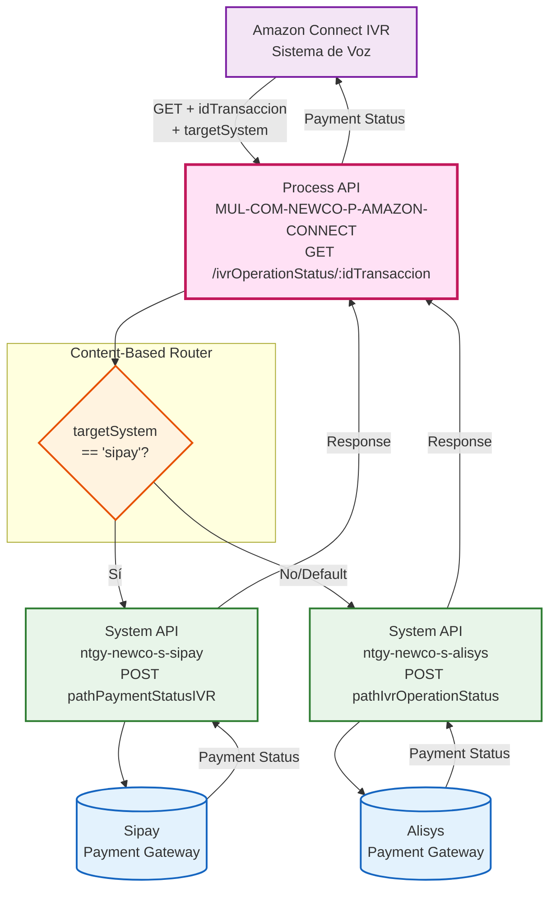
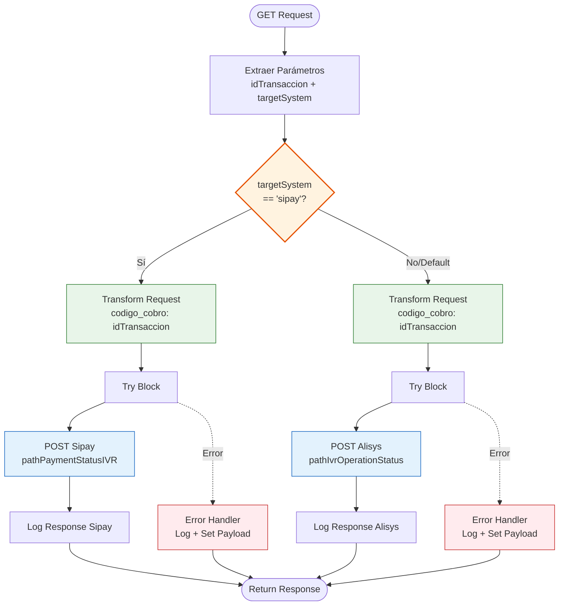
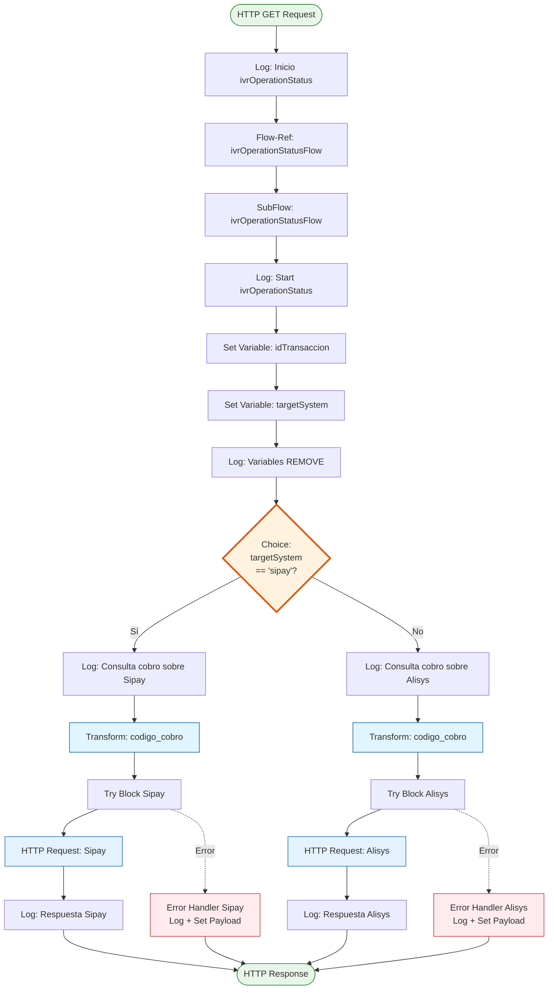
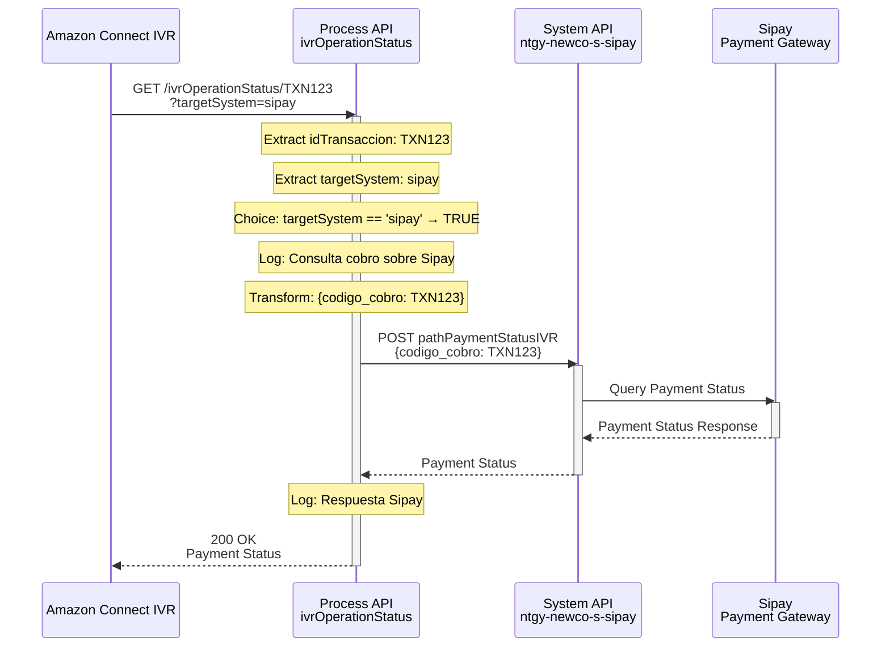
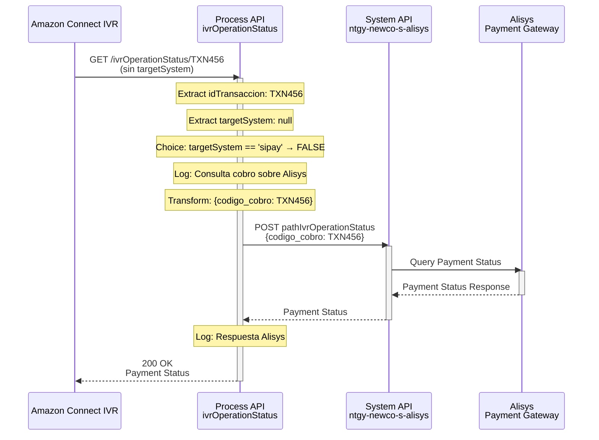
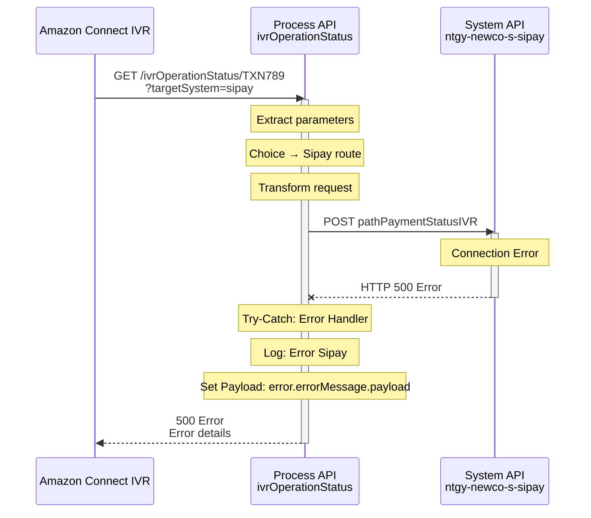
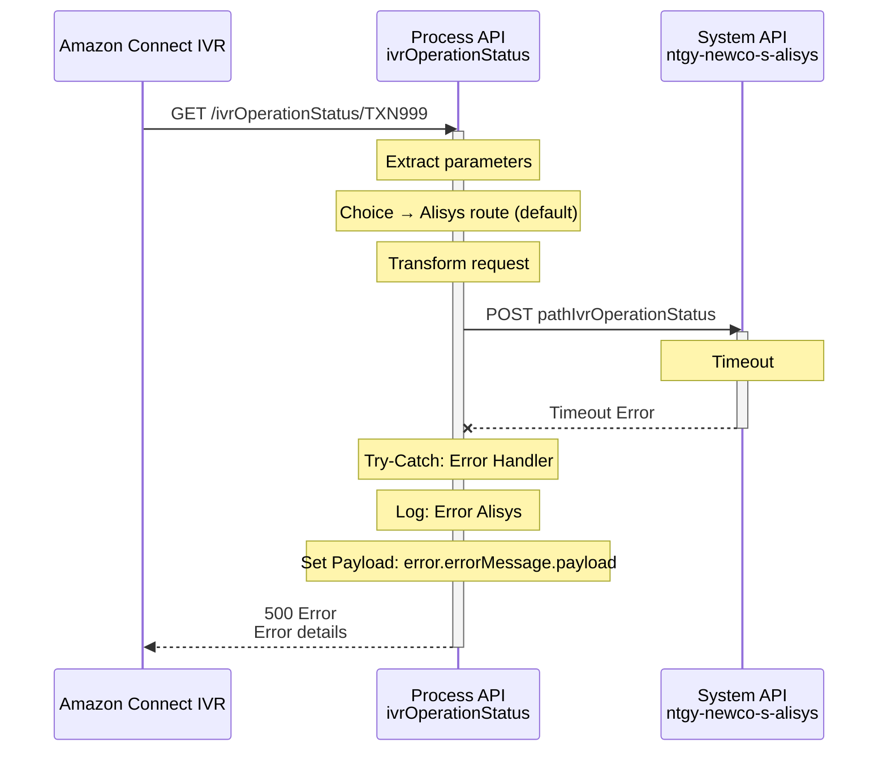

# GET /ivrOperationStatus/:idTransaccion

## 📌 Descripción General

### Propósito del Endpoint

Este endpoint permite consultar el estado de una operación de pago por tarjeta realizada vía IVR (Interactive Voice Response) de Amazon Connect. Implementa un enrutamiento condicional que dirige la consulta a diferentes plataformas de pago (Sipay o Alisys) según el parámetro `targetSystem`, proporcionando flexibilidad para soportar múltiples proveedores de servicios de pago.

### Tipo de API

**Capa:** Process API (API-Led Connectivity)

**Función:** Orquestación de consultas de estado de pago con enrutamiento condicional a múltiples plataformas

### Patrón de Integración

**Tipo:** Content-Based Router con Transformación

**Descripción:** El endpoint recibe un ID de transacción y un parámetro opcional que determina el sistema de pago a consultar. Basándose en este parámetro, enruta la petición al System API correspondiente (Sipay o Alisys), transforma el request al formato requerido por cada plataforma, y retorna el estado de la operación.

### Arquitectura API-Led Connectivity



---

## 💼 Propósito del Negocio

### Casos de Uso Principales

1. **Verificación de Estado de Pago desde IVR**
   - Cliente llama al IVR para verificar si su pago fue procesado correctamente
   - Sistema consulta automáticamente el estado en la plataforma de pago correspondiente
   - Proporciona respuesta inmediata sobre el estado de la transacción

2. **Soporte Multi-Plataforma de Pago**
   - Permite consultar pagos procesados en diferentes plataformas (Sipay/Alisys)
   - Facilita la migración o coexistencia de múltiples proveedores de pago
   - Proporciona flexibilidad operativa y continuidad de negocio

3. **Trazabilidad de Transacciones**
   - Cada consulta utiliza el ID de transacción único
   - Permite seguimiento completo del ciclo de vida del pago
   - Facilita auditoría y resolución de incidencias

4. **Automatización de Verificaciones**
   - Elimina necesidad de intervención manual para verificar pagos
   - Reduce carga en call center
   - Mejora experiencia del cliente con respuestas inmediatas

### 🔗 Endpoints Dependientes

Este Process API consume los siguientes System APIs de forma condicional:

| System API | Endpoint | Método | Propósito | Condición |
|------------|----------|--------|-----------|-----------|
| `ntgy-newco-s-sipay` | `/paymentStatusIVR` | POST | Consulta estado de pago en plataforma Sipay | `targetSystem == "sipay"` |
| `ntgy-newco-s-alisys` | `/ivrOperationStatus` | POST | Consulta estado de pago en plataforma Alisys | `targetSystem != "sipay"` o no especificado (default) |

### Lógica de Orquestación



**Pasos del Proceso:**

1. **Extracción de Parámetros**: Captura `idTransaccion` (path param) y `targetSystem` (query param)
2. **Evaluación Condicional**: Determina la plataforma de pago según `targetSystem`
3. **Transformación**: Construye payload con formato `{"codigo_cobro": idTransaccion}`
4. **Enrutamiento**:
   - **Ruta Sipay**: Si `targetSystem == "sipay"` → POST a ntgy-newco-s-sipay
   - **Ruta Alisys**: Si `targetSystem != "sipay"` o no especificado → POST a ntgy-newco-s-alisys (default)
5. **Manejo de Errores**: Try-catch independiente por ruta con logging y propagación de error
6. **Respuesta**: Retorna el estado del pago desde la plataforma consultada

### Transformaciones Aplicadas

#### Transformación de Entrada (Request → System APIs)

**Nota:** La transformación es idéntica para ambas plataformas.

| Campo Original | Campo Transformado | Transformación |
|----------------|-------------------|----------------|
| `idTransaccion` (path param) | `codigo_cobro` | Mapeo directo desde variable |

**Código DataWeave (idéntico para Sipay y Alisys):**
```dataweave
%dw 2.0
output application/json
---
{
  "codigo_cobro": vars.idTransaccion
}
```

#### Transformación de Salida

⚠️ **Este Process API NO transforma la respuesta de los System APIs.**

La respuesta de Sipay o Alisys se retorna directamente al consumidor (pass-through).

Para el schema completo de respuesta, consultar:
- 📖 **System API Sipay:** `ntgy-newco-s-sipay` endpoint `pathPaymentStatusIVR`
- 📖 **System API Alisys:** `ntgy-newco-s-alisys` endpoint `pathIvrOperationStatus`

### Contexto Empresarial

- **Dominio:** Gestión de Pagos y Cobros
- **Sector:** Energía - Utilities
- **División:** Naturgy España - NewCo
- **Proceso de Negocio:** Verificación de Estado de Pagos por Tarjeta vía IVR

### Stakeholders

- **Clientes Finales**: Verifican estado de sus pagos de forma autónoma vía IVR
- **Agentes de Call Center**: Consultan estado de pagos para resolver incidencias
- **Equipo de Tesorería**: Monitorean transacciones y conciliación de pagos
- **Equipo de Operaciones**: Gestionan incidencias de pagos fallidos
- **Proveedores de Pago**: Sipay y Alisys como plataformas de procesamiento

### Valor de Negocio

- **Flexibilidad Multi-Proveedor**: Soporte para múltiples plataformas de pago sin cambios en consumidores
- **Disponibilidad 24/7**: Consultas automáticas sin intervención humana
- **Reducción de Costes**: Menos llamadas a call center para verificación de pagos
- **Mejora de Experiencia**: Respuestas inmediatas sobre estado de transacciones
- **Continuidad de Negocio**: Capacidad de cambiar entre proveedores sin impacto
- **Trazabilidad**: Logging completo de todas las consultas para auditoría

### Consumidores Potenciales

Este endpoint está diseñado específicamente para:
- **Amazon Connect IVR**: Sistema de voz interactivo (consumidor principal)
- **Sistemas de Contact Center**: Plataformas de atención telefónica
- **Aplicaciones de Agentes**: Herramientas de back-office para consulta de pagos
- **Sistemas de Monitoreo**: Dashboards de seguimiento de transacciones

---

## 🔧 Especificación Técnica

### URLs por Ambiente

| Ambiente | URL Base | URL Completa |
|----------|----------|--------------|
| **Local** | `http://localhost:8081` | `http://localhost:8081/api/ivrOperationStatus/:idTransaccion` |
| **Development** | `https://mul-com-newco-p-amazon-connect-dev.us-e2.cloudhub.io` | `https://mul-com-newco-p-amazon-connect-dev.us-e2.cloudhub.io/api/ivrOperationStatus/:idTransaccion` |
| **UAT** | `https://mul-com-newco-p-amazon-connect-uat.us-e2.cloudhub.io` | `https://mul-com-newco-p-amazon-connect-uat.us-e2.cloudhub.io/api/ivrOperationStatus/:idTransaccion` |
| **Production** | `https://mul-com-newco-p-amazon-connect-pro.us-e2.cloudhub.io` | `https://mul-com-newco-p-amazon-connect-pro.us-e2.cloudhub.io/api/ivrOperationStatus/:idTransaccion` |

### Método HTTP

```
GET /api/ivrOperationStatus/:idTransaccion
```

### Headers Requeridos

| Header | Tipo | Obligatorio | Descripción |
|--------|------|-------------|-------------|
| `client_id` | string | Sí | Client ID de Anypoint Platform |
| `client_secret` | string | Sí | Client Secret de Anypoint Platform |

### Parámetros de Entrada

#### Path Parameters

| Parámetro | Tipo | Obligatorio | Descripción | Ejemplo |
|-----------|------|-------------|-------------|---------|
| `idTransaccion` | string | Sí | Identificador único de la transacción/cobro a consultar | "TXN123456789" |

#### Query Parameters

| Parámetro | Tipo | Obligatorio | Descripción | Valores Permitidos | Default |
|-----------|------|-------------|-------------|-------------------|---------|
| `targetSystem` | string | No | Sistema de pago donde se procesó la transacción | "sipay" o cualquier otro valor | Alisys (si no se especifica o != "sipay") |

#### Validaciones de Entrada

- `idTransaccion`: Debe ser un string no vacío
- `targetSystem`: 
  - Si es "sipay" (case-sensitive) → Enruta a Sipay
  - Si es cualquier otro valor o no se proporciona → Enruta a Alisys (default)

### Respuestas

⚠️ **Este Process API es pass-through**: Retorna la respuesta del System API sin transformación.

#### 200 OK - Éxito

**La estructura de la respuesta depende del System API consultado:**

- **Si targetSystem = "sipay"**: La respuesta proviene de `ntgy-newco-s-sipay` endpoint `/paymentStatusIVR`
- **Si targetSystem != "sipay" o no especificado**: La respuesta proviene de `ntgy-newco-s-alisys` endpoint `/ivrOperationStatus`

**Para el schema exacto de respuesta, consultar la documentación de los System APIs:**
- 📖 **System API Sipay:** `ntgy-newco-s-sipay` → `/paymentStatusIVR`
- 📖 **System API Alisys:** `ntgy-newco-s-alisys` → `/ivrOperationStatus`

#### 500 Internal Server Error - Error del Sistema

En caso de error, el endpoint propaga el error del System API o retorna un error de conexión.

**La estructura del error depende del System API que falle.**

**Posibles causas de error:**
- Timeout de conexión con el System API
- System API no disponible
- Error en la plataforma de pago (Sipay/Alisys)
- Transacción no encontrada

### Comportamiento del Enrutamiento

| Valor de `targetSystem` | Sistema Consultado | Endpoint Invocado |
|-------------------------|-------------------|-------------------|
| `"sipay"` | Sipay | `ntgy-newco-s-sipay` → `pathPaymentStatusIVR` |
| `"alisys"` | Alisys | `ntgy-newco-s-alisys` → `pathIvrOperationStatus` |
| `null` o no especificado | Alisys (default) | `ntgy-newco-s-alisys` → `pathIvrOperationStatus` |
| Cualquier otro valor | Alisys (default) | `ntgy-newco-s-alisys` → `pathIvrOperationStatus` |

### Autenticación

- **Tipo:** Client ID & Client Secret (Anypoint Platform)
- **Método:** Headers HTTP
- **Validación:** Anypoint Platform valida credenciales antes de procesar request

### Timeouts

| Tipo | Valor | Descripción |
|------|-------|-------------|
| **Request Timeout** | Configurable | Timeout para llamada a System APIs (Sipay/Alisys) |
| **Connection Timeout** | 10 segundos | Timeout de conexión HTTP |

### Rate Limiting

- **Límite:** Según configuración de Anypoint Platform
- **Política:** Aplicada a nivel de API Manager

---

## 🏗️ Implementación Técnica

### Arquitectura del Flow



### Componentes del Flow Principal

#### 1. Flow Principal: `get:\ivrOperationStatus\(idTransaccion):ntgy-newco-p-amazon-connect-config`

**Ubicación:** `src/main/mule/ntgy-newco-p-amazon-connect.xml`

**Componentes:**
- **Logger**: Registra inicio del endpoint
- **Flow-Ref**: Invoca subflow `ivrOperationStatusFlow`

#### 2. SubFlow: `ivrOperationStatusFlow`

**Ubicación:** `src/main/mule/implementation/ivrOperationStatusFlow.xml`

**Componentes:**

1. **Logger Start**: Registra inicio del proceso con payload
2. **Set Variable idTransaccion**: Extrae path parameter `attributes.uriParams.'idTransaccion'`
3. **Set Variable targetSystem**: Extrae query parameter `attributes.queryParams.'targetSystem'`
4. **Logger vars REMOVE**: Log de debug con variables (para desarrollo)
5. **Choice**: Evaluación condicional `vars.targetSystem == "sipay"`

**Ruta Sipay (when):**
6. **Logger**: "Consulta cobro sobre Sipay"
7. **Transform Message**: Construye `{"codigo_cobro": vars.idTransaccion}`
8. **Try Block**:
   - **HTTP Request**: POST a Sipay con path `${ntgy-newco-s-sipay.pathPaymentStatusIVR}`
   - **Error Handler**: On-Error-Continue con logging y set payload del error
9. **Logger**: "Respuesta Sipay"

**Ruta Alisys (otherwise - default):**
6. **Logger**: "Consulta cobro sobre Alisys"
7. **Transform Message**: Construye `{"codigo_cobro": vars.idTransaccion}`
8. **Try Block**:
   - **HTTP Request**: POST a Alisys con path `${ntgy-newco-s-alisys.pathIvrOperationStatus}`
   - **Error Handler**: On-Error-Continue con logging y set payload del error
9. **Logger**: "Respuesta Alisys"

### Transformaciones DataWeave

#### Transformación: Prepara Request (idéntica para ambas rutas)

**Ubicación:** Inline en `ivrOperationStatusFlow.xml`

**Para Sipay:**
```dataweave
%dw 2.0
output application/json
---
{
  "codigo_cobro": vars.idTransaccion
}
```

**Para Alisys:**
```dataweave
%dw 2.0
output application/json
---
{
  "codigo_cobro": vars.idTransaccion
}
```

**Características:**
- Transformación idéntica en ambas rutas
- Usa variable `vars.idTransaccion` extraída del path parameter
- Output: JSON con un solo campo `codigo_cobro`

### Configuración HTTP Requests

#### HTTP Request Sipay

**Config-Ref:** `HTTP_S_SIPAY`

**Parámetros:**
- **Method:** POST
- **Path:** `${ntgy-newco-s-sipay.pathPaymentStatusIVR}` (configurable)
- **Body:** Payload transformado con DataWeave

#### HTTP Request Alisys

**Config-Ref:** `HTTP_S_ALISYS`

**Parámetros:**
- **Method:** POST
- **Path:** `${ntgy-newco-s-alisys.pathIvrOperationStatus}` (configurable)
- **Body:** Payload transformado con DataWeave

### Patrones de Diseño

#### Patrón 1: Content-Based Router

**Implementación:** Choice component con evaluación de `targetSystem`

**Justificación:**
- Permite enrutamiento dinámico basado en parámetro de entrada
- Facilita soporte de múltiples proveedores de pago
- Simplifica migración entre plataformas
- Proporciona flexibilidad operativa

**Ventajas:**
- Un solo endpoint para múltiples backends
- Fácil adición de nuevos proveedores
- Configuración centralizada

#### Patrón 2: Try-Catch Error Handler

**Implementación:** Try blocks independientes con On-Error-Continue

**Justificación:**
- Manejo robusto de errores por plataforma
- Logging detallado de fallos
- Propagación controlada de errores al consumidor
- No interrumpe el flujo en caso de error

**Características:**
- Error handler independiente por ruta
- Logging del error con `error.errorMessage.payload`
- Set payload con el error para respuesta al cliente

#### Patrón 3: Variable Storage

**Implementación:** Set Variable para path y query parameters

**Justificación:**
- Acceso consistente a parámetros en todo el flow
- Facilita debugging con logging de variables
- Permite reutilización en transformaciones

### Diagramas de Secuencia

#### 1. Flujo Normal de Éxito (Sipay)



#### 2. Flujo Normal de Éxito (Alisys - Default)



#### 3. Flujo con Error de Sipay



#### 4. Flujo con Error de Alisys



### Manejo de Errores

El endpoint implementa manejo de errores robusto con try-catch independiente por ruta:

#### Estrategia de Error Handling

**Ruta Sipay:**
```xml
<try>
    <http:request ... />
    <error-handler>
        <on-error-continue>
            <logger message="ivrOperationStatus - Error Sipay - #[error.errorMessage.payload]" />
            <set-payload value="#[error.errorMessage.payload]" />
        </on-error-continue>
    </error-handler>
</try>
```

**Ruta Alisys:**
```xml
<try>
    <http:request ... />
    <error-handler>
        <on-error-continue>
            <logger message="ivrOperationStatus - Error Alysis - #[error.errorMessage.payload]" />
            <set-payload value="#[error.errorMessage.payload]" />
        </on-error-continue>
    </error-handler>
</try>
```

#### Tipos de Errores Manejados

**Errores de Conexión:**
- Timeout al conectar con System API
- System API no disponible
- Errores de red

**Errores de Plataforma de Pago:**
- Transacción no encontrada
- Error en plataforma Sipay/Alisys
- Respuesta inválida del gateway

**Errores de Validación:**
- ID de transacción inválido
- Formato de request incorrecto

#### Estrategia de Logging

**Logging Completo del Flujo:**
1. **Inicio**: Log del inicio del endpoint
2. **Variables**: Log de idTransaccion y targetSystem (debug)
3. **Ruta Seleccionada**: Log de la plataforma consultada (Sipay/Alisys)
4. **Respuesta**: Log de la respuesta recibida
5. **Errores**: Log detallado de cualquier error con payload completo

**Niveles de Log:**
- INFO: Flujo normal y respuestas exitosas
- ERROR: Errores de conexión o plataforma (implícito en error handler)

---

## 💻 Ejemplos de Uso

### Ejemplo 1: Consulta a Sipay

#### Request

```bash
curl -X GET "https://mul-com-newco-p-amazon-connect-dev.us-e2.cloudhub.io/api/ivrOperationStatus/TXN123456789?targetSystem=sipay" \
  -H "client_id: YOUR_CLIENT_ID" \
  -H "client_secret: YOUR_CLIENT_SECRET"
```

#### Response (200 OK)

**La respuesta proviene del System API `ntgy-newco-s-sipay` endpoint `/paymentStatusIVR`**

Para el schema exacto de respuesta, consultar la documentación de ese System API.

### Ejemplo 2: Consulta a Alisys (Default - Sin targetSystem)

#### Request

```bash
curl -X GET "https://mul-com-newco-p-amazon-connect-dev.us-e2.cloudhub.io/api/ivrOperationStatus/TXN987654321" \
  -H "client_id: YOUR_CLIENT_ID" \
  -H "client_secret: YOUR_CLIENT_SECRET"
```

#### Response (200 OK)

**La respuesta proviene del System API `ntgy-newco-s-alisys` endpoint `/ivrOperationStatus`**

Para el schema exacto de respuesta, consultar la documentación de ese System API.

### Ejemplo 3: Consulta a Alisys (Explícito)

#### Request

```bash
curl -X GET "https://mul-com-newco-p-amazon-connect-dev.us-e2.cloudhub.io/api/ivrOperationStatus/TXN555666777?targetSystem=alisys" \
  -H "client_id: YOUR_CLIENT_ID" \
  -H "client_secret: YOUR_CLIENT_SECRET"
```

#### Response (200 OK)

**La respuesta proviene del System API `ntgy-newco-s-alisys` endpoint `/ivrOperationStatus`**

Para el schema exacto de respuesta, consultar la documentación de ese System API.

### Ejemplo 4: JavaScript (Node.js) - Consulta Sipay

```javascript
const axios = require('axios');

async function checkPaymentStatus(transactionId, targetSystem = null) {
  try {
    const url = `https://mul-com-newco-p-amazon-connect-dev.us-e2.cloudhub.io/api/ivrOperationStatus/${transactionId}`;
    const params = targetSystem ? { targetSystem } : {};
    
    const response = await axios.get(url, {
      params: params,
      headers: {
        'client_id': 'YOUR_CLIENT_ID',
        'client_secret': 'YOUR_CLIENT_SECRET'
      }
    });
    
    console.log('Estado del pago:', response.data);
    return response.data;
  } catch (error) {
    console.error('Error al consultar estado:', error.response?.data || error.message);
    throw error;
  }
}

// Consultar en Sipay
checkPaymentStatus('TXN123456789', 'sipay');

// Consultar en Alisys (default)
checkPaymentStatus('TXN987654321');
```

### Ejemplo 5: Python - Consulta con Manejo de Errores

```python
import requests

def check_payment_status(transaction_id, target_system=None):
    """
    Consulta el estado de un pago en Sipay o Alisys
    
    Args:
        transaction_id: ID de la transacción
        target_system: 'sipay' para Sipay, None o cualquier otro valor para Alisys
    """
    url = f'https://mul-com-newco-p-amazon-connect-dev.us-e2.cloudhub.io/api/ivrOperationStatus/{transaction_id}'
    
    headers = {
        'client_id': 'YOUR_CLIENT_ID',
        'client_secret': 'YOUR_CLIENT_SECRET'
    }
    
    params = {}
    if target_system:
        params['targetSystem'] = target_system
    
    try:
        response = requests.get(url, headers=headers, params=params)
        response.raise_for_status()
        
        data = response.json()
        print(f'Estado del pago: {data}')
        return data
    except requests.exceptions.RequestException as e:
        print(f'Error al consultar estado: {e}')
        if hasattr(e.response, 'text'):
            print(f'Detalles: {e.response.text}')
        raise

# Ejemplos de uso
if __name__ == '__main__':
    # Consultar en Sipay
    check_payment_status('TXN123456789', 'sipay')
    
    # Consultar en Alisys (default)
    check_payment_status('TXN987654321')
```

### Ejemplo 6: Manejo de Errores

#### Request

```bash
curl -X GET "https://mul-com-newco-p-amazon-connect-dev.us-e2.cloudhub.io/api/ivrOperationStatus/TXN999888777?targetSystem=sipay" \
  -H "client_id: YOUR_CLIENT_ID" \
  -H "client_secret: YOUR_CLIENT_SECRET"
```

#### Response (Error)

**En caso de error, el endpoint propaga el error del System API.**

El código implementa try-catch que:
1. Captura el error con `error.errorMessage.payload`
2. Lo registra en logs
3. Lo establece como payload de respuesta con `set-payload`

**La estructura del error depende del System API que falle (Sipay o Alisys).**

Para detalles sobre errores específicos, consultar la documentación de los System APIs correspondientes.

### Ejemplo 8: Integración con Amazon Connect Lambda

```javascript
// Lambda function para Amazon Connect
exports.handler = async (event) => {
    const axios = require('axios');
    
    // Extraer datos del evento de Amazon Connect
    const { transactionId, paymentPlatform } = event.Details.Parameters;
    
    try {
        const url = `${process.env.API_URL}/api/ivrOperationStatus/${transactionId}`;
        const params = paymentPlatform ? { targetSystem: paymentPlatform } : {};
        
        const response = await axios.get(url, {
            params: params,
            headers: {
                'client_id': process.env.CLIENT_ID,
                'client_secret': process.env.CLIENT_SECRET
            }
        });
        
        // Determinar estado para Amazon Connect
        const paymentStatus = response.data.status || response.data.estado;
        const isApproved = paymentStatus === 'approved' || paymentStatus === 'COMPLETADO';
        
        // Retornar resultado a Amazon Connect
        return {
            statusCode: 200,
            paymentStatus: paymentStatus,
            isApproved: isApproved,
            transactionDetails: response.data
        };
    } catch (error) {
        console.error('Error:', error);
        return {
            statusCode: 500,
            paymentStatus: 'ERROR',
            isApproved: false,
            error: error.message
        };
    }
};
```

### Ejemplo 9: Diferencias entre Plataformas

⚠️ **Importante**: Este Process API es pass-through, por lo que la estructura de respuesta varía según la plataforma consultada.

**Para conocer la estructura exacta de respuesta:**
- **Sipay**: Consultar documentación de `ntgy-newco-s-sipay` → `/paymentStatusIVR`
- **Alisys**: Consultar documentación de `ntgy-newco-s-alisys` → `/ivrOperationStatus`

**El enrutamiento se determina por el parámetro `targetSystem`:**
- `targetSystem = "sipay"` → Respuesta de Sipay
- `targetSystem != "sipay"` o no especificado → Respuesta de Alisys (default)

### Notas de Implementación

1. **Enrutamiento Condicional**: El parámetro `targetSystem` es case-sensitive. Solo el valor exacto "sipay" enruta a Sipay; cualquier otro valor o ausencia del parámetro enruta a Alisys.

2. **Pass-Through Response**: El endpoint retorna la respuesta del System API sin transformación, por lo que la estructura varía según la plataforma consultada.

3. **Error Handling**: Los errores de las plataformas de pago se propagan al cliente con el payload original del error, facilitando el debugging.

4. **Logging Extensivo**: Cada paso del flujo se registra, incluyendo la plataforma seleccionada y las respuestas recibidas, proporcionando trazabilidad completa.

5. **Flexibilidad Operativa**: El diseño permite añadir nuevas plataformas de pago simplemente agregando nuevas condiciones al Choice component.

6. **Idempotencia**: Las consultas GET son idempotentes y pueden repetirse sin efectos secundarios.

7. **Timeout Configuration**: Los timeouts son configurables por plataforma mediante properties, permitiendo ajustes según SLAs específicos.
