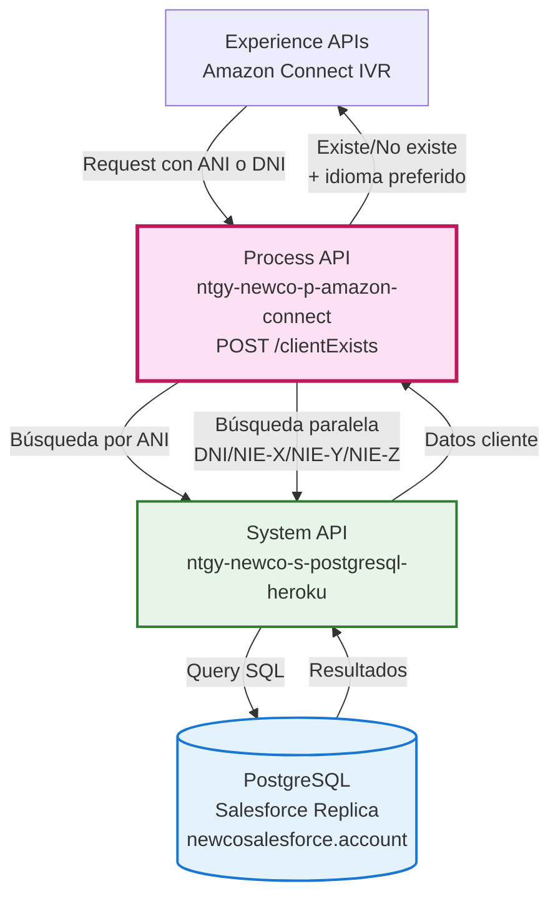
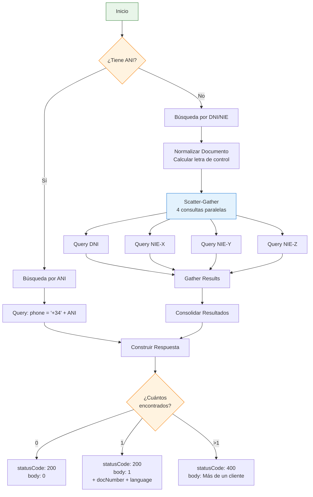
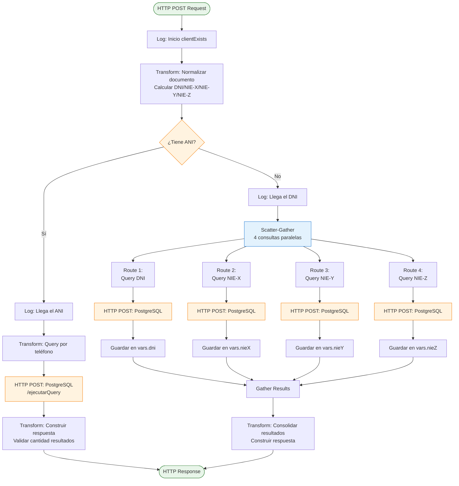
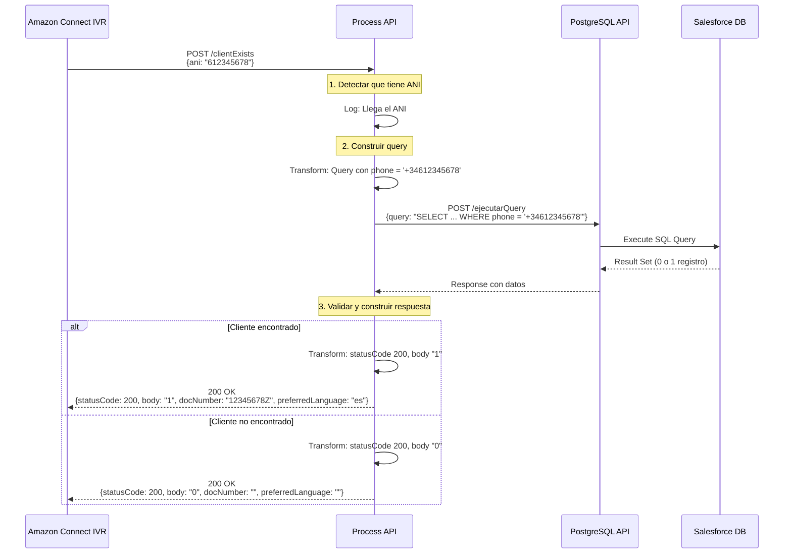
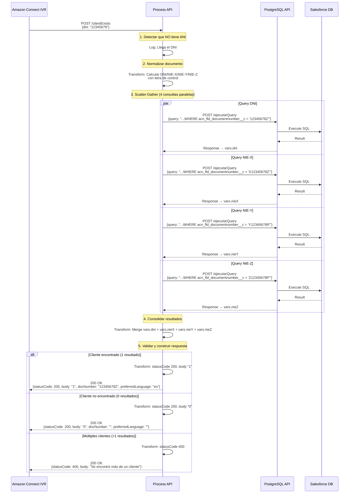
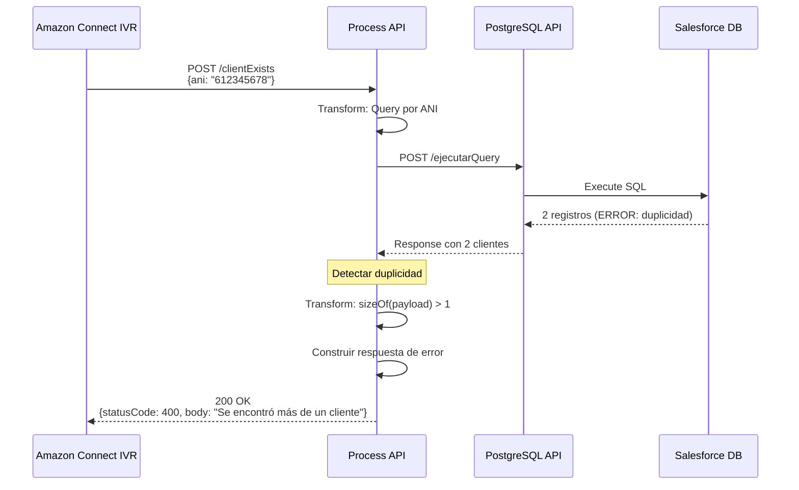

# POST /clientExists

## 📌 Descripción General

### Propósito del Endpoint

Este endpoint verifica la existencia de un cliente en Salesforce utilizando dos métodos de identificación alternativos: ANI (Automatic Number Identification - número de teléfono) o documento de identidad (DNI/NIE). El servicio está diseñado específicamente para sistemas IVR como Amazon Connect, permitiendo identificar rápidamente al cliente y obtener su idioma preferido para personalizar la experiencia de atención.

### Tipo de API

**Capa:** Process API (API-Led Connectivity)

**Función:** Orquestación de validación de cliente con lógica de negocio para normalización de documentos de identidad españoles

### Patrón de Integración

**Tipo:** Orquestación Condicional con Transformación Compleja

**Descripción:** Este endpoint implementa dos flujos alternativos según el tipo de identificador proporcionado:
1. **Flujo ANI**: Búsqueda directa por número de teléfono
2. **Flujo DNI/NIE**: Búsqueda paralela con 4 variantes de documento (DNI, NIE-X, NIE-Y, NIE-Z) usando scatter-gather

### Arquitectura API-Led Connectivity



---

## 💼 Propósito del Negocio

### Casos de Uso Principales

1. **Identificación de Cliente por Teléfono (ANI)**
   - Cliente llama desde su teléfono registrado
   - Sistema identifica automáticamente al cliente
   - Beneficio: Experiencia sin fricción, sin necesidad de introducir datos

2. **Identificación de Cliente por Documento**
   - Cliente proporciona DNI o NIE por voz o teclado
   - Sistema normaliza y busca en todas las variantes posibles
   - Beneficio: Flexibilidad en la identificación, manejo de diferentes formatos

3. **Personalización de Idioma**
   - Obtiene el idioma preferido del cliente (es/ca/gl/en)
   - Permite adaptar la experiencia IVR al idioma del cliente
   - Beneficio: Mejor experiencia de usuario, cumplimiento normativo

### 🔗 Endpoints Dependientes

Este Process API consume el siguiente System API:

| System API | Endpoint | Método | Propósito |
|------------|----------|--------|-----------|
| `ntgy-newco-s-postgresql-heroku` | `/ejecutarQuery` | POST | Consulta por ANI (teléfono) en tabla account |
| `ntgy-newco-s-postgresql-heroku` | `/ejecutarQuery` | POST | Consulta por DNI normalizado en tabla account |
| `ntgy-newco-s-postgresql-heroku` | `/ejecutarQuery` | POST | Consulta por NIE-X normalizado en tabla account |
| `ntgy-newco-s-postgresql-heroku` | `/ejecutarQuery` | POST | Consulta por NIE-Y normalizado en tabla account |
| `ntgy-newco-s-postgresql-heroku` | `/ejecutarQuery` | POST | Consulta por NIE-Z normalizado en tabla account |

### Lógica de Orquestación



**Pasos del Proceso:**

1. **Decisión de Flujo**: Determina si se busca por ANI o por documento
2. **Flujo ANI** (si aplica):
   - Construye query con número de teléfono en formato internacional (+34)
   - Ejecuta búsqueda única en PostgreSQL
3. **Flujo DNI/NIE** (si aplica):
   - Normaliza el documento calculando letra de control
   - Genera 4 variantes: DNI, NIE-X, NIE-Y, NIE-Z
   - Ejecuta 4 consultas en paralelo (scatter-gather)
   - Consolida resultados
4. **Validación de Resultados**:
   - 0 resultados: Cliente no existe
   - 1 resultado: Cliente encontrado (retorna datos)
   - >1 resultados: Error de duplicidad

### Transformaciones Aplicadas

#### Transformación 1: Normalización de Documento de Identidad

**Ubicación en código:** Líneas 9-35

```dataweave
%dw 2.0
output application/json

var tabla_letras = "TRWAGMYFPDXBNJZSQVHLCKE"

var isDNI = if(sizeOf(payload.documento) == 6)
    "0" ++ "0" ++ payload.documento ++ tabla_letras[payload.documento mod 23]
    else if(sizeOf(payload.documento) == 7)
    "0" ++ payload.documento ++ tabla_letras[payload.documento mod 23]
    else
    payload.documento ++ tabla_letras[payload.documento mod 23]

var nieX = "X" ++ payload.documento ++ tabla_letras[payload.documento mod 23]
var nieY = "Y" ++ payload.documento ++ tabla_letras[("1" ++ payload.documento) mod 23]
var nieZ = "Z" ++ payload.documento ++ tabla_letras[("2" ++ payload.documento) mod 23]
```

**Propósito:** Normalizar documentos de identidad españoles añadiendo:
- Ceros a la izquierda para DNI cortos (6-7 dígitos)
- Letra de control calculada según algoritmo oficial
- Variantes NIE con prefijos X, Y, Z

**Ejemplo:**
- Input: `"12345678"` → Output DNI: `"12345678Z"`
- Input: `"12345678"` → Output NIE-X: `"X12345678Z"`
- Input: `"12345678"` → Output NIE-Y: `"Y12345678R"`

#### Transformación 2: Construcción de Queries SQL

**Ubicación en código:** Líneas 38-43

```dataweave
{
  queryDNI: "select sfid, vlocity_cmt__preferredlanguage__c, acn_fld_documentnumber__c from newcosalesforce.account where acn_fld_documentnumber__c = '" ++ isDNI ++ "'",
  queryNieX: "select sfid, vlocity_cmt__preferredlanguage__c, acn_fld_documentnumber__c from newcosalesforce.account where acn_fld_documentnumber__c = '" ++ nieX ++ "'",
  queryNieY: "select sfid, vlocity_cmt__preferredlanguage__c, acn_fld_documentnumber__c from newcosalesforce.account where acn_fld_documentnumber__c = '" ++ nieY ++ "'",
  queryNieZ: "select sfid, vlocity_cmt__preferredlanguage__c, acn_fld_documentnumber__c from newcosalesforce.account where acn_fld_documentnumber__c = '" ++ nieZ ++ "'"
}
```

**Propósito:** Generar 4 queries SQL diferentes para buscar todas las variantes posibles del documento.

#### Transformación 3: Query por ANI

**Ubicación en código:** Líneas 51-57

```dataweave
{
  query: "select sfid, vlocity_cmt__preferredlanguage__c, acn_fld_documentnumber__c from newcosalesforce.account where phone = '+34" ++ payload.ani ++ "'"
}
```

**Propósito:** Construir query de búsqueda por teléfono en formato internacional.

#### Transformación 4: Consolidación de Resultados DNI/NIE

**Ubicación en código:** Líneas 115-125

```dataweave
var pLoad = if(sizeOf(vars.dni) > 0 and sizeOf(vars.nieX) > 0) 
    vars.dni ++ vars.nieX 
    else if(sizeOf(vars.dni)>0) vars.dni
    else if(sizeOf(vars.nieX) > 0) vars.nieX
    else if (sizeOf(vars.nieY) > 0) vars.nieY
    else if (sizeOf(vars.nieZ) > 0) vars.nieZ
    else ""
```

**Propósito:** Consolidar resultados de las 4 búsquedas paralelas en un único array.

#### Transformación 5: Mapeo de Idioma

**Ubicación en código:** Líneas 138-143 y 71-76

```dataweave
preferredLanguage: payload[0].vlocity_cmt__preferredlanguage__c match {
    case "Castellano" -> "es"
    case "Catalán" -> "ca"
    case "Gallego" -> "gl"
    case "Inglés" -> "en"                
    else -> "es"
}
```

**Propósito:** Convertir idioma de Salesforce (texto completo) a código ISO 639-1.

### Contexto Empresarial

- **Dominio:** Identificación y Validación de Clientes
- **Sector:** Energía - Utilities
- **División:** Naturgy España - NewCo
- **Proceso de Negocio:** Verificación de identidad en canales de atención automatizados (IVR)

### Stakeholders

- **Clientes Finales**: Necesitan identificación rápida y sin fricción al contactar con la empresa
- **Departamento de Atención al Cliente**: Requiere validación automática de clientes antes de ofrecer servicios
- **Departamento de Sistemas**: Necesita integración confiable entre IVR y Salesforce
- **Departamento de Cumplimiento**: Requiere trazabilidad de intentos de identificación

### Valor de Negocio

- **Mejora de Experiencia del Cliente**: Identificación automática por ANI sin necesidad de introducir datos
- **Flexibilidad de Identificación**: Soporte para múltiples formatos de documento (DNI/NIE)
- **Personalización**: Adaptación automática del idioma según preferencias del cliente
- **Eficiencia Operativa**: Reducción de tiempo de identificación en IVR

### Consumidores Potenciales

Este endpoint puede ser consumido por:
- Amazon Connect IVR (consumidor principal)
- Sistemas de telefonía automatizados
- Aplicaciones de agentes de call center
- Portales de autoservicio con verificación de identidad

---

## 🔧 Especificación Técnica

### URLs por Ambiente

| Ambiente | URL Base | URL Completa |
|----------|----------|--------------|
| **Local** | `http://localhost:8081` | `http://localhost:8081/api/clientExists` |
| **Development** | `https://ntgy-newco-p-amazon-connect-dev.us-e2.cloudhub.io` | `https://ntgy-newco-p-amazon-connect-dev.us-e2.cloudhub.io/api/clientExists` |
| **UAT** | `https://ntgy-newco-p-amazon-connect-uat.us-e2.cloudhub.io` | `https://ntgy-newco-p-amazon-connect-uat.us-e2.cloudhub.io/api/clientExists` |
| **Production** | `https://ntgy-newco-p-amazon-connect-pro.us-e2.cloudhub.io` | `https://ntgy-newco-p-amazon-connect-pro.us-e2.cloudhub.io/api/clientExists` |

### Método HTTP

```
POST /api/clientExists
```

### Parámetros de Entrada

#### Request Body (application/json)

> **⚠️ Nota sobre los parámetros:** Este endpoint requiere **al menos uno** de los dos parámetros (ANI o DNI). Si se proporcionan ambos, se prioriza la búsqueda por ANI.

| Campo | Tipo | Requerido | Descripción |
|-------|------|-----------|-------------|
| `ani` | string | ❌ No* | Número de teléfono del cliente (sin prefijo internacional). Se añadirá automáticamente el prefijo +34 |
| `dni` | string | ❌ No* | Número de documento de identidad (DNI o NIE) sin letra. El sistema calculará automáticamente la letra de control |

**\* Al menos uno de los dos campos debe estar presente**

#### Ejemplo de Request Body - Búsqueda por ANI

```json
{
  "ani": "612345678"
}
```

#### Ejemplo de Request Body - Búsqueda por DNI

```json
{
  "dni": "12345678"
}
```

#### Ejemplo de Request Body - Ambos Campos (se prioriza ANI)

```json
{
  "ani": "612345678",
  "dni": "12345678"
}
```

### Respuestas

#### 200 OK - Cliente Encontrado

```json
{
  "statusCode": 200,
  "body": "1",
  "docNumber": "12345678Z",
  "preferredLanguage": "es"
}
```

**Descripción:** Se encontró exactamente un cliente que coincide con los criterios de búsqueda.

**Campos de respuesta:**
- `statusCode`: Código de estado HTTP
- `body`: "1" indica que el cliente existe
- `docNumber`: Número de documento completo con letra de control
- `preferredLanguage`: Código ISO 639-1 del idioma preferido (es/ca/gl/en)

#### 200 OK - Cliente No Encontrado

```json
{
  "statusCode": 200,
  "body": "0",
  "docNumber": "",
  "preferredLanguage": ""
}
```

**Descripción:** No se encontró ningún cliente que coincida con los criterios de búsqueda.

**Campos de respuesta:**
- `statusCode`: 200 (la operación fue exitosa, simplemente no hay resultados)
- `body`: "0" indica que el cliente no existe
- `docNumber`: Vacío
- `preferredLanguage`: Vacío

#### 400 Bad Request - Múltiples Clientes Encontrados

```json
{
  "statusCode": 400,
  "body": "Se encontró más de un cliente",
  "docNumber": "",
  "preferredLanguage": ""
}
```

**Descripción:** Se encontraron múltiples clientes con el mismo identificador (situación de error de datos).

### Autenticación

- **Tipo:** Client ID & Client Secret (Anypoint Platform)
- **Headers Requeridos:**
  - `client_id`: Client ID de la aplicación
  - `client_secret`: Client Secret de la aplicación

### Timeouts

| Tipo | Valor |
|------|-------|
| **Request Timeout** | 30 segundos |
| **Connection Timeout** | 10 segundos |
| **PostgreSQL Timeout** | Configurado en properties del System API |

---

## 🏗️ Implementación Técnica

### Arquitectura del Flow



### Transformaciones DataWeave Clave

#### 1. Normalización de Documento de Identidad

**Ubicación en código:** Líneas 9-43

```dataweave
%dw 2.0
output application/json

var tabla_letras = "TRWAGMYFPDXBNJZSQVHLCKE"

var isDNI = if(sizeOf(payload.documento) == 6)
    "0" ++ "0" ++ payload.documento ++ tabla_letras[payload.documento mod 23] default ""
    else if(sizeOf(payload.documento) == 7)
    "0" ++ payload.documento ++ tabla_letras[payload.documento mod 23] default ""
    else
    payload.documento ++ tabla_letras[payload.documento mod 23] default ""

var nieX = "X" ++ payload.documento ++ tabla_letras[payload.documento mod 23] default ""
var nieY = "Y" ++ payload.documento ++ tabla_letras[("1" ++ payload.documento) mod 23] default ""
var nieZ = "Z" ++ payload.documento ++ tabla_letras[("2" ++ payload.documento) mod 23] default ""

---
{
  queryDNI: "select sfid, vlocity_cmt__preferredlanguage__c, acn_fld_documentnumber__c from newcosalesforce.account where acn_fld_documentnumber__c = '" ++ isDNI ++ "'",
  queryNieX: "select sfid, vlocity_cmt__preferredlanguage__c, acn_fld_documentnumber__c from newcosalesforce.account where acn_fld_documentnumber__c = '" ++ nieX ++ "'",
  queryNieY: "select sfid, vlocity_cmt__preferredlanguage__c, acn_fld_documentnumber__c from newcosalesforce.account where acn_fld_documentnumber__c = '" ++ nieY ++ "'",
  queryNieZ: "select sfid, vlocity_cmt__preferredlanguage__c, acn_fld_documentnumber__c from newcosalesforce.account where acn_fld_documentnumber__c = '" ++ nieZ ++ "'"
}
```

**Propósito:** Implementar el algoritmo oficial español de cálculo de letra de control para DNI/NIE.

**Algoritmo:**
1. **DNI**: `número mod 23` → índice en tabla de letras
2. **NIE-X**: Prefijo "X" + `número mod 23`
3. **NIE-Y**: Prefijo "Y" + `(1 + número) mod 23`
4. **NIE-Z**: Prefijo "Z" + `(2 + número) mod 23`

**Tabla de letras oficial:** `"TRWAGMYFPDXBNJZSQVHLCKE"`

#### 2. Construcción de Query por ANI

**Ubicación en código:** Líneas 51-57

```dataweave
%dw 2.0
output application/json
---
{
  query: "select sfid, vlocity_cmt__preferredlanguage__c, acn_fld_documentnumber__c from newcosalesforce.account where phone = '+34" ++ payload.ani ++ "'"
}
```

**Propósito:** Construir query SQL para búsqueda por teléfono en formato internacional.

**Ejemplo:**
- Input: `{"ani": "612345678"}`
- Output query: `"...where phone = '+34612345678'"`

#### 3. Validación y Construcción de Respuesta (ANI)

**Ubicación en código:** Líneas 62-80

```dataweave
%dw 2.0
output application/json
---
if (sizeOf(payload) > 1)
{
  statusCode: 400,
  body: "Se encontró más de un cliente",
  docNumber: "",
  preferredLanguage: ""
}
else if (sizeOf(payload) == 1)
{
  statusCode: 200,
  body: "1",
  docNumber: payload[0].acn_fld_documentnumber__c,
  preferredLanguage: payload[0].vlocity_cmt__preferredlanguage__c match {
    case "Castellano" -> "es"
    case "Catalán" -> "ca"
    case "Gallego" -> "gl"
    case "Inglés" -> "en"                
    else -> "es"
  }
}
else
{
  statusCode: 200,
  body: "0",
  docNumber: "",
  preferredLanguage: ""
}
```

**Propósito:** Validar cantidad de resultados y construir respuesta apropiada.

**Lógica:**
- **>1 resultados**: Error 400 (duplicidad)
- **1 resultado**: Éxito con datos del cliente
- **0 resultados**: Éxito sin datos (cliente no existe)

#### 4. Consolidación de Resultados DNI/NIE

**Ubicación en código:** Líneas 115-148

```dataweave
%dw 2.0
output application/json

var pLoad = if(sizeOf(vars.dni) > 0 and sizeOf(vars.nieX) > 0) 
    vars.dni ++ vars.nieX 
    else if(sizeOf(vars.dni)>0) vars.dni
    else if(sizeOf(vars.nieX) > 0) vars.nieX
    else if (sizeOf(vars.nieY) > 0) vars.nieY
    else if (sizeOf(vars.nieZ) > 0) vars.nieZ
    else ""

---
if (sizeOf(pLoad) > 1)
{
  statusCode: 400,
  body: "Se encontró más de un cliente",
  docNumber: "",
  preferredLanguage: ""
}
else if (sizeOf(pLoad) == 1)
{
  statusCode: 200,
  body: "1",
  docNumber: pLoad[0].acn_fld_documentnumber__c,
  preferredLanguage: pLoad[0].vlocity_cmt__preferredlanguage__c match {
    case "Castellano" -> "es"
    case "Catalán" -> "ca"
    case "Gallego" -> "gl"
    case "Inglés" -> "en"                
    else -> "es"
  }
}
else
{
  statusCode: 200,
  body: "0",
  docNumber: "",
  preferredLanguage: ""
}
```

**Propósito:** Consolidar resultados de las 4 búsquedas paralelas y construir respuesta única.

### Patrones de Diseño

#### Patrón 1: Choice Router (Enrutamiento Condicional)

**Justificación:** Dos flujos completamente diferentes según el tipo de identificador:
- Flujo simple para ANI (1 consulta)
- Flujo complejo para DNI/NIE (4 consultas paralelas)

#### Patrón 2: Scatter-Gather (Agregación Paralela)

**Justificación:** Necesidad de buscar en 4 variantes de documento simultáneamente para maximizar velocidad:
- DNI normalizado
- NIE con prefijo X
- NIE con prefijo Y
- NIE con prefijo Z

#### Patrón 3: Normalización de Datos

**Justificación:** Implementación del algoritmo oficial español de cálculo de letra de control para garantizar coincidencias exactas en la base de datos.

### Diagramas de Secuencia

#### 1. Flujo de Búsqueda por ANI



#### 2. Flujo de Búsqueda por DNI/NIE



#### 3. Flujo con Error de Duplicidad



### Manejo de Errores

#### Estrategia de Error Handling

**Nivel 1: Validación de Entrada**
- Validación de presencia de al menos un identificador (ANI o DNI)
- Respuesta: 400 Bad Request si no hay identificadores

**Nivel 2: Validación de Resultados**
- Detección de duplicidad (>1 cliente con mismo identificador)
- Respuesta: statusCode 400 en el body (no en HTTP status)

**Nivel 3: Logging y Trazabilidad**
- Log de inicio del proceso
- Log del tipo de búsqueda (ANI vs DNI)
- Correlation ID para trazabilidad

#### Códigos de Respuesta

| statusCode (en body) | Descripción | Significado |
|---------------------|-------------|-------------|
| `200` | Cliente encontrado | body = "1", incluye docNumber y preferredLanguage |
| `200` | Cliente no encontrado | body = "0", campos vacíos |
| `400` | Múltiples clientes | body = "Se encontró más de un cliente" (error de datos) |

**Nota importante:** El HTTP status siempre es 200 OK. El verdadero estado se indica en el campo `statusCode` del body.

### Consideraciones de Performance

**Optimizaciones Implementadas:**
1. **Scatter-Gather Paralelo**: Las 4 consultas DNI/NIE se ejecutan simultáneamente
2. **Búsqueda Directa por ANI**: Solo 1 consulta cuando se proporciona teléfono
3. **Índices en Base de Datos**: Campos phone y acn_fld_documentnumber__c indexados

**Métricas Esperadas:**
- Tiempo promedio de respuesta (ANI): 0.5-1 segundo
- Tiempo promedio de respuesta (DNI): 1-2 segundos (4 consultas paralelas)
- Throughput: 50-100 requests/minuto
- Tasa de éxito: >99%

---

## 💻 Ejemplos de Uso

### Ejemplo 1: Búsqueda Exitosa por ANI

#### cURL

```bash
curl -X POST "https://ntgy-newco-p-amazon-connect-dev.us-e2.cloudhub.io/api/clientExists" \
  -H "Content-Type: application/json" \
  -H "client_id: YOUR_CLIENT_ID" \
  -H "client_secret: YOUR_CLIENT_SECRET" \
  -d '{
    "ani": "612345678"
  }'
```

#### Respuesta (200 OK - Cliente Encontrado)

```json
{
  "statusCode": 200,
  "body": "1",
  "docNumber": "12345678Z",
  "preferredLanguage": "es"
}
```

### Ejemplo 2: Búsqueda Exitosa por DNI

#### JavaScript (Node.js)

```javascript
const axios = require('axios');

async function checkClientExists() {
  try {
    const response = await axios.post(
      'https://ntgy-newco-p-amazon-connect-dev.us-e2.cloudhub.io/api/clientExists',
      {
        dni: "12345678"
      },
      {
        headers: {
          'Content-Type': 'application/json',
          'client_id': 'YOUR_CLIENT_ID',
          'client_secret': 'YOUR_CLIENT_SECRET'
        }
      }
    );
    
    console.log('Response:', response.data);
    
    if (response.data.body === "1") {
      console.log('Cliente encontrado!');
      console.log('Documento:', response.data.docNumber);
      console.log('Idioma preferido:', response.data.preferredLanguage);
    } else if (response.data.body === "0") {
      console.log('Cliente no encontrado');
    } else {
      console.log('Error:', response.data.body);
    }
    
  } catch (error) {
    console.error('Error:', error.response?.data || error.message);
  }
}

checkClientExists();
```

### Ejemplo 3: Cliente No Encontrado

#### Python

```python
import requests
import json

def check_client_exists(ani=None, dni=None):
    url = "https://ntgy-newco-p-amazon-connect-dev.us-e2.cloudhub.io/api/clientExists"
    
    headers = {
        "Content-Type": "application/json",
        "client_id": "YOUR_CLIENT_ID",
        "client_secret": "YOUR_CLIENT_SECRET"
    }
    
    payload = {}
    if ani:
        payload["ani"] = ani
    if dni:
        payload["dni"] = dni
    
    try:
        response = requests.post(url, headers=headers, json=payload, timeout=30)
        response.raise_for_status()
        
        result = response.json()
        print(f"Response: {json.dumps(result, indent=2)}")
        
        if result["body"] == "1":
            print(f"✅ Cliente encontrado: {result['docNumber']}")
            print(f"   Idioma: {result['preferredLanguage']}")
            return True
        elif result["body"] == "0":
            print("❌ Cliente no encontrado")
            return False
        else:
            print(f"⚠️ Error: {result['body']}")
            return None
            
    except requests.exceptions.RequestException as e:
        print(f"Error en la petición: {e}")
        return None

# Ejemplo de uso
check_client_exists(dni="99999999")  # Cliente que no existe
```

#### Respuesta (200 OK - Cliente No Encontrado)

```json
{
  "statusCode": 200,
  "body": "0",
  "docNumber": "",
  "preferredLanguage": ""
}
```

### Ejemplo 4: Error de Duplicidad

#### Request

```bash
curl -X POST "https://ntgy-newco-p-amazon-connect-dev.us-e2.cloudhub.io/api/clientExists" \
  -H "Content-Type: application/json" \
  -H "client_id: YOUR_CLIENT_ID" \
  -H "client_secret: YOUR_CLIENT_SECRET" \
  -d '{
    "ani": "612345678"
  }'
```

#### Respuesta (200 OK - Múltiples Clientes)

```json
{
  "statusCode": 400,
  "body": "Se encontró más de un cliente",
  "docNumber": "",
  "preferredLanguage": ""
}
```

### Ejemplo 5: Integración con Amazon Connect

#### Lambda Function (Node.js)

```javascript
exports.handler = async (event) => {
    const axios = require('axios');
    
    // Obtener ANI del contacto de Amazon Connect
    const contactData = event.Details.ContactData;
    const customerEndpoint = contactData.CustomerEndpoint;
    const ani = customerEndpoint.Address.replace('+34', ''); // Remover prefijo
    
    try {
        const response = await axios.post(
            process.env.PROCESS_API_URL + '/clientExists',
            { ani: ani },
            {
                headers: {
                    'Content-Type': 'application/json',
                    'client_id': process.env.CLIENT_ID,
                    'client_secret': process.env.CLIENT_SECRET
                },
                timeout: 30000
            }
        );
        
        const result = response.data;
        
        if (result.body === "1") {
            // Cliente encontrado
            return {
                clientExists: true,
                docNumber: result.docNumber,
                preferredLanguage: result.preferredLanguage,
                message: "Cliente identificado correctamente"
            };
        } else if (result.body === "0") {
            // Cliente no encontrado
            return {
                clientExists: false,
                message: "Cliente no registrado"
            };
        } else {
            // Error de duplicidad
            return {
                clientExists: false,
                error: true,
                message: result.body
            };
        }
        
    } catch (error) {
        console.error('Error calling Process API:', error);
        
        return {
            clientExists: false,
            error: true,
            message: "Error al verificar cliente"
        };
    }
};
```

### Ejemplo 6: Búsqueda con Ambos Parámetros (Prioridad ANI)

#### Request

```json
{
  "ani": "612345678",
  "dni": "12345678"
}
```

**Comportamiento:** El sistema prioriza la búsqueda por ANI. El campo DNI se ignora.

#### Respuesta

```json
{
  "statusCode": 200,
  "body": "1",
  "docNumber": "87654321X",
  "preferredLanguage": "ca"
}
```

**Nota:** El docNumber retornado corresponde al cliente encontrado por ANI, no necesariamente coincide con el DNI proporcionado.

---