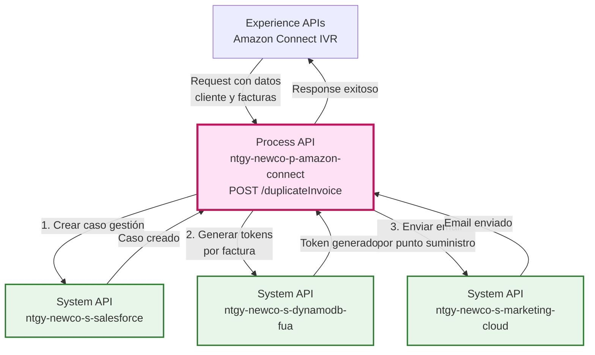
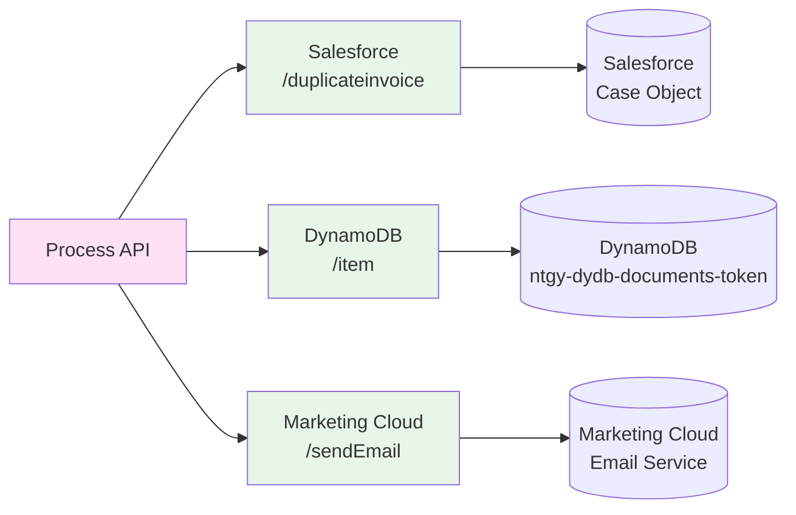
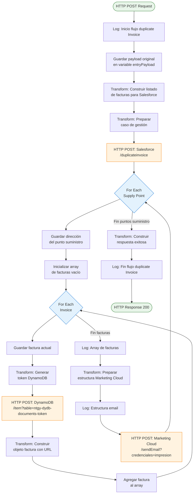
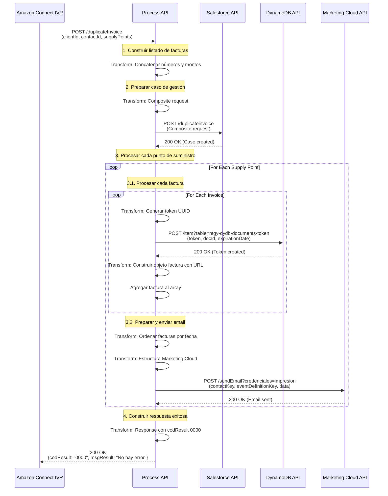
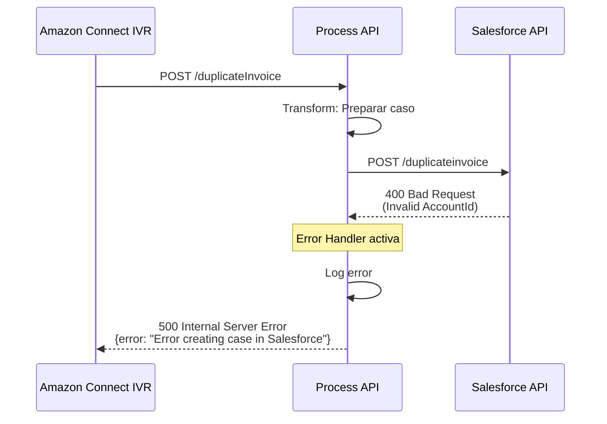
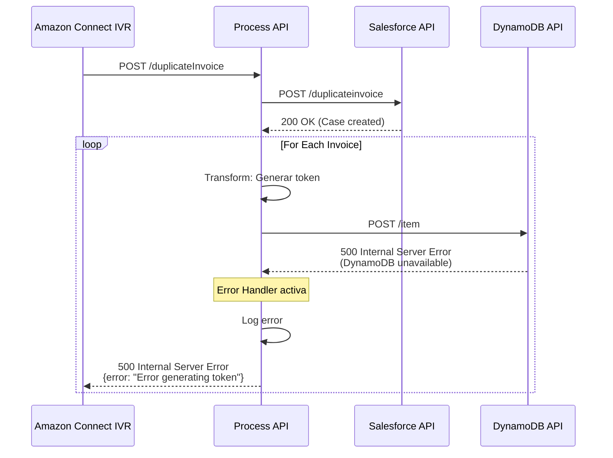
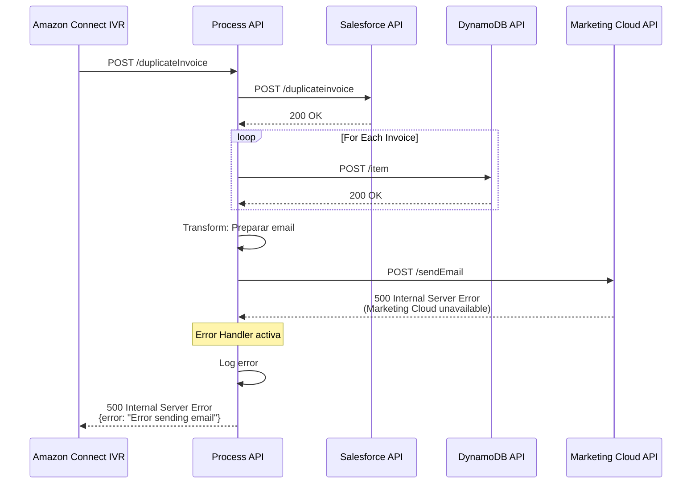

# POST /duplicateInvoice

## 📌 Descripción General

### Propósito del Endpoint

Este endpoint orquesta el proceso completo de envío de duplicados de facturas a clientes a través de email, garantizando la trazabilidad mediante la creación de un caso de gestión en Salesforce. El proceso incluye la generación de tokens de acceso temporal para cada factura, asegurando que los enlaces de descarga sean seguros y tengan una validez limitada de 30 días.

### Tipo de API

**Capa:** Process API (API-Led Connectivity)

**Función:** Orquestación del proceso de negocio de duplicado de facturas con integración multi-sistema (Salesforce, DynamoDB, Marketing Cloud)

### Patrón de Integración

**Tipo:** Orquestación Compleja con Transformación

**Descripción:** Este endpoint implementa un patrón de orquestación secuencial que coordina tres System APIs diferentes:
1. Crea un caso de gestión en Salesforce para trazabilidad
2. Genera tokens de acceso temporal en DynamoDB para cada factura
3. Envía emails personalizados a través de Marketing Cloud con enlaces seguros

### Arquitectura API-Led Connectivity



---

## 💼 Propósito del Negocio

### Casos de Uso Principales

1. **Solicitud de Duplicado de Facturas por IVR**
   - Cliente solicita duplicado de facturas a través de Amazon Connect
   - Sistema envía facturas por email de forma automática
   - Beneficio: Autoservicio 24/7 sin intervención de agentes

2. **Trazabilidad de Solicitudes**
   - Cada solicitud genera un caso de gestión en Salesforce
   - Permite seguimiento y auditoría de todas las solicitudes
   - Beneficio: Cumplimiento normativo y mejora continua del servicio

3. **Acceso Seguro a Documentos**
   - Tokens temporales con validez de 30 días
   - Enlaces únicos por factura para seguridad
   - Beneficio: Protección de datos sensibles del cliente

### 🔗 Endpoints Dependientes

Este Process API consume los siguientes System APIs:

| System API | Endpoint | Método | Propósito |
|------------|----------|--------|-----------|
| `ntgy-newco-s-salesforce` | `/duplicateinvoice` | POST | Crear caso de gestión tipo "Gestión" con origen "IVR" |
| `ntgy-newco-s-dynamodb-fua` | `/item` | POST | Generar token temporal de acceso (30 días) para cada factura |
| `ntgy-newco-s-marketing-cloud` | `/sendEmail` | POST | Enviar email con facturas ordenadas por fecha de vencimiento |

### Lógica de Orquestación



**Pasos del Proceso:**

1. **Preparación de Caso Salesforce**: Concatena listado de facturas (número + importe) y prepara estructura composite request
2. **Creación de Caso**: Invoca Salesforce para crear caso de gestión con toda la información de la solicitud
3. **Generación de Tokens** (por cada factura):
   - Genera UUID único como token
   - Calcula fecha de expiración (30 días desde ahora)
   - Almacena en DynamoDB con referencia al documento
   - Construye URL de descarga segura
4. **Envío de Emails** (por cada punto de suministro):
   - Ordena facturas por fecha de vencimiento (más reciente primero)
   - Prepara estructura para Marketing Cloud con hasta N facturas
   - Envía email personalizado con enlaces seguros

### Transformaciones Aplicadas

#### Transformación 1: Listado de Facturas para Salesforce

```dataweave
flatten(vars.entryPayload.supplyPoints.*invoices) map ((invoice) ->
  invoice.invoiceNumber ++ ";" ++ invoice.amount as String
) joinBy ", "
```

**Resultado:** `"FAC001;150.50, FAC002;200.75, FAC003;180.25"`

#### Transformación 2: Generación de Token DynamoDB

```dataweave
{
  "token": uuid(),
  "tokenExpirationDate": ((now() + |P30D|) >> "CET") as String {format: "dd-MM-yyyy HH:mm:ss"},
  "docId": vars.currentInvoice.pdfDocumentId,
  "nif": vars.entryPayload.docNumber,
  "invoiceNumber": vars.currentInvoice.invoiceNumber,
  "documentType": "03.01",
  ("s3File": true) if((try(() -> fromBase64(vars.currentInvoice.pdfDocumentId)) orElse vars.currentInvoice.pdfDocumentId) startsWith "fact_")
}
```

**Campos Clave:**
- `token`: UUID generado automáticamente
- `tokenExpirationDate`: Fecha actual + 30 días en zona horaria CET
- `s3File`: Flag condicional si el documento está en S3

#### Transformación 3: Ordenamiento de Facturas para Email

```dataweave
vars.invoices orderBy ((invoice) -> (invoice.dueDate as Date {format: "dd/MM/yyyy"}))
```

**Resultado:** Facturas ordenadas de más reciente a más antigua por fecha de vencimiento

#### Transformación 4: Estructura Dinámica para Marketing Cloud

```dataweave
sortedInvoices[-1 to 0] map (invoice, index) -> {
  ("invoiceNumber" ++ (index + 1)): invoice.invoiceNumber,
  ("amount" ++ (index + 1)): invoice.amount,
  ("sector" ++ (index + 1)): invoice.sector,
  ("dueDate" ++ (index + 1)): invoice.dueDate,
  ("url" ++ (index + 1)): invoice.url
}
```

**Resultado:** Estructura plana con campos numerados (invoiceNumber1, amount1, url1, invoiceNumber2, amount2, url2, ...)

### Contexto Empresarial

- **Dominio:** Gestión de Facturas y Atención al Cliente
- **Sector:** Energía - Utilities
- **División:** Naturgy España - NewCo
- **Proceso de Negocio:** Autoservicio de duplicado de facturas a través de canales digitales (IVR)

### Stakeholders

- **Clientes Finales**: Necesitan acceso rápido a duplicados de facturas sin llamar a atención al cliente
- **Departamento de Atención al Cliente**: Reduce carga de trabajo al automatizar solicitudes de duplicados
- **Departamento de Facturación**: Garantiza trazabilidad de todas las solicitudes de duplicados
- **Departamento de Cumplimiento**: Asegura acceso seguro y temporal a documentos sensibles

### Valor de Negocio

- **Reducción de Costes Operativos**: Automatización completa del proceso de duplicado de facturas
- **Mejora de Experiencia del Cliente**: Autoservicio 24/7 con recepción inmediata por email
- **Seguridad y Cumplimiento**: Tokens temporales y trazabilidad completa en Salesforce
- **Eficiencia Operativa**: Proceso end-to-end sin intervención manual

### Consumidores Potenciales

Este endpoint puede ser consumido por:
- Amazon Connect IVR (consumidor principal)
- Portales web de autoservicio
- Aplicaciones móviles de clientes
- Sistemas de agentes de call center (para solicitudes asistidas)

---

## 🔧 Especificación Técnica

### URLs por Ambiente

| Ambiente | URL Base | URL Completa |
|----------|----------|--------------|
| **Local** | `http://localhost:8081` | `http://localhost:8081/api/duplicateInvoice` |
| **Development** | `https://ntgy-newco-p-amazon-connect-dev.us-e2.cloudhub.io` | `https://ntgy-newco-p-amazon-connect-dev.us-e2.cloudhub.io/api/duplicateInvoice` |
| **UAT** | `https://ntgy-newco-p-amazon-connect-uat.us-e2.cloudhub.io` | `https://ntgy-newco-p-amazon-connect-uat.us-e2.cloudhub.io/api/duplicateInvoice` |
| **Production** | `https://ntgy-newco-p-amazon-connect-pro.us-e2.cloudhub.io` | `https://ntgy-newco-p-amazon-connect-pro.us-e2.cloudhub.io/api/duplicateInvoice` |

### Método HTTP

```
POST /api/duplicateInvoice
```

### Parámetros de Entrada

#### Request Body (application/json)

> **⚠️ Nota sobre el campo `reason`:** Este campo está definido en el contrato RAML pero actualmente no se utiliza en la implementación. Se mantiene documentado para compatibilidad con el contrato de la API.

| Campo | Tipo | Requerido | Descripción |
|-------|------|-----------|-------------|
| `clientId` | string | ✅ Sí | ID del cliente en Salesforce (AccountId) |
| `contactId` | string | ✅ Sí | ID del contacto en Salesforce (ContactId) |
| `reason` | string | ❌ No | Motivo de la solicitud de duplicado (definido en RAML pero no utilizado en implementación actual) |
| `supplyPoints` | array | ✅ Sí | Array de puntos de suministro con sus facturas |
| `supplyPoints[].fullAddress` | string | ✅ Sí | Dirección completa del punto de suministro |
| `supplyPoints[].invoices` | array | ✅ Sí | Array de facturas del punto de suministro |
| `supplyPoints[].invoices[].invoiceNumber` | string | ✅ Sí | Número de la factura |
| `supplyPoints[].invoices[].amount` | number | ✅ Sí | Importe de la factura |
| `supplyPoints[].invoices[].sector` | string | ✅ Sí | Sector (Electricidad/Gas) |
| `supplyPoints[].invoices[].dueDate` | string | ✅ Sí | Fecha de vencimiento (formato: dd/MM/yyyy) |
| `supplyPoints[].invoices[].pdfDocumentId` | string | ✅ Sí | ID del documento PDF en el sistema |
| `email` | string | ✅ Sí | Email del cliente para envío de facturas |
| `docNumber` | string | ❌ No | Número de documento (NIF/NIE) del cliente |
| `createdBy` | string | ✅ Sí | ID del usuario/agente que crea la solicitud |
| `x-interaction-id` | string | ✅ Sí | ID del caso de interacción padre en Salesforce |
| `language` | string | ✅ Sí | Idioma del cliente (es/ca/en) |

#### Ejemplo de Request Body

```json
{
  "clientId": "0011t00000ABC123",
  "contactId": "0031t00000XYZ456",
  "reason": "Solicitud de duplicado por IVR",
  "supplyPoints": [
    {
      "fullAddress": "Calle Mayor 123, 28001 Madrid",
      "invoices": [
        {
          "invoiceNumber": "FAC2024001",
          "amount": 150.50,
          "sector": "Electricidad",
          "dueDate": "15/01/2024",
          "pdfDocumentId": "fact_2024001_abc123"
        },
        {
          "invoiceNumber": "FAC2024002",
          "amount": 200.75,
          "sector": "Gas",
          "dueDate": "20/01/2024",
          "pdfDocumentId": "fact_2024002_def456"
        }
      ]
    }
  ],
  "email": "cliente@example.com",
  "docNumber": "12345678A",
  "createdBy": "0051t00000USER123",
  "x-interaction-id": "5001t00000CASE789",
  "language": "es"
}
```

### Respuestas

#### 200 OK - Éxito

```json
{
  "result": {
    "codResult": "0000",
    "msgResult": "No hay error"
  }
}
```

**Descripción:** El proceso se completó exitosamente. Se creó el caso en Salesforce, se generaron los tokens en DynamoDB y se enviaron los emails.

#### 400 Bad Request - Error de Validación

```json
{
  "error": {
    "code": "400",
    "message": "Validation error",
    "details": "Missing required field: clientId"
  }
}
```

**Descripción:** Falta algún campo requerido o el formato de los datos es incorrecto.

#### 500 Internal Server Error - Error del Sistema

```json
{
  "error": {
    "code": "500",
    "message": "Internal server error",
    "details": "Error creating case in Salesforce"
  }
}
```

**Descripción:** Error en alguno de los sistemas backend (Salesforce, DynamoDB o Marketing Cloud).

### Autenticación

- **Tipo:** Client ID & Client Secret (Anypoint Platform)
- **Headers Requeridos:**
  - `client_id`: Client ID de la aplicación
  - `client_secret`: Client Secret de la aplicación

### Timeouts

| Tipo | Valor |
|------|-------|
| **Request Timeout** | 60 segundos (proceso largo con múltiples llamadas) |
| **Connection Timeout** | 10 segundos |
| **Salesforce Timeout** | Configurado en properties |
| **DynamoDB Timeout** | Configurado en properties |
| **Marketing Cloud Timeout** | Configurado en properties |

---

## 🏗️ Implementación Técnica

### Arquitectura del Flow



### Transformaciones DataWeave Clave

#### 1. Construcción de Listado de Facturas

**Ubicación en código:** Líneas 13-21

```dataweave
%dw 2.0
output application/json
---
flatten(vars.entryPayload.supplyPoints.*invoices) map ((invoice) ->
  invoice.invoiceNumber ++ ";" ++ invoice.amount as String
) joinBy ", "
```

**Propósito:** Crear un string concatenado con todas las facturas para incluir en la descripción del caso de Salesforce.

**Ejemplo de salida:** `"FAC2024001;150.50, FAC2024002;200.75, FAC2024003;180.25"`

#### 2. Preparación de Caso Salesforce (Composite Request)

**Ubicación en código:** Líneas 23-48

```dataweave
%dw 2.0
output application/json
---
{
  "allOrNone": true,
  "collateSubrequests": false,
  "compositeRequest": [
    {
      "method": "POST",
      "url": "/services/data/v52.0/sobjects/Case",
      "referenceId": "refCaseGestion",
      "body": { 
        "NewCo_Recordtype__c": "Gestion",
        "AccountId": vars.entryPayload.clientId,
        "ContactId": vars.entryPayload.contactId,
        "Origin": "IVR",
        "Description": vars.invoiceList,
        "NewCo_Creado_por__c": vars.entryPayload.createdBy,
        "ParentId": vars.entryPayload."x-interaction-id",
        "NewCo_Ip__c": "213.94.15.86",
        "CreatedbyId": vars.entryPayload.createdBy,
        "NewCo_CorrelationId__c": correlationId,
        "acn_fld_Tittle__r": {
          "NewCo_ExternalId__c": "DuplicadoFactura"
        }
      }
    }
  ]
}
```

**Propósito:** Crear un caso de tipo "Gestión" en Salesforce con toda la información de la solicitud.

#### 3. Generación de Token DynamoDB

**Ubicación en código:** Líneas 58-73

```dataweave
%dw 2.0
import * from dw::core::Binaries
import * from dw::Runtime
output application/json

var expirationDate = ((now() + |P30D|) >> "CET") as String {format: "dd-MM-yyyy HH:mm:ss"}
---
{
  "token": uuid(),
  "tokenExpirationDate": expirationDate,
  "docId": vars.currentInvoice.pdfDocumentId,
  "nif": vars.entryPayload.docNumber,
  "invoiceNumber": vars.currentInvoice.invoiceNumber,
  "documentType": "03.01",
  ("s3File": true) if((try(() -> fromBase64(vars.currentInvoice.pdfDocumentId)) orElse vars.currentInvoice.pdfDocumentId) startsWith "fact_")
}
```

**Propósito:** Generar un token único con fecha de expiración de 30 días para acceso seguro al documento.

**Campos Clave:**
- `token`: UUID generado automáticamente
- `tokenExpirationDate`: Fecha actual + 30 días en formato "dd-MM-yyyy HH:mm:ss"
- `s3File`: Flag condicional que indica si el documento está almacenado en S3

#### 4. Construcción de Objeto Factura con URL

**Ubicación en código:** Líneas 82-93

```dataweave
%dw 2.0
output application/json
---
{
  invoiceNumber: vars.currentInvoice.invoiceNumber,
  amount: vars.currentInvoice.amount,
  sector: vars.currentInvoice.sector,
  dueDate: vars.currentInvoice.dueDate,
  url: p('ntgy-newco-s-marketing-cloud.urlDescarga') ++ '?qt=' ++ vars.dynEntry.token ++ '&documentId=' ++ vars.dynEntry.docId
}
```

**Propósito:** Construir objeto de factura con URL de descarga segura que incluye el token generado.

**Ejemplo de URL:** `https://download.naturgy.com/documents?qt=abc123-def456-ghi789&documentId=fact_2024001_abc123`

#### 5. Preparación de Email Marketing Cloud

**Ubicación en código:** Líneas 104-130

```dataweave
%dw 2.0
output application/json

var sortedInvoices = 
  vars.invoices
  orderBy ((invoice) -> (invoice.dueDate as Date {format: "dd/MM/yyyy"}))

var transformedInvoices = 
  sortedInvoices[-1 to 0]
  map (invoice, index) -> {
    ("invoiceNumber" ++ (index + 1)): invoice.invoiceNumber,
    ("amount" ++ (index + 1)): invoice.amount,
    ("sector" ++ (index + 1)): invoice.sector,
    ("dueDate" ++ (index + 1)): invoice.dueDate,
    ("url" ++ (index + 1)): invoice.url
  }

---
{
  contactKey: vars.entryPayload.contactId,
  eventDefinitionKey: p('ntgy-newco-s-marketing-cloud.eventDuplicadoFacturaAmazon'),
  data: {
    recordId: uuid(),
    Address: vars.address,
    SubscriberKey: vars.entryPayload.contactId,
    Email: vars.entryPayload.email,
    Language: vars.entryPayload.language,
    numInvoices: sizeOf(payload.invoices)
  } ++ (flatten(transformedInvoices) reduce ((acc, item) -> acc ++ item))
}
```

**Propósito:** Preparar estructura dinámica para Marketing Cloud con facturas ordenadas por fecha de vencimiento.

**Características:**
- Ordena facturas de más reciente a más antigua
- Crea campos numerados dinámicamente (invoiceNumber1, amount1, url1, etc.)
- Incluye información del cliente y configuración del idioma

### Patrones de Diseño

#### Patrón 1: Orquestación Secuencial

**Justificación:** El proceso requiere ejecutar operaciones en orden específico:
1. Primero crear el caso en Salesforce (trazabilidad)
2. Luego generar tokens para cada factura (seguridad)
3. Finalmente enviar emails con los enlaces seguros (notificación)

#### Patrón 2: For-Each Anidado

**Justificación:** Necesidad de procesar múltiples niveles de colecciones:
- Nivel 1: Puntos de suministro (For-Each externo)
- Nivel 2: Facturas por punto de suministro (For-Each interno)

#### Patrón 3: Variable Accumulator

**Justificación:** Construcción incremental del array de facturas con URLs dentro del loop interno.

### Diagramas de Secuencia

#### 1. Flujo Normal de Éxito



#### 2. Flujo con Error en Salesforce



#### 3. Flujo con Error en DynamoDB



#### 4. Flujo con Error en Marketing Cloud



### Manejo de Errores

#### Estrategia de Error Handling

**Nivel 1: Validación de Entrada**
- Validación de campos requeridos en el request
- Validación de formato de datos (email, fechas, IDs)
- Respuesta: 400 Bad Request con detalles del error

**Nivel 2: Errores de Backend**
- Timeout en llamadas a System APIs
- Errores de negocio de Salesforce/DynamoDB/Marketing Cloud
- Respuesta: 500 Internal Server Error con contexto del error

**Nivel 3: Logging y Trazabilidad**
- Log de inicio y fin del proceso
- Log de cada llamada a backend
- Log de errores con stack trace completo
- Correlation ID para trazabilidad end-to-end

#### Códigos de Error Comunes

| Código | Descripción | Causa Probable |
|--------|-------------|----------------|
| `400` | Bad Request | Campos requeridos faltantes o formato incorrecto |
| `401` | Unauthorized | Credenciales inválidas (client_id/client_secret) |
| `500` | Internal Server Error | Error en Salesforce, DynamoDB o Marketing Cloud |
| `503` | Service Unavailable | Algún System API no disponible |
| `504` | Gateway Timeout | Timeout en llamada a backend |

### Consideraciones de Performance

**Optimizaciones Implementadas:**
1. **Procesamiento Paralelo**: Los loops for-each procesan facturas secuencialmente pero podrían optimizarse
2. **Timeouts Configurables**: Cada backend tiene su propio timeout configurado
3. **Logging Selectivo**: Solo logs INFO y ERROR para reducir overhead

**Métricas Esperadas:**
- Tiempo promedio de respuesta: 5-10 segundos (depende del número de facturas)
- Throughput: 10-20 requests/minuto
- Tasa de éxito: >95%

---

## 💻 Ejemplos de Uso

### Ejemplo 1: Solicitud Exitosa con Una Factura

#### cURL

```bash
curl -X POST "https://ntgy-newco-p-amazon-connect-dev.us-e2.cloudhub.io/api/duplicateInvoice" \
  -H "Content-Type: application/json" \
  -H "client_id: YOUR_CLIENT_ID" \
  -H "client_secret: YOUR_CLIENT_SECRET" \
  -d '{
    "clientId": "0011t00000ABC123",
    "contactId": "0031t00000XYZ456",
    "reason": "Solicitud de duplicado por IVR",
    "supplyPoints": [
      {
        "fullAddress": "Calle Mayor 123, 28001 Madrid",
        "invoices": [
          {
            "invoiceNumber": "FAC2024001",
            "amount": 150.50,
            "sector": "Electricidad",
            "dueDate": "15/01/2024",
            "pdfDocumentId": "fact_2024001_abc123"
          }
        ]
      }
    ],
    "email": "cliente@example.com",
    "docNumber": "12345678A",
    "createdBy": "0051t00000USER123",
    "x-interaction-id": "5001t00000CASE789",
    "language": "es"
  }'
```

#### Respuesta (200 OK)

```json
{
  "result": {
    "codResult": "0000",
    "msgResult": "No hay error"
  }
}
```

### Ejemplo 2: Solicitud con Múltiples Facturas y Puntos de Suministro

#### JavaScript (Node.js)

```javascript
const axios = require('axios');

const duplicateInvoiceRequest = {
  clientId: "0011t00000ABC123",
  contactId: "0031t00000XYZ456",
  reason: "Solicitud de duplicado por IVR",
  supplyPoints: [
    {
      fullAddress: "Calle Mayor 123, 28001 Madrid",
      invoices: [
        {
          invoiceNumber: "FAC2024001",
          amount: 150.50,
          sector: "Electricidad",
          dueDate: "15/01/2024",
          pdfDocumentId: "fact_2024001_abc123"
        },
        {
          invoiceNumber: "FAC2024002",
          amount: 200.75,
          sector: "Gas",
          dueDate: "20/01/2024",
          pdfDocumentId: "fact_2024002_def456"
        }
      ]
    },
    {
      fullAddress: "Avenida Libertad 456, 08001 Barcelona",
      invoices: [
        {
          invoiceNumber: "FAC2024003",
          amount: 180.25,
          sector: "Electricidad",
          dueDate: "18/01/2024",
          pdfDocumentId: "fact_2024003_ghi789"
        }
      ]
    }
  ],
  email: "cliente@example.com",
  docNumber: "12345678A",
  createdBy: "0051t00000USER123",
  "x-interaction-id": "5001t00000CASE789",
  language: "es"
};

async function sendDuplicateInvoice() {
  try {
    const response = await axios.post(
      'https://ntgy-newco-p-amazon-connect-dev.us-e2.cloudhub.io/api/duplicateInvoice',
      duplicateInvoiceRequest,
      {
        headers: {
          'Content-Type': 'application/json',
          'client_id': 'YOUR_CLIENT_ID',
          'client_secret': 'YOUR_CLIENT_SECRET'
        }
      }
    );
    
    console.log('Success:', response.data);
    // Output: { result: { codResult: "0000", msgResult: "No hay error" } }
  } catch (error) {
    console.error('Error:', error.response?.data || error.message);
  }
}

sendDuplicateInvoice();
```

### Ejemplo 3: Python con Manejo de Errores

```python
import requests
import json

def send_duplicate_invoice():
    url = "https://ntgy-newco-p-amazon-connect-dev.us-e2.cloudhub.io/api/duplicateInvoice"
    
    headers = {
        "Content-Type": "application/json",
        "client_id": "YOUR_CLIENT_ID",
        "client_secret": "YOUR_CLIENT_SECRET"
    }
    
    payload = {
        "clientId": "0011t00000ABC123",
        "contactId": "0031t00000XYZ456",
        "reason": "Solicitud de duplicado por IVR",
        "supplyPoints": [
            {
                "fullAddress": "Calle Mayor 123, 28001 Madrid",
                "invoices": [
                    {
                        "invoiceNumber": "FAC2024001",
                        "amount": 150.50,
                        "sector": "Electricidad",
                        "dueDate": "15/01/2024",
                        "pdfDocumentId": "fact_2024001_abc123"
                    }
                ]
            }
        ],
        "email": "cliente@example.com",
        "docNumber": "12345678A",
        "createdBy": "0051t00000USER123",
        "x-interaction-id": "5001t00000CASE789",
        "language": "es"
    }
    
    try:
        response = requests.post(url, headers=headers, json=payload, timeout=60)
        response.raise_for_status()
        
        result = response.json()
        print(f"Success: {json.dumps(result, indent=2)}")
        return result
        
    except requests.exceptions.HTTPError as http_err:
        print(f"HTTP error occurred: {http_err}")
        print(f"Response: {response.text}")
    except requests.exceptions.ConnectionError as conn_err:
        print(f"Connection error occurred: {conn_err}")
    except requests.exceptions.Timeout as timeout_err:
        print(f"Timeout error occurred: {timeout_err}")
    except requests.exceptions.RequestException as req_err:
        print(f"Request error occurred: {req_err}")
    
    return None

# Ejecutar
result = send_duplicate_invoice()
```

### Ejemplo 4: Error de Validación (400 Bad Request)

#### Request con Campo Faltante

```bash
curl -X POST "https://ntgy-newco-p-amazon-connect-dev.us-e2.cloudhub.io/api/duplicateInvoice" \
  -H "Content-Type: application/json" \
  -H "client_id: YOUR_CLIENT_ID" \
  -H "client_secret: YOUR_CLIENT_SECRET" \
  -d '{
    "contactId": "0031t00000XYZ456",
    "supplyPoints": [],
    "email": "cliente@example.com"
  }'
```

#### Respuesta (400 Bad Request)

```json
{
  "error": {
    "code": "400",
    "message": "Validation error",
    "details": "Missing required field: clientId"
  }
}
```

### Ejemplo 5: Integración con Amazon Connect

#### Lambda Function (Node.js) para Amazon Connect

```javascript
exports.handler = async (event) => {
    const axios = require('axios');
    
    // Datos del contacto desde Amazon Connect
    const contactData = event.Details.ContactData;
    const attributes = contactData.Attributes;
    
    const duplicateRequest = {
        clientId: attributes.salesforceAccountId,
        contactId: attributes.salesforceContactId,
        reason: "Solicitud de duplicado por IVR Amazon Connect",
        supplyPoints: JSON.parse(attributes.supplyPointsJson),
        email: attributes.customerEmail,
        docNumber: attributes.customerNIF,
        createdBy: attributes.agentId || "SYSTEM_IVR",
        "x-interaction-id": contactData.ContactId,
        language: attributes.language || "es"
    };
    
    try {
        const response = await axios.post(
            process.env.PROCESS_API_URL + '/duplicateInvoice',
            duplicateRequest,
            {
                headers: {
                    'Content-Type': 'application/json',
                    'client_id': process.env.CLIENT_ID,
                    'client_secret': process.env.CLIENT_SECRET
                },
                timeout: 60000
            }
        );
        
        return {
            statusCode: 200,
            body: JSON.stringify({
                success: true,
                message: "Duplicado de facturas enviado correctamente",
                result: response.data
            })
        };
        
    } catch (error) {
        console.error('Error calling Process API:', error);
        
        return {
            statusCode: 500,
            body: JSON.stringify({
                success: false,
                message: "Error al enviar duplicado de facturas",
                error: error.message
            })
        };
    }
};
```

### Ejemplo 6: Respuesta de Email Enviado

**Email recibido por el cliente:**

```
Asunto: Duplicado de Facturas - Naturgy

Estimado/a cliente,

Adjuntamos los duplicados de las facturas solicitadas:

Punto de Suministro: Calle Mayor 123, 28001 Madrid

Factura 1:
- Número: FAC2024001
- Importe: 150,50 €
- Sector: Electricidad
- Fecha de vencimiento: 15/01/2024
- Descargar: [Enlace seguro válido hasta 15/02/2024]

Factura 2:
- Número: FAC2024002
- Importe: 200,75 €
- Sector: Gas
- Fecha de vencimiento: 20/01/2024
- Descargar: [Enlace seguro válido hasta 20/02/2024]

Los enlaces de descarga son válidos durante 30 días.

Atentamente,
Equipo de Atención al Cliente
Naturgy
```