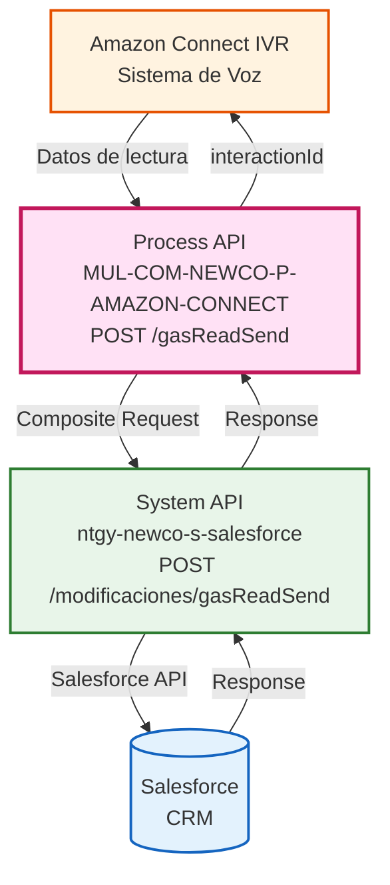
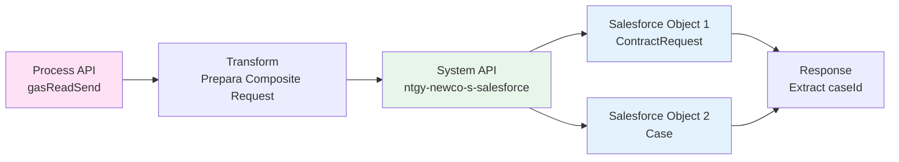
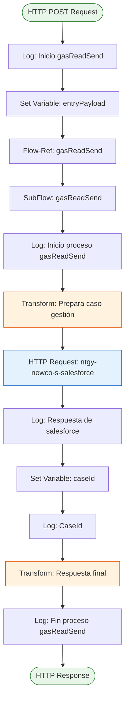
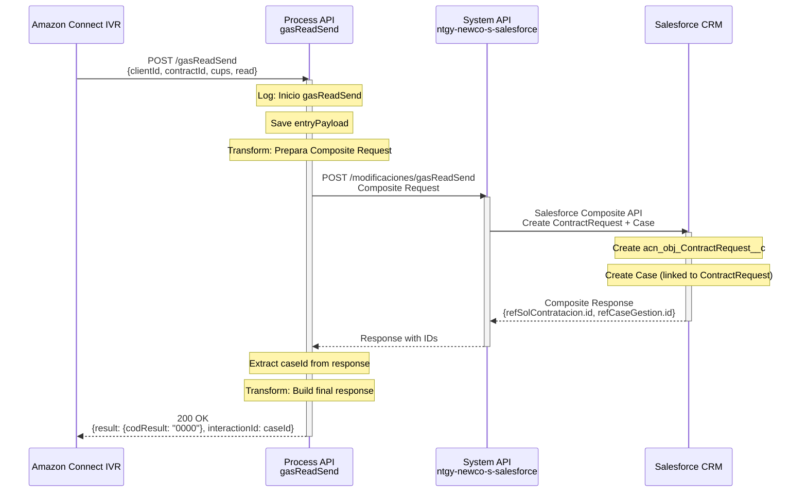
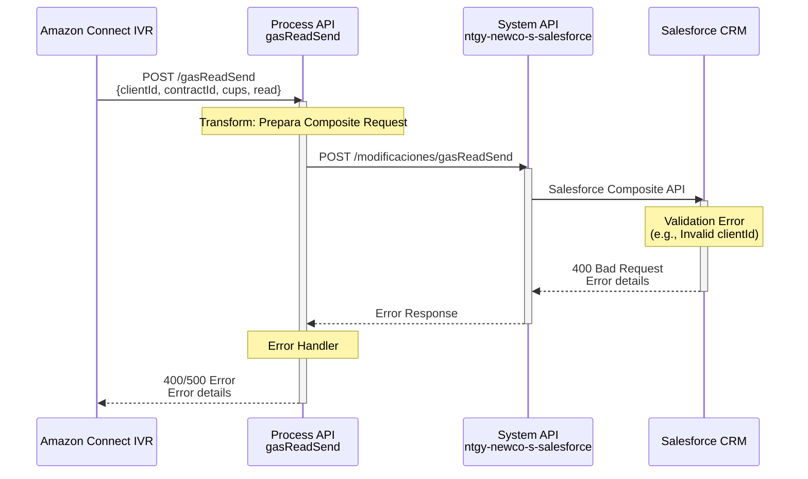
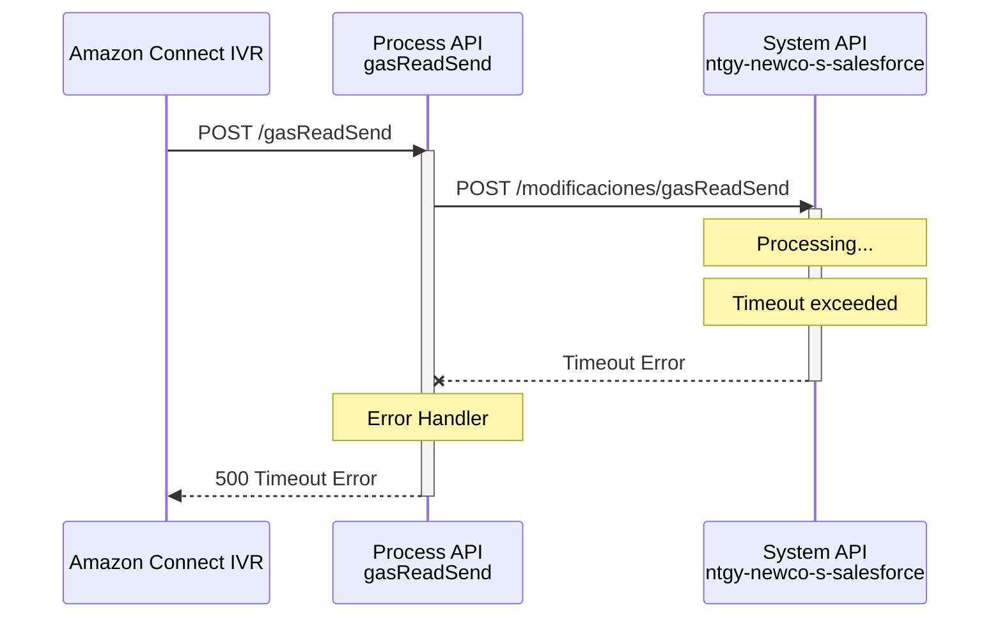

# POST /gasReadSend

## 📌 Descripción General

### Propósito del Endpoint

Este endpoint facilita el proceso de envío de lecturas de gas desde el sistema IVR (Interactive Voice Response) de Amazon Connect. Orquesta la creación simultánea de una solicitud de contratación (`acn_obj_ContractRequest__c`) y un caso de gestión (`Case`) en Salesforce, vinculando ambos registros para el seguimiento del proceso de "Facilita Lectura".

### Tipo de API

**Capa:** Process API (API-Led Connectivity)

**Función:** Orquestación de proceso de negocio para facilitar lecturas de gas desde IVR

### Patrón de Integración

**Tipo:** Orquestación con Transformación

**Descripción:** El endpoint recibe datos de lectura desde IVR, transforma la información en el formato requerido por Salesforce Composite API, y orquesta la creación de dos objetos relacionados en una única transacción atómica.

### Arquitectura API-Led Connectivity



---

## 💼 Propósito del Negocio

### Casos de Uso Principales

1. **Facilitar Lectura de Gas desde IVR**
   - Cliente llama al IVR y proporciona lectura de contador de gas
   - Sistema registra automáticamente la lectura en Salesforce
   - Se crea caso de gestión para seguimiento del proceso

2. **Trazabilidad de Lecturas**
   - Cada lectura genera un caso de gestión único
   - Vinculación automática con solicitud de contratación
   - Identificador de interacción (`interactionId`) para seguimiento

3. **Automatización de Proceso de Negocio**
   - Eliminación de entrada manual de datos
   - Reducción de errores en captura de lecturas
   - Mejora en tiempo de respuesta al cliente

### 🔗 Endpoints Dependientes

Este Process API consume el siguiente System API:

| System API | Endpoint | Método | Propósito |
|------------|----------|--------|-----------|
| `ntgy-newco-s-salesforce` | `/modificaciones/gasReadSend` | POST | Creación de solicitud de contratación y caso de gestión mediante Salesforce Composite API |

### Lógica de Orquestación



**Pasos del Proceso:**

1. **Recepción de Datos**: El endpoint recibe datos de lectura desde IVR (CUPS, lectura, IDs de cliente/contrato/contacto)
2. **Transformación DataWeave**: Construye un Composite Request con dos subrequests:
   - **SubRequest 1**: Crear `acn_obj_ContractRequest__c` (Solicitud de Contratación)
   - **SubRequest 2**: Crear `Case` (Caso de Gestión) vinculado a la solicitud
3. **Llamada al System API**: Envía el Composite Request a Salesforce
4. **Extracción de Respuesta**: Extrae el `caseId` del caso creado
5. **Respuesta Final**: Retorna código de resultado e `interactionId` para seguimiento

### Transformaciones Aplicadas

#### Transformación de Entrada (IVR → Salesforce Composite)

| Campo Original (IVR) | Campo Transformado (Salesforce) | Objeto | Transformación |
|----------------------|----------------------------------|--------|----------------|
| `clientId` | `acn_fld_Account__c` | ContractRequest | Mapeo directo |
| `contractId` | `acn_fld_Contract__c` | ContractRequest | Mapeo directo |
| `cups` | `acn_fld_CUPS__r.acn_fld_Name__c` | ContractRequest | Referencia externa por CUPS |
| `read` | `acn_fld_ReadingValue__c` | ContractRequest | Mapeo directo |
| `userId` | `NewCo_Creado_por__c` | ContractRequest | Condicional: userId o clientId |
| `clientId` | `AccountId` | Case | Mapeo directo |
| `contractId` | `NewCo_Contract__c` | Case | Mapeo directo |
| `contactId` | `ContactId` | Case | Mapeo directo |
| `read` | `acn_fld_ReadingValue__c` | Case | Mapeo directo |
| - | `acn_fld_ReadingDate__c` | Ambos | Fecha actual (now()) |
| - | `acn_fld_Tittle__r.NewCo_ExternalId__c` | Case | Valor fijo: "FacilitaLectura" |
| - | `acn_fld_ContractRequest__c` | Case | Referencia al ContractRequest creado mediante @refSolContratacion.id |

#### Transformación de Salida (Salesforce → IVR)

| Campo Original (Salesforce) | Campo Transformado (Response) | Transformación |
|-----------------------------|-------------------------------|----------------|
| `compositeResponse[].body.id` | `interactionId` | Extracción del caseId del caso creado |
| - | `result.codResult` | Valor fijo: "0000" (éxito) |
| - | `result.msgResult` | Valor fijo: "No hay error" |

### Contexto Empresarial

- **Dominio:** Gestión de Lecturas de Contadores
- **Sector:** Energía - Utilities (Gas)
- **División:** Naturgy España - NewCo
- **Proceso de Negocio:** Facilitar Lectura de Gas desde Canal IVR

### Stakeholders

- **Clientes Finales**: Proporcionan lecturas de gas de forma autónoma vía IVR
- **Agentes de Call Center**: Monitorean casos de gestión creados
- **Equipo de Facturación**: Utilizan lecturas para cálculo de consumo
- **Equipo de Operaciones**: Gestionan seguimiento de solicitudes

### Valor de Negocio

- **Automatización**: Eliminación de entrada manual de lecturas
- **Disponibilidad 24/7**: Clientes pueden enviar lecturas en cualquier momento
- **Reducción de Errores**: Captura automática reduce errores de transcripción
- **Trazabilidad**: Cada lectura genera un caso de gestión con ID único
- **Mejora de Experiencia**: Proceso rápido y sin intervención humana

### Consumidores Potenciales

Este endpoint está diseñado específicamente para:
- **Amazon Connect IVR**: Sistema de voz interactivo (consumidor principal)
- **Sistemas de Contact Center**: Integraciones con plataformas de atención telefónica
- **Aplicaciones de Autoservicio**: Portales web o móviles que repliquen funcionalidad IVR

---

## 🔧 Especificación Técnica

### URLs por Ambiente

| Ambiente | URL Base | URL Completa |
|----------|----------|--------------|
| **Local** | `http://localhost:8081` | `http://localhost:8081/api/gasReadSend` |
| **Development** | `https://mul-com-newco-p-amazon-connect-dev.us-e2.cloudhub.io` | `https://mul-com-newco-p-amazon-connect-dev.us-e2.cloudhub.io/api/gasReadSend` |
| **UAT** | `https://mul-com-newco-p-amazon-connect-uat.us-e2.cloudhub.io` | `https://mul-com-newco-p-amazon-connect-uat.us-e2.cloudhub.io/api/gasReadSend` |
| **Production** | `https://mul-com-newco-p-amazon-connect-pro.us-e2.cloudhub.io` | `https://mul-com-newco-p-amazon-connect-pro.us-e2.cloudhub.io/api/gasReadSend` |

### Método HTTP

```
POST /api/gasReadSend
```

### Headers Requeridos

| Header | Tipo | Obligatorio | Descripción |
|--------|------|-------------|-------------|
| `Content-Type` | string | Sí | Debe ser `application/json` |
| `client_id` | string | Sí | Client ID de Anypoint Platform |
| `client_secret` | string | Sí | Client Secret de Anypoint Platform |

### Parámetros de Entrada

#### Request Body (application/json)

```json
{
  "clientId": "string",
  "contractId": "string",
  "contactId": "string",
  "cups": "string",
  "read": "number",
  "userId": "string"
}
```

#### Descripción de Campos

| Campo | Tipo | Obligatorio | Descripción | Ejemplo |
|-------|------|-------------|-------------|---------|
| `clientId` | string | Sí | ID de la cuenta del cliente en Salesforce | "0011t00000ABC123" |
| `contractId` | string | Sí | ID del contrato en Salesforce | "a0A1t00000XYZ456" |
| `contactId` | string | Sí | ID del contacto en Salesforce | "0031t00000DEF789" |
| `cups` | string | Sí | Código CUPS del punto de suministro | "ES0021000000000001JN0F" |
| `read` | number | Sí | Valor de la lectura del contador | 12345 |
| `userId` | string | No | ID del usuario que crea el registro (opcional) | "0051t00000GHI012" |

#### Validaciones de Entrada

- `clientId`: Debe ser un ID válido de Salesforce (formato: 18 caracteres alfanuméricos)
- `contractId`: Debe ser un ID válido de Salesforce
- `contactId`: Debe ser un ID válido de Salesforce
- `cups`: Debe seguir formato estándar de CUPS español (20-22 caracteres)
- `read`: Debe ser un número positivo
- `userId`: Si se proporciona, debe ser un ID válido de Salesforce

### Respuestas

#### 200 OK - Éxito

```json
{
  "result": {
    "codResult": "0000",
    "msgResult": "No hay error"
  },
  "interactionId": "5001t00000ABC123"
}
```

**Descripción de Campos de Respuesta:**

| Campo | Tipo | Descripción |
|-------|------|-------------|
| `result.codResult` | string | Código de resultado ("0000" = éxito) |
| `result.msgResult` | string | Mensaje descriptivo del resultado |
| `interactionId` | string | ID del caso de gestión creado en Salesforce (para seguimiento) |

#### 400 Bad Request - Error de Validación

```json
{
  "error": {
    "code": "400",
    "message": "Invalid request parameters",
    "details": "Missing required field: clientId"
  }
}
```

#### 500 Internal Server Error - Error del Sistema

```json
{
  "error": {
    "code": "500",
    "message": "Internal server error",
    "details": "Error creating records in Salesforce"
  }
}
```

### Autenticación

- **Tipo:** Client ID & Client Secret (Anypoint Platform)
- **Método:** Headers HTTP
- **Validación:** Anypoint Platform valida credenciales antes de procesar request

### Timeouts

| Tipo | Valor | Descripción |
|------|-------|-------------|
| **Request Timeout** | Configurable | Timeout para llamada al System API de Salesforce |
| **Connection Timeout** | 10 segundos | Timeout de conexión HTTP |

### Rate Limiting

- **Límite:** Según configuración de Anypoint Platform
- **Política:** Aplicada a nivel de API Manager

---

## 🏗️ Implementación Técnica

### Arquitectura del Flow



### Componentes del Flow Principal

#### 1. Flow Principal: `post:\gasReadSend:application\json:ntgy-newco-p-amazon-connect-config`

**Ubicación:** `src/main/mule/ntgy-newco-p-amazon-connect.xml`

**Componentes:**
- **Logger**: Registra inicio del endpoint
- **Set Variable**: Guarda payload original en `entryPayload`
- **Flow-Ref**: Invoca subflow `gasReadSend`

#### 2. SubFlow: `gasReadSend`

**Ubicación:** `src/main/mule/implementation/gasReadSend.xml`

**Componentes:**

1. **Logger Inicio**: Registra inicio del proceso con payload
2. **Transform: Prepara caso gestión**: Construye Composite Request
3. **HTTP Request**: Llama a System API de Salesforce
4. **Logger Respuesta**: Registra respuesta de Salesforce
5. **Set Variable caseId**: Extrae ID del caso creado
6. **Logger CaseId**: Registra el caseId extraído
7. **Transform: Respuesta final**: Construye respuesta del endpoint
8. **Logger Fin**: Registra fin del proceso

### Transformaciones DataWeave

#### Transformación 1: Prepara caso gestión (Request → Salesforce Composite)

**Ubicación:** Inline en `gasReadSend.xml` (líneas 8-35)

```dataweave
%dw 2.0
output application/json
---
{
  "allOrNone": true,
  "collateSubrequests": false,
  "compositeRequest": [
    {
      "method": "POST",
      "url": "/services/data/v52.0/sobjects/acn_obj_ContractRequest__c",
      "referenceId": "refSolContratacion",
      "body": {
        "NewCo_Recordtype__c": "acn_rt_With_Switching",
        "acn_fld_Account__c": vars.entryPayload.clientId, 
        "acn_fld_Contract__c": vars.entryPayload.contractId, 
        "acn_fld_Sctype__c": "23", 
        "acn_fld_Category__c": "50", 
        "acn_fld_Status__c": "01", 
        "acn_fld_CUPS__r": {
          "acn_fld_Name__c": vars.entryPayload.cups
        },
        "acn_fld_ReadingDate__c": now()[0 to 9],
        "acn_fld_ReadingValue__c": vars.entryPayload.read,
        "NewCo_Creado_por__c": if(vars.entryPayload.userId != null) 
                                vars.entryPayload.userId 
                                else vars.entryPayload.clientId
      }
    },
    {
      "method": "POST",
      "url": "/services/data/v52.0/sobjects/Case",
      "referenceId": "refCaseGestion",
      "body": {
        "NewCo_Recordtype__c": "Gestion", 
        "AccountId": vars.entryPayload.clientId, 
        "NewCo_Contract__c": vars.entryPayload.contractId, 
        "ContactId": vars.entryPayload.contactId, 
        "Status": "06", 
        "Priority": "02", 
        "Origin": "IVR", 
        "acn_fld_ReadingDate__c": now()[0 to 9], 
        "acn_fld_ReadingValue__c": vars.entryPayload.read, 
        ("CreatedbyId": vars.entryPayload.userId) if(!isEmpty(vars.entryPayload.userId)),
        ("OwnerId" : vars.entryPayload.userId) if(!isEmpty(vars.entryPayload.userId)), 
        "NewCo_Creado_por__c": if(vars.entryPayload.userId != null) 
                                vars.entryPayload.userId 
                                else vars.entryPayload.clientId,
        "acn_fld_Tittle__r": {
          "NewCo_ExternalId__c": "FacilitaLectura" 
        },
        "acn_fld_ContractRequest__c": "@{refSolContratacion.id}"
      }
    }
  ]
}
```

**Características Clave:**
- **allOrNone: true**: Transacción atómica (ambos objetos se crean o ninguno)
- **collateSubrequests: false**: Subrequests se ejecutan en orden
- **Referencia entre objetos**: El Case referencia al ContractRequest mediante la sintaxis de referencia de Salesforce Composite API
- **Campos condicionales**: `CreatedbyId` y `OwnerId` solo se incluyen si `userId` no está vacío
- **Fecha actual**: `now()[0 to 9]` extrae fecha en formato YYYY-MM-DD

#### Transformación 2: Respuesta final (Salesforce → Response)

**Ubicación:** Inline en `gasReadSend.xml` (líneas 40-49)

```dataweave
%dw 2.0
output application/json
---
{
    "result": {
        "codResult": '0000',
        "msgResult": "No hay error"
    }
} ++ "interactionId": vars.caseId
```

**Características Clave:**
- **Operador ++**: Concatena objeto result con campo interactionId
- **vars.caseId**: Variable extraída previamente del response de Salesforce
- **Códigos fijos**: codResult y msgResult son valores constantes de éxito

### Extracción del caseId

**Ubicación:** `gasReadSend.xml` (línea 38)

```dataweave
#[(payload.compositeResponse filter ((item, index) -> item.referenceId == "refCaseGestion")).body.id[0]]
```

**Lógica:**
1. Filtra el array `compositeResponse` buscando el elemento con `referenceId == "refCaseGestion"`
2. Extrae el campo `body.id` del elemento filtrado
3. Toma el primer elemento del array resultante `[0]`

### Configuración HTTP Request

**Config-Ref:** `HTTP_S_SALESFORCE`

**Parámetros:**
- **Method:** POST
- **Path:** `/modificaciones/gasReadSend`
- **Response Timeout:** `${ntgy-newco-s-salesforce.timeout}` (configurable)

### Objetos Salesforce Creados

#### 1. acn_obj_ContractRequest__c (Solicitud de Contratación)

| Campo Salesforce | Valor | Descripción |
|------------------|-------|-------------|
| `NewCo_Recordtype__c` | "acn_rt_With_Switching" | Tipo de registro: Con Switching |
| `acn_fld_Account__c` | clientId | Referencia a la cuenta del cliente |
| `acn_fld_Contract__c` | contractId | Referencia al contrato |
| `acn_fld_Sctype__c` | "23" | Tipo de solicitud: Facilita Lectura |
| `acn_fld_Category__c` | "50" | Categoría de la solicitud |
| `acn_fld_Status__c` | "01" | Estado inicial: Pendiente |
| `acn_fld_CUPS__r.acn_fld_Name__c` | cups | CUPS (referencia externa) |
| `acn_fld_ReadingDate__c` | now() | Fecha de la lectura |
| `acn_fld_ReadingValue__c` | read | Valor de la lectura |
| `NewCo_Creado_por__c` | userId o clientId | Usuario que crea el registro |

#### 2. Case (Caso de Gestión)

| Campo Salesforce | Valor | Descripción |
|------------------|-------|-------------|
| `NewCo_Recordtype__c` | "Gestion" | Tipo de registro: Gestión |
| `AccountId` | clientId | Cuenta del cliente |
| `NewCo_Contract__c` | contractId | Contrato asociado |
| `ContactId` | contactId | Contacto del cliente |
| `Status` | "06" | Estado del caso |
| `Priority` | "02" | Prioridad del caso |
| `Origin` | "IVR" | Origen: IVR |
| `acn_fld_ReadingDate__c` | now() | Fecha de la lectura |
| `acn_fld_ReadingValue__c` | read | Valor de la lectura |
| `CreatedbyId` | userId (condicional) | Usuario creador (si existe) |
| `OwnerId` | userId (condicional) | Propietario del caso (si existe) |
| `NewCo_Creado_por__c` | userId o clientId | Usuario que crea el registro |
| `acn_fld_Tittle__r.NewCo_ExternalId__c` | "FacilitaLectura" | Título del caso (referencia externa) |
| `acn_fld_ContractRequest__c` | Referencia dinámica | Referencia a la solicitud creada (ID generado en runtime) |

### Patrones de Diseño

**Patrón:** Composite Request Pattern (Salesforce)

**Justificación:** 
- Permite crear múltiples objetos relacionados en una única llamada HTTP
- Garantiza atomicidad (allOrNone: true)
- Reduce latencia al evitar múltiples round-trips
- Permite referenciar objetos creados en la misma transacción

**Patrón:** Variable Storage Pattern

**Justificación:**
- Almacena payload original en variable `entryPayload` para acceso en transformaciones
- Extrae y almacena `caseId` para construcción de respuesta final

### Diagramas de Secuencia

#### 1. Flujo Normal de Éxito



#### 2. Flujo con Error de Salesforce



#### 3. Flujo con Timeout



### Manejo de Errores

El endpoint implementa manejo de errores en múltiples niveles:

#### Errores de Validación (400)
- Campos obligatorios faltantes
- Formato inválido de IDs de Salesforce
- Formato inválido de CUPS
- Valor de lectura inválido

#### Errores de Negocio (400/500)
- Cliente no existe en Salesforce
- Contrato no existe o inactivo
- CUPS no encontrado
- Duplicación de lectura

#### Errores Técnicos (500)
- Timeout en llamada a Salesforce
- Error de conexión con System API
- Error en Salesforce Composite API
- Error en transformación DataWeave

#### Estrategia de Logging
- **Inicio**: Log del payload de entrada
- **Transformación**: Log del Composite Request generado
- **Respuesta**: Log de la respuesta de Salesforce
- **CaseId**: Log del ID extraído
- **Fin**: Log del payload de salida

---

## 💻 Ejemplos de Uso

### Ejemplo 1: Llamada Exitosa con userId

#### Request

```bash
curl -X POST "https://mul-com-newco-p-amazon-connect-dev.us-e2.cloudhub.io/api/gasReadSend" \
  -H "Content-Type: application/json" \
  -H "client_id: YOUR_CLIENT_ID" \
  -H "client_secret: YOUR_CLIENT_SECRET" \
  -d '{
    "clientId": "0011t00000ABC123",
    "contractId": "a0A1t00000XYZ456",
    "contactId": "0031t00000DEF789",
    "cups": "ES0021000000000001JN0F",
    "read": 12345,
    "userId": "0051t00000GHI012"
  }'
```

#### Response (200 OK)

```json
{
  "result": {
    "codResult": "0000",
    "msgResult": "No hay error"
  },
  "interactionId": "5001t00000ABC123"
}
```

### Ejemplo 2: Llamada Exitosa sin userId

#### Request

```bash
curl -X POST "https://mul-com-newco-p-amazon-connect-dev.us-e2.cloudhub.io/api/gasReadSend" \
  -H "Content-Type: application/json" \
  -H "client_id: YOUR_CLIENT_ID" \
  -H "client_secret: YOUR_CLIENT_SECRET" \
  -d '{
    "clientId": "0011t00000ABC123",
    "contractId": "a0A1t00000XYZ456",
    "contactId": "0031t00000DEF789",
    "cups": "ES0021000000000001JN0F",
    "read": 12345
  }'
```

#### Response (200 OK)

```json
{
  "result": {
    "codResult": "0000",
    "msgResult": "No hay error"
  },
  "interactionId": "5001t00000XYZ789"
}
```

**Nota:** Cuando no se proporciona `userId`, el campo `NewCo_Creado_por__c` se establece con el valor de `clientId`.

### Ejemplo 3: JavaScript (Node.js)

```javascript
const axios = require('axios');

async function sendGasReading() {
  try {
    const response = await axios.post(
      'https://mul-com-newco-p-amazon-connect-dev.us-e2.cloudhub.io/api/gasReadSend',
      {
        clientId: '0011t00000ABC123',
        contractId: 'a0A1t00000XYZ456',
        contactId: '0031t00000DEF789',
        cups: 'ES0021000000000001JN0F',
        read: 12345,
        userId: '0051t00000GHI012'
      },
      {
        headers: {
          'Content-Type': 'application/json',
          'client_id': 'YOUR_CLIENT_ID',
          'client_secret': 'YOUR_CLIENT_SECRET'
        }
      }
    );
    
    console.log('Lectura enviada exitosamente');
    console.log('Interaction ID:', response.data.interactionId);
    return response.data;
  } catch (error) {
    console.error('Error al enviar lectura:', error.response?.data || error.message);
    throw error;
  }
}

sendGasReading();
```

### Ejemplo 4: Python

```python
import requests
import json

def send_gas_reading():
    url = 'https://mul-com-newco-p-amazon-connect-dev.us-e2.cloudhub.io/api/gasReadSend'
    
    headers = {
        'Content-Type': 'application/json',
        'client_id': 'YOUR_CLIENT_ID',
        'client_secret': 'YOUR_CLIENT_SECRET'
    }
    
    payload = {
        'clientId': '0011t00000ABC123',
        'contractId': 'a0A1t00000XYZ456',
        'contactId': '0031t00000DEF789',
        'cups': 'ES0021000000000001JN0F',
        'read': 12345,
        'userId': '0051t00000GHI012'
    }
    
    try:
        response = requests.post(url, headers=headers, json=payload)
        response.raise_for_status()
        
        data = response.json()
        print('Lectura enviada exitosamente')
        print(f"Interaction ID: {data['interactionId']}")
        return data
    except requests.exceptions.RequestException as e:
        print(f'Error al enviar lectura: {e}')
        if hasattr(e.response, 'text'):
            print(f'Detalles: {e.response.text}')
        raise

if __name__ == '__main__':
    send_gas_reading()
```

### Ejemplo 5: Error - Campo Obligatorio Faltante

#### Request

```bash
curl -X POST "https://mul-com-newco-p-amazon-connect-dev.us-e2.cloudhub.io/api/gasReadSend" \
  -H "Content-Type: application/json" \
  -H "client_id: YOUR_CLIENT_ID" \
  -H "client_secret: YOUR_CLIENT_SECRET" \
  -d '{
    "clientId": "0011t00000ABC123",
    "contractId": "a0A1t00000XYZ456",
    "cups": "ES0021000000000001JN0F",
    "read": 12345
  }'
```

#### Response (400 Bad Request)

```json
{
  "error": {
    "code": "400",
    "message": "Invalid request parameters",
    "details": "Missing required field: contactId"
  }
}
```

### Ejemplo 6: Error - ID de Salesforce Inválido

#### Request

```bash
curl -X POST "https://mul-com-newco-p-amazon-connect-dev.us-e2.cloudhub.io/api/gasReadSend" \
  -H "Content-Type: application/json" \
  -H "client_id: YOUR_CLIENT_ID" \
  -H "client_secret: YOUR_CLIENT_SECRET" \
  -d '{
    "clientId": "INVALID_ID",
    "contractId": "a0A1t00000XYZ456",
    "contactId": "0031t00000DEF789",
    "cups": "ES0021000000000001JN0F",
    "read": 12345
  }'
```

#### Response (400 Bad Request)

```json
{
  "error": {
    "code": "400",
    "message": "Salesforce validation error",
    "details": "Invalid Salesforce ID format: INVALID_ID"
  }
}
```

### Ejemplo 7: Integración con Amazon Connect

```javascript
// Lambda function para Amazon Connect
exports.handler = async (event) => {
    const axios = require('axios');
    
    // Extraer datos del evento de Amazon Connect
    const { clientId, contractId, contactId, cups, readingValue } = event.Details.Parameters;
    
    try {
        const response = await axios.post(
            process.env.API_URL + '/api/gasReadSend',
            {
                clientId: clientId,
                contractId: contractId,
                contactId: contactId,
                cups: cups,
                read: parseInt(readingValue)
            },
            {
                headers: {
                    'Content-Type': 'application/json',
                    'client_id': process.env.CLIENT_ID,
                    'client_secret': process.env.CLIENT_SECRET
                }
            }
        );
        
        // Retornar interactionId a Amazon Connect
        return {
            statusCode: 200,
            interactionId: response.data.interactionId,
            success: true
        };
    } catch (error) {
        console.error('Error:', error);
        return {
            statusCode: 500,
            success: false,
            error: error.message
        };
    }
};
```

### Notas de Implementación

1. **Transaccionalidad**: El uso de `allOrNone: true` garantiza que ambos objetos (ContractRequest y Case) se crean o ninguno se crea, manteniendo la integridad de datos.

2. **Referencias entre Objetos**: El Case se vincula automáticamente al ContractRequest mediante la referencia dinámica de Salesforce Composite API, eliminando la necesidad de una segunda llamada.

3. **Campos Condicionales**: Los campos `CreatedbyId` y `OwnerId` solo se incluyen si se proporciona `userId`, evitando errores de validación en Salesforce.

4. **Fecha Automática**: La fecha de lectura se establece automáticamente con la fecha actual del sistema, garantizando precisión temporal.

5. **Identificador de Seguimiento**: El `interactionId` retornado es el ID del Case creado, permitiendo seguimiento completo del proceso en Salesforce.
