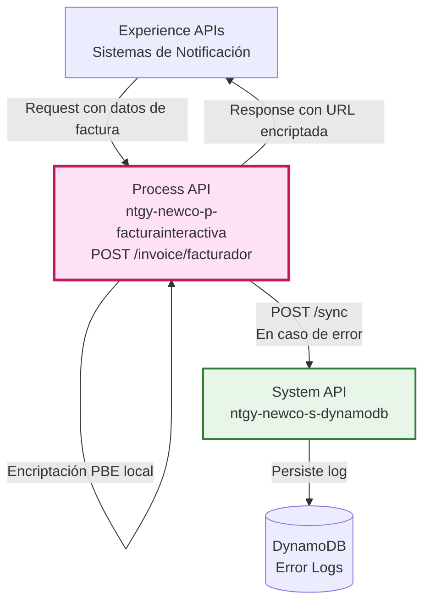
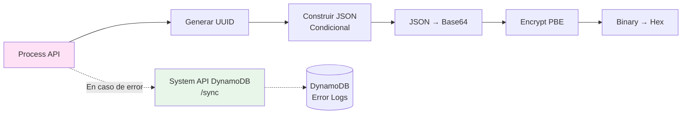
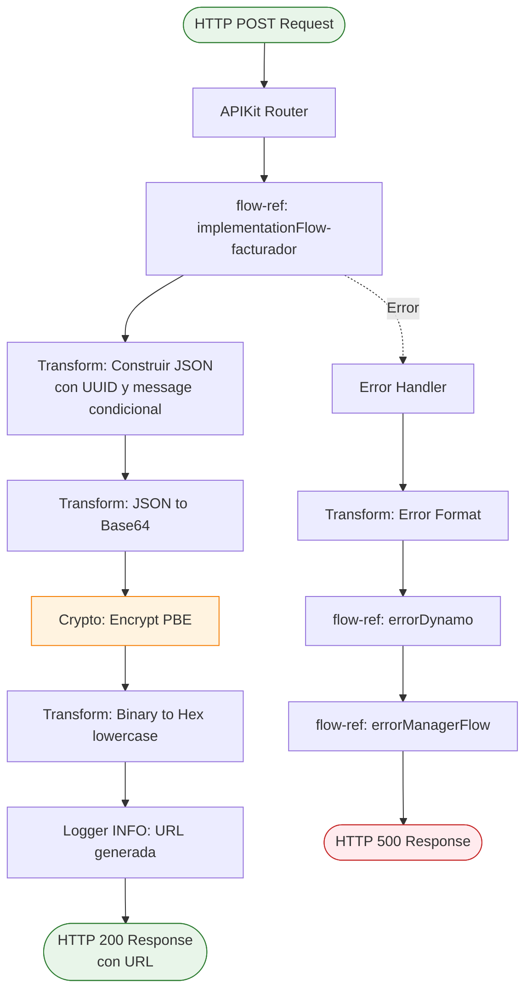
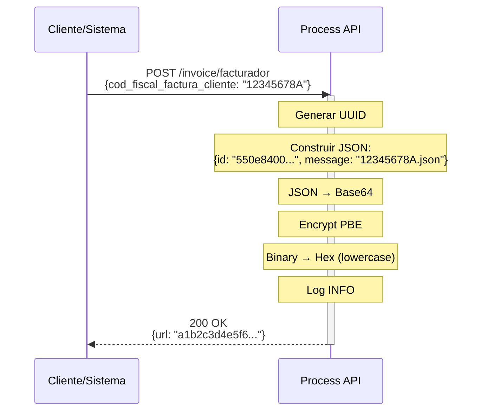
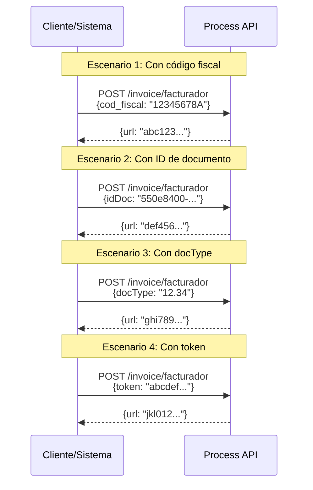
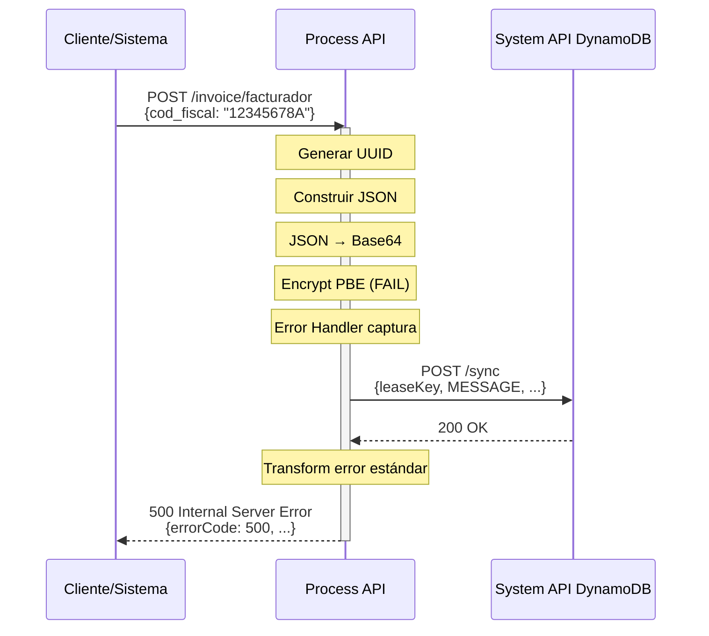

# POST /invoice/facturador

## 📌 Descripción General

### Propósito del Endpoint

Este endpoint genera URLs encriptadas que contienen información de facturas de forma segura. Utiliza encriptación PBE (Password-Based Encryption) con algoritmo SHA256 y AES 256 para proteger datos sensibles. La URL generada puede ser compartida de forma segura por email, SMS o notificaciones push.

### Tipo de API

**Capa:** Process API (API-Led Connectivity)

**Función:** Generación de URLs seguras mediante encriptación PBE

### Patrón de Integración

**Tipo:** Transformation Pattern (Encriptación Local)

**Descripción:** Recibe datos de factura, genera UUID único, encripta con PBE y retorna URL en formato hexadecimal.

### Arquitectura API-Led Connectivity



---

## 💼 Propósito del Negocio

### Casos de Uso Principales

1. **Envío de Factura por Email**
   - Sistema de facturación genera URL encriptada
   - Email incluye enlace seguro a factura
   - Cliente hace clic y accede sin exponer datos sensibles

2. **Notificación Push de Nueva Factura**
   - App móvil genera URL encriptada
   - Envía notificación con enlace seguro
   - Cliente accede directamente a factura

3. **Compartir Factura con Terceros**
   - Cliente solicita URL para compartir con gestoría
   - Sistema genera URL encriptada temporal
   - Tercero accede sin necesidad de credenciales

### 🔗 Endpoints Dependientes

Este Process API consume los siguientes System APIs:

| System API | Endpoint | Método | Propósito |
|------------|----------|--------|-----------|
| `ntgy-newco-s-dynamodb` | `/sync` | POST | Persistencia de logs de error (solo en caso de fallo) |

**Nota:** Este endpoint NO consume System APIs para su operación normal. La encriptación es procesamiento local.

### Lógica de Orquestación



**Pasos del Proceso:**

1. **Recepción de Request**: Process API recibe datos de factura (cod_fiscal, idDoc, docType o token)
2. **Generación de UUID**: Crea identificador único RFC 4122
3. **Construcción Condicional**: Genera objeto JSON según campos presentes
4. **Transformación a Base64**: Codifica JSON en Base64
5. **Encriptación PBE**: Aplica algoritmo PBEWithHmacSHA256AndAES_256
6. **Conversión a Hex**: Transforma binary a hexadecimal lowercase
7. **Logging**: Registra URL generada en logs INFO
8. **Error Handling**: Si falla, persiste error en DynamoDB

### Transformaciones Aplicadas

#### Cadena de Encriptación

| Paso | Transformación | Input | Output |
|------|----------------|-------|--------|
| 1 | Generar UUID | N/A | `"550e8400-e29b-41d4-a716-446655440000"` |
| 2 | Construir JSON | Campos del request | `{"id": "...", "message": "..."}` |
| 3 | JSON → Base64 | JSON object | Base64 string |
| 4 | Encrypt PBE | Base64 string | Binary encrypted |
| 5 | Binary → Hex | Binary data | `"a1b2c3d4..."` (hex lowercase) |

#### Construcción Condicional del Message

| Campo Presente | Valor de `message` | Ejemplo |
|----------------|-------------------|---------|
| `cod_fiscal_factura_cliente` | `{cod_fiscal}.json` | `"12345678A.json"` |
| `idDoc` | `{idDoc}.pdf` | `"550e8400-e29b-41d4-a716-446655440000.pdf"` |
| `docType` | `{docType}` | `"12.34"` |
| `token` | `{token}` | `"abcdefghijklmnopqrstuvwxyz12345"` |

**Nota:** Solo uno de estos campos debe estar presente en el request.

### Contexto Empresarial

- **Dominio:** Facturación Interactiva con URLs Seguras
- **Sector:** Energía - Utilities
- **División:** Naturgy España - NewCo
- **Proceso de Negocio:** Generación de enlaces seguros para distribución de facturas

### Stakeholders

- **Sistemas de Facturación**: Generan URLs para envío masivo de facturas
- **Equipos de Marketing**: Utilizan URLs en campañas de comunicación
- **Equipos de Seguridad**: Requieren protección de información sensible

### Valor de Negocio

- **Seguridad**: Protección de datos sensibles mediante encriptación robusta
- **Flexibilidad**: Soporte para múltiples formatos de identificación
- **Trazabilidad**: UUID único permite tracking de cada URL generada
- **Simplicidad**: Un endpoint para generar URLs para cualquier tipo de factura

### Consumidores Potenciales

Este endpoint puede ser consumido por:
- Sistemas de email marketing (envío masivo de facturas)
- Aplicaciones móviles (generación de enlaces compartibles)
- Portales web (generación de enlaces temporales)
- Sistemas de SMS (envío de enlaces cortos)
- APIs de terceros autorizados

---

## 🔧 Especificación Técnica

### URLs por Ambiente

| Ambiente | URL Base | URL Completa |
|----------|----------|--------------|
| **Local** | `http://localhost:8081` | `http://localhost:8081/api/invoice/facturador` |
| **Development** | `https://ntgy-newco-p-facturainteractiva-dev.de-c1.cloudhub.io` | `https://ntgy-newco-p-facturainteractiva-dev.de-c1.cloudhub.io/api/invoice/facturador` |
| **UAT** | `https://ntgy-newco-p-facturainteractiva-uat00.de-c1.cloudhub.io` | `https://ntgy-newco-p-facturainteractiva-uat00.de-c1.cloudhub.io/api/invoice/facturador` |
| **Pre-Production** | `https://ntgy-newco-p-facturainteractiva-pre.de-c1.cloudhub.io` | `https://ntgy-newco-p-facturainteractiva-pre.de-c1.cloudhub.io/api/invoice/facturador` |
| **Production** | `https://ntgy-newco-p-facturainteractiva-pro.de-c1.cloudhub.io` | `https://ntgy-newco-p-facturainteractiva-pro.de-c1.cloudhub.io/api/invoice/facturador` |

### Método HTTP

```
POST /api/invoice/facturador
```

### Parámetros de Entrada

#### Request Body

**Content-Type:** `application/json`

**Opción 1: Con código fiscal**
```json
{
  "cod_fiscal_factura_cliente": "string",
  "fech_ini_factura": "string",
  "fech_fin_factura": "string"
}
```

**Opción 2: Con ID de documento**
```json
{
  "idDoc": "string"
}
```

**Opción 3: Con tipo de documento**
```json
{
  "docType": "string"
}
```

**Opción 4: Con token**
```json
{
  "token": "string"
}
```

| Campo | Tipo | Obligatorio | Descripción | Ejemplo |
|-------|------|-------------|-------------|---------|
| `cod_fiscal_factura_cliente` | string | Condicional | Código fiscal del cliente | `"12345678A"` |
| `fech_ini_factura` | string | Opcional | Fecha inicio factura | `"2024-01-01"` |
| `fech_fin_factura` | string | Opcional | Fecha fin factura | `"2024-01-31"` |
| `idDoc` | string | Condicional | ID del documento (UUID) | `"550e8400-e29b-41d4-a716-446655440000"` |
| `docType` | string | Condicional | Tipo de documento | `"12.34"` |
| `token` | string | Condicional | Token de acceso | `"abcdefghijklmnopqrstuvwxyz12345"` |

**Nota:** Solo uno de los campos condicionales debe estar presente.

### Respuestas

#### 200 OK - Éxito

**Content-Type:** `application/json`

```json
{
  "url": "a1b2c3d4e5f6789abcdef0123456789abcdef0123456789abcdef"
}
```

| Campo | Tipo | Descripción |
|-------|------|-------------|
| `url` | string | URL encriptada en formato hexadecimal (lowercase) |

#### 400 Bad Request - Error de Validación

```json
{
  "errorCode": 400,
  "message": "Bad request",
  "description": "Invalid request format: no valid field provided"
}
```

#### 500 Internal Server Error - Error del Sistema

```json
{
  "errorCode": 500,
  "message": "Error al generar URL",
  "description": "Encryption failed: internal error"
}
```

### Autenticación

- **Tipo:** Client ID & Client Secret (Anypoint Platform)
- **Headers requeridos:**
  - `client_id`: ID de la aplicación cliente
  - `client_secret`: Secret de la aplicación cliente

### Timeouts

| Tipo | Valor |
|------|-------|
| **Request Timeout** | 30 segundos |
| **Connection Timeout** | 10 segundos |

---

## 🏗️ Implementación Técnica

### Arquitectura del Flow



### Código de Implementación

**Ubicación:** `src/main/mule/implementation.xml` (líneas 105-141)

#### Sub-flow: implementationFlow-facturador

```xml
<sub-flow name="implementationFlow-facturador">
    <!-- 1. Construir JSON con UUID y message condicional -->
    <ee:transform>
        <ee:message>
            <ee:set-payload><![CDATA[%dw 2.0
output application/json
---
{
    "id": uuid(),
    ("message": payload.cod_fiscal_factura_cliente ++ ".json") if (payload.cod_fiscal_factura_cliente?),
    ("message": payload.idDoc ++".pdf") if (payload.idDoc?),
    ("message": payload.docType) if (payload.docType?),
    ("message": payload.token) if (payload.token?)
}]]></ee:set-payload>
        </ee:message>
    </ee:transform>
    
    <!-- 2. Convertir JSON a Base64 -->
    <ee:transform>
        <ee:message>
            <ee:set-payload><![CDATA[%dw 2.0
output application/java
---
dw::core::Binaries::toBase64(write(payload, "application/json"))]]></ee:set-payload>
        </ee:message>
    </ee:transform>
    
    <!-- 3. Encriptar con PBE -->
    <crypto:jce-encrypt-pbe 
        algorithm="#[p('codification.algorithm')]" 
        password="${secure::codification.password}"/>
    
    <!-- 4. Convertir Binary a Hex (lowercase) -->
    <ee:transform>
        <ee:message>
            <ee:set-payload><![CDATA[%dw 2.0
output application/json
---
{
    url: lower(dw::core::Binaries::toHex(payload))
}]]></ee:set-payload>
        </ee:message>
    </ee:transform>
    
    <!-- 5. Logging de URL generada -->
    <logger level="INFO" message="#[payload]"/>
</sub-flow>
```

### Transformaciones DataWeave

#### 1. Construcción de JSON con UUID

**Ubicación:** Inline (línea 106-119)

```dataweave
%dw 2.0
output application/json
---
{
    "id": uuid(),
    ("message": payload.cod_fiscal_factura_cliente ++ ".json") if (payload.cod_fiscal_factura_cliente?),
    ("message": payload.idDoc ++".pdf") if (payload.idDoc?),
    ("message": payload.docType) if (payload.docType?),
    ("message": payload.token) if (payload.token?)
}
```

**Propósito:** Genera UUID único y construye message según campo presente.

**Ejemplos:**
- Input: `{ "cod_fiscal_factura_cliente": "12345678A" }`
- Output: `{ "id": "550e8400-...", "message": "12345678A.json" }`

- Input: `{ "idDoc": "abc-123" }`
- Output: `{ "id": "550e8400-...", "message": "abc-123.pdf" }`

#### 2. Conversión JSON a Base64

**Ubicación:** Inline (línea 120-127)

```dataweave
%dw 2.0
output application/java
---
dw::core::Binaries::toBase64(write(payload, "application/json"))
```

**Propósito:** Serializa JSON y codifica en Base64.

**Ejemplo:**
- Input: `{ "id": "550e8400-...", "message": "12345678A.json" }`
- Output: Base64 string `"eyJpZCI6IjU1MGU4NDAwLi4uIiwibWVzc2FnZSI6IjEyMzQ1Njc4QS5qc29uIn0="`

#### 3. Conversión Binary a Hex (Lowercase)

**Ubicación:** Inline (línea 129-139)

```dataweave
%dw 2.0
output application/json
---
{
    url: lower(dw::core::Binaries::toHex(payload))
}
```

**Propósito:** Convierte datos binarios encriptados a hexadecimal en minúsculas.

**Ejemplo:**
- Input: Binary encrypted data
- Output: `{ "url": "a1b2c3d4e5f6789abcdef0123456789abcdef" }`

### Patrones de Diseño

**Patrón:** Transformation Pipeline con Encriptación

**Justificación:** 
- Cadena de transformaciones secuenciales
- Cada paso prepara datos para el siguiente
- Encriptación PBE protege información sensible
- UUID garantiza unicidad de cada URL

### Diagramas de Secuencia

#### 1. Flujo Normal de Éxito



#### 2. Flujo con Diferentes Tipos de Input



#### 3. Flujo con Error de Encriptación



### Manejo de Errores

#### Estrategia de Error Handling

1. **Error de Encriptación**
   - Causa: Password incorrecto, algoritmo no disponible
   - Acción: Error 500 con logging en DynamoDB

2. **Request Inválido**
   - Causa: Ningún campo condicional presente
   - Acción: Error 400 con descripción

3. **Error de DynamoDB**
   - Causa: Sistema de logging caído
   - Acción: Continúa con error handling, log local

#### Códigos de Error

| Código | Descripción | Causa Común |
|--------|-------------|-------------|
| 400 | Bad Request | Formato de request inválido, ningún campo válido presente |
| 500 | Internal Server Error | Error de encriptación, error interno |

---

## 💻 Ejemplos de Uso

### Ejemplo 1: Generar URL con Código Fiscal

#### cURL

```bash
curl -X POST "https://ntgy-newco-p-facturainteractiva-dev.de-c1.cloudhub.io/api/invoice/facturador" \
  -H "Content-Type: application/json" \
  -H "client_id: YOUR_CLIENT_ID" \
  -H "client_secret: YOUR_CLIENT_SECRET" \
  -d '{
    "cod_fiscal_factura_cliente": "12345678A",
    "fech_ini_factura": "2024-01-01",
    "fech_fin_factura": "2024-01-31"
  }'
```

#### Respuesta (200 OK)

```json
{
  "url": "a1b2c3d4e5f6789abcdef0123456789abcdef0123456789abcdef0123456789abcdef0123456789abcdef"
}
```

### Ejemplo 2: Generar URL con ID de Documento

#### JavaScript (Fetch API)

```javascript
const response = await fetch('https://ntgy-newco-p-facturainteractiva-dev.de-c1.cloudhub.io/api/invoice/facturador', {
  method: 'POST',
  headers: {
    'Content-Type': 'application/json',
    'client_id': 'YOUR_CLIENT_ID',
    'client_secret': 'YOUR_CLIENT_SECRET'
  },
  body: JSON.stringify({
    idDoc: '550e8400-e29b-41d4-a716-446655440000'
  })
});

const data = await response.json();
console.log('URL generada:', data.url);
```

#### Respuesta (200 OK)

```json
{
  "url": "def456abc789def456abc789def456abc789def456abc789def456abc789def456abc789def456abc789"
}
```

### Ejemplo 3: Generar URL con DocType

#### Python con Requests

```python
import requests

url = 'https://ntgy-newco-p-facturainteractiva-dev.de-c1.cloudhub.io/api/invoice/facturador'
headers = {
    'Content-Type': 'application/json',
    'client_id': 'YOUR_CLIENT_ID',
    'client_secret': 'YOUR_CLIENT_SECRET'
}
payload = {
    'docType': '12.34'
}

response = requests.post(url, headers=headers, json=payload)

if response.status_code == 200:
    data = response.json()
    print(f"URL generada: {data['url']}")
    print(f"Longitud: {len(data['url'])} caracteres")
else:
    print(f"Error {response.status_code}: {response.text}")
```

#### Respuesta (200 OK)

```json
{
  "url": "ghi789jkl012mno345pqr678stu901vwx234yz567abc890def123ghi456jkl789mno012pqr345stu678"
}
```

### Ejemplo 4: Generar URL con Token

#### cURL

```bash
curl -X POST "https://ntgy-newco-p-facturainteractiva-dev.de-c1.cloudhub.io/api/invoice/facturador" \
  -H "Content-Type: application/json" \
  -H "client_id: YOUR_CLIENT_ID" \
  -H "client_secret: YOUR_CLIENT_SECRET" \
  -d '{
    "token": "abcdefghijklmnopqrstuvwxyz12345"
  }'
```

#### Respuesta (200 OK)

```json
{
  "url": "vwx901yz234abc567def890ghi123jkl456mno789pqr012stu345vwx678yz901abc234def567ghi890"
}
```

### Ejemplo 5: Flujo Completo (Generar + Usar URL)

#### Paso 1: Generar URL

```bash
curl -X POST "https://ntgy-newco-p-facturainteractiva-dev.de-c1.cloudhub.io/api/invoice/facturador" \
  -H "Content-Type: application/json" \
  -H "client_id: YOUR_CLIENT_ID" \
  -H "client_secret: YOUR_CLIENT_SECRET" \
  -d '{
    "cod_fiscal_factura_cliente": "12345678A"
  }'
```

**Respuesta:**
```json
{
  "url": "a1b2c3d4e5f6789abcdef0123456789abcdef0123456789abcdef"
}
```

#### Paso 2: Enviar URL por Email (Pseudocódigo)

```javascript
const emailService = require('./email-service');

const invoiceUrl = `https://portal.naturgy.com/factura?url=${encryptedUrl}`;

await emailService.send({
  to: 'cliente@example.com',
  subject: 'Tu factura de Naturgy está disponible',
  body: `
    Hola,
    
    Tu factura del mes de enero está disponible.
    Puedes consultarla haciendo clic en el siguiente enlace:
    
    ${invoiceUrl}
    
    Este enlace es seguro y personal.
    
    Saludos,
    Equipo Naturgy
  `
});
```

#### Paso 3: Cliente Usa URL

```bash
# Cliente hace clic en el enlace, que llama a POST /invoice/url
curl -X POST "https://ntgy-newco-p-facturainteractiva-dev.de-c1.cloudhub.io/api/invoice/url" \
  -H "Content-Type: application/json" \
  -H "client_id: YOUR_CLIENT_ID" \
  -H "client_secret: YOUR_CLIENT_SECRET" \
  -d '{
    "url": "a1b2c3d4e5f6789abcdef0123456789abcdef0123456789abcdef"
  }'
```

**Respuesta:**
```json
{
  "result": {
    "codResult": "0000",
    "msgResult": "No hay error"
  },
  "factura": {
    "numeroFactura": "FAC-2024-001234",
    "cliente": {
      "codigoFiscal": "12345678A",
      "nombre": "Juan Pérez García"
    },
    "total": 93.78
  }
}
```

### Ejemplo 6: Error - Request Sin Campos Válidos

#### cURL

```bash
curl -X POST "https://ntgy-newco-p-facturainteractiva-dev.de-c1.cloudhub.io/api/invoice/facturador" \
  -H "Content-Type: application/json" \
  -H "client_id: YOUR_CLIENT_ID" \
  -H "client_secret: YOUR_CLIENT_SECRET" \
  -d '{
    "invalidField": "value"
  }'
```

#### Respuesta (400 Bad Request)

```json
{
  "errorCode": 400,
  "message": "Bad request",
  "description": "Invalid request format: no valid field provided (cod_fiscal_factura_cliente, idDoc, docType, or token required)"
}
```
