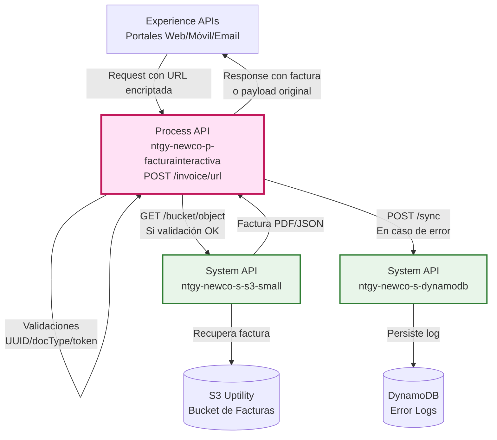
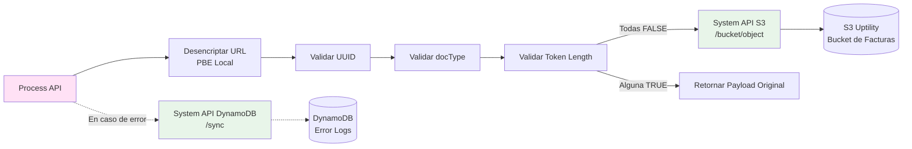
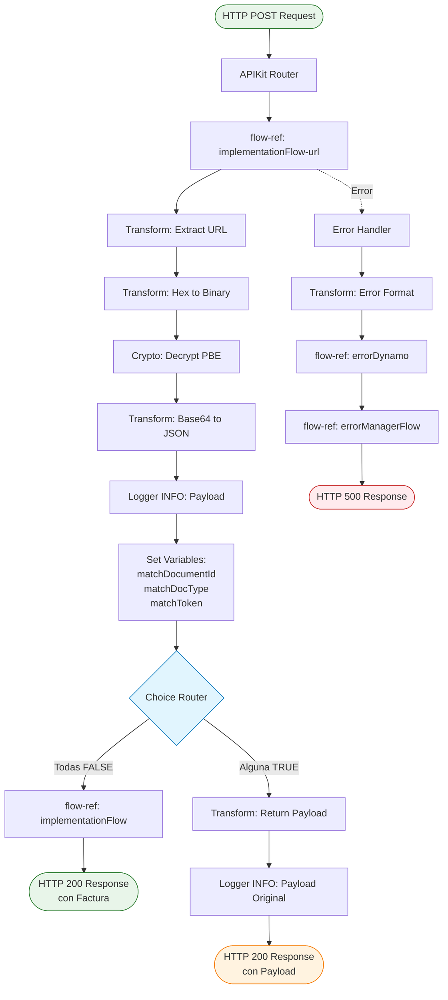
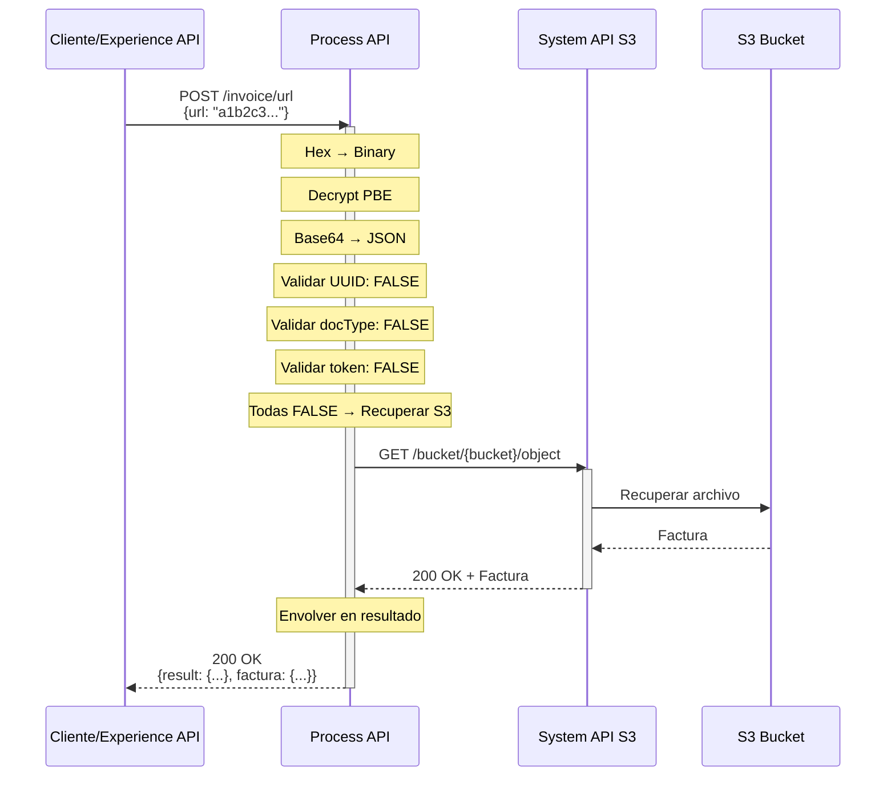
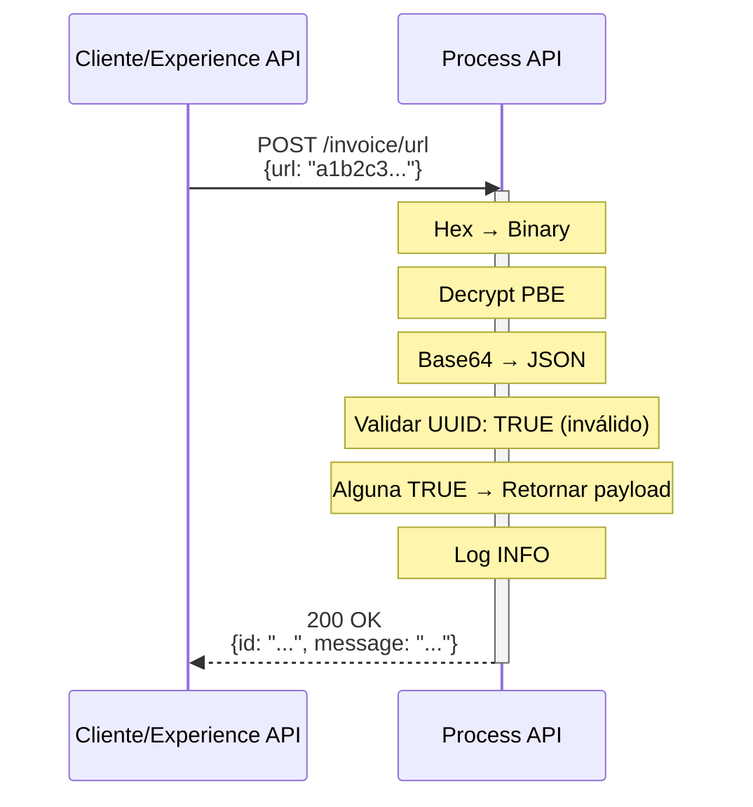
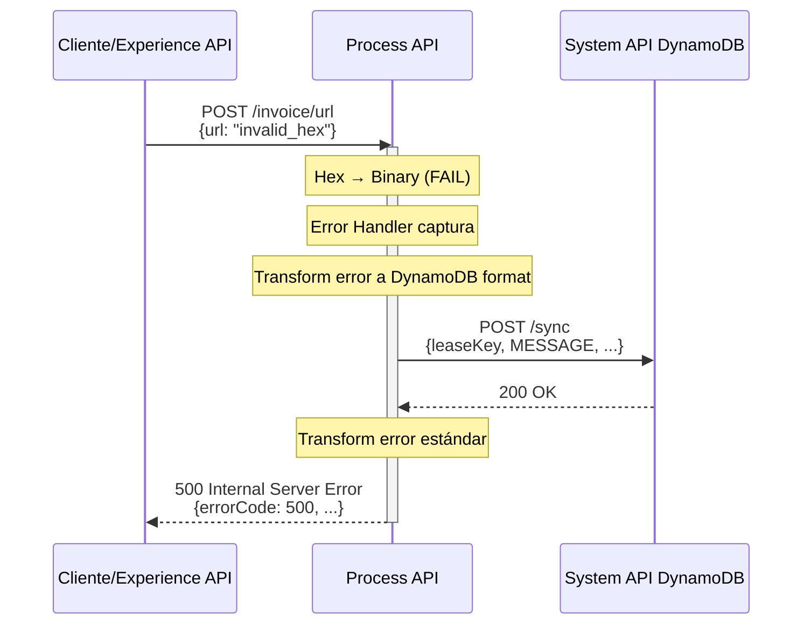

# POST /invoice/url

## 📌 Descripción General

### Propósito del Endpoint

Este endpoint desencripta URLs encriptadas que contienen información de facturas, valida el formato de los datos desencriptados (UUID, docType, token) y recupera la factura desde S3 si las validaciones son exitosas. Implementa un patrón de **graceful degradation**: si las validaciones fallan, retorna el payload desencriptado en lugar de un error.

### Tipo de API

**Capa:** Process API (API-Led Connectivity)

**Función:** Desencriptación, validación y orquestación de acceso a facturas mediante URLs seguras

### Patrón de Integración

**Tipo:** Content-Based Routing con Transformación y Validación

**Descripción:** Desencripta URL (PBE), valida formato de datos, y enruta a recuperación de S3 o retorna payload según validaciones.

### Arquitectura API-Led Connectivity



---

## 💼 Propósito del Negocio

### Casos de Uso Principales

1. **Acceso a Factura via Email**
   - Cliente recibe email con URL encriptada
   - Hace clic en enlace que contiene URL encriptada
   - Sistema desencripta, valida y muestra factura

2. **Compartir Factura de Forma Segura**
   - Cliente genera URL encriptada de factura
   - Comparte URL con tercero autorizado (gestoría, asesor)
   - Tercero accede a factura sin exponer información sensible

3. **Acceso desde Notificaciones Push**
   - App móvil envía notificación con URL encriptada
   - Cliente toca notificación
   - Sistema valida y muestra factura directamente

### 🔗 Endpoints Dependientes

Este Process API consume los siguientes System APIs:

| System API | Endpoint | Método | Propósito |
|------------|----------|--------|-----------|
| `ntgy-newco-s-s3-small` | `/bucket/{bucketName}/object` | GET | Recuperación de facturas desde S3 Uptility (solo si validación exitosa) |
| `ntgy-newco-s-dynamodb` | `/sync` | POST | Persistencia de logs de error (solo en caso de fallo) |

### Lógica de Orquestación



**Pasos del Proceso:**

1. **Recepción de Request**: Process API recibe URL encriptada en hexadecimal
2. **Desencriptación**: Convierte Hex → Binary → Decrypt PBE → Base64 → JSON
3. **Validaciones Múltiples**:
   - UUID format: `[0-9a-f]{8}-[0-9a-f]{4}-[0-9a-f]{4}-[0-9a-f]{4}-[0-9a-f]{12}`
   - DocType format: `[0-1][0-9].[0-1][0-9]`
   - Token length: `>= 30 caracteres`
4. **Content-Based Routing**:
   - Si TODAS las validaciones son FALSE → Recuperar de S3
   - Si ALGUNA validación es TRUE → Retornar payload original
5. **Logging**: Registra operación en logs INFO
6. **Error Handling**: Si falla, persiste error en DynamoDB

### Transformaciones Aplicadas

#### Cadena de Desencriptación

| Paso | Transformación | Input | Output |
|------|----------------|-------|--------|
| 1 | Hex → Binary | `"a1b2c3..."` (hex string) | Binary data |
| 2 | Decrypt PBE | Binary encrypted | Binary decrypted |
| 3 | Base64 → JSON | Binary (Base64) | `{"id": "...", "message": "..."}` |

#### Validaciones

| Validación | Regex/Condición | Propósito |
|------------|-----------------|-----------|
| UUID | `/[0-9a-f]{8}-[0-9a-f]{4}-[0-9a-f]{4}-[0-9a-f]{4}-[0-9a-f]{12}/` | Verificar formato de identificador de documento |
| DocType | `/[0-1][0-9].[0-1][0-9]/` | Verificar formato de tipo de documento |
| Token Length | `>= 30` | Verificar longitud mínima de token de seguridad |

### Contexto Empresarial

- **Dominio:** Facturación Interactiva con URLs Seguras
- **Sector:** Energía - Utilities
- **División:** Naturgy España - NewCo
- **Proceso de Negocio:** Acceso seguro a facturas mediante enlaces encriptados

### Stakeholders

- **Clientes Finales**: Reciben URLs encriptadas por email/SMS para acceder a facturas
- **Sistemas de Notificaciones**: Generan y envían URLs encriptadas
- **Equipos de Seguridad**: Requieren protección de información sensible en URLs

### Valor de Negocio

- **Seguridad**: URLs encriptadas protegen información sensible del cliente
- **Conveniencia**: Un clic para acceder a factura sin login
- **Trazabilidad**: Validaciones permiten detectar URLs manipuladas
- **Flexibilidad**: Graceful degradation permite debugging sin bloquear flujo

### Consumidores Potenciales

Este endpoint puede ser consumido por:
- Sistemas de email marketing (envío de facturas)
- Aplicaciones móviles (notificaciones push)
- Portales web (enlaces directos a facturas)
- Sistemas de SMS (envío de enlaces cortos)

---

## 🔧 Especificación Técnica

### URLs por Ambiente

| Ambiente | URL Base | URL Completa |
|----------|----------|--------------|
| **Local** | `http://localhost:8081` | `http://localhost:8081/api/invoice/url` |
| **Development** | `https://ntgy-newco-p-facturainteractiva-dev.de-c1.cloudhub.io` | `https://ntgy-newco-p-facturainteractiva-dev.de-c1.cloudhub.io/api/invoice/url` |
| **UAT** | `https://ntgy-newco-p-facturainteractiva-uat00.de-c1.cloudhub.io` | `https://ntgy-newco-p-facturainteractiva-uat00.de-c1.cloudhub.io/api/invoice/url` |
| **Pre-Production** | `https://ntgy-newco-p-facturainteractiva-pre.de-c1.cloudhub.io` | `https://ntgy-newco-p-facturainteractiva-pre.de-c1.cloudhub.io/api/invoice/url` |
| **Production** | `https://ntgy-newco-p-facturainteractiva-pro.de-c1.cloudhub.io` | `https://ntgy-newco-p-facturainteractiva-pro.de-c1.cloudhub.io/api/invoice/url` |

### Método HTTP

```
POST /api/invoice/url
```

### Parámetros de Entrada

#### Request Body

**Content-Type:** `application/json`

```json
{
  "url": "string"
}
```

| Campo | Tipo | Obligatorio | Descripción | Ejemplo |
|-------|------|-------------|-------------|---------|
| `url` | string | Sí | URL encriptada en formato hexadecimal (lowercase) | `"a1b2c3d4e5f6..."` |

**Nota:** La URL debe haber sido generada previamente por el endpoint `POST /invoice/facturador`.

### Respuestas

#### 200 OK - Éxito con Factura (Validaciones Pasadas)

**Content-Type:** `application/json`

```json
{
  "result": {
    "codResult": "0000",
    "msgResult": "No hay error"
  },
  "factura": {
    // Contenido de la factura recuperada de S3
  }
}
```

#### 200 OK - Payload Original (Validaciones Fallidas)

**Content-Type:** `application/json`

```json
{
  "id": "550e8400-e29b-41d4-a716-446655440000",
  "message": "12345678A.json"
}
```

**Nota:** Este es el comportamiento de **graceful degradation**. Si las validaciones fallan, se retorna el payload desencriptado en lugar de un error.

#### 400 Bad Request - Error de Validación

```json
{
  "errorCode": 400,
  "message": "Bad request",
  "description": "Invalid request format"
}
```

#### 500 Internal Server Error - Error del Sistema

```json
{
  "errorCode": 500,
  "message": "Error al desencriptar URL",
  "description": "Decryption failed: invalid password or corrupted data"
}
```

### Autenticación

- **Tipo:** Client ID & Client Secret (Anypoint Platform)
- **Headers requeridos:**
  - `client_id`: ID de la aplicación cliente
  - `client_secret`: Secret de la aplicación cliente

### Timeouts

| Tipo | Valor |
|------|-------|
| **Request Timeout** | 30 segundos |
| **Connection Timeout** | 10 segundos |

---

## 🏗️ Implementación Técnica

### Arquitectura del Flow



### Código de Implementación

**Ubicación:** `src/main/mule/implementation.xml` (líneas 39-104)

#### Sub-flow: implementationFlow-url

```xml
<sub-flow name="implementationFlow-url">
    <!-- 1. Extraer URL del payload -->
    <ee:transform>
        <ee:message>
            <ee:set-payload><![CDATA[%dw 2.0
output application/json
---
payload]]></ee:set-payload>
        </ee:message>
    </ee:transform>
    
    <!-- 2. Convertir Hex a Binary -->
    <ee:transform>
        <ee:message>
            <ee:set-payload><![CDATA[%dw 2.0
output application/java
---
dw::core::Binaries::fromHex(payload.url)]]></ee:set-payload>
        </ee:message>
    </ee:transform>
    
    <!-- 3. Desencriptar con PBE -->
    <crypto:jce-decrypt-pbe 
        algorithm="#[p('codification.algorithm')]" 
        password="${secure::codification.password}"/>
    
    <!-- 4. Convertir Base64 a JSON -->
    <ee:transform>
        <ee:message>
            <ee:set-payload><![CDATA[%dw 2.0
output application/java
---
read(dw::core::Binaries::fromBase64(payload), "application/json")]]></ee:set-payload>
        </ee:message>
    </ee:transform>
    
    <!-- 5. Logging del payload desencriptado -->
    <logger level="INFO" message="#[payload]"/>
    
    <!-- 6. Validaciones -->
    <ee:transform>
        <ee:variables>
            <ee:set-variable variableName="matchDocumentId"><![CDATA[%dw 2.0
import * from dw::core::Strings
output application/java
var docId= substringBefore(payload.message, '.')
---
docId matches /[0-9a-f]{8}\b-[0-9a-f]{4}-[0-9a-f]{4}-[0-9a-f]{4}-\b[0-9a-f]{12}/]]></ee:set-variable>
            <ee:set-variable variableName="matchDocType"><![CDATA[%dw 2.0
output application/java
---
payload.message matches /[0-1]{1}[0-9]{1}\.[0-1]{1}[0-9]{1}/]]></ee:set-variable>
            <ee:set-variable variableName="matchToken"><![CDATA[%dw 2.0
output application/json
---
sizeOf(payload.message) >= 30]]></ee:set-variable>
        </ee:variables>
    </ee:transform>
    
    <!-- 7. Content-Based Routing -->
    <choice>
        <when expression="#[(vars.matchDocumentId != true and vars.matchDocType != true and vars.matchToken != true)]">
            <!-- Todas las validaciones FALSE → Recuperar de S3 -->
            <flow-ref name="implementationFlow" />
        </when>
        <otherwise>
            <!-- Alguna validación TRUE → Retornar payload original -->
            <ee:transform>
                <ee:message>
                    <ee:set-payload><![CDATA[%dw 2.0
output application/json
---
payload]]></ee:set-payload>
                </ee:message>
            </ee:transform>
            <logger level="INFO" message="#[payload]"/>
        </otherwise>
    </choice>
</sub-flow>
```

### Transformaciones DataWeave

#### 1. Conversión Hex a Binary

**Ubicación:** Inline (línea 48-54)

```dataweave
%dw 2.0
output application/java
---
dw::core::Binaries::fromHex(payload.url)
```

**Propósito:** Convierte string hexadecimal a datos binarios para desencriptación.

**Ejemplo:**
- Input: `{ "url": "a1b2c3d4..." }`
- Output: Binary data `[161, 178, 195, 212, ...]`

#### 2. Conversión Base64 a JSON

**Ubicación:** Inline (línea 59-64)

```dataweave
%dw 2.0
output application/java
---
read(dw::core::Binaries::fromBase64(payload), "application/json")
```

**Propósito:** Decodifica Base64 y parsea JSON.

**Ejemplo:**
- Input: Binary (Base64 encoded)
- Output: `{ "id": "550e8400-...", "message": "12345678A.json" }`

#### 3. Validación de UUID

**Ubicación:** Inline (línea 72-77)

```dataweave
%dw 2.0
import * from dw::core::Strings
output application/java
var docId= substringBefore(payload.message, '.')
---
docId matches /[0-9a-f]{8}\b-[0-9a-f]{4}-[0-9a-f]{4}-[0-9a-f]{4}-\b[0-9a-f]{12}/
```

**Propósito:** Extrae ID del documento y valida formato UUID.

**Ejemplo:**
- Input: `{ "message": "550e8400-e29b-41d4-a716-446655440000.pdf" }`
- Output: `true` (es UUID válido)

#### 4. Validación de DocType

**Ubicación:** Inline (línea 78-81)

```dataweave
%dw 2.0
output application/java
---
payload.message matches /[0-1]{1}[0-9]{1}\.[0-1]{1}[0-9]{1}/
```

**Propósito:** Valida formato de tipo de documento.

**Ejemplo:**
- Input: `{ "message": "12.34" }`
- Output: `true` (formato válido)

#### 5. Validación de Token Length

**Ubicación:** Inline (línea 82-85)

```dataweave
%dw 2.0
output application/json
---
sizeOf(payload.message) >= 30
```

**Propósito:** Verifica longitud mínima de token.

**Ejemplo:**
- Input: `{ "message": "abcdefghijklmnopqrstuvwxyz12345" }` (31 caracteres)
- Output: `true` (longitud suficiente)

### Patrones de Diseño

**Patrón:** Content-Based Routing con Graceful Degradation

**Justificación:** 
- Validaciones múltiples determinan el flujo
- No bloquea completamente si validación falla
- Permite debugging retornando payload desencriptado
- Cliente puede manejar respuesta inesperada

### Diagramas de Secuencia

#### 1. Flujo Normal de Éxito (Validaciones Pasadas)



#### 2. Flujo con Validación Fallida (Graceful Degradation)



**Nota:** No se lanza error, se retorna el payload desencriptado para que el cliente pueda analizar el problema.

#### 3. Flujo con Error de Desencriptación



### Manejo de Errores

#### Estrategia de Error Handling

1. **Desencriptación Fallida**
   - Causa: URL corrupta, password incorrecto, formato hex inválido
   - Acción: Error 500 con descripción detallada

2. **Validaciones Fallidas**
   - Causa: Formato de datos no esperado
   - Acción: Graceful degradation (retorna payload, no error)

3. **Error de S3**
   - Causa: Factura no encontrada, timeout
   - Acción: Error 500 con logging en DynamoDB

4. **Error de DynamoDB**
   - Causa: Sistema de logging caído
   - Acción: Continúa con error handling, log local

#### Códigos de Error

| Código | Descripción | Causa Común |
|--------|-------------|-------------|
| 400 | Bad Request | Formato de request inválido, campo url faltante |
| 500 | Internal Server Error | Error de desencriptación, timeout de S3, error interno |

---

## 💻 Ejemplos de Uso

### Ejemplo 1: Desencriptación y Recuperación Exitosa

#### cURL

```bash
curl -X POST "https://ntgy-newco-p-facturainteractiva-dev.de-c1.cloudhub.io/api/invoice/url" \
  -H "Content-Type: application/json" \
  -H "client_id: YOUR_CLIENT_ID" \
  -H "client_secret: YOUR_CLIENT_SECRET" \
  -d '{
    "url": "a1b2c3d4e5f6789abcdef0123456789abcdef0123456789abcdef"
  }'
```

#### Respuesta (200 OK - Con Factura)

```json
{
  "result": {
    "codResult": "0000",
    "msgResult": "No hay error"
  },
  "factura": {
    "numeroFactura": "FAC-2024-001234",
    "cliente": {
      "codigoFiscal": "12345678A",
      "nombre": "Juan Pérez García"
    },
    "total": 93.78
  }
}
```

### Ejemplo 2: Validación Fallida (Graceful Degradation)

#### JavaScript (Fetch API)

```javascript
const response = await fetch('https://ntgy-newco-p-facturainteractiva-dev.de-c1.cloudhub.io/api/invoice/url', {
  method: 'POST',
  headers: {
    'Content-Type': 'application/json',
    'client_id': 'YOUR_CLIENT_ID',
    'client_secret': 'YOUR_CLIENT_SECRET'
  },
  body: JSON.stringify({
    url: 'abc123def456...' // URL con formato inválido
  })
});

const data = await response.json();
console.log('Payload desencriptado:', data);
```

#### Respuesta (200 OK - Payload Original)

```json
{
  "id": "invalid-uuid-format",
  "message": "short"
}
```

**Nota:** Las validaciones detectaron formato inválido, pero no se lanzó error. Se retorna el payload desencriptado para debugging.

### Ejemplo 3: Python con Requests

```python
import requests

url = 'https://ntgy-newco-p-facturainteractiva-dev.de-c1.cloudhub.io/api/invoice/url'
headers = {
    'Content-Type': 'application/json',
    'client_id': 'YOUR_CLIENT_ID',
    'client_secret': 'YOUR_CLIENT_SECRET'
}
payload = {
    'url': 'a1b2c3d4e5f6789abcdef0123456789abcdef0123456789abcdef'
}

response = requests.post(url, headers=headers, json=payload)

if response.status_code == 200:
    data = response.json()
    if 'factura' in data:
        print("Factura recuperada exitosamente")
        print(f"Total: {data['factura'].get('total', 'N/A')}")
    else:
        print("Validación fallida, payload desencriptado:")
        print(data)
else:
    print(f"Error {response.status_code}: {response.text}")
```

### Ejemplo 4: Error - URL Corrupta

#### cURL

```bash
curl -X POST "https://ntgy-newco-p-facturainteractiva-dev.de-c1.cloudhub.io/api/invoice/url" \
  -H "Content-Type: application/json" \
  -H "client_id: YOUR_CLIENT_ID" \
  -H "client_secret: YOUR_CLIENT_SECRET" \
  -d '{
    "url": "invalid_hex_string"
  }'
```

#### Respuesta (500 Internal Server Error)

```json
{
  "errorCode": 500,
  "message": "CRYPTO:DECRYPTION",
  "description": "Error while decrypting: Invalid hex string format"
}
```

### Ejemplo 5: Integración Completa (Generar + Usar URL)

#### Paso 1: Generar URL Encriptada

```bash
# Llamar a POST /invoice/facturador
curl -X POST "https://ntgy-newco-p-facturainteractiva-dev.de-c1.cloudhub.io/api/invoice/facturador" \
  -H "Content-Type: application/json" \
  -H "client_id: YOUR_CLIENT_ID" \
  -H "client_secret: YOUR_CLIENT_SECRET" \
  -d '{
    "cod_fiscal_factura_cliente": "12345678A"
  }'
```

**Respuesta:**
```json
{
  "url": "a1b2c3d4e5f6789abcdef0123456789abcdef0123456789abcdef"
}
```

#### Paso 2: Usar URL Encriptada

```bash
# Llamar a POST /invoice/url con la URL generada
curl -X POST "https://ntgy-newco-p-facturainteractiva-dev.de-c1.cloudhub.io/api/invoice/url" \
  -H "Content-Type: application/json" \
  -H "client_id: YOUR_CLIENT_ID" \
  -H "client_secret: YOUR_CLIENT_SECRET" \
  -d '{
    "url": "a1b2c3d4e5f6789abcdef0123456789abcdef0123456789abcdef"
  }'
```

**Respuesta:**
```json
{
  "result": {
    "codResult": "0000",
    "msgResult": "No hay error"
  },
  "factura": {
    "numeroFactura": "FAC-2024-001234",
    "cliente": {
      "codigoFiscal": "12345678A",
      "nombre": "Juan Pérez García"
    },
    "total": 93.78
  }
}
```
